## Security Monitoring Using Microsoft Sentinel and Defender

在上一章中，我们更详细地研究了构建与网络、身份、漏洞和补丁管理相关的安全基础的一些基本部分，以及安全监控的基础知识。

现在，我们将重点关注如何在环境中设置安全监控，无论它是在本地运行还是在公有云中运行。我们将使用 Microsoft Sentinel、Microsoft Defender for Endpoint 以及 Microsoft Defender for Servers，这些都是我们工具箱中用于检测环境中异常活动的有用工具。我们将更详细地研究这些服务的工作原理以及如何使用它们，然后更详细地研究 Microsoft Defender 以及它为漏洞管理提供的一些功能。

在本章中，我们将涵盖以下主题：

- Understanding Microsoft Sentinel and Microsoft Defender
- Designing and implementing Microsoft Sentinel
- Using Kusto to query data logs
- Creating analytics rules in Sentinel
- Vulnerability monitoring using Microsoft Defender

### Technical requirements

在本章中，我们将重点关注为安全监控配置 Microsoft Sentinel 和 Microsoft Defender。要完成本章中描述的部分演练，您需要以下内容：

数据是通过以下任一方式收集到工作区中的：

- 启用 Azure 服务的诊断设置
- 在 VM 上安装 Azure Monitor Agent 或 Log Analytics agent，例如 Windows 或 Linux
- 在 Microsoft Sentinel 中为原生 Microsoft 服务（如 Intune、Azure AD）和第三方服务启用数据连接器
- 通过 HTTP Data Collector API 上传自定义数据

下图总结了不同组件如何连接以及数据如何从不同 API 收集到工作区中。

Sentinel 为传统的 Log Analytics 工作区提供了额外的功能，例如计划查询，被称为 **analytics rules**。Microsoft 还开发了使用机器学习算法检测大量数据中异常模式的分析规则；该功能称为 Fusion。我们还拥有 hunting rules，允许我们按规模对收集的数据运行预定义查询。

我们还可以使用 Jupyter Notebooks，这是在收集的数据上进行的基于 Python 的查询，允许我们按规模分析数据。Sentinel 还集成来自其他 Azure 服务的数据，包括 Azure Security Graph API，该 API 从所有其他 Microsoft 安全服务收集事件信息：

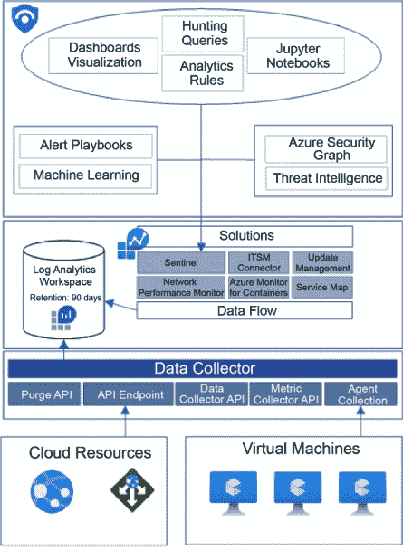

内置连接器将启用从不同服务收集数据，并为收集的给定数据集提供额外的内置功能，例如自定义查询和仪表板。

Microsoft Sentinel 还支持 Syslog，可以通过运行 Linux agent 的现有机器上传。还应注意，Microsoft Sentinel 可以收集存储在机器上的自定义日志文件，但这目前仅通过 Azure Log Analytics agent 支持。

Log Analytics 作为一项服务还具有可安装的其他模块或扩展，可提供额外的监控功能，例如用于容器的 Azure Monitor、Service Map 和 Update Management，我们将在第 5 章 Ransomware Countermeasures – Microsoft Azure Workloads 中更详细地介绍这些内容。

> **Important note**
> 在撰写本文时，有几个 agent 你应该注意，可以安装在任何 guest 机器上。你有 Azure Monitor Agent，这是新的首选 agent，支持新功能，例如自定义转换规则和 **Data Collection Rules (DCRs)**。然后，我们有 Log Analytics agent，它基于 **System Center Operations Manager (SCOM)** 架构构建，其中数据收集在工作区级别定义。

在为 Microsoft Sentinel 设置数据收集时，它会经过不同的缓存和节流机制，然后数据才会被索引并在工作区中可用。因此，请记住要有耐心，因为数据在 Microsoft Sentinel 中可用之前可能需要一些时间。

当数据收集到 Microsoft Sentinel 中时，我们可以使用自定义查询使用 Kusto 查询查看不同数据集中的异常事件/流量或用户行为。Microsoft 还提供与其其他安全产品的集成。此外，还有一些内置的机器学习机制。

Microsoft Defender 是一个更简单的服务，因为它只需要我们在每个资源级别或更高级别（如订阅级别或管理组级别）启用不同的服务即可。

在撰写本文时，Microsoft Defender 支持以下功能和平台：

- Azure PaaS services.
- Azure data services.
- Azure networks.
- CSPM.
- Microsoft Defender for Servers，它为 Linux 和 Windows 机器提供不同的安全机制，例如无文件攻击检测和漏洞管理。
- Threat Vulnerability Management for Servers，它是 Defender for Servers 的子功能，提供第三方应用程序的漏洞管理以检测，例如，是否存在已知漏洞。该功能有两种不同的选项，要么使用集成到服务中的 Qualys 服务，要么作为原生 Microsoft 功能。

在此基础上，Microsoft Defender for Cloud 还可以与 Microsoft Sentinel 集成，以便如果 Defender 检测到可疑流量并创建警报，该警报也可以在 Microsoft Sentinel 中创建。此外，Defender 收集的所有数据也可以推送到 Sentinel 使用的 Log Analytics 工作区中。

现在我们已经了解了 Microsoft Sentinel 和 Defender 的工作原理以及服务中包含的一些功能，让我们更详细地研究 Microsoft Sentinel 的设计和实施。

## Designing and implementing Microsoft Sentinel

Microsoft Sentinel 建立在现有的 Log Analytics 工作区之上，你可以在世界各地的不同 Azure 区域放置任意数量的工作区。应注意，使用 Log Analytics 和 Sentinel，你需要为存储在其中的每个 GB 付费，以及配置的保留时间。

例如，如果你在 Microsoft Sentinel 中每天生成 10 GB 的日志，每月费用约为 $1,600，其中 $780 是 Sentinel 的费用，$882 是 Log Analytics 的费用。

你可以使用 Azure 价格计算器作为衡量收集数据量的成本的好方法：`https://azure.microsoft.com/nb-no/pricing/calculator/`。

如前所述，Sentinel 在 Log Analytics 之上计费，并且由于 Sentinel 专注于安全事件和异常流量模式的监控，因此一个良好的最佳实践是确定应将何种数据放在 Sentinel Log Analytics 工作区中。

例如，PaaS 的性能指标可能不应该存储在 Sentinel Log Analytics 工作区中，因为它与服务或系统的性能相关信息，从安全角度来看没有提供太多价值；它只会增加成本。

总体建议是尽可能少地拥有 Log Analytics 工作区，但至少每个地理区域有一个——一个启用了 Sentinel 的工作区用于收集与安全相关的事件，以及一个或多个工作区用于收集非安全事件，例如性能指标和/或应用程序数据。

例如，假设你有两个工作区，其中一个启用了 Sentinel，另一个用于通用应用程序日志记录和性能指标。在这里，你可以配置称为 DCRs 的内容，在其中确定 VM 上的何种日志和事件应存储在哪些工作区中，如下图所示。


DCRs 提供了更大的灵活性，因为它们允许我们定义想要收集的日志类型以及存储位置。当我们配置 DCR 时，它还会自动在引用的对象上安装 Azure Monitor Agent：

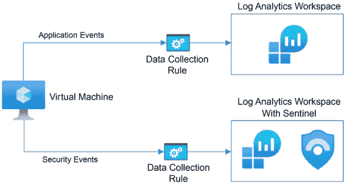

图 3.2 – Azure 中的 DCR

对于 Azure 中的 PaaS，您可以配置诊断设置，在其中指定应将哪些数据源发送到不同的 Log Analytics 工作区。

除了在工作区级别定义的保留期外，您还可以在表级别定义保留期。所有工作区都由不同的表组成，具体取决于收集的数据类型，如果连接新的数据源，新的表将自动创建。使用 ARMClient 通过 REST API 指定表级别的保留期。这提供了更大的灵活性。例如，如果我们想将表保留期设置为 7 天，也可以通过门户完成。表级别保留允许您例如指定性能数据仅存储 7 天而不是 90 天，而 90 天是存储在 Sentinel 中的数据的默认保留期。

如果您想为每个表定义自定义保留期，可以进行此定义，但它在 Azure 门户中不可直接使用。

要为每个表配置自定义保留期，您需要直接使用 Azure Resource Manager (ARM) API 进行更改，使用名为 ARMClient 的 CLI 工具，可以从此处下载：https://github.com/projectkudu/ARMClient。

要更改表的保留时间，例如 SecurityEvents 表，请执行以下操作：

+   1. 运行客户端，使用以下命令将客户端与 Microsoft Azure 进行身份验证：

```
armclient.exe azlogin
```
+   2. 通过浏览器使用有权访问环境的帐户进行身份验证。
+   3. 使用以下命令检查给定表的保留期：

```
armclient.exe get /subscriptions/subscriptionid/resourceGroups/resourcegroupname/providers/Microsoft.OperationalInsights/workspaces/loganalyticsworkspace/Tables/SecurityEvents?api-version=2017-04-26-preview
```
+   4. 确保将订阅 ID、资源组名称和 Log Analytics 工作区表名称替换为您自己的。

> **注意**
> 您将在本章后面学习如何创建该服务。

默认情况下，保留时间为 30 天。

+   5. 要更改保留时间，我们需要更改命令以发送包含更改的 HTTP 正文。此示例将 SecurityEvents 的保留时间更改为 7 天：

```
armclient put /subscriptions/subscriptionid/resourceGroups/resourcegroup/providers/Microsoft.OperationalInsights/workspaces/workspacename/Tables/SecurityEvent?api-version=2017-04-26-preview" "{properties: {retentionInDays: 7}}"
```

在这里，我们设置了 Microsoft Sentinel 和 Log Analytics 工作区，并配置了 Azure Arc，以便我们可以管理我们拥有的 Windows VM。然后，我们配置了 Azure Monitor Agent 并定义了我们想要收集的日志数据源。

需要注意的是，要完成本节，您需要一个有效的 Microsoft Azure 订阅。这也可以通过设置 Azure 试用帐户来完成，可以在此处设置：https://azure.microsoft.com/en-us/offers/ms-azr-0044p/。

实现 Microsoft Sentinel 可以使用不同的方法：

+   - 使用 Azure CLI 或 PowerShell 的 CLI
+   - **基础设施即代码 (IaC)** – Terraform、Bicep 或原生 ARM 模板，如我在博客中所示，其中展示了 PowerShell 和 Terraform 设置示例；我们将在下一节中也展示这一点：https://msandbu.org/automating-azure-sentinel-deployment-using-terraform-and-powershell/
+   - 通过 Azure 门户（使用 Microsoft Azure 的示例可以在此处找到：https://learn.microsoft.com/en-us/azure/sentinel/quickstart-onboard）

这里使用的示例基于 PowerShell 的使用，这要求您拥有一台支持 PowerShell 模块的计算机。

首先，我们需要安装一些模块，以便通过 PowerShell 与 Microsoft Azure 交互：

+   1. 安装 Azure PowerShell 模块，您可以从此网站下载：https://learn.microsoft.com/en-us/powershell/azure/install-az-ps。
+   2. 接下来，我们需要安装一些额外的模块，这些模块将直接从 PowerShell 运行这些命令进行安装。此模块允许我们从 PowerShell 配置 Azure Monitor 和 Microsoft Sentinel。使用 Install-Module 命令安装以下模块：
+   3. 最后，您可以使用 Get-InstalledModule 命令并指定模块名称，以查看其是否已成功安装，如以下屏幕截图所示：

```
Install-Module -Name Az.SecurityInsights
Install-Module -Name Az.MonitoringSolutions.
```

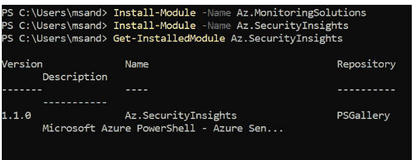

安装完这些模块后，我们需要连接到 Azure 环境以继续配置。从 PowerShell 运行 Connect-AzAccount 命令。这将触发浏览器窗口打开；从那里，您需要使用有权访问 Azure 订阅的帐户进行身份验证。

现在，我们将创建不同的资源，例如资源组，这是一个逻辑容器，我们将在其中放置 Log Analytics 工作区和 Sentinel 模块。以下示例基于名为 sentinel-rg 的资源组，并将放置在 Azure 西欧区域。您可以根据自己的喜好更改名称和区域：

```
New-azresourcegroup -name "sentinel-rg" -location "west europe"
New-azoperationalinsightsworkspace -name la-sentinel-we001 -resourcegroupname "sentinel-rg" -location "west europe"
$id = Get-AzOperationalInsightsWorkspace -Name
```

```
la-sentinel-we001 -ResourceGroupName sentinel-rg
New-AzMonitorLogAnalyticsSolution -Type SecurityInsights
-ResourceGroupName sentinel-rg -location "west europe"
-WorkspaceResourceId $id.ResourceId
```

如果这些命令运行成功，您应该在 Microsoft Azure 中创建了 Microsoft Sentinel 工作区。您可以使用相同的凭据登录 https://portal.azure.com 以验证工作区是否已成功创建。然后，在中间的搜索窗口中输入 Sentinel – 您应该会看到创建的工作区，如以下屏幕截图所示：

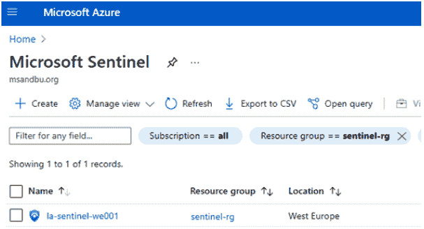

图 3.4 – Azure 门户中的 Microsoft Sentinel

使用 PowerShell 模块，我们还可以配置不同的分析规则和 DCR。DCR 允许我们定义应从不同 VM 收集何种类型的数据。

最后，我们应该收集工作区 ID 和稍后用于将机器加入 Sentinel 的主密钥。您可以使用以下 PowerShell 命令收集这些信息（如果您使用的是与之前相同的示例）。工作区 ID 和主密钥用于将代理加入以将日志数据收集到 Log Analytics。

从这两个命令中，我们需要复制出 PrimarySharedKey 和 CustomerId 属性：

```
Get-AzOperationalInsightsWorkspaceSharedKey -ResourceGroupName "sentinel-rg" -Name "la-sentinel-we001"
Get-AzOperationalInsightsWorkspace -ResourceGroupName "sentinel-rg" -Name "la-sentinel-we001"
```

在下一节中，我们将重点介绍从我们将用于构建分析规则的 VM 上加入日志数据。

如果您想从本地或 Azure 外部运行的 VM 收集日志，可以在受支持期间使用常规 Log Analytics 代理，或使用 Azure Arc 代理。Azure Arc for Servers 除了日志收集外还提供一系列独特功能，例如补丁管理、策略和期望状态配置。

在示例中，我将向您展示如何使用 Azure Arc 与 Azure Monitor 收集 Windows 的安全事件，我们将在 Microsoft Sentinel 中使用这些事件来分析异常流量模式和事件。

需要注意的是，Azure Arc 代理以及随服务提供的其他受支持功能需要通过 443 端口与 Microsoft Azure 进行出站连接。

在开始安装 Azure Arc 代理之前，我们将在 Azure 中创建一个新的资源组，所有 Arc 代理都将位于其中。您可以使用 Azure 门户或以下 PowerShell 命令创建新的资源组：

```
New-azresourcegroup -name "arc-comp-001" -location "west europe"
```

接下来，我们需要在 Azure 环境中注册一些新的资源提供程序。注册资源提供程序只是允许我们为订阅访问 Azure Arc 功能。

在现有连接中在 PowerShell 中运行这些命令：

```
Register-AzResourceProvider -ProviderNamespace Microsoft.HybridCompute
Register-AzResourceProvider -ProviderNamespace Microsoft.GuestConfiguration
Register-AzResourceProvider -ProviderNamespace Microsoft.HybridConnectivity
```

最后，我们还应安装 Azure Arc 的 PowerShell 模块，该模块允许我们轻松管理 Arc 启用 VM 上的扩展。您可以使用以下 PowerShell 命令安装此模块：

```
Install-Module -Name Az.ConnectedMachine
```

我们还需要创建一个部署脚本，用于加入机器。进入 Azure 门户，在顶部搜索窗口中输入 Azure Arc，如以下屏幕截图所示：


图3.6 – Azure门户中的Azure Arc

在Azure门户中进入Azure Arc服务，点击“服务器”，然后点击“添加”。现在，您会看到用于生成加入脚本的不同选项。加入操作既可以通过交互式登录每台服务器的手动方式进行，也可以创建用于部署的自定义服务主体。

在本示例中，我们将使用单台服务器，因此请在门户中的“添加单台服务器”选项下点击“生成脚本”按钮。

然后，您需要完成向导，该向导将创建加入脚本，并选择先前创建的资源组。

您还必须定义一个区域；此区域并不反映实际日志数据的存储位置，而仅代表逻辑计算机对象。所有数据都将存储在先前创建的Log Analytics工作区中。

然后，定义连接方法，可以是公共、代理或通过专用终结点。最后一个选项仅在您已通过VPN或ExpressRoute等方式与Azure建立连接时才可用。

选择“公共”，点击“下一步”，然后定义标签，如位置或数据中心。这些标签将自动应用于Azure中的每个计算机资源。然后，点击“下一步”，复制向导中生成的脚本，脚本应类似于：

注册请求已提交（这可能需要几分钟时间）

## 2. 下载或复制以下脚本

```
### Download the installation package
Invoke-WebRequest -Uri "https://aka.ms/azcmagent-windows" -TimeoutSec 30 -OutFile "$env:TEMP\install_windows_azcmagent.ps1"

### Install the hybrid agent
& "$env:TEMP\install_windows_azcmagent.ps1"
if($LASTEXITCODE -ne 0) {
    throw "Failed to install the hybrid agent"
}

### Run connect command
& "$env:ProgramW6432\AzureConnectedMachineAgent\azcmagent.exe" connect --resource-group "arc-comp-001" --tenant-id "2c2d79bd-1c3f-448c-8479-3c0a19c98c6e" --location "westeurope" --subscription-id "..." --cloud "AzureCloud" --correlation-id "762ea005-36ce-4e58-a939-ea00461cc000"

if($LastExitCode -eq 0){Write-Host -ForegroundColor yellow "To view your onboarded server(s), navigate to https://portal.azure.com/#blade/HubsExtension/BrowseResource/resourceType/Microsoft.HybridCompute%2Fmachines"}
```

图3.7 – Azure Arc向导配置

然后，在要加入的计算机上打开PowerShell并运行该脚本。运行脚本时，系统会要求您使用有权访问该订阅的用户登录Microsoft Azure以完成安装。

安装代理后，可以通过运行以下PowerShell命令来验证其是否已连接：

```
Get-AzConnectedMachine
```

它应显示您加入的计算机。您也可以返回Azure门户，在“Azure Arc”和“服务器”下查看该计算机。

接下来，我们需要将计算机加入，以便向Sentinel工作区发送数据，这可以通过向已加入Azure Arc的计算机添加扩展来完成。扩展是使用Azure Arc代理安装在计算机上的加载项。要安装扩展，我们需要先前收集的workspacekey和workspaceid属性，这些属性将作为变量传递给命令。

以下代码中引用的workspacekey和workspaceid仅作为示例；您应根据自己的位置、资源组、计算机名称、主共享密钥和工作区ID修改脚本：

```
$Setting = @{
  "workspaceid" = "bd28c551-c805-476d-92f2-9f1cf98f8c81de"
}
$protectedSetting = @{
  "workspacekey" =
```

```
```powershell
"9KtRbA+ZwojksqV2YvD/QHOuBMR4iRP8nk1s8BIGYQtJkQ/ekw6DZ3UUASetPbhQZnmCxQyQUX0zFSc4ccjM5w==" }
New-AzConnectedMachineExtension -Name MicrosoftMonitoringAgent
-ResourceGroupName "arc-comp-001" -MachineName "wapp-no-001"
-Location "west europe" -Publisher "Microsoft.EnterpriseCloud.
Monitoring" -Settings $Setting -ProtectedSetting
$ProtectedSetting -ExtensionType "MicrosoftMonitoringAgent"
```
```

运行此命令后，可能需要一些时间才能完成。验证扩展是否已安装并开始收集数据的最简单方法是进入Azure门户，然后进入**Azure Arc**视图，在**服务器**下查看。然后，点击VM资源并点击门户中的**扩展**视图。

在那里，您应该会看到状态为**成功**的Microsoft Monitoring Agent。如果您点击**日志**，应该会看到一些日志源的表视图。

现在，最后一部分是在Microsoft Sentinel中设置数据连接器以收集安全事件。不幸的是，这不能通过API和PowerShell完成。虽然我们可以使用PowerShell配置DCR，但我们将介绍如何使用UI配置数据连接器。

您可以在`https://learn.microsoft.com/en-us/azure/sentinel/data-connectors-reference`查看当前支持的数据连接器。

Microsoft提供了广泛的连接器，可简化将数据源集成到Sentinel的过程，包括以下内容：

- Azure AD
- Office 365
- 安全事件（Windows安全事件）
- Azure防火墙

添加数据连接器时，在大多数情况下，它会包括数据集成、搜寻和分析规则，这些规则可以使用但默认情况下未启用，最后还包括可用于可视化数据的工作簿。

进入Azure门户，在中间的搜索面板中键入`Microsoft Sentinel`。然后，点击新创建的工作区。

在Sentinel的**概述**页面上，您将看到不同的选项，例如日志事件和安全事件，而在左侧，您将看到一个菜单，如下面的屏幕截图所示：

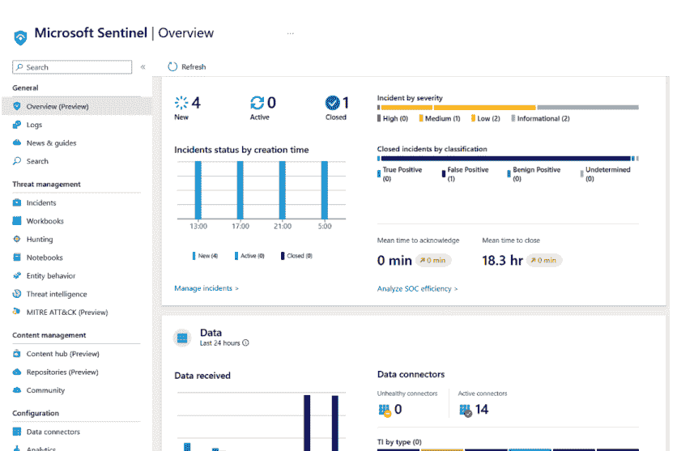

图3.8 – Microsoft Sentinel概述

Sentinel包含许多功能，因此我想就门户中可用的不同选项写一些简短的说明。以下是本章稍后将配置的一些设置：

- **事件**：包含Sentinel中分析规则创建的所有安全事件。这些可能来自预定义查询或其他Microsoft安全产品的安全警报。
- **工作簿**：包含与已配置的不同数据源相关的仪表板。提供了一种轻松可视化所收集特定数据的视图。
- **搜寻**：包含搜寻查询，让您可以轻松查找环境中的特定活动。此处包含的查询也来自已配置的数据连接器。
- **笔记本**：包含Jupyter Notebook，允许我们对连接的数据运行基于Python的脚本。
- **实体行为**：包含一个仪表板，用于显示与已配置实体相关的历史记录。

在此向导中，点击**创建数据收集规则（DCR）**。为规则提供名称，并选择将存储DCR的资源组。点击**下一步**。在**资源**下，您可以选择是将此DCR应用于将加入订阅的所有计算机，还是指定资源组中可用的自定义计算机。选择一台已安装Azure Arc代理的VM，然后点击**收集**。在这里，您可以根据三个定义的级别指定要收集的安全事件类型：

- **所有安全事件**
- **常见**
- **最小**

此网站包含与每个安全事件级别收集的不同事件ID相关的参考：`https://docs.microsoft.com/en-us/azure/sentinel/windows-security-event-id-reference`。

在大多数情况下，我倾向于选择**常见**，其中包含最必要的安全事件。选择级别后，点击**下一步**，直到进入**查看并创建**部分，然后点击**创建**。

DCR完成后，连接器页面应反映正在收集数据，并在连接器列表中显示连接器状态，如下面的屏幕截图所示：

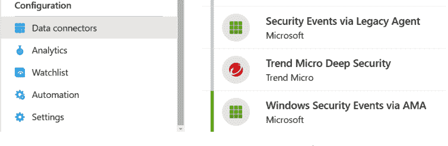

图3.9 – Sentinel中的数据连接器

创建DCR规则后，下次Azure Monitor Agent连接到Azure时，它将看到一组已更新的规则，并会下载这些规则开始处理。

它可能需要几分钟才能完成处理并开始上传数据。我们可以通过进入Sentinel中的**日志**窗格来验证是否正在收集数据。然后，在左侧，我们可以点击**安全和审核**类别，并在其下双击**SecurityEvent**。这将把表名填充到右侧的搜索窗格中。完成后，点击**运行**——您应该会看到从计算机收集的一些事件，如下面的屏幕截图所示：


## 执行 Kusto 和日志查询

Sentinel 将数据存储在工作区中，工作区是一个数据库，我们可以使用一种名为 Kusto 的查询语言来分析这些数据，Kusto 是一种只读的 SQL 查询语言。

Kusto 语法简单；你定义想要搜索的数据源和要应用的筛选器，以及可以根据数据源对某些属性进行包含或排除的不同筛选器应用的位置。

到目前为止，我们已在 SecurityEvents 表中收集了数据，该表包含此处列出的属性：https://docs.microsoft.com/en-us/azure/azure-monitor/reference/tables/securityevent。 需要注意的是，对于每个表，可用的属性会有所不同。 可用数据取决于启用和配置了哪些类型的数据连接器。

> **注意**
> 默认情况下，存储在工作区中的所有数据均设置为只读，因此你无法通过 UI 从工作区中删除数据。 但是，有一个 Purge API 允许你删除工作区中的某些条目。 你可以在此处阅读有关如何使用 API 的更多信息：https://docs.microsoft.com/en-us/rest/api/loganalytics/workspace-purge/purge。

如果我们想在 Security Events 表中查找某个 Event ID，可以使用以下查询：

```
SecurityEvent
| where EventID == 4625
```

这将列出包含特定 Event ID 的所有事件。 我们还可以进一步自定义查询，以查看特定时间范围。 我只需附加此筛选器即可在特定时间范围内查找：

```
| where TimeGenerated > datetime(2022-03-10) and TimeGenerated < datetime(2022-03-12)
```

Kusto 在添加选择器方面提供了许多不同的功能，这些选择器允许你在结果中筛选数据或添加外部数据源以丰富数据集。 你也可以在此处找到与本书相关的更多 Kusto 运算符和查询示例：https://github.com/PacktPublishing/Windows-Ransomware-Detection-and-Protection/tree/main/chapter3。

如果你想了解有关如何使用 Kusto 的更多信息，可以在此处了解更多信息：https://docs.microsoft.com/en-us/azure/sentinel/kusto-overview。

重要的是要理解，当我们构建分析规则时，计划的 Kusto 查询会在特定时间内查找特定活动。 我们还必须确定该查询需要多少结果才会触发 Sentinel 警报。

因此，Sentinel 中的大部分工作都涉及构建良好的 Kusto 查询，这些查询将用于运行分析规则。 你对 Kusto 越熟练，Sentinel 在查找数据中的异常行为方面就越强大。

不过，我想在这里展示一些示例查询，以便让你了解其功能以及如何使用不同的筛选器和使用外部数据丰富数据集。

默认情况下，Kusto 不会增强收集的数据源；因此，例如，SecurityEvents 表不包含与国家/地区相关的任何信息。 如果我们有一台 VM 不断被暴力破解，并且我们想确定攻击 IP 地址的位置，我们可以使用外部 IP 源：

```
let geoData = externaldata
(network:string,geoname_id:string,continent_code:string,continent_name:string,
  country_iso_code:string,country_name:string,is_anonymous_proxy:string,is_satellite_provider:string)
[@"https://raw.githubusercontent.com/datasets/geoip2-ipv4/master/data/geoip2-ipv4.csv"] with (ignoreFirstRecord=true, format="csv");
SecurityEvent
| where EventID == "4625"
| evaluate ipv4_lookup (geoData, IpAddress, network, false)
| summarize count() by IpAddress, country_name
```

此示例查询首先定义一个变量，其中包含网络、geoname、国家代码等不同属性。 然后，它对 HTTPS 端点执行外部调用并收集 CSV 文件，然后将该文件映射到属性中。

然后，我们查找 SecurityEvent 表，其中我们查找事件 ID 为 4625 的事件，这是有人登录失败时生成的事件 ID。 然后，我们使用名为 ipv4_lookup 的 evaluate 运算符，其中我们将 IP 地址和 CSV 中的地理数据源位置映射到 SecurityEvent 表中的 IpAddress 属性，并查看是否匹配。

Microsoft 还推出了一个名为 Kusto Detective Agency 的新的交互式 Kusto 学习方式，它为你提供了预定义的用例，让你学习 Kusto。 你可以在此处找到它：https://detective.kusto.io/。

然后，我们使用 summarize 运算符来获取登录尝试的总计数，如以下示例屏幕截图所示：

```
let geoData = externaldata
(network: string, geoname_id: string, continent_code: string, continent_name: string,
country_iso_code: string, country_name: string, is_anonymous_proxy: string,
is_satellite_provider: string)
[@"https://raw.githubusercontent.com/datasets/geoip2-ipv4/master/data/geoip2-ipv4.csv"]
with (ignoreFirstRecord=true, format="csv");
SecurityEvent
| where EventID == "4625"
| evaluate ipv4_lookup (geoData, IPAddress, network, false)
| summarize count() by IPAddress, country_name
| render piechart
```

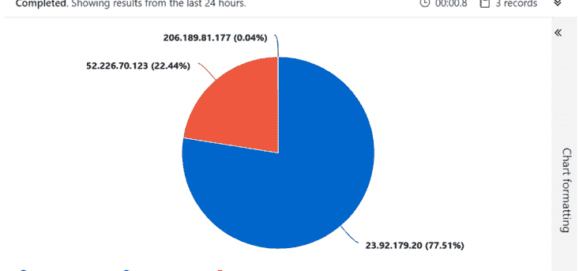

图 3.11 – Microsoft Sentinel 中登录尝试的地理查找

## 看到全貌

如第 1 章《勒索软件攻击和威胁态势》中所述，在勒索软件攻击或初步评估期间，勒索软件操作员可能会在受损的端点或服务上使用许多不同的工具和脚本，以尝试获得进一步的访问权限。

仅通过查看安全事件中的异常登录流量，你将无法获得足够的数据来全面了解正在发生的事情。

例如，SecurityEvent 表包含与使用帐户名和 IP 地址的登录尝试相关的信息。 但是，它不包含有关发出调用的进程或尝试来自何种端口的任何信息；其次，它不包含有关某人获得访问权限后发生的情况的任何信息，例如他们是否在机器上运行任何命令、脚本或可执行文件。

为了获得全面的概述，我们需要多个不同的数据源，以便能够更早地检测攻击，使威胁狩猎更容易，并确定正常行为或模式。

例如，仅此安全事件仅告诉我们有人已成功登录：

### 事件 ID：4624 – IP 地址 80.66.76.145 – 帐户已成功登录

但是，如果我们使用多个数据源，我们可以看到同一时期从该 IP 地址运行的整个事件系列。

以下表中的信息来自不同的数据源：VM 连接来自 VM insights，这需要安装 Azure Monitor Agent；依赖项代理需要一些额外的配置才能收集。 然后，我们有来自我们之前配置的数据连接器的安全事件。 此外，对于配置了 Microsoft Defender for Servers 的设备，我们有设备文件事件。 该表包含有关机器上运行的所有进程和已下载文件的信息。 这对于查看例如某人是否在机器上本地运行脚本很有用。 最后，我们有一个来自更改跟踪功能的配置更改。 这对于检测 Windows 机器上注册表、文件或服务的更改很有用。

收集的数据存储在不同的表中并包含不同的数据。 你可以在此处了解有关收集了哪些数据的更多信息：https://learn.microsoft.com/en-us/azure/azure-monitor/reference/tables/tables-category。

以下信息是虚构的，但它展示了拥有不同的数据收集以能够看到发生的一切的价值：

| 来源 | VM 连接 | 安全事件 | 设备文件事件 | 配置更改 | 设备进程事件 |
|---|---|---|---|---|---|
| 活动 | 80.66.76.145<br>入站<br>3389<br>svchost<br>俄罗斯 | 80.66.76.145<br>4624 - 帐户已成功登录。 | PowerShell wget hxxp://209.14.0[.]234:46613/VcEt rKighyIFS5foGNXH -file *.zip | 服务<br>已停止<br>MsSenseS | powershell.exe<br>ExecutionPolicy<br>不受限制<br>非交互式 |

图 3.12 – 来自 Sentinel 日志源的数据概览


要获得此视图，我们需要在 Microsoft Sentinel 中收集的其他数据源也需要启用：

- **VM 连接：** 这提供了对网络连接的洞察。将它映射到机器上的运行进程，还可以显示流量是传出还是传入。这需要启用 VM insights 扩展。
- **设备文件事件：** 这需要与 Microsoft Defender for Servers 集成并安装代理。
- **配置更改：** 这需要与 Azure Automation 集成，可监控注册表、进程甚至文件的更改。
- **设备进程事件：** 这需要与 Microsoft Defender for Servers 集成并安装代理。

我们将在 *Detecting vulnerabilities with Defender* 部分稍后回到 Microsoft Defender；不过，我们可以更仔细地查看如何在我们的 Azure Arc VM 上启用 VM insights 扩展。

启用 VM insights 可以使用 PowerShell、Azure Policy 或 Azure 门户完成。为简单起见，我们将使用 PowerShell。

这可以通过在机器上安装依赖项代理来完成。此依赖项代理将继承现有 Monitor Agent 的所有配置，因此你只需安装代理，它就会开始收集数据：

```
Invoke-WebRequest "https://aka.ms/dependencyagentwindows"
-OutFile InstallDependencyAgent-Windows.exe
.\InstallDependencyAgent-Windows.exe /S
```

需要注意的是，启用 VM insights 会产生大量日志数据，具体取决于机器进出流量的多少。由于它可能为 Log Analytics 产生高昂成本，因此请谨慎启用。

安装代理后，几分钟后，你将在 Sentinel 工作区中看到一些新表正在生成，例如 VMComputer、VMConnection 和 VMProcess。你也可以通过转到 **Monitoring** 选项卡下的 **Insights** 来查看概览，如以下屏幕截图所示：

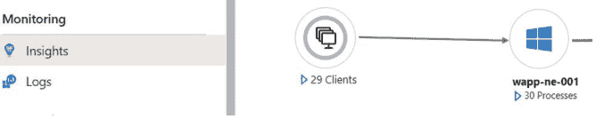

图 3.13 – 为 Azure Arc 机器启用 VM insights

使用此数据的一种简单方法是查看对 VM 的传入连接。进入 Azure 门户，然后 Microsoft Sentinel，单击 Logs。在那里，双击 VMConnection 表并输入以下 Kusto 查询：

```
VMConnection
| where Direction == "inbound"
| summarize count() by DestinationPort
```

这是一个简单的查询，它将查看数据集并查找传入连接，并根据传入端口进行汇总。

至此，我们更详细地了解了如何扩展日志记录功能，以获得有关进入 VM 的流量流的更多洞察。现在，让我们迈出下一步，看看如何使用信息构建分析规则在 Microsoft Sentinel 中触发事件或警报。

## 创建分析规则和处理事件

现在数据来源已在 Sentinel 中收集，我们需要定义一些逻辑来查找异常模式，如果发现这些模式，将会生成事件。

在 Microsoft Sentinel 中，事件是基于分析规则创建的。这些规则可以分为三种类型：

- 定时查询规则
- Microsoft 事件创建规则（Security Graph API）
- 异常规则

如果我们创建定时查询规则，我们需要定义一个将在预定义计划上运行的 Kusto 查询。此外，在查询中，我们必须定义一个阈值，如果与 Kusto 查询匹配，则如果达到阈值，将会生成事件。

我们还拥有 Microsoft 事件创建规则，这些是来自 Security Graph API 的其他 Microsoft 安全产品发出的警报。这些可以来自 Azure AD Identity Protection、Microsoft Defender for Cloud、Microsoft Defender for Endpoint、Defender for Identity 等警报，然后也会自动在 Sentinel 中创建。

最后一个是基于异常的查询规则，它基于机器学习算法。我们这里的重点将基于定时查询规则，在其中我们需要定义自定义逻辑。

一旦分析规则触发，它也可以用于触发自动化规则，这些规则基于 Microsoft Azure 中的 Logic Apps：

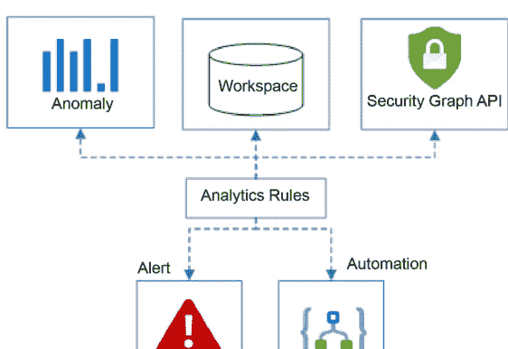

图 3.14 – Microsoft Sentinel 中分析规则的概览

在开始构建分析规则之前，还有一个最终概念我们需要理解，那就是实体。使用 Sentinel，你可以从许多不同的来源摄取数据。在处理所有不同类型的数据时，一些信息在不同来源中是相同的，但以不同的属性呈现。

让我分享一个例子。如以下屏幕截图所示，我们有两个不同的表。一个是 SecurityEvents，它收集来自 Windows 事件引擎的安全日志的信息。该日志源收集诸如失败的登录尝试等信息，并将尝试登录的主机 IP 地址收集在 IpAddress 属性下。然后，我们有 VMConnection 数据源，它也收集大部分相同的信息，但从进程视图查看流量。此数据源还收集与尝试连接的 IP 地址相关的信息，但存储在 SourceIP 属性下：

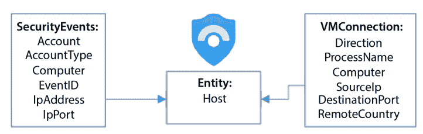

图 3.15 – Microsoft Sentinel 中的实体匹配

Microsoft Sentinel 使用实体来匹配它识别的数据并将其分类到同一事件中，例如，并进入实体历史记录。对于此示例，IpAddress 和 SourceIp 数据项都应匹配到 Sentinel 中的同一实体——即 Host

实体用作事件的参考点，并在 Sentinel 中处理事件时允许你查看实体历史记录。

Microsoft 支持广泛的不同实体，你可以使用；更多信息可在此处找到：https://docs.microsoft.com/en-us/azure/sentinel/entities。

这些实体也可以在实体行为仪表板中轻松引用，在那里你可以查找实体的历史记录，例如 IP 地址、主机名和用户名，如以下屏幕截图所示：

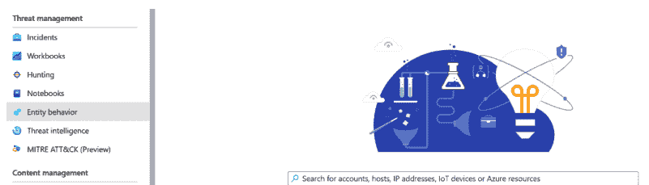

图 3.16 – Microsoft Sentinel 中的实体仪表板

通过能够跟踪先前与安全警报关联的 IP 地址或用户等实体，我们可以深入了解潜在的安全风险。现在我们了解了数据如何被收集和保存，我们可以建立监控准则。

## 分析规则

让我们开始构建自己的分析规则。对于此示例，我将使用 Azure 门户，并在最后提供 PowerShell 示例。

如第 1 章 Ransomware Attack Vectors and the Threat Landscape 中所述，勒索软件攻击的典型入口点可以基于 RDP 连接。我想创建两个不同的分析规则，它们将使用两个数据源来查看来自一个在互联网上通过 RDP 公开可用的虚构机器的入侵迹象：

- 安全事件（从 Azure Monitor 中的 DCR 收集）
- VM insights（从依赖项代理收集）

为此示例起见，我们将查找 RDP 成功连接的尝试，并基于此创建警报规则。我们还将排除已知 IP 地址，以便不会为已知流量创建警报规则。

首先进入 Azure 门户，然后 Microsoft Sentinel，然后进入 Analytics 选项卡。从那里，单击 Create Scheduled Query Rule，这将启动向导。

然后，在向导的第一部分输入以下信息：

- **名称：** Successful Logon RDP - Security Events
- **描述：** 查找入侵迹象，即有人已成功使用 RDP 登录到机器
- **战术和技术：** 初始访问（T1078）和暴力破解（T1110）
- **严重性：** 中等
- **状态：** 已启用

此信息可在以下屏幕截图所示中看到：


### Analytics rule wizard - Create a new scheduled rule

Home > Microsoft Sentinel > Microsoft Sentinel >

General   Set rule logic   Incident settings   Automated response   Review and create

Create an analytics rule that will run on your data to detect threats.

## Analytics rule details

Name *
Successful Logon RDP - Security Events

Description
Looking for signs of compromise where someone has successfully logged onto a machine with RDP

Tactics and techniques
2 selected

Severity
Medium

Status
Enabled Disabled

Figure 3.17 – Analytics rule wizard in Microsoft Sentinel

The tactics and techniques are mapped to the MITRE framework, which you can read more about here: https://attack.mitre.org/techniques/T1021/001/. Microsoft has a detailed reference sheet regarding Event ID that contains different descriptions: https://www.microsoft.com/en-us/download/details.aspx?id=52630.

Then, click Next to be taken to the Set rule logic tab of the wizard. Here, we need to enter a Kusto query to determine what we are looking for. The Kusto query logic is built up like this: we start with a subnet that we want to exclude, which we define in a variable called subnets. Then, we look inside the SecurityEvents table and look for event ID 4624, which will look for successful logon attempts. In addition, we will evaluate IP addresses to exclude the known IP ranges and lastly filter only on the 3 logon type, which indicates network-based login.

The following code shows the example Kusto query that will be entered in this rule logic part of the wizard:

```
let subnets = datatable(network:string) [ "8.8.8.8"];
SecurityEvent
| where EventID == 4624
| evaluate ipv4_lookup(subnets, IpAddress, network, return_unmatched = true)
| where isempty(network)
| where LogonTypeName == "3 - Network"
```

As part of the wizard, you can also click on **View query results** to see whether any existing events will match the query.

Next, we need to map attributes from the data source to entities, where we want to map two different entities called **IP** and **Account**. Here, **IP** will be mapped to `IpAddress` and **Account** will be mapped to `AccountName`, as seen in the following screenshot:

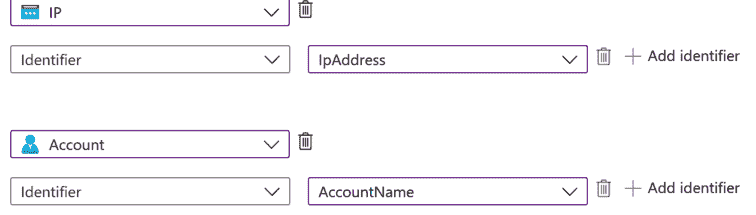

Figure 3.18 – Entity matching in analytics rules

Then, under **Query scheduling**, we need to define how often these queries should run to check the data lookup. By default, it is set to 5 hours, which means that the query will be run every 5 hours, which might already be too late. Since we are looking for successful logon attempts with this query, we should be looking at using as many real-time frequencies as possible.

The lowest possible interval is 5 minutes; however, lower intervals down to 1 minute are something that is in public preview at the time of writing.

To account for ingestion delay, Microsoft Sentinel runs scheduled analytics rules on a 5-minute delay from their scheduled time.

It should be noted that because of ingestion delay, you should always define the lookback period as longer than how often the query is run. There should be at least a 2-minute overlap between the scheduled query and the lookup data. This means that if you run the query every 5 minutes, you should have at least 7 minutes of lookup time. However, there is no additional cost to having queries looking up for a longer period, such as 1 hour or 1 day.

The final part is defining the threshold. In this example, we want an alert for when 1 entry is created, so the setting here is going to be **Is greater than 0**.

Then, we can just continue through the wizard to the end and click Create. Now, we must go back to the main Sentinel dashboard, click on the Analytics pane, and go to Active rules. The newly created rule should be visible there.

We can also create a similar analytics query rule but use another data source where we will look for active RDP traffic to the machine. We will use the same logic as before and exclude known IP ranges. The complete Kusto query will look like this:

```
let subnets = datatable(network:string) [ "81.166.4.107" ];
VMConnection
| where BytesSent > 200000
| where DestinationPort == 3389
| evaluate ipv4_lookup(subnets, SourceIp, network, return_unmatched = true)
| where isempty(network)
```

The only additional information here is bytes sent, which needs to be higher than 200 KB; an average RDP attempt is between 100 and 120 KB. Second, we need to change ipv4_lookup so that it uses the SourceIp attribute instead since that is the attribute that is used in this data source. We also need to change the entity type when we define the IP address so that it matches SourceIp.

The rest you can leave the same as you did for the other analytics rule; just remember to change the name to, for instance, Successful Logon RDP - VM Insight.

For this example, I wanted to show what it looks like if someone managed to gain access to RDP and generated an event in both those analytics rules.

First, we will have incidents that will be created if there is a match, as seen in the Incidents pane of Sentinel:

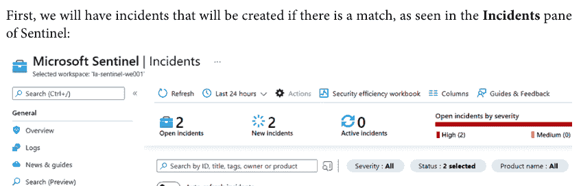

Figure 3.19 – The Incidents view in Sentinel

As I mentioned in *Chapter 1, Ransomware Attack Vectors and the Threat Landscape*, many of the attack vectors are aimed at or usually start at the endpoint, so having some security mechanisms there as well, such as Defender for Endpoint, which can also feed data into Microsoft Sentinel, is a great addition to get visibility.

While there is not one set of analytics rules that works for every organization, the queries should be tailored to your data sources and services. There are, however, some templates that you can start with.

Within Sentinel, under the **Analytics** pane, you have an option called **Rule template**, which contains Microsoft predefined analytics rules that are disabled by default. These analytics rules have predefined data sources, Kusto queries, and entities.

There is also a great set of templates available on the official Microsoft Sentinel GitHub that have categories, analytics, and queries based on data sources, which not only check for ransomware compromise but also give good starting points for any basic security monitoring in your environment: https://github.com/Azure/Azure-Sentinel/tree/master/Detections.

In this section, we covered how to implement Microsoft Sentinel and build some simple analytics rules to automatically detect login attempts to a VM. In the next section, we will look at Microsoft Defender and see how it provides automatic threat detection for VM-based workloads and other Azure services.

## Detecting vulnerabilities with Defender

Up until now, we have focused much on the use of Microsoft Sentinel to monitor signs of compromise or reconnaissance attacks; however, we want to ensure that it never gets to that point. As mentioned earlier, one of the typical attack vectors is exploiting vulnerabilities to get in.

This means that we need to ensure that we are tracking vulnerabilities in our environment and acting to remediate them when possible. Microsoft Defender provides vulnerability management as part of its features for VMs in addition to other services in Azure.

Defender supports the following workloads and provides the following features:

- **Servers**: EDR capabilities, **just-in-time (JIT)** access (for Azure-only resources) and threat protection, asset inventory, and file integrity monitoring. This feature supports servers also managed through Azure Arc.
- **Azure App Services**: Threat protection.
- **Azure databases**: Threat protection.
- **Azure Storage**: Threat protection.
- **Containers**: Threat protection for Kubernetes and container-based workloads.
- **Azure Key Vault**: Threat protection.
- **Azure Resource Manager**: Threat protection.
- **Azure DNS**: Threat protection.

To give some context to what kind of threat protection features Defender for Cloud provides, the following is a screenshot from my test environment where we have enabled Defender for Cloud for servers, where the network traffic analysis mechanisms have detected anomalous incoming RDP traffic to our machine.

By collecting IPFIX metadata from Azure edge routers, the service can identify and monitor any potentially suspicious outbound traffic originating from VMs:

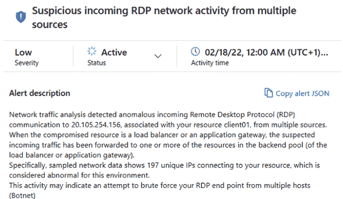

Figure 3.21 – Alert from Microsoft Defender for Cloud

Regarding vulnerability management with Defender, we have two options: using a Qualys agent that has collected data and delivered the results back to Defender or using the built-in threat and vulnerability module from Microsoft. Note that these two options are only available for server operating systems. This feature is also available for Azure Arc machines.

Microsoft has also recently introduced an offline scan called agentless scanning that supports environments where you do not want to have additional clients installed. You can read more about this feature here: https://learn.microsoft.com/en-us/azure/defender-for-cloud/enable-vulnerability-assessment-agentless.

To enable Microsoft Defender for Azure Arc-enabled machines, you need to go into the Azure portal, go into **Microsoft Defender for Cloud**, choose **Environment settings**, and click on the subscription where you have the Azure Arc machines.


打开订阅后，您应该会在左侧看到一个菜单，其中第一个选项为 **Defender plans**。

首先，您需要启用 Microsoft Defender for Servers。这将为将来加入同一 Azure Arc 配置的所有服务器启用功能。

接下来，您需要为机器启用漏洞评估。您还将有选择要使用哪种漏洞评估解决方案的选项。这可以在以下屏幕截图中的 **Auto provisioning** 选项下看到：

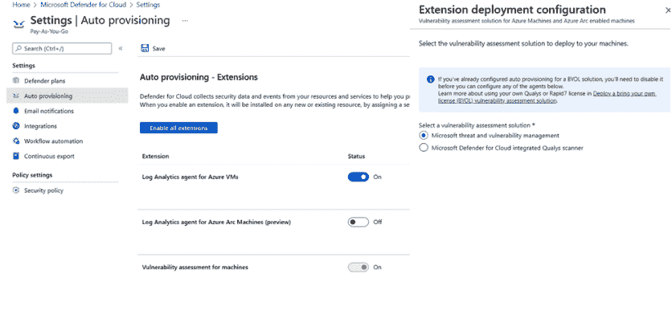

图 3.22 – 在 Defender 中启用漏洞管理

启用后，Microsoft 将开始为安装了 **Threat and Vulnerability Management (TVM)** 的那些机器提供漏洞管理。

除此之外，Microsoft Defender 还将根据安全最佳实践评估机器。

如果您进入 Defender for Cloud 菜单，转到左侧并单击 **Inventory**，则应会看到使用 Azure Arc 安装的机器作为一项。如果您单击它，您将获得与 VM 相关的信息，例如其状态、已安装的应用程序和整体安全基线。

当您启用 Defender for Servers 时，您还应在 Sentinel 中启用 Microsoft Defender for Cloud 的 Microsoft 事件规则，因为这还将启用在 Defender 中创建警报时自动创建事件。

本节简要介绍了 Microsoft Defender for Cloud 及其一些功能，以及如何使用 Defender 配合威胁漏洞功能。我们将在 *Chapter 5, Ransomware Countermeasures – Microsoft Azure Workloads* 中更深入地介绍这些功能，其中我们将介绍 Azure 工作负载。
