## 勒索软件对策
– Microsoft Azure 工作负载

许多组织正在将虚拟机工作负载迁移到云端。随之而来的是，他们需要很好地了解不同的安全机制以及在放置基础设施之前架构应是什么样的。

不幸的是，我见过许多客户在将工作负载迁移到公共云后因缺乏知识或安全机制有限而遭受勒索软件攻击或信息泄露的案例。

本章将介绍如何在 Microsoft Azure 中为虚拟机工作负载构建安全架构的理论，以及以下主题：

- Microsoft Azure 中的网络分段和设计最佳实践
- 使用 DDoS 和 WAF 机制保护外部服务的机制
- Azure 中身份和访问管理的身份安全最佳实践
- 使用 Azure Arc 保护混合工作负载
- Microsoft Azure 中的身份和访问管理
- 使用 Azure Backup 和 Azure Policy 进行数据保护

## 技术要求

在本章中，我们将重点介绍 Microsoft Azure 中使用的架构和服务。为了能够使用本章中列出的功能和服务，您需要一个 Microsoft Azure 的活跃订阅。如果您没有活跃订阅，您可以在 https://azure.microsoft.com/en-us/free/ 注册一个免费的 200 美元试用版。还需要注意的是，许多服务都有运行成本，因此如果您设置测试环境，请在完成后删除资源，以免产生任何经常性费用。


## 网络分段与设计

在 Microsoft Azure 中，设置虚拟网络和虚拟机、为其分配公共 IP 地址并使其公网可用非常简单。Azure 还在全球提供了超过 50 个区域，我们可以利用这些区域在不同地理位置创建服务，并将其提供给最终用户。

然而，我们始终应该从构建一个安全的基础开始，确保服务仅以安全的方式暴露，例如通过安全网关，或者如果是 Web 服务，则部署在 Web 应用防火墙之后。

同样重要的是，网络设计要确保服务间的流量通过集中式防火墙，而不是经过公共互联网，同时还要实施微隔离，以确保所有服务以最小暴露面运行。

尽管 Azure 已经成为一个庞大的生态系统，在如何设计安全基础设施方面提供了多种可能性，幸运的是，微软创建了一个名为“企业级登陆区域”（enterprise-scale landing zone）的参考架构，涵盖了所有这些方面，包括服务隔离方面的最佳实践。

该参考架构并不适用于所有场景和规模，但为架构设计提供了指导原则和最佳实践。

该参考架构由以下部分组成：

- **中心辐射型网络拓扑、安全性和连接性**：中心辐射型是一种将服务分隔到不同网络区域的方式，确保放置在自己辐射区中的服务只能通过集中的安全中心（通常由防火墙服务组成）与另一个服务通信。
- **管理组和带有 Azure Policy 的订阅层次结构**：管理组和订阅层次结构是将资源逻辑分组到不同计费和访问环境中的方法。Azure Policy 是一种对 Azure 资源强制执行规则和限制的方式，以确保符合组织标准和服务级别协议。它们定义了对一组 Azure 资源允许或拒绝的操作，可用于强制执行命名约定、资源组结构和成本控制策略等。Azure Policy 用于实时评估和审计资源，并提供自动修正选项，以确保资源长期保持合规。
- **用于数据加密和安全特权访问的安全机制**：这涉及确保使用加密方法访问和存储数据，并确保通过使用条件访问或 Privileged Identity Management 等服务，使用 MFA 身份验证来访问平台和服务。

虽然我们不会在这里涵盖所有内容，但我们将深入探讨一些重要方面，例如针对勒索软件防护的网络和安全机制。

微软已记录并提供了参考实现示例，你可以在此处找到：https://docs.microsoft.com/en-us/azure/cloud-adoption-framework/ready/landing-zone/choose-landing-zone-option。

根据公司的规模、全球布局或合规需求，微软提供了不同的参考架构示例。许多示例（如企业级基础）都包含可以自动部署登陆区域的自动化模板。但是，我强烈建议你将参考架构主要作为指导，并根据你的需求定制自己的登陆区域。

此外，如果只是使用预定义模板，你将很难感受到对服务部署方式的所有权。

## Microsoft Azure 中的身份和访问管理

Azure 提供了广泛的安全机制。理解这一点很重要：有些服务用于保护工作负载本身，例如虚拟机。还有一些服务用于保护对 Azure 具有访问权限的管理员或用户的身份，以确保他们不被允许设置公网可用的服务，或者如果他们想要执行任何管理操作，则需要使用 MFA 登录 Azure 门户。

当你通过 Web 门户、CLI 或 SDK 与 Microsoft Azure 交互时，你始终在使用一个名为 Azure Resource Manager 的 API 层，如下图所示。该图还描绘了与 Microsoft 365 交互时的另一个 API 层，即 Graph API。

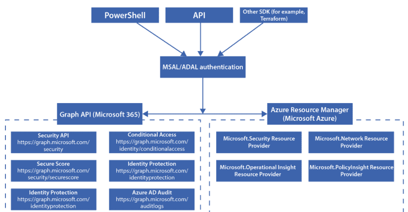

图 5.1 – Microsoft Azure 和 365 的 API 层以及可用于与之交互的工具

Azure Resource Manager 使用 Azure AD 作为底层身份验证提供程序，但 Microsoft Azure 中的访问权限与 Azure AD 中的访问权限不同。

因此，如果用户在 Office 365 或 Microsoft 365 中拥有管理员访问权限，这并不会直接授予他们对 Microsoft Azure 资源的访问权限。其中一个方面是确保拥有 Azure 访问权限的用户仅对资源的某些部分拥有委派访问权限，或者确保他们在需要时使用内置功能提升访问权限。

现在让我们回到一些不同的安全服务。有些服务专注于威胁情报，另一些则专注于网络安全。那么让我先简要解释一下它们，然后再深入探讨：

- **Microsoft Defender for Cloud**：这是一项用于安全态势管理和威胁防护的服务。此功能为不同的 PaaS 服务提供威胁检测，并与 Microsoft Intelligence Security Graph（微软自家的威胁情报服务）集成。此外，如果你有公网可用的服务（例如虚拟机或具有公共 IP 地址的资源），该服务还提供网络层分析。该服务使用机器学习模型，通过分析 Azure 核心路由器收集的示例 IPFIX 数据来识别恶意流量活动。这些数据用于识别可能表明恶意活动的模式和趋势。
- **Microsoft Defender for Servers**：我们在*第 3 章“使用 Microsoft Sentinel 和 Defender 进行安全监控”*中介绍了此功能的一些要点，以及它如何使用 Azure Arc 处理混合资源。但 Defender for Servers 是一种 EDR 工具，可用于检测无文件攻击，并使用原生 Microsoft Defender 漏洞管理或 Qualys 检测第三方应用程序中的漏洞。
- **Microsoft Sentinel**：我们在*第 3 章“使用 Microsoft Sentinel 和 Defender 进行安全监控”*中介绍了此功能的一些要点。这是微软基于云的 SIEM 服务。它与 Log Analytics 一起用于收集 Azure 中不同服务的日志。Azure 中的所有服务都有与 Log Analytics 的集成点，允许我们将日志导出到其中。这包括 Azure AD、网络流量和 PaaS 诊断日志等日志。
- **Azure Firewall**：这是 Azure 中的一项托管防火墙服务，运行在虚拟网络中的专用子网上。该防火墙服务提供不同的安全功能，例如网络规则、应用程序规则、NAT 功能、TLS 检查和 IPS 机制，具体取决于所使用的 SKU。
- **Azure AD 条件访问**：这是一种安全机制，我们可以在其中定义当管理员或用户尝试登录集成到 Azure AD 的应用程序（例如 Azure 门户）时应用的语句。例如，当管理员登录时，他们只能从符合 Intune 策略的设备登录，并且必须通过 MFA 提示成功完成身份验证。我们还可以使用条件访问来限制来自某些 IP 地址或网络位置的认证。此功能不直接用于虚拟机，除非你的计算机已加入 Azure Active Directory 而不是 Active Directory。


- **Azure AD 特权身份管理（PIM）：** 此功能用于控制对 Azure AD 和 Azure 中角色的访问。一种常用的方法是，如果管理员需要对 Azure 中的某些内容进行更改，则他们需要先在 PIM 中提升自己的访问权限，然后才能访问这些资源。
- **Azure Policy：** 这是一种服务，用于根据业务规则评估 Azure 资源；另一种理解方式是 Microsoft Azure 的组策略。默认情况下，如果某人拥有 Azure 订阅的所有者访问权限，他们可以在任何区域创建服务，并且如果他们愿意，还可以创建所有具有公共 IP 地址的服务。Azure Policy 允许我们定义中央策略，以确定管理员可以创建哪些资源以及在何处创建。一个典型场景是利用策略限制只能部署在特定区域内的资源，并防止任何服务使用公共 IP 地址进行部署。虽然此服务更多是关于控制对 Azure 中某些资源的访问，而不是直接针对虚拟机，但微软正在大力推广一项名为 Guest Configuration 的新功能，该功能允许我们使用 Desired State Configuration 定义基于操作系统的策略。这意味着我们可以使用 Azure Policy 对 Azure 资源进行集中配置，包括虚拟机上的来宾操作系统。
- **网络安全组（NSG）：** 这是一个简单的五元组防火墙规则，可以直接应用于虚拟机的**网络接口卡（NIC）**或 Azure 虚拟网络子网。
- **网络流日志和流量分析：** 借助 NSG 流日志，我们将收集通过 NSG 的所有网络流数据，无论其是被阻止还是允许。默认情况下，这些流日志会收集到存储帐户中。但是，可以使用名为“流量分析”的功能将这些流日志收集到 Log Analytics 中。然后，Microsoft 将收集数据，并使用其威胁情报信息丰富数据，然后再将其推送到 Log Analytics 工作区。
- **Azure 应用程序网关和 Web 应用程序防火墙：** 此功能为 Web 应用程序提供负载均衡和基于第 7 层的防火墙。它通常用于向外部发布 Web 服务。Web 应用程序防火墙服务用于基于 OWASP 规则阻止常见的第 7 层攻击。
- **Azure DDoS 防护：** 此功能提供针对第 3 层和第 4 层攻击的 DDoS 防护，通常是基于 UDP 和 TCP 的攻击。一个例子是名为 Killnet 的活动组织，该组织于 2022 年 6 月使用 TCP SYN 洪水攻击对挪威发起了大量第 4 层 DDoS 攻击，而 Azure 中的内置 DDoS 防护功能可以阻止这些攻击。需要注意的是，此服务成本相当高，并且仅适用于具有公共 IP 地址的公开服务。
- **Azure 磁盘加密：** 此功能为虚拟机提供 BitLocker 加密，其中加密机制将加密/解密密钥存储在 Azure 中另一个名为 Azure Key Vault 的服务中。这确保任何有内容的虚拟机都已加密，因此即使有人设法访问 Azure 环境，也无法下载和检查计算机的内容。
- **Azure 存储服务加密：** 此功能对 Azure 数据中心内物理驱动器上存储的数据进行加密，并且默认启用。由于此功能针对物理驱动器，因此不会对实际运行的工作负载和数据产生任何影响。

> **注意**
> 
> 前面列出的大多数功能默认不启用，并且涉及额外的配置和额外成本。我总是建议先查阅不同的服务并了解每项服务的价格，然后再开始使用它们，以免措手不及。您可以使用 Azure 定价计算器查看不同服务的成本：https://azure.microsoft.com/en-us/pricing/calculator/。

现在让我们将这些功能组合在一起，看看它们如何在 Microsoft Azure 中的简化示例架构中协同工作。

下图展示了一个简单的工作负载，其中 Azure 中有一个虚拟网络，网络内有一台虚拟机。该计算机使用 Azure 防火墙作为网关，允许与外界通信。服务器运行着一个 Web 服务，该服务使用 Azure 应用程序网关（充当反向代理）在外部公开。

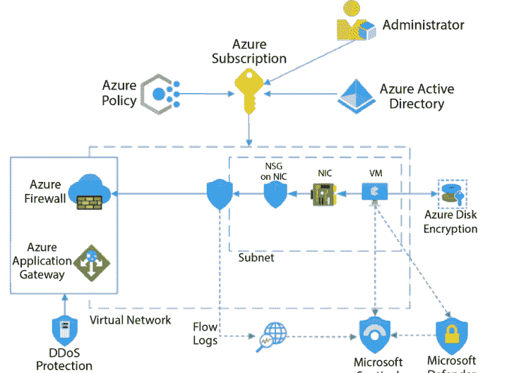

图 5.2 – Microsoft Azure 中虚拟机的示例架构

在此示例中，我们为 NIC 和计算机所在的子网都定义了 NSG 规则。该计算机启用了操作系统磁盘加密，并使用 Microsoft Sentinel 收集安全事件，以及使用 Defender 进行 EDR 和漏洞检测。

DDoS 防护已启用，并且仅适用于具有公共 IP 地址的服务。我们还将 Azure 策略附加到订阅，以确保管理员无法在此订阅中部署任何具有公共 IP 地址的资源。这是这里最重要的部分，以确保服务不会直接暴露。

当你在 Azure 中设置具有直接公共 IP 地址且防火墙机制有限的工作负载或虚拟机时，只需几分钟你就会遭到自动化暴力破解攻击，因为公共云是常见的攻击目标。需要注意的是，前面显示的体系结构中缺少一些组件（例如路由表和 DNS 配置）以确保其正常工作，但我们稍后会再讨论。

虽然这种设计可以工作，但从网络或管理的角度来看，它无法正确扩展。为此提供一些背景知识：默认情况下，当单个虚拟网络中有许多虚拟机或资源时，它们会自动具备路由表，这确保同一 VNet 内的所有资源能够直接相互到达。为了确保所有流量都通过中心防火墙作为下一跳，我们使用了称为用户定义路由 (UDR) 的功能，该功能会覆盖默认行为。这是中心辐射型网络体系结构的一个基本方面。

## 中心辐射型虚拟网络

在 Azure 中构建可扩展的网络体系结构时，许多组织使用一种常见的网络拓扑，该拓扑依赖于虚拟网络链式连接，也称为中心辐射型网络体系结构。这种拓扑使用将一组网络连接到虚拟网络中心（如链）的概念。在这种设计中，如下面的图所示，可以轻松添加和删除辐射分支，而不会影响网络的其余部分。此体系结构使用称为 VNet 对等互连的功能将不同的辐射分支连接到中心。这确保从一个辐射分支到另一个辐射分支的流量需要先经过中心，然后再到达另一个辐射分支。由于 VNet 对等互连是不可传递的，因此可以确保辐射分支一无法直接与辐射分支二通信，除非经过中心防火墙，如下面的图所示。

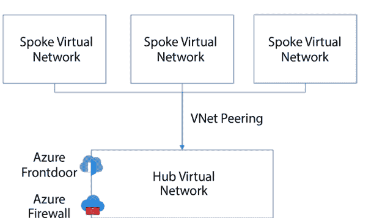

图 5.3 – Microsoft Azure 中的中心辐射型网络

这种拓扑通常使用集中式监控、管理和连接机制，例如防火墙和 VPN 或直接连接功能。VNet 链式连接允许采用分层隔离方法，这是许多组织对某些服务的要求。

每个辐射分支网络都可以在各自的 Azure 订阅中定义，从而确保对中心虚拟网络的访问可以仅限于系统管理员，并且不同的团队可以管理自己的辐射分支。

此方法还使用在子网级别分配的用户定义路由 (UDR) 来覆盖 Azure 中的默认路由，以确保来自辐射分支中工作负载的流量路由到中心防火墙。

这意味着所有去往互联网甚至本地网络的流量都需要经过中心。这确保您可以对 Microsoft Azure 中资源的所有进出网络流量进行集中治理。

虽然正确设计 VNet 很重要，但第二部分是控制 Azure 中的虚拟机工作负载。

## Azure 中虚拟机的结构

在 Azure 中创建虚拟机可以像运行两个 PowerShell 命令一样简单，但在设置任何计算机之前，您应该了解一些注意事项。


首先，你有 VM 的生成类型，这就像你在 Hyper-V 中拥有的那样，或者 VMware 中的 VM 版本。在 Microsoft Azure 中，我们有两代：第一代支持基于 BIOS 的启动，并且不提供任何 TPM 机制，而第二代除了受信任启动外还提供 UEFI 启动。

| 功能 | 第一代 VM | 第二代 VM |
|---|---|---|
| 启动类型 | PCAT | UEFI |
| 磁盘控制器 | IDE | SCSI |
| 支持的 VM SKU | 几乎全部 | 几乎全部 |
| OS 磁盘大于 2 TB | 否 | 是 |
| VBS | 否 | 是 |
| 受信任启动 | 否 | 是 |
| vTPM | 否 | 是 |

图 5.4 – Azure 中第一代和第二代 VM 之间的差异

借助对基于虚拟化的安全 (VBS) 的支持，你还可以使用诸如 Credential Guard 之类的功能用于虚拟机。默认情况下，当你创建一台机器时，它会选择第一代，并且没有从第一代转换到第二代的机制。

因此，建议是，你将所有虚拟机都创建为第二代。有些功能目前还不支持第二代，例如 Site Recovery，这是在 Azure 中的一项灾难恢复服务，但支持很快就会到来。

创建第二代虚拟机可以通过 PowerShell、脚本或使用 Azure 门户来完成，如以下屏幕截图所示。在这里，选择了映像类型并定义了安全类型以启用受信任启动功能。

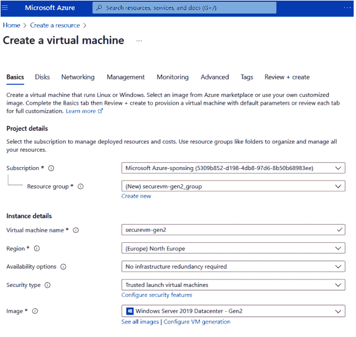

图 5.5 – 在 Microsoft Azure 中创建第二代机器的向导

当你拥有第二代虚拟机时，你可以启用使用诸如 Credential Guard 之类的功能，这可以限制攻击者获取机器上本地凭据的可能性。你可以在此处阅读有关如何激活该功能的更多信息：`https://docs.microsoft.com/en-us/windows/security/identity-protection/credential-guard/credential-guard-manage`。

Azure 中的所有机器都预装了一个代理，允许 VM 与 Azure 中的其他服务之间进行通信。代理还将健康状态发送回 Azure 控制平面，并且默认情况下也用于 DHCP 和 DNS 查找。

Azure 代理将与一些仅对 VM 内部的虚拟 IP 地址进行通信，如下图所示，这些地址用于管理目的，例如以下内容：

- 与 Azure 平台通信以表明其处于 **Ready** 状态
- 启用与 DNS 虚拟服务器的通信，以为没有自定义 DNS 服务器的资源（例如 VM）提供过滤的名称解析
- 启用来自 Azure 负载均衡器 (`https://docs.microsoft.com/en-us/azure/load-balancer/load-balancer-custom-probe-overview`) 的健康探测，以确定 VM 的健康状态

这意味着，如果我们在 Azure 中有一个域控制器，我们就可以利用此功能运行脚本，使用标准 PowerShell 模块更改任何帐户的密码。无法禁用此功能，因此重要的是要确保对放置这些虚拟机的某些 VM 或订阅的访问受到限制。

## 检测 Azure 中被入侵虚拟机的滥用

你可以在我撰写的关于该主题的博文中更深入地阅读有关此功能如何被用于恶意目的的信息：https://bit.ly/3a2Hhlb。

Azure 代理还用于安装扩展，这些扩展是安装在虚拟机上的软件插件。我常用的扩展之一是反恶意软件扩展，它为基于 Azure 的机器提供免费的反恶意软件功能，使用 Microsoft 的反恶意软件引擎。虽然你没有像许多第三方那样拥有相同的管理层，但你可以使用 Azure Policy 或作为扩展配置的一部分来管理反恶意软件引擎，并且所有数据都从扩展收集到 Log Analytics 中。

扩展安装也可以通过门户完成，进入虚拟机对象，单击 **Extensions**，并找到 **Microsoft Antimalware**，如以下屏幕截图所示：

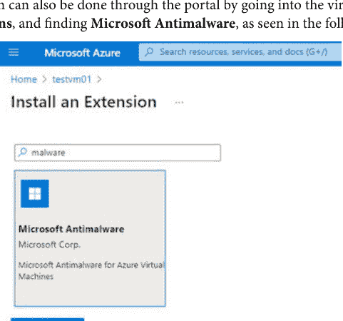

图 5.8 – 反恶意软件扩展安装

然后单击 **Next**，配置反恶意软件代理的设置，然后单击 **Create** 以在虚拟机上安装扩展。

根据你在虚拟机上运行的操作系统类型，你还可以从列表中获得其他不同的扩展。例如，如果你在创建虚拟机期间未选择该选项，你还可以选择安装基于 Azure AD 的登录扩展或自动管理扩展，我们稍后将介绍。

扩展还可用于运行自定义脚本，例如在创建虚拟机时或机器创建并运行后。这可以例如与 **基础设施即代码 (IaC)** 工具结合使用，以自动化虚拟机的创建并安装代理。

下一部分是为虚拟机获取自动修补，以确保安装安全更新。在 Azure 中，补丁管理有几种不同的选项：

- 自动，由平台完成
- 使用 Azure Automation 的 Update Management（适用于 Windows Server 和 Linux）
- Endpoint Manager（适用于在 Microsoft Azure 中运行的 Windows 10/11）

“自动，由平台完成”指的是 Azure 的自动补丁管理，具有以下功能：

- 被归类为 *critical* 或 *security* 的补丁将由平台自动下载并安装到 VM 上。
- 补丁会根据 VM 的时区在非高峰时段自动安装。
- Azure 管理补丁编排过程并根据可用性优先原则应用补丁。这意味着系统优先考虑维护服务和系统的可用性，而不是立即应用所有可用补丁。

该服务在更新后监控 VM 的健康状况，以验证补丁是否已成功安装。

如果你有分布在不同区域或可用性集中的工作负载，该服务将确保补丁一次只应用于一个区域、一个可用性区域和一个可用性集。这是为了确保工作负载的可用性。

此功能可以通过 IaC、PowerShell 或 Azure 门户启用。如果你已经有一台正在运行的 VM，你可以通过 PowerShell 使用以下命令启用该功能：

```
Set-AzVMOperatingSystem -VM $VirtualMachine -Windows -ComputerName $ComputerName -Credential $Credential -ProvisionVMAgent -EnableAutoUpdate -PatchMode "AutomaticByPlatform"
```

如果你希望对补丁安装时间有更多控制，则需要使用 Azure Update Management。Update Management 是两种服务的组合，即 Azure Automation 和 Log Analytics。如以下图所示，此服务通过使用 Log Analytics 代理工作，该代理会收集 VM 上有哪些更新可用，然后将这些信息报告回 Update Management 解决方案，在那里我们定义补丁应安装的时间表。

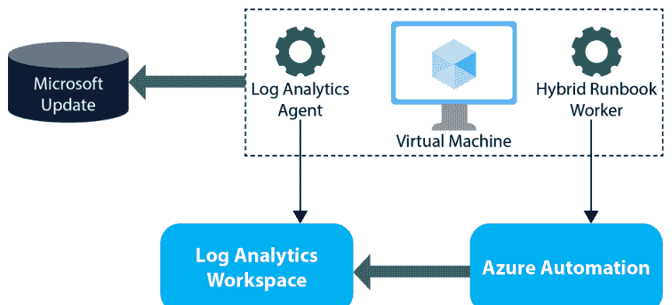

图 5.9 – Azure Update Management

Hybrid Runbook Worker 代理负责安装已定义的补丁。

> 注意
> Update Management 服务要求 VM 能够访问更新目录，例如 WSUS 或 Microsoft Update。该服务不会推送或下载实际的更新，而是更像是对虚拟机可用补丁的编排服务。

你可以通过进入 Azure 门户中的虚拟机然后单击 Updates 来轻松创建并启用该服务。如以下屏幕截图所示，这将自动创建一个 Automation 帐户和 Log Analytics 工作区。或者，你也可以选择现有的。


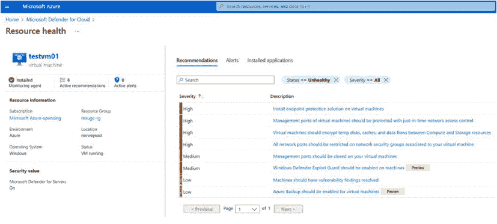

*图5.12 – Microsoft Defender for Cloud 建议列表*

在这里，我们还可以看到机器上安装了哪些类型的应用程序，以及该特定机器上是否存在任何已知漏洞。

这部分在 UI 中不太明显：具有 EDR 功能的服务器还可以将数据发送到另一个数据源，该数据源属于 Defender for Endpoint 数据库的一部分。

然而，这要求我们安装额外的代理，将服务器载入服务，以便将数据发送到服务。这可以自动配置，Microsoft 将安装额外的代理。我们需要做的只是集成 Defender for Cloud 和 Defender for Endpoint。

要启用集成，请在 Azure 门户中转到 **Defender for Cloud**，转到 **环境设置**，然后选择我们最近为 Defender for Servers 设置的包含机器的订阅。选择 **集成**，选择 **允许 Microsoft Defender for Endpoint 访问我的数据** 设置，然后点击“保存”。

> **注意**
>
> Microsoft Defender for Cloud 会自动将您的机器注册到 Microsoft Defender for Endpoint 服务。对于在启用集成时已存在的机器，注册过程（称为“载入”）可能需要最多 12 小时。对于在集成激活后创建的新机器，载入通常需要大约 1 小时。

一旦集成到位，服务器也应自动载入 Defender for Endpoint 服务。另一种选择是通过手动安装软件来载入机器，可以通过登录 `https://security.microsoft.com` 完成，在 **设置 | 终结点 | 载入** 下，我们有适用于不同操作系统的不同载入机制。为您的操作系统下载合适的软件版本，并使用向导进行安装。

当服务器通过集成或手动安装完成载入后，它们将显示在 Defender for Endpoint 门户（https://security.microsoft.com）的“终结点”下。在这里，我们可以查看各种漏洞，如以下屏幕截图所示。

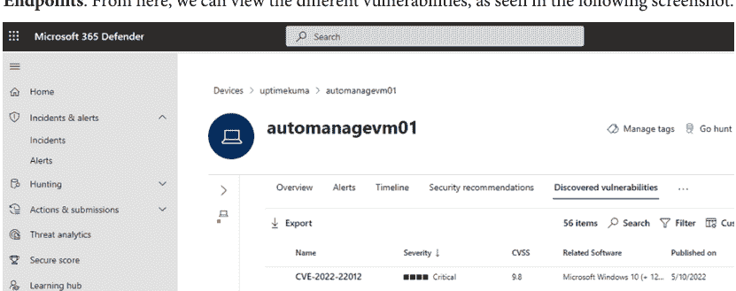

图5.13 – Microsoft Defender EDR 和发现的漏洞

我们还有一个时间线视图，显示机器上发生的所有事件。这意味着代理将收集与设备上的注册表、文件、网络和进程相关的所有更改和活动。

数据存储在 Log Analytics 等数据库中，它也支持 Kusto 查询。这意味着我们也可以使用 Kusto 查询来分析数据，我们在第3章“使用 Microsoft Sentinel 和 Defender 进行安全监控”中已经介绍过。不过，为了提供一些背景信息，Defender for Servers 将自动映射可能被视为异常流量模式的事件，如以下屏幕截图所示。

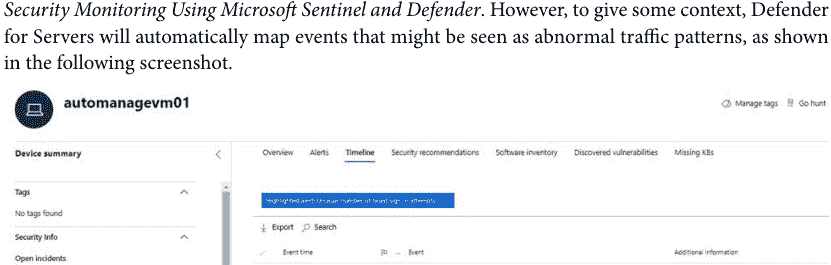

图5.14 – Microsoft Defender for Servers 中虚拟机的时间线视图

## 注意

上一屏幕截图中顶部菜单中可用的不同设置将取决于您运行的操作系统版本。您可以在此处查看不同 Windows Server 版本可用的不同功能：https://docs.microsoft.com/en-us/microsoft-365/security/defender-endpoint/configure-server-endpoints。

所有收集的数据也可以原始格式查看，如果我们进入门户的 **搜寻** 部分并点击 **高级搜寻**。这将带我们进入一个查询窗口，在这里我们可以运行 Kusto 查询，类似于我们使用 Microsoft Sentinel 所做的。

例如，我们可以使用此功能来查找 BazarLoader 的 Word 文档传递方法，该方法通常利用 Word 创建一个 `.hta` 文件，以在机器本地启动，如下所示：

```
DeviceProcessEvents | where InitiatingProcessFileName =~ 'WINWORD.EXE' and FileName =~ 'cmd.exe' and ProcessCommandLine has_all('hta')
```

Defender 收集大量与操作系统相关的数据，包括文件更改、机器上的进程以及 Windows 注册表的更改。它还收集每台设备上的所有入站和出站网络连接。这使我们能够查看机器上的大部分通信流，例如查看在给定时间哪个服务正在与网络上的另一台计算机通信。它不收集安全事件，因为这是由其他服务（如 Sentinel）完成的。

应注意，默认情况下，Defender 服务将数据存储 180 天；但是，如果您希望将数据存储更长时间，可以启用 Microsoft Sentinel 中名为 Microsoft 365 Defender 的数据连接器。这将在 Sentinel 数据库中创建 Defender 数据库中所有原始日志的副本。但是，应注意，复制这些原始日志可能会显著增加日志使用量和服务成本。

## Azure Policy

如前所述，Azure Policy 可以帮助我们提供对 Azure 资源的集中控制。策略可以应用于资源创建，也可以在资源创建完成后进行评估，这最常见于虚拟机中的来宾配置。

策略可以通过以下方式部署：

- 审核模式
- 拒绝模式
- 如果不存在则审核
- 如果不存在则部署

我收到的一个常见请求是确保没有人能在 Microsoft Azure 中部署带有公共 IP 地址的资源。这是为了降低面向互联网的资源（如虚拟机）被攻陷的风险。

带有公共 IP 地址且没有安全机制的虚拟机，在设置后的第一个小时内就会受到暴力破解攻击的轰炸。

因此，我们需要确保应从互联网访问的资源只能通过其他安全机制访问，例如根据服务使用 Azure Bastion 或 Application Gateway。

使用 Azure Policy，您可以确保没有人使用预定义的策略定义部署带有公共 IP 地址的资源。您可以在以下屏幕截图中找到名为 **网络接口不应具有公共 IP** 的定义。

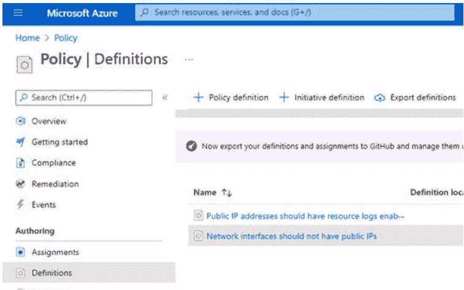

图5.15 – Azure Policy 定义

然后，点击该策略并选择 **分配**。在 **范围** 下，您可以定义要应用此策略的级别，可以是资源组、订阅或管理组。我们还可以在分配策略时定义一个不合规消息，当有人触发策略违规时，我们可以定义更具描述性的消息，而不是默认消息。这可以在分配策略时的 **不合规消息** 选项下定义。

定义范围并可选地定义不合规消息后，点击 **查看 + 创建**，然后点击 **创建**。

如果有人试图在应用了该策略的网卡上附加公共 IP，或者试图创建具有公共 IP 地址的新虚拟机，他们将收到类似以下屏幕截图所示的消息。

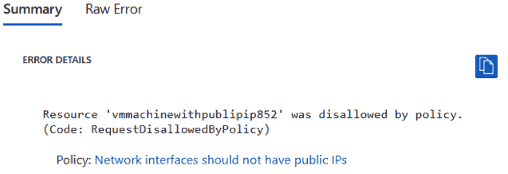

*图5.16 – Azure Policy 拒绝公共 IP*

还有大量其他预定义策略可用于为您的 Microsoft Azure 环境添加更多治理。例如，有一个策略可以根据机器具有的标记自动将机器添加到备份策略。这确保了如果有人忘记将机器添加到备份策略，如果机器上有预定义标记，该策略将自动处理。

门户中可用的所有策略也可以在 Microsoft 的 GitHub 页面上查看：https://github.com/Azure/azure-policy/blob/master/built-in-policies/policyDefinitions/，其中许多策略也是 Microsoft 作为示例提供的企业规模登陆区域参考架构的一部分。

现在，让我们仔细看看 Azure 中虚拟机的备份功能。在应对勒索软件时，最显著的功能之一是确保您拥有工作负载的备份，并且在需要时可以轻松恢复。

## Azure Backup

默认情况下，当您在 Azure 中设置虚拟机时，存储在其中的所有数据都会在同一数据中心内自动复制三次。这也称为 **本地冗余存储 (LRS)**，这是为了确保数据的可用性。

如果我们的机器感染了勒索软件，在 Azure 中加密我们的数据，复制机制将启动并同样复制该数据三次。因此，重要的是要了解此功能并不能替代对数据进行备份的需求。

在 Azure 中，Microsoft 提供了一项备份服务，可以备份虚拟机工作负载，并将数据存储在单独的存储账户中。此存储账户只能从备份服务访问，默认情况下，静态备份数据使用 **平台托管密钥 (PMKs)** 加密。此外，该服务还具有软删除机制，这意味着无法清除/


删除或覆盖服务正在备份的数据。这确保了勒索软件无法破坏服务已备份的数据。

因此，如果你的 Azure 环境不幸遭到勒索软件入侵，你可以轻松地从 Azure Backup 服务恢复虚拟机，并确保备份数据未受影响。

Azure Backup 服务还支持备份其他数据源，例如：

- 本地文件、文件夹和系统状态
- Azure 托管磁盘
- Azure 文件共享（Azure 中的 SMB 文件服务）
- Azure PostgreSQL
- Azure Blob 存储（Azure 中的对象存储服务）

可以通过 Azure 门户为虚拟机启用备份：进入 VM 对象，然后点击“备份”选项。在这里，我们可以自动创建备份保管库并定义备份策略。备份保管库是一种逻辑资源，提供备份服务的管理平面，包括管理备份数据所在的存储帐户。

你有两种不同的备份策略类型可供选择：

- 标准（每 24 小时备份一次，基于 LRS 的快照）
- 增强（每天多次备份，基于 ZRS 的快照层，并支持使用第 2 代虚拟机的受信任 Azure VM）

> **注意**
> **ZRS** 代表**区域冗余存储**，这意味着数据在同一地理区域内的三个不同数据中心之间复制三次，以确保在其中一个物理数据中心发生故障时数据仍然可用。

创建服务和策略后，可以在名为 Azure Backup center 的服务中集中管理备份和还原功能。

此外，如果你已建立了包含多个订阅的企业登陆区结构，则必须为每个订阅设置单独的备份保管库，以确保全面的备份和还原能力。这是因为备份保管库只能从同一订阅内的资源进行备份。

虽然许多人可能熟悉其他备份服务具有内置机制来自动验证备份中的数据，但截至目前，Azure Backup 中还没有这样的功能。

作为 Azure Backup 的一部分，在还原数据方面我们有一些不同的选项。我们可以使用备份数据在与 control/elevate-access-global-admin 相同的订阅中创建新的虚拟机。因此，请确保你也限制全局管理员帐户的数量。如果你想在 Azure AD 内委派访问权限，请使用 Azure AD 管理单元等功能。

- 如果你想在 Microsoft Azure 中将 PaaS 服务与虚拟机结合使用，请确保使用专用终结点部署这些服务。这可以确保 PaaS 服务和连接保持在 Azure 虚拟网络内，而不是公开暴露。
- 确保所有虚拟机都安装了终结点保护、更新管理和 Log Analytics/Azure Monitor 代理。其次，安全日志应收集到集中的 Log Analytics 工作区中，并启用 Microsoft Sentinel 或第三方 SIEM 服务。
- 使用 Azure Bastion 等服务为管理员提供对虚拟机的安全远程访问，而不是让跳板机对外可用。Azure Bastion 还支持按 IP 连接，这意味着你也可以使用它连接到本地资源。
- 确保为你的 Azure 环境应用 Azure 策略，以降低发布面向互联网的不安全服务或服务日志记录机制不足的风险。例如，确保服务只能在批准的区域中预配，只能放在集中式安全机制之后，并且启用日志记录。

这些是你在 Azure 中构建工作负载时应遵循的一些建议。需要注意的是，Azure 在不断变化，因此你应该始终重新评估你的 Azure 环境是否按照基于 Microsoft 云安全基准的最佳实践运行，你可以在此处阅读更多相关信息：https://learn.microsoft.com/en-us/security/benchmark/azure/overview?source=recommendations。

## 总结

随着越来越多的组织将工作负载迁移到 Microsoft Azure，我们必须深入了解可用的各种服务和机制，以确保我们拥有安全的基础。

在本章中，我们深入探讨了如何设计基于 Azure 的环境，以及为确保能够控制其中预配的虚拟机资源而应具备的一些核心组件。

我们了解了一些核心服务，例如 Azure Policy、Azure 更新管理和 Azure Backup，以及如何使用它们来保护我们在 Azure 中的虚拟基础架构。

在下一章中，我们将更深入地探讨如何在遵循零信任原则的同时，为用户提供对应用程序和服务的安全访问，以及如何将风险和威胁信息集成到访问管理中。

最后，我们将研究有助于保护流量免受各种攻击的不同机制。
