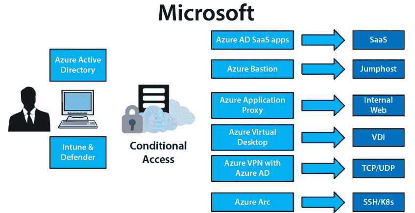
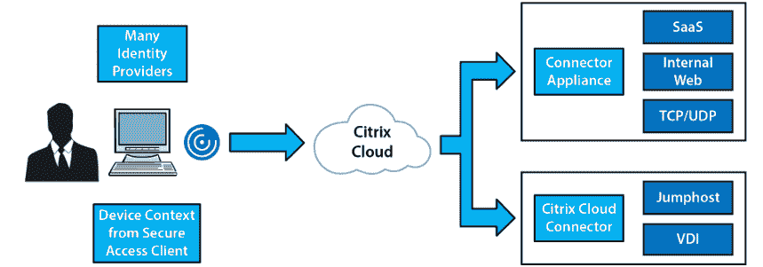
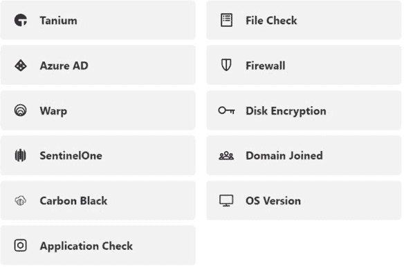
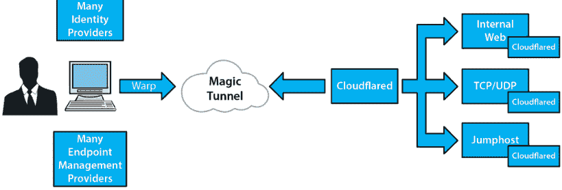
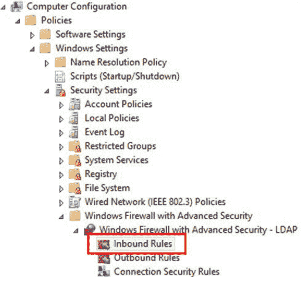
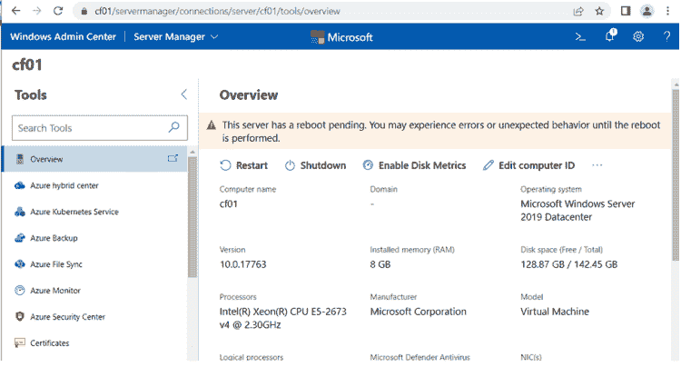
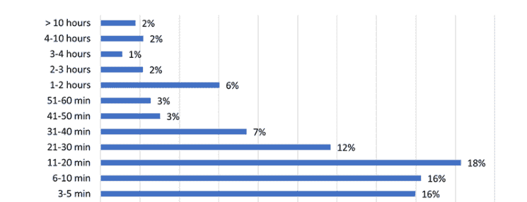
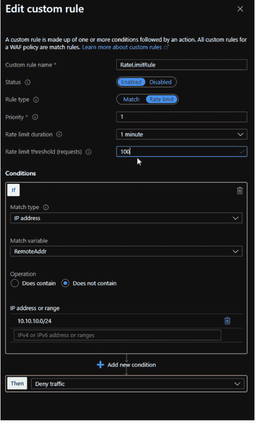

## 勒索软件对策——网络与零信任访问

正如我在第一章中提到的，大多数勒索软件攻击要么始于受感染的设备，要么始于外部可访问的易受攻击的服务（如 VPN 或 VDI），攻击者随后会利用这些服务。

无论如何，大多数此类攻击都为攻击者提供了可乘之机，并为他们提供了进一步访问基础架构的途径。

如果最终用户设备无法访问基础架构，或者服务不对外部开放，那么大多数此类攻击都可以被阻止。

因此，在本章中，我们将基于零信任访问模型，探讨如何确保用户和管理员能够安全地从外部访问服务，而不会面临同样的风险。

我们还将探讨一些有关基于 Windows 的工作负载的网络分段和安全最佳实践，以及如何保护我们的外部 Web 服务免受分布式拒绝服务（DDoS）攻击，这种攻击媒介我们越来越常见。

最后，我们将研究一些 SASE 服务模型，以及它们如何帮助降低移动办公人员的风险。

在本章中，我们将涵盖以下主题：

- 零信任网络访问和 SASE 服务
- 网络分段、防火墙和访问
- DDoS 防护和针对新 Web 服务的防护

## 攻击者与横向移动

在第 1 章“勒索软件攻击向量与威胁格局”中，我们介绍了一些不同的勒索软件变种及其工作原理。在大多数情况下，攻击始于攻击者用来对网络和基础架构进行侦察的终结点。

然后，攻击者通常会结合多种方式进一步访问基础架构：

- 重用终结点上发现的凭据，使用远程桌面协议（RDP）登录服务器
- 使用 Bloodhound 等工具查找 Active Directory 中通往管理员帐户的攻击路径
- 利用 Zerologon 等漏洞
- 使用 Rubeus 等工具执行 Kerberoasting 攻击
- 使用 Invoke-ShareFinder 等模块查找网络共享和敏感内容

不幸的是，我们还遇到过 PrintNightmare 等漏洞，这些漏洞使能够访问终结点的黑客可以轻松入侵打印服务器或运行打印后台处理程序服务的服务器。

现在，这些侦察和横向移动之所以成为可能，很大程度上是因为 Active Directory 域的基础架构加上某种形式的漏洞。

在大多数组织中，最终用户的 Windows 机器需要与许多不同的内部服务通信，例如文件服务、打印服务、域控制器和 PKI 服务等。

在大多数情况下，攻击者无法直接从受感染的终结点访问域控制器，除非存在某种漏洞或配置错误的服务可供他们利用进行横向移动。另一种情况是，攻击者设法获得了高特权帐户的凭据，而基础架构中用于限制访问的防火墙规则有限。

此外，我们还有 Zerologon 等漏洞，这些漏洞允许攻击者从已加入域的计算机访问域控制器。

许多攻击者使用 Bloodhound 等工具（我们将在本章后面介绍）来绘制环境地图，并识别可能获得域管理员访问权限的不同攻击路径。

因此，采用分层安全方法非常重要，这尤其适用于我们拥有虚拟基础架构的网络。

正如我们在 Microsoft Azure 的网络设计中所介绍的那样，我们可以使用中心辐射型网络拓扑来分段网络，这涉及拥有多个 VLAN/区域，并通过集中式防火墙路由所有流量。

有了这些区域，我们就可以使用集中式安全服务（如防火墙）来确保这些区域之间的通信安全，并使攻击者更难到达我们基础设施的核心。

在我们深入探讨网络分段之前，我们将重点关注为终端用户提供对服务的访问安全。

## 为用户提供对服务的安全访问

在大多数情况下，我们的终端用户通过某些服务（如 Always On VPN）以某种形式的远程访问方式访问基础设施。这确保了他们的终端可以与文件服务器、打印服务器、Active Directory 以及不同应用程序所需的其他网络协议（如 TCP/UDP）进行通信。

现在使用 Always On VPN 或其他第三方服务的原因是，它为终端用户提供了与在办公室相似的体验。这使他们能够在自己的机器上登录并自动通过 VPN 隧道连接到基础设施，提供无缝的用户体验。

许多这些 VPN 服务还提供 **网络准入控制 (NAC)** 功能，在设备被允许进行身份验证或在 VPN 隧道中发送流量之前检查设备的健康状况。

然而，在大多数情况下，这些检查可能相当有限，其次，一旦 VPN 隧道激活，终端基本上就被视为办公室内部的机器，可以访问大多数内部服务。

> **注意**
> 
> 我还遇到过另一种情况，攻击者成功入侵了一台已注册到 AAD 的服务器，随后利用它对基础设施的其他部分发起攻击。您可以在此处阅读更多相关内容：`https://msandbu.org/the-curious-case-of-azure-managed-identity-and-a-compromised-virtual-machine/`。

我遇到过这样一种情况，一家客户的 VPN 服务允许其员工在疫情期间在家访问企业基础设施。然而，他们忘记打开与 Windows Server Update Services 的通信，因此大多数机器无法进行补丁更新，但仍然可以完全访问其公司的基础设施。

因此，我们需要寻找一种新的方式来为用户提供对内部服务的安全访问，而不会像使用 VPN 服务或其他需要维护的外部服务那样承担同等风险。

许多安全厂商现在更倾向于推动基于零信任的模型来提供访问。正如 *第 2 章，建立安全基础* 中所述，目标是防止未经授权访问数据和服务，同时尽可能细化访问控制执行。以 VPN 为例，终端不应获得对网络的完全访问权限，而应仅在需要时获得对特定服务的访问权限。能够为用户提供基于零信任的访问的服务通常被称为 **零信任网络访问 (ZTNA)**。

当用户尝试连接到服务时，ZTNA 产品可以根据配置检查以下内容：

- 设备是否安全？是否已更新？是否已实施必要的<|message|> 安全配置？
- 用户是否来自已知位置？用户是否使用 MFA 进行身份验证？
- 这是正常用户行为还是异常行为？
- 用户是否已定义对该服务的访问权限？

因此，让我们来看一些用户访问内部服务的访问权限如何区分的示例：

- 用户 1 尝试从已知位置访问内部 Web 应用程序
- 用户 1 设备已实施安全基线，其中包括已安装防恶意软件且已启用端点检测与响应 (EDR) 代理
- 在用户 1 完成 MFA 提示后，授予其访问权限
- ZTNA 服务会不断评估状态是否发生变化，例如用户位置或设备风险

让我们再看另一个用户，他正尝试从未知设备或未实施必要安全配置的设备登录：

- 用户 2 尝试从已知位置访问内部 Web 应用程序
- 用户 2 设备未实施任何安全配置，且设备上的防恶意软件和 EDR 已被禁用
- 根据其身份和设备态势以及访问策略的组合，用户 2 未被授予对该服务的访问权限

现在，虽然零信任和不同的支柱是一组安全设计原则，但要实现 ZTNA 必须依赖于一套特定的技术。正如我提到的，市场上有大量厂商提供所谓的 ZTNA 服务，以确保您可以在用户访问服务或数据之前验证用户及其设备、属性和上下文。

这也是我们提供访问方式的改变，因为用户默认不应具有对内部服务的显式访问权限（如基于 AD 的计算机，一旦经过身份验证，本质上就具有对内部资源的显式访问权限）。因此，如果您想实施基于零信任的安全架构，您应考虑将受管终端迁移到 Azure AD。

虽然许多优秀的厂商提供许多相同的功能，但我将在本章中介绍市场上三种不同的厂商，介绍它们提供哪些功能，以及这些功能如何帮助降低勒索软件风险。

## Microsoft

现在，如果我们开始查看不同的厂商，Microsoft 拥有一个众所周知的技术栈，可以解决我们为内部服务提供安全访问的大部分需求，例如操作员访问、终端用户访问或只是对内部 Web 应用程序的普通访问。

Microsoft 提供了多种不同的服务，如下图所示，但其中大多数服务仅在运行 Microsoft Azure 或使用 Azure 服务时可用：

图 6.2 – Microsoft 安全访问服务概览

核心是 Azure AD 用于身份态势，以及 Intune 和 Defender 用于设备上下文。这些产品具有不同的异常检测机制来验证用户和设备的健康状况。然后，这些信息由条件访问处理，后者将确定您是否被允许访问该服务。

然后，我们有一系列可以让用户访问这些不同服务的服务：

- Azure AD：提供对已集成 Azure AD 的 Web 应用程序的原生访问。
- Azure Application Proxy：通过 Azure AD Application Proxy Connector 发布内部 Web 应用程序，提供对这些应用程序的访问。这些应用程序随后可通过 MyApps 或 Office 365 用户门户使用。
- **Azure Bastion：** Bastion 是使用 RDP 或 SSH 访问跳板机或服务器的方式。Microsoft 还最近引入了 *Connect to IP* 和 *Native Client Support*，这使我们能够使用 Bastion 通过 IP 地址直接或使用机器上的原生 RDP 客户端连接到机器，结合通过 Azure Bastion 服务的反向隧道，而不是 Web 门户。
- **Azure Virtual Desktop/Windows 365：** 为终端用户提供 VDI 服务，要么使用 Windows 10/11 的 1:1 设置，要么在 Azure 中提供多会话支持。
- **Azure VPN：** Azure VPN，顾名思义，是 Azure 原生的 VPN 服务，可用于将本地环境连接到 Azure，但它也支持 **点到站点 (P2S)** 配置，以便客户端可以使用其 Azure AD 凭据连接到 VPN 服务。此功能仅限于 Windows。它支持条件访问以验证上下文，但它仍然会打开到基础设施的完整 VPN 隧道。
- **Azure Arc：** Arc 是 Microsoft 提供混合服务和功能的新方式，也已引入支持，只要服务器已连接到 Azure Arc，您就可以连接到任何启用了 SSH 的设备。因此，它在设备和 Arc 之间建立反向隧道来处理流量。
- **Microsoft Tunnel：** Tunnel 是一款面向移动设备的 VPN 服务，内置于 iOS 和 Android 的 Microsoft Defender 应用中。VPN 服务本身作为容器运行，但也支持基于 Azure AD 的身份验证。

其中大多数服务还通过 Microsoft Azure 使用反向隧道，这意味着它们不会公开暴露服务或端点（Azure VPN 和 Microsoft Tunnel 除外）。这降低了攻击者利用外部服务已知漏洞的风险。

需要注意的是，并非所有这些服务都提供细粒度的访问检查——例如，Azure VPN 没有机制在 Intune 检测到用户终端存在风险时断开会话。

但作为一个例子，如果我们使用 Azure Virtual Desktop 而不是直接将服务器通过 RDP 发布到互联网，这将极大地降低网络攻击的风险。

## Citrix

许多组织今天使用 Citrix 来提供对 VDI 环境的远程访问，而 Citrix 在过去几年中不幸地遭受了与其网关设备相关的许多严重漏洞，许多攻击者已知会利用这些漏洞。

阅读更多内容：https://www.cisa.gov/known-exploited-vulnerabilities-catalog。

Citrix 还在云平台 Citrix Cloud 上构建了越来越多的服务，并最近引入了名为 Secure Private Access 的新功能，这是一项仅限云的服务，如下图所示：

图 6.3 – Citrix Secure Private Access 概览

Citrix Secure Private Access 可以使用不同的身份提供方 IDP，例如 Azure AD 或原生 SAML，或其自有的身份验证机制，称为 Adaptive Authentication，可与终端访问机制结合使用来验证身份态势。

其次，作为 Secure Private Access 的一部分，Citrix 还可以使用内置代理 Citrix Secure Access 进行设备态势检查。这种方法的缺点是内置代理无法使用来自第三方 MDM 工具或 EDR 工具的信息来进行终端的设备上下文检查，这意味着如果您使用 CrowdStrike 进行 EDR，在确定是否应授予用户访问权限时，Citrix Cloud 无法原生访问在那里收集的信息。

Citrix 还包含 Citrix Analytics，可提供会话上下文，了解用户在 VDI 会话中正在做什么，例如，如果 Analytics 检测到 VDI 会话中的异常用户行为，您可以创建策略自动断开会话。这确保了如果攻击者能够获得访问权限，他们无法在 VDI 会话中进行任何恶意活动。

Citrix 还具有 Secure Browser 功能，可让您在浏览器会话上提供更多安全控制机制（随着新传输协议的出现，这变得越来越困难）。从用户角度来看，他们可以使用现有的 Citrix Workspace 应用访问内部服务。

## Cloudflare

Cloudflare 历史上以提供保护 Web 服务的服务而闻名，最近已通过其零信任产品更多地进入终端用户生态系统。与市场上其他厂商相比，Cloudflare 最大的主要区别在于他们没有自己的 IDP 或 EDR 服务，就像微软拥有 Defender for Endpoint 一样，因此他们专注于提供灵活性并与不同的第三方提供商集成，如以下屏幕截图所示：

图 6.4 – Cloudflare EDR 和终端设备检查

Cloudflare 例如可以使用 Azure AD 作为 IDP 获取用户上下文，并使用 Carbon Black 收集设备上下文。能够与许多不同的提供商集成使其在设备和身份上下文方面非常灵活。

现在，与 Microsoft 和 Citrix 不同，Cloudflare 没有任何 VDI 服务，但确实提供对内部服务、TCP/UDP、SSH/RDP 和基于 Web 的服务的访问，使用 Warp 和一个名为 **Cloudflared** 的服务器组件。cloudflared 是安装在我们基础设施中运行的虚拟机上的服务名称。从终端用户角度来看，Warp 代理连接到 Cloudflare 网络，如 *图 6.5* 所示。然后，Cloudflare 守护进程在内部服务器上运行，可以在 Windows、Linux 或作为容器运行，如下图所示：

图 6.5 – Cloudflare 零信任概览

SASE 平台的核心组件之一是 CASB，这是一种产品通常使用与不同云服务（如 SaaS）的 API 集成来监控该服务内的活动。

这当然要求 CASB 提供商根据可用的 API 类型为特定的 SaaS 方案构建支持。大多数 CASB 提供商支持大型 SaaS 方案，如 Microsoft 365、ServiceNow、Workday 和 Salesforce，但如果您有一个小型自定义 SaaS 方案，很可能无法集成 CASB 产品。

虽然 CASB 是堆栈的一部分，第二部分是 SWG，您可以将其视为所有出站网络流量的反向代理。它更侧重于保护用户免受互联网上的恶意内容。在大多数情况下，使用 SWG 时，所有互联网流量都将通过提供商的接入点 PoP 路由，在那里他们将检查您尝试访问的任何站点的 URL、目标和内容。有时，这些安全提供商还使用浏览器扩展或插件来更深入地了解流量流。

结合此功能，提供商还具有 SD-WAN 功能，旨在为终端用户提供更智能的互联网流量路由，或作为分支机构的解决方案。

所有这些组件共同构成了 SASE 方案。我们可以看到越来越多的安全厂商进入这一生态系统，单一厂商提供完全集成的服务。

我提到 SASE 的原因是，当它在市场上变得更加成熟时，它将能够为移动用户提供更好的安全性，因为它将允许通过 CASB 实现对云服务的更好可见性，通过 SWG 提供更主动的安全性，当然，还能够使用 ZTNA 提供对内部服务的安全访问。

## 文件访问

最常用的服务之一，大多数远程用户需要访问的是文件共享或文件服务器上自己的个人存储区域，这不幸的是勒索软件传播最常见的方式之一。

因此，就勒索软件对策而言，用不运行在 SMB 上的替代方案移除或替换文件共享，同时仍能以零信任为目标在外部访问，这是一种有效降低风险的方法。

常见的设置是将数据从本地文件服务迁移到基于云的服务，例如以下：

- OneDrive（SharePoint/Microsoft Teams）
- Google Drive
- Dropbox

这至少可以在勒索软件脚本和工具能够加密的哪种数据方面降低影响。

此外，其中一些服务，如 OneDrive，支持各种加密机制，这意味着如果有人设法访问文件或内容，他们在解密之前将无法读取实际内容。这也确保了勒索软件攻击者无法基于文件数据或敏感信息对您进行勒索。

虽然基于云的存储可以适用于许多文件场景，但您可能有需要访问快速本地存储的内部服务器或应用程序的场景。

我曾经与一家客户合作，他们的硬件开发团队最近遭受了勒索软件攻击。现有环境是一组标准的域加入 Windows 机器连接到本地文件服务器，因此我们做了一些工作，让他们能够更远程地工作并降低未来攻击的风险。

他们的机器迁移到了 Azure AD，并且他们个人存储中的大部分文件都迁移到了 OneDrive 和 Teams。然而，最后一个缺失的部分是他们用于开发的应用程序需要访问快速本地存储，因为它包含应用程序需要访问的大文件。

困难之处在于他们使用的应用程序需要集成文件资源管理器访问现有文件服务器才能正常工作。然而，由于他们的机器已迁移到 Azure AD，我们希望消除引入新的 SMB 文件服务器的风险，对于此场景，我们评估了一些支持其要求的第三方选项。

我也想在此强调一些替代方案：

- **Fileflex：** 这提供了 Azure AD 集成的访问现有内部存储服务，如 FTP、SharePoint On Premises、NAS 和其他本地 SMB 共享
- **Egnyte：** 这提供了自己的存储服务，支持与本地基础设施集成以及与不同 IDP 集成以提供 MFA 访问

这些都支持基于云的存储和混合存储，与 Azure AD 集成用于身份验证，并与 Windows 文件资源管理器集成（使用或不使用 SMB 协议）。

将您的存储从基于 SMB 的文件服务移开也会降低攻击者能够影响您文件风险。大多数勒索软件团伙利用基于脚本和基于工具的方法来定位和加密 SMB 共享上的文件。值得注意的是，许多基于云的存储服务提供版本化文件和数据功能，这有助于在必要时更轻松地恢复文件。然而，值得注意的是，基于云的存储在很大程度上未受到勒索软件攻击的影响。

> **注意**
> Microsoft 在 Microsoft Azure 中提供大量不同的存储选项，但其中没有一个支持本地部署。一个选项是 Azure File Sync，它在本地文件服务器和 Microsoft Azure 之间复制数据。此功能仍使用常规 Windows 文件服务器、AD 和 SMB 协议。

## 远程管理服务

在我遇到的大多数勒索软件案例中，攻击者都能够利用 RDP 访问并在企业网络内部的服务器之间跳转。微软也在其年度报告 *Microsoft Digital Defence Report 2022* 中指出，该报告可在此处找到 – https://www.microsoft.com/en-us/security/business/microsoft-digital-defense-report-2022 – RDP 也是勒索软件攻击的主要攻击向量之一。

**注意**
RDP 代表勒索软件部署协议 Ransomware Deployment Protocol 是一个常见的玩笑，但其中有些是真实的。根据 Shodan 的数据，互联网上有超过 400 万台服务器启用了 RDP 并且可以公开访问。

RDP 的问题在于默认情况下没有任何内置的 MFA 机制。你可以通过其他 **远程桌面服务 (RDS)** 功能，例如 RDS 网关，它是 Windows Server 的一部分，使用 MFA 发布 RDP。

使用 RDS 网关在外部发布它，所有 RDP 流量将通过网关代理，该网关使用 TCP 443（和 UDP 3391）。RDS 网关可以通过 NPS 服务器角色使用 MFA 进行配置，但这仍然要求你将 RDS 网关暴露给互联网以提供远程访问。

同样，在公共云上设置 Windows 服务器时，云提供商总是几乎过于轻松地设置一台具有公共 IP 地址并启用 RDP 进行远程管理的机器。这不幸地产生了一个副作用，即该机器成为暴力攻击的热门目标，而这些攻击几乎可以在机器可用后的几分钟内针对。

因此，重要的是要尽量减少 RDP 的使用，降到最低限度，不仅用于服务器管理，也用于远程访问。你在任何情况下都不应让 RDP 服务器公开可用。

关于 Windows 基础架构的远程管理，你应实施以下措施：

- 确保对于需要启用 RDP 的服务器，你已启用 **网络级身份验证 (NLA)**。NLA 在连接建立之前提供额外的身份验证级别，并且在 Server 2012 R2 及更高版本中默认启用。
- 确保你已为需要启用 RDP 的服务器禁用驱动器映射和剪贴板映射。这是因为勒索软件运营商经常使用剪贴板功能将文件从受感染的机器复制到目标服务器。
- 确保对于需要 RDP 访问的服务器，你限制可以登录的用户和组类型。默认情况下，本地管理员和远程桌面用户被允许登录。这里的一个最佳实践是删除管理员通过 RDP 登录的能力。

这也应在中央防火墙上实施，但也在主机级别执行的原因是为了阻止来自同一子网或防火墙区域内服务器的访问。

在这里，我们创建一个自定义规则，因为它给了我们定义端口和应适用到的 IP 范围的选项。

确保你也删除可能将 RDP 打开到更广范围或其他范围的防火墙规则，这些范围位于管理或跳板主机服务器之外。默认情况下，Windows Defender 防火墙会阻止所有传入网络流量，除非它与允许流量的规则匹配。因此，添加入站规则意味着只有来自定义网络的 RDP 流量才会被允许。

虽然启用 RDP 应被视为最后的手段，但微软也引入了新的功能，使无需使用 RDP 即可更轻松地进行远程管理。其中一个选项是 Windows Admin Center，它可以被视为 Windows 中传统 Server Manager 功能的演进，如以下屏幕截图所示：

图 6.8 – Windows Admin Center 网页 UI

> > **注意**
> >
> > 如果你已在 Microsoft Azure 中部署了基础架构，你没有像 VMware/Hyper-V 环境那样使用控制台连接的选项，因此可能需要使用 RDP 来访问虚拟机。在 Azure 中，你也有 Azure Bastion 服务，这是一个基于 Apache Guacamole 的托管跳板主机服务，你可以通过 Azure 门户通过 RDP 登录到机器。

在这里，管理员可以执行他们需要的大多数任务，而无需使用 RDP 登录。Server Manager 也支持基于 Azure AD 的身份验证。

该产品具有相当简化的架构，其中有两个主要组件，即托管 UI 的 Web 服务器和通过 PowerShell/WMI over WinRM 与你管理的服务器通信的网关服务器。

虽然 Windows Admin Center 减少了使用 RDP 的需求，但它仍然使用 WinRM，并且要求网关服务器能够与网络中的其他服务器通信。然而，使用 Admin Center 并删除使用 RDP 访问网络中其他服务器的能力，可以大大减少攻击者在你的网络中进行横向移动的影响。

还应注意的是，还有很多优秀的第三方选项可提供通过云服务进行更简单的远程管理功能，以及 MFA，例如以下：

- **Teleport** – `https://goteleport.com/`
- **BeyondTrust** - https://www.beyondtrust.com/
- **JumpCloud** - https://jumpcloud.com/

如果你有 Citrix NetScaler/ADC，你也有使用名为 RDP Proxy 的功能发布 RDP 访问的选项，如果你仅需要 RDP 进行一些管理，则无需 RDS 网关。你可以在此处阅读更多相关信息：https://docs.citrix.com/en-us/citrix-gateway/current-release/rdp-proxy.html。

## DDoS 防护

在 2021 年夏季，微软宣布他们阻止了有史以来记录的 *最大 DDoS 攻击之一* – https://www.theverge.com/2021/10/12/22722155/microsoft-azure-biggest-ddos-attack-ever-2-4-tbps – 表示他们能够缓解 2.4 TBps 的 DDoS 攻击。

此次攻击是基于 UDP 的反射攻击，虽然时间很短，但肯定会使企业针对的任何外部服务瘫痪。

微软表示大多数 DDoS 攻击时间很短。根据他们收集的统计数据，大多数攻击发生在 5–30 分钟的范围内，如以下屏幕截图所示：

## 攻击持续时间

图 6.9 – DDoS 攻击持续时间统计

此外，Cloudflare 在其最新的 2022 年第二季度 DDoS 攻击趋势文章中，如你在此处查看 – https://blog.cloudflare.com/ddos-attack-trends-for-2022-q2/ – 表示，五分之一经历过 DDoS 攻击的调查受访者报告称他们遭受了勒索 DDoS 攻击或其他威胁。

对于大多数公司来说，DDoS 攻击只是一种麻烦，除了公共网站的一些服务中断外几乎没有造成损害。然而，对于主要收入来自电子商务的其他公司来说，DDoS 攻击可能意味着他们的网站宕机每小时都会造成大量收入损失。

DDoS 攻击通常分为三个不同级别：

- **第 4 层 DDoS 攻击**（TCP **同步 (SYNC)** 洪水或 **用户数据报协议 (UDP)** 洪水） – SYN 洪水（或 TCP SYN 洪水）是一种针对 TCP 连接建立过程的 DDoS 攻击类型。攻击者向目标服务器发送大量 TCP SYN 数据包，并使用伪造的源 IP 地址。服务器以 **同步-确认 (SYN-ACK)** 数据包进行响应，但攻击者从未通过发送 ACK 数据包来完成握手。这导致服务器将不完整的连接保持在 *半开* 状态，称为 **SYN 队列**。如果服务器收到大量 SYN 数据包，它可能会耗尽资源，无法处理合法连接。UDP 洪水是一种针对 UDP 的 DDoS 攻击类型。攻击者向目标服务器的随机端口发送大量 UDP 数据包，这可能导致服务器消耗大量带宽和处理能力。由于 UDP 是无连接协议，服务器在发送或接收数据之前无需建立连接，因此攻击可以用最少的资源发起。UDP 洪水可用于使目标服务器过载，导致其崩溃或不可用。
- **第 7 层 DDoS 攻击**（HTTP GET/POST 洪水） – 它们也被称为应用层攻击。第 7 层攻击通常更难检测，因为它们试图模仿普通终端用户。此外，由于它们消耗服务器资源以及网络资源，因此也更有效。然而，第 7 层攻击需要实际的 IP 地址，因为它们不适用于伪造地址。
- **放大攻击**（例如使用 DTLS 协议，我之前在我的网站上写过这里 – https://msandbu.org/rdp-ddos-amplification-attack/） – 简而言之，它们让目标使用特制的数据包和协议栈中的漏洞对自身进行 DDoS 攻击。

前两种攻击旨在仅用流量使服务过载，直到服务无法处理负载为止。TCP SYN 洪水利用 TCP 三次握手 — 它通过向目标发送大量 TCP SYN 数据包来实现，源 IP 地址也可能是伪造的 IP 地址。

虽然许多防火墙和 **应用交付控制器 (ADC)** 具有内置的保护方法来防御这些类型的攻击，使用名为 TCP SYN cookie 的功能，但它们仍需要处理初始数据包。

在 2022 年，一个名为 Killnet 的俄罗斯关联网络犯罪团伙还针对挪威和立陶宛的多个组织和公共服务，使服务在数小时内不可用。虽然攻击时间不长，但它对本地网络的影响很长，其中导致本地网络设备（如交换机）的流表饱和，以及数据包转发能力的破坏。因此，它也可能影响托管网站的其他内部服务。

Killnet 的攻击模式根据目标网站的位置分为第 4 层和第 7 层。如果网站托管在公有云中，Killnet 就会使用基于第 7 层的攻击；但对于不在公有云中的目标，他们会使用基于第 4 层的攻击。

他们之所以避免对使用 AWS 等公有云的目标发起基于第 4 层的攻击，原因之一是 AWS 默认启用了针对第 4 层攻击的 DDoS 防护。AWS 等大型提供商内置了 DDoS 防护机制，可以在边缘保护入站流量，使流量不会到达实际的客户服务。

这些攻击通常通过大量机器人（也称为僵尸或代理）发起，这些机器人通常是被攻击者远程控制的受感染计算机或设备。这些机器人由一台主服务器控制，该服务器是一个集中式服务器，负责协调僵尸网络中所有机器人的行动。主服务器向机器人发送命令，指示它们对特定目标发起攻击。这样一来，攻击者就能以极少的资源发动大规模 DDoS 攻击，因为攻击分布在多个机器人上。使用机器人和主服务器会使检测和缓解 DDoS 攻击变得困难，因为攻击源分布在多台受感染的设备上，并且由中心统一控制。

Azure 和 Google Cloud 也有类似的机制和功能，但默认并未启用。此外，我们还有 Cloudflare 和 Akamai 等选项，它们也使用 DDoS 防护机制。

对于较小的公司，我建议考虑 Cloudflare，因为他们的 SKU 更便宜，而且实现起来很简单，可以抵御基于第 4 层的 DDoS 攻击。无论你选择 Cloudflare 还是其他提供商，在大多数情况下，你都不需要将实际网站托管在那里。使用 Cloudflare 时，你只需设置一个新的公共地址，并将 DNS 记录指向新的 Cloudflare IP，Cloudflare 就会充当反向代理，直接或通过名为 Argo Smart Routing 的功能连接到后端——也就是你的 Web 服务器。

至于第 7 层攻击，如前所述，它们更难与正常流量区分开来，因为僵尸网络中的每个机器人都会发出看似合法的网络请求，这表明流量并非伪造，来源也可能看起来正常。

有时，这些攻击会直接使用 HTTP GET 请求访问网站的主 URL；有时则使用 HTTP POST，因为这要求 Web 服务器处理该进程，从而消耗更多资源。

现在，有一些方法可以阻止这类攻击，我接下来会提到，但它们要求你在服务前面部署某种形式的第 7 层防火墙，例如带有 Web 应用程序防火墙（WAF）的 Microsoft Azure Application Gateway、AWS 的 CloudFront 或 Cloudflare：

- **用户代理阻止**：在大多数情况下，自动化攻击会使用僵尸网络上的脚本触发，因此不会有常规的 HTTP 用户代理，如下面的截图所示。因此，让 WAF 能够根据未知用户代理阻止攻击，可能是阻止入站攻击或网页抓取的一个良好起点。我们可以从针对我网站流量的日志中看到这一点：一个基于 Python 的脚本用户代理正在抓取我的网站信息：

  | 字段 | 值 |
  | --- | --- |
  | HTTP 版本 | HTTP/1.1 |
  | 主机 | msandbu.org |
  | 路径 | /azure-vm-guest-agent/ |
  | 查询字符串 | 空查询字符串 |
  | 用户代理 | python-requests/2.27.1 |

  图 6.10 – 用户代理活动日志

- **地理封锁**：大多数 WAF 提供商还可以根据来源国家/地区阻止 IP 段，如果你的业务仅在特定国家/地区运营，那么无论如何都应该这样做。你应该检查防火墙日志，并在没有合乎逻辑的理由让某些国家/地区访问你的站点时阻止它们。然而，在处理 DDoS 攻击时，大多数情况下僵尸网络跨越许多不同的国家/地区，这使得维护变得困难，并且可能误封合法用户所在的国家/地区。

- **WAF 签名**：大多数 WAF 厂商会根据内置签名或自定义规则进行阻止。内置签名用于阻止已知的攻击模式，例如 OWASP TOP 10。例如，你可以在这里阅读 Microsoft 为其 WAF 功能提供的签名文件：https://learn.microsoft.com/en-us/azure/web-application-firewall/ag/application-gateway-crs-rulegroups-rules?tabs=owasp32。同样，问题是此功能无法阻止第 7 层的常规 DDoS 攻击，因为攻击模式可能只是一个简单的 Web 请求，而且攻击看起来就像普通用户流量。因此，在不影响实际最终用户的情况下很难阻止来自攻击的流量。

- **速率限制**：减少 HTTP DDoS 攻击影响的最常见方法是添加速率限制。这允许我们在网站上定义阈值。假设有人每秒发送超过 100 个请求——我们可以对其流量实施 QoS 检查，或者完全阻止它。许多厂商还实施了 **JavaScript (JS)** 质询，这意味着一旦达到阈值，服务就会向他们发送一个 JS 质询（只是一个小型 JS 脚本），他们需要在发出请求的端点上运行该脚本。如前所述，DDoS 攻击通常由无法解析 JS 质询的脚本触发，因此这些脚本无法通过质询并被阻止。使用浏览器的合法 Web 用户可以运行并处理 JavaScript 质询，因此不会被阻止。

当使用 Microsoft Azure 托管你的 Web 服务时，Application Gateway 中的 WAF 功能不包含速率限制能力。要在 Azure 中实现速率限制，可以使用 Azure Front Door 服务，如下面的图所示。Azure Front Door 允许你创建自定义规则，包括速率限制规则，这些规则将应用于所有访问你网站的用户。需要注意的是，该规则应配置为匹配你网站的主机名：

图 6.11 – Azure Front Door 和速率限制

我们可以看到，基于 DDoS 的勒索软件攻击已变得更加普遍。幸运的是，对于使用公有云或其他公共 DDoS 防护机制（如 Cloudflare 或 Akamai）的客户来说，DDoS 攻击的影响有限，因为这些机制拥有庞大的基础设施和处理流量的方式。

虽然 DDoS 攻击可能只是令人烦恼，但它们也可能对特定行业和基础设施产生重大影响。因此，了解你可以使用哪些选项来最大限度地降低 DDoS 攻击影响你业务的风险非常重要。

## 总结

在本章中，我们了解了 ZTNA 技术以及该生态系统中的一些厂商，以及如何使用这些服务安全地将内部服务发布给最终用户以降低勒索软件风险。然后，我们探讨了一些安全访问管理解决方案的方法，使用内置工具和第三方选项来管理基于 Windows 的基础设施。

然后，我们讨论了 DDoS 趋势、DDoS 攻击如何影响企业，以及我们如何在不同层面保护自己免受 DDoS 攻击。

最后，我们讨论了网络分段，以及如何对网络进行分段以降低攻击者横向移动可能性的一些常见最佳实践。

尽管在本章中我们重点讨论了安全发布服务，但攻击仍然可能发生。因此，能够保护数据也很重要，这样即使攻击者成功窃取数据，也无法直接看到数据。在下一章中，我们将重点讨论可以使用哪些服务和方法来加密和保护我们的数据。
