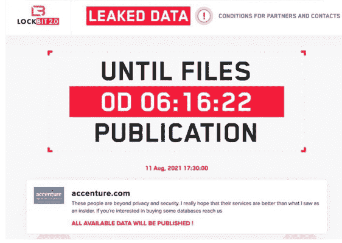
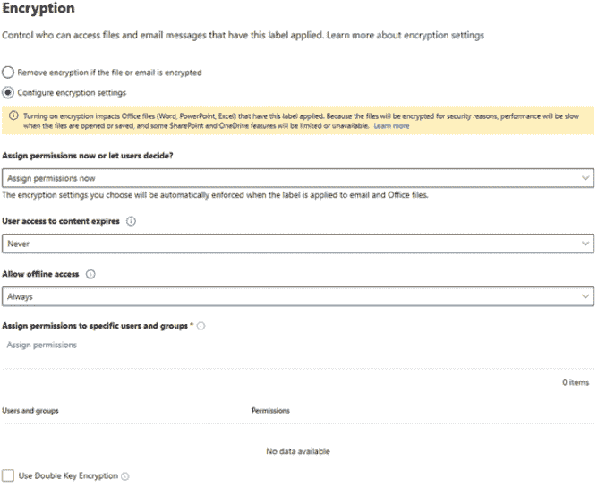
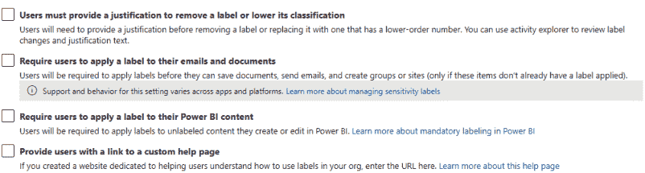
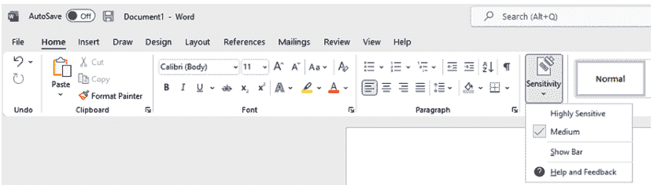
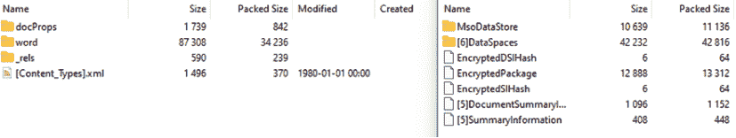
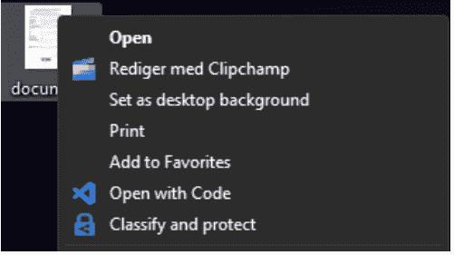
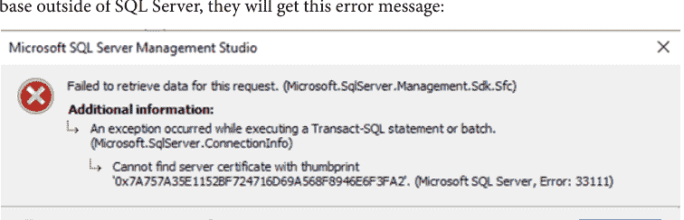

## 使用 Azure 信息保护和数据保护保护信息

近年来，大多数勒索软件攻击已从仅加密数据转变为既加密又窃取数据。原因是大多数公司意识到他们只需要从备份中恢复加密文件，这意味着勒索软件组织不会得到任何付款。因此，为了增加获得付款的可能性，勒索软件组织开始窃取他们能找到的任何数据。

在本章中，我们将了解如何使用服务来加密数据以降低数据落入错误之手的风险。我们将仔细研究 Windows 和 Azure 信息保护（AIP）中的一些内置服务，最后介绍一些与数据保护和备份相关的常见最佳实践。

在本章中，我们将介绍以下主题：

- 为什么要对数据进行分类和加密
- AIP 概述
- DLP 功能与 AIP 的未来
- 基于 SQL 的工作负载加密
- 数据保护和备份的最佳实践

### 技术要求

在本章中，我们将使用 AIP 的功能来介绍 Microsoft E5 的一些功能。如果你在前面的章节中注册了试用许可证，那么你已经可以使用我们将在本章中介绍的功能。


如果您还没有注册，可以使用此链接注册 E5 试用版：https://go.microsoft.com/fwlink/p/?LinkID=2188847&clcid=0x409&culture=en-us&country=US.

## 数据外泄

想象一下，你登录到自己的计算机或管理服务器，却发现系统已被加密，桌面上有一封勒索信，声称你的数据已被窃取。随后，你收到通知，如果不支付赎金，你的所有数据将被公开在网上。这些数据可能包含机密信息。2020年，芬兰一家名为 Vastaamo 的私人心理治疗服务提供商的病人数据库遭到黑客攻击，并被泄露到暗网。该病人数据库包含3万名患者的病历记录，这些信息随后被用来直接敲诈服务提供商和患者本人。

在过去两年中，我们看到大多数勒索软件攻击都采用这种策略。在撰写本书时，最新的攻击之一是针对思科（Cisco）的。攻击者声称他们在2022年6月的一次攻击中窃取了2.8 GB的数据。

此外，像埃森哲（Accenture）这样的公司在2021年8月也受到了 LockBit 攻击的影响，攻击者团伙声称窃取了6 TB的数据。攻击者还建立了一个反向拍卖网站，如下图所示：



图 7.1 – LockBit 泄露数据页面

虽然转储中包含的数据似乎大部分来自 PowerPoint 和案例研究，但这表明即使是大型企业也可能没有适当的安全机制，因此确保数据受到保护非常重要，以防有人设法访问你的数据。

由于文件服务器或 OneDrive、Google Drive、SharePoint 甚至 SQL Server 中存储的大多数文件默认情况下并未加密，如果有人设法访问存储在那里的文件，他们可以直接打开它们。

## 数据分类

关键问题是，我们应该加密所有数据吗？我们能加密所有数据吗？是否所有数据都应使用相同的加密方法进行加密？

这就是数据分类发挥作用的地方，当我们开始进入 AIP 时，它也将发挥作用。数据分类可以定义为按类别组织数据的过程，从而使其更容易被使用并得到更有效的保护。

虽然我们不会在本书中深入介绍这一点，但我们将在这里进行一个高层次的概述。

我们可以将组织中的所有数据分为三个不同的敏感度级别：

- **低敏感度**：公共网站、新闻稿
- **中敏感度**：不含机密数据的电子邮件和文档
- **高敏感度**：财务记录、知识产权

我们可能有一些低敏感度的信息，这些信息应该对公众开放，因此，为了让公众能够直接阅读内容，这些信息不应加密。默认情况下，电子邮件不加密，电子邮件中发送的附件也不加密。

然后，我们有高度敏感的文档，例如财务记录或个人信息，如患者病历，这些是我们想要保护的数据。

我们如何根据敏感度级别对这些数据进行分类？我们可以采用三种主要方法：

- **基于内容**：基于内容的分类是一个评估数据内容并根据评估结果对数据进行分类的过程。例如，如果文件包含个人信息（如社会安全号码），则会被归类为高度敏感。这种类型的分类通常由分类软件处理，该软件扫描内容以查找特定模式，并在找到匹配项时相应地对数据进行分类。
- **基于上下文**：当数据由某些软件生成时（例如财务数据或人力资源系统），数据应自动分类为高度敏感。例如，如果你有一个使用后端数据库的人力资源系统，该系统上的所有内容都应定义为高度机密。这通常通过手动方式完成，即在数据级别启用加密，或者由软件自动为数据添加敏感度级别。
- **基于用户**：这是指处理数据的用户决定如何对其进行分类。如果用户知道某些文档包含高度敏感的信息，他们应该能够在数据上定义相应的级别。

通常，你会使用所有这些方法，因为某些数据需要用户交互，而其他数据将根据生成数据的系统自动分类。

## Azure 信息保护

对数据进行分类是保护数据的第一步；然而，它并不会自动加密数据。因此，你需要一个能够根据数据上已定义的敏感度标签来加密数据的产品/服务。

虽然市场上有许多产品具备这种能力，但我们将重点介绍微软的一项服务，称为 **Azure 信息保护**。

AIP 具有广泛的功能；它包括一个可安装在最终用户机器上的标签客户端，该客户端已集成到文件资源管理器和 Office 应用程序中。这意味着用户可以自动标记文件和数据，然后客户端可以自动加密这些文件和数据。

AIP 还有一个本地文件扫描器，可用于扫描网络和文件共享中的敏感内容，并根据已定义的策略自动应用分类和保护标签。

> **注意**
> 
> AIP 需要使用 Microsoft E5 或 Azure AD P2 许可证。根据你所拥有的许可证类型，功能级别也有所不同。你可以在此处查看不同的功能和许可证级别：https://docs.microsoft.com/en-us/office365/servicedescriptions/microsoft-365-service-descriptions/microsoft-365-tenantlevel-services-licensing-guidance/microsoft-365-security-compliance-licensing-guidance.

在撰写本书时，AIP 和其他合规性功能已移至名为 Purview 的另一个产品系列下，因此门户名称或我们在 UI 中看到的菜单可能与本书中使用的有所不同。要执行下一步设置一些示例标签，你需要拥有一个 Azure AD 租户，或者你可以创建一个新租户来使用。

如果你已注册试用版或正在使用现有租户，可以从 Microsoft 365 管理中心内的合规性门户访问 AIP 功能，你可以在此处找到该门户：https://compliance.microsoft.com/homepage.

## 为标签命名并创建工具提示

你为此标签选择的保护设置将立即应用于其所应用的文件、电子邮件或内容容器。带标签的文件无论保存在何处（无论是保存在云中还是下载到计算机）都将受到保护。

名称 *

输入一个友好名称

显示名称 *

输入显示名称。这是你的用户将在发布该标签的应用中看到的名称。

面向用户的说明 *

输入有助于用户理解此标签用途的文本

面向管理员的说明

输入对管理此标签的管理员有帮助的说明

图 7.3 – AIP 创建新标签

单击“下一步”。现在，我们需要定义标签的范围。如下图所示，我们有三个不同的选项。对于此场景，我们将选择“项目”。

## 定义此标签的范围

标签可以直接应用于文件、电子邮件、SharePoint 网站和 Teams 等容器、Power BI 项目、架构化数据资产等。请告诉我们你希望在哪里使用此标签，以便配置适用的保护设置。了解有关标签范围的更多信息

项目
为带标签的电子邮件、Office 文件和 Power BI 项目配置保护设置。还可以定义自动标记条件，以自动将此标签应用于 Office 中的敏感内容、Azure 中的文件等。

组和网站
配置隐私、访问控制和其他设置，以保护带标签的 Teams、Microsoft 365 组和 SharePoint 网站。
要将敏感度标签应用于 Teams、SharePoint 网站和 Microsoft 365 组，必须先完成这些步骤以启用该功能。

架构化数据资产（预览）
将标签应用于 Microsoft Purview 数据地图中的文件和架构化数据资产。架构化数据资产包括 SQL、Azure SQL、Azure Synapse、Azure Cosmos、AWS RDS 等。
要将此标签应用于架构化数据资产，必须先为 Microsoft Purview 数据地图启用标签功能。你可以从“标签”页面执行此操作。了解有关 Microsoft Purview 数据地图标签的更多信息

图 7.4 – AIP 标签的范围


可以将标签分配给以下对象：

- **项目：** 这适用于使用 AIP 客户端手动标记的电子邮件、Office 文件和其他非 Office 文件。
- **组和网站：** 这适用于 Microsoft Teams 网站、Microsoft 365 组（原 Office 365 组）和 SharePoint 网站。
- **架构化数据资产：** 由于此功能处于预览阶段，此链接说明了它适用于哪些类型的数据，因为这些数据可能会变化：`https://docs.microsoft.com/en-us/azure/purview/how-to-automatically-label-your-content#scan-your-data-to-apply-sensitivity-labels-automatically`

接下来，我们可以定义是要应用加密还是使用自定义内容（如页眉、页脚或水印）标记文件。在此示例中，我们选择加密项目，这将为我们提供以下屏幕截图所示的设置。



图 7.5 – AIP 的加密机制

单击**向特定用户和组分配权限**，然后向标签分配权限。在此示例中，如下面的屏幕截图所示，让我们选择**添加组织中的所有用户和组**，然后单击**保存**。

## 分配权限

只有您选择的用户或组才会被授予使用带有此标签的内容的权限。您可以从现有权限（如共同所有者、共同作者和审阅者）中进行选择，或者根据您的需求自定义权限。

- 添加组织中的所有用户和组
- 添加任何经过身份验证的用户
- 添加用户或组
- 添加特定的电子邮件地址或域

0 个项目

图 7.6 – 向 AIP 标签分配全局权限

我们可以指定权限，或者允许用户在文件上设置标签时自行分配权限。

在“加密”页面上，您还应该注意另一个设置，即“使用双密钥加密”。默认情况下，存储在 Office 365 中或使用 AIP 加密的所有内容都使用由 Microsoft 管理的加密密钥。这当然意味着 Microsoft 拥有所有数据的所有密钥。使用双密钥加密，我们可以使用 Microsoft 的密钥以及我们自己的密钥对数据进行加密。如果启用了此功能，Microsoft 理论上无法访问数据。

双密钥加密需要设置加密 Web 服务，以便在加密或解密文件时能够访问该服务。但是，如果您丢失了自己的密钥，那么您将失去对数据的所有访问权限，因此，如果您出于合规性原因计划实施双密钥加密，请确保从知名供应商（如 Thales）实施双密钥服务。

您还可以指定是否应根据内容自动应用敏感度标签，但我们暂时将其留空。

现在，单击“下一步”和“完成”以保存标签。然后重复同样的操作，将另一个标签命名为“中等”。另外，这里我们不选择“加密项目”，而是选择“应用内容标记”，然后单击“下一步”。然后打开“内容标记”并勾选“添加水印”。然后输入水印文本，如下面的屏幕截图所示：

## 内容标记

- 添加水印
- 自定义文本
- 公司敏感

图 7.7 – 在标签上添加水印

然后，单击**下一步**以保存新的策略标签。

既然我们有了两个标签，让我们将它们分组为一个策略并发布给我们的用户。返回合规门户中的**信息保护**菜单，单击**标签策略**，然后选择**发布标签**。

接下来，选择先前创建的现有标签，然后单击**下一步**。此时，您将看到一些自定义选项，如下面的屏幕截图所示。

## 策略设置

为包含在此策略中的标签配置设置。



图 7.8 – 为标签定义高级设置

但是，只需保持设置不选中并单击**下一步**，直到进入向导的最后部分。为策略命名并单击**提交**。

如果尚未选择，您可以在**标签策略**菜单中选择策略，并单击**发布标签**。然后，这些标签将发布到 Office 配置服务，并在接下来的 24 小时内，作为 Microsoft Office 中的一个选项，对您 Azure AD 租户内的所有用户可用，如下面的屏幕截图所示。



图 7.9 – 在 Microsoft Word 中定义标签

如果我们选择**高度敏感**，文档应自动由 AIP 服务加密。如果您在 Microsoft Word 中创建两个文档，并将一个文档保存为带高度敏感标签，另一个文档不带任何敏感度标签，您会注意到在其他 Word 阅读器中无法检查带高度敏感标签的文档。

一个有趣的事实是，Word 文件只是压缩的 XML 文件，因此如果您使用 7-Zip 打开 Word 文档，您将看到 Word 文件的内容。在下面的屏幕截图中，您可以看到左侧普通 Word 文件和右侧加密文件之间的内容差异。



图 7.10 – 使用 7-Zip 检查两个 Word 文件，其中右侧文件已加密

虽然此功能适用于 Microsoft Office 文件和数据，那么非 Office 文件呢？在这种情况下，我们可以使用 AIP 客户端，您可以从此处下载：`https://www.microsoft.com/en-us/download/details.aspx?id=53018`。

当您安装 AIP 代理时，您将在 Windows 文件资源管理器中使用一些额外功能，如下面的屏幕截图所示。如果您左键单击文件，然后右键单击，您将看到**分类和保护**选项。



图 7.11 – AIP 右键单击扩展功能

在这里，您也会看到与 Microsoft Office 中相同的标签。一旦文件被定义为受保护，您将看到图标位图更改为 AIP 徽标。

如果您在常规 TXT 文件上使用此功能，并在加密后尝试打开该 TXT 文件，您将看到内容不再可读。

最后，应该指出的是，如果使用不当，AIP 的功能可能会产生一些不良副作用，例如，如果有用户离开了公司，而他们是对某些文件有访问权限的唯一人员。

幸运的是，在 AIP 中，我们有一个称为超级用户的访问角色，它始终对权限管理服务拥有完全控制权。这意味着他们可以修改对使用 AIP 加密的文件或数据的访问权限。但是，此功能默认未启用，并且不会自动为用户分配该角色。

要将用户添加到超级用户角色，您需要使用 AIP PowerShell 模块。要安装和配置 AIP 超级用户，请在您的计算机上打开 PowerShell，并首先安装以下模块：

```
Install-Module -Name AIPService
```

然后，使用以下 PowerShell 命令向 AIP 服务进行身份验证，该命令将触发一个浏览器窗口，您需要使用在 Azure AD 租户中具有全局管理员角色的用户进行身份验证：

```
Connect-AIPService
```

接下来，使用以下命令启用超级用户功能：

```
Enable-AipServiceSuperUserFeature
```

现在，您可以使用以下命令并指定用户的电子邮件地址，将用户添加到超级用户角色。在此示例中，我使用了我的电子邮件地址：

```
Add-AipServiceSuperUser -EmailAddress msandbu@msandbu.org
```

然后，您可以使用以下命令根据文件路径查看文件的分类级别：

```
Get-AIPFileStatus -path
```

如下面的屏幕截图所示，我们可以查看存储在桌面文件夹中的所有文件的 AIP 状态。这还包括标签状态，以及文件是否在 IsRMSProtected 属性下使用 AIP 进行保护：


Figure 7.12 – 查看文件的分类

接下来，使用以下命令移除文件的保护机制：

```
Set-AIPFileLabel C:\locationofthefile -RemoveProtection
```

你也可以使用 PowerShell 命令在需要时移除标签、更改标签或批量移除文件的保护。只要记住，在完成移除或更改文件后，你应该使用以下 PowerShell 命令禁用超级用户功能：

```
Disable-AipServiceSuperUserFeature
```

使用 AIP 是对数据进行分类和加密的一种方式。这可确保攻击者无法查看数据，并降低知识产权落入错误人之手的风险。

需要注意的是，使用此功能需要适当的终端用户培训，并且该功能适用于常规终端用户文件，但不适用于由应用程序或服务器基础设施使用的文件。

我们在这本书中尚未涉及的最后一件事是使用 Microsoft Defender for Cloud Apps 及其与 AIP 的集成。

Microsoft Defender for Cloud Apps 允许从 AIP 自动应用敏感性标签。这些标签可以在 Cloud Apps 中作为治理操作应用于文件，并且也可以根据标签的配置自动加密文件以提供额外的安全性。

并非在你使用第三方应用程序使用 SQL Server 的情况下。在我个人的经验中，很少有应用程序或应用程序供应商支持或测试过 Always Encrypted。使用 TDE，数据的加密和解密由数据库系统处理，并且加密过程对应用程序是透明的，这意味着应用程序无需专门设计来处理数据的加密和解密。

在此链接中，你可以找到使用 TDE 与 SharePoint 结合的示例：https://social.technet.microsoft.com/wiki/contents/articles/34201.configuring-tde-in-sharepoint-content-databases.aspx。

TDE 不加密实时通信流，如果攻击者设法获得对 SQL Server 实例的访问权限并知道如何登录 SQL 服务和管理工具，他们可以使用查询对数据进行操作然后将其导出。然而，攻击者更感兴趣的是转储数据库文件并将其导出到外部位置，因为他们希望尽快进出。现在，如果主数据库文件（MDF）使用 TDE 加密并且有人设法将其导出，他们将无法读取内容。

TDE 对数据和日志文件进行实时 I/O 加密和解密，而不会产生太多性能开销。据估计，TDE 使用的 CPU 增加在 3% 到 5% 之间；然而，如果大部分数据缓存在内存中，则可能更低。

那么，TDE 如何帮助抵御勒索软件攻击？如果攻击者设法访问 SQL 数据库，他们将无法在没有加密密钥的情况下打开文件。如果他们尝试在 SQL Server 之外打开数据库，他们会收到此错误消息：



Figure 7.13 – 打开 TDE 加密的数据库

以下是如何在现有数据库上使用自签名证书启用 TDE 的快速示例。需要注意的是，使用自签名证书并不是最佳实践，而且在设置 TDE 时使用外部密钥管理系统时你有一些选择，例如以下内容：

- Azure Key Vault with SQL Connector：Azure Key Vault 集成仅适用于 SQL Server 的 Enterprise、Developer 和 Evaluation 版本。从 SQL Server 2019 开始，Standard 版本也受支持。
- **HashiCorp Vault with Key Management for SQL Server：** 这需要 HashiCorp Vault 的 Enterprise 版本。

为 SQL Server 设置 TDE 需要你拥有一个数字证书，该证书将被导入到用于读取/写入数据库的 SQL Server 实例中。

> **Note**
> 此设置的完成应使用官方 PKI 服务或使用前面提到的一些功能来提供证书生命周期管理。

为此，我们将使用以下命令使用 PowerShell 生成自签名证书：

```
New-SelfSignedCertificate -Subject sqlserver.local
```

这将创建一个自签名证书，该证书存储在 SQL Server 上的本地证书存储中。接下来，你需要在 SQL Server 上安装 SQL Server Management Studio 或 Azure Data Studio 工具以供使用。需要注意的是，TDE 需要在生产环境中启用 Enterprise 版本，但在 Evaluation 和 Developer 版本上也有效。

当你在 SQL Server 上打开管理工具时，你首先需要在系统数据库上运行以下命令：

```
USE [master];
GO
CREATE MASTER KEY ENCRYPTION BY PASSWORD = 'somePassword';
GO
```

完成此操作后，数据库将使用 TDE 进行静态加密。这意味着只有本地数据库服务器才能读取/写入数据库内容。在大多数勒索软件案例中，攻击者会尝试停止具有 NTFS 文件锁的服务，例如 SQL Server 服务，如果他们尝试复制出数据库文件，他们将无法读取内容。

这是锁定对 Microsoft SQL 数据库访问的一种方式，这些数据库在大多数企业中常用，这将使我们能够确保在数据外泄的情况下，攻击者将无法直接访问内容。

## 备份和数据保护的最佳实践

在勒索软件攻击发生时，最重要的事情之一就是拥有数据的备份。这可以确保在需要时能够快速恢复关键系统和数据。不幸的是，我们见过勒索软件攻击者也设法加密存储在备份服务器上的数据，包括异地备份的情况，因为两个数据位置都很容易从主网络访问，并且作为 SMB 共享可用。

虽然有许多不同的备份产品和供应商，但有一些通用的最佳实践，你应该遵循以保护备份免受勒索软件攻击：

- 遵循备份的 3-2-1 规则，这意味着你有三份数据副本，跨越两种不同的介质，可以是磁盘和磁带或磁盘和基于云的备份。最后，将一份数据副本放在异地。
- 确保你的备份服务器不能直接从你的主环境访问；将其保留在单独的管理域中。如果可能，确保你的备份服务器不能直接从虚拟化层访问。曾有案例显示攻击者能够通过 vSphere Client 访问备份服务器。
- 确保你的备份数据可以存储在超高韧性的介质上。我们也见过备份数据被加密的情况，因为数据存储在常规 Windows 文件服务器上。如今大多数备份供应商都支持使用不可变备份，这意味着一旦备份数据写入后，就无法修改。例如，Veeam Backup & Replication 具有 hardened repositories 功能，其中数据存储在 Linux 文件服务器上使用 XFS 文件系统，或者你也可以使用云服务，如 S3 对象存储。
- 让备份服务与 AD 域断开连接也有助于降低备份服务器在攻击者设法入侵你的 AD 时受影响的风险。
- 确保你在备份作业上启用加密。这可确保如果有人设法访问备份数据，他们将无法读取加密的数据。
- 最后，定期检查备份的状态并确认它们已成功执行至关重要。此外，验证备份文件的完整性以确保在灾难发生时数据可以正确恢复也至关重要。为此，你可以使用各种工具，例如校验和或文件比较软件，来验证备份文件是否与原始数据匹配。还建议定期执行测试恢复，以确保在紧急情况下备份文件可以成功恢复。

关于检查备份状态，许多供应商都内置了备份验证功能。许多这些备份产品可以根据备份数据在隔离网络中自动启动虚拟机并运行测试以验证数据的完整性。

## Summary

在本章中，我们学习了如何配置和使用 AIP 来对数据进行分类和加密，以最大程度地降低恶意行为者访问信息的风险。

我们还研究了使用其他功能来加密其他数据源，例如 SQL Server 和文件服务器。


