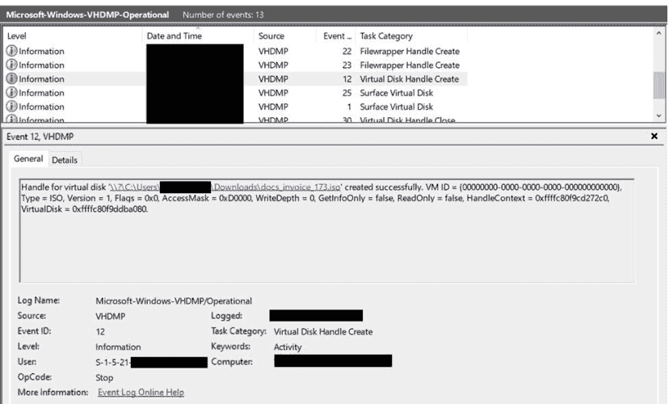
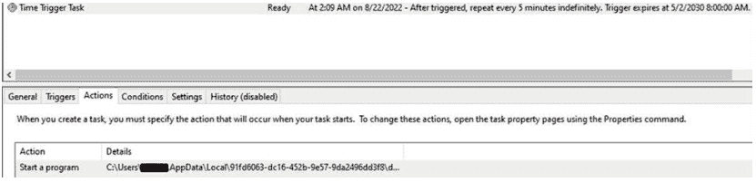
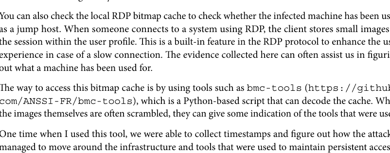

### 勒索软件取证

无论设置了多少防御措施，或安全边界有多先进，我们都不可能 100% 免受网络攻击。因此，始终重要的是：一旦遭到攻击，要知道该怎么做，并尝试通过事后审查来弄清楚攻击是如何发生的。

许多曾遭受勒索软件攻击并支付了赎金的组织，在初次攻击后仅几周就再次遭到攻击，因为他们无法封堵漏洞或实施适当的防御措施。

在本章中，我们将涵盖以下主题：

- 勒索软件取证——以及一旦遭到攻击该怎么做
- 在文件系统、注册表和基础设施事件中要查找什么
- 判断勒索软件的类型，并研究最常见的攻击向量
- 确保在系统恢复运行后移除被利用的入口点

### 你中了勒索软件，现在该怎么办？

如前所述，已有多个案例报告显示，刚从勒索软件攻击中恢复的组织，在初次攻击后仅几天或几周内便再次遭到攻击。

这是因为攻击发生后的主要工作重心放在从备份中恢复系统和基础设施，或重新搭建系统，以确保 IT 系统对最终用户保持可用。问题在于，如果再次发生新的攻击，当你需要重复同样的流程时，所有时间和精力都将付诸东流。

因此，重要的是建立起相应流程，确保你也能查明攻击是如何发生的，并封堵该漏洞或移除相关的攻击向量。

- 使用诸如 ID Ransomware 网站（可在此处找到：https://id-ransomware.malwarehunterteam.com/）之类的服务来验证勒索软件变种。我们可以在此网站上上传受感染机器上生成的示例文本文件。这有助于识别你的基础设施中使用了哪种勒索软件。当我们识别出所使用的勒索软件类型后，可能也会得到一些关于使用了哪种攻击向量的线索。这很有用，因为该服务还会通知你是否存在可用的解密工具。
- 如果未从 ID Ransomware 网站获得任何信息，请收集受攻击设备上勒索软件创建的文本文件中的网址和参考信息。在大多数情况下，你都能获得关于是哪个勒索软件组织发动了攻击的明确信息。
- 列出所有应被通知的人员名单，并使用可用的服务（如 Microsoft Teams、Slack 或其他渠道）建立沟通流程。在这些不同阶段，拥有协作手段始终非常重要。

一旦我们验证了事件并收集了有关所面对的是哪种勒索软件攻击的信息，在大多数情况下，互联网上可能会有大量关于所使用的特定勒索软件变种及其典型攻击向量的信息。这些信息有助于更轻松地确定入口点。

### 第二阶段——发现影响范围

一旦我们确认已受到勒索软件攻击，就需要了解攻击的影响范围。有多少终端和服务器已被入侵？

需要注意的是，除了技术调查之外，如果你的组织所在国家是欧盟成员国，因此需要遵守 GDPR，你还需要立即通知监管机构，最迟不得超过知悉违规后的 72 小时。此外，你还应联系当地有关部门。

以下是涉及的步骤：

- 验证如何判断机器上是否存在勒索软件，可以通过查看桌面背景的变化，或桌面上/机器上的特定文件扩展名来判断。如果某台机器上的文件扩展名已变为 CRYPT 或其他扩展名，这可能是验证勒索软件变种类型的第一条线索，也是判断机器是否已被入侵的一种方式。请记录下来，并告知员工如何验证他们的机器是否受到了攻击影响。应使用电子邮件以外的渠道通知员工，因为电子邮件服务可能因攻击而不可用。应指定专人负责收集受影响终端员工的信息。这是为了建立攻击时间线——最终用户何时注意到变化——同时记录他们最近是否收到过可疑电子邮件。这些步骤应由服务台处理。你还应准备预定义的模板，用于告知最终用户发生了什么以及他们应该做什么。
- 重置管理员和用户账户的凭据，尤其是如果你有同步到云服务的账户。这是为了确保即使攻击者获取了用户账户信息，也无法利用这些信息访问其他云服务。如果由于域控制器或身份同步服务不可用而无法重置凭据，至少应限制对云服务的登录访问，直到你能妥善重置凭据。此外，你还应撤销 Azure AD 中所有用户账户的令牌。这是为了降低攻击者利用凭据访问基于 Azure AD 的服务（如 Microsoft 365）的风险。
- 在调查阶段，告知最终用户发生了什么以及这对他们的影响。重要的是要用通俗易懂的语言向他们解释，以及这次对 IT 基础设施的攻击如何影响他们工作和访问内部系统的能力。虽然这些步骤很耗时，但必须确保最终用户理解攻击的后果。如果可能，你还应编写一份简短的常见问题解答，分享给本地服务台。
- 在禁用出站连接后，登录关键服务器以验证它们是否受到影响。最初的重点应放在域控制器和备份服务器上。其次，应检查文件服务器或其他存储服务是否受到影响。最后，再检查基础设施中的其他各种服务器。如果环境较大且在攻击后可见性有限，则从不同网段中的服务器中抽取一些随机样本来验证影响范围。
- 如果你能访问 EDR 工具或 SIEM 机制等系统，请尝试扫描具体的失陷指标。如果这些服务不可用，请手动检查文件更改。同时尝试查看不同网络区域或网段中是否有未受影响的系统。这可以让你了解哪些区域是可被访问的。在 SIEM 和 EDR 工具中，查找*第 1 章*中引用的已知工具和脚本，以寻找失陷指标。EDR 工具还可以用于检查外部通信。一旦确定某个系统已被入侵，请尝试将该系统从网络中隔离，以防止进一步入侵。
- 检查防火墙或 IDS 日志中是否有通往任何命令与控制服务器的出站流量。在大多数情况下，组织记录网络流量的窗口很短，因此务必确保攻击发生时间窗口内的日志不会被新流量覆盖。尝试将日志导出到可用于检查的干净系统中。
- 检查防火墙/IDS 日志中是否有任何数据外泄的迹象，这一点也很重要。根据你所拥有的供应商和可见性不同，通常最容易的方法是检查是否在大量数据出站流量中出现了不熟悉的 IP 地址。某些防火墙供应商还能提供更深入的可见性，使你能够了解是否存在高数据出站流量，并显示使用了哪种协议和哪个 IP。在大多数涉及数据外泄的勒索软件案例中，攻击者要么使用 HTTPS，要么使用 FTP，这正是你应当关注的。另外，请记住


大多数防火墙日志的保留期很短，因此请务必尝试导出一份防火墙日志的副本，以供后续进一步检查。

- 检查在上一次备份之前数据是否已遭到破坏。通过将最后一次成功的备份还原到隔离环境中，您可以验证数据的完整性。必须将其设置在隔离环境中，以确保备份数据不会遭到破坏。大多数攻击发生在夜间，有时您可能恰好在攻击发生前的夜间成功完成备份，这样可以最大限度地减少数据丢失。部分勒索软件攻击在初始加密过程之前还会使用 Windows 中的 vssadmin 工具来删除所有卷影副本并修改服务，这可能会影响系统备份。如果您在备份服务中发现某些服务器昨晚未能成功备份，这可能表明这些服务器首先被感染了。

那么，如果攻击期间我们所有的服务器、终端用户计算机和备份数据都已遭到入侵，该怎么办？幸运的是，我们有异地备份，其中包含一些近期数据，或者我们的大部分业务数据存储在公有云中，例如电子邮件/文件/ERP 系统。如果没有，那选择就非常有限。您可以检查是否存在针对特定勒索软件变种的解密工具。

如果您正在与攻击者谈判，并要求他们提供备份服务器的解密密钥以测试解密工具，他们很可能会直接拒绝，并索要更高的价格。有一次，我很幸运，成功与勒索软件运营者协商，获得访问其中一台服务器的权限，以检查解密工具是否有效，而那台服务器恰好是包含所有备份数据的备份服务器。随后我得以从备份中恢复数据。

我之所以能够做到这一点，是因为勒索软件运营者对该环境中使用的备份工具并不熟悉，因为该备份产品并非知名品牌。其次，该服务器的名称并没有反映出它是一台备份服务器。因此，我运气不错，而且我们在收集到的网络日志中也看到，数据很可能并未被泄露。

勒索软件运营者会为每台被加密的服务器收集元数据，因为每台服务器都有自己唯一的加密密钥。这是为了确保您无法在多个服务器上使用相同的解密工具。有时，他们可能会给您一个可用于解密测试服务器或某些文件的工具，只是为了向您证明解密工具是有效的。

## 第三阶段——了解攻击途径以及需要关注的内容

一旦我们确定了所使用的勒索软件变种，并判断出攻击影响了多少系统和终端，下一步就是尝试弄清楚攻击是如何发生的。

例如，如果我们确定我们受到 Quantum 勒索软件的入侵，我们可以通过 ID Ransomware 服务或在受害机器上发现的勒索文本文件中的证据来验证这一点。然后，我们查看互联网上公开可用的相关信息，了解勒索软件通常使用哪些机制来获得访问权限。

在查看公开信息后，我们得知 Quantum 主要以钓鱼邮件作为初始攻击途径。接下来，如果没有用户报告可疑邮件，我们需要检查是否有任何日志可以表明在过去 24 小时内是否有人在其机器上打开了附件。

当然，这一步取决于您是否能够轻松访问服务的电子邮件流量日志。例如，如果您同时使用了 Microsoft Defender for Endpoint 和 Microsoft Defender for Office，您会有审计日志，可以从中检查是否存在包含恶意附件的钓鱼邮件的迹象。

通过使用 Microsoft Sentinel Kusto 查询（如下代码示例所示），我们可以轻松找出过去 24 小时内通过电子邮件发送到我们组织的附件类型：

```
```kusto
EmailAttachmentInfo| where SenderFromAddress !contains
"nameofinternaldomain.com"
| summarize count() by FileType
```
```

这将针对 EmailAttachmentInfo 日志源表运行查询，该表包含发送到我们组织的所有带附件电子邮件的日志。最初，我们可以选择通过应用筛选器将内部发件人从结果中排除。最后，我们可以通过按文件类型对传输的文件进行分类来汇总结果。

我们应该重点关注的是压缩文件或具有异常类型的文件，例如 .lnk、.exe 或其他类型。

我们还可以添加额外的筛选器，排除我们认为无需进一步调查的文件类型，例如 .png、.jpeg 和 .pdf 文件，因此筛选器将如下所示：

```
```kusto
EmailAttachmentInfo
| where SenderFromAddress !contains " nameofinternaldomain.com
"
| where FileType !contains "png" and FileType !contains "jpeg"
| summarize count() by FileType
```
```

现在，我们已经将范围缩小到少数我们认为可疑、需要进一步调查的事件。这个审计日志的一个问题是它只跟踪带附件的电子邮件，并不能为我们提供任何关于用户实际上是否在其计算机上点击并打开了附件的指示。

下一步是查看个人收到带有恶意附件的电子邮件并打开该内容后发生了什么。这也要求我们从用户的设备上收集日志，以便查看用户打开附件后操作系统上发生的事件时间线。

同样，这取决于您的组织使用哪种安全产品。在本示例中，我将使用 Microsoft Defender for Endpoint，它会从已载入的终端收集此类数据。首先要做的就是尝试找出用户在收到附件时使用的是哪台设备。

在这里，您还可以使用 Microsoft Defender for Endpoint 的审计日志来检查登录事件，这些事件可以指示用户登录了哪台设备。以下是一个自定义查询示例，通过输入用户名，即可找到用户登录过的计算机：

```
DeviceInfo
| where LoggedOnUsers[0].UserName == "username"
```

从这里，我们可以看出用户在过去两个月中是否使用过某台特定设备。下一步是查看从打开电子邮件附件到首次攻击发生之间，机器上发生了哪些进程或变化。

## 手动处理方式

在某些情况下，我们可能无法获得同等的可见性，因为我们的终端上可能没有安装这些类型的 EDR 产品。这就需要我们采用更手动的方法来处理此过程。

我们需要检查一些主要内容，以尝试寻找证据：

- 本地文件系统和运行内存
- 事件日志
- 任务计划程序和 BITS
- 注册表更改
- 来自安全产品（如 Microsoft Defender 或第三方安全工具）的证据

希望您能大致了解是哪个用户打开了附件，以及该计算机是否仍使用该用户的凭据登录，这样您就能洞察机器上正在运行的任何内容。

如果用户已注销或停止了机器，您应尝试使用本地管理员帐户（如果有的话）登录该机器；只需确保该机器未连接到网络即可。

您需要从很多地方开始深入检查机器，以尝试弄清楚发生了什么。首先，检查是否有任何安全产品检测到威胁，以及已采取了哪些操作。在大多数勒索软件攻击中，攻击者通常会先禁用任何安全产品，因此您通常不太可能在那里找到任何东西。


第一步是检查操作系统上是否有不需要的或异常的文件夹：

- C:\users\download（用于ISO文件、ZIP文件或INK文件）– 同时检查当前机器上是否有已挂载的文件
- C:\windows\temp（用于.exe或.bat脚本）
- C:\users\username\appdata\local\temp（用于.exe或.bat脚本）
- C:\ – 如果这里有任何时间戳较新的文件夹，大多数情况下，攻击者会创建一个临时文件夹，用于存放他们使用的脚本和漏洞利用工具。

根据此处使用的勒索软件变种，有时在其他文件中可能找不到任何线索，因为攻击者在开始加密过程之前已经删除了所有痕迹。此外，在初始侦查阶段使用的文件夹也可能因勒索软件变种而异。

如果我们在那里没有找到任何东西，第二步是尝试在事件查看器中查找异常事件，这可能会给我们提供一些线索。在以下示例中，我们有一个通过电子邮件发送的ISO文件传递的有效载荷，用户打开并执行了该恶意软件。

Windows会在事件查看器中记录ISO挂载事件，使用Event ID 12，日志位于Microsoft-Windows-VHDMP-Operational.evtx，如下面的截图所示：



图8.1 – 机器上挂载的VHD文件

此外，你还应查找以下事件ID：

- 1000 – 应用程序错误
- 1 – 服务启动
- 1102 – 审核日志已清除
- 1116 – Microsoft Defender 防病毒软件检测到恶意软件
- 1117 – Microsoft Defender 防病毒软件已采取恶意软件操作
- 4624 – 网络登录（通常表示RDP登录）
- 4688 – 进程创建事件
- 4700 – 已启用计划任务
- 7045 – 系统中安装了新服务

勒索软件也可能使用不同的机制来维持持久访问，因此检查是否存在异常的计划任务和BITS任务也很重要。首先，我们可以在事件查看器的Microsoft-Windows-Task-Scheduler/Operational事件日志下检查计划任务是否有任何更改。

> **注意**
> 你可以通过查看安全日志中的事件ID 1102来检查事件日志是否已被清除。攻击者通常会这样做以清除证据，这通常是在加密过程开始之前做的最后几件事之一。

如果事件日志已被清除，我们可以使用以下PowerShell命令检查计划任务：

```
Get-ScheduledTask | format-list
```

或者，你可以使用任务计划程序应用程序来更直观地查看不同的任务。以下示例显示了一个每5分钟运行一次的计划任务，它是STOP/DJVU勒索软件的一部分：



图8.2 – 任务计划程序显示一个用于维持持久访问的任务

介绍 Intel RealSense LiDAR Camera L515，它是一款具有高精度depth感知、适用于室内应用的小型深度摄像头。



## 主要特点

- 高精度深度感知
- 小型轻量化设计
- 适用于室内应用
- 支持多种开发平台

## 技术参数

| 参数 | 规格 |
| --- | --- |
| 深度分辨率 | 1024×768 |
| 深度帧率 | 30 fps |
| 测量范围 | 0.25m - 9m |
| 接口 | USB 3.0 |

我们可以查找作为发起进程的计划任务：

```
DeviceProcessEvents
| where FileName =~ "schtasks.exe"
| project Timestamp, DeviceName
```

此外，如果攻击者使用了其他发起进程来设置计划任务，我们可以从注册表更改中寻找指标：

```
DeviceRegistryEvents
| where ActionType == @"RegistryKeyCreated"
| where RegistryKey startswith @"HKEY_LOCAL_MACHINE\SOFTWARE\Microsoft\Windows NT\CurrentVersion\Schedule\TaskCache\Tree\"
| project Timestamp, DeviceName, ActionType, InitiatingProcessFileName, RegistryKey
```

通过在Microsoft Defender for Endpoint中运行某些查询，可以确定系统中是否添加了计划任务。虽然可能需要进一步调查注册表以确定该任务的目的，但Microsoft Defender for Endpoint也可用于检测其他已知的恶意活动，例如禁用系统还原或删除备份副本的任务。这可能表明系统存在潜在的安全威胁：

```
DeviceProcessEvents
| where FileName =~ "wmic.exe"
| where ProcessCommandLine has "shadowcopy" and ProcessCommandLine has "delete" | project DeviceId, Timestamp, InitiatingProcessFileName, FileName, ProcessCommandLine, InitiatingProcessIntegrityLevel, InitiatingProcessParentFileName
DeviceProcessEvents
| where InitiatingProcessFileName =~ 'rundll32.exe' and InitiatingProcessCommandLine !contains " " and InitiatingProcessCommandLine != "" and FileName in~ ('schtasks.exe') and ProcessCommandLine has 'Change' and ProcessCommandLine has 'SystemRestore' and ProcessCommandLine has 'disable'
```

上述示例将对所有已收集信息的设备运行查询。你还可以添加一个过滤器，仅针对特定设备运行查询，例如在查询中使用以下附加行：

```
| where DeviceName == "nameofdevice"
```

一旦我们获得了关于哪些组策略被更改以及哪些设置被更改的信息，我们应该尝试撤销这些设置。然而，在大多数情况下，我见过攻击者使用脚本自动创建应用所有这些设置的新组策略，因此删除这些策略应该能恢复大部分更改。

## 封堵入口

虽然我们主要关注如何分析勒索软件变种，但我们还需要确保能够封堵攻击者利用的入口，以免再次成为同一手法的受害者。

以我之前提到的Quantum勒索软件为例，他们的主要攻击向量往往是钓鱼邮件。然而，如果我们遭受其他方式的攻击怎么办？

时间线是理解攻击起源的重要工具。在从用户账户和日志中收集证据时，创建一条追踪可能表明初始受损的最早事件的时间线非常重要。为此，请考虑主要的入侵方法，并回溯以确定攻击可能如何发生：

- 终端用户工作站
- 公开可用的错误配置服务器
- 外部服务上的零日漏洞

如果初始入侵是通过发送给终端用户的钓鱼邮件发生的，那么确定使用了哪种附件在终端用户的机器上启动恶意软件加载程序非常重要。这些信息有助于识别攻击来源，并了解攻击者是如何进入系统的。

首先，你需要执行以下操作：

- 阻止发件人和来自该特定域名的电子邮件。这只是一个临时解决方案，因为许多钓鱼域名的生命周期很短。
- 如果发送的附件使用了不常用的畸形附件类型，请在电子邮件服务中阻止该附件类型。
- 如果攻击使用了已知的文档附件，例如.docx或.xlsx，我们需要分析该附件。将包含恶意文档的附件上传到virustotal.com等分析网站。例如，这里有一个VirusTotal报告，显示了与Microsoft Office中名为Follina的零日漏洞相关的分析，可以让我们了解VirusTotal的一些功能：https://www.virustotal.com/gui/file/4a24048f81afbe9fb62e7a6a49adbdlfaf41f266b5f9feecdceb567aec096784/detection。
- 一旦你知道使用了哪个漏洞，你需要了解如何修复该漏洞。对于Follina漏洞，微软提供了一个软件更新，可以消除滥用该漏洞的可能性，如这里所述：https://msrc-blog.microsoft.com/2022/05/30/guidance-for-cve-2022-30190-microsoft-support-diagnostic-tool-vulnerability/。

需要注意的是，终端应自动安装操作系统、浏览器和Office产品的最新安全补丁。这样就能封堵攻击者利用该漏洞的入口。

现在，如果攻击不是从终端用户开始的，而是从一个错误配置的服务开始的，例如一个通过RDP公开的服务器，该怎么办？需要注意的是，微软在Microsoft Azure中看到的最常见入口点之一是具有公共IP并开放RDP的服务器。

要检测哪些服务和端口是公开可用的，必须绘制出可从互联网访问的服务。这有助于识别任何漏洞或潜在安全风险。

查看防火墙可能会根据你使用的供应商提供一些有用的指示，但有时，为了进一步确认，我倾向于使用Nmap等工具对组织公共IP范围进行简单的端口扫描。

你可以从这里下载Nmap - https://nmap.org/download.html - 这是一个CLI工具，可使用以下命令轻松扫描IP范围：

```
Nmap -Pn 192.168.0-200
```

这将对192.168.0.0到192.168.0.200之间的整个网络进行端口扫描。-Pn选项告诉Nmap假设主机在线并跳过主机发现。它将对192.168.0-200的IP地址范围执行ping扫描，这是C类网络的私有IP地址范围。它将扫描网络上的所有主机，并尝试绘制网络地图，识别主机、操作系统及其上运行的服务。另一种选择是使用Microsoft外部攻击面管理或Shodan等工具，这些工具也可以进行更深入的扫描。

如果你发现一台服务器开放了RDP等服务，你应该查看从该服务器收集的日志，检查安全日志中是否有任何身份验证尝试，这些尝试可能表明系统已受损。如果你为该服务器启用了Sentinel，可以使用以下KQL查询来查找RDP暴力破解攻击：

```
SecurityEvent
| summarize
LOGONFAILED=countif(EventID == "4625"),
by IpAddress, Computer
```

如果你发现此查询中的服务器有大量失败的登录尝试，这很可能表明该机器遭受了暴力破解攻击。还应注意，如果你使用公共云服务托管虚拟机，你可能还需要检查云提供商提供的公共IP地址，以确认服务是否可从外部访问。


> **注意**
> 
> 本书官方 GitHub 仓库中提供了更多使用 Kusto 检测入侵的示例，可在此处找到：`https://github.com/PacktPublishing/Windows-Ransomware-Detection-and-Protection`。

第一个攻击场景可能涉及钓鱼攻击，而第二个场景可能涉及针对配置错误服务的暴力破解攻击。

在第三种场景中，可公开访问的服务可能用于合法目的，例如 VPN、远程工作和 Web 应用程序。然而，仍有可能利用零日漏洞或现有漏洞来获取对您基础设施的访问权限。定期审查和评估这些服务以确保其安全非常重要。

了解可公开访问的外部服务也很重要，例如用于网站的服务。例如，正在使用的服务和框架的映射可能包括以下内容：

- VPN（Fortinet）
- VDI（VMware Horizon）
- Web 应用程序（IIS 和 Apache），主要使用 .NET 应用程序
- 运行旧版 Java 的 Web 应用程序，用于 ERP 系统
- 电子邮件（Microsoft Exchange）

虽然可能很难确定是否使用了漏洞利用，但首先要确定每个服务的软件版本类型，并确保它们已更新到最新版本。如果没有，请确保它们运行的是最新版本，如果您怀疑其中一个外部服务存在初始入侵，请尝试查找有关该漏洞的更多信息以及缓解方法。

例如，CIS 维护着一个正在被利用的已知漏洞的最新列表，网址为 `https://www.cisa.gov/known-exploited-vulnerabilities-catalog`，在您绘制服务地图后也可以将其用作来源。

## 摘要

在本章中，我们了解了更多关于如何处理潜在攻击、如何将攻击划分为不同阶段、我们应如何在组织内部和向当局通报，以及一些寻找入侵技术证据的方法。

需要注意的是，本章提到的技术只是常用的方法中的几个例子。有效 IT 安全的关键在于拥有在需要时提供洞察的正确工具，以及及时了解最新的漏洞和攻击方法。威胁形势不断变化，因此跟踪当前威胁至关重要。这将在下一章中进一步讨论。
