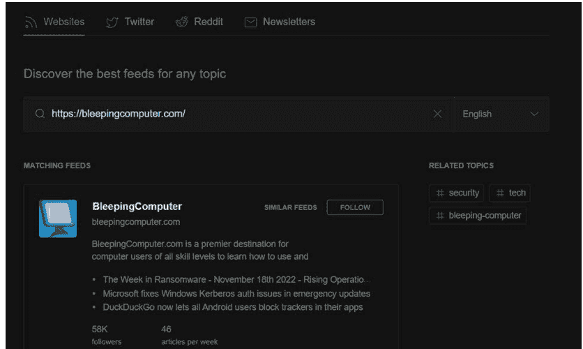
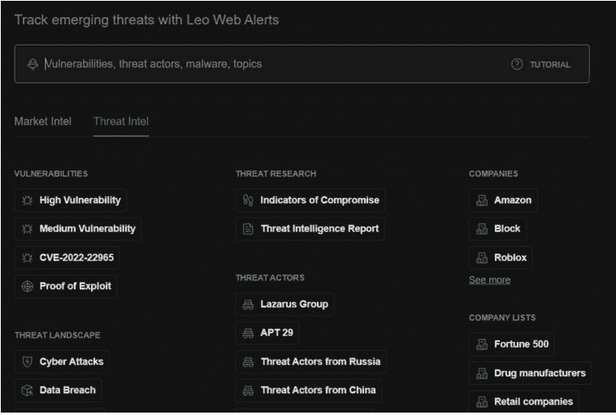
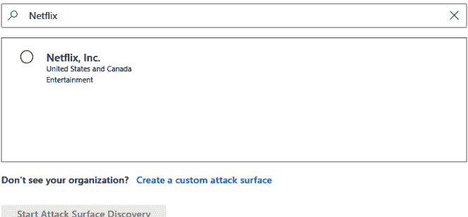
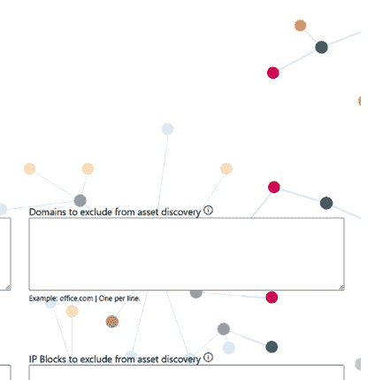
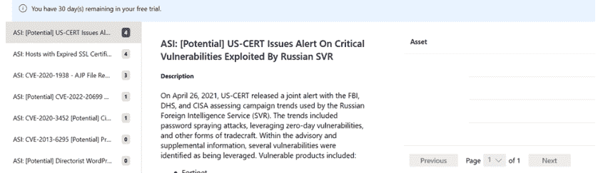
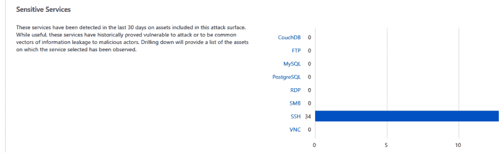
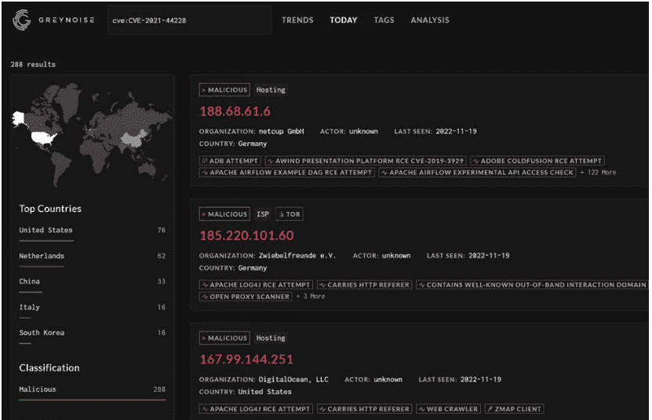

## 监控威胁形势

威胁形势不断演变，因此 IT 领域的所有人员都必须拥有工具和新闻来源，以便轻松及时了解当前威胁。

在本章中，我想提供一些建议，说明您如何使用不同的在线来源和流程来监控未来威胁的威胁形势，以帮助您保持最新状态。

本章还提供了我们过去一年所看到的趋势的见解，以及保护工作负载免受未来威胁将重要的因素。

在本章中，我们将涵盖以下主题：

- 如何监控威胁形势
- 建立流程以确保威胁得到处理
- 未来会怎样？

## 如何监控威胁形势

作为一名 IT 专业人员，我花费大量时间收集和处理信息，因此拥有工具来轻松聚合合适的信息和新闻水平非常重要。当然，收集信息的方式有很多，这里我只分享我个人收集信息的一些不同方式。

我使用的主要工具之一是 Feedly，这是一项用于使用 RSS 聚合来自不同来源的 feed 的服务。Feedly 使用简单，因此您可以轻松添加新的网站作为数据源，并且个人账户免费使用。

您可以使用社交账户在 feedly.com 免费注册 Feedly。注册后，您必须添加要关注的来源，可以通过添加单个页面或添加一堆不同来源来添加。您可以通过单击左侧的 **Following website** 按钮并将网站 URL 添加到搜索面板，然后按 *Enter* 来添加单个来源。然后您将看到您搜索的网站，如下图所示：

图 9.1 – 使用 Feedly 通过 RSS 收集网站更新

然后，您单击 **FOLLOW** 按钮将其添加为新闻来源。除了添加单个站点外，您还可以通过访问以下地址添加捆绑包：https://feedly.com/i/discover/sources/search/topic/cybersecurity。

在这里，您有一个可以关注的不同来源列表，以便轻松获取与安全新闻和更新相关信息。

此外，Feedly 还具有名为 Leo 的 AI 引擎，它还可以帮助减少重复信息的杂乱，对于威胁情报信息收集也非常有用。有了 Leo，您可以使用不同的预定义集合来从大量开放源收集信息，如下图所示：

图 9.2 – Feedly 和 Leo 网络警报配置

因此，例如，我可以监控具有高漏洞评分的来源，并在此处直接获取聚合源。替代方案是直接访问每个网站并将每个来源添加到 Feedly 的主 RSS 引擎，通过其他来源通过电子邮件获取信息，甚至手动访问每个站点获取信息。

您还可以定义不同的过滤器，例如 AND/OR，这使我们能够收集与我们基础设施中产品相关的漏洞数据，无论是 VMware、Veeam、Citrix 还是 Microsoft。

我们还可以在不访问网站的情况下将相关信息和文章直接转发到 Teams 或 Slack。需要注意的是，Leo 的功能以及将事件转发到 Teams/Slack 的能力仅在 Feedly 的企业版中可用，每位用户每月费用约为 12 美元。

此外，我个人也大量使用 Twitter 来收集威胁信息。与 Feedly 相比，Twitter 的缺点是作为社交媒体平台会有更多噪音。然而，我使用它不仅仅是为了获取威胁信息；它也有助于获取研究、其他相关新闻或故障排除问题的信息。

在 Twitter 上，您还可以创建包含预定义人员或频道的列表以供关注。但是，这需要您过滤大量噪音。更好的选择是使用不同的搜索运算符来收集可能有用的信息：

| 搜索运算符 | 查找的推文 |
|---|---|
| CVE Microsoft | 同时包含 CVE 和 Microsoft。这是默认运算符。 |
| "Office Zeroday" | 包含确切短语 – Office Zeroday。 |
| ransomware OR cve | 包含 ransomware 或 cve（或两者）。 |
| ransomware -cve | 包含 ransomware 但不包含 cve。 |
| #Zerologon | 包含 Zerologon 标签。 |

表 9.1 – 显示 Twitter 的不同搜索运算符

需要注意的是，许多信息安全社区的人也转向了 Mastodon，这是一个 Twitter 的替代品，例如 Infosec Mastodon 网络：https://infosec.exchange/。

此外，您还有其他更官方的来源可用于收集与新漏洞相关信息，例如以下内容：

- Microsoft Security Response Center：https://msrc-blog.microsoft.com/
- Cisco Talos Intelligence：https://talosintelligence.com/vulnerability_info
- VMware Security Response Center：https://www.vmware.com/security/vsrc.html

您还有更多厂商中立的网站也积极监控新漏洞，例如网络安全和基础设施安全局（CISA），它还监控已知被利用的漏洞：https://www.cisa.gov/known-exploited-vulnerabilities-catalog。

微软最近基于其在 2021 年收购的公司 RiskIQ 引入了几项新服务。此次收购后发布的产品之一是 Microsoft Defender Threat Intelligence，如果您拥有 Microsoft 365 许可证，可以在此处访问：https://ti.defender.microsoft.com/。

该服务提供不同的 SKU。您有免费选项和付费选项，后者按用户每年收费。虽然付费版本提供有关漏洞和指标的更丰富信息，但免费版本也可用于查找漏洞以及与 IP 地址相关信息。

例如，如果我输入 PrintNightmare 的 CVE ID，我可以获得有关该漏洞的详细信息，如下图所示：

## 图 9.3 – 来自 Microsoft Defender Threat Intelligence 的 CVE 信息

然而，我在此列出的大部分资源只是获取与威胁态势相关的信息和新闻的方式。最重要的一点是能够获得与您自己的环境和基础设施相关的洞察和信息。也就是说，能够看到哪些类型漏洞可能会影响您的环境和服务。

也有云服务可以用于从外部视角监控和查找服务及漏洞，就像任何攻击者一样。这些服务还可以将这些外部服务与漏洞进行映射。

在这里，我们有 Shodan.io 等选项，可用于单独搜索外部服务或设置自定义监控。

例如，我可以搜索特定漏洞并将搜索映射到特定组织或国家：

## Microsoft Defender Threat Intelligence

## CVE-2021-34527

Priority Score: 94 High | CVSS 2: 9 High | CVSS 3: 8.8 High | Published: July 03, 2021

## Description

Windows Print Spooler Remote Code Execution Vulnerability

## References (Advisories, Solutions, and Mitigation)

This information is provided "as is". Microsoft recommends that you validate applicability before implementing in your own environment.

- https://portal.msrc.microsoft.com/en-US/security-guidance/advisory/CVE-2021-34527
- http://packetstormsecurity.com/files/167261/Print-Spooler-Remote-DLL-Injection.html

| Search operator | Shodan searches |
|---|---|
| vuln:CVE-2019-19781 | Searching for services that are vulnerable to CVE-2019-19781 |
| hostname:google.com,facebook.com | Services with a hostname containing either google.com OR facebook.com |
| net:8.8.0.0/16 | Services in the range of 8.8.0.0 to 8.8.255.255 |
| org:Google | Search for services at Google |
| product:Samsung | Search for services with a product name |

Table 9.2 – Search operators for Shodan

因此，这使我能够针对自己的公共 IP 地址范围或组织名称进行搜索。最后一个选项仅在 Shodan 能够将您的组织名称映射到服务时适用，例如使用 SSL 证书中的指示符。

要能够针对您的环境设置定期监控，您需要获得付费订阅。您可以在此处阅读有关不同级别的更多信息：https://account.shodan.io/billing。

Microsoft 还提供了一项名为 External Attack Surface Management (EASM) 的服务，它提供了与 Shodan 相同的部分功能。该服务可在 Microsoft Azure 中使用，并且可以持续扫描您的环境，无论您是否有服务部署在 Azure 中。

设置很简单——您首先需要拥有一个 Azure 订阅，然后使用网络浏览器进入 Azure 门户。

> Note
> 需要注意的是，在撰写本书期间，该服务在过去几个月里经历了多次更改，并且在接下来的 6 个月内仍将继续，因此您可能会发现书中的某些部分在实际门户中不会以相同的方式出现。

在顶部的搜索面板中，输入 External Attack Surface Management 并单击第一个搜索结果。该服务使用工作区概念，用于将我们想要监控的不同资产组合在一起。

因此，首先，我们将创建一个工作区。在 EASM 页面中，单击 Create，然后输入创建工作区所需的信息，如以下屏幕截图所示：

Home > Microsoft Defender EASM >

## Create Microsoft Defender EASM Resource

Basics   Review + create

Microsoft Defender External Attack Surface Management (Defender EASM) uses proprietary technology to build a dynamic inventory of your web applications, third-party dependencies, and web infrastructure. We combine that with latest threat research and vulnerability intelligence to give you visibility into your organization's security posture.

New Defender EASM resources start with a 30-day trial. After the trial period you will be automatically billed at the standard metered rate.

## Project details

Select the subscription to manage deployed resources and costs. Use resource groups like folders to organize and manage all your resources.

Subscription *  Pay-As-You-Go

Resource group *  (New) easm-rg  Create new

## Instance details

Name *  easmwp1

Region *  Sweden Central

Figure 9.4 – Wizard for setting up Microsoft Defender EASM

需要指出的是，由于该服务是新的，您在放置服务的位置上可能选择有限。一旦工作区配置完成，它将自动开始 30 天的免费试用。

输入信息后，单击 Next 然后单击 Create。服务配置完成后，进入该资源，我们现在必须添加一些搜索参数。在默认向导中，您可以选择从 Microsoft 管理的预建列表中添加组织，以便尝试搜索您自己的组织，看看是否会出现，如以下屏幕截图所示：

## Welcome to Microsoft Defender External Attack Surface Management (EASM)!

Microsoft maintains an inventory of internet-facing devices and services (assets) which can be used to discover an organization’s attack surface.

Search from a list of pre-built attack surfaces to understand your organization’s internet exposure.

Figure 9.5 – Setting up EASM in Azure

许多大型企业的数据都列在那里。然而，如果您的组织没有出现，您需要单击搜索菜单底部的按钮 Create a custom attack surface。

在这里，我们需要定义服务将开始并爬取以查找信息的资产。我们可以输入诸如组织名称、域名、IP 块、主机、电子邮件联系人、ASNs 或 whois 组织等信息。在以下屏幕截图示例中，我只添加了组织名称、IP 块和域名：

## Organization information

Seed Organization names for asset discovery ①

msandbu
mariussandbu

Example: Microsoft | One per line.

## Seeds

Domains (2)

Seed Domains for asset discovery ①

msandbu.org
msandbu.net

Example: office.com | One per line.

Domains to exclude from asset discovery ①

Example: office.com | One per line.

IP Blocks (2)

Seed IP Blocks for asset discovery ①

81.166.4.0/16
81.167.4.0/16

Example: 20.64.0.0/10 | One per line.

IP Blocks to exclude from asset discovery ①

Example: 20.64.0.0/10 | One per line.

Figure 9.6 – Defining custom assets for discovery

添加信息后，单击 Start Search。

我们也有排除资产的选项，如果我们只使用 IP 块的某个部分或与他人共享服务，这可能会使搜索结果混乱，这将很有用。其次，该服务按资产每天计费，因此我们应尽可能准确地限定搜索参数。

输入搜索参数后，单击 Next 然后单击 Confirm。完成向导后，服务将开始爬取已定义的资产。结果可用可能需要一些时间，通常为 24-48 小时。

一旦搜索数据可用，它将自动填充到主仪表板中，左侧有不同的仪表板可用于查看攻击面和安全态势。

如果单击 Attack Surface，它将列出是否发现任何漏洞，以及其他低安全观察结果，例如已弃用的技术或 SSL 过期。例如，如果我们有中等严重性的漏洞，如以下屏幕截图所示，服务能够将已知漏洞映射到外部服务，在本例中为 Citrix NetScaler 设备：

## 中等严重程度观察结果

您的免费试用期还剩 30 天。

## ASI：[潜在] US-CERT 就俄罗斯 SVR 利用的关键漏洞发布警报

### 描述

2021 年 4 月 26 日，US-CERT 与 FBI、DHS 和 CISA 联合发布了一份警报，评估了俄罗斯对外情报局（SVR）使用的活动趋势。这些趋势包括密码喷洒攻击、利用零日漏洞以及其他形式的传统技术。在该建议和补充信息中，确定了多个被利用的漏洞。受影响的产品包括：

图 9.7 – Defender EASM 中发现的漏洞

此外，通过返回攻击面仪表板并向下滚动，还会列出其他敏感服务，例如开放的 DB、FTP、SSH 和 RDP 服务，如以下屏幕截图所示：

### 敏感服务

这些服务在过去 30 天内已在该攻击面包含的资产上被检测到。虽然有用，但这些服务历史上已被证明容易受到攻击，或成为恶意行为者信息泄露的常见途径。向下钻取将提供所选服务已被观察到的资产列表。

图 9.8 – Defender EASM 发现的服务

通过点击其中一项服务，我们将被直接引导至 IP 地址视图，在那里我们还可以看到托管该特定服务的 IP 的更多信息，以及托管在该特定 IP 地址上的其他服务。

因此，EASM 是监控自身外部服务威胁的绝佳补充。它还可以用于持续监控环境中可能意外暴露到互联网上的未来服务，以便您在服务首次公开可用时尽快收到通知。

我最后要提到的一个服务与其他服务有所不同，因为它是一种反威胁情报服务，本质上充当互联网威胁警报的垃圾邮件过滤器。许多最初看起来像是针对性网络攻击迹象的指标实际上可能是由良性互联网噪音引起的误报，例如其他安全公司的扫描。此服务可以帮助过滤掉这种噪音并识别真正的威胁。

该服务名为 GreyNoise，它还具有使用不同的搜索参数来查找漏洞并查看哪些类型的 IP 地址是恶意的，哪些是良性的功能。您还可以免费访问其搜索引擎 https://greynoise.io，虽然免费版本在可执行的搜索次数方面存在一些限制。

例如，如果存在一个可能被利用来攻击我们其中一项外部服务的高严重性漏洞，我们可能希望了解指标，例如最有可能尝试利用该漏洞的 IP 地址，同时等待修补系统的批准。GreyNoise 通常有一个预建的数据集，显示正在积极尝试利用或检测特定漏洞的恶意 IP 地址。在以下屏幕截图中，对已知漏洞的搜索显示了 288 个已知尝试利用或检测该漏洞的恶意 IP 地址：

图 9.9 – GreyNoise 和漏洞扫描

您还可以使用此数据来丰富您可能通过 SIEM 产品获得的现有安全警报。例如，有一个与 Microsoft Sentinel 的 playbook 集成，它使用 API 集成来丰富与安全警报相关的实体信息。

此 playbook 配置可以在 Azure Security GitHub 仓库的此处找到：https://github.com/Azure/Azure-Sentinel/tree/master/Playbooks/Enrich-SentinelIncident-GreyNoiseCommunity-IP。

此外，一个新添加的功能也是免费的，名为 PickupSTIX。PickupSTIX 是一个免费和开源的网络威胁情报来源，未被商业化。它目前整合了 3 个公共源的信息，每天提供约 100 条新的情报。PickupSTIX 将源转换为 STIX 格式，可与任何 TAXII 服务器集成。PickupSTIX 提供的情报可免费使用，是在 Microsoft Sentinel 中利用网络威胁情报的绝佳起点。

## 威胁管理

收集数据和信息是重要的一部分，第二部分是建立流程和例行程序，以确保威胁得到识别并相应处理。虽然您处理威胁管理的方式会因组织规模而异，但我可以分享一些我在小型公司从 IT 角度处理此事的个人经验：

- 创建一个跨平台团队，成员来自不同经验领域（网络、基础设施、终端和身份），根据规模包括 CISO/CIO。
- 举行每周站会，由某人负责收集并展示基于过去一周收集的数据可能影响公司的最新威胁。此责任需要在团队成员之间轮换。
- 此外，如果您没有 SOC 团队，安全事件需要由该团队处理，需要进一步调查的案例要么在每周站会上处理，要么直接在群组中讨论。
- 使用 Teams 或 Slack 等工具为团队建立良好的协作平台，以便团队成员之间可以轻松聊天。
- 在识别新风险时，有足够的时间收集和处理信息。这些风险可以添加到看板或 ITSM 工具中的任务中。重要的是要有一种工具可以定义任务并分配责任。这有助于确保风险得到妥善处理和管理。
- 在整个基础设施环境中部署适当的工具和洞察力，并尝试利用这些洞察力创建基础设施概览，例如威胁仪表板。微软的大多数工具，如 Defender for Endpoint，都提供对服务器基础设施和终端的此类洞察，而 Microsoft Defender for Cloud 则提供对 Azure、AWS 和 GCP 的此类洞察。如果您没有许可证，请考虑使用 Power BI 等工具根据您已有的数据集创建报告。

与一位客户一起，我们每周举行会议，议程如下：

- 可能影响组织的新的威胁和漏洞。
- 其他安全相关信息，例如趋势攻击或新的攻击向量。
- 对上次会议以来发生的安全事件进行审查，以及任何需要进一步调查或立即关注的特殊或复杂攻击。对于此类事件，重要的是创建一个战情室，在那里可以存储证据，相关团队成员共同调查案件。
- 由领域专家介绍来自不同厂商的安全功能更新，包括新功能或更新。
- 改进点，我们讨论对内部服务进行安全改进的潜在方案，无论是使用新服务还是现有功能。这些改进点随后被添加到看板中以便跟进。重要的是根据优先级和这些变更的潜在影响对该看板进行筛选。

我们的每周会议通常持续 30 分钟到 1 小时，其中约 10 分钟用于讨论事件以及自上次会议以来的任何进展。关于这些主题的更深入讨论在会议之外进行。

## 未来会怎样？

在本书中，重点是尝试涵盖勒索软件当前状态的所有方面。虽然勒索软件攻击在过去一年有所下降，但我仍然认为在未来几年我们仍会看到许多勒索软件攻击。勒索软件在最简单的形式上就是利用许多组织存在的技术债务，并利用最薄弱的环节通过未修补或未受保护的服务获得对基础设施的访问。

我看到的一个主要问题是，许多从事 IT 工作的人大部分时间都在扑灭一天到晚发生的火灾，他们没有时间专注于主动防御。我谈到的许多这些 IT 人员通常负责范围很广，从打印机到基础设施和网络。他们没有多余的时间来监控威胁态势或跟上最新漏洞的进展。只要情况如此，我们将始终有组织容易受到此类网络攻击。

此外，随着许多组织现在转向公有云，我们看到新的攻击向量被利用，甚至更多基本攻击向量被利用。作为一个例子，我之前与一位客户合作过，他们对现有的本地基础设施有相当好的控制，部署了大量适当的安全机制。然后，他们决定将更多服务迁移到公有云，但他们在开始迁移虚拟服务器之前并没有重点培训人员。他们的 IT 资源没有关于如何在云中保护资源方面的适当知识，最终他们成为勒索软件攻击的受害者。

现在，隧道尽头终于出现了一些曙光，幸运的是。今天，我认为 99% 的勒索软件攻击都是为了获取对 AD 的访问权限以传播恶意软件。我看到越来越多的组织正在将终端迁移到基于 Azure AD 的方法。随着更多服务迁移到 Azure AD，这也意味着它们不太可能暴露于勒索软件攻击。

我们也可以看到，新的服务现在是使用云原生方法构建的，或使用云厂商的 PaaS 服务。使用 PaaS 服务的优势在于它始终保持最新，这意味着我们无需花费时间修补和更新服务，因为这些工作由厂商完成。这 hopefully 将意味着利用漏洞发起的攻击会更少。

在迁移到具有更高自动化水平的云原生技术栈时，攻击向量将更多地转向供应链的破坏或身份为基础的攻击，要么是通过攻击破坏依赖项，要么是试图获取对 CI/CD 或源代码的访问以破坏服务。最后，我们将看到越来越多的攻击将直接针对开发人员，因为他们可以访问越来越多的技术栈。

最后，我们看到技术比以往任何时候都发展得更快，云平台每年推送接近 2,000 次变更，这意味着我们需要比以前花费更多的时间来跟进变更并了解这些变更对我们组织的影响。

我还想提及一些其他优秀的资源，这些资源每年都会更新，并为当前网络安全状况提供极好的见解：

- Microsoft Digital Defense Report 2022: https://www.microsoft.com/en-us/security/business/microsoft-digital-defense-report-2022
- Sophos State of Ransomware: https://www.sophos.com/en-us/content/state-of-ransomware
- Emsisoft State of Ransomware: https://www.emsisoft.com/en/blog/43258/the-state-of-ransomware-in-the-us-report-and-statistics-2022/

## Summary

在本章中，我们更详细地研究了如何使用不同的社交媒体来源和 RSS 工具收集与 IT 安全相关的信息，以及如何使用不同的服务从外部视角监控我们的基础设施。

这可能是最大的挑战，因为每天都会发现新的漏洞并出现新的攻击向量，因此所有组织都必须努力领先一步，收集相关信息并在为时已晚之前了解漏洞可能对业务造成的影响。

在下一章也是最后一章中，我们将更详细地介绍与保护 Windows 免受勒索软件攻击相关的最终最佳实践，重点会更偏向基础设施方面。
