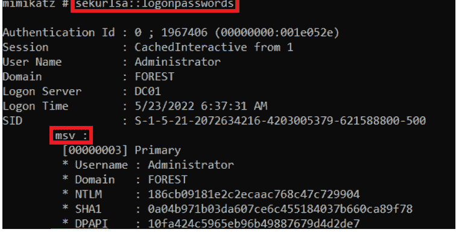
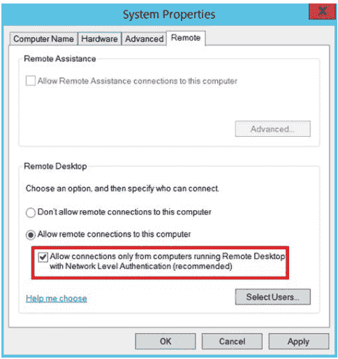
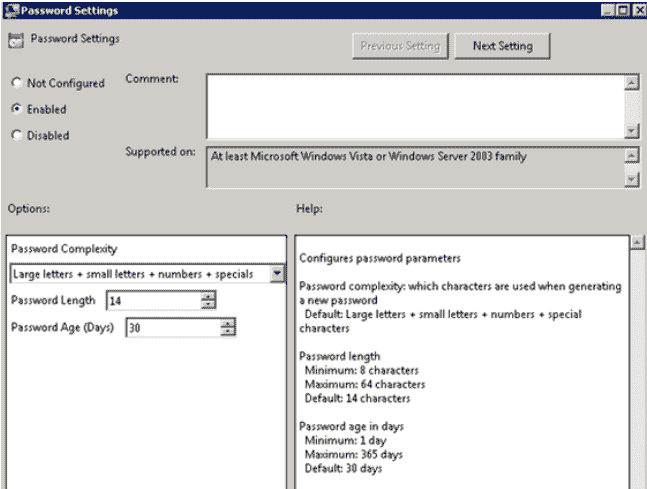
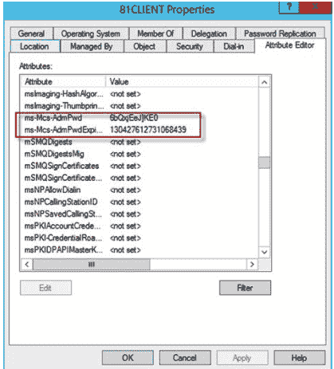
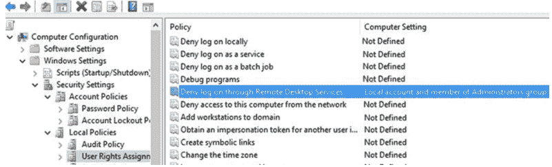
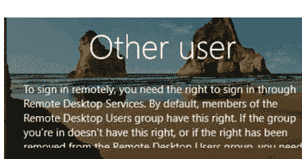
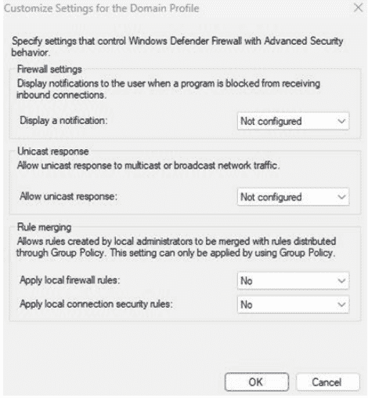
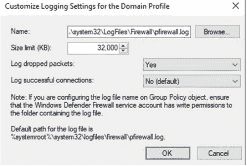
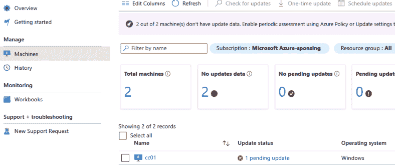
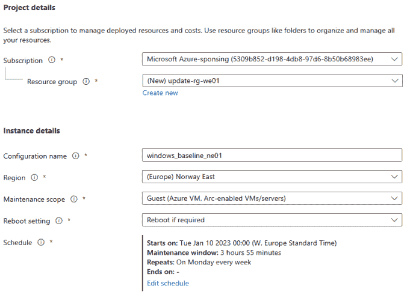

## Best practices and security settings in Windows

在之前的章节中，我们重点关注了我们基础设施的周边组件，例如终端、身份、外部服务和基于云的服务。缺失的部分是我们的 Windows 基础设施。

正如前几章中也提到的，今天的许多勒索软件攻击通常始于一台受损的终端，通常是通过网络钓鱼，让攻击者得以进入内部。从那里，他们通常会尝试使用不同的攻击向量来获得对基础设施的进一步访问。

攻击者可以采用不同方式来获得进一步访问权限。通常是使用他们通过受损系统获得访问权限的一组凭据，或使用某种形式的漏洞。

用于收集凭据的常用工具之一是 Mimikatz，我在前几章中提到过。

Mimikatz 由法国黑客 Benjamin Delpy 开发，他表示该工具旨在作为展示和突出计算机系统和网络弱点的一种手段，而不是作为恶意用途的工具。然而，Mimikatz 已被黑客广泛采用，并成为执行多种攻击的流行工具，包括以下内容：

- **Password cracking**: Mimikatz 可用于从内存中提取密码并对其进行离线破解，从而使黑客能够访问受弱密码保护的账户和系统。
- **Pass-the-hash attacks**: Mimikatz 可用于从内存中提取密码哈希并用其对系统进行身份验证，从而使黑客能够在不知道实际密码的情况下访问账户和系统。
- **Kerberos ticket manipulation**: Mimikatz 可用于操纵 Kerberos 票据，从而使黑客能够访问受 Kerberos 身份验证保护的资源。
- **Golden ticket attacks**: Mimikatz 可用于创建伪造的 Kerberos 票据，称为 *golden tickets*，可用于未经授权访问任何系统和资源。
- **Silver ticket attacks**: 与 Golden Ticket 类似，它涉及利用受损凭据和 Kerberos 协议设计中的弱点。然而，与 Golden Ticket 为攻击者提供对域的无限制访问不同，Silver Ticket 仅允许攻击者伪造特定服务的 **Ticket Granting Service (TGS)** 票据。

Kerberos 票据是由 Kerberos 身份验证服务器，通常是域控制器，发出的少量加密数据，用于向其他网络资源证明用户或服务的身份。票据包含诸如用户身份、目标服务、票据过期时间以及加密校验和等信息。虽然 Mimikatz 可以创建 golden tickets，但它也可以从安装了 Citrix Workspace 的终端用户收集 SSO 令牌，因此它不仅限于 Windows 基于的密码。

你可以在这里下载 Mimikatz 来自行尝试 (https://blog.gentilkiwi.com/mimikatz)；不过，需要注意的是，你应避免在企业设备上使用此工具，并且应仅在隔离设备上出于教育目的进行尝试。你可以在这里阅读有关不同命令和用例的更多信息 https://adsecurity.org/?page_id=1821。

> **Note**
> 如果你下载 Mimikatz，它很可能会在 Microsoft Edge 和 **operating system (OS)** 上的 Microsoft Defender 中触发 SmartScreen，并将其标记为特洛伊木马并阻止你下载。这是可以预期的，它应仅用于教育目的。

正如以下屏幕截图中所示的示例，只要我拥有管理员权限，我就可以使用 Mimikatz 提取用户密码的哈希或密码：



Figure 10.1 – Mimikatz and collecting a local password hash

Mimikatz 中的 sekurlsa::logonpasswords 命令用于提取存储在 Windows 系统上 **Local Security Authority (LSA)** 进程内存中的凭据。LSA 进程负责对登录系统的用户进行身份验证，并将最近登录用户的凭据存储在内存中以用于未来服务请求的身份验证。

Mimikatz 中的 sekurlsa::logonpasswords 命令用于提取这些凭据，其中包括用户的密码、**New Technology LAN Manager (NTLM)** 和 **LAN manager (LanMan)** 哈希，以及 Kerberos 票据。提取的凭据可用于以用户身份对其他网络资源进行身份验证，或执行密码破解攻击。

需要注意的是，使用此命令或类似工具可能是非法的，并可用于恶意目的，应仅在受控环境中并获得适当授权或许可后使用。

还有不同的模块可用于通过以下命令提取现有远程桌面协议 (RDP) 会话的密码：

```
ts::mstsc
```

此命令提供如下列表：

```
!!! Warning: false positives can be listed !!!
| PID 90176      mstsc.exe (module @ 0x00000000007BFCC0)
ServerName                                      [wstring] '51.120.179.242'
ServerFqdn                                      [wstring] ''
UserSpecifiedServerName                        [wstring] 'X.X.X.X'
UserName                                        [wstring] 'admin'
Domain                                          [wstring] 'demo01'
Password                                        [protect] 'Password1'
SmartCardReaderName                             [wstring] ''
PasswordContainsSCardPin                        [ bool  ] FALSE
ServerNameUsedForAuthentication                 [wstring] '51.120.179.242'
RDmiUsername                                    [wstring] 'demo01\admin'
```

然而，作为 Windows 11 的一部分，微软对一些安全设置进行了更改。其中一个设置是 Credential Guard 和 LSA 保护，该设置现在已默认启用以供未来版本使用，你可以在 https://www.microsoft.com/en-us/security/blog/2022/04/05/new-security-features-for-windows-11-will-help-protect-hybrid-work/ 上阅读相关内容。

Credential Guard 很有用，因为它旨在防止凭据被窃取。它通过将某些凭据材料，例如哈希和 Kerberos 票据，隔离在与操作系统其余部分分离的虚拟化环境中来实现这一点。Credential Guard 使用硬件虚拟化和基于虚拟化的安全 (VBS) 创建一个安全容器来存储凭据。此容器称为虚拟安全模式 (VSM)。Credential Guard 还使用基于硬件的安全功能，例如受信任平台模块 (TPM)，来帮助确保 VSM 的安全。

虽然 Mimikatz 能够提取存储在 Windows 系统上 LSA 进程内存中的凭据，但它无法提取受 Credential Guard 保护的凭据。Credential Guard 是 Windows 中的一项安全功能，它使用 VBS 隔离 LSA 进程并保护其凭据免受恶意软件或其他恶意行为者的访问。


然而，即使凭据受 Credential Guard 保护，Mimikatz 仍然可以在用户登录时拦截其输入的凭据。这是因为当用户登录 Windows 机器时，凭据会临时提供给该机器以对用户进行身份验证。在此期间，Mimikatz 可以在凭据传递给 LSA 进程并受到 Credential Guard 保护之前将其拦截。

还有其他机制可用于阻止 Mimikatz 读取**本地安全机构服务器服务 (LSASS)** 的内存，例如使用内置的**攻击面减少 (ASR)** 规则：https://learn.microsoft.com/en-us/microsoft-365/security/defender-endpoint/attack-surface-reduction-rules-reference?view=o365-worldwide#block-credential-stealing-from-the-windows-local-security-authority-subsystem （该规则可同时应用于 Windows Server 和 Windows 客户端）。

## 远程桌面管理

大多数 Windows 环境使用诸如 RDP 之类的工具进行远程管理。在使用 RDP 等功能时，建议之一就是启用**网络级身份验证 (NLA)**。NLA 在建立连接之前提供了额外的预身份验证层，并确保在用户成功验证之前不会暴露系统信息。我们可以通过打开**系统属性**并转到**远程**选项卡来验证机器上是否启用了 NLA，如下面的截图所示：



图 10.2 – RDP 的 NLA 设置

注意：我不建议使用 RDP 执行远程管理；你应该使用第三方服务或使用云服务，例如 Azure Bastion，或支持多重身份验证 (MFA) 的工具，例如 Windows Admin Center。还有其他新的替代方案，例如 Cloudflare Zero Trust 或 Hashicorp Boundary；这些选项也支持与 Azure AD 集成，以提供基于零信任的访问方法。

可以通过组策略为整个基础架构强制启用 NLA，导航到：

**计算机配置 | 策略 | 管理模板 | Windows 组件 | 远程桌面服务 | 远程桌面会话主机 | 安全 | 要求使用网络级身份验证对远程连接进行用户身份验证**

重要的是要意识到 NLA 使用**凭据安全支持提供程序 (CredSSP)** 从发起系统传输身份验证请求。这可能会导致安全问题，因为 CredSSP 可能会将凭据存储在发起系统的 LSA 内存中，即使用户已注销也是如此。

在内部使用 RDP 管理基础设施时，这可能会带来问题，因为凭据可能会在每个被访问的服务器上暴露。这是因为远程交互式登录会导致凭据与 Kerberos 票证和其他信息一起存储在 LSASS 内存中。

为了解决此问题，微软在 Windows 8.1 和 Windows Server 2012 R2 中引入了一项名为**受限管理员模式**的功能。此功能通过限制存储凭据的使用，有助于防范横向移动和传递哈希攻击。

启用此功能后，建立 RDP 会话无需提供密码；而是使用用户的哈希或 Kerberos 票证作为 RDP 连接的一部分进行身份验证。

讽刺的是，该功能也引入了一个新的攻击向量，我们可以利用它，即使用用户的哈希，通过 Mimikatz 之类的工具发起传递哈希攻击来对受限系统进行身份验证。例如，如果我有一个启用了受限管理员模式的系统，我可以使用 Mimikatz 的以下参数执行传递哈希攻击：

```
sekurlsa::pth /user:<user name> /domain:<domain name> /
ntlm:<the user's ntlm hash> /run:"mstsc.exe /restrictedadmin /v:<IP of the system>"
```

随后在 Windows 10 中，微软引入了一项名为**远程凭据保护**的新功能，这是 Windows 操作系统中的一项安全功能，旨在防范凭据盗窃攻击。它使用基于虚拟化的安全性来隔离机密（例如凭据），并为其存储和使用提供安全环境，同时也有助于防止传递哈希攻击。与受限管理员模式不同，此功能仅支持 Kerberos 协议。

对于帮助台支持场景，即人员需要管理访问权限以通过远程桌面会话向计算机用户提供远程协助时，微软建议在这种情况下不应使用 Windows Defender 远程凭据保护。这是因为如果向攻击者已经控制的受感染客户端发起 RDP 会话，攻击者可以利用该开放通道代表用户创建会话（无需破坏凭据），从而在会话断开后的一段时间（几小时）内访问用户的任何资源。

从 Windows 11 企业版 22H2 开始，与 Windows Defender 凭据保护兼容的系统将默认启用该功能。

更好的替代方案是确保我们制定了适当的特权访问策略，以保证特权帐户不会暴露或丢失。微软在这里为我们应如何规划特权帐户策略编写了一份很好的总结：https://learn.microsoft.com/en-us/security/compass/privileged-access-strategy。

但简而言之，诸如企业管理员或域管理员之类的特权帐户绝不应在非特权帐户使用的常规设备上使用。确保这些特权帐户仅用于**特权访问工作站 (PAW)**，这些工作站是以最高安全配置配置的机器。

你还应对这些特权帐户添加额外的监控，以确保它们只能由 PAW 运行。一个示例是使用**安全信息和事件管理 (SIEM)** 工具来监控那些特权帐户的使用情况，如微软的这篇文章中所述：https://learn.microsoft.com/en-us/azure/active-directory/fundamentals/security-operations-privileged-accounts。这里还有一篇文章展示了如何使用 Microsoft Sentinel 监控紧急访问帐户的使用情况，其中许多相同的原则也可用于监控特权帐户：https://jeffreyappel.nl/monitor-azure-ad-break-glass-accounts-with-azure-sentinel/。

微软提供了一些非常好的示例，强调并展示了我们如何使用 Azure **Active Directory (AD)** 和 Intune 设计和部署 PAW 解决方案：https://learn.microsoft.com/en-us/security/compass/privileged-access-deployment。

## 管理共享

另一个经常被忽视的攻击向量是利用管理共享。某些勒索软件变体会尝试使用管理共享或隐藏的网络共享。例如，许多勒索软件攻击者使用 Invoke-ShareFinder 并配合特权帐户的管理共享来试图查找敏感信息，正如这份**数字取证与事件响应 (DFIR)** 报告中提到的由 Emotet 实施的案例：https://thedfirreport.com/2022/11/28/emotet-strikes-again-lnk-file-leads-to-domain-wide-ransomware/。

注意：禁用服务器上的管理共享，尤其是**域控制器 (DC)**，可能会对基于域的环境中系统的功能和操作产生重大影响。因此，如果你计划禁用此功能，务必谨慎行事。此外，如果你的环境中使用了 PsExec，禁用管理 (ADMIN$) 共享可能会限制该软件的功能。

禁用该功能的方法要么是添加注册表项，要么是禁用 `LanmanServer` 服务。你可以通过添加以下注册表值来禁用管理共享：

```
HKLM\SYSTEM\CurrentControlSet\Services\LanmanServer\Parameters
DWORD Name = "AutoShareServer" Value = "0"
```

然后从管理员命令提示符（例如 CMD 或 PowerShell）运行以下命令：

```
net stop server
net start server
```

请注意，此更改不适用于 IPC$ 共享或你手动创建的共享。

第二种方法是禁用 `LanmanServer` 服务，这将影响与网络上的其他设备共享文件和打印机的功能。微软的 Windows Server 安全指南中也提到不应禁用该服务，因此不建议这样做：https://learn.microsoft.com/en-us/windows-server/security/windows-services/security-guidelines-for-disabling-system-services-in-windows-server。

另外，我越来越多地使用的一种技术是金丝雀令牌 (canary token)。金丝雀令牌是计算机安全中使用的一种蜜罐或诱饵系统。它是一种特殊类型的 URL 或文件，用于模拟攻击者可能感兴趣的目标，例如登录页面或敏感文档。当被访问时，金丝雀令牌会发送警报，使我们能够跟踪攻击来源并做出相应响应。金丝雀令牌背后的理念是提供攻击的早期预警，以便目标可以采取行动防止或减轻损害。

虽然该工具和**软件即服务 (SaaS)** 有很多选择，但这里有一个将某种金丝雀产品与 Microsoft Sentinel 结合使用的示例：https://learnsentinel.blog/2022/03/24/deception-in-microsoft-sentinel-with-thinkst-canaries/。

这些类型的工具在勒索软件攻击者试图在网络共享上查找敏感信息的初始阶段很有用，因此，为名为 secret 或 sensitive information 的文件设置一个金丝雀令牌可能会触发警报。


## LAPS 以及限制本地账户的使用

另一个重要因素是本地管理员账户。当终端与域之间的域信任出现问题时，我们常常会使用这些账户登录并进行故障排除。攻击者通常利用服务器上存在的本地账户在环境中进行横向移动。如果多台服务器上的内置本地管理员账户密码设置为相同值，这尤其有害。

Windows **本地管理员密码解决方案（LAPS）** 是 Microsoft 提供的一款工具，允许我们安全地管理已加入域的计算机的本地管理员密码。当我们在计算机上安装 Windows LAPS 组件时，它会带来以下更改：

- 在所有加入域的计算机上安装新的组策略客户端扩展。该扩展负责为计算机上的本地管理员账户生成随机密码，并将其存储在 AD 中。
- 扩展新的 AD 架构，以在名为 `ms-Mcs-AdmPwd` 的新属性中存储每台计算机的本地管理员密码。
- 创建新的组策略并链接到域。该策略控制 Windows LAPS 客户端扩展的行为，可用于配置密码长度和复杂性等设置。
- 在域控制器上安装新服务，以管理本地管理员密码的存储和检索。借助 LAPS，组织中的每台设备都为本地管理员账户配置了唯一且随机生成的密码，该密码存储在 AD 中，只有授权人员才能访问。

LAPS 软件可以在这里找到：https://www.microsoft.com/en-us/download/details.aspx?id=46899。

配置 LAPS 后，可以通过 AD 中的组策略对象进行管理，从而允许我们控制对本地管理员密码的访问，并设置密码过期和轮换策略，如下面的截图所示：



### 图 10.3 – Windows LAPS 的组策略设置

如果我们需要检索特定机器的本地管理员密码账户，可以从该特定机器的 AD 对象中获取，如下面的截图所示：



### 图 10.4 – 查找机器对象的本地管理员密码

Windows LAPS 是保护加入域的计算机上本地管理员账户的重要工具。然而，它并不是缓解这些账户被滥用风险的唯一措施。另一个重要步骤是实施限制和控制措施，例如通过组策略提供的功能，以降低攻击者横向移动的风险。如前所述，组策略可用于配置限制本地管理员账户功能的设置，使攻击者更难利用它们在网络中进行横向移动。

有几个设置应该被配置以限制本地管理员账户的使用。在这些设置中，我们需要将 **S-1-5-114: NT AUTHORITY\Local account and member of Administrators group** 添加到以下组策略中，导航路径为：

**计算机配置 | Windows 设置 | 安全设置 | 本地策略 | 用户权限分配**

- 从网络访问此计算机拒绝
- 作为批处理作业登录拒绝
- 作为服务登录拒绝
- 通过终端服务登录拒绝
- 调试

如下面的截图所示的一个示例，我们已将该账户添加到 **通过远程桌面服务登录拒绝** 策略中：



如果有人随后尝试使用本地账户或管理员组中的用户，在应用了此策略的服务器上通过 RDP 登录，他们将会看到以下错误消息：



图 10.6 – 显示账户被限制登录时的登录事件

有了这一设置，我们就可以降低网络中本地管理员账户通过 RDP 进行横向移动的风险。

## Windows 防火墙最佳实践

Windows 防火墙也是保护计算机免受不必要流量攻击的重要工具。Microsoft 和其他安全专家强烈推荐将其作为 AD 安全的最佳实践。即使已有基于网络的防火墙，仍然建议启用基于主机的防火墙。多层安全措施的实施能提升网络和设备的整体保护能力。

首先，我们可以通过运行以下命令来检查计算机上防火墙的状态：

```
netsh advfirewall show all
```

你应该会看到一条消息，内容如下：

```
域配置文件设置：
状态 开启
```

如果你拥有 AD 环境或包含已加入域的计算机的 Azure，最好集中管理防火墙设置，以确保一致且有效的保护。这样我们可以轻松地将防火墙规则应用并强制执行到所有计算机，而不是单独管理它们。集中式防火墙管理还可以使监控和更新防火墙设置变得更加容易。

关于 Windows 防火墙配置，你应该始终保持默认设置，例如默认情况下应阻止传入连接。

在 Windows 设备上启用和配置基于主机的防火墙有几种方式，包括以下这些：

- 在设备上使用防火墙管理单元（WF.msc）
- 在设备上使用 PowerShell 命令
- 使用组策略或**移动设备管理（MDM）**解决方案（例如 Microsoft Endpoint Configuration Manager 或 Intune（配合 Azure AD 加入））在已加入域或已注册 MDM 的设备上远程管理防火墙

此外，规则合并设置可用于控制来自不同策略源的规则如何组合。管理员可以为域配置文件、专用配置文件和公用配置文件设置不同的合并行为，这些行为决定本地管理员是否可以除了从组策略获取的规则之外，创建自己的防火墙规则。

然而，我们应该禁用规则合并。通过禁用规则合并，本地防火墙规则将被忽略，端点防火墙设置将完全由组策略控制。这意味着应用于防火墙的规则将仅是通过组策略指定的规则，任何本地创建的规则都会被忽略。这有助于确保组织中的所有设备具有一致的防火墙配置，但不允许对防火墙规则进行任何本地自定义。

在许多勒索软件攻击案例中，攻击者经常使用 netsh 命令在本地打开计算机上的防火墙端口。启用此设置后，攻击者将无法在每台计算机上本地打开这些端口，只能通过组策略来实现。

规则合并设置只能通过组策略中的 **规则合并** 下进行应用，并对 **应用本地防火墙规则** 和 **应用本地连接安全规则** 都选择 **否**，如下面的截图所示：



图 10.7 – Windows 防火墙上的规则合并设置

我建议启用丢弃数据包日志记录，并增大日志文件大小，以便于故障排除。这将有助于轻松识别防火墙阻止合法连接并导致问题的情况。通过记录丢弃的数据包并增大日志文件大小，我们可以更轻松地排查可能出现的任何问题。这同样是在 Windows 防火墙的组策略设置中配置的，如下面的截图所示：



图 10.8 – Windows 主机设置的防火墙日志记录

总之，建议启用丢弃数据包日志记录，并增大日志文件大小，以便进行故障排除。这样，当日志包含有关被阻止连接的信息时，可以轻松识别防火墙是否因阻止合法程序而导致连接问题。此配置可以在 Windows 防火墙的组策略设置中进行设置。

最后，对于服务器，还建议将此日志上传到集中的 SIEM 工具（如 Microsoft Sentinel），以便你能够全面了解你的基础设施。Microsoft Sentinel 甚至有一个适用于 Windows 防火墙的自定义连接器，其中包含一组预定义的搜寻查询和工作簿，可以可视化所收集的数据，你可以在这里了解更多信息：`https://learn.microsoft.com/en-us/azure/sentinel/data-connectors-reference#windows-firewall`。

## 篡改保护

篡改保护是 Windows 中的一项功能，通过防止恶意应用禁用安全措施（如防病毒保护、防火墙和其他安全功能）来帮助防御勒索软件攻击。这类攻击通常被攻击者用来获取数据访问权限并安装恶意软件。此外，它还能阻止应用禁用针对已检测威胁的自动操作、抑制 Windows 安全应用中的通知，以及阻止扫描存档和网络文件。此功能旨在让攻击者更难禁用安全措施并访问系统数据。


篡改保护在以下操作系统上可用：

- Windows 11
- Windows 11 企业版多会话
- Windows 10 OS 1709、1803、1809 或更高版本（需搭配 Microsoft Defender for Endpoint）
- Windows 10 企业版多会话

如果你使用的是已附加租户的 Configuration Manager 版本 2006，则篡改保护还可以扩展到以下服务器操作系统：

- Windows Server 2012 R2
- Windows Server 2016
- Windows Server 2019
- Windows Server 2022

默认情况下，对于所有使用 Microsoft Defender for Endpoint 的客户（无论是在 Windows 客户端操作系统还是 Windows Server 上），此项功能都会自动部署，具体说明可参阅：`https://techcommunity.microsoft.com/t5/microsoft-defender-for-endpoint/tamper-protection-will-be-turned-on-for-all-enterprise-customers/ba-p/3616478`。

如果你没有 Defender for Endpoint，你仍然可以通过 Intune 或 **System Center Configuration Manager（SCCM）** 启用此功能。启用此功能后，攻击者想要尝试禁用我们机器上的内置安全机制就会变得更加困难。

> **注意**
> 
> 目前已经有一个可以绕过此功能的**概念验证（PoC）**，名为 **Defeat Defender**，但在撰写本书时，几乎没有证据表明它已被用于勒索软件攻击。更多详情可以在这里找到：`https://github.com/swagkarna/Defeat-Defender-V1.2.0`。

## 基础设施的自动修补

如前面章节所述，攻击也可能发生在攻击者利用外部服务中的漏洞，或者利用漏洞在您的基础设施内进行横向移动的情况下。

在提供基础设施自动修补方面，有很多选项可供选择，例如 SCCM 或普通的 **Windows Server Update Services（WSUS）**，但我想重点介绍微软提供的一项新服务，名为 **更新管理（Update Management）**，这是一项 Azure 服务。

更新管理（目前为预览版）是一项允许我们从单个集中式仪表板管理和监督所有设备更新的服务。借助此服务，我们可以跟踪 Azure、本地以及其他云平台上 Windows 和 Linux 设备的更新合规性。使用此服务的一个注意事项是，它要求您的机器要么在 Microsoft Azure 中运行，要么已载入 Azure Arc。

不过，我将演示如何针对基于 Azure 的虚拟机使用此功能：

- 1. 要使用更新管理中心，请登录 Azure 门户并导航到 **Update management center (Preview)**。
- 2. 点击 **Getting Started** 选项卡，然后在 **On-demand Assessment and Updates** 下，点击 **Check for Updates**。
- 3. **Select Resources** 列表将显示所有正在 Microsoft Azure 中运行或通过 Azure Arc 连接的虚拟机。标记一台已通过 Arc 载入的机器，然后点击 **Check for Updates**。
- 4. 当您点击 **Check for Updates** 时，它将启动一次合规性扫描。评估完成后，您会在页面右上角看到一条确认消息，但请注意，完成可能需要一些时间。
- 5. 这会在机器上触发一个作业，从 Windows Update 收集可用更新，并将可用更新信息报告给服务。然后返回 **Update Management Center** 仪表板并点击 **Machines**。在这里，您将看到该机器以及是否存在任何更新的状态，如下面的截图所示：



如果我们选择该机器，我们可以选择进行一次性更新。但是，如果我们希望确保定期安装更新，例如，微软会按照定期计划发布安全更新，也就是众所周知的 **Patch Tuesday（补丁星期二）**。该计划安排在每月第二个星期二的上午 10:00 **太平洋标准时间（PST）**。还有其他组件的更新频率更高，例如防病毒定义文件和其他关键安全更新。

6. 要定义计划，我们需要创建一个维护配置。在同一个界面中，点击 Browse maintenance configurations（浏览维护配置），然后点击 Create（创建）。

7. 在这里，我们将创建一个 Windows 更新计划。定义 Configuration name（配置名称），将 Maintenance scope（维护范围）设置为 Guest（来宾），并为 Reboot setting（重新启动设置）选择 Reboot if required（必要时重新启动）。

如果您希望对重新启动有更多控制权，您可以将其设置为 Never reboot（从不重新启动）并定义一个计划。如下面的截图所示，我已将其定义为在必要时重新启动，以确保补丁完全安装：



图 10.10 – Update Management（更新管理）的维护配置设置

8. 输入所有设置后，点击 Next（下一步），然后点击 Add Machines（添加机器）。在这里，我们添加应应用此计划的机器，然后点击 Next（下一步）和 Create（创建）。

一旦维护配置创建完成，我们需要进入该配置并定义应安装哪些类型的更新。

9. 在顶部的搜索栏中，输入 Maintenance Configuration（维护配置），进入我们最近创建的那个配置，然后点击 Updates（更新）。

默认情况下，它会安装标记为关键和安全相关的更新。在这里，我们可以通过点击 Include update classification（包含更新分类）并添加（例如）签名文件来更改设置，如下面的截图所示：

## Windows 机器

- [ ] 全选
- [x] 关键更新
- [x] 安全更新
- [ ] 更新汇总
- [ ] 功能包
- [ ] 服务包
- [ ] 定义更新
- [ ] 工具
- [ ] 更新

图 10.11 – 定义更新分类

这里的一个最佳实践是针对基础设施和更新的不同部分使用不同的*维护配置*。一个示例如下：

- **Defender 防病毒定义文件：** 计划每天运行
- **安全更新和关键更新：** 计划在每月第二个星期二运行
- **自定义配置：** 这些用于高严重性安全更新，我们在此添加特定的**知识库（KB）** ID，以尽快安装这些更新

> **注意：**
> Windows **KB ID** 是微软为每篇单独的知识库文章或安全更新分配的唯一标识符。KB ID 由字母和数字组合而成，用于轻松识别和引用特定的更新或文章。KB ID 包含在文章或更新的标题中，在通过 Windows Update 或 Microsoft Update Catalog 下载或安装更新时也会用到。在搜索微软网站或支持页面以获取有关特定更新或问题的信息时，同样会使用 KB ID。它是一个唯一标识符，可用于跟踪特定的补丁、更新或安全公告。

当然，这只是处理跨公有云和本地基础设施的虚拟基础架构更新的一种方式。微软还有其他功能，例如 **Automanage**，它提供了部分相同的能力，用于管理备份、配置监控以及启用自动更新，但这样一来，更新管理就直接交由微软负责了。

无论您选择哪种机制，都需要注意，此功能仅处理 Microsoft 更新，这意味着所有第三方供应商的更新都需要以其他方式处理。

## 文件服务器资源管理器与文件组

**文件服务器资源管理器（FSRM）** 角色提供了多种功能，包括**文件屏蔽**。文件屏蔽允许文件服务器实时监控所有共享，以检测对已知勒索软件扩展名的任何修改。如果用户感染了勒索软件并试图修改其文件，文件屏蔽将检测到此活动并拒绝该用户访问文件共享，从而保护其余文件免受损害。这有助于防止或减轻勒索软件攻击的影响。

FSRM 服务可以添加到使用 **Server Message Block（SMB）** 协议并与 AD 集成的现有文件共享中。

为了启用文件屏蔽，它使用了一个名为 **File Group（文件组）** 的功能，该功能包含要监控的文件名模式，例如 .xyz 或 .ctbl。通过设置此类组，您可以密切关注这些模式，如果它们出现在您的服务器上，则可以采取相应措施。

目前，有超过 5,000 种不同的扩展名类型被用于勒索软件攻击，这使得手动将这些扩展名类型添加到 FSRM 的文件组中变得非常困难。幸运的是，加拿大一家名为 ITPartners 的服务提供商的一些人帮我们解决了这个麻烦，他们制作了一个 PowerShell 脚本，可以自动部署该服务，并自动从在线来源更新扩展名列表。您可以在这里找到该脚本和部署信息：https://fsrm.experi ant.ca/。

现在让我们看一些保护系统免受勒索软件攻击的通用建议。

## 防范勒索软件的其他重要建议

我想列出其他一些常见的最佳实践，涉及如何降低基础设施遭受勒索软件攻击的风险，其中一些我们在前面的章节中已经介绍过，但我想把我们在这本书中讨论过的各种对策做一个汇总列表：

- 如果服务器没有互联网接入需求，就不应接入互联网。服务器可以访问互联网，会使攻击者更容易在那台机器上下载额外的载荷，或使用诸如 TeamViewer 或 AnyDesk 之类的工具进行持久访问。其次，它也使得攻击者更容易直接从（例如）文件服务器上窃取数据。

- 当基础设施需要互联网接入时，建议实施 DNS 过滤服务，以降低初始攻击联系恶意软件（如 IcedID 或 Emotet）常用的**命令和控制（C&C）**域名的风险。另一种选择是使用带有**入侵检测系统（IDS）**功能的 Web 代理，该功能可以识别并阻止与已知恶意域的连接。这也有助于防止初始攻击到达 C&C 域名。


-   不再使用传统的文件共享。许多攻击者使用的工具和脚本都是为了在常规文件共享中查找敏感信息和文件夹；通过改用其他服务，如 Office 365 或其他支持零信任方案的第三方工具，你也能降低数据被窃取的风险。这里有许多第三方服务可以提供与常规文件服务器相当的性能和功能，同时还能在允许用户访问前进行更好的安全上下文检查。
-   将端点迁移到基于 Azure AD 的端点，而不是使用基于 AD 的计算机。这样一来，我们实际上能显著降低风险。大多数攻击工具、脚本以及大多数勒索软件攻击的方式主要都基于 AD 环境。
-   确保你的软件和操作系统通过适用于端点的 Windows Update for Business，以及适用于服务器基础架构的 Update Center 或第三方工具，始终保持最新的安全补丁和更新。同时，维护一份第三方供应商清单，并制定计划确保这些供应商的软件也能及时更新。
-   使用防病毒软件并定期更新。有一篇很不错的博客文章可以帮助你控制 Defender 防病毒软件的更新：`https://cloudbrothers.info/gradual-rollout-process-microsoft-defender/`。
-   同时使用基于网络和基于主机的防火墙来保护你的网络免受未经授权的访问，并确保你具备一定的日志记录能力，以便在更长的时间内获得洞察。在发生攻击时，应在保留时间过去之前收集这些日志。另外，确保这些日志不是存储在防火墙本地，而是存储在集中的日志服务中。
-   限制能够访问敏感数据的用户数量，并遵循最小权限原则。同时，确保具有管理员权限的用户帐户不会被同步到 Azure AD（将这些帐户分开），并且你正在使用**特权身份管理（PIM）**功能，例如 Azure AD PIM。
-   为所有帐户使用强且唯一的密码，并在可能的情况下启用双因素认证。你还应确保尝试使用单一用户身份集成所有服务，使用诸如 Azure AD 配合**跨域身份管理系统（SCIM）**预配和 SQL/LDAP 预配等工具，以确保用户生命周期管理。
-   定期备份重要数据，并将其存储在离线或云端。这是为了确保在勒索软件攻击时备份不会被破坏。此外，请确保你有一个备份服务，可以通过自动化测试自动验证数据的内容和完整性。
-   使用软件限制策略或应用程序白名单来阻止未经授权的软件在系统上运行。你也可以使用名为 Smart App Control 的新服务，将维护已批准供应商和应用程序列表的责任移交给 Microsoft。

-   教育员工了解勒索软件以及如何避免成为网络钓鱼攻击的受害者。请记住，勒索软件攻击可能以不同的方式发起。为他们提供需要留意的示例和迹象。过去仅通过电子邮件发生的网络钓鱼攻击，现在也可能通过其他渠道（如 Microsoft Teams）进入。
-   实施网络分段，以在发生攻击时限制恶意软件的传播。同时，尝试使用零信任原则优化网络访问；这可以确保受感染的设备自动从网络断开或被阻止访问网络中的其他设备。例如，Microsoft 添加了一项自动阻止设备的新功能，你可以在这里了解更多：`https://learn.microsoft.com/en-us/microsoft-365/security/defender-endpoint/respond-machine-alerts?view=o365-worldwide#isolate-devices-from-the-network`。
-   制定事件响应计划。这是为了确保我们在发生攻击时知道该做什么、通知谁，以及收集证据和限制必要访问所涉及的步骤。
-   使用服务监控你的攻击面，确保没有人设置新的外部可用服务，或在互联网上暴露已知漏洞的服务，可以使用诸如 Microsoft Defender 外部攻击面管理之类的工具。
-   使用能够检测和阻止恶意脚本、宏和其他恶意代码的软件。来自互联网的宏默认会被 Microsoft 阻止；然而，这些文档进入网络的方式有很多。
-   使用**网络访问控制（NAC）**根据设备的安全状况来控制对网络的访问。许多网络提供商支持与**端点检测和响应（EDR）**服务（如 Defender for Endpoint）集成，以便在设备被允许连接到物理网络或 Wi-Fi 之前监控其健康状况，例如 Cisco Meraki 就支持与 Azure AD 集成进行认证：`https://documentation.meraki.com/General_Administration/Managing_Dashboard_Access/Configuring_SAML_SSO_with_Azure_AD`。
-   使用 SIEM 监控网络中的可疑活动和流量。使用**入侵检测和防御系统（IDPS）**来检测并阻止恶意网络流量。
-   使用数据加密来保护敏感数据免受未经授权的访问。使用 Azure 信息保护等工具可以降低有人访问包含敏感信息内容的凭据风险，因为他们唯一能看到的是加密数据。
-   使用基于云的安全解决方案来防御云中的威胁。尤其是**平台即服务（PaaS）**，虽然我们目前尚未看到太多针对 PaaS 的勒索软件攻击，但未来可能会看到；因此，了解这里的攻击面非常重要。Microsoft Defender for Cloud 等工具可以为基于 PaaS 的服务提供可见性和异常检测。
-   在 `haveibeenpwned.com` 上为你的域设置域名监控，以确保如果你的某个用户的账户信息被盗或泄露，你能收到通知。

-   摆脱旧式服务，例如** Active Directory 联合身份验证服务（ADFS）**和 Microsoft Exchange，除非你有特定要求禁止迁移到基于云的服务。在过去几年中，我们看到 Microsoft Exchange 中出现了大量漏洞，例如 Rackspace 在 2022 年 12 月遭受了攻击：https://www.rackspace.com/hosted-exchange-incident。
-   将现有的**虚拟专用网络（VPN）**服务替换为基于**零信任网络访问（ZTNA）**的服务，并减少完整 VPN 隧道的使用，只允许基于每个应用程序的访问。
-   在 Windows 端点上使用受控文件夹访问，以保护重要的本地文件夹免受勒索软件或其他恶意软件等未经授权程序的侵害。Windows 10 或 Windows 11 上的此功能会监视应用对受保护文件夹中文件所做的更改，并阻止被判定为恶意的更改，防止恶意软件在你的系统上加密或修改敏感文件。
-   在你的基础架构中部署一组蜜罐。蜜罐安全是一种通过部署易于识别为*蜜罐*或陷阱的诱饵系统、文件或数据来检测和响应网络攻击的技术。这些蜜罐旨在模仿真实系统或数据，但它们实际上是受监控和保护的资源，一旦被触发，就可以提醒安全团队注意潜在的破坏或入侵。其中一些系统还支持与 Microsoft Sentinel 集成，如此处所述：https://redcanary.com/blog/microsoft-sentinel-mdr/。

最后我想提一下 MITRE ATT&CK 框架。MITRE ATT&CK 框架是一个全面的知识库，涵盖威胁行为者用于破坏组织及其信息系统的战术和技术。该框架为讨论和分析网络威胁提供了一种通用语言，并按照攻击者在不同攻击阶段所使用的战术、技术和程序组织成一个矩阵。该矩阵可以作为参考，帮助你更好地理解、检测和响应网络威胁。该框架可以帮助各种规模的组织识别潜在的安全风险，并改善其整体安全态势。它还可以作为事件响应和威胁搜寻的参考，以及用于安全规划和风险评估。它还可以用来评估现有安全控制的有效性，并识别需要改进的领域。这本来自 MITRE 的电子书提供了一种简单的方式，让你了解该框架以及如何使用不同的控制机制：https://www.mitre.org/sites/default/files/2021-11/getting-started-with-attack-october-2019.pdf。

虽然我们在这章中涵盖了很多技术技巧，但最重要的部分可能是努力领先于正在发生的所有变化、新威胁、漏洞和攻击向量。不幸的是，这没有简单的解决办法；唯一的补救措施是抽出专门的时间，使用前几章提到的一些工具和来源来跟进新闻动态。


## 摘要

在本章中，我们探讨了如何保护我们的 Windows 基础设施以降低其被勒索软件攻击入侵的风险。我们学习了操作系统中经常被忽视的各种安全机制，以及这些机制如何作为 Windows 中的额外安全屏障发挥作用。

希望本书的内容能为您提供有关不同攻击向量以及您可以采取的防护措施的宝贵见解。我只希望尽可能少的读者遭遇勒索软件攻击，并且希望这些提示和服务能够作为您未来安全态势的基础解决方案。感谢阅读！
