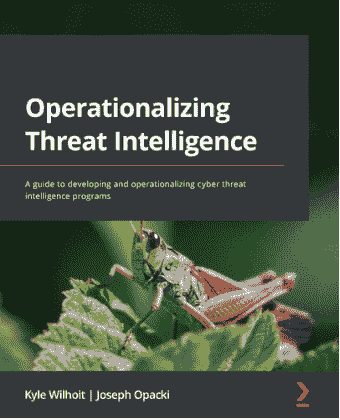
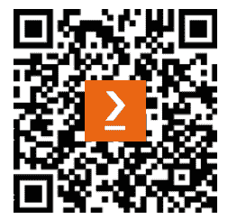

## 索引

### A

- **Active Directory (AD)** 243
- securing 130-132
- **Active Directory and Azure AD**
- **password policy** 52
- **Active Directory Federation**
- **Services (ADFS)** 258
- **AD Application Proxy** 41
- **additional countermeasures** 136, 137
- **administrative shares**
- using 243, 244
- **Adversary-in-the-Middle**
- **(AiTM) phishing** 132
- **AIP future** 199
- **Always Encrypted** 199
- **Always On VPN** 34
- **analytics rules** 67, 91-95
- creating 88-91
- types 88
- **antimalware** 107-110
- **Application Delivery Controllers**
- **(ADCs)** 182
- **application pillar** 38, 39
- **ASR testing tool**
- download link 105
- **attackers** 166
- **Attack Surface Reduction (ASR)**
- **rules** 103-106, 241
- features 103
- in Endpoint Manager 104
- **attack vector** 8
- accessing, through brute-force attacks 11
- accessing, through compromised
  workstation 12
- accessing, through credential stuffing 10
- accessing, through end user machine 12
- known vulnerabilities, exploiting 9
- **Automanage** 254
- **Azure Active Directory** 41, 42
- **Azure Active Directory**
- **Conditional Access** 142
- **Azure Active Directory Privileged**
- **Identity Management (PIM)** 143
- **Azure AD Identity Protection (AADIP)** 51
- **Azure AD joined** 43
- **Azure AD Password Protection** 52
- **Azure AD Registered** 43
- **Azure Application Gateway** 58, 143
- **Azure Backup** 160-162
- **Azure-based workloads**
- recommendations 162, 163
- **Azure Bastion** 59, 131
- **Azure DDoS Protection** 143
- Azure Defender for Cloud 58
- Azure Disk Encryption 143
- Azure Firewall 58, 142
- Azure Information Protection (AIP) 187, 190-198
- Azure Log Analytics 59
- Azure Policy 59, 143, 157-160
- Azure resource group 58
- Azure Resource Manager (ARM) 70, 158
- Azure Sentinel 57
- Azure Storage Service Encryption 144
- Cloud Security Posture Management (CSPM) 66
- command and control (C&C) domains 255
- Common Vulnerabilities and Exposures (CVEs) 24
- compromised workstation
- attack vector, access via 12
- Conditional Access policy 41
- Conti ransomware 14-16
- Credential Security Support Provider (CredSSP) 242
- credential stuffing
- attack vector, accessing via 10
- Cybersecurity and Infrastructure Security Agency (CISA) 9, 226

### B
- Background Intelligent Transfer Services (BITS) 13
- backups
- best practices 201, 202
- BeyondTrust
- URL 180
- bring your own device (BYOD) 43
- brute-force attacks
- attack vector, accessing via 11
- Business Email Compromise (BEC) attacks 132

### D
- data classification 189
- Data Collection Rules (DCRs) 69
- Data Connectors 80
- data exfiltration 188, 189
- data logs
- collecting, from VMs 74-82
- data pillar 39, 40
- data protection
- best practices 201, 202
- data sources
- collecting, from VMs 74-82
- DDoS attacks
- amplification attacks 182
- layer 4 DDoS attacks 182
- layer 7 DDoS attacks 182
- DDoS protection 181-185
- Defeat Defender 251
- device pillar 37
- Diavol ransomware 12-14

### C
- Citrix
- reference link 47
- secure access services, providing 171, 172
- Citrix ADC (CVE-2019-19781) 28, 29
- Citrix Secure Private Access
- overview 172
- Client Access Service (CAS) 27
- Cloud Access Security Broker (CASB) 174
- Cloudflare
- secure access services, providing 172-174

### E
- Digital Forensics and Incident Response (DFIR) 243
- Distributed Denial of Service (DDoS) attack 7
- DLP features 199
- DNS filtering 118
- Domain-Based Message Authentication, Reporting, and Conformance (DMARC) 135
- Domain Controllers (DC) 244
- DomainKeys Identified Mail (DKIM) 135
- Egnyte 176
- ELK 56
- email services
- content and URLs, protecting 135, 136
- domains, protecting 134, 135
- securing 132-134
- Endpoint Detection and Response (EDR) 102, 169, 257
- Endpoint Manager
- ASR rule 104
- endpoints
- securing 102
- end user machine
- attack vector, accessing via 12
- exabeam 57
- Exploit Guard Demo Tool
- configuration 106
- External Attack Surface Management (EASM) 228

### F
- Fileflex 176
- file groups 255
- File Server Resource Manager (FSRM) role 255
- foundation, within Microsoft Azure
- securing 57-60
- securing, concepts and features 58, 59

### G
- geo-blocking 184
- golden ticket attacks 238
- Graylog 56
- GreyNoise
- reference link 233

### H
- hub-and-spoke network
- architecture 145, 146
- humio 57
- Hybrid Azure AD joined 43

### I
- identity and access control 47, 48
- authentication methods, ensuring 49-53
- least privilege, using 53, 54
- role-based access control 53, 54
- strong passwords, ensuring 49-53
- user life cycle management 48, 49
- identity and access management in Microsoft Azure 141-145
- identity-based attacks 20-23
- vulnerabilities 24
- vulnerabilities, monitoring 30, 31
- identity pillar 35, 36
- ID Ransomware
- reference link 4, 209

### incidents
- handling 88-91
- infrastructure
- automatic patching 251-255
- Infrastructure as Code (IaC) 71, 151
- Internet of Things (IoT) devices 37
- intrusion detection and prevention systems (IDPS) 257
- Intrusion Detection System (IDS) 255

### J
- JumpCloud
- URL 180
- just-in-time (JIT) access 96

### K
- Kerberos 43
- Kerberos ticket manipulation 238
- Knowledge Base (KB) 254
- Kusto
- performing 83-85
- queries, used for initial compromise 95, 96

### L
- LAN manager (LanMan) 239
- lateral movement 166
- LDAP-based authentication protocols 49
- Leo, AI engine 224
- Living Off the Land Binaries (LOLBins) 122, 123
- Local Administrator Password Solution (LAPS) 245
- Local Code Execution (LCE) 45
- Local Redundant Storage (LRS) 160
- Local Security Authority (LSA) 108, 239
- Local Security Authority Server Service (LSASS) 241
- LockBit ransomware 16, 17
- log queries
- performing 83-85

### M
- Make Me Admin 53
- master database files (MDFs) 200
- Microsoft
- secure access services, providing 170, 171
- Microsoft 365 guidance for security & compliance
- reference link 190
- Microsoft Azure
- identity and access management 141-145
- Microsoft Defender 66-69, 107-110
- features 96
- features and platforms 68
- vulnerability, detecting with 96-98
- Microsoft Defender for Cloud 142
- Microsoft Defender for Servers 142, 154-157
- data sources, using 85-88
- Microsoft Edge, policy settings
- reference link 114
- Microsoft Intune 35
- Microsoft LAPS and Cloud LAPS 52
- Microsoft Office Apps
- securing 112-114
- Microsoft Purview compliance portal
- reference link 190
- Microsoft Security Response Center (MSRC)
- reference link 31
- Microsoft Sentinel 66-69, 142
- analytics rules, creating to trigger incident 88-91
- data sources, enabling to be collected in 87
- data sources, using 85-88
- designing 69-73
- implementing 69-73
- reference link 66
- settings 79, 80
- Microsoft Sentinel, data
- Kusto and log queries, performing 83-85
- Mimikatz 25
- download link 239
- tools, for performing variety of attacks 238
- miscellaneous endpoint
- countermeasures 117
- default applications 123, 124
- DNS filtering 118
- LOLBins 122, 123
- PowerShell 118-120
- SMB protocol 120-122
- mobile device management
- (MDM) solutions 249
- Multi-Factor Authentication (MFA) 125, 242

### N
- National Institute of Standards and
- Technology (NIST) 51
- network access 40-43
- Network Access Control (NAC) 167, 257
- Network Flow Logs 143
- Network Interface Card (NIC) 143
- Network Level Authentication
- (NLA) 177, 241
- network pillar 38
- Network Policy Server (NPS) 34, 50
- network scanner 199
- Network Security Group (NSG) 58, 143
- Network Virtual Appliance (NVA) 60
- New Domain Registrations (NDRs) 118
- Newly Registered Domains (NRDs) 12
- New Technology LAN Manager (NTLM) 239
- Nmap
- download link 221
- NSG flow logs 58
- NTLM 43

### O
- OAuth 43
- Office365 43
- OneDrive 43
- One-Time Passcode (OTP) 129
- operating system (OS) 239

### P
- Pacific Standard Time (PST) 252
- pass-the-hash attacks 238
- password cracking 238
- patch management 43-45
- Patch Tuesday 252
- phishing emails
- structure 132, 133
- PickupSTIX 234
- Platform as a Service (PaaS) 257
- Platform-Managed Keys (PMKs) 160
- Point of Presence (PoP) 175
- Point-to-Site (P2S) configuration 171
- potentially unwanted applications
- (PUA) 107
- PowerShell scripts 118-120
- log mechanisms 119
- PrintNightmare 24
- vulnerability management, example 45-47
- privileged access workstations (PAWs) 243
- Privileged Identity Management
- (PIM) features 256
- Proof of Concept (PoC) 251
- ProxyShell 27

## R

**勒索软件（ransomware）**

Conti 勒索软件  14-16
Diavol 勒索软件  12-14
演变  4-8
团伙概述  18, 19
最新加入  18
LockBit 勒索软件  16, 17
Sodinokibi/Revil 勒索软件  16
防护提示  255-258
工作机制  12

**勒索软件即服务（Ransomware as a Service，RaaS）**  17
**勒索软件攻击**
  未来发展  235, 236
**勒索软件取证**  207, 208
  警报验证  208
  攻击向量  211-213
  自动化方法  216-219
  关闭后门  220-222
  影响发现  209-211
  手动方法  213-216
**速率限制**  184
**远程访问**  34
**远程代码执行（Remote Code Execution，RCE）**  9, 45
**远程凭据保护（Remote Credential Guard）**  242
**远程桌面管理**
  用于执行的 RDP 工具  241-243
**远程桌面协议（Remote Desktop Protocol，RDP）**  11, 240
**远程桌面服务（Remote Desktop Services，RDS）**  177
**远程管理服务**  177-180
**受限管理员模式（Restricted Admin mode）**  242
**Revil 勒索软件**  16
**路由**  34

## S

**SAML**  43
**基于 SCIM 的预配**  49
**安全访问服务边缘（Secure Access Service Edge，SASE）**
  提供安全访问服务  174, 175
**安全访问服务**
  文件访问  175, 176
  向用户提供  167-169
**Microsoft 安全访问服务**
  Azure Active Directory  170
  Azure 应用程序代理  170
  Azure Arc  171
  Azure Bastion  171
  Azure 虚拟桌面/Windows 365  171
  Azure VPN  171
  Microsoft Tunnel  171
**安全 Web 网关（Secure Web Gateway，SWG）**  174
**安全信息和事件管理（Security Information and Event Management，SIEM）**  56, 243
**安全日志记录**  54-57
**安全监控**  54-57
**发件人策略框架（Sender Policy Framework，SPF）**  134
**敏感度级别**
  高敏感度  189
  低敏感度  189
  中敏感度  189
**敏感度级别方法**
  基于内容  189
  基于上下文  189
  基于用户  190
**服务器消息块（Server Message Block，SMB）**  255
**会话应用控制**  130
**白银票据攻击**  238
**SMB 协议**  120-122
**社交媒体**  32
**Sodinokibi 勒索软件**  16
**软件即服务（Software as a Service，SaaS）**  244

## U

软件资产管理（Software Asset Management，SAM） 46
Specrom Analytics
  参考链接 22
Splunk 56
基于 SQL 的身份验证协议 49
SQL Server
  加密 199-201
SuccessFactors 49
sumologic 57
同步-确认（SYN-ACK）数据包 182
同步（SYNC）泛洪 182
SYN 队列 182
System Center Configuration Manager（SCCM） 251
System Center Operations Manager（SCOM） 68
跨域身份管理系统（System for Cross-domain Identity Management，SCIM） 256

## T

防篡改保护（Tamper Protection） 250, 251
TDE 与外部密钥管理系统
  Azure Key Vault（搭配 SQL Connector） 200
  HashiCorp Vault（搭配 SQL Server 的 Key Management） 201
Teleport
  URL 180
威胁态势
  监控 223-234
威胁管理 234, 235
票据授予服务器（Ticket Granting Server，TGS） 13
票据授予服务（Ticket Granting Service，TGS） 238
基于时间的组成员资格 131
流量分析（Traffic Analytics） 143
透明数据加密（Transparent Data Encryption，TDE） 199
受信任的平台模块（Trusted Platform Module，TPM） 240

更新管理 110-112, 251
更新环 110, 111
用户代理阻止 183
用户数据报协议（User Datagram Protocol，UDP）泛洪 182
用户定义路由（User-Defined Route，UDR） 58, 145
用户身份
  保护 125-129
用户生命周期管理 48, 49

## V

虚拟桌面服务（Virtual Desktop Services，VDIs） 50
基于虚拟化的安全性（Virtualization-Based Security，VBS） 108, 147, 240
虚拟网络
  分段与设计 140, 141
虚拟专用网络（virtual private network，VPN） 258
虚拟安全模式（virtual Secure Mode，VSM） 240
虚拟系统管理员（Virtual System Administrator，VSA） 4
VirusTotal
  参考链接 220
Azure 中的 VM
  结构剖析 146-154
Azure 中 VM 的结构剖析
  Microsoft Defender for Servers 154-157
虚拟机
  从其中收集数据日志 74-82
  从其中收集数据源 74-82
VMware ESXi
  参考链接 47
VNet 58
VNET 对等互连 58
卷影复制服务（Volume Shadow Copy Service，VSS） 13
Vulmon 31
  参考链接 31

漏洞
  参考链接 222
针对基于身份的攻击的漏洞 24
  Citrix ADC（CVE-2019-19781） 28, 29
  PrintNightmare 24
  ProxyShell 27
  Zerologon 25-27
漏洞管理 31, 43, 45
  示例：PrintNightmare 45-47
  阶段 44
零信任
  设计原则 34, 35
零信任架构 34
  支柱 35
零信任架构的支柱
  应用支柱 38, 39
  数据支柱 39, 40
  设备支柱 37
  身份支柱 35, 36
  网络支柱 38
零信任网络访问（Zero-Trust Network Access，ZTNA） 41, 167, 258
  概述 168
区域冗余存储（Zone Redundant Storage，ZRS） 161
W
WAF 签名 184
Web 应用程序防火墙（Web Application Firewall，WAF） 22, 143, 183
Web 浏览器
  保护 114-117
Windows
  最佳实践 238-241
  安全设置 238-241
基于 Windows 的端点
  保护注意事项 102
Windows 防火墙
  最佳实践 248-250
Windows KB ID 254
Windows LAPS
  用于安全地管理本地账户 245-248
Windows 角色 34
Windows Server Update Services（WSUS） 251
Workday 49
Z
零小时自动清除（Zero-hour auto purge，ZAP） 135
Zerologon 25-27, 34

Packt.com

订阅我们的在线数字图书馆，即可完整访问超过 7,000 本图书和视频，以及行业领先的工具，帮助您规划个人发展并推进职业生涯。如需了解更多信息，请访问我们的网站。

## 为什么订阅？

- 通过来自 4,000 多名行业专业人士的实用电子书和视频，减少学习时间，增加编码时间
- 通过专为您打造的技能计划提升学习效果
- 每月免费获取一本电子书或视频
- 支持全文搜索，便于快速访问关键信息
- 可复制、粘贴、打印和书签内容

您知道 Packt 出版的所有图书都提供电子书版本，并包含 PDF 和 ePub 格式吗？您可以升级到 packt.com 的电子书版本。作为印刷版图书客户，您有权享受电子书版本的折扣。如需了解更多详情，请联系我们：customercare@packtpub.com。

在 www.packt.com，您还可以阅读一系列免费技术文章，订阅多种免费通讯，并获取 Packt 图书和电子书的独家折扣和优惠。

## 威胁情报落地实践

Kyle Wilhoit, Joseph Opacki

ISBN: 9781801814683

- 了解各类威胁行为者及其常见战术和技术
- 理解网络威胁情报的核心原则
- 了解网络威胁情报的策略、流程和框架
- 探索收集网络威胁情报的基础知识
- 理解威胁情报丰富与分析的基础知识
- 理解威胁狩猎和溯源 pivoting 的含义，并附示例
- 专注于将威胁情报投入生产
- 探索执行威胁分析、溯源和狩猎的技术

## Packt 正在寻找像您这样的作者

如果您有兴趣成为 Packt 的作者，请访问 authors.packtpub.com 并立即申请。我们已与数千名开发人员和技术专业人士（就像您一样）合作，帮助他们与全球技术社区分享见解。您可以进行一般申请，申请我们正在招募作者的具体热门主题，或提交您自己的想法。

## 分享您的想法

现在您已读完*《Windows 勒索软件检测与防护》*，我们很想听听您的想法！如果您从亚马逊购买了本书，请点击此处直接前往亚马逊本书的评论页面，分享您的反馈，或在您购买本书的网站上留下评论。

您的评论对我们和技术社区非常重要，将帮助我们确保提供优质内容。

## 下载本书免费 PDF 版本

感谢您购买本书！

您是否喜欢随时阅读，但无法随身携带纸质书？您的电子书购买是否与您选择的设备不兼容？

不用担心，现在每本 Packt 图书都附带一个无 DRM 的 PDF 版本，免费提供。

可在任何地方、任何设备上阅读。直接从您最喜欢的技术书籍中搜索、复制和粘贴代码到您的应用程序中。

福利还不止于此，您还可以获得独家折扣、通讯和每日优质免费内容。

请遵循以下简单步骤获取这些福利：

1. 扫描二维码或访问以下链接
2. 提交您的购买凭证
3. 就这样！我们会将免费 PDF 和其他福利直接发送到您的电子邮箱

https://packt.link/free-ebook/9781803246345

