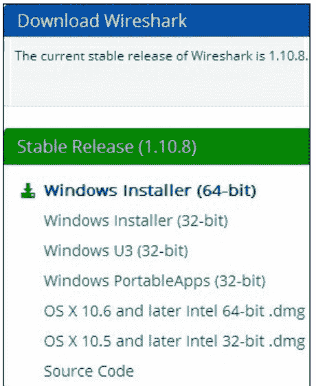
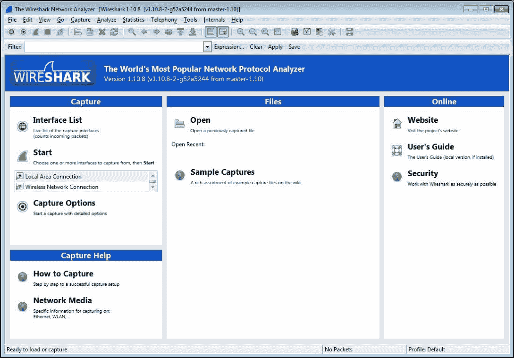
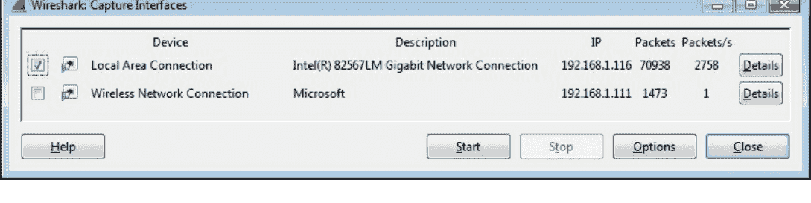
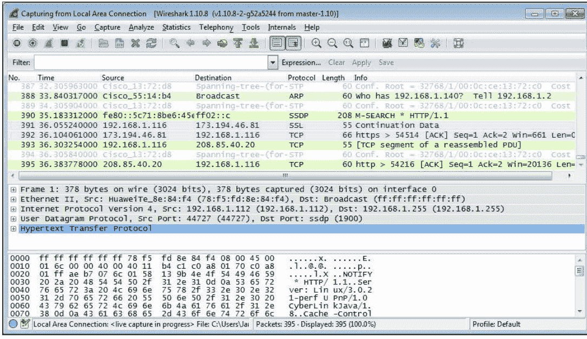
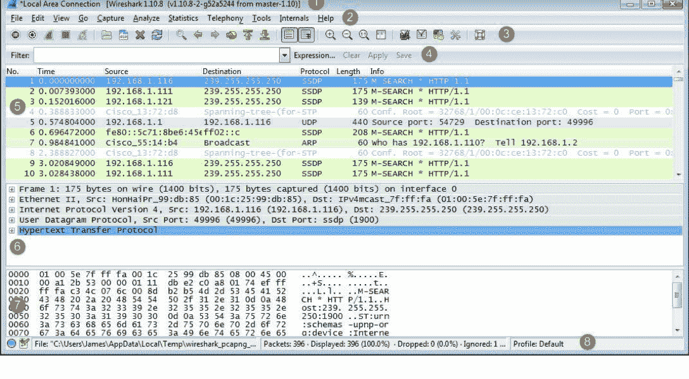
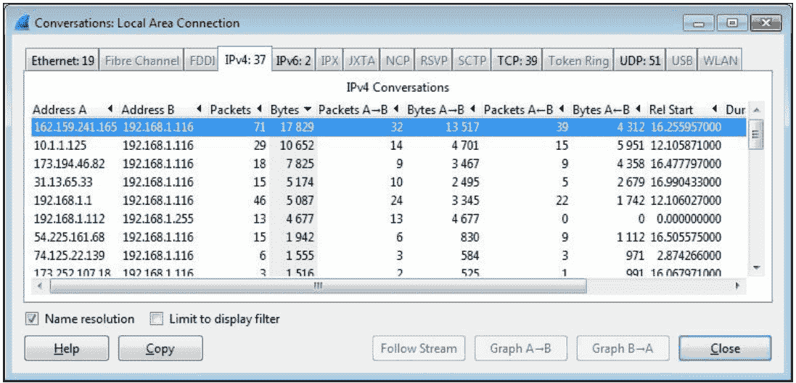
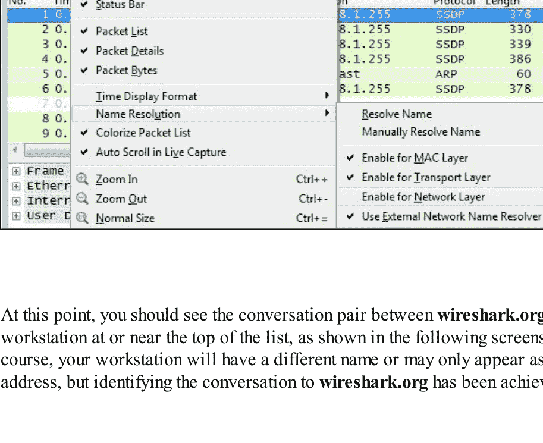
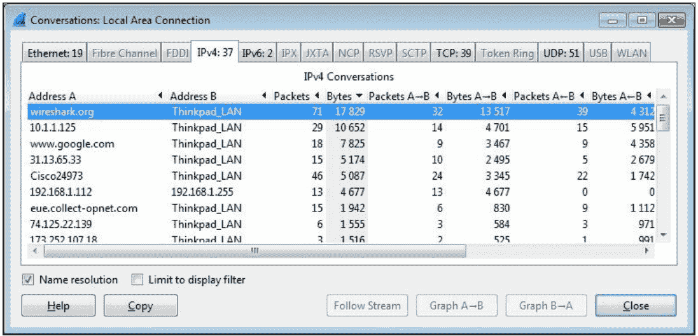
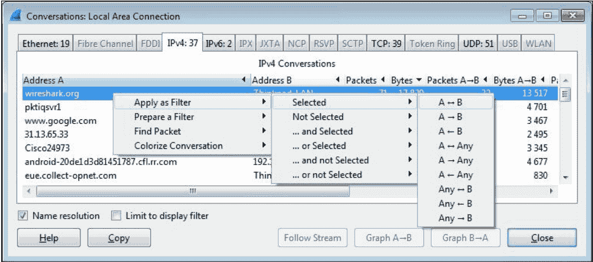
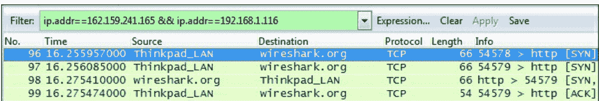

## 第 1 章 初识 Wireshark

自 1997 年 Gerald Combs 为了在小型 ISP 解决网络问题而创建 Wireshark（最初名为 Ethereal）以来，它已成为用于网络和应用协议数据包级分析的最流行工具之一。这主要是因为它是一个开源解决方案，任何技术专业人士都可以免费使用，同时它功能广泛，支持超过 1000 种协议，并且全球超过 800 名开发者的贡献使其得以持续支持和改进。

本入门章节将帮助您通过在系统上安装 Wireshark 并进行一些有趣且有用的操作，快速熟练掌握它，然后再深入探讨更多细节和支持概念。

在本章中，我们将讨论以下主题：

-   安装 Wireshark
-   执行数据包捕获
-   Wireshark 用户界面要点
-   使用显示过滤器隔离感兴趣的网络流量
-   保存过滤后的数据包跟踪文件

后续章节将在此基础上提供这些基本功能的支持概念，使您能够培养最适合您的技术角色和目标的 Wireshark 技能。

## 在 Windows 上安装 Wireshark

在下面的屏幕截图中，Wireshark 下载页面已识别出 64 位 Windows 安装程序适用于此 Windows 工作站：

点击突出显示的链接会下载一个 Wireshark-win64-1.10.8.exe 文件或类似的可执行文件，您可以将其保存到硬盘上。双击可执行文件即可开始安装过程。您需要按照以下步骤操作：

- 1. 同意许可协议。
- 2. 通过在每个提示中点击下一步来接受所有默认值，包括安装 WinPcap 的提示，WinPcap 是从工作站的网络接口卡 (NIC) 捕获数据包所需的库。
- 3. 在 Wireshark 安装早期，进程会暂停并提示您在单独的窗口中点击安装和几个下一步按钮来安装 WinPcap。
- 4. WinPcap 安装完成后，点击通过剩余的下一步提示完成 Wireshark 安装。

## 在 Linux/Unix 上安装 Wireshark

在 Linux 或 Unix 平台上安装 Wireshark 的要求和流程可能因特定环境而有很大差异。Wireshark 通常可以通过您特定 Linux 发行版的包管理系统默认获得。有关在 Linux 上安装 Wireshark 的指导可在 [第 2 章](Chapter 2)，网络数据包分析师，或 Wireshark 用户文档中找到，位于 [www.wireshark.org/docs/wsug_html_chunked/ChapterBuildInstall.html](http://www.wireshark.org/docs/wsug_html_chunked/ChapterBuildInstall.html)。

## 执行您的首次数据包捕获

当您首次启动 Wireshark 时，会显示初始的 **开始页面**，如下图所示：

不要对这个屏幕太过钟爱。虽然您每次启动 Wireshark 时都会看到它，但一旦您执行捕获、打开跟踪文件或在 Wireshark 中执行任何其他功能，此屏幕将被标准的 Wireshark 用户界面取代，您要到下次启动 Wireshark 时才会再次看到它。因此，我们不会在这里花费太多时间。

### 选择网络接口

如果您的机器上有多个网络接口，您可能不确定选择哪个接口来捕获数据包，但有一个相当简单的方法可以弄清楚。在 Wireshark 开始页面上，点击 **接口列表**（或者从 **捕获** 菜单中点击 **接口**，或点击图标栏上的第一个图标）。

打开的 **Wireshark 捕获接口** 窗口提供了机器上所有网络接口的列表和描述，每个接口分配的 IP 地址（如果已分配），以及几个计数器，例如自此窗口打开以来接口上看到的总数据包数和数据包/秒（每秒数据包数）计数器。如果接口分配了 IPv6 地址（可能以 `fe80::` 开头并包含多个冒号）并且正在显示，您可以点击 IPv6 地址，它将切换为显示 IPv4 地址。这在下面的屏幕截图中显示：

### 注意

在 Linux/Unix/Mac 平台上，您可能还会看到一个回环接口，可以选择它来捕获在同一台机器上应用程序之间发送的数据包。然而，在大多数情况下，您只会对从网络接口捕获数据包感兴趣。

目标是识别当您打开浏览器并导航到网站时将用于与 Internet 通信的活动接口。如果您有有线局域网连接并且接口已启用，那很可能是活动接口，但您也可能有一个已启用的无线接口，它可能是也可能不是主要接口。活动网络接口最可靠的指标是它将具有不断增加的数据包数量，并且有相应的活动数据包/秒数（会随时间变化）。另一个可能的指标是如果一个接口分配了 IP 地址而其他接口没有。如果您仍然不确定，请打开一个浏览器窗口并导航到您最喜欢的网站之一，观察数据包和数据包/秒计数器，以识别活动增加最多的接口。

### 执行数据包捕获

一旦您识别出正确的接口，选择该接口左侧的复选框，然后点击捕获接口窗口底部的开始按钮。Wireshark 将开始捕获该接口上可以看到的所有数据包，包括发送到和来自您工作站的数据包。您会在屏幕顶部部分（称为数据包列表窗格）看到各种各样令人眼花缭乱的数据包经过；这是正常的。如果您没有看到，请尝试不同的接口。

在典型的网络上，有多少后台流量令人惊讶，例如设备广播其名称、地址和服务的广播数据包，以及其他设备请求它们想要通信的站点的地址。同样，您自己的工作站为后台运行的应用程序和服务产生相当多的流量，而您之前并不知道它们会产生这么多噪音。您的 Wireshark 数据包列表窗格可能看起来与以下屏幕截图类似；不过，我们现在可以忽略所有这些：

我们准备生成一些我们感兴趣分析的流量。打开一个新的 Internet 浏览器窗口，在地址框中输入 www.wireshark.org，然后按 Enter。

当 https://www.wireshark.org/ 主页加载完成时，通过从 **捕获** 菜单中选择 **停止** 或点击位于 **视图** 和 **转到** 菜单标题之间的红色方块停止图标来停止 Wireshark 捕获。

### Wireshark 用户界面要点

一旦您完成了首次捕获，您将看到正常的 Wireshark 用户界面主屏幕。因此，在我们继续进行更多操作之前，对此用户界面的主要部分进行快速介绍将有所帮助，这样您在我们继续分析过程时就知道所指的内容。

默认 Wireshark 用户界面有八个重要部分或元素，如下图所示：

让我们详细查看这八个重要部分：

- **标题：** 此区域反映捕获所取自的接口或打开的数据包跟踪文件的名称
- **菜单：** 这是 Wireshark 中标准的主功能和子功能行
- **主工具栏（图标）：** 这些提供快速访问最有用的 Wireshark 功能的方式，值得熟悉并使用
- **显示过滤器工具栏：** 这允许您快速创建、编辑、清除、应用和保存过滤器，以隔离感兴趣的数据包进行分析
- **数据包列表窗格：** 此部分包含每个捕获数据包的摘要信息行，以及数据包编号和相对时间戳
- **数据包详细信息窗格：** 此部分提供所选数据包的信息的层次结构显示，该数据包在数据包列表窗格中被选中，分为数据包中包含的各种协议的部分
- **数据包字节窗格：** 此部分以十六进制字节或位形式显示所选数据包的内容，以及有助于的数据 ASCII 显示
- **状态栏：** 此部分提供专家信息指示器、编辑捕获注释图标、跟踪文件路径名和大小信息、捕获和显示的数据包数量数据和其他信息，以及配置文件显示和选择部分

我们想要对会话列表进行排序，以便将网络术语中称为 Top Talkers 的最繁忙会话置于列表顶部。点击 Bytes 列标题，然后再次点击它。你的列表应该看起来像前面的截图，如果你没有产生大量从你的工作站进出的其他背景流量，那么来自 https://www.wireshark.org/ 的流量应该具有最大体积，因此位于列表顶部。

在此示例中，IP地址 162.159.241.165 与 192.168.1.116 之间的会话具有最大的总体流量，并且查看 Bytes A->B 列，很明显大部分流量是从 162.159.241.165 地址到 192.168.1.116 地址。然而，在这一点上，我们如何知道这真的是我们要找的会话呢？

我们需要将列表中的 IP 地址解析为主机名或网站地址，这可以在 Wireshark 内部完成，通过打开网络名称解析并尝试使用反向 DNS 查询为这些 IP 地址解析主机名和/或网站地址（使用称为指针 (PTR) DNS 记录类型）。如果你刚刚安装或启动了 Wireshark，名称解析选项可能默认未打开。

这通常是一件好事，因为 Wireshark 在捕获过程中遇到所有 IP 地址时，通过发送 DNS 查询来创建自己的流量，你并不希望在捕获期间发生这种情况。然而，**名称解析**选项在捕获完成后将 IP 地址解析为正确的主机名时非常有帮助。

要启用 **名称解析**，导航到 **View | Name Resolution | Enable for Network Layer**（点击打开复选标记），并确保 **Use External Network Name Resolver** 也已启用。Wireshark 将尝试将捕获中的所有 IP 地址解析为其主机名或网站地址，并且解析后的名称将出现在数据包列表以及 **Conversations** 窗口中（替换之前的 IP 地址）。

请注意，**Conversations** 窗口底部的 **名称解析**选项也必须启用（通常默认启用），并且此设置会影响在 **Conversations** 窗口中显示解析后的名称还是 IP 地址（如果在 Wireshark 主屏幕中启用了 **名称解析**），如下图所示：

此时，你应该在列表顶部或附近看到 **wireshark.org** 与你的工作站之间的会话对，如下图所示。当然，你的工作站将具有不同的名称或可能仅显示为 IP 地址，但已成功识别到 **wireshark.org** 的会话。

## 应用显示过滤器

你现在想要只查看工作站与 wireshark.org 之间的会话，并去掉所有多余的会话，以便专注于感兴趣的流量。这是通过创建仅显示所需流量的过滤器来实现的。

右键单击包含 wireshark.org 条目的行并导航到 Apply as Filter | Selected | A<->B，如下图所示：

Wireshark 将创建并应用一个显示过滤器字符串，将显示的流量隔离为仅 wireshark.org 与你的工作站 IP 地址之间的会话，如下图所示。请注意，如果你手动创建或编辑显示过滤器条目，你需要点击 Apply 将过滤器应用于跟踪文件（或点击 Clear 清除它）。

这种特定的显示过滤器语法使用 IP 地址而不是主机名，并使用 ip.addr==（IP 地址等于）语法为每个节点以及 &&（与）逻辑运算符构建一个字符串，表示显示包含该 IP 地址 *和* 该 IP 地址的任何数据包。这是你在数据包分析中将大量使用的显示过滤器类型。

你会注意到在 Packet List 窗格中上下滚动时，除了工作站与 wireshark.org 之间的数据包外，所有其他数据包都消失了。它们在严格意义上并没有消失，只是被隐藏了——你可以通过检查 **Packet No.** 列来观察，编号序列中存在间隙；那些是隐藏数据包的编号。

此外，默认情况下，Wireshark 会选择 All packets 选项，如果应用了显示过滤器（如本场景中），则会选择 Displayed 选项而不是无论是否应用过滤器都保存所有数据包的 Captured 选项。输入文件名并确认所有保存选项正确后，你可以点击 Save 保存新的数据包跟踪文件。

请注意，当你完成此跟踪文件保存活动后，Wireshark 仍在内存中保留捕获的原始所有数据包，并且可以通过点击 Display Filter Toolbar 菜单中的 Clear 来查看它们。如果你想进一步处理刚刚保存的新跟踪文件，你需要通过点击 File 菜单中的 Open（或 File 菜单中的 Open Recent）来打开它。

## 总结

恭喜！如果你完成了本章涵盖的所有活动，你已成功安装 Wireshark，执行了数据包捕获，创建了过滤器以从所有多余噪声中隔离并仅显示你感兴趣的数据包，并创建了仅包含这些数据包的新数据包跟踪文件，以便稍后分析。此外，在此过程中，你对 Wireshark 用户界面获得了初步熟悉，并学会了使用其许多最有用和强大的功能。对于第一章来说，这已经很不错了。

在下一章中，我们将回顾一些进行数据包级分析所需的基本网络概念。下一章的主要目标是帮助你建立一个适合数据包级分析的网络心理模型，而不会陷入不必要的细节中。
