## 第 2 章. 面向数据包分析师的网络

数据包分析就是分析应用程序如何通过网络将有用数据从 A 点传输到 B 点。因此，了解网络如何运行至关重要。

在本章中，我们将涵盖以下主题：

- 为什么七层 OSI 模型很重要
- IP 网络和子网
- 交换和路由数据包
- 以太网帧和交换机
- IP 地址和路由器
- WAN 链路
- 无线网络

七层 OSI 模型将被映射到最常见的网络术语，我们将回顾帧、交换、IP 地址、路由以及其他一些感兴趣的网络主题。目标是建立一个适合数据包级分析的网络心理模型。

## OSI 模型 – 为什么它很重要

**开放系统互连 (OSI)** 参考模型是由 **国际标准化组织 (ISO)** 开发的行业公认标准，用于将网络功能划分为七个逻辑层，以支持并鼓励（相对）独立开发，同时在不同硬件/软件环境、平台和厂商之间提供（相对）无缝互连。还有一个稍微简单一些的四层 **国防高级研究计划局 (DARPA)** 模型，它映射到 OSI 模型，但 OSI 版本是最常被引用的。我在讨论各个层时将引用这两个模型。

下图比较了 OSI 和 DARPA 参考模型：

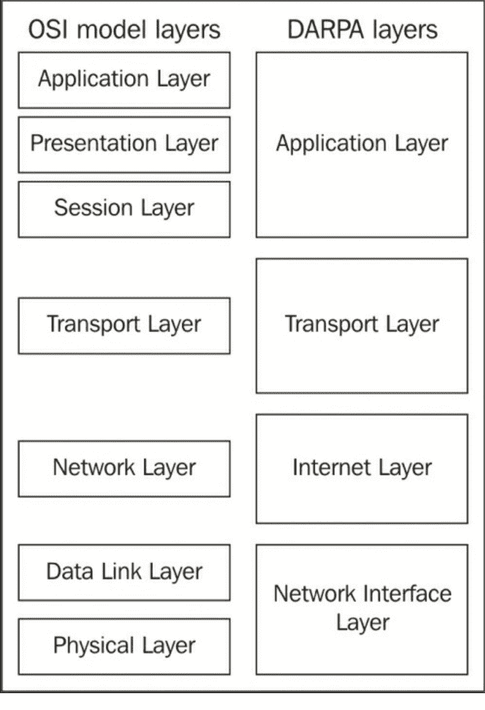

除非你从事协议编写工作，否则没有必要深入研究这七层中的每一层，但从概念上理解它们是有帮助的，因为业界和你的 IT 同行都会提及这些层。

更重要的是，你必须知道这些层及其相关协议在 Wireshark 的 **数据包详细信息** 窗格中是如何呈现的，以及呈现在哪里。我们将从这个角度来介绍这些层，以帮助你记住它们，并从讨论中获得最大收益。

## 理解网络协议

网络协议与 OSI 层一样，是一组行业标准规则和设计，用于在计算机和应用程序之间交换消息和数据。在任何关于 OSI 层的讨论中，你都直接或间接地提到与某一层相关的协议——最常用的协议是 IP、UDP、TCP、HTTP 等——以及它们所执行的重大功能。

例如，你经常听到网络层和 IP 层这两个术语互换使用，并且人们会认为你所说的是该层及其相关协议，该协议包含并使用 IP 地址来将数据包从 A 点路由到网络中的 B 点。接下来的讨论将把 OSI 和 DARPA 层与其相关协议联系起来。

## OSI 七层模型

当我们从第 1 层到第 7 层依次介绍 OSI 层时，我将概述每一层相关协议在 Wireshark 中如何显示，以及/或在网络硬件中如何使用。你通过这种方法形成的思维模型对于数据包分析来说应该是最准确、最有用的。

### 第 1 层 – 物理层

物理层包含电气特性和机械标准，用于将数据位从计算机的网络接口卡（NIC）传输到交换机端口，或在交换机端口和路由器端口之间传输。你将在这一层遇到的最常见标准、术语和设备包括：

- **以太网**：这是一系列用于**局域网（LAN）** 的网络技术。
- **RJ-45**：这是一种 8 针模块化连接器，位于铜质以太网电缆的两端，插入计算机上的 NIC、墙壁插座或交换机端口。
- **Cat 5（Cat 5e 或 Cat 6）电缆**：这些是使用双绞铜线的以太网电缆。“Cat”代表电缆的类别，反映了其质量和数据传输速度能力。
- **100Base-T、1000Base-T 和 1000Base-LX**：这些代表特定的以太网标准。100Base-T 是使用 RJ-45 连接器的双绞线电缆上的 100 Mbps，1000Base-LX 是光纤上的 1000 Mbps，依此类推。
- **单模和多模光纤电缆**：它们使用固态 LED 或激光器发出的光脉冲来传输数据位。

用于将 NIC 连接到交换机的以太网标准也用于将交换机相互连接，以及将交换机连接到路由器或其他网络设备，尽管使用的电缆和连接器可能因电缆类型和速度而异。

还有其他常用的第 1 层标准，包括 802.11 无线、帧中继和 ATM；后两者用于长距离**广域网（WAN）**。

### 第 2 层 – 数据链路层

数据链路层将来自物理层（通常是以太网）的原始比特组织成帧，这是你在 Wireshark 中看到的通常称为数据包的第一种表现形式。这一层是物理网络、电气/机械标准与用于在更高层中格式化、传输、接收和解码数据包数据的逻辑结构（协议）之间的分界线。

在 DARPA 参考模型中，OSI 的物理层和数据链路层合并为网络接口层。这一层（对于以太网 II 帧）的重要特性和功能包括：

- **媒体访问控制（MAC）地址**：这些是 LAN 中使用的网络地址。它们是烧录在 NIC、交换机、路由器或其他网络设备端口/接口上的内存芯片中的 6 字节网络硬件地址：
  - MAC 地址的前三个字节分配给了特定的制造商，并且可以与制造商关联。Wireshark 有一个列表，可以将 MAC 地址显示为制造商代码和最后三个字节的组合。制造商为每个接口创建唯一的最后三字节地址，因此每个 MAC 地址在全球都是唯一的。（尽管 NIC 可能被编程为使用其他任意的 MAC 地址，这是为了恶意攻击而进行的 MAC 欺骗。但这是一个非常糟糕的主意，因为另一块网卡可能正在使用相同的地址，并可能导致数据丢失和一些非常混乱的数据包交换问题。）
  - 以太网帧包含目标 MAC 地址和源 MAC 地址。MAC 地址用于在同一 LAN 上的计算机之间，或计算机与 LAN 上的路由器或其他设备端口之间交换（而非路由——我们稍后会做出区分）帧。
- **类型（或 EtherType）字段**：这表示下一个更高层协议（通常是 IP（0800）或 ARP（0806））。Wireshark 使用它来确定在数据包解码中应用的下一步协议解析器。
- **载荷**：这是以太网帧携带的数据包或数据报。
- **帧校验序列**：这是一个 4 字节的**循环冗余校验（CRC）** 错误检测代码，根据帧中的所有位计算并添加到帧的末尾。它用于检测通常因电缆故障、外部电信号在电缆导线中引起的噪声等原因而损坏的帧。当接收到帧时，会根据收到的位重新计算此代码，并与 FCS 字段进行比较。然后丢弃坏帧。

下图展示了以太网帧中各字段的布局：

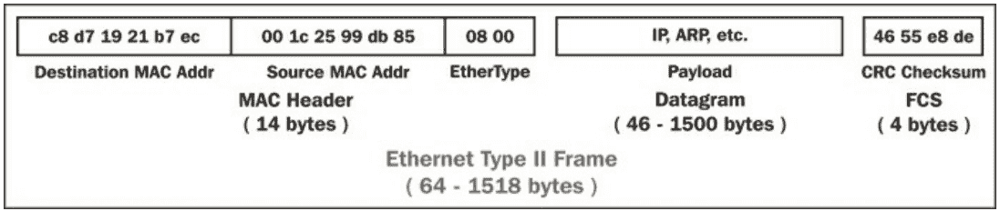

这里的一个关键点——这一点很重要——是以太网帧及其 MAC 地址只能在它们所属的局域网（LAN 和 IP 子网）上的设备之间传输帧。

路由器通过其 IP 子网（子网络）寻址形成 LAN 之间的边界。属于同一 IP 子网的所有设备都是同一 LAN 的一部分，而将数据包发送到不同子网或从不同子网接收数据包都需要路由器。

一旦帧进入路由器端口以路由到不同/远程网络，带有 MAC 地址和 FCS 的以太网帧就会被剥离并丢弃。帧内的载荷被路由到端口，并将离开该端口前往下一个设备；同时会创建另一个具有不同 MAC 地址和重新计算的 FCS 的帧来封装该数据包。然后该帧被传输到下一个目的地。

在这一层工作的网络设备——通常是交换机——通常称为第 2 层设备或第 2 层交换机。

最后，你应该注意，第 2 层交换机可以支持多种网络增强功能，例如虚拟局域网（VLAN）和服务类别（CoS）标记，这是通过在 MAC 地址和 EtherType 字段之间添加一个 4 字节的 802.1Q 字段来实现的。你可能会在交换机之间看到这些帧（但不会在用户端口上看到）。

VLAN 是一种第 2 层解决方案，允许将交换机上的不同端口管理性地划分为独立的广播域。位于不同 VLAN 上的设备实际上彼此隔离，就像它们位于不同的物理网络上一样。如果交换机支持 VLAN 标记，VLAN 可以分散在多个交换机上，而无需为每个 VLAN 铺设单独的电缆。不同 VLAN 上的设备之间的通信通常需要使用路由器。

在下面的 Wireshark 数据包详细信息截图中，以太网 II 帧的**目标**和**源** MAC 地址、**类型**（表示下一层协议为 IP）以及**帧校验序列**都被圈出，**帧**摘要也是如此。

### 注意

Wireshark 会显示每个帧的摘要，包括帧大小、捕获时间戳和帧间时间，以及其他有用的信息。这是 Wireshark 为帮助分析而计算的元数据，不属于捕获帧的一部分。

下面的截图突出显示了以太网帧的重要字段：

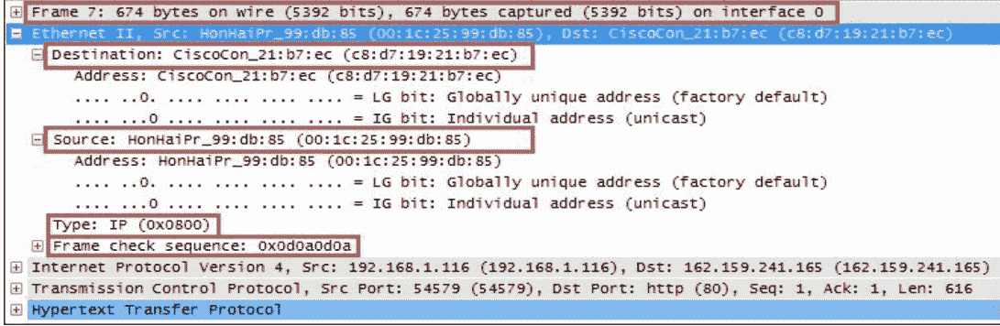

### 注意

Wireshark 在数据包详细信息窗格的任何区域提供的任何附加分析，如果是计算得出的或不是实际数据包内容的一部分，都将用方括号括起来。

### 第 3 层 – 网络层

网络层（在 DARPA 模型中称为互联网层）主要根据目标 IP 地址处理数据包从源计算机到目标主机的路径上穿越网络或到达其他网络的路由。在这一层最常见的两种协议是互联网协议和地址解析协议。

#### 互联网协议

这一层最常用的协议是 **互联网协议第 4 版（IPv4）**，它包含几个关键字段，用以完成数据包跨网络路由的任务。

networks:

- **Differentiated Services (DiffServ):** 该字段支持对 IP 的一种增强，通常称为 **Quality of Service (QoS)**，允许对某些类型的流量（语音、视频等）进行分类，以便在网络拥塞时这些数据包可以获得优先处理。
- **Total length:** 这是数据包的总长度（不包括以太网 MAC 头）。
- **Identification (IP ID):** 这是一个递增的数字，用于支持分片。
- **Flags:** 这些用于支持分片（将数据包分成两个或更多个较小的部分），以防大包需要被分成几个较小的包以穿越受数据包大小限制的链路。这些标志连同 IP ID 字段值允许将分片的数据包正确重新组装成原始数据包。
- **Fragment offset:** 如果 **Flag** 字段为 1（更多分片），则该字段中的值指示此分片数据包包含的片段相对于原始负载起始位置的偏移量，以字节为单位。
- **Time to Live (TTL):** 这是一个“跳数”或时间计数器，每当数据包经过路由器时都会递减。如果 TTL 达到零，数据包将被丢弃。主要目的是防止数据包永远存活并在发生意外路径环路时导致网络崩溃。
- **Protocol:** 这标识 IP 数据包负载中的协议。Wireshark 使用它来确定应用于数据包解码的下一个协议解剖器。
- **Source and destination IP addresses:** 这些是发送机器和最终目标机器的 IP 地址。IP 地址长 4 字节，以四个八位组（十进制编号 0 到 255）用点分隔表示。

在下面的屏幕截图中，重要的 IPv4 字段被圈出。这些是在该层进行数据包分析时你需要检查并熟悉的字段。

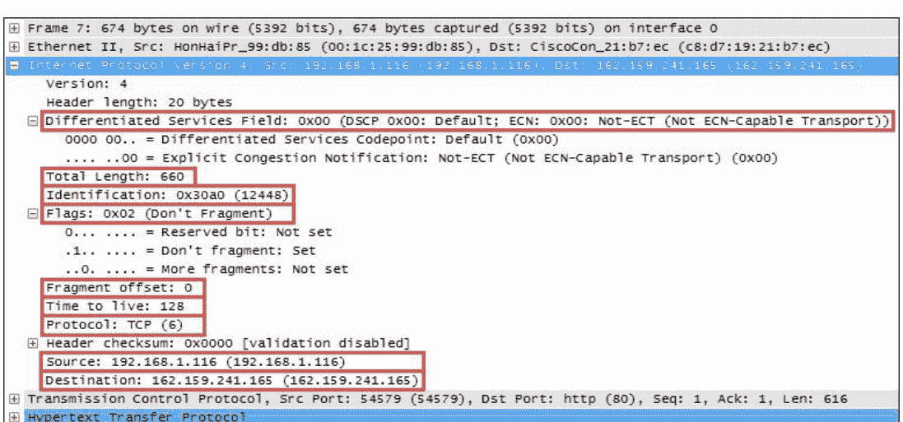

## Address Resolution Protocol

在网络层你还会看到的另一个协议是 Address Resolution Protocol (ARP)，它用于设备在只知道另一设备的 IP 地址时获取该设备的 MAC 地址。

在下面的 Wireshark 数据包详细信息屏幕截图中，请注意以太网帧目标 MAC 地址为广播（ff:ff:ff:ff:ff:ff），类型为 ARP（0x0806），并且该站已在其 ARP 协议发送方字段中提供了自己的 MAC 和 IP 地址（其他站监听并使用这些信息来构建 MAC 和 IP 地址表）。它提供目标设备的 IP 地址，并在目标 MAC 地址字段中填入全零。目标设备应返回一个类似的 ARP 数据包，地址指向请求方，并在发送方字段中包含其 MAC 地址。

一个站只在以下情况下发送 ARP 请求：

- 该站需要目标设备的 MAC 地址，但未听到该站 MAC 地址的先前广播，或其 ARP 表已超时（ARP 条目仅保留一段时间）。

- 该站需要目标设备的 MAC 地址，并且已根据目标的 IP 地址和自己的子网掩码计算出目标设备应在同一局域网上。否则，该站假设目标设备位于不同网络，并将第一个会话发起数据包发送到默认网关（路由器）。MAC 地址基于发送站默认网关配置设置中的条目。默认网关将把数据包转发到适当的出口端口以将其路由到目的地。

- 需要向远端网络发送数据包的站不知道其默认网关的 MAC 地址（例如，刚上电后）。

下面的屏幕截图突出了 ARP 数据包的重要字段：

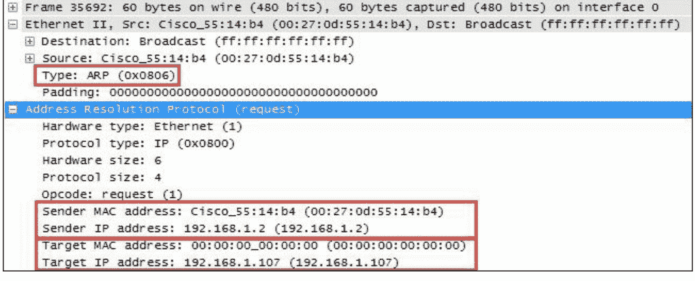

该层使用的其他协议包括 Internet Control Message Protocol (ICMP)，它用于在设备之间发送网络错误消息，以及 Internet Group Management Protocol (IGMP)，它用于主机和相邻路由器建立多播（一对多）组成员关系，以用于流媒体视频和游戏等网络应用。

## Layer 4 – the transport layer

传输层，在 OSI 和 DARPA 模型中都如此称呼，负责通过端口号在应用程序之间或用户与应用程序之间在唯一会话中传输数据包。设备或用户的 IP 地址与其分配的端口号（称为套接字）的组合将与其他设备或用户的 IP 地址和端口号不同（在客户端）。

如果数据包的源主机是服务器，则源端口很可能是标准应用程序和服务的众所周知的号码，例如 HTTP 的端口 80。

传输层通常使用两种协议之一，User Datagram Protocol 或 Transmission Control Protocol，其中后者对大多数应用程序更为普遍。

## User Datagram Protocol

**User Datagram Protocol (UDP)** 是一个相当简单的协议。它被认为是一种不可靠的传输，因为没有数据包交付或排序的保证，但它开销较低，并被时间敏感型应用如语音和视频流量以及网络服务应用如 DNS 所使用。

UDP 头只有 8 字节长，由以下部分组成：

- **Source and Destination port number:** 各为 2 字节。
- **Length:** 这是 UDP 头加上负载的长度。这是一个 2 字节字段。
- **Checksum:** 这是用于检查 UDP 头和数据的错误的 2 字节字段。如果发送方未生成校验和，则此字段为全零。

下面的屏幕截图显示了 UDP 头中包含的字段：

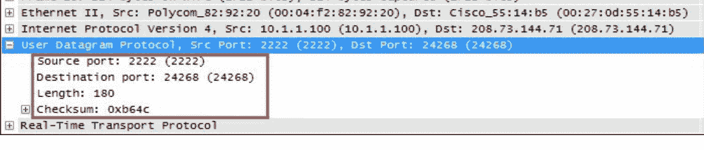

## Transmission Control Protocol

与 UDP 不同，**Transmission Control Protocol (TCP)** 通过检测丢失、重复或乱序的数据包、请求丢失数据的重传，或在交付给应用程序之前重新排列数据包的顺序来提供数据的可靠交付。TCP 还可以从应用程序接收一大块数据，并使用多个数据包可靠地处理数据的传输，并在另一端重新组装它们（UDP 也可以，但不可靠；应用程序必须确定并从丢失的数据包中恢复）。

TCP 头的内容和长度可能会根据使用的选项而变化，但在最简单的实现中，它由以下部分组成：

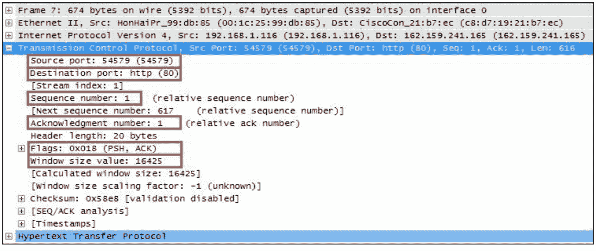

## Layer 5 – the session layer

会话层处理在两个计算机之间的应用程序中设置、控制和结束会话。这不一定与例如 TCP 连接相同，尽管两者相关。应用程序会话可以跨越并存活多个网络连接。一个在该层运行的网络协议示例是 Network Basic Input/Output System (NetBIOS)。

## Layer 6 – the presentation layer

表示层将传入和传出的数据从一种格式转换为另一种格式，并处理如果需要则进行加密/解密和/或压缩。表示层还负责向应用层交付和格式化信息以供进一步处理或显示。表示服务的示例是将 EBCDIC 编码的文本计算机文件转换为 ASCII 编码的文件。

## Layer 7 – the application layer

应用层可能（或可能不）执行与应用程序本身不同的功能，处理消息格式化、人机界面等。该层代表直接支持应用程序的服务，例如文件传输、数据库访问、电子邮件等的软件。

在许多广泛使用的应用中，表现层和应用层之间没有区分。例如，**超文本传输协议（HTTP）**通常被视为应用层协议，但它具有表现层方面的功能，例如能够识别字符编码以进行适当的转换，而该转换随后在应用层完成。

在 DARPA 模型中，OSI 模型的第 5-7 层被合并为应用层。从数据包分析的角度来看，顶层功能的特定表现形式和可见性（在 Wireshark 中）会根据所使用的应用和特定协议而有所不同。

下图总结了 OSI 和 DARPA 层，以及各种网络协议和服务如何与这些层以及彼此对齐：

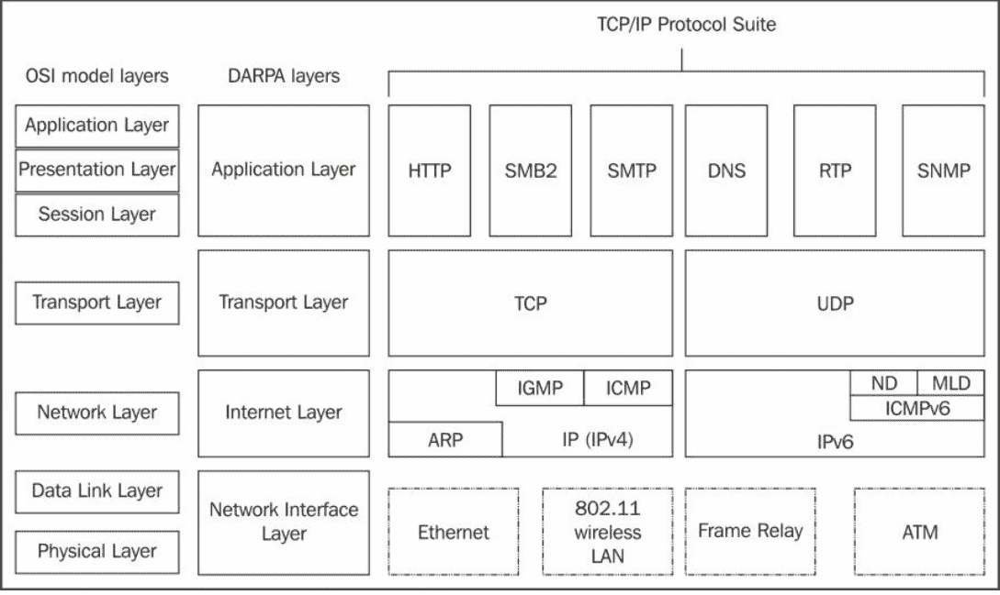

## 封装

到目前为止，你可能已经注意到数据包将各种协议封装到连续的层中，就像剥洋葱一样。以太网帧包含数据报负载；该数据报是带有 IP 头部和负载的数据包。IP 数据包负载由 TCP 头部和数据段组成，而数据段又可能包含 HTTP 头部和负载。这种封装在 Wireshark 的 **数据包详细信息** 面板中更容易可视化。

## IP 网络和子网

在继续之前，对典型的 IP 子网术语和典型应用进行简要回顾，有助于澄清本书中使用的术语，并为已熟悉 IP 地址的人员提供复习。

在图表或设备配置中，在网络 IP 地址后放置的 /24 设计符是无类别域间路由（CIDR）设计符，表示如下：

- 在 4 字节 IP 地址的 32 位中，前 24 位代表该网络上任何 IP 地址的网络部分。该网络被指定为 10.1.1.0（下一个 /24 网络将是 10.1.2.0，然后是 10.1.3.0，依此类推）。
- 32 位地址的最后 8 位可用于为工作站、主机和其他设备分配 IP 地址，但有以下例外：
  - 该网络上的第一个主机地址被保留为构建路由表的网络标识符：10.1.1.0（通常称为环回地址）
  - 该网络上的最后一个主机地址被保留为 IP 广播地址：10.1.1.255

  8 位二进制值等于 256 十进制，减去前述两个例外。这留下了 254 个可用的 IP 地址供设备使用，从 10.1.1.1、10.1.1.2 开始，一直到 10.1.1.254。

- 另一种表达子网掩码的方式是点分十进制格式，255.255.255.0，这再次表示 IP 地址的前 24 位是网络，后 8 位用于主机。
- 有 A 类、B 类和 C 类地址范围，以及作为私有地址保留供组织内部使用的 IP 范围子集。

下表显示了三个主要类别中的 IP 地址范围：

| IP 地址类别 | 起始 IP 地址 | 结束 IP 地址 |
| --- | --- | --- |
| A | 1.0.0.0 | 126.255.255.255 |
| B | 128.0.0.0 | 191.255.255.255 |
| C | 192.0.0.0 | 223.255.255.255 |

下表显示了私有 IP 地址范围：

| 私有 IP 地址类别 | 起始 IP 地址 | 结束 IP 地址 |
| --- | --- | --- |
| A | 10.0.0.0 | 10.255.255.255 |
| B | 172.16.0.0 | 172.31.255.255 |
| C | 192.168.0.0 | 192.168.255.255 |

- 子网掩码可以配置为允许每个子网有更多或更少的主机，并相应地在大型组织内构建多个网络时进行网络地址数量的权衡。

对 IP 地址和子网划分的更深入回顾超出了本书的范围。如果你不熟悉这些概念，建议进行一些额外的学习，因为对 IP 子网划分的扎实理解对于大多数分析活动至关重要。

## 交换和路由数据包

到目前为止，我们已经涵盖了讨论数据包如何从计算机 A 跨越局域网和/或广域网路由到主机 B 所需的主题，距离可能从房间内到全球各地。需要记住的重要概念是，以太网帧通过交换机工作，IP 数据包通过路由器工作来实现这一壮举，我们将在下一节中介绍。

### 以太网帧和交换机

为了重申在第 2 层（数据链路层）讨论中概述的内容，以太网帧根据目标 MAC 地址从入口端口切换到适当的出口端口。网络交换机构建哪些 MAC 地址属于每个端口的表，将帧的目标 MAC 地址与这些表进行比较，如果目标在同一交换机上，则将帧切换到适当的出口端口，否则通过中继端口切换到另一台交换机或路由器。

请注意，交换机第一次看到不认识的目标 MAC 地址时，它会将数据包（通常是 ARP 数据包）发送到所有端口，直到有设备响应并将其新的 MAC 地址添加到其可内容寻址内存（CAM）表中，该表将 MAC 地址映射到特定端口。

发往远程网络的数据包会被发送到默认网关端口 MAC 地址。如果你查看 Wireshark 中会话表以太网选项卡中的 MAC 地址列表，并看到某个地址的流量量明显高于其他站点，这很可能是一个默认网关（路由器）端口 MAC 地址。该端口是进入/离开此局域网到/来自其他网络的通道。

在任何给定的局域网中，你都会看到工作站、服务器和路由器生成 ARP 和域名系统（DNS）请求：

- ARP：用于将 IP 地址解析为 MAC 地址
- DNS：用于将主机名解析为 IP 地址

在下图中，有两台用户工作站和一台服务器，它们连接在 10.1.1.0/24 IP 网络的局域网上。一台路由器连接到该网络，该路由器具有通往另一地点的广域网链路。

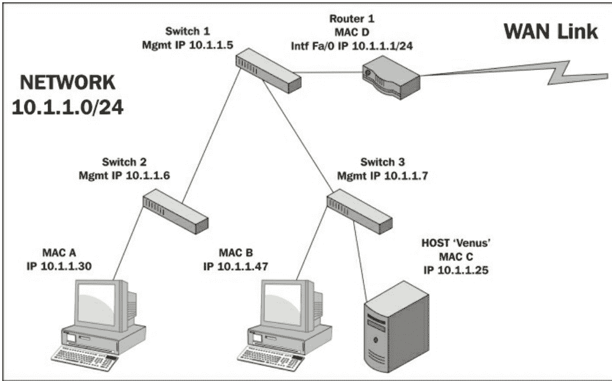

以下两个场景利用此图示来展示 MAC 地址如何用于在局域网中交换以太网帧：

- MAC 地址为 B 的工作站想要使用刚刚加电，所有网络设备都不知道的服务器 Venus 上的应用程序。工作站知道 Venus 的 IP 地址，因为该 IP 地址已预先配置在客户端应用程序中，但它不知道服务器的 MAC 地址。

  工作站广播一个 ARP 数据包，其中发送方为其自己的 MAC 和 IP 地址，目标字段中为 Venus 服务器的 IP 地址和全部为零的 MAC 地址。Venus 服务器以包含其 MAC 地址 C 的 ARP 响应进行回复。

  工作站随后使用服务器的 MAC 地址作为以太网帧中的目标 MAC 向服务器发送会话发起数据包。

  这些以太网帧经过交换机 3，该交换机通过观察 ARP 会话学习了两个设备的 MAC 地址。局域网中的其他交换机在工作站 B 广播其 ARP 数据包时学习了工作站 B 的 MAC 地址（因为交换机 3 将此 ARP 数据包发送到所有端口），但未学习服务器的 MAC，因为服务器直接响应了 B。

- MAC 地址为 A 的工作站现在也想使用服务器 Venus 上的应用程序。它也不知道服务器的 MAC 地址，因此也发送 ARP 请求，交换机 2 将其广播到所有端口，交换机 1 和交换机 3 也会这样做，因为交换机只查看 MAC 地址，而任何 ARP 请求的目标 MAC 地址都是 **ff:ff:ff:ff:ff:ff**，因此每个交换机都必须将广播帧发送到所有端口。

  然而，当服务器 Venus 使用 A 的 MAC 地址响应 A 的 ARP 数据包时，路径中的每个交换机都已学习到它在哪个端口看到 A 的 MAC 地址进入。因此，每个交换机只将 Venus 的响应发送到返回工作站 A 的适当端口。对于已学习的非广播帧也是如此。如果交换机不识别非广播帧的目标 MAC 地址，则第一次也会将其发送到所有端口。

随着交换机 CAM 表被 MAC 地址及其关联端口填充，必须发送到局域网中每个设备的帧数量以及所有这些设备的负载会显著减少。

## IP 地址和路由器

当数据包需要离开局域网前往远程 IP 网络时，就需要路由器根据目的 IP 地址对数据包进行路由。以下场景（仍参考前面的截图）说明了在一种可能情况下涉及的一些细节。

工作站 A 现在想要使用位于与之前场景不同网络上的服务器 Mars 上的一个应用程序。在这种情况下，工作站 A 不知道服务器的 IP 地址；它只需要其名称。工作站 A 将向其网络设置中配置的 DNS 服务器 IP 地址发送一个 DNS 请求数据包，主机名为 Mars；DNS 服务器（此处未显示）将返回 Mars 的 IP 地址 10.1.2.25。工作站 A 通过将其 IP 地址和子网掩码与 Mars 的 IP 地址进行比较，计算出该主机不在其自己的网络上，因此它将会话发起数据包发送到路由器 1，该路由器在其网络设置中被配置为其默认网关。我们假设工作站 A 已经通过之前的 ARP 交换知道了路由器 1 端口的 MAC 地址，以便从给定的 IP 地址找到路由器 1 的 MAC 地址。

当路由器收到发送到路由器端口 MAC 地址的 A 的帧时，它会检查 IP 头部中的目的 IP 地址并查找适当的端口以转发数据包。此路由过程由路由器从其他路由器广播的路由信息构建的路由表条目支持；每个路由器都会告诉其他所有路由器它知道通往哪些网络的路由。

在这种情况下，围绕 A 数据包的以太网帧被剥离，剩余的有效载荷（数据包）通过广域网链路发送到路由器 2，后者也会检查 IP 头部目的 IP 地址并查找正确的端口以转发数据包。路由器 2 将数据包封装在新的以太网帧中，其源 MAC 地址为其自身的 X，目的 MAC 地址为 Mars 服务器的 Y 地址（假设路由器已在其 MAC 表中已有服务器），并将数据包传输到局域网上，以便交换到 Mars 服务器，如下图所示：

### WAN 链路

Router 2
MAC X
Intf Fa/0 IP 10.1.1.1/24

Switch 20
Mgmt IP 10.1.1.5

### NETWORK
10.1.1.0/24

Switch 25
Mgmt IP 10.1.2.10

HOST 'Mars'
MAC Y
IP 10.1.1.25

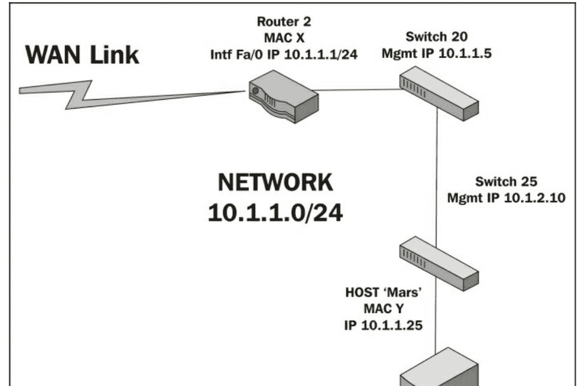

## 无线网络

无线网络利用一系列 802.11 规范，通过 2.4 或 5 GHz 频段以多种速度提供连接。无线帧与有线网络上的帧之间的显著区别如下：

- 无线网络采用载波侦听（每个站点都在监听）、多址接入（共享介质）和冲突避免（避免冲突而不仅仅是恢复冲突）技术，这会降低吞吐量
- 除了转发到有线网络的数据帧外，无线帧类型还包括以下内容：
  - **管理帧：** 用于身份验证和关联任务
  - **控制帧：** 控制共享介质上的发送/接收功能以帮助避免冲突

Wireshark 可用于在无线网络上捕获和分析数据包。然而，为了分析控制和管理帧，以及在无需关联到特定频道的情况下选择要捕获的无线电频道，需要专用适配器。这些适配器可从各种网络供应商处获得。

这些无线适配器及其驱动程序使 Wireshark 能够在 **Packet Details** 窗格中帧头下方显示一个伪头部，其中包含有关以下内容的信息：

- **数据速率：** 这是无线电频道上可能的最大数据传输速率
- **频道频率：** 这是站点正在使用的射频频道频率
- **频道类型：** 这是使用的 802.11 协议，常见类型为 a、b、g 和 n
- **射频信号和噪声电平：** 这是接收到的射频信号强度和背景噪声电平；两者之间的差异越大，信号解码效果越好

请记住，在分析无线网络时，无线接入点利用有线局域网连接连接到网络的其余部分，这可能需要单独分析。接入点剥离 802.11 头部并将数据包封装在以太网帧中，然后在有线网络上传送数据包。

以下屏幕截图说明了典型的 **Radiotap Header** 和

**IEEE 802.11 帧** 的内容；请注意 **Data Rate**、**Channel frequency** 和 **Signal/Noise** 值：

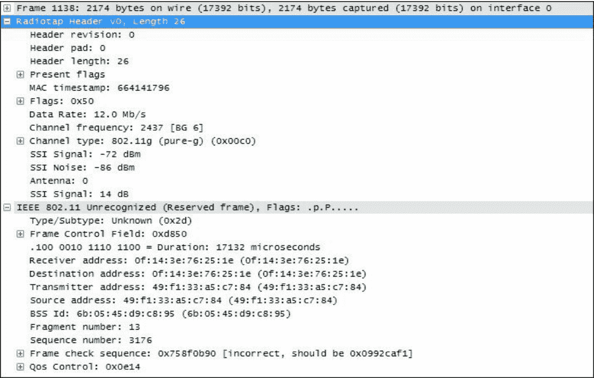

### Note

有大量参考资料和书籍可供阅读，以了解有关网络和网络协议的更多信息。其中一个经典来源是 TCP/IP Illustrated Volumes I, II, and III, W. Richard Stevens, Addison-Wesley Professional，可在线或以书籍格式获得。

## Summary

本章涵盖的重要内容包括如何根据目的 MAC 地址将以太网帧交换到局域网上适当交换机端口，以及如何根据目的 IP 地址将数据包路由到远程网络，以及如何将发往远程网络的帧根据目的 IP 地址发送到默认网关端口 MAC 地址。

我们还介绍了如何以及为什么较慢和/或距离更远的广域网链路会给数据包传输带来大量延迟，从而减慢应用程序数据交换并增加用户响应时间。我们通过讨论 Wireshark 如何使用专用适配器在 802.11 无线网络上捕获和分析数据包结束了本章。

在下一章中，我们将详细介绍如何使用 Wireshark 捕获和过滤数据包。
