## Chapter 3. Capturing All the Right Packets

为了分析以排除连接、性能或安全问题，您必须成功捕获所有正确的数据包，然后识别并过滤掉与当前目标相关的仅数据包。

在本章中，我们将涵盖以下主题：

- Picking the best capture point
- TAPs and switch port mirroring
- Wireshark's capture interfaces, filters, and options
- Verifying a good capture
- Isolating the conversation(s) of interest
- Using the Wireshark Conversations window
- Wireshark's display filters
- Filtering expression buttons
- Following TCP/UDP/SSL streams
- Marking and ignoring packets
- Saving filtered traffic

您会认识到，其中许多活动与我们在第 1 章《Getting Acquainted with Wireshark》中完成以执行捕获并过滤仅涉及加载网页的数据包的活动相同。在本章中，我们将扩展并完成在所有这些主题方面的技能。

## Picking the best capture point

确定执行数据包捕获的最佳位置取决于以下几个因素：

- 调查问题的性质
- 在提供最高分析有用性的位置执行捕获的相对能力
- 在给定位置执行捕获所需的技术难度、风险和时间

### User location

如果您正在排查用户投诉，第一个捕获点应位于用户工作站，以从用户角度获得视图并验证/澄清用户报告的情况。从这个角度，您可以：

- 确保基本网络服务如 ARP 和 DNS 正常工作
- 如果用户身份验证涉及与目标应用程序服务器不同的设备，则分析初始登录过程
- 测量从用户到目标主机（s）的网络往返时间
- 确定 TCP 会话设置握手是否适合所访问的应用程序
- 测量服务响应时间（如 HTTP 或 SMB 响应时间）
- 确定用户是否遇到数据包丢失和重传、乱序数据包或其他网络相关异常
- 捕获发送给用户的任何应用程序错误消息以及导致这些错误请求的请求

从用户位置捕获在实践上通常要简单得多，并且流量要少得多，这使得捕获大小更小，过滤感兴趣的数据包更简单。断开用户以太网电缆几分钟以插入 TAP（我们将在下一节讨论这些）或在用户工作站上安装 Wireshark 通常不需要特殊授权或准备，因为对其他用户的风险可以忽略不计。


## 服务器位置

如果无法或不切实际地从投诉用户的 workstation 获取捕获，从服务器端获取捕获仍然是有用的，但可能有优势应用捕获过滤器来仅收集与用户 workstation 之间（基于用户 IP 地址）的流量，以限制捕获文件大小。你仍然可以测量网络往返时间、服务器响应时间、分析 TCP 握手细节，并检测由丢包引起的重传，并且可能从此位置观察到登录/身份验证过程。

从服务器位置捕获在分析后端服务响应时间时也是合适的。例如，如果用户与应用服务器交互，但该应用服务器为了满足用户请求而与后端数据库进行事务处理，并且存在响应时间缓慢的投诉，那么对应用服务器到数据库服务器交互的分析可以帮助将性能不佳的真正来源隔离到其中一台主机，以及导致缓慢或错误响应的请求类型。

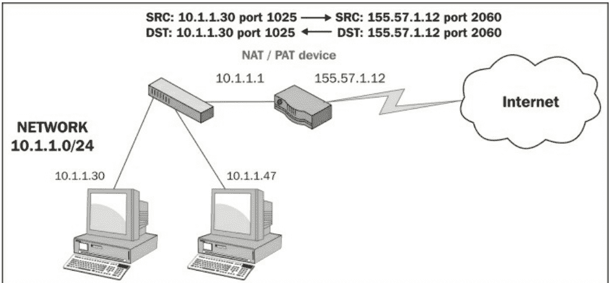

- **代理服务器和防火墙**：此类设备可以充当希望使用其他（通常是外部）服务器资源的客户端之间的中间人。这些设备最常部署在公司内部用户与通过互联网访问的外部（Web）服务之间。这些设备因其安全功能而被采用，允许对可以访问的内容和可以在两个网络之间中继的数据内容类型进行管理控制、恶意软件扫描等。从数据包分析的角度来看，你应该意识到，除了执行 NAT/PAT 功能外，这些设备的某些实现实际上可能在一侧终止用户会话，并在另一侧代表用户在设备与外部主机之间发起完全不同的会话，使得 TCP 握手和会话参数、IP地址和端口号以及数据包大小在两侧都可能不同。
- **使用通用路由封装的 IP 隧道**：这些用于连接两个否则没有原生路由路径的 IP 网络。原始数据包被封装在具有不同 IP 地址的包内，适用于它们将穿越的网络媒体。IP 隧道最常见的用途是通过公共互联网连接将私有企业网络连接在一起，或通过传统的 IPv4 网络路径将 **Internet Protocol Version 6 (IPv6)** 网络连接在一起。IP 隧道可以在路由器和高端交换机之间配置。

尽管可能有必要（为了向其他支持团队验证问题）或更实际地在前面所述设备的接口处或附近进行捕获，但通常在用户和/或服务器位置进行捕获更容易且同样有效。除非你是网络支持团队的一员，否则你不必在如此高级和复杂的环境中进行分析。

## 测试访问端口和交换机端口镜像

如果你从用户位置捕获并且无法或不希望在用户机器上安装 Wireshark，或你在网络中的其他位置捕获，你有两个选项来获取流经网络的数据包副本：测试访问端口或交换机端口镜像。

### 测试访问端口

**Test Access Port (TAP)** 是一种设备，它将流经它的所有数据包复制到一个或多个监控端口。安装了 Wireshark 的工作站可以连接到其中一个监控端口以捕获数据包。

你应选择一个支持所分析网络端口链路速度（通常为 100 Mbps 或 1 Gbps）的聚合 TAP，并且会复制并合并双向流动的数据包（来自用户工作站的发送数据和来自网络的接收数据）；聚合 TAP 将流量汇聚到单个连接（发送到 Wireshark 工作站），以便你可以使用 Wireshark 工作站上的单个网络接口捕获双向流量。请注意，由于你将来自两个方向的数据包复制到 Wireshark 工作站的一个管道中，如果流量速率极高，监控端口可能会过载。如果发生这种情况，多余的数据包将被丢弃。在用户工作站处过载通常不是问题，但对于交换机中继或其他高流量区域可能是问题。

下图说明了 TAP 如何插入在用户工作站与其工作站交换机端口之间，以及 Wireshark 工作站如何连接以捕获数据包：

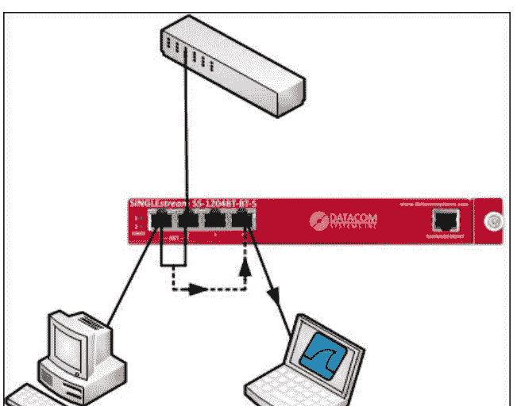

### 交换机端口镜像

交换机端口镜像，也称为 **Switched Port Analyzer (SPAN)** 功能或跨接端口，是配置网络交换机执行与 TAP 相同功能的做法：复制指定端口进出的数据包并将其发送到一个通常未使用的监控端口，在该端口上连接 Wireshark 工作站以捕获数据包。

使用端口镜像的优点是无需中断连接以插入 TAP。监控端口可以由交换机管理员轻松配置，也可以同样轻松地禁用。

此选项的潜在问题包括并非所有交换机都支持端口镜像，并且有证据表明使用此功能可能会影响交换机的性能，至少对于被监控的端口而言。端口镜像也存在监控端口因发送加接收流量水平过高而过载的可能性，就像使用 TAP 时一样，这在监控到其他交换机的交换机中继时很可能发生，因为这些中继承载着多个用户的流量。

下图是交换机上端口镜像场景的简单说明。工作站端口的进出数据包被复制到 Wireshark 工作站连接的端口。

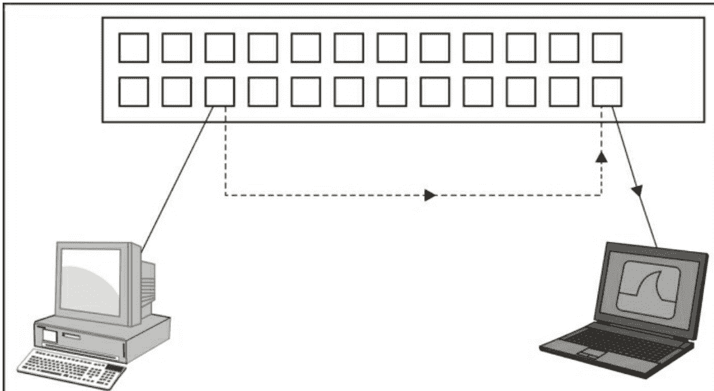

## 在高流量速率链路上捕获数据包

如果需要在高流量速率链路上捕获数据包，例如大型交换机之间的中继链路，Wireshark 可能不是最佳解决方案。它可能无法跟上繁忙链路的节奏。Wireshark 实际上是一个调用名为 **dumpcap** 的命令行可执行文件的 GUI 工具，该工具捕获数据包并将其保存到磁盘文件。Wireshark 读取此文件并将处理后的数据包呈现给用户界面。Wireshark 的替代方案是直接使用 dumpcap 或 **tcpdump** 可执行文件（这些在 [Chapter 8](Chapter 8) 中介绍，命令行和其他实用工具）或众多厂商提供的高速捕获设备。

## 捕获接口、过滤器和选项

使用 Wireshark 捕获数据包包括选择正确的网络接口以从中捕获数据包，应用可能适当的捕获过滤器，并应用正确的选项以按所需方式完成捕获。我们将在以下各节中介绍这三个主题。

### 选择正确的网络接口

如第 1 章《Getting Acquainted with Wireshark》中所述，如果你的机器上有多个网络接口，你需要确定并选择正确的接口来捕获数据包。在 Wireshark 的捕获菜单中，单击接口或单击图标栏上的第一个图标。

Wireshark 捕获接口窗口提供机器上网络接口的列表和描述、分配的 IP 地址，以及每个接口的总数据包和每秒数据包计数器。如果接口分配了 IPv6 地址并且正在显示，你可以单击该地址以切换并显示 IPv4 地址。

以下屏幕截图说明了典型的捕获接口窗口，列出了 LAN 和无线接口以及它们的 IP 地址和数据包计数器：

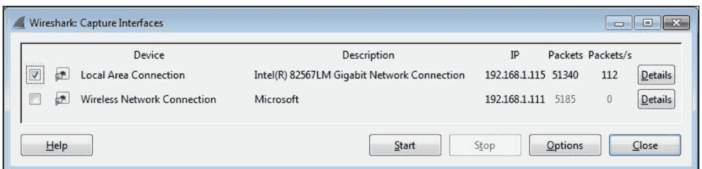

捕获接口窗口提供以下两个选项：

- 对任何列出的接口单击详细信息按钮将打开一个接口详细信息窗口，提供可用于验证接口操作的各种信息。链路和链路速度信息的状态显示在特性选项卡中，所选 NIC 的 MAC 地址显示在 802.3（以太网）选项卡中。
- 其余捕获选项在捕获选项窗口中配置，可通过在捕获接口窗口中单击选项按钮，或从捕获菜单中选择选项，或单击图标栏上的第二个图标来打开。

以下屏幕截图说明了典型的捕获选项窗口，其中包含一个数字


所指定的选项。您可以参考它以获取有关**捕获选项**主题的示例。

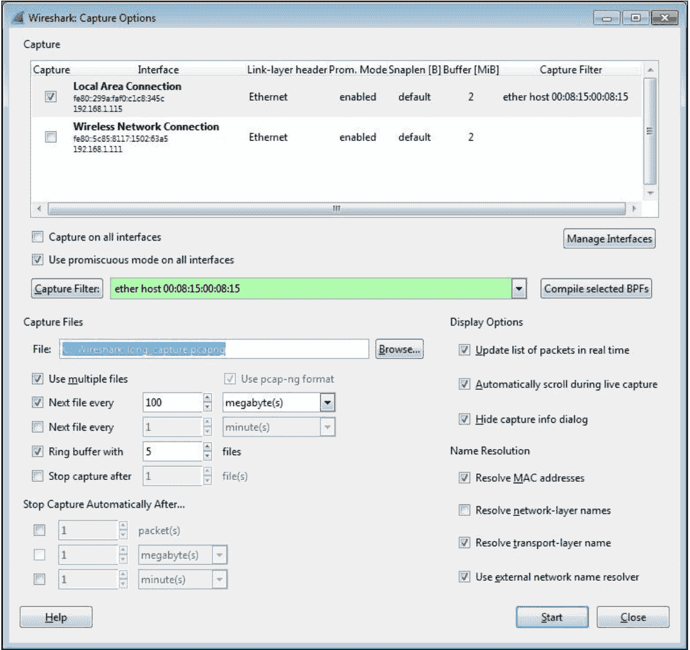

如上面的截图所示，**捕获选项**窗口显示可用的接口及其 IP 地址，并允许您选择一个或多个这些接口来执行捕获。Wireshark 可以同时从多个接口以及虚拟接口进行捕获。从**捕获接口**窗口开始的主要优势在于可以使用数据包计数器来帮助识别活动接口，这是**捕获选项**窗口所不具备的功能。

否则，如果您知道要使用哪个接口，则可以跳过**捕获接口**窗口，直接从这里开始。

单击**捕获选项**窗口中的**管理接口**按钮，会打开**接口管理**窗口。在**本地接口**选项卡中，您可以选择隐藏不希望显示在**捕获接口**和**捕获选项**窗口中的接口。

有一个选项可以快速启用**在所有接口上捕获**，还有一个默认启用的**在所有接口上使用混杂模式**选项。在大多数情况下，应保持启用此选项，以便所选接口能够捕获并保存所有可见的数据包。否则，只有发送到 Wireshark 工作站 MAC 地址的数据包、广播数据包和/或多播数据包才会被看到并捕获，这基本上否定了它作为捕获设备的用途。**编译所选 BPF** 按钮提供编译后捕获过滤器的机器语言显示，但没有其他功能用途。

## 注意

**捕获过滤器**字段具有高亮功能，用于指示过滤器语法是否有效。绿色背景表示有效的过滤器，红色背景表示无效或不完整的过滤器。

## 使用捕获过滤器

捕获过滤器用于减少数据包捕获期间保存的流量数量。在实践中，捕获过滤器应尽量少用（如果确实要用的话），以确保不会因为数据包不在捕获过滤器参数范围内而无意中遗漏对分析重要的数据包。请记住，您随时可以从捕获中过滤掉不需要的流量，但一旦捕获完成，对于错过的数据包您就无能为力了。如果您对捕获没有把握，请使用更宽松的捕获过滤器或完全不使用过滤器重新执行捕获。

适合使用捕获过滤器的一种场景是当您希望让捕获运行较长时间时。此时，您应尽可能过滤掉无关流量，以控制捕获文件的大小。但是，请注意确保您应用的捕获过滤器不会排除任何可能对分析有用的流量。

在使用捕获过滤器时，通常最好先进行一些试捕获，以验证过滤器是否按预期工作，然后再进行您想要保留的正式捕获。

## 配置捕获过滤器

Wireshark 提供了一个**捕获过滤器**窗口，可以轻松选择预配置的捕获过滤器，您也可以根据自己的需要配置自定义过滤器。

单击**捕获选项**窗口中的**捕获过滤器**按钮，打开**捕获过滤器**窗口。在此窗口中，您可以从多个有用的预配置捕获过滤器中进行选择，根据自己的目的创建新的唯一捕获过滤器，或删除不需要或错误的过滤器。创建新过滤器只需为过滤器命名、输入捕获过滤器语法、单击**新建**保存过滤器，最后单击**确定**即可。或者，您可以单击现有过滤器，再单击**新建**，这将在列表底部创建该过滤器的副本，然后您可以根据自己的目的进行修改。

以下截图展示了一个典型的**捕获过滤器**窗口。在本例中，选择了一个仅允许与特定以太网 MAC 地址进行通信的捕获过滤器：

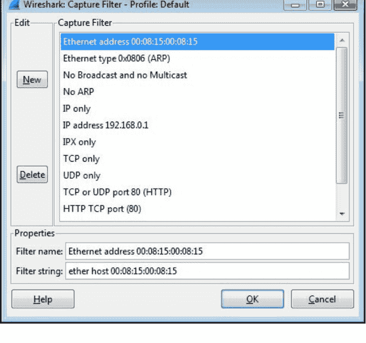

Wireshark 的捕获过滤器使用一种称为**伯克利数据包过滤器（BPF）**格式的语法，该格式起源于 Unix 领域，至今仍用于数据包级驱动程序。请注意，Wireshark 中用于捕获过滤器的语法与用于显示过滤器的语法有很大不同。

**捕获过滤器**窗口中的默认捕获过滤器选择有助于提供捕获过滤器语法的示例。下表列出了一些额外的捕获过滤器语法示例及相应示例：

| 描述 | 语法 | 示例 |
|---|---|---|
| 按以太网 MAC 地址过滤 | `ether host xx:xx:xx:xx:xx:xx` | `ether host 00:1c:25:99:db:85` |
| 仅捕获来自或发往某个 MAC 地址的流量 | `ether src or ether dst` | `ether src 00:1c:25:99:db:85` |
| 按 IP 地址或主机名过滤 | `host xxx.xxx.xxx.xxx` | `host 192.168.1.115`<br>`host www.wireshark.org` |
| 仅捕获两个 IP 地址之间的流量 | `src host and dst host` | `host 192.168.1.115 and host 10.1.1.125` |
| 仅捕获两台主机之间单向的流量 | `src host ... and dst host ...` | `src host 192.168.1.115 and dst host 10.1.1.125` |
| 按端口号过滤 | `port, dst port, and src port` | `port 53` |
| 过滤 DNS 数据包 |  | `port 67` |
| 过滤 DHCP 数据包 |  |  |
| 按协议过滤 | `arp, icmp, ip, udp, tcp, http, ipv6, and icmp6` | `http` |
| 仅过滤 HTTP 流量 |  |  |
| 捕获过滤器逻辑运算符 | `=, !=, >, <, >=, <=, !, not, &&, and, ||, or` | `not arp and port not 53`<br>`! arp && port ! 53` |
| 排除 ARP 和 DNS 数据包的过滤器 |  |  |

更多关于捕获过滤器的信息和示例可以在 Wireshark 维基网站 [http://wiki.wireshark.org/CaptureFilters](http://wiki.wireshark.org/CaptureFilters) 上找到，协议特定的捕获过滤器语法包含在 [http://wiki.wireshark.org/ProtocolReference](http://wiki.wireshark.org/ProtocolReference) 的参考信息中。

## 捕获选项

**Wireshark 捕获选项**窗口提供了多种控件，用于根据特定需求配置捕获。

### 捕获文件名和位置

单击**文件**选项上的**浏览**按钮，您可以导航到选定的目录，在其中存储捕获文件，并为捕获文件输入文件名。

使用**文件**选项时，Wireshark 会在您指定的文件名后附加文件编号和日期时间戳，并且不会提供文件扩展名。您应在文件名中指定 `.pcapng` 扩展名。通过示例可以更好地说明这一点。

用户提供的目录和文件名为 `C:\Wireshark\long_capture.pcapng`，Wireshark 将以 `C:\Wireshark\long_capture_00001_20140724132952.pcapng` 的格式创建并保存数据包文件。

如果将 Wireshark 配置为捕获到多个文件（稍后将讨论），文件编号和日期时间戳将随着捕获的进行而相应递增，例如 `long_capture_00002_20140724133343.pcapng` 和 `long_capture_00003_20140724133612.pcapng`。

### 多文件选项

可以将 Wireshark 配置为将数据包保存到多个文件以进行长期捕获，并提供多个选项来控制如何实现这一点。

选择**使用多个文件**选项后，随着特定选项的启用，相应的底层控件将变为活动状态。您可以选择在每个文件达到指定大小和/或经过可配置的时间段后开始一个新（下一个）文件。

### 注意

当处理远大于 100 MB 的捕获文件时，Wireshark 可能会变得非常缓慢甚至崩溃，因此您应将此视为一个合理的最大文件大小。

### 环形缓冲区


**Ring buffer** 选项与 **Next File every** 选项配合使用，可使 Wireshark 填充指定数量的文件，并在捕获继续进行时删除最旧的文件。

此功能在等待某些间歇性问题或事件发生时很有用，在此之后捕获会手动停止。环形缓冲区文件提供了在停止捕获之前的某个时间段的历史捕获数据，而不会用过多的大型捕获文件填满硬盘。

## Stop capture options

Wireshark 具有在达到指定数据包数、文件大小或时间段后自动停止捕获的选项。如果启用了 **Use multiple files** 选项，则可以使用在达到指定文件数后停止捕获的选项。否则，捕获可以在达到指定数据包数、文件大小或时间段后停止。

## Display options

**Update list of packets in real time** 选项指定 Wireshark 在捕获过程中定期读取正在写入的捕获文件并相应地更新 **Packet List** 内容。否则，在捕获期间 Wireshark 用户界面将被置灰。

**Automatically scroll during live capture** 选项指定 Wireshark 更新并在 **Packet List** 面板中显示最新捕获的数据包，使得数据包在列表更新时似乎向上滚动。此选项需要启用 **Update list of packets in real time** 选项才能发挥作用。

这两个选项都有处理时间成本，可能导致数据包丢失和/或显示迟缓，如果在非常繁忙的链路上进行捕获，应将其禁用。但是，在捕获期间查看和确认预期的包流是否正在发生的能力将会丢失。

**Hide capture info dialog** 选项（默认启用）控制在捕获期间是否显示一个简单的窗口，该窗口按协议显示数据包计数和百分比。除非特别需要，最好将此窗口保持隐藏。

## Name resolution options

如果启用了 **Resolve MAC addresses** 选项，则会导致 Wireshark 使用分配的制造商代码显示 MAC 地址，而不是前三个八位字节。例如，Wireshark 将显示 **CiscoCon_21:b7:ec** 而不是 **c8:d7:19:21:b7:ec**。制造商代码列表保存在 Wireshark 安装目录的 `manuf` 文件中。

**Resolve network-layer names** 选项与 **Use external network name resolver** 配合使用，以确定捕获的 IP 地址如何解析为主机名，具体如下：

- **Resolve network-layer names** 选项指定 Wireshark 应尝试将 IP 地址解析为主机名。如果启用了 **Use external network name resolver** 选项，Wireshark 将对每个唯一的 IP 地址执行反向 DNS 查找。这会导致 Wireshark 生成自己的流量。
- 如果禁用了 **Use external network name resolver** 选项，Wireshark 将尝试使用用户提供的 `hosts` 文本文件解析 IP 地址（使用典型的 IP 地址 `<tab>` 主机名语法），该文件位于使用默认配置文件时的 Wireshark 安装目录中，或使用自定义配置文件时位于相应的配置文件目录中。

在捕获期间，最好将 **Resolve network-layer names** 选项保持禁用状态，以便 Wireshark 在捕获期间尝试解析 IP 地址时不会创建额外的网络流量。此功能在捕获完成后始终可以临时启用（通过从菜单导航到 **View | Name Resolution | Enable for network layer**）。

如果启用了 **Resolve transport-layer name** 选项，则会导致 Wireshark 在 **Packet List** 面板的 Info 显示字段中显示人类可读的、端口和协议特定的服务名称，而不是端口号。例如，TCP 端口 80 将显示为 HTTP。端口号服务的列表保存在 Wireshark 安装目录中的 `services` 文件中。

本节开头的屏幕截图说明了一个设置为使用 LAN 接口的 **Capture Option** 窗口，使用过滤器仅捕获到特定以太网 MAC 地址和来自该地址的流量，以在环形缓冲区场景中保存最多五个每个 100 MB 的文件，并将这些文件保存到提供的目录中，使用特定的前导文件名和扩展名。**Display Options** 和 **Name Resolution** 选项已保持其默认设置。

一旦选择了所有所需的 **Capture Options**，单击 **Start** 按钮将开始捕获。

在涵盖了所有最有用的 **Capture Options** 功能之后，现在可能是告诉你正确的时候，对于你进行的许多捕获，尤其是从相对低流量量的位置（如用户工作站）进行的捕获，你不需要也不需要设置任何捕获选项（除捕获的适当接口外），并且可以通过单击图标栏上的第三个（绿色鲨鱼鳍形）图标或从 **Capture** 菜单中选择 **Start** 来使用所有默认值直接开始捕获。不使用捕获过滤器允许你捕获所有相关数据包——不会遗漏任何内容——并在捕获完成后使用显示过滤器过滤掉不需要的流量。

## Verifying a good capture

捕获完成后，你应该滚动并检查 **Packet List** 面板中的数据包，以确保你看到的是预期的流量——通常是到特定主机和来自特定主机的流量。

你还应确保没有丢弃的数据包，这将在 Wireshark 用户界面底部中央的 **Status Bar** 中的 **Packet Information** 部分显示。丢弃的数据包表明 Wireshark 或所选的 NIC 无法跟上流量量，不得不丢弃数据包，这当然会影响分析的质量。如果出现丢弃的数据包，你可能需要使用性能更高的工作站进行捕获或选择较低流量量的捕获位置。

## Saving the bulk capture file

在完成并验证了良好的捕获后，你应该将批量（所有捕获的数据包）捕获文件（假设为单个文件捕获）保存到你选择的目录。你稍后将过滤并将数据包子集保存到较小的文件中，但能够在以后分析时重新加载原始捕获文件是有利的，如果你发现自己可能无意中过滤掉了比想要更多的包。

使用 **File** 菜单中的 **Save As** 选项，导航到你选择的目录并为文件命名。如果未指定文件扩展名，Wireshark 将根据所选的 **Save as type** 选项附加文件扩展名；默认是 `.pcapng` 格式。但是，如果你打算与使用不同协议分析工具的人共享捕获文件，你可以将文件保存为几种其他流行的特定于供应商的格式。

如果使用多个文件和/或环形缓冲区捕获选项保存了多个文件，请导航到 **File | File Set | List Files** 以选择并打开其中一个文件。

## Using the Conversations window

使用 **Conversations** 窗口的基础知识已在 [Chapter 1](Chapter 1) 的第一次捕获中介绍，Getting Acquainted with Wireshark。在本节中，我们将介绍 **Conversations** 窗口的几个其他便捷功能。

### The Ethernet tab

**Conversations** 窗口在 **Ethernet** 选项卡中表现出特定的行为，具体取决于可用的 **Name Resolution** 设置。如果在 **View** 菜单中可以找到的 **Name Resolution** 菜单中启用了 **Enable for Network Layer**，并且 **Conversations** 窗口中也启用了 **Name Resolution**，则与给定设备的 MAC 地址关联的 IP 地址将显示为 IP 地址而不是 MAC 地址。在这种情况下切换 **Name Resolution** 选项对于轻松关联设备的 IP 地址与其 MAC 地址很有用。

如果未启用 **Enable for Network Layer** 选项，则 **Conversations** 窗口中的 **Name Resolution** 选项控制 MAC 地址是使用制造商前缀显示还是作为基本 6 八位字节 MAC 地址显示。


## WLAN 选项卡

由于 **Conversations** 窗口的选项卡按字母顺序排列，**WLAN** 选项卡位于最后。该选项卡显示无线站点的 MAC 地址，以及 **Bytes**、**Packets** 和其他选项卡中提供的其他列。

## Wireshark 显示过滤器

Wireshark 提供了非常广泛的特定于协议的显示过滤器，通过允许您根据自己定义的标准专注于特定数据包，这些过滤器对于分析活动非常有用。您可以仅过滤要查看的流量，或将不需要的流量从视图中过滤掉。显示过滤器是 Wireshark 最有帮助的功能之一，因此值得非常熟悉。

显示过滤器可以通过以下几种方式创建：

- 通过从 **Display Filter** 窗口应用显示过滤器
- 通过在显示过滤器语法中输入（使用自动完成功能）
- 通过从 **Conversations**（或 **Endpoints**）窗口应用显示过滤器
- 通过从 Filter Expression Buttons 应用已保存的显示过滤器
- 使用 **Expressions** 按钮协助创建过滤器
- 在特定数据包字段上使用右键菜单

### Note

请记住，显示过滤器使用专有的 Wireshark 过滤器格式，该格式依赖于协议，并且与捕获过滤器语法有很大不同。

## 显示过滤器窗口

您可以通过从 **Analyze** 菜单中选择 **Display Filters**，点击工具栏上的 **Edit/apply display filter** 图标，或直接点击显示过滤器栏上显示过滤器文本框旁边的 **Filters** 按钮来打开 **Display Filter** 窗口。

**Display Filter** 窗口的外观和功能与捕获过滤器窗口类似，如以下屏幕截图所示。您可以通过输入过滤器名称和适当的语法然后点击 **New**，或点击现有过滤器来创建新的自定义显示过滤器以添加到此窗口。点击 **New** 并根据需要修改/重命名。

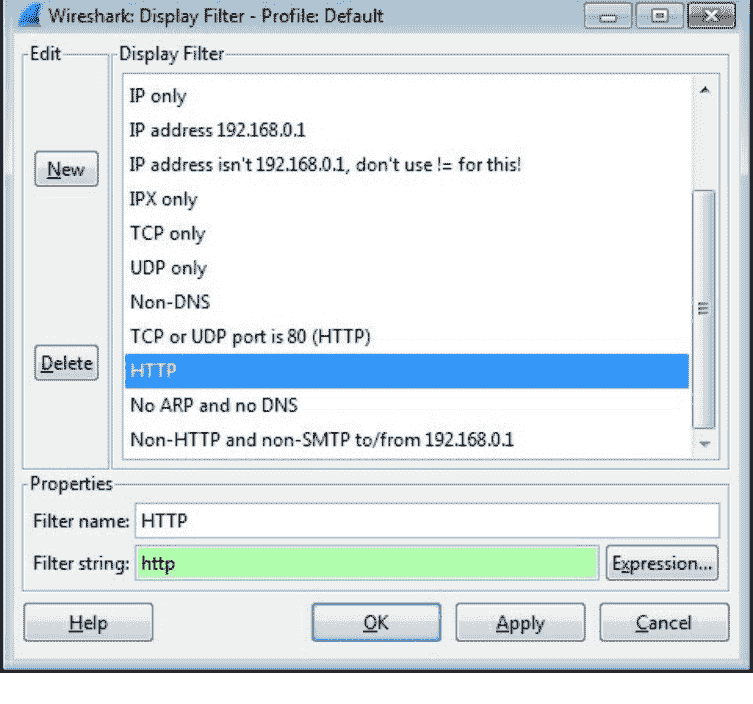

此窗口中列出的显示过滤器已保存在 Wireshark 安装目录中默认配置文件的 `dfilters` 文件中，并在使用自定义配置文件时保存在适当的 **Personal configuration** 目录中。

当您应用显示过滤器时，Wireshark 用户界面屏幕底部的 **Status Bar** 会反映数据包总数和显示的数据包数量，如以下屏幕截图所示：

Packets: 423 · Displayed: 71 (16.8%) · Load time: 0:00.030

## 输入显示过滤器

您可以直接在显示过滤器栏中的 **Filter** 文本框中输入显示过滤器语法，然后点击 **Apply** 应用过滤器或点击 **Clear** 清除过滤器并重新开始。

在文本框中输入显示过滤器语法的有帮助功能是自动完成功能。在输入协议名称后跟一个句点（.）时，文本框会显示可用的协议相关扩展列表，可供选择，然后添加适当的比较运算符和值，然后点击 **Apply**。

文本框还具有指示显示过滤器语法状态的颜色编码背景。如果语法不正确或不完整，背景为红色，正确的过滤器则背景为绿色。黄色背景表示警告，输入的语法可能无法按预期工作。

## 从 Conversations 或 Endpoints 窗口的显示过滤器

从 **Conversations** 窗口应用显示过滤器已有所介绍。相同的功能也可从 **Endpoints** 窗口使用，可通过从 **Statistics** 菜单中选择 **Endpoint List** 并选择其中一种列出的协议来打开。

## Filter Expression Buttons

Filter Expression Buttons 是基于显示过滤器创建的按钮；可用于快速将先前保存的显示过滤器应用于捕获数据，以识别网络和应用程序问题。

例如，要创建一个 **Filter Expression Button** 选项，仅显示 **TCP SYN, SYN/ACK, FIN,** 或 **RST** 数据包以分析 TCP 会话设置参数、网络往返延迟时间和会话终止：

- 1. 在 **Display Filter Bar** 上的 **Filter** 文本框中输入以下显示过滤器字符串：

```
(tcp.flags&02 && tcp.seq==0) ||  (tcp.flags&12 && tcp.seq==0) ||
(tcp.flags.ack && tcp.seq==1 && !tcp.nxtseq > 0 && !tcp.ack >1)
|| tcp.flags.fin == 1 || tcp.flags.reset ==1
```

- 2. 点击 **Apply** 将此过滤器应用于您加载的捕获，以便确认其正常工作。

- 3. 然后，点击 **Save** 并为按钮命名，例如 `TCP Handshake`（如以下屏幕截图所示）。然后，点击 **OK**：

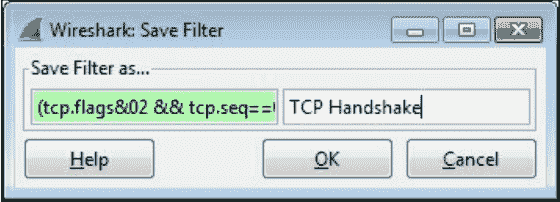

您创建的过滤器表达式按钮将出现在显示过滤器栏初始控件右侧，如以下屏幕截图所示：


过滤器表达式按钮定义存储在您正在使用的配置文件的首选项文件中。您可以在 Wireshark 的 Preferences 窗口中编辑按钮显示顺序、编辑名称或过滤器语法，或删除按钮。

## 使用 Expressions 窗口按钮

在显示过滤器工具栏上文本框右侧是 **Expression** 按钮。点击此按钮会打开一个 **Filter Expression** 窗口，允许您选择协议和该协议的扩展、其中一个适当的关联（比较）运算符，并分配比较值。点击 **OK** 将生成的显示过滤器语法填充到显示过滤器文本框中，然后点击 **Apply** 应用过滤器。

## 特定数据包字段上的右键菜单

如果您在 **Packet List** 或 **Packet Details** 窗格中右键点击特定字段，可以选择 **Apply as Filter** 或 **Prepare a Filter** 选项以及所需的子菜单选项来创建显示过滤器语法，如以下屏幕截图所示。这是一种创建显示过滤器语法的非常快速的方法：

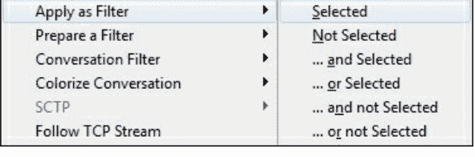

如果您选择一个字段并使用右键功能创建显示过滤器语法，通常最好使用 **Prepare a Filter** 选项，这将允许您在点击 **Apply** 应用过滤器之前编辑语法。

### Note

在 **Packet Details** 窗格中点击协议字段会使该字段和反映该字段的显示过滤器语法显示在左下角的 **Status** 栏字段中。这对于开始使用特定字段的显示过滤器字符串非常有帮助。

## 跟踪 TCP/UDP/SSL 流

选择对话中的数据包，右键点击并从菜单中选择 Follow TCP Stream、Follow UDP Stream 或 Follow SSL Stream 选项（视情况而定）会提供一个显示窗口，其中包含对话中所有数据包的有效载荷数据的文本描述。这是在无需选择和检查多个数据包的情况下检查流内容的一种极佳方式。查看客户端和服务器之间的交换对于故障排除非常有帮助。

当为给定数据包选择 Follow Stream 选项时，会自动创建并应用显示过滤器以支持此窗口的创建。以下屏幕截图说明了 Follow TCP Stream 窗口。此外，请注意创建并应用的显示过滤器语法（tcp.stream eq 15），当选择此流时：

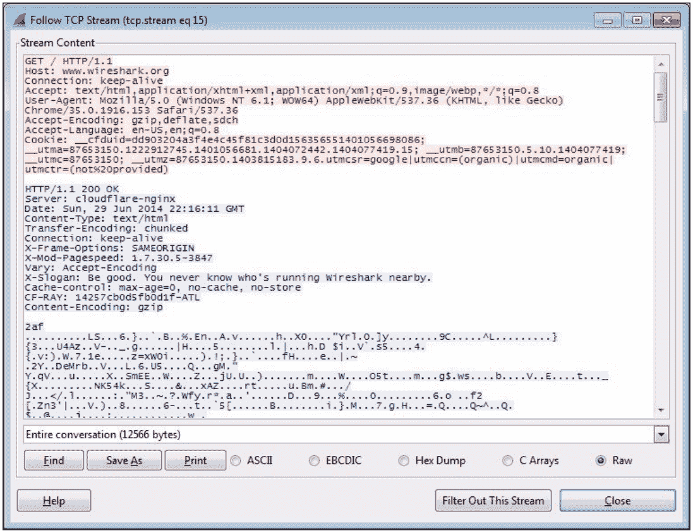


### 标记和忽略数据包

您可以通过Wireshark的**编辑**菜单切换**标记/取消标记数据包**或**忽略/取消忽略数据包**，也可以在**数据包列表**窗格中右键点击数据包并选择**标记数据包（切换）**或**忽略数据包（切换）**。

在**数据包列表**窗格中右键点击数据包后显示的菜单如下截图所示：

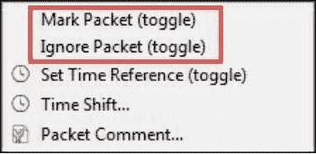

Wireshark允许您在**数据包列表**窗格中标记一个或多个数据包，通过为数据包条目设置黑底白字，以便日后更容易找到这些数据包。这种标记可以按数据包逐个切换开启或关闭。标记数据包对显示或数据包上下文没有其他影响。

您还可以忽略一个或多个数据包。不过，当您对某个数据包启用忽略功能后，该数据包条目会从**数据包列表**、**数据包详情**和**数据包字节**窗格中消失，并且实际上（暂时）不再属于捕获文件的一部分。请注意，忽略数据包可能导致Wireshark报告因缺失数据包而引发的重传或其他错误状况。

被忽略的数据包实际上并未从捕获文件中删除，因为您可以使用**视图**菜单中的**重新加载**选项，或点击图标栏上的**重新加载**图标来恢复被忽略的数据包。

### 保存过滤后的流量

在分析过程中或分析完成后，您可能希望将一组过滤后的数据包保存到新的捕获文件中。将批量捕获数据中的过滤子集保存下来，并在Wireshark中打开这个更小的新文件，有助于减少分析过程中在清除显示过滤器、使用会话窗口等操作时显示的干扰性背景噪声数据包。最后，完成分析后，您将需要一个过滤后的捕获文件，它代表了分析证据和结论，并且可以在日后快速加载以供审阅。

使用**文件**菜单中的**导出指定数据包**选项，即可将仅包含过滤后数据包的新捕获文件保存。导航到目标目录；输入文件名（Wireshark会提供相应的文件扩展名）；做出适当的选择以保存所有显示的数据包、标记的数据包，和/或移除被忽略的数据包；然后点击**保存**。请记得也使用**文件**菜单中的**另存为**选项保存完整的捕获文件，因为您可能再次需要该文件。

以下截图展示了典型的**导出指定数据包**窗口及其选项：

### 小结

本章涵盖的重点包括：选择最佳的捕获点，在TAP和镜像/SPAN端口之间做出选择，Wireshark的捕获过滤器和选项，验证捕获质量，使用Wireshark的**会话**窗口和显示过滤器来隔离感兴趣的数据包，创建过滤器表达式按钮，标记和忽略数据包，以及保存过滤后的流量以供后续或更详细的分析。

在下一章中，我们将介绍Wireshark其余的基本数据包分析功能。
