## 第4章 配置Wireshark

Wireshark提供了许多可配置的功能，以提高数据包分析活动的准确性和便捷性，例如排查功能或性能问题。选择最佳格式来测量数据包之间的经过时间是一个重要因素。还有许多特定于协议的选项会影响Wireshark显示时间相关信息的方式，这些选项也同样有用。着色规则、首选项设置和配置文件让您可以根据自己的特定分析风格以及可能工作的不同环境来定制Wireshark。

在本章中，我们将涵盖以下主题：

- 处理数据包时间戳
- 着色与着色规则
- Wireshark首选项
- Wireshark配置文件

这些主题将为我们对Wireshark最基本、最实用的功能和选项的介绍画上句号。

### 处理数据包时间戳

理解Wireshark如何处理时间，并使用恰当的数据包时间戳显示形式，对于正确分析数据包流和识别与时间相关的异常至关重要。

### Wireshark如何保存时间戳

当捕获数据包时，Wireshark会根据执行捕获的机器的系统时钟为每个数据包分配一个时间戳。该时间戳会根据捕获机器的时区设置和适用的夏令时（DST）规则计算出的偏移量转换为协调世界时（UTC），然后再转换为纪元编号（自1970年1月1日以来基于UTC的秒数）。这就是保存到捕获文件中每个数据包的时间值。当Wireshark读取捕获文件时，它会将纪元编号转换回熟悉的日期和时间显示，并根据您所在机器的时区和夏令时偏移量进行调整。

这意味着，如果在洛杉矶（UTC偏移量为-8小时）的机器上进行数据包捕获，而您在柏林（UTC+1小时，总体差异为9小时，再加上任何夏令时差异）的机器上查看同一捕获文件，那么在洛杉矶当地时间上午10点捕获的数据包，在柏林将显示为晚上7点的时间戳。

不同时区的时间戳显示示例如下表所示：

|  | 洛杉矶 | 伦敦 | 柏林 | 班加罗尔 |
|---|---|---|---|---|
| 捕获文件时间（UTC） | 10:00 | 10:00 | 10:00 | 10:00 |
| 本地相对于UTC的偏移 | -8 | 0 | +1 | +5:30 |
| 显示时间（本地时间） | 02:00 | 10:00 | 11:00 | 17:30 |

如果您要查看别人发送给您的数据包捕获文件，并且某个事件发生的绝对时间对分析很重要，那么您需要知道或询问捕获是在哪个时区进行的，确定您的时区与捕获所在地时区之间的偏移量，并在心里对Wireshark显示的时间戳进行时差调整。否则，这种差异并不重要，因为您通常更关心经过的时间或捕获中特定事件之间的时间间隔。

### Wireshark时间显示选项

Wireshark中提供了多种多样的数据包时间显示方式。默认情况下，Wireshark会在**数据包列表**窗格中提供一个**时间**列，该列配置为以微秒分辨率（123.123456）显示每个数据包的**自捕获开始以来的秒数**。

不过，可以通过在**视图**菜单中选择所需的**时间显示格式**选项来更改此列中时间的显示方式，如下截图所示：

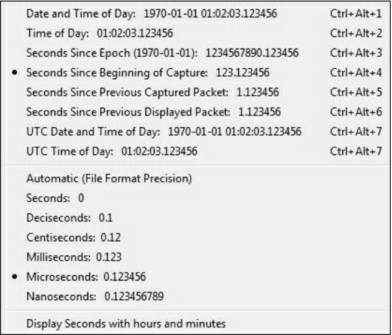

如果使用了**自捕获开始以来的秒数**选项，捕获中的第一个数据包将显示时间值**0.000000**；所有其他数据包都以该第一个数据包为参考进行计时，从而显示自捕获开始以来的经过时间。

时间显示菜单选项均提供了格式示例，也相当不言自明，只是**自上一个捕获数据包以来的秒数**和**自上一个显示数据包以来的秒数**这两个选项可能需要额外说明。**自上一个捕获数据包以来的秒数**选项提供每个捕获数据包之间的经过时间，而**自上一个显示数据包以来的秒数**选项则显示应用显示过滤器后可见的前一个数据包以来的经过时间。

**显示数据包**选项的工作方式如下截图所示。您可以看到**捕获数据包**的时间戳持续递增，而**显示数据包**的时间戳显示自上一个显示数据包以来的时间。

| 捕获数据包 | 显示数据包 |
|---|---|
| 0.000000 | 0.000000 |
| 0.001000 | 0.001000 |
| 0.002000 | ----------- |
| 0.003000 | 0.002000 |
| 0.004000 | ----------- |
| 0.005000 | ----------- |
| 0.006000 | ----------- |
| 0.007000 | 0.004000 |

**时间显示格式**菜单中的时间显示精度选项也附带了显示格式示例，同样不言自明，唯独**自动（文件格式精度）**设置需要说明一下。

Wireshark依赖网卡驱动程序和捕获设备的系统时钟来获取数据包时间戳。这些时间戳在精度和亚秒位数（毫秒、微秒和纳秒）方面的准确性会有所不同，但通常可以提供毫秒级分辨率。该精度值会保存在捕获文件中。**自动（文件格式精度）**设置指示Wireshark使用此精度值显示时间戳。

使用**纳秒精度**设置的能力取决于是否有支持这种精度级别的网卡驱动程序。如果您选择此选项，而捕获文件不包含更高的分辨率，则每个时间戳的最后三位数字将全部为零。

## 添加时间列

在**数据包列表**窗格中设置两个（或更多）时间列通常很有用，这样可以提供多种时间显示类型，而无需反复更改单个时间列的格式。你可以使用以下两种方法之一添加新的时间列。

第一种方法为“首选项”设置方法：

- 1. 从**编辑**菜单中选择**首选项**，或单击**首选项**图标打开**首选项**窗口。
- 2. 选择**列**。
- 3. 单击**添加**在列表底部添加一个新条目。
- 4. 单击新条目的**标题**区域，为列命名。
- 5. 确保新条目处于高亮状态，并从下拉的**字段类型**框中选择所需的时间显示格式。
- 6. 单击并将新条目在列表中向上拖动，以选择其在**数据包列表**窗格中的相对位置。
- 7. 最后，单击**确定**。

**字段类型**框中用于时间显示列的可选选项包括：

- **绝对日期，格式为 YYYY-MM-DD，和时间**：这是基于捕获设备时区的实际捕获日期和时间。
- **绝对日期，格式为 YYYY/DOY，和时间**：这是另一种基于捕获设备时区显示日期和时间的方式。
- **相对时间**：这是从捕获文件中的第一个数据包开始计算的时间。类似于**自捕获开始以来的秒数**选项。
- **相对时间（会话）**：这是会话的跟踪文件中从第一个数据包开始的时间（此功能无效）。
- **增量时间**：这是从前一个数据包到当前数据包所经过的时间。
- **增量时间（会话）**：这是会话中从前一个数据包到当前数据包所经过的时间（此功能无效）。
- **显示的增量时间**：这只是从一个数据包结束到下一个显示数据包结束的时间。
- **自定义**：**相对时间（会话）**和**增量时间（会话）**选项（在首选项设置中也列出了）在撰写本文时当前可用的 Wireshark 版本（v1.12）中已不再有效。你可以使用以下方式实现这些选项以前提供的功能：

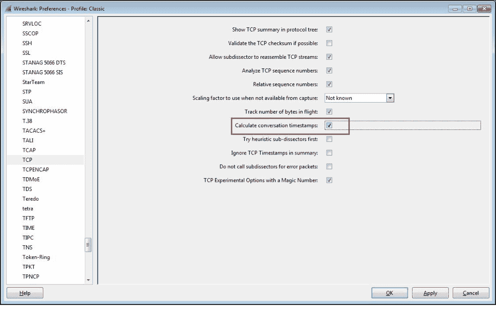

以下步骤展示了第二种方法，即通过右键单击添加列的方法：

- 1. 在**数据包列表**窗格中选择一个合适的数据包。
- 2. 在**数据包详细信息**窗格中，展开**帧**头，或者如果适用，展开**传输控制协议**头。
- 3. 在**帧**或**TCP**部分中找到所需的时间值字段（这些字段用方括号括起来）。如果要在 TCP 部分中选择时间值，则需要展开**[时间戳]**部分才能看到这些值。
- 4. 右键单击所需的时间字段，然后从菜单中选择**应用为列**。
- 5. 新列将出现在**数据包列表**窗格中**信息**列的旁边。单击并将新列拖到所需位置。
- 6. 你可以右键单击新列标题，选择**编辑列详细信息**，如果需要，可以为列指定一个更短的名称。

正如之前在首选项设置方法中所讨论的，你必须启用**首选项**设置中**TCP**协议选项下的**计算会话时间戳**，才能查看和使用**TCP**部分中的时间值。

## 会话时间与显示的数据包时间选项

会话的时间显示与显示的数据包时间选项之间的差异可能很微妙，但却很重要。

如前所述，如果你使用显示的数据包时间选项之一，则对于给定数据包，显示的时间值将是自上一个数据包在**数据包列表**窗格中显示以来所经过的时间。此时间值选项在应用显示过滤器之前没有实际用处；应用后，你可以轻松看到所显示的每个数据包之间的经过时间，无需其他心算或调整。如果你使用例如**tcp.stream==xx**显示过滤器设置来依次过滤、清除和查看多个会话，这将非常有用。

然而，如果你未使用显示过滤器，则**数据包列表**窗格中可能会显示来自多个会话的数据包。如果你使用会话时间显示之一，则对于给定数据包，显示的时间值将是该会话中自上一个数据包以来所经过的时间，而不论当前查看的数据包与该会话中上一个数据包之间可能穿插显示的其他数据包。这允许你快速浏览会话数据包的时间，而无需应用显示过滤器。

## 选择最佳 Wireshark 时间显示选项

可用的时间显示选项如此之多，可能很难确定在何时何地使用某个选项。在 Wireshark 时间列中选择最佳时间显示在很大程度上取决于分析目标：

- 如果你需要知道捕获中事件发生的具体日期和时刻，例如当你试图查找数据包并将其与用户报告的事件或日志条目相关联时，则应使用**绝对时间**格式之一。
- 如果你正在寻找在捕获开始后某个已知时间发生的事件，请使用**相对时间**格式之一。
- 另一方面，如果你只需要测量某些数据包之间的时间，例如测量请求和响应之间的时间，那么**增量时间**格式之一将是最有用的。

## 使用时间参考选项

Wireshark 的另一个有用功能是**时间参考**菜单选项，它可用于在捕获文件中间测量从一个数据包到另一个数据包的时间。你可以单击某个特定数据包，并使用**编辑**菜单中的**设置/取消设置时间参考**选项，或通过右键单击并从弹出菜单中选择**设置时间参考（切换）**选项，为该数据包启用或禁用此选项。该数据包将在第一个时间列中标记为*REF*指示符，并且**时间参考**数据包之后的任何相对时间戳都将相对于该数据包显示。

**时间参考**设置是临时的，不会保存到捕获文件中，如果你重新加载文件，它将消失。

## 着色与着色规则

在**数据包列表**窗格中对数据包进行着色可以有效地识别和突出显示感兴趣的数据包，尤其是包含或指示某种错误状态的数据包。

Wireshark 具有默认启用的预定义着色规则，这些规则可能导致**数据包列表**窗格中出现五颜六色的数据包。如果这让你觉得眼花缭乱，你可以通过从“视图”菜单中选择**为数据包列表着色**，或单击图标栏中的**为数据包列表着色**图标来启用或禁用着色规则。

你还可以通过从**视图**菜单中选择**着色规则**，或单击图标栏中的**编辑着色规则**图标，来查看、启用/禁用、添加、删除、重新排序和编辑着色规则。有一个**清除**按钮，可以移除你对规则所做的所有更改，并在需要时将其恢复为默认设置。

下图展示了**着色规则**窗口：

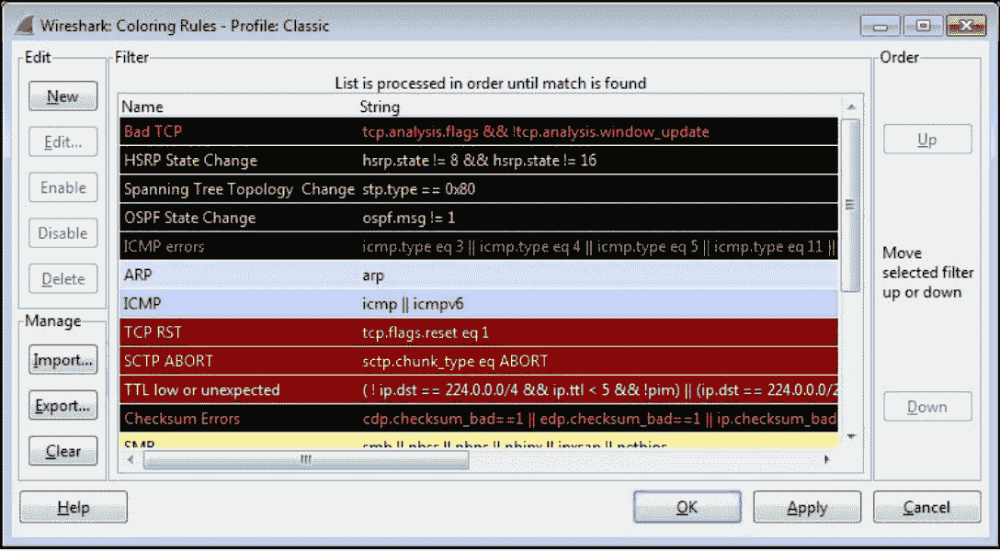

着色规则采用具有特定值的显示过滤器格式来标识应着色的数据包。规则从列表顶部的规则开始向下与数据包进行比较。仅应用与数据包条件匹配的第一条规则，因此如果有多个规则匹配某个数据包，规则的排序决定了应用哪条规则。如果你创建或修改规则，必须检查顺序以确保获得所需的行为。

单击某条规则，再单击**编辑**，即可修改该规则的前景色和背景色，也可以根据需要更改过滤器字符串。

如果你想与他人共享着色规则，还可以导出/导入着色规则。着色规则存储在一个名为`colorfilters`的文件中，该文件位于你的个人配置目录之一中，具体取决于当前使用的配置。

### 数据包着色

您还可以通过选择会话中的一个数据包，从**视图**菜单中选择**着色会话**，并从相邻菜单中选择一种颜色，或者右键单击数据包，从菜单中选择**着色会话**，选择特定于协议的选项之一，然后选择所需的颜色，来暂时为会话中的一系列数据包着色。重新加载捕获文件后，此着色将消失，或者您可以从**视图**菜单中选择**重置着色 1-10**。

## Wireshark 首选项

在“添加时间列”一节中，我们使用**编辑**菜单中的**首选项**或单击图标栏中的**首选项**图标打开了**首选项**窗口，以配置时间显示列选项。您应该了解相当多的**首选项**选项，并可能希望进行调整以自定义您的 Wireshark 环境：

- **布局**：用于选择数据包列表、数据包详情和数据包字节窗格的顺序。
- **列**：用于在数据包列表窗格中添加、删除和移动列。
- **捕获**：用于设置默认的捕获选项。
- **过滤器表达式**：用于添加、删除或移动过滤器表达式按钮。
- **名称解析**：用于设置 MAC、传输和网络（IP）解析选项。
- **协议**：可以为 Wireshark 支持的所有协议设置选项；其中一些最重要和最有用的选项包括：
    - **HTTP**：用于添加环境中应识别为 HTTP 流量的任何其他 TCP 端口。
    - **IEEE 802.11**：用于在需要解码加密无线会话时添加/编辑无线解密密钥。
    - **IPv4**：如果可能，您可能需要禁用“验证 IPv4 校验和”，以避免由称为校验和卸载的 NIC 选项引起的意外错误消息，该校验在数据包发送到 Wireshark 之后检查校验和。
    - **RTP**：启用“允许子解析器重组 RTP 流”以支持从 VoIP 捕获中解码音频。
    - **SMB**：启用“重组 SMB 事务负载”以支持从数据包捕获中的 SMB 流导出文件对象。
    - **SSL**：如果您有私钥文件，Wireshark 可以解密 SSL/TLS 流量。要将密钥添加到 Wireshark，请转到**首选项**窗口，单击“RSA 密钥列表”的“编辑”按钮。然后，在“SSL 解密”窗口中，单击“新建”并填写“SSL 解密：新建”字段（SSL 服务器的 IP 地址；端口，对于 HTTP 通常为 443；协议，如 HTTP；以及密钥文件，用于选择 RSA 私钥的路径（如果密钥文件是 PKCS#12 密钥库（通常具有 .pfx 或 .p12 扩展名），则必须填写密码字段）），最后单击**确定**关闭每个后续窗口。
- **TCP**：这为您提供了多个选项，如下所示：
    - **如果可能，验证 TCP 校验和**：禁用此选项以避免由校验和卸载引起的意外错误消息。
    - **允许子解析器重组 TCP 流**：启用此选项以支持从 TCP 流导出文件对象。
    - **相对序列号**：启用此选项可以更轻松地读取和跟踪捕获文件中的 TCP 序列号。
    - **跟踪在途字节数**：这是在**数据包详情**窗格的 TCP 协议头中计算并显示的一个值，对于性能分析很有用。
    - **计算会话时间戳**：这是前面讨论过的设置，用于支持**tcp.time_relative**和**tcp.time_delta**时间显示。

还有许多其他首选项设置可能与您的个人偏好或分析环境相关；您必须调查大部分或所有这些选项。如果您不确定某个特定设置，可以单击**首选项**窗口底部的**帮助**按钮获取更多信息。

首选项设置存储在名为`preferences`的文件中，该文件位于您的其中一个**个人配置**目录中，具体取决于使用的配置方案。

## Wireshark 配置方案

由于我们已经介绍了许多 Wireshark 配置选项，这些选项保存在特定文件中，例如用于**捕获过滤器**的`cfilters`、用于**显示过滤器**的`dfilters`、用于**着色规则**的`colorfilters`以及用于首选项设置的`preferences`，之前提到这些文件保存在您的其中一个**个人配置**目录中，但我一直没有完整解释配置方案和这些配置目录，直到现在，以便您更好地理解配置方案的组成以及它们为何有用。

配置方案是根据您的特定需求和偏好定制的 Wireshark 配置文件集合，包括捕获和显示过滤器、着色规则、列和布局等，适用于您所处的特定环境。您可以创建一个或多个配置方案，并通过选择适当的配置方案快速重新配置 Wireshark 以在不同环境中最佳工作。

首次安装 Wireshark 时，它使用一组默认配置文件运行，这些文件位于**全局配置**目录中，该目录通常与 Wireshark 程序文件所在的**系统**目录相同。当您更改任何默认设置时，更改将保存在存储在**个人配置**目录中的新配置文件中，该目录的位置因安装而异。您可以通过单击**帮助**菜单中的**关于 Wireshark** 选项并单击**文件夹**选项卡，从 Wireshark 中确定并快速打开您的安装的**个人配置**目录。此选项卡中列出了 Wireshark 使用的所有目录，如以下截图所示：

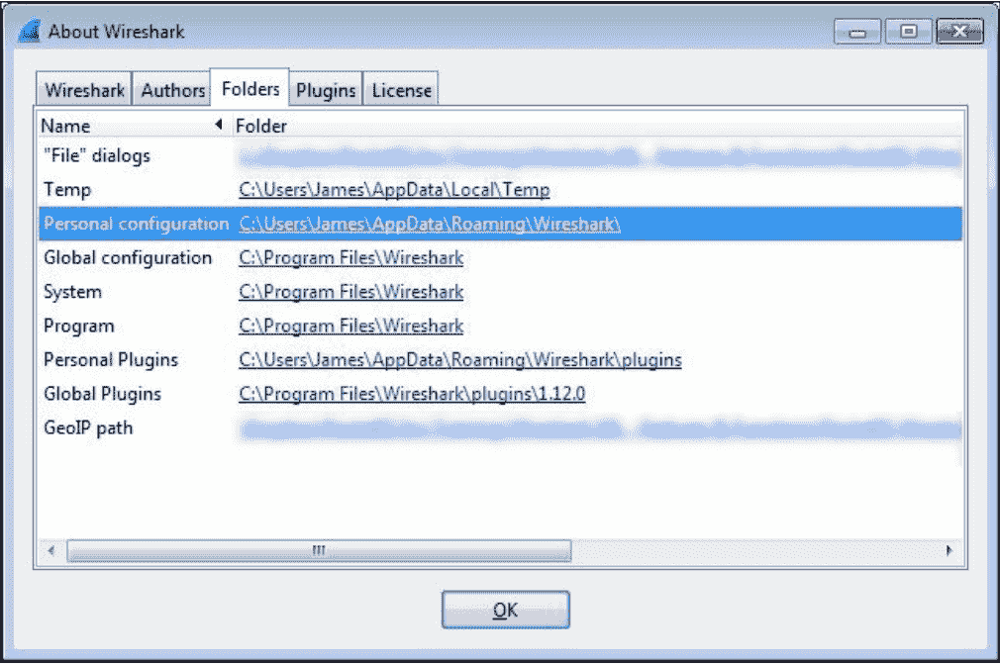

您可以双击 Wireshark 目录链接以打开该目录的窗口。

双击**文件夹**选项卡中的**个人配置**链接将打开存储您的自定义配置文件（在`profiles`子目录下）的目录。每个配置方案都存储在单独的目录中，该目录反映您为配置方案指定的名称，如以下截图所示：

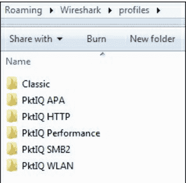

每个自定义的`profile`目录都包含所有 Wireshark 配置文件，这些文件决定了该配置方案如何控制 Wireshark 的功能。您可以与其他 Wireshark 用户复制和共享这些自定义配置方案目录；将`profile`目录复制到他们的**个人配置**目录中即可使该配置方案可供选择。

### 创建 Wireshark 配置方案

要创建新的 Wireshark 配置方案，请按照以下步骤操作：

1. 右键单击 Wireshark 用户界面底部的**状态栏**中的**配置方案**部分（在右侧窗格），并单击**新建**，或者导航到菜单栏中的**编辑 | 配置方案 | 新建**。
2. 在出现的**新建配置方案**窗口中，您可以给配置方案命名。您还可以通过从**创建自**下拉列表中选择现有配置方案的设置作为起点来创建配置方案，或者从零开始创建。**新建配置方案**窗口如下截图所示：
3. 单击**确定**将新配置方案保存到自己的目录中，该目录位于**个人配置**目录下的`Profiles`目录中，名称与配置方案相同。

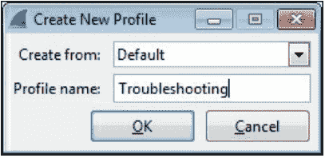

## 选择 Wireshark 配置方案

您可以通过从**编辑**菜单中选择**配置方案**，单击列出的配置方案之一，再单击**确定**来选择您的自定义配置方案之一。更快的方法是单击**状态栏**的**配置方案**部分，然后从弹出菜单中选择一个配置方案，如以下截图所示：

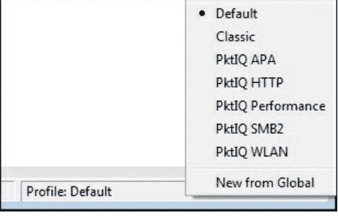

## Summary

本章涵盖的主题包括使用 Wireshark 的时间显示、着色和着色规则、为特定分析环境选择合适的 Wireshark 首选项，以及将所有这些设置保存到可按需选择的配置文件中。

在下一章中，我们将介绍现代网络中常见使用的网络层、传输层和应用层协议的选择，这将帮助你为后续章节中更高级的数据包分析活动做好准备。

## The OSI and DARPA reference models

我们在第 2 章《Networking for Packet Analysts》中回顾了 OSI 和 DARPA 参考模型的目的。它们各层的视觉描绘在以下图表中重复出现，作为参考并总结了一些主要协议以及它们在各自层中的位置：

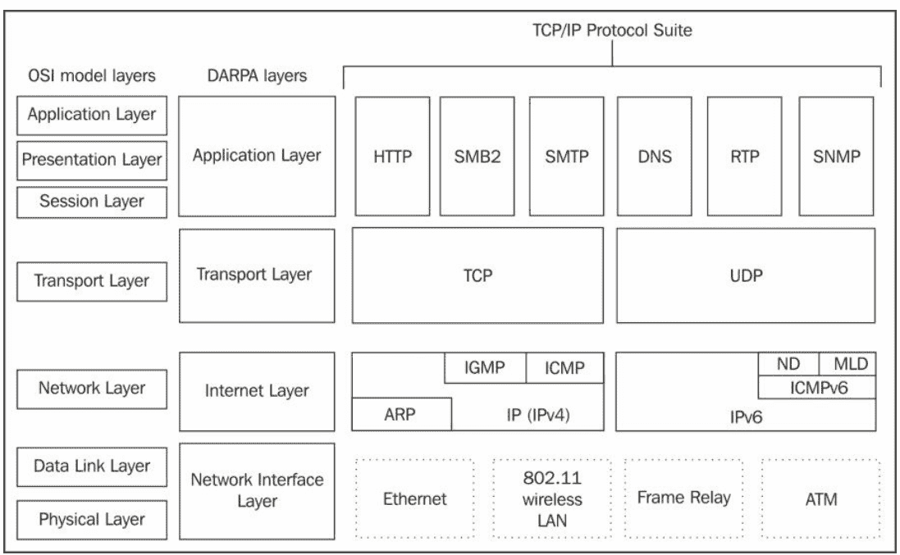

## Network layer protocols

网络层协议，也称为 DARPA 参考模型中的 Internet 层协议，提供基本网络连接和互联网络通信服务。在这一层，你主要会发现 IP 协议用于在网络间传输数据包，以及 ARP、IGMP 和 ICMP。

我们在第 2 章《Networking for Packet Analysts》中介绍了 IP 和 ARP 协议数据包报头结构和字段，因此此处不再重复。然而，基本 Wireshark 捕获和显示过滤器在此提供，也为以下各节中的剩余协议提供：

### Wireshark IPv4 filters

Capture filter(s): `ip`

Display filter(s): `ip ip.addr==192.168.1.1 ip.src== ip.dst== ip.id > 2000`

### Wireshark ARP filters

Capture filter(s): `arp`

Display filter(s): `arp arp.opcode==1 arp.src.hw_mac==00:1c:25:99:db:85`

## Internet Group Management Protocol

**Internet Group Management Protocol (IGMP)** 由主机用于通知相邻路由器已建立的组播（一对多）组成员关系。换句话说，IGMP 使提供内容（例如视频流）的计算机能够使用一组组播地址范围向分布式的用户组提供此类内容（在 `224.0.0.0` 到 `239.255.255.255` 的类 D 组播范围内）。这种组播能力取决于能够并配置为支持此服务的路由器；客户端必须加入组播组。当主机想要启动组播时，它会向 `224.0.0.2`（所有组播路由器）地址发送 **IGMP Membership Report** 消息，指定此特定组的组播 IP 地址。希望加入或离开该组（以便接收组播内容）的客户端会向路由器发送 IGMP 加入或离开消息。以下表格显示了地址的各种范围：

| Starting address range | Ending address range | Description |
|---|---|---|
| `224.0.0.0` | `224.0.0.255` | These are reserved for special well-known multicast addresses |
| `224.0.1.0` | `238.255.255.255` | These are globally-scoped (Internet-wide) multicast addresses |
| `239.0.0.0` | `239.255.255.255` | These are locally-scoped and administered multicast addresses |

以下屏幕截图显示了 IGMP 协议报头中的重要字段：

IGMP 协议有多个版本且相当复杂。请参阅本章开头提供的协议参考以获取更多信息。

### Wireshark IGMP filters

**Capture filter(s):** `igmp`

**Display filter(s):** `igmp igmp.type==0x22 igmp.record_type==4`
`igmp.maddr==244.0.1.60`

packet was received, the traceroute utility can build and display a progressive list of router interface IP addresses in the path and the RTT delay to each router.

## ICMP control message types

以下表格提供了最常见 ICMP 控制消息类型的采样，包括其类型和代码（子类型）编号：

| Type | Code | Description |
|------|------|-------------|
| 0 | 0 | This indicates echo reply (ping) |
| 3 | 0 | This indicates destination network unreachable |
| 3 | 1 | This indicates destination host unreachable |
| 3 | 4 | This indicates fragmentation required and do not fragment bit set |
| 3 | 6 | This indicates destination network unknown |
| 3 | 7 | This indicates destination host unknown |
| 5 | 0 | This indicates redirect datagram for the network |
| 5 | 1 | This indicates redirect datagram for the host |
| 8 | 0 | This indicates echo request (ping) |
| 11 | 0 | This indicates TTL expired in transit (seen in traceroutes) |

以下屏幕截图中说明的 ICMP 数据包的 Wireshark 数据包详细信息字段描绘了在典型 traceroute 捕获中看到的 Time-to-live exceeded 消息：

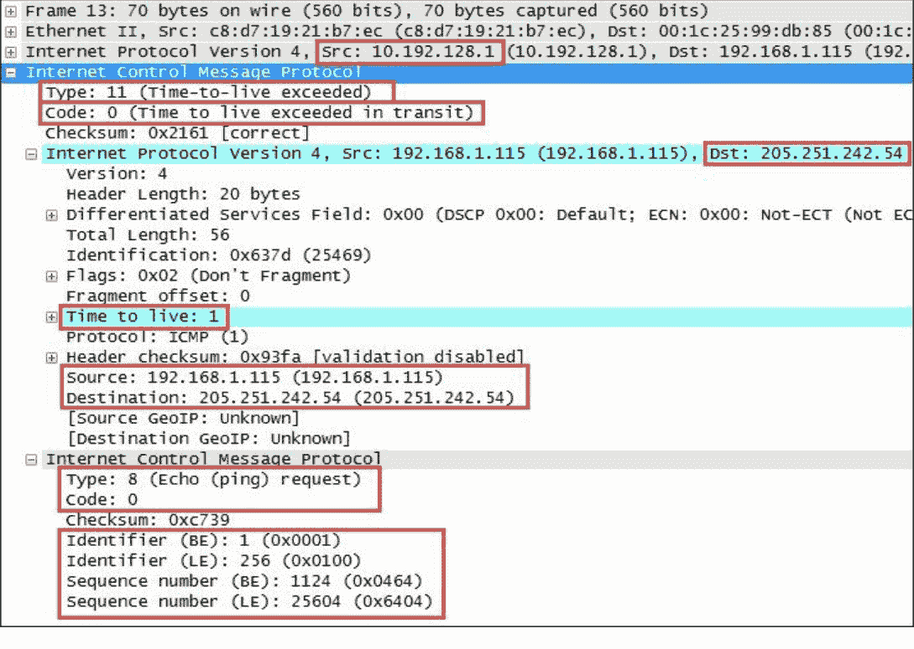

分析此数据包的重要点如下：

- IPv4 报头摘要中看到的源 IP 地址为 **10.192.128.1**，这是发送 ICMP 消息给源地址 **192.168.1.115** 的路由器接口的 IP 地址
- ICMP 数据包为 **Type 11, Code 0**（TTL exceeded in transit）

在第一个 IPv4 和 ICMP 报头之后跟随的第二个 IPv4 和 ICMP 报头集是发送方原始传输数据包的副本。此副本被返回以允许确定导致 ICMP 消息的数据包。此 ICMP 消息副本的数据包详细信息中的重要点包括：

- 目标目的 IP 地址，即 echo request 数据包 intended to be sent 的地址（如果 TTL 值未被更改则会发送）为 **205.251.242.51**。
- 当此数据包到达 **10.192.128.1** 路由器接口时，TTL 值为 **1**。

此数据包无法被转发，导致 TTL exceeded 消息被发送回发送方。

- 原始 ICMP 数据包为 **Type 8, Code 0** echo request 消息。
- ICMP 数据包 echo 请求和回复的 **Header Data** 部分将包括 16 位标识符和 16 位序列号，用于将 echo 回复与其请求匹配。

## ICMP redirects

ICMP 的另一个常见用途是重定向客户端使用不同的默认网关（路由器）来到达主机或网络，而不是它最初尝试使用的网关。在以下屏幕截图中描绘的 ICMP **Redirect** 数据包中，应注意多个数据包字段：

- ICMP 重定向数据包的源 IP 地址为 `192.168.1.1`，这是客户端的默认网关；这是将重定向数据包发送回客户端的路由器。
- ICMP **Type is 5 (Redirect)** 且 **Code is 1 (Redirect for host)**。
- 路由器 `192.168.1.1` 告诉客户端用于到达所需目标主机的网关 IP 地址为 `192.168.1.2`。
- 目标主机的 IP 地址为 `10.1.1.125`。

以下屏幕截图显示了 ICMP **Redirect** 数据包：

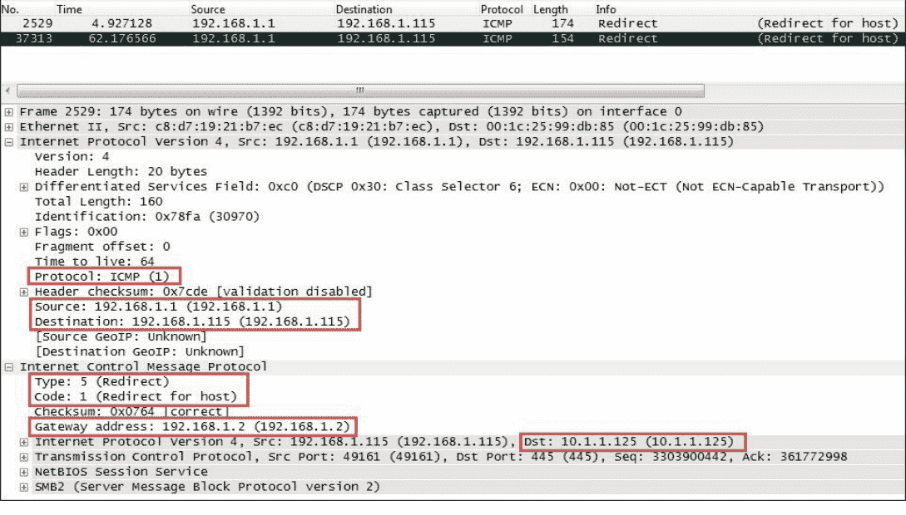

### Wireshark ICMP filters

**Capture filters(s):** `icmp`

**Display filter(s):** `icmp icmp.type==8 || icmp.type==0 (pings) icmp.type==5 && icmp.code==1 (host redirects)`

## Internet Protocol Version 6

Internet Protocol Version 6 (IPv6) 是 Internet 协议的最新版本，虽然它仍处于采用的早期阶段，但其目的是最终取代 IPv4——主要是为了解决可分配给网络设备的 IP 地址短缺问题。IPv4 具有 32 位地址空间，提供大约 43 亿个地址，其中几乎全部已被分配给全球的公司和私人利益。

IPv6 使用 128 位地址空间，允许 2¹²⁸ 或大约 3.4 x 10³⁸ 个地址；该数字为 340,282,366,920,463,463,374,607,431,768,211,456 个唯一地址。

## IPv6 addressing

IPv6 地址的 128 位表示为八组每组 16 位，以四个十六进制数字由冒号 (:) 分隔书写。IPv6 地址的示例为 2001:0db8:0000:0000:0000:ff00:0042:8329。

为方便起见，IPv6 地址可通过应用以下规则在可能的情况下缩短为较短的表示法：

- 从任何一组十六进制数字中删除一个或多个前导零；这通常对所有或无前导零执行。例如，十六进制组 0042 可转换为仅 42。
- 将连续的零段替换为双冒号 (::)。双冒号在一个地址中只能使用一次，因为多次使用会使地址不确定。双冒号不得用于表示单个被省略的零段。

将这些规则应用于 IPv6 地址的示例如下：

- **Initial address**: 2001:0db8:0000:0000:0000:ff00:0042:8329
- **After removing all leading zeroes**: 2001:db8:0:0:0:ff00:42:8329
- **After omitting consecutive sections of zeroes**: 2001:db8::ff00:42:8329

IPv6 地址的 128 位在逻辑上分为网络前缀和主机标识符。Class Inter-Domain Routing (CIDR) 表示法用于表示 IPv6 网络前缀，例如，2001:DB8:0:CD30::/64 表示网络 2001:DB8:0000:CD30::

## IPv6 地址类型

IPv6 地址有三种基本类型：

- **单播（Unicast）**：这是一对一设备之间使用单一接口地址发送的数据包。单播地址可以是以下三种类型之一：
  - **全球单播（Global Unicast）**：此类地址可在互联网上及通过互联网路由。全球单播地址通常以 `2xxx` 开头（如 `2000::/3`）。
  - **链路本地（Link-local）**：此类地址自动分配给接口，并用于本地网络链路；它不能路由到互联网，与 MAC 地址类似。链路本地单播地址以 `FE80`（`FE80::/10`）开头。当接口初始化时，会使用一种算法，将网卡 48 位 MAC 地址的重排版本放入 IPv6 地址中，从而自动分配该地址，用于本地链路上的通信。这些地址不可路由。IPv6 使用链路本地地址进行邻居发现功能。
  - **唯一本地（Unique local）**：此类地址不可路由到互联网，但可在企业内路由（类似于 IPv4 私有地址）。唯一本地单播地址以 `FC00`（`FC00::/7`）开头。该地址块保留用于私有 IPv6 网络中。
- **组播（Multicast）**：这是一对多设备之间发送的数据包。组播地址以 `FFxx` 开头。组播地址的一个示例是 `FF01:0:0:0:0:0:0:101`，可缩写为 `FF01::101`。IPv6 中没有广播地址；组播用作替代。一些众所周知的组播地址如下表所示：

  | 地址 | 描述 | 范围 |
  |---|---|---|
  | ff01:0:0:0:0:0:0:1 | 所有节点地址 | 接口本地（仅覆盖节点上的单个接口，仅用于组播数据包的环回传输） |
  | ff02:0:0:0:0:0:0:1 | 所有节点地址 | 链路本地（本地网段上的所有节点） |
  | ff01:0:0:0:0:0:0:2 | 所有路由器地址 | 接口本地 |
  | ff02:0:0:0:0:0:0:2 | 所有路由器地址 | 链路本地 |
  | ff05:0:0:0:0:0:0:2 | 所有路由器 | 站点本地（覆盖单个站点） |
  | ff02:0:0:0:0:0:1:2 | DHCPv6 服务器/代理 | 链路本地 |
  | ff05:0:0:0:0:0:1:3 | DHCPv6 服务器/代理 | 站点本地 |

- **任播（Anycast）**：这是从一台设备发送到一组接口中最近的一个接口的数据包。任播地址没有特殊的地址方案；它们与单播地址类似。当一个单播地址被分配给多个接口时，会自动创建一个任播地址。任播地址可用于设置一组设备，使该组中的任何一台设备都可以响应发送到单个 IPv6 地址的请求。

关于 IPv6 寻址的进一步讨论将涵盖相当多的附加功能，这些超出了本书的范围。建议读者在线进一步研究 IPv6 寻址，和/或阅读请求评论（RFC）4291（IP 版本 6 寻址架构）。

## IPv6 头部字段

IPv6 协议头部示例如以下截图所示：

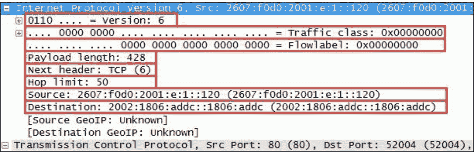

IPv6 头部字段与许多 IPv4 头部相似，字段包括：

- **版本（Version）**：这是 IP 版本号，IPv6 为 6。
- **流量类别（Traffic class）**：这与 IPv4 的 **DiffServ** 字段类似；用于标识 IPv6 数据包的不同类别或优先级。
- **流标签（Flow label）**：用于标识标记为一组的数据包序列。IPv6 流由 20 位 **流标签** 字段以及源和目的 IPv6 地址字段定义。
- **负载长度（Payload length）**：这是 IPv6 负载的长度，不包括任何数据包填充。
- **下一个头（Next header）**：此字段指示数据包中接下来的内容。这相当于 IPv4 的 **协议** 字段。在前面的示例中，下一层是正常的 **TCP（6）** 头部。
- **跳数限制（Hop limit）**：此字段大致相当于 IPv4 中的**生存时间（Time To Live）** 字段；每台转发 IPv6 数据包的设备都会将其减 1。当该值达到 1 时，数据包不能再被转发。
- **源地址和目的地址（Source and Destination addresses）**：这些是 128 位的 IPv6 源地址和目的地址。

IPv6 支持扩展头部，可提供附加信息字段，并扩展 IPv6 头部的长度。有一个特定的 **下一个头** 代码用于指示此附加功能的存在。

## IPv6 过渡方法

作为向 **IPv6** 过渡的一部分，当前 TCP/IP 设备支持双协议栈（IPv4 和 IPv6 同时运行）以及将 IPv6 数据包封装和隧道传输到 IPv4 数据包内，以便 IPv4 网络可以路由这些数据包。三种最流行的封装方法是：

- **6to4 隧道**：在这种隧道方法中，IPv6 头部跟在 IPv4 头部之后；IPv4 头部的 **协议** 字段将包含 41（IPv6），并且 IPv6 头部中的源 IPv6 地址将以 `2002` 开头。
- **Teredo**：在这种隧道方法中，IPv6 头部被封装在 UDP 数据包内。开发此方法是为了适应不处理协议 41 的 NAT 设备。Teredo 隧道可以通过 UDP 数据包头部中的目的端口 `3544` 来识别。
- **ISATAP**：此隧道方法使用本地分配的 IPv4 地址来创建 64 位接口标识符。例如，在 ISATAP 中，IPv4 地址 `24.6.173.220` 变为 `::0:5EFE:1806:ADDC`。ISATAP 与 6to4 隧道一样，将 IPv6 头部封装在 IPv4 中。

## Wireshark IPv6 过滤器

**捕获过滤器：** `ip6 host fe80::1 ip proto 41`（捕获 IPv6-over-IPv4 隧道流量）

**显示过滤器：** `ipv6.addr == fe80::f61f:c2ff:fe58:7dcb || ipv6.addr == ff02::1`

## 互联网控制消息协议第 6 版

**互联网控制消息协议第 6 版（ICMPv6）** 是 IPv6 不可分割的一部分，每个 IPv6 节点都必须完整实现基础协议。ICMPv6 为 IPv6 环境提供了在 IPv4 环境中由其他不同协议提供的服务，例如用邻居请求（Neighbor Solicitation）替代 ARP。

下表包含一些常见的 ICMPv6 数据包类型：

| ICMPv6 数据包类型 | ICMPv6 类型 | 用途 |
|---|---:|---|
| 回显请求 | 128 | Ping 请求 |
| 回显响应 | 129 | Ping 响应 |
| 组播侦听器查询 | 130 | 由组播路由器发送，轮询网段中的组成员 |
| 组播侦听器报告 | 131 | 主机加入组播组时发送，或响应路由器发送的组播侦听器查询 |
| 组播侦听器完成 | 132 | 主机离开组播组并可能是该网段上该组最后一个成员时发送 |
| 路由器请求 | 133 | 发现本地路由器 |
| 路由器通告 | 134 | 响应路由器请求消息，以及在初始化后和之后周期性地发送此数据包 |
| 邻居请求 | 135 | 首先用于重复地址检测（使用源地址 ::），然后用于获取本地路由器的 MAC 地址；此功能取代了 ARP |
| 邻居通告 | 136 | 响应邻居请求消息 |
| 重定向消息 | 137 | 将设备重定向到正确的路由器，以发送数据包到特定网络或主机 |

邻居请求 ICMPv6 数据包的一个示例见以下截图：

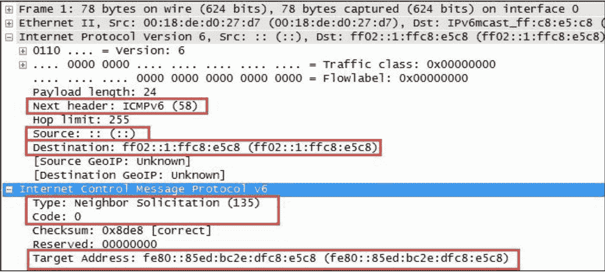

此数据包中的重要字段包括：

- **下一个头：** 此字段包含 **58**，表示下一个协议头是 ICMPv6。
- **IPv6 源地址：** 存在未指定地址（::）表示这是 **重复地址检测** 数据包。
- **IPv6 目的地址：** 这基本上是一个组播地址。
- **ICMPv6 类型：** 这是邻居请求消息，使用类型 **135**。
- **ICMPv6 代码：** 这是邻居请求消息的子类型；将为 **0**。
- **ICMPv6 目标地址：** 这是主机想要使用的地址。如果网络上的另一个节点已经在使用此地址，它们将相应地进行响应。

### 组播侦听器发现

**组播侦听器发现（MLD）** 是 IPv6 套件的另一个组件，IPv6 路由器使用它来发现在直接连接的链路上的组播侦听器。MLD 是 ICMPv6 协议的一部分，它取代了 IPv4 网络上的 IGMP。

### Wireshark ICMPv6 过滤器

**捕获过滤器：** `icmp6`

**显示过滤器：** `icmpv6 icmpv6.type==135 && icmpv6.code==0 (Neighbor Solicitation)`

## 传输层协议

传输层协议包括用于传输应用协议的 TCP 和 UDP。

### 用户数据报协议

用户数据报协议（UDP）被认为是一种不可靠的传输。在此，没有数据包交付或排序的保证，但它开销较低，并被用于对时间敏感的应用，例如语音和视频流量。

以下屏幕截图显示了 UDP 头部包含的字段：

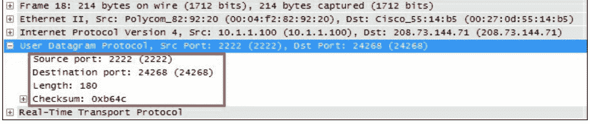

UDP 头部仅为 8 字节长，由以下部分组成：

- **源端口和目的端口**：每个为 2 字节。
- **长度**：这是 UDP 头部加上负载的长度。这是一个 2 字节字段。
- **校验和**：这是一个 2 字节字段，用于检查 UDP 头部和数据的错误。如果发送方未生成校验和，则此字段为全零。

### Wireshark UDP 过滤器

捕获过滤器：udp udp port 2222

显示过滤器：udp udp.srcport == 161 (SNMP response) udp.length > 256

### 传输控制协议

传输控制协议（TCP）通过检测丢失、重复或乱序的数据包、请求重传丢失的数据，或在交付给应用程序之前重新排列数据包的顺序，从而提供数据的可靠交付。TCP 还可以从应用程序接收大量数据，并使用多个数据包处理将数据可靠地传输到另一端，并在另一端重新组装它们。

以下屏幕截图突出显示了基本 TCP 头部的显著字段：

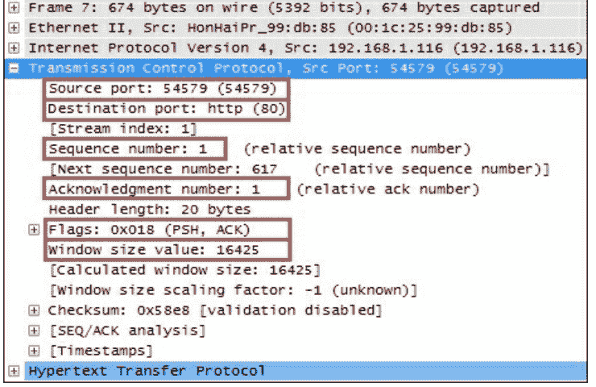

TCP 头部的内容和长度可能因所使用的选项而异，但在最简单的实现中它由以下部分组成：

- 源端口和目的端口：这些是众所周知且已注册的端口，用于（在服务器上）访问标准应用程序服务，如 HTTP、FTP、SMTP、数据库等。分配给客户端/用户会话的端口号通常在较高的数字范围内并按顺序分配。
- 序列号：这是一个代表任何给定段中第一个八位字节的数字。序列号在新会话开始时初始化为随机数，然后随着数据字节的发送而递增。
- 确认号：当 ACK 标志位被设置时，此字段包含从发送方期望的下一个序列号，这反过来确认收到到该点为止的所有字节。

### 注意

序列号和确认号的使用是 TCP 通过跟踪接收到的字节的数量和顺序来确保数据可靠交付的方式。

序列号和确认号很大，人类难以跟踪。Wireshark 可以将它们转换为相对值，并在会话开始时从 0 开始显示，以便更轻松地检查它们并将值与传输和接收的字节数相关联。

- **标志：** 这些位用于控制连接设置、终止和流量控制机制。
- **窗口大小：** 此字段指示此主机上用于存储接收数据直到可以移交给接收应用程序的缓冲区的当前大小。此信息使发送主机能够在网络或主机拥塞的情况下调整数据流速率。

### TCP 标志

下表列出了 TCP 头部中最常用的标志：

| 标志字段名称 | 描述 |
|---|---|
| URG (紧急) | 这指示应检查的 **紧急指针** 字段（在 TCP 头部校验和之后）。此标志通常为 0；只有当此位被设置时，才会检查 **紧急指针** 字段。 |
| ACK (确认) | 这是确认数据包。 |
| PSH (推送) | 这指示发送节点的 TCP 堆栈是否应绕过任何缓冲并将数据直接传递到网络并传递给接收应用程序。 |
| RST (重置) | 这用于显式关闭连接。 |
| SYN (同步) | 这用于同步序列号并用于三向 TCP 会话初始化握手过程。 |
| FIN (结束) | 这在事务结束时使用。这并不意味着连接要显式关闭，但在会话结束时通常可见。 |

### TCP 选项

TCP 还支持许多额外的选项，其中一些在现代网络中很常见，你应该了解。以下屏幕截图中说明的 TCP 头部片段描绘了其中最受欢迎的几个选项：

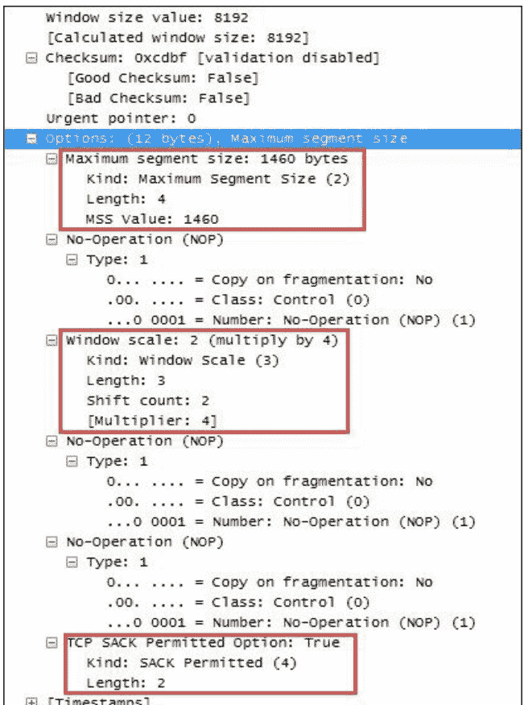

前述屏幕截图中突出显示的 TCP 选项包括：

- **最大段大小**：此选项允许你指定可在 TCP 头部后跟随的字节数。此选项存在是为了允许调整以适应 VLAN 标记或 **多协议标签交换（MPLS）**。
- **窗口缩放**：此选项克服了标准 TCP 头部中 **窗口大小** 字段无法指定大于 65,535 字节的窗口大小的能力。窗口缩放允许你指定一个因子来乘以 advertised 窗口大小以实现更大的窗口大小。会话的两端都必须能够支持此选项才能应用；这是在会话设置期间确定的。
- **TCP SACK 允许选项：** 此选项指示此节点支持选择性确认，这允许节点在仍请求特定丢失数据包的同时确认正在进行和传入的数据包。恢复过程仅需要重传丢失的数据包，而不是丢失的数据包及其后的所有数据包。会话的两端都必须能够支持此选项才能应用，如会话设置期间所确定。

### Wireshark TCP 过滤器

**捕获过滤器：** `tcp tcp port 80`

**显示过滤器：** `tcp tcp.port == 80 tcp.dstport == 8080 tcp.stream == 2`

## 应用层协议

最常见的应用层协议包括用于获取客户端 IP 地址和配置信息的 DHCP，用于主机名解析的 DNS，HTTP、SMB、POP/SMTP，以及用于最常见网络服务的 FTP，和用于 VoIP 和视频会议的 SIP、RTP 和 RTCP。

对所有上层协议的广泛覆盖超出了本书的范围。将提供 DHCP 和 DNS 的简要概述，因为这些协议普遍支持网络操作，以及 HTTP 作为最常见的应用层协议之一的示例。鼓励读者根据其兴趣范围和满足所解决的分析任务的需求，进一步研究这些协议中的任何一个或全部。

### 动态主机配置协议

**动态主机配置协议（DHCP）** 允许客户端从 DHCP 服务器管理的池中租用 IP 地址。客户端还可以接收其他配置选项，例如默认网关、子网掩码和一个或多个 DNS 服务器地址。DHCP 源自较旧的 BOOTP 协议；Wireshark 在显示过滤器语法中使用 bootp。DHCP 通过客户端使用 UDP 源端口 67 向 UDP 目的端口 68 发送广播数据包来工作。DHCP 服务器将使用 UDP 源端口 68 向请求者的 IP 地址响应，使用 UDP 目的端口 67。

DHCP 服务器不一定必须与客户端位于同一本地网络段。诸如路由器的中继代理可以转发 DHCP 请求并响应/来自 DHCP 服务器所在的另一个网络。

### Wireshark DHCP 过滤器

**捕获过滤器：** port 67 (DHCP is between ports 67 and 68; filtering on port 67 is sufficient to get both sides of the conversations)

**显示过滤器：** `bootp bootp.option.value == 0` (DHCP Discover message)

## 动态主机配置协议第6版

**动态主机配置协议第6版（DHCPv6）** 是 DHCP 的 IPv6 版本。由于 IPv6 不使用广播，DHCPv6 客户端使用多播地址 `All_DHCP_Relay_Agents_and_Servers (ff02::1:2)` 来定位 DHCPv6 服务器或中继代理。

### Wireshark DHCPv6 过滤器

**捕获过滤器：** `port 546`（DHCPv6 位于端口 `546` 和 `547` 之间；两者均可）

**显示过滤器：** `dhcpv6 dhcpv6.msgtype == 1`（DHCPv6 Solicit 消息）

## 域名服务

域名服务（DNS）用于将主机名（例如 www.wireshark.org）转换为 IP 地址。DNS 还可用于识别与 IP 地址关联的主机名（反向或指针（PTR）查询），以及其他一些网络信息服务。这是一个值得熟悉的好协议，因为它在企业内和互联网上都广泛用于通过主机名定位节点。

### Wireshark DNS 过滤器

捕获过滤器：port 53

显示过滤器：dns dns.flags.response == 0（DNS 查询）
dns.flags.response == 1（DNS 响应）dns.flags.rcode != 0（DNS 响应包含错误）

## 超文本传输协议

超文本传输协议（HTTP）是人们在互联网上浏览（非安全）网站时使用的应用层协议，还有其安全版本（HTTPS）。HTTP/1.1 是当前版本，尽管 HTTP/2.0 开始在部分环境中出现。请注意，某些网络设备（如代理服务器和网关）可能尚不支持 HTTP/2.0。

下面截图展示了向 Web 服务器发送 GET 请求的 HTTP 数据包示例：

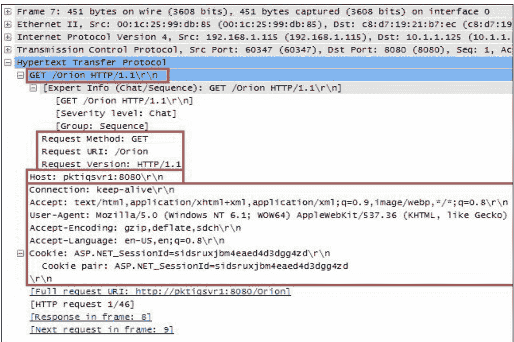

HTTP 协议最常见的特性和字段包括 HTTP 方法、Host 和请求修饰符。

在上述截图中，HTTP 标头包括：

- 请求方法：GET
- 请求 URI：/Orion（Web 服务器上的主页）
- 请求版本：HTTP/1.1

### HTTP 方法

下表列出并描述了一些常见的 HTTP 方法：

| 方法 | 描述 |
|---|---|
| GET | 检索由 **统一资源标识符（URI）** 字段定义的信息 |
| HEAD | 检索与所需 URI 相关的元数据 |
| POST | 向 HTTP 服务器/应用程序发送数据 |
| OPTIONS | 确定与资源关联的选项 |
| PUT | 向 HTTP 服务器/应用程序发送数据 |
| DELETE | 删除由 URI 定义的资源 |
| CONNECT | 用于连接到代理设备 |

### Host

**Host** 字段用于标识所请求资源的目标主机和端口号。在上述截图中，**Host** 是 `pktiqsvr1`，端口为 `8080`。

### 请求修饰符

HTTP 请求和响应使用请求修饰符来提供请求的详细信息。在上述截图中，请求修饰符包括：

- **Connection：** 表示对持久连接（keep-alive）的偏好。
- **Accept：** 可接受的数据格式列表（`text/html` 和 `application/xhtml` 以及 `xml`）。
- **User-agent：** 发起请求设备的浏览器和操作系统参数列表（Mozilla/5.0 (Windows NT 6.1; WOW64) AppleWebKit）。
- **Accept-encoding：** 可接受的 HTTP 压缩方案列表（gzip、deflate 和 sdch）。
- **Accept-language：** 可接受的语言（en-US 和 en; q=0.8），其中 q=0.8 是一个相对质量因子，表示用户偏好的语言级别，范围为 0 到 1。
- **Cookie：** 这是一个会话 ID cookie（ASP.NET_SessionId=sidsruxjbm4eaed4d3dgg4zd），此前已存储在用户浏览器的 cookie 中，现正提供给网站。

下表列出了一些更常用的修饰符：

| 请求修饰符 | 描述 |
|---|---|
| Accept | 可接受的内容类型 |
| Accept-charset | 可接受的字符集 |
| Accept-encoding | 可接受的编码 |
| Accept-language | 可接受的语言 |
| Accept-ranges | 服务器可以接受范围请求 |
| Authorization | 用于 HTTP 身份验证的凭据 |
| Cache-control | 缓存指令 |
| Connection | 用户代理偏好的连接类型 |
| Cookie | HTTP cookie（一种由网站发送并存储在用户浏览器中的小数据，在用户下次访问时发送回网站，包含会话信息） |
| Content-length | 请求正文的长度（以字节为单位） |

| 标头 | 描述 |
|---|---|
| Content-type | 正文的 MIME 类型（用于 `POST` 和 `PUT` 请求） |
| Date | 消息发送的日期和时间 |
| Expect | 定义客户端期望的服务器行为 |
| If-match | 如果客户端提供的信息匹配，则执行操作 |
| If-modified-since | 提供缓存数据的日期/时间；如果缓存数据仍然是最新的，则返回 **304 Not Modified** |
| If-range | 请求缺失信息的范围 |
| IF-unmodified-since | 仅在提供的日期/时间之后未修改才发送 |
| Max-forwards | 限制通过代理或网关转发的次数 |
| Proxy-authorization | 代理连接的授权凭据 |
| Range | 仅请求实体的一部分 |
| TE | 接受的传输编码 |
| User-agent | 包含浏览器和操作系统信息的字符串 |
| Via | 所经过的代理 |

### Wireshark HTTP 过滤器

**捕获过滤器：** `tcp port http tcp port https`

**显示过滤器：** `http http.request.method == "GET" or http.request.method == "POST" http.response.code > 399`（标识客户端或服务器错误数据包）

## 附加信息

要覆盖所有最常见的上层协议，或对它们进行深入的介绍，显然超出了本书篇幅所能包含的内容。我鼓励你花一些时间研究那些出于个人或工作原因感兴趣的协议。你投入的时间将获得丰厚的回报。

本章讨论的任何协议以及所有未涉及的协议的附加信息都可以在网上找到。

### Wireshark wiki

如果你正在 Wireshark 的**数据包详细信息**窗格中检查某个协议，可以右键单击协议头或协议头中的字段，然后从菜单中选择**Wiki 协议页面**，即可进入 Wireshark wiki 上包含该协议信息的特定页面。更多信息请参见 [http://wiki.wireshark.org/ProtocolReference](http://wiki.wireshark.org/ProtocolReference)。

你也可以通过选择协议头或协议头中的字段，右键单击，然后选择**过滤器字段参考**来获取特定协议的 Wireshark 显示过滤器完整列表。

### Wikipedia 上的协议

你可以在 Wikipedia 上找到各种协议的一般信息。从互联网协议开始。还提供了整个互联网协议套件的附加链接：[http://en.wikipedia.org/wiki/Internet_Protocol](http://en.wikipedia.org/wiki/Internet_Protocol)。

### 请求评议（RFC）

**请求评议（RFC）** 文档包含所有互联网协议的详细信息。这些文档由**互联网工程任务组（IETF）**维护，是关于协议应如何实现和运行的最终依据（[http://www.ietf.org/rfc.html](http://www.ietf.org/rfc.html)）。如果你想按标题或关键字搜索特定 RFC，请使用链接 [http://www.rfc-editor.org/search/rfc_search.php](http://www.rfc-editor.org/search/rfc_search.php)。

## 总结

本章涵盖的主题包括：网络层协议 IPv4、ARP、IGMP、ICMP、IPv6 和 ICMPv6 的协议和字段；传输层协议 UDP 和 TCP；应用层协议 DHCP、DHCPv6 和 DNS 的概述；以及对 HTTP 的更深入探讨。

在下一章中，我们将充分利用目前已涵盖的所有主题，使用 Wireshark 排查功能和性能问题。

