## 第 6 章. 故障排除与性能分析

在本章中，我们将讨论 Wireshark 的主要用途——排除网络和应用程序的连接、功能和性能问题。

将涵盖的主题包括：

- 故障排除方法
- 排除连接问题
- 排除功能问题
- 性能分析方法
- 应用性能不佳的五大原因
- 检测和确定延迟优先级
- 服务器处理时间事件
- 应用往返延迟
- 网络路径延迟
- 带宽拥塞
- 数据传输问题

这些主题涵盖了你在分析工作中会遇到的绝大多数问题。

### 故障排除方法

进行数据包分析的两个基本原因如下：

- 排除连接或功能问题（用户无法连接、应用程序无法工作或工作不正常），我们将其称为故障排除
- 分析性能问题（应用程序可以工作但很慢），我们将其称为性能分析

第三个灰色地带是应用程序基本可以工作但很慢且偶尔超时，这可能涉及导致性能问题的潜在功能问题，也可能只是性能非常差。

排除连接或功能问题，只需将正常工作的情况与你正在处理的情况进行比较即可。

另一方面，性能问题则需要确定特定事务完成所需的大部分时间花费在何处，测量延迟并将该延迟与正常或可接受的情况进行比较。过量延迟的来源和类型通常会指向下一步需要进一步调查或解决的领域。

无论如何，你需要收集信息以确定这是一个连接、功能还是性能问题，并根据其性质来处理问题。

### 收集正确的信息

在处理问题时，你能做的最重要的事情就是确定真正的問題是什么，以便你可以解决正确的问题或问题的正确方面。为了确定真正的问题，或至少接近它，你需要提问并解释答案。这些问题可能包括根据投诉情况从以下列表中选择合适的项目：

- 定义问题：
  - 你试图做什么（连接到服务器、登录、发送/接收电子邮件、通用应用程序使用、上传/下载文件，以及特定事务或功能）？
  - 是什么都不工作，还是只是特定应用程序或多个应用程序的问题？
  - 你试图/连接到哪个网站/服务器/应用程序？你知道用于访问应用程序的主机名、URL 和/或 IP 地址和端口吗？
  - 问题/症状的性质是什么？此应用程序或功能/特性以前是否工作过，还是这是你第一次尝试使用它？
  - 你是否收到任何错误消息或其他问题指示？
  - 问题是一致的还是间歇性的？取决于什么？
  - 这已经发生多久了？
  - 是否有最近的变化可能产生影响？
  - 到目前为止已确定或怀疑了什么？为解决此问题已采取了什么措施？这有帮助或改变了什么吗？
  - 是否有其他相关因素、症状或用户环境最近的变化需要考虑？
- 确定问题的范围：
  - 这个问题是单个用户还是用户组遇到？
  - 这个问题是发生在特定办公室、地区，还是整个公司范围内？
  - 这个问题是否对不同类型的用户产生不同影响？
- 收集系统、应用程序和路径信息。对于更深入的分析（超出单个用户或小用户组问题），根据投诉情况，可能还需要从以下列表中收集并分析适用的问题（其中一些信息可能需要从网络或应用程序支持组获取）：
  - 客户端的浏览器类型和版本（针对 Web 应用）？这与正常工作的客户端不同吗？
  - 客户端和服务器的操作系统类型和版本是什么？
  - 正确的（厂商）应用程序名称和版本是什么？应用程序是否存在与这些症状相匹配的已知问题（检查厂商的错误报告）。
  - 应用程序服务器背后的数据库类型和服务器环境是什么？
  - 是否涉及其他后端支持的数据源，例如在线数据服务或 Documentum 和 SharePoint 服务器？
  - 客户端与服务器之间的网络路径是什么？路径中是否有防火墙、代理服务器、负载均衡器和/或 WAN 加速器？它们是否配置正确并正常工作？
  - 你能否通过 traceroute 确认预期的网络路径（以及涉及的任何 WAN 链路）并验证带宽可用性？
  - 你能否通过 ping 或 TCP 握手完成时间测量从用户到应用程序服务器的 **往返时间 (RTT)** 路径延迟？

### 确定问题的一般性质

到目前为止，你应该能够在以下三种基本类型中识别出问题的一般性质：

- 确定这是否是连接问题
  - 用户无法连接到任何东西
  - 用户无法连接到特定服务器/应用程序
- 确定这是否是功能或配置问题
  - 用户可以连接（获得登录屏幕或应用程序服务器的其他响应）但无法登录（或获得预期响应）
  - 用户可以连接并登录但某些或所有功能失败（例如，无法发送/接收电子邮件）
- 确定这是否是性能问题
  - 用户可以连接、登录并正常使用应用程序；但速度很慢
  - 应用程序正常工作但有时会停滞和/或超时

### 二分法故障排除和其他逻辑

在我职业生涯早期从事电子设备组件级维修时，我学会了使用“二分法”故障排除方法，在几乎每一种情况下都效果很好。二分法故障排除是通过在系统大约中途注入或测量信号，将问题域（在我例子中是一台无线电设备）一分为二的过程。想法是看看哪一半工作正常，哪一半不正常，然后将重点转移到不工作的那一半，分析其一半，依此类推。重复此过程，直到将问题缩小到其源头。

在网络和应用程序世界中，同样可以以一般意义上应用二分法故障排除方法。如果用户抱怨网络很慢，尝试确认或排除网络：

- 靠近服务器的用户是否也遇到类似的缓慢？其他远程位置的用户呢？
- 如果某个远程用户的某个应用程序很慢，该用户是否也对其他应用程序很慢？
- 如果用户无法连接到某个服务器，他们能否连接到附近或其他位置的其他服务器？

通过对什么能工作和什么不能工作的逻辑检查，你可以消除很多猜测，并将分析缩小到少数几个合理的可能性。

如果你有一个一切正常工作的环境与一个不工作的情况进行比较，通常更容易确定连接或功能问题的来源。可以比较工作与非工作场景的数据包捕获，看看有什么不同以及这些差异是否重要。

即使你处理的问题看起来与之前修复过的问题相同，也不要对问题做出太多假设。始终验证问题以及你应该能够应用的解决方案，并移除修复措施，观察问题是否可靠地消失/重现。否则，你应该质疑自己是否找到了问题的真正来源，还是只是影响了症状。

除非报告的问题明显是系统范围或特定服务器问题，否则最好在投诉用户处或尽可能靠近投诉用户的位置进行至少初步分析

尽可能在工作站上进行。这样做的好处是能够执行以下操作：

-   查看并验证用户所报告的实际问题
-   测量到目标服务器的往返时间
-   在会话建立时捕获并查看 TCP 握手过程
-   捕获并调查登录及任何其他后台进程和流量
-   查找用户设备所经历的网络问题（丢包和重传）的迹象
-   在数据下载期间测量到用户工作站的表观网络吞吐量
-   无需使用捕获过滤器；单个工作站的进出流量不应过大

在用户工作站、服务器或其他设备上进行捕获时，应使用聚合型**测试访问点（TAP）**，而不是使用交换机的 SPAN 端口（如[第 3 章](Chapter 3)“捕获所有正确的数据包”中所述），或者作为最后手段，在用户的工作站或服务器上安装 Wireshark（如果获得授权）。

## 排查连接问题

单个用户或小群体的连接问题可以通过确认用户工作站访问本地和远程网络资源所需的网络功能是否正常运作来解决。需要确认的基本要求或项目包括：

-   启用正确的网络接口（工作站配置）
-   确认第 1 层（物理）连接
-   获取每个接口的 IP 地址、子网掩码和默认网关（DHCP）
-   获取默认网关或其他本地网络服务的 MAC 地址（ARP）
-   获取网络服务的 IP 地址（DNS）
-   连接到网络服务（TCP 握手或 UDP 响应）

我们将按顺序简要讨论每一项；虽然前两步不涉及使用 Wireshark，但它们是故障排除方法中必要的组成部分。如果连接问题影响到一组用户或整个办公室，第一步可能不适用。

### 启用网络接口

虽然启用网络接口似乎是显而易见的，但认为接口在设备启动时默认自动启用（尤其是无线连接）的假设可能是错误的。

在 Windows 上，你可以使用命令行工具 `ipconfig` 查看网络接口的状态和基本配置（IP 地址、子网掩码和默认网关）；在 Linux 或 Mac 设备上，等效命令是 `ifconfig` 或 `ip`。

### 确认物理连接

如果连接问题仅限于单个用户的工作站，则应怀疑物理连接。需要检查几个项目，可以采取的故障排除步骤如下：

-   如果从工作站到墙上插座的以太网电缆有问题，你需要换一根不同的电缆。
-   如果从用户墙上插座到交换机端口的布线有问题，你需要将用户的以太网电缆临时插入另一个（已知正常的）墙上插座。
-   如果交换机、交换机端口或端口配置有问题，你需要将用户的端口电缆临时插入另一个（已知正常的）端口。请注意，某些网络安全策略要求禁用交换机端口，直到需要使用时才启用，或将端口配置为与单个特定 MAC 地址关联。如果是这样，端口在插入时可能无法工作，尽管物理上没有问题。

### 获取工作站 IP 配置

除非工作站是手动配置的，否则它需要从 DHCP 服务器获取 IP 地址、子网掩码、默认网关和 DNS 服务器设置。如果这看起来无法正常工作（在使用 `ipconfig`（Windows）或 `ifconfig`（Linux 或 Mac OS X）检查配置之后），你需要使用 TAP 或 SPAN 端口在工作站初始化/启动过程中执行数据包捕获，并调查 DHCP 请求和响应。

共有八种 DHCP 消息类型（不要与两种引导协议类型混淆，即引导请求和引导应答）：

| 消息类型编号 | 消息类型 | 描述 |
|---|---|---|
| 1 | DHCP 发现 | 客户端广播以定位可用的 DHCP 服务器 |
| 2 | DHCP 提供 | 服务器对 DHCP 发现的响应，以提供配置参数 |
| 3 | DHCP 请求 | 客户端发送给 DHCP 服务器的消息，用于以下任一情况：<br>- 向一台服务器请求提供的参数并拒绝其他 DHCP 服务器的报价<br>- 重新启动后确认先前分配的地址的正确性<br>- 延长 IP 地址的租约 |
| 4 | DHCP 拒绝 | 客户端发送给 DHCP 服务器的消息，表示所提供的地址不可接受 |
| 5 | DHCP 确认 | 服务器向客户端发送配置参数，包括已分配的网络地址 |
| 6 | DHCP 否定确认 | 服务器向客户端表示客户端的地址不正确或已过期 |
| 7 | DHCP 释放 | 客户端向服务器释放网络地址并取消租约 |
| 8 | DHCP 信息 | 客户端向服务器仅请求本地配置参数 |

对于正在启动且之前已在网络上正常工作的工作站，你通常会看到 DHCP 请求和确认数据包，以验证工作站仍可使用先前租用的地址。在完全冷启动时，前两个 DHCP 数据包将是 DHCP 发现和 DHCP 提供数据包，随后是请求和确认数据包。

在 DHCPv6 环境中，典型的数据包序列是 DHCPv6 请求、DHCPv6 通告、DHCPv6 请求和 DHCPv6 应答。

在 DHCP 响应数据包（或 DHCPv6 通告数据包中的类似字段）中需要验证的字段包括以下四个字段：

-   **您的（客户端）IP 地址：** 这是为此工作站提供的 IP 地址
-   **子网掩码：** 这是在此网络上使用的子网掩码
-   **域名服务器：** 这是 DNS 服务器 IP 地址
-   **路由器：** 这是要使用的默认网关的 IP 地址

这是任何网络通信所需的最少数据；下面的屏幕截图说明了在 DHCP 应答数据包中提供这些字段的示例：

```
Bootstrap Protocol (ACK)

Message type: Boot Reply (2)
Hardware type: Ethernet (0x01)
Hardware address length: 6
Hops: 0
Transaction ID: 0x28a0655c

Seconds elapsed:
[Expert Info (Note/Protocol): Seconds elapsed appears to be encoded as little-endian]
[Severity level: Note]
[Group: Protocol]

Bootp flags: 0x8000 (Broadcast)
1... .... .... .... = Broadcast flag: Broadcast

Client IP address: 0.0.0.0 (0.0.0.0)
Your (client) IP address: 192.168.1.115 (192.168.1.115)

Next server IP address: 192.168.1.1 (192.168.1.1)
Relay agent IP address: 0.0.0.0 (0.0.0.0)
Client MAC address: 00:1c:25:99:d8:85 (00:1c:25:99:d8:85)
Client hardware address padding: 00000000000000000000
Server host name: ecosystem.home.cisco.com
Boot file name not given
Magic cookie: DHCP

Option: (53) DHCP Message Type (ACK)
Length: 1
DHCP: ACK (5)

Option: (54) DHCP Server Identifier
Length: 4
DHCP Server Identifier: 192.168.1.1 (192.168.1.1)

Option: (51) IP Address Lease Time
Length: 4
IP Address Lease Time: (86400s) 1 day

Option: (58) Renewal Time Value
Length: 4
Renewal Time Value: (43200s) 12 hours

Option: (59) Rebinding Time Value
Length: 4
Rebinding Time Value: (75600s) 21 hours

Option: (1) Subnet Mask
Length: 4
Subnet Mask: 255.255.255.0 (255.255.255.0)

Option: (28) Broadcast Address
Length: 4
Broadcast Address: 192.168.1.255 (192.168.1.255)

Option: (81) Client Fully Qualified Domain Name
Length: 15
Flags: 0x03
0000 .... = Reserved flags: 0x00
.... 0... = Server DDNS: Some server updates
.... .0.. = Encoding: ASCII encoding
.... ..1. = Server overrides: override
.... ...1 = Server: Server
A-RR result: 255
PTR-RR result: 255
Client name: ThinkPadW500

Option: (6) Domain Name Server
Length: 4
Domain Name Server: 192.168.1.1 (192.168.1.1)

Option: (3) Router
Length: 4
Router: 192.168.1.1 (192.168.1.1)

Option: (255) End
Option End: 255
```

你可以使用 Wireshark 显示过滤器来筛选出 DHCP 数据包；过滤器为 `bootp`，因为这是 DHCP 的旧称：

- **DHCP 显示过滤器：** `bootp bootp.option.dhcp == 5 (DHCP Message Type 'ACK')`
- **DHCPv6 显示过滤器：** `dhcpv6 dhcpv6.msgtype == 2 (DHCPv6 'Advertise')`

在**显示过滤器**工具栏的文本框中输入过滤器字符串，点击**保存**，并为按钮分别命名为 `DHCP Pkts` 和 `DHCPv6 Pkts` 之后，你就可以将基本的 `bootp` 和 `dhcpv6` 显示过滤器保存为**过滤器表达式按钮（FEB）**。或者，你也可以使用 `or (||)` 将这两个过滤器合并到一个按钮中，如以下截图所示：

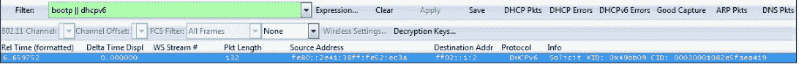

你可能还想保存另一个 FEB，使用以下显示过滤器字符串来显示 DHCP 异常状态数据包，并将该按钮命名为 **DHCP 错误**或类似名称，如下所示：

```
bootp.option.dhcp == 4 || bootp.option.dhcp == 6 || bootp.option.dhcp == 7
```

类似的 DHCPv6 异常事件显示过滤器可以包括：

```
dhcpv6.msgtype == 8 || dhcpv6.msgtype == 9 || dhcpv6.msgtype == 10
```

如果你需要更详细地分析这些内容，可以在网上或其他来源进一步研究 DHCP、DHCPv6 以及各种 DHCPv6 消息类型。

## 获取 MAC 地址

工作站会使用 ARP 协议，为其已知 IP 地址对应的网络服务（例如默认网关，或位于同一网段的 DNS 服务器）获取 MAC 地址。ARP 协议及其典型工作方式已在第 2 章“面向数据包分析师的网络知识”中介绍过。

你可能希望使用 `arp` 显示过滤器语法创建一个 ARP FEB，以便快速、轻松地检查这些数据包。

## 获取网络服务 IP 地址

客户端工作站向 DNS 服务器发送查询，以获取给定主机名的 IP 地址；DNS 服务器直接返回信息，或代表客户端向其他 DNS 服务器询问这些信息。

Wireshark **数据包详细信息**窗格中显示的 DNS 查询和响应数据包字段格式相当直观。下面的截图展示了一个 DNS 响应数据包示例，其中包含 `time.windows.com` 的已解析 IP 地址；该响应实际上为别名 `time.microsoft.akadns.com` 提供了 IP 地址 `(137.170.185.211)`：

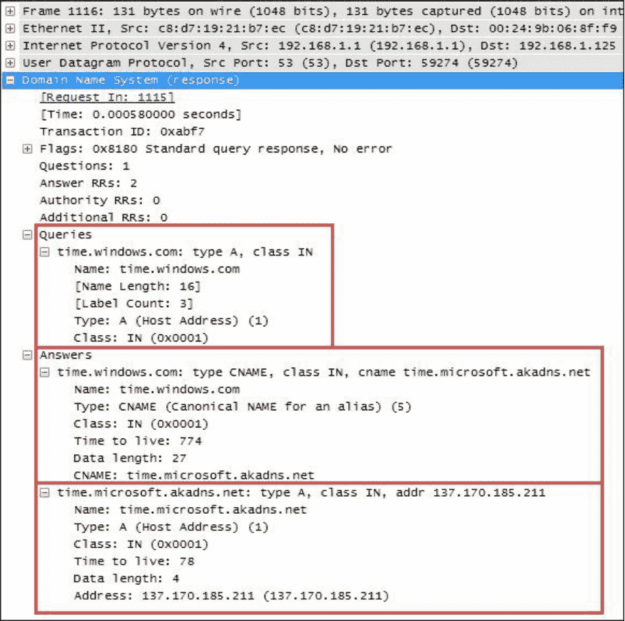

## 基本网络连通性

几个简单的测试就可以确认基本网络连通性是否正常，或者发现需要由网络支持团队处理的路由问题或其他问题。

在以下测试中，捕获并分析发送和接收的 ICMP 数据包可能会很有启发；尽管测试结果本身往往也已足够说明问题：

- 使用 `ipconfig /all`（Windows）或 `ip addr show`（Linux）获取默认网关 IP 地址，然后 ping 用户的默认网关，以确认用户工作站具备本地网络上的基本连通性。
- ping 目标服务器的主机名或 URL。如果失败（出现请求超时消息），请尝试 ping 其他主机或 URL。如有必要，请在这些测试的数据包捕获中检查 DNS 和/或 ICMP 响应，以确定失败的性质。否则，请记录平均往返时间。
- 如果 ping 默认网关成功，但 ping 其他目标失败，则对目标服务器执行 traceroute 可以揭示网络路径中连通性在何处中断或受阻。

### 注意

Windows 中的 traceroute 命令行工具是 `tracert`，而在 Linux/Unix 和 Mac OS X 机器上，该命令是 `traceroute`。在 Windows 中执行 traceroute 时，请打开命令提示符（CMD）窗口并输入 `tracert <hostname or IP Address of target>`。在大多数其他环境中，请打开终端窗口并输入 `traceroute <hostname or IP address of target>`。

如果你能 ping 通目标服务器，且网络连通性正常，就可以进入故障排除流程的下一步。如果不能，请注意，某些主机可能配置为不响应 ICMP ping 请求，和/或出于安全原因，ICMP 被用户与服务器之间的防火墙阻止。因此，无法 ping 通某台设备并不一定意味着网络有问题。Traceroute 结果应有助于确定在通往目标服务器的路径上，网络连通性在多大范围内仍然有效；对其他目标进行测试也会有所启发。

下面的截图展示了先 ping 默认网关、再 ping URL，最后对目标 URL 执行 traceroute 的示例：

```
C:\>ping 192.168.1.1
Pinging 192.168.1.1 with 32 bytes of data:
Reply from 192.168.1.1: bytes=32 time<1ms TTL=64
Reply from 192.168.1.1: bytes=32 time<1ms TTL=64
Reply from 192.168.1.1: bytes=32 time<1ms TTL=64
Reply from 192.168.1.1: bytes=32 time<1ms TTL=64

Ping statistics for 192.168.1.1:
    Packets: Sent = 4, Received = 4, Lost = 0 (0% loss),
Approximate round trip times in milli-seconds:
    Minimum = 0ms, Maximum = 0ms, Average = 0ms

C:\>
C:\>
C:\>ping www.wireshark.org

Pinging www.wireshark.org [162.159.241.165] with 32 bytes of data:
Reply from 162.159.241.165: bytes=32 time=19ms TTL=54
Reply from 162.159.241.165: bytes=32 time=19ms TTL=54
Reply from 162.159.241.165: bytes=32 time=19ms TTL=54
Reply from 162.159.241.165: bytes=32 time=28ms TTL=54

Ping statistics for 162.159.241.165:
    Packets: Sent = 4, Received = 4, Lost = 0 (0% loss),
Approximate round trip times in milli-seconds:
    Minimum = 19ms, Maximum = 28ms, Average = 21ms

C:\>
C:\>
C:\>
C:\>tracert www.wireshark.org

Tracing route to www.wireshark.org [162.159.241.165]
over a maximum of 30 hops:

  1     <1 ms     <1 ms     <1 ms  Cisco24973 [192.168.1.1]
  2      8 ms      8 ms      8 ms  10.192.128.1
  3     10 ms     21 ms      8 ms  72-31-193-94.net.bhntampa.com [72.31.
  4     12 ms      9 ms     10 ms  ten0-0-0-7.orl d13-ser1.bhn.net [72.31.
  5     12 ms     11 ms     13 ms  72-31-188-178.net.bhntampa.com [72.31.
  6     13 ms     14 ms     12 ms  10.bu-ether15.orl df1jo0w-bcr00.tbone.
  7     22 ms     23 ms     20 ms  bu-ether18.atlngamq47w-bcr01.tbone.rr.
  8     21 ms     18 ms     23 ms  bu-ether21.atlngamq46w-bcr00.tbone.rr.
  9     22 ms     19 ms     18 ms  ae-1-0.pr0.atl20.tbone.rr.com [66.109.
 10     21 ms     28 ms     21 ms  66.109.10.62
 11     28 ms     30 ms     36 ms  as13335.xe-7-0-7.ar1.atl1.us.nlayers.ne
 12     19 ms     18 ms     31 ms  162.159.241.165

Trace complete.

C:\>_
```

## 连接到应用程序服务

如果从用户工作站到目标服务器的网络连通性正常（以能够 ping 通主机为证），那么连接到该服务器上托管的特定应用程序时出现问题可能由多种因素导致：

## 排查功能问题

如果用户能够连接到应用程序服务器并建立 TCP 会话，但应用程序无法正常运行或无法正确运行，那么可以从多个方面展开调查。这些方面可以结合数据包级分析、错误报告，以及与其他用户机器上的捕获结果和配置进行对比来调查：

- **用户凭据：** 应用程序功能出现特定用户问题的最常见原因是缺少适当的凭据、授权、权限等。这是首先要检查的事项，以确认其他用户是否正常工作。
- **用户机器上的应用程序设置：** 某些应用程序要求将特定的配置文件放置在用户机器的特定位置。应用程序还可能要求特定版本的应用程序专用工具、Java、.NET 框架等。通常，应用程序会提供一条错误消息，至少指出配置问题的大致性质。
- **应用程序报告的错误：** 你可以在响应数据包中或用户屏幕上查找可能揭示应用程序错误性质的错误代码：
  - HTTP、FTP 或 SIP 响应数据包中大于 400 的状态码
  - SMB 响应数据包中的错误代码
  - 其他应用程序特定的异常、错误代码和消息
- **Web 浏览器的差异：** 某些 Web 应用程序专为特定浏览器（Chrome、Internet Explorer、Firefox、Opera 等）设计，在其他浏览器上可能无法正常运行，甚至根本无法运行，而且可能没有任何错误消息提示这种情况。将浏览器类型和版本与其他正常工作的用户进行比较，可能会有所发现。

网络连通性和应用程序功能问题的原因可能千差万别，因此不可能为每种可能性都绘制出一条清晰的路线图。成功解决这些问题的最佳方法，不是在没有通过系统、逻辑化的故障排除步骤证明这些假设正确之前就做出太多假设，而是尝试找到或创建一个系统（或至少部分系统）能正常工作的场景，并将正常环境与不正常环境中的相关数据包级细节进行比较。


## 性能分析方法论

分析应用程序的性能问题基本上就是确定特定任务完成时大部分时间花费在何处，并将该时间与该类型任务的正常和/或可接受时间进行测量/比较。

## 应用程序性能不佳的五大原因

总体而言，性能问题可归因于以下五个领域，按可能性递减的顺序排列：

- 服务器处理时间延迟
- 应用程序转弯延迟
- 网络路径延迟
- 带宽拥塞
- 数据传输（TCP）问题

客户端处理时间通常是整体响应时间中相对较小的一部分——除非是某些计算密集型桌面应用程序，否则重点放在网络和服务器环境以及任何影响性能的应用程序设计特征上。

### 准备工具和方法

与准备排查连接或功能问题时一样，您需要收集有关应用程序环境和问题域的正确信息。您还希望确定分析过程中可能需要使用的工具：Wireshark、用于促进数据包捕获的 TAP 以及任何其他分析工具。

您还需要确定在哪里进行第一次数据包捕获：

- 客户端捕获是开始性能分析工作的最佳位置。从这个角度，您可以查看并验证用户抱怨的内容，查看向用户呈现的任何错误消息或在数据包捕获中明显的错误消息，测量网络往返时间，并捕获可在数据包捕获中研究性能特征，而无需使用捕获过滤器，因此您知道不会遗漏任何内容。
- 服务器端捕获可能需要，因为对于距离很远的用户，客户端捕获可能无法实现，或者为了分析到后端数据库或其他数据源的服务器到服务器事务。
- 在网络路径中的某个中间点进行数据包捕获可能需要以隔离 excessive 数据包丢失/错误以及相关的重传的来源。

请记住，使用聚合 TAP 比使用 SPAN 端口更可取，或者您可以将 Wireshark 安装在客户端工作站或服务器上作为最后的手段，但无论如何都要完成捕获。

## 执行、验证和保存良好的数据包捕获

执行捕获并保存大容量捕获文件后，请确认以下内容：

- 1. 检查文件以确保 Wireshark **Expert Info** 菜单中的 **Warnings** 选项卡中没有带有 **ACKed Unseen Segment** 消息的数据包，这意味着 Wireshark 看到了一个被确认的数据包，但没有看到原始数据包；表明 Wireshark 由于 TAP 或 SPAN 端口配置不良或流量水平过高而丢失数据包。在任何情况下，如果出现的不止几个，您希望在确认捕获设置后再次进行捕获。
- 2. 接下来，您希望在 **Conversations** 窗口中查看捕获的 **IPv4** 对话并对 **Bytes** 列进行排序。用户与应用程序服务器之间的 IP 对话应位于顶部或附近，以便您可以选择此对话，右键单击它，然后在 **Selected** 菜单中选择 **A <-> B**。
- 3. 在查看过滤后的数据以确保其包含您所期望的内容后，从 **File** 菜单中选择 **Export Specified Packets** 并保存过滤后的捕获文件，文件名应反映这是大容量捕获文件的过滤子集。
- 4. 最后，打开您刚刚保存的过滤文件，以便您使用一个更小、更快的没有与分析无关的其他对话的干扰数据包的文件工作。

## 初始错误分析

在分析开始时，您应该查看 Wireshark 的 **Expert Info** 窗口（**Analyze | Expert Info**）的 **Errors**、**Warnings** 和 **Notes** 选项卡，以查找诸如 excessive 重传、Zero Window 条件或应用程序错误之类的重大错误。这些对于提供报告的性能不佳来源的线索非常有帮助。

尽管在大多数数据包捕获中，少数丢失的数据包和重传是正常且影响很小的，但在路径中用户和服务器之间发生网络拥塞、数据包被丢弃，并且从这些丢失的数据包中恢复可能需要花费相当多的时间时， excessive 的数量就表明了这一点。

在 **Expert Info Notes** 窗口中看到大量 Duplicate ACK 数据包的计数可能令人担忧，但可能具有误导性。在下面的屏幕截图中，对于一个丢失的数据包，Duplicate ACKs 最多达到 69 个，对于第二个丢失的数据包，计数上升到 89 个（未在下面的屏幕截图中显示）：

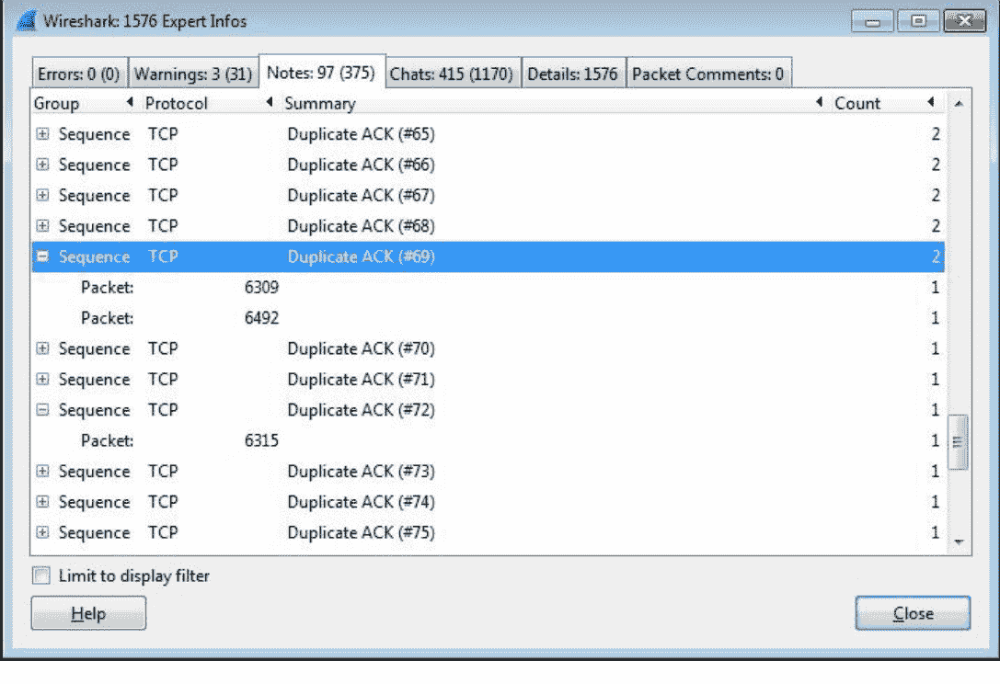

然而，在使用 **Edit** 菜单中的 **Set/Unset Time Reference** 功能在 Wireshark 中标记第一个 Duplicate ACK 发生的时间，然后通过单击 **Expert Info** 屏幕中的数据包编号转到此系列中的最后一个 Duplicate ACK 并检查 **Packet List** 窗格中的 **Relative time** 列，只有 30 毫秒的时间过去了。这不是一个显著的时间量，特别是如果启用了 **Selective Acknowledgment**（正如本例中那样）并且在此期间其他数据包正在被传递和确认。在更长延迟的网络路径上，Duplicate ACK 计数可能会更高；只有当丢失的数据包总数和所需重传变得 excessive 时，延迟才可能被用户注意到。

在 **Expert Info Notes** 窗口中要查找的另一个条件包括 **TCP Zero Window** 报告，这是由客户端或服务器上的接收缓冲区已满，无法再接受更多数据，直到应用程序有时间检索和处理数据并在缓冲区中腾出更多空间所引起的。这不一定是错误条件，但如果缓冲区缓解所需的时间很长，则可能导致数据传输出现实质性延迟。

您可以通过标记 TCP Zero Window 数据包并查看相对时间直到发送 **TCP Window Update** 数据包的时间来测量此时间，这表明接收方已准备好接收更多数据。如果这种情况经常发生，或者 Zero Window 和 Window Update 数据包之间的延迟很长，您可能需要检查正在经历缓冲区满条件的宿主机，以查看是否有任何后台进程对您正在分析的应用程序产生不利影响。

### Note

如果您尚未添加，您需要在 **Packet List** 窗格中添加 **Relative time** 和 **Delta time** 列。导航到 **Edit | Preferences | Columns** 以添加这些。添加时间列也在第 4 章《配置 Wireshark》中进行了说明。

您可能会在 **Warnings** 选项卡中看到连接重置（RST）消息。如果它们发生在客户端-服务器交换或会话结束时，它们不是错误条件的指标；它们是会话终止的正常指标。

一个非常方便的 **Filter Expression** 按钮，您可能希望添加到 Wireshark 中，是使用以下显示过滤器字符串的 **TCP Issues** 按钮，如下所示：

```
tcp.analysis.flags && !tcp.analysis.window_update &&
!tcp.analysis.keep_alive && !tcp.analysis.keep_alive_ack
```

这将过滤并显示您将在 **Expert Info** 窗口中看到消息的大多数数据包，并提供任何重大问题的快速概览。

## 检测和优先处理延迟

由于我们正在处理应用程序性能，第一步是识别数据包流中的任何延迟，以便我们可以专注于周围的数据包以识别延迟的来源和性质。

识别延迟事件的最快方法之一是对 **TCP Delta time** 列进行排序（通过单击列标题），以便最高延迟的数据包排列在


top of the packet list. You can then inspect the Info field of these packets to determine which, if any, reflect a valid performance affecting the event as most of them do not.

In the following screenshot, a TCP Delta time column is sorted in order of descending inter-packet times:

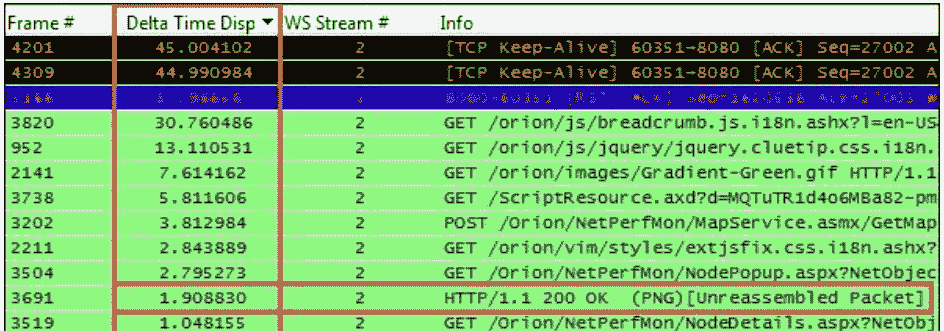

Let's have a detailed look at all the packets:

- The first two packets are the TCP Keep-Alive packets, which do just what they're called. They are a way for the client (or server) to make sure a connection is still alive (and not broken because the other end has gone away) after some time has elapsed with no activity. You can disregard these; they usually have nothing to do with the user experience.
- The third packet is a Reset packet, which is the last packet in the conversation stream and was sent to terminate the connection. Again, it has no impact on the user experience so you can ignore this.
- The next series of packets listed with a high inter-packet delay were GETs and a POST. These are the start of a new request and have occurred because the user clicked on a button or some other action on the application. However, the time that expired before these packets appear were consumed by the user think time—a period when the user was reading the last page and deciding what to do next. These also did not affect the user's response time experience and can be disregarded.
- Finally, Frame # 3691, which is a HTTP/1.1 200 OK, is a response from the server to a previous request; this is a legitimate response time of 1.9 seconds during which the user was waiting. If this response time had consumed more than a few seconds, the user may have grown frustrated with the wait and the type of

request and reason for the excessive delay would warrant further analysis to determine why it took so long.

The point of this discussion is to illustrate that not all delays you may see in a packet trace affect the end user experience; you have to locate and focus on just those that do.

You may want to add some extra columns to Wireshark to speed up the analysis process; you can right-click on a column header and select Hide Column or Displayed Columns to show or hide specific columns:

- **TCP Delta (tcp.time_delta)**: This is the time from one packet in a TCP conversation to the next packet in the same conversation/stream
- **DNS Delta (dns.time)**: This is the time between DNS requests and responses
- **HTTP Delta (http.time)**: This is the time between the HTTP requests and responses

## Note

You should ensure that **Calculate conversation timestamps** is enabled in the **TCP** option, which can be found by navigating to **Edit | References | Protocols**, so that the delta time columns will work properly.

While you're adding columns, the following can also be helpful during a performance analysis:

- **Stream # (tcp.stream)**: This is the TCP conversation stream number. You can right-click on a stream number in this column, and select **Selected** from the **Apply as a filter** menu to quickly build a display filter to inspect a single conversation.
- **Calc Win Size (tcp.window_size)**: This is the calculated TCP window size. This column can be used to quickly spot periods within a data delivery flow when the buffer size is decreasing to the point where a Zero Window condition occurred or almost occurred.

## Server processing time events

One of the most common causes of poor response times are excessively long server processing time events, which can be caused by processing times on the application server itself and/or delays incurred from long response times from a high number of requests to backend databases or other data sources.

Confirming and measuring these response times is easy within Wireshark using the following approach:

1. Having used the sorted **Delta Time** column approach discussed in the previous section to identify a legitimate response time event, click on the suspect packet and then click on the **Delta Time** column header until it is no longer in the sort mode. This should result in the selected packet being highlighted in the middle of the **Packet List** pane and the displayed packets are back in their original order.
2. Inspect the previous several packets to find the request that resulted in the long response time. The pattern that you'll see time and again is:
   1. The user sends a request to the server.
   2. The server fairly quickly acknowledges the request (with a [**ACK**] packet).
   3. After some time, the server starts sending data packets to service the request; the first of these packets is the packet you saw and selected in the sorted **Delta Time** view.

The time that expires between the first user request packet and the third packet when the server actually starts sending data is the **First Byte** response time. This is the area where you'll see longer response times caused by server processing time. This effect can be seen between users and servers, as well as between application servers and database servers or other data sources.

In the following screenshot, you can see a **GET** request from the client followed by an ACK packet from the server 198 milliseconds later (**0.198651** seconds in the **Delta Time Displ** column); **1.9** seconds after that the server sends the first data packet (**HTTP/1.1 200 OK** in the **Info** field) followed by the start of a series of additional packets to deliver all of the requested data. In this illustration, a **Time Reference** has been set on the request packet. Looking at the **Rel Time** column, it can be seen that **2.107481** seconds transpired between the original request packet and the first byte packet:

| Rel Time (formatted) | Delta Time Displ | WS Stream # | Source Address | Destination Addr | Info |
|---|---|---|---|---|---|
| *REF* | *REF* | 2 | 192.168.1.115 | 10.1.1.125 | GET /Orion/NetPerfMon/... |
| 0.198651 | 0.198651 | 2 | 10.1.1.125 | 192.168.1.115 | 8080→60351 [ACK] Seq=... |
| 2.107481 | 1.908830 | 2 | 10.1.1.125 | 192.168.1.115 | HTTP/1.1 200 OK (PNG) |
| 2.107671 | 0.000190 | 2 | 10.1.1.125 | 192.168.1.115 | 8080→60351 [ACK] Seq=... |

It should be noted that how the First Byte data packet is summarized in the **Info** field depends upon the state of the **Allow subdissector to reassemble TCP streams** setting in the **TCP** menu, which can be found by navigating to **Edit | Preferences | Protocols,**

as follows:

- If this option is disabled, the First Byte packet will display a summary of the contents of the first data packet in the Info field, such as HTTP/1.1 200 OK shown in the preceding screenshot, followed by a series of data delivery packets. The end of this delivery process has no remarkable signature; the packet flow just stops until the next request is received.
- If the Allow subdissector to reassemble TCP streams option is enabled, the First Byte packet will be summarized as simply a TCP segment of a reassembled PDU or similar notation. The HTTP/1.1 200 OK summary will be displayed in the Info field of the last data packet in this delivery process, signifying that the requested data has been delivered. An example of having this option enabled is illustrated in the following screenshot. This is the same request/response stream as shown in the preceding screenshot. It can be seen in the Rel Time column that the total elapsed time from the original request to the last data delivery packet was 2.1097 seconds:

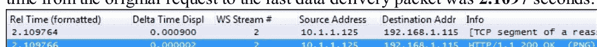

## Note

The Reassemble SMB Transaction payload setting in the SMB protocol preferences will affect how SMB and SMB2 responses are summarized in the Info field in like fashion to the related setting in the TCP protocol preferences.

In either case, the total response time as experienced by the user will be the time that transpires from the client request packet to the end of the data delivery packet plus the (usually) small amount of time required for the client application to process the received data and display the results on the user's screen.

In summary, measuring the time from the first request to the First Byte packets is the server response time. The time from the first request packet to the final data delivery packet is a good representation of the user response time experience.

## Application turn's delay

The next, most likely source of poor response times—especially for remote users accessing applications over longer distances—is a relatively high number of what is known as application turns. An app turn is an instance where a client application makes


一个请求以及除此之外没有任何事情发生，直到响应被接收，之后又可以进行另一个请求/响应循环，如此往复。

每个客户端/服务器应用程序都受应用程序轮转效应影响，每次请求/响应循环都会产生一次该效应。一个由于设计不良而在完成任务时施加大量应用轮转的应用程序——通常是由于设计不良——会让终端用户在延迟较高的网络路径上承受较差的响应时间，因为等待这些多次请求和响应在网络中来回传输所花费的时间会累积起来，而且累积得很快。

例如，如果一个应用程序需要 100 次应用程序轮转来完成一个任务，而用户与应用程序之间的**往返时间 (RTT)** 为 50 毫秒（典型的跨国值），则应用轮转延迟将为 5 秒：

```
100 App Turns x 50 ms RTT network latency = 5 seconds
```

这种应用轮转效应是在任何服务器处理和网络传输延迟之上的额外等待（响应）时间，是 5 秒完全浪费的时间。由此产生的更长时间不可避免地会被归咎于网络；网络支持团队断言网络工作正常，而应用程序团队指出应用程序在网络介入之前工作正常。就这样继续下去，因此了解应用轮转效应很重要，了解其原因以及如何衡量和核算它们。

Web 应用程序由于需要下载一个或多个 CSS 文件、JavaScript 文件以及多个图像来填充页面，因此可能会产生相对较高的应用轮转计数。Web 设计师可以使用技术来减少应用轮转和下载时间，并且现代浏览器允许同时使用多个连接，以便同时处理多个请求，但在更长的网络路径上，其影响仍然可能很显著。许多旧的、遗留的应用程序和微软的 **Server Message Block (SMB)** 协议也已知会施加较高的应用轮转计数。

除非你知道应用程序轮转存在并且知道如何识别和计数它们，否则在数据包捕获中应用程序轮转的存在和影响并不会直观地显现。你可以在 Wireshark 中对客户端捕获使用显示过滤器来做到这一点：

```
ip.src == 10.1.1.125 && tcp.analysis.ack_rtt > .008 && tcp.flags.ack == 1
```

你需要将 `ip.src` IP 地址替换为你的服务器地址，并将 `tcp.analysis.ack_rtt` 值调整为用户与服务器之间网络路径的 RTT。应用过滤器后，你将看到代表应用程序轮转的数据包显示，并且你可以在 Wireshark 用户界面底部的 **Status Bar** 选项中心部分的 **Displayed** 字段中看到总的应用轮转计数。

如果你测量完成任务所需的总时间（第一个请求数据包到最后一个数据交付数据包）并将该时间除以应用程序轮转所花费的时间（应用程序轮转次数 X 网络 RTT），你就可以得出近似的应用轮转时间百分比：

```
5 seconds app turns delay / 7.5 seconds total response time = 66% of RT
```

任何超过 25% 的百分比都值得进一步调查，可以采取什么措施来减少 RTT 延迟（服务器放置）或应用程序轮转次数（应用程序设计）。

## 网络路径延迟

导致高响应时间的下一个主要原因是网络路径延迟，这会加剧前面章节中讨论的应用轮转效应，并影响数据传输吞吐量以及从丢包中恢复和随后的重传所需的时间。

你可以使用 ICMP ping 数据包来测量客户端和服务器之间的网络路径延迟，但你也可以通过数据包捕获来确定此延迟，通过测量 TCP 三次握手过程中客户端 SYN 数据包到服务器 SYN、ACK 响应的时间，如以下客户端捕获图所示：

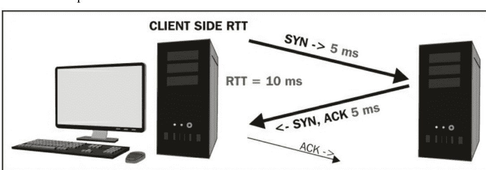

在服务器端捕获中，从 SYN、ACK 到客户端 ACK 的时间（三次握手中的第三个数据包）也反映了 RTT。实际上，从任何捕获点来看，从第一个 SYN 数据包到第三个 ACK 数据包的时间也是 RTT 的良好表示，前提是握手过程中客户端和服务器的响应时间很小。请注意，服务器对 SYN 数据包的响应时间虽然通常很短，但在高负载期间可能比正常情况更长，并会影响此测量。

高网络路径延迟本身并不是错误条件，但显然会像前面讨论的那样对应用程序通过网络的运行产生不利影响。

## 带宽拥塞

带宽拥塞通过延长在网络路径上传输给定数据量所需的时间来影响应用程序的性能；对于通过繁忙的 WAN 链路访问应用程序服务器的用户来说，这些影响可能变得很显著。网络支持团队应该能够为路径中的 WAN 链路生成带宽使用和可用性报告以检查这种可能性，但你也可以通过使用正确配置的 Wireshark IO Graph 在较大数据传输期间查看网络吞吐量来寻找带宽拥塞的证据。

以下屏幕截图说明了一个受限带宽影响的数据传输；在 2.5 Mbps 标记处出现平坦化（此示例中的总带宽可用性），因为没有更多带宽可用以支持更快的传输，这一点清晰可见：

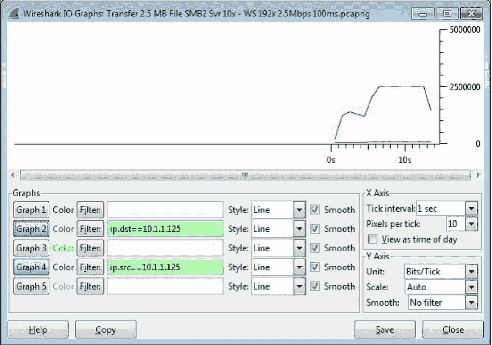

你可以通过按如下方式配置图表，从 IO Graph 中以 **每秒比特数 (bps)** 确定峰值数据传输速率：

- **X Axis Tick interval:** 1 sec
- **Y Axis Unit:** Bits/tick
- **Graph 2 Filter:** `ip.dst == <IP address of server>`
- **Graph 4 Filter:** `ip.src == <IP address of server>`

这些设置会在客户端到服务器（红色）和服务器到客户端（蓝色）方向上生成准确的每秒比特数网络吞吐量显示。**X Axis** 面板中的 **Pixels per tick** 选项、**Y Axis** 面板中的 **Scale** 选项和其他设置可以根据需要进行修改以获得最佳显示，而不会影响测量的准确性。

请注意，大多数现代应用程序可以在短时间内产生数兆比特的峰值带宽需求（在不受限制的链路上）。网络路径上的 WAN 链路应具有足够的空闲容量来满足这些短期需求，否则响应时间将相应受损。这是重要的性能考虑因素。

## 数据传输

有一些 TCP 数据传输效应会影响应用程序性能；这些可以在 Wireshark 中进行分析。

### TCP StreamGraph

Wireshark 提供 TCP StreamGraphs 来分析几个关键的数据传输指标，包括：

- **Round-trip time**: 此图绘制从数据包到相应 ACK 数据包的 RTT。
- **Throughput**: 这些以每秒字节数绘制吞吐量。
- **Time/sequence (Stevens-style)**: 这可视化随时间推移的基于 TCP 的数据包序列号（以及传输的字节数）。理想的图表以平滑的方式从左下角流向右上角。
- **Time/sequence (tcptrace)**: 这与 Stevens 图类似，但提供更多信息。数据包以 I-bar 显示表示，其中 I-bar 越高，表示发送的数据越多。还显示了一个灰色条，表示接收窗口大小。当灰色条更接近 I-bar 时，接收窗口大小减小。
- **Window Scaling**: 此图绘制接收窗口大小。

### Note

TCP StreamGraphs 是单向的。你需要为传输数据的方向选择一个数据包以获得正确的视图。

这些分析图可以通过在数据包列表窗格中选择 TCP 流中的一个数据包，然后从 Statistics 菜单中选择 TCP StreamGraph，然后选择 Time-Sequence Graph（tcptrace）等选项来使用。

所选图表和控制窗口将从控制窗口的 Graph type 选项卡出现，你可以在其中选择其他类型的分析图表，如以下屏幕截图所示：


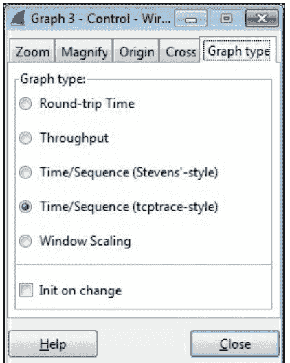

以下截图中显示的 **Time/Sequence Graph (tcptrace)** 会随着数据传输的进行绘制序列号的增长情况，以及灰色的接收窗口大小线：

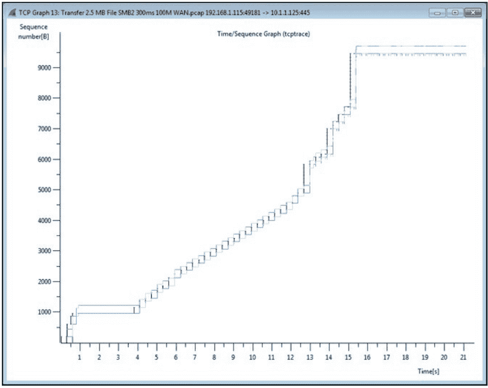

你可以通过在图表上点击并拖动鼠标来放大特定区域，或按 + 键放大、按 - 键缩小。在任意图表上点击一个点会跳转到 Wireshark 的 Packet List 窗格中对应的数据包。

## IO Graph

你还可以通过将 TCP 分析显示过滤器字符串应用到 Wireshark 的 IO Graph 来分析 TCP 问题对网络吞吐量的影响，例如：

```
tcp.analysis.flags && !tcp.analysis.window_update
```

在以下慢速 SMB 数据传输的截图中，可以看到红色线条中的多个 TCP 问题（本例中为丢包、重复 ACK 和重传）对应于吞吐量（黑色线条）的下降：

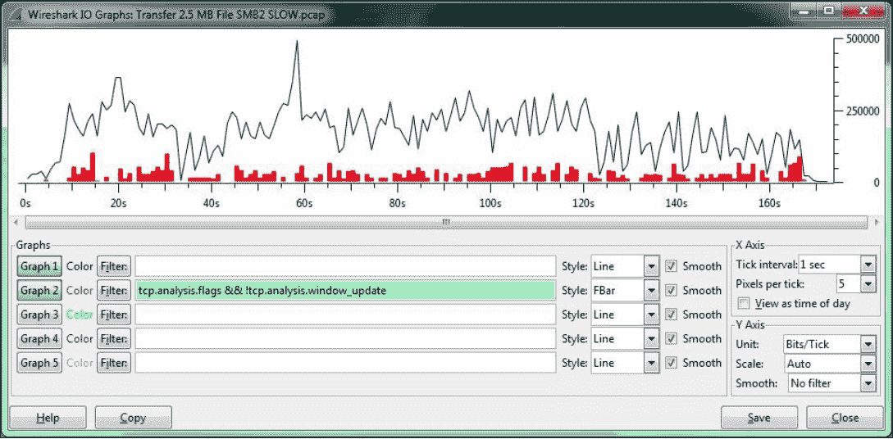

在 IO Graph 上点击一个点会跳转到 Wireshark 的 **Packet List** 窗格中对应的数据包，以便你调查该问题。

## IO Graph – Wireshark 2.0

Wireshark 2.0，也称为 Wireshark Qt，是 Wireshark 版本历史中的一个重大变化，因为它从 GTK+ 用户界面库过渡到 Qt，以提供对所支持平台更好的持续 UI 覆盖。大多数 Wireshark 功能和用户界面控件基本保持不变，但 IO Graph 发生了变化。

下图显示了这些变化，其中显示了与前一张截图中相同的 TCP 问题：

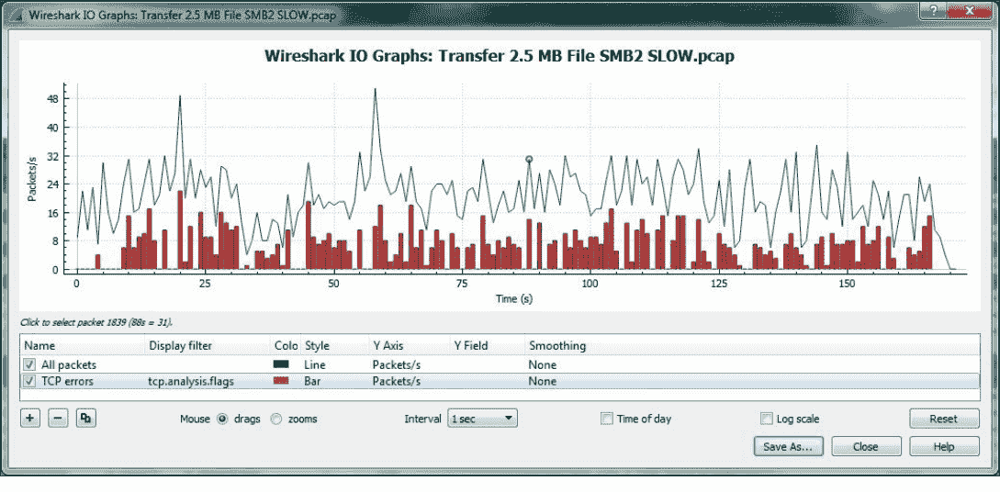

新的 IO Graph 窗口具有添加任意多条线条的能力（使用 + 键），以及放大图表线条的能力，还可以保存图表为图像或 PDF 文档。

## Summary

本章涵盖的主题包括故障排除方法，如何使用 Wireshark 排除连接性和功能性问题，性能分析方法，以及导致应用性能不佳的五大主要原因以及如何使用 Wireshark 分析这些原因。

在下一章中，我们将回顾一些常见的恶意流量类型和来源，并介绍安全专业人员如何使用 Wireshark 检测这些威胁。

## Security analysis methodology

在数据包层面的安全分析基于检测和分析可疑流量，即由于存在不寻常的协议类型或端口，或不寻常的请求、响应或数据包频率而不符合正常模式的流量。可疑流量可能包括侦察（发现）扫描、回连行为、拒绝服务攻击、僵尸网络命令，或来自直接攻击或病毒/僵尸网络代理的其他类型行为。

Wireshark 捕获网络中的战略位置，以调查来自特定主机的可疑数据包，或在网络段和出口点上的数据包，这也可以补充可能已部署以提醒 IT 人员注意可疑流量的任何 **Intrusion Detection System (IDS)** 系统。

## The importance of baselining

如果你拥有正常情况的基线，就能更容易识别出需要调查的异常流量模式与由行为不佳的应用、配置错误或故障设备引起的流量。基线是与主要应用和服务器的典型会话以及它们所在网络段上的背景流量的快照捕获。在潜在的安全入侵情况下，你可以将基线中的正常协议、流量模式和用户会话与当前捕获进行比较，过滤掉正常流量，然后检查差异。

为了在安全分析中允许基线比较，你需要定期捕获并存储数据包跟踪文件，覆盖足够长的时间以提供典型用户和背景流量模式的良好样本，同时保持文件大小在 Wireshark 中可管理，例如每个文件 100 MB 到 1 GB。你可以在 Wireshark 的 Capture Options 窗口中配置 Ring Buffer 选项，以保存一系列合理大小的文件用于更长时间的捕获或更繁忙的网络段。

尽管你的基线需求和实践取决于你的环境，但应检查的一些流量方面包括：

- Broadcast and multicast types and rates:
  - What devices and applications are using broadcasts and multicasts?
  - What are the typical broadcast and multicast packet rates?
- Applications and protocols:
  - What applications are running over the network?
  - What protocols and ports are they using?
  - Application launch sequences and typical tasks
  - Are application sessions encrypted?
  - Are all users forced to use encryption? Any exceptions?
  - What are the login/logout sequences and dependencies?
- Routing protocol(s) and routing updates
- ICMP traffic
- Boot-up sequences
- Name resolution sessions
- Wireless connectivity includes normal management, control, and data frame contents
- VoIP and video communications
- Idle time traffic is the host communicating with other hosts when there are no users
- What backup processes are running at night and for how long?
- Are there any suspect protocols or broadcasts/scans taking place?

在检查基线捕获时，有助于查看正在使用的协议摘要，可通过从 Wireshark 的 **Statistics** 菜单中选择 **Protocol Hierarchy** 来实现。例如在以下截图中，你可以看到存在一些 **Internet Relay Chat (IRC)** 流量，以及 **Trivial File Transfer Protocol (TFTP)** 流量，这两者在你的网络上可能并不正常，可能表明与外部实体的非法通信：

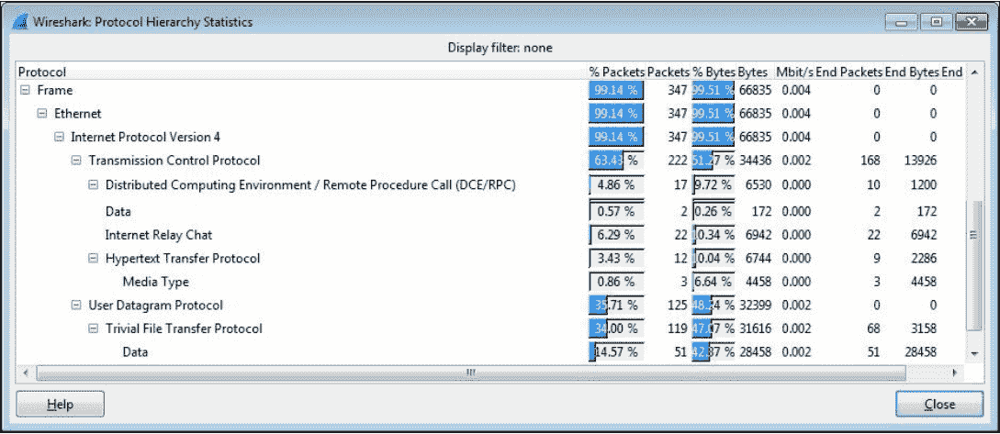

分析正常流量水平和模式的基线也是熟悉你的网络环境及其典型数据包流和协议的绝佳方式，这能更好地帮助你发现异常流量。

## Security assessment tools

安全专业人员用于执行安全评估和漏洞测试的流行工具有几种。由于这些工具可以生成与黑客和恶意代理可能使用的扫描、指纹识别和其他利用活动相同类型的活动，因此它们对数据包分析人员很有用，可以使用 Wireshark 分析它们生成的数据包，以熟悉不同类型活动在数据包跟踪中的表现，并构建显示过滤器来检测它们。

其中最受欢迎的工具之一是 **Network Mapper (Nmap)**，这是一款用于网络发现和安全审计的免费开源实用程序。Nmap 运行于所有主要计算机操作系统，并提供命令行和 GUI 版本（**Zenmap**）。

### Note

你可以在 http://nmap.org 找到有关 Nmap 的更多信息，有关其他顶级安全工具的信息可以在 http://sectools.org 找到。

## Identifying unacceptable or suspicious traffic

Wireshark 可用于识别网络流量中的不寻常模式或数据包内容，包括网络扫描、格式错误的数据包，以及不应在你的网络上运行的不寻常协议、应用和/或会话。以下是可能不可接受和/或需要调查以验证其在你的环境中合法性的流量类型的一般列表：

- **MAC or IP address scans**: 这些尝试识别网络上的活动主机
- **TCP or UDP port scans**: 这些尝试识别活动应用和服务

IP 地址和端口扫描可以由网络管理应用程序生成，以构建或维护其要监控/管理的设备和应用列表，但这通常是这些类型流量的唯一合法来源。

- **Clear text passwords**: 这些是你可以在 Wireshark 的 Packet Details 或 Packet Bytes 字段中看到的密码。这些对于 File Transfer Protocol (FTP) 登录是典型的，但在其他地方则不典型或不可接受。
- **Clear text data**: 这是可在数据包负载中读取的数据。这对于 HTTP 请求和响应是典型的，并在应用服务器到数据库的请求和响应中常见，但这些数据库交换应在隔离的非公共网络段之间进行，并且在物理上安全的环境中。
- **Password cracking attempts**: 这些是从单个设备发出的重复、系统的尝试以发现有效的密码。
- **Maliciously formed packets**: 这些是协议字段中包含故意无效或格式不正确的数据的包，旨在利用应用中的漏洞。
- **Phone home traffic**: 这是可能驻留在服务器或工作站上的 rogue 代理发出的流量，会定期与远程（通常在网络外）主机进行检查。
- **Flooding or Denial of Service (DOS) attacks**: 这是以非常高的每秒数据包速率故意发送到一个或多个主机的流量，试图用大量流量淹没主机或网络，以至于其他人无法访问其服务。
- **Subversive activities**: 这些包括为准备和


促成中间人攻击，即设备被诱骗将数据包发送到恶意主机，以截获数据。

这只是你可能会在网络上看到的恶意流量类型的一个示例；网络安全是一个不断演变的攻防过程，攻击手段日益复杂，随之而来的对抗措施也在不断升级。

随着你安全分析技能的提升，你可能会想在 Wireshark 中构建一个特殊的安全配置文件，其中包含基于显示过滤器的数据包着色规则，以帮助识别可疑或畸形数据包，以及一组**过滤表达式按钮**，用于隔离并显示你可能正在寻找的各种可疑流量。

以下是一些用于隔离和检查可疑数据包的显示过滤器示例：

| 过滤器描述 | 显示过滤字符串 |
|---|---|
| 检测 ICMP ping 及可能的 ping 扫描 | `icmp.type == 8 || icmp.type == 0` |
| ICMP 目标不可达过滤器（包含重定向） | `(icmp.type >= 3 && icmp.type <= 5) || icmp.type == 11 || (icmpv6.type >= 1 && icmpv6.type <= 4)` |
| 异常的 ICMP 回显请求 | `(icmp.type == 8) && !(icmp.code == 0x00)` |
| TCP 握手可用于检测 TCP 扫描，也可检查正常的会话建立/拆除/重置 | `(tcp.flags&02 && tcp.seq==0) || (tcp.flags&12 && tcp.seq==0) || (tcp.flags.ack && tcp.seq==1 && !(tcp.nxtseq > 0 && !tcp.ack >1)) || tcp.flags.fin == 1 || tcp.flags.reset ==1` |
| 检测 Xmas 扫描（设置了 URG、FIN 和 PUSH 标志） | `tcp.flags == 0x029` |
| 其他可疑的 TCP 设置：TCP SYN/ACK 且窗口大小大于 1025，设置了 SYN、FIN、PSH、URG 位，未设置 TCP 标志，TCP 最大分段大小小于 1460 | `((tcp.flags == 0x02) && (tcp.window_size < 1025)) || tcp.flags == 0x2b || tcp.flags == 0x00 || tcp.options.mss_val < 1460` |
| **互联网中继聊天（IRC）**流量（这在你的网络中正常吗？） | `tcp.port == 194 || (tcp.port >= 6660 && tcp.port <= 6669) || tcp.port == 7000` |
| 大量 DNS 应答（可能是命令与控制服务器列表） | `dns.count.answers > 5` |

## 扫描与探测

恶意程序和流氓进程可能会在发起攻击之前，使用各种扫描手段探查网络环境中的可用端口和主机。识别这些侦察过程的存在，可以在攻击发起之前加以阻止，并能够追踪和/或阻断恶意活动的来源——尤其是当来源位于公司内部时（这种情况确实存在）。

### ARP 扫描

ARP 扫描（也称为 ARP 探测）用于发现网段中的活动主机。除非你应用显示过滤器，并观察到来自同一设备的稳定、递增的扫描，否则 ARP 探测很难被察觉，如下图所示：

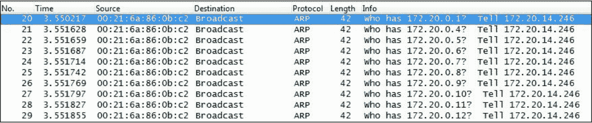

由于 ARP 数据包无法穿过路由器，因此发起 ARP 探测的源设备必须与观察到 ARP 数据包的网段处于同一网段。

### ICMP ping 探测

ICMP ping 探测用于发现本地或远程网段中的活动主机（因为 ICMP 使用 IP 且可路由），其原理是对一段 IP 地址范围发送 ICMP Type 8 回显请求并接收 Type 0 回显应答。你可以使用显示过滤器 `icmp.type == 8 || icmp.type == 0` 轻松检测 ping 探测。

### TCP 端口扫描

TCP 端口扫描使恶意代理能够发现目标主机上哪些 TCP 端口处于开放状态。网络端口是服务器或工作站的入口点；监听特定端口的服务能够处理来自客户端的请求。恶意代理有时会利用服务器代码中的漏洞来获取敏感数据或在机器上执行恶意代码，这就是为什么在所有安全验证中，测试所有活动端口是必不可少的原因。

一些用于 TCP 服务的最常见端口包括：

- 80 HTTP
- 443 HTTPS
- 8080 HTTP 代理
- 8000 HTTP 备用
- 21 FTP
- 22 SSH
- 23 Telnet
- 3389 Microsoft 远程桌面
- 5900 VNC
- 25 SMTP
- 110 POP3
- 143 IMAP
- 3306 MySQL
- 1433 Microsoft SQL Server
- 1720 H.323
- 5060 SIP

TCP 端口扫描设备会向目标主机的某个端口发送 TCP SYN 数据包，目标主机将做出响应：如果端口开放，则返回 SYN 或 ACK；如果端口关闭，则返回 RST。与 ARP 扫描类似，TCP 扫描可以通过来自单一 IP 地址、发往目标 IP 地址、覆盖一系列端口号的多个 SYN 数据包来检测。使用显示过滤器可以更轻松地检测此类扫描：

```
ip.dest == <IP Address of target host> && tcp.flags.syn
```

前面所述的 OS 检测活动的一个 Wireshark 抓包示例中，包含一个运行的 OS 指纹识别脚本，该脚本向目标设备（172.20.0.1）发送了一个伪造的 HTTP 请求，请求路径为 /nice%20ports%2C/Tri%6Eity.txt%2ebak，以查看生成的错误响应具体是什么类型，从而帮助确定 OS 版本：

| 编号 | 时间 | 源 | 目的 | 源端口 | 目的端口 | 协议 | 长度 | 信息 |
|---|---|---|---|---|---|---|---|---|
| 2693 | 16.260887 | 172.20.14.246 | 172.20.0.1 | 2403 | 8080 | HTTP | 107 | GET /nice%20ports%2C/Tr%6Eity.txt%2Ebak HTTP/1.0 |
| 2694 | 16.262351 | 172.20.0.1 | 172.20.14.246 | 8080 | 2403 | TCP | 60 | 8080->2403 [ACK] Seq=1 Ack=54 win=13080 Len=0 |
| 2695 | 16.262403 | 172.20.0.1 | 172.20.14.246 | 8080 | 2403 | TCP | 206 | [TCP 段（已重组的 PDU）] |
| 2697 | 16.263793 | 172.20.0.1 | 172.20.14.246 | 8080 | 2403 | HTTP | 990 | HTTP/1.0 200 OK (text/html) |

从前述请求返回的 HTML 响应的确切格式可用于识别 OS 和/或 Web 服务器版本，如以下 Wireshark 数据包详细信息截图所示：

```
Line-based text data: text/html
<html>\r\n<head>\r\n<title>Error</title>\r\n</head>\r\n<body topmargin=1 leftmargin=1 marginheight=1 marginwidth=1 bgcolor="orange" text="black">\r\n<font size="+2">An error occurred. <br> </font>\r\n<font size="+1">\r\nThis http server can only serve URL requests for ufdBGuard <br>\r\nredirection messages and does not understand the URL. <br>\r\nURL: <tt>/nice%20ports%2C/Tr%6Eity.txt%2Ebak</tt> <br>\r\nMost likely the configuration of "redirect" statements is incorrect. It should include "/cgi-bin/URLblocked.cgi". <br>\r\n</font>\r\n</body>\r\n</html>\r\n<!-- Long comment to disable MSIE and chrome so-called friendly error page -->\r\n
```

分析这类 OS 指纹识别请求和响应的数据包捕获，将更容易发现来自恶意实体的类似活动。

## 畸形数据包

恶意构造的畸形数据包通过有意篡改网络协议中数据字段的内容，利用操作系统和应用程序的漏洞。这些漏洞可能导致系统崩溃（一种拒绝服务形式），或强制系统执行任意代码。

畸形数据包漏洞的一个示例是 Cisco 安全公告 cisco-sa-20140611-ipv6，其中某个系列路由器在解析畸形 IPv6 数据包时存在漏洞，可能导致承载网络流量的某块板卡重载（重启），从而间歇性造成服务中断。

此类漏洞的另一个示例是某些未打补丁的 Windows 或 Linux 系统，如果它们收到一系列分片相互重叠的数据包，系统将会崩溃。

畸形数据包的类型和可能性无穷无尽，但漏洞通常会在被发现时公布，有些漏洞公告还会提供数据包详情。你可以在 Wireshark 中构建显示过滤器和/或着色规则来检测这些数据包。同时，学习和了解不同协议字段正常且合法的取值范围，以及 TCP 和其他协议序列的正常样态，也有助于你在数据包流中发现可疑内容。


## 密码破解流量

密码破解流量可以通过观察目标主机发出的大量错误消息来检测，这些消息指向一个客户端，该客户端反复且不成功地尝试登录。密码破解尝试大致有两种类型：

- 字典攻击使用常见单词、姓名和数字的列表
- 暴力破解攻击使用字符、数字和键值的序列

这两种类型通常都会被登录安全措施所挫败，这些措施会在短时间内多次登录失败后锁定账户。

## 异常流量

虽然很难预料黑客可能使用何种方法来渗透网络或主机，但有一些事情在正常健康的网络上几乎不应该发生。由于 ICMP 数据包在测试和传达错误条件方面很有用，因此它们很可能是恶意重定向的目标。由于 TCP 是大多数应用程序使用的主要传输协议，因此您应该注意 TCP 头或负载中的异常情况，这可能是恶意意图的迹象。

以下表格中讨论了一些需要留意的异常示例：

| 可疑内容 | 描述 |
|---|---|
| TCP 错误标志 | TCP 标志的非法或不太可能的组合。SYN、SYN/ACK、ACK、PSH、FIN 和 RST 标志在适当位置使用时是正常的；其他情况都值得调查。 |
| SYN 数据包包含数据 | 初始 TCP SYN 数据包绝不应该包含负载数据；它仅用于建立会话。注意，TCP 中的第三个 ACK 数据包可以包含数据。 |
| 可疑数据报负载内容 | 对操作系统或其他非应用程序目录的引用、奇怪的可执行文件，或其他似乎与用于发送数据的应用程序目的不符的负载数据。 |
| 可疑 ping 负载文本 | 用于填充 ICMP Echo Request 数据包负载的文本通常是无害的字母和数字的顺序序列或类似无意义的文本。如果此文本似乎携带命令或有意义的数据，则值得调查。 |
| FTP 或 Telnet 会话中的明文密码 | 看到使用 FTP 传输敏感业务数据，或使用 Telnet 管理交换机和路由器，并不是黑客的恶意意图。这是员工的疏忽做法，因为这两种协议按设计会通过网络以明文形式传输登录 ID 和密码，使得即使是不 sophisticated 的黑客也很容易捕获它们。Web 上为所有平台提供了安全 FTP（sftp）和安全 Shell（SSH）（Telnet 替代方案）解决方案。 |

## 总结

本章关于安全分析的主题包括检测扫描和探测以识别计划攻击的目标、操作系统指纹识别、检测畸形数据包、以及可疑地分片或乱序发送的数据包、恶意代理的回连流量、识别密码破解尝试，以及识别其他异常数据包和负载。

在下一章中，我们将回顾 Wireshark 安装中提供的多个关键命令行实用程序，以及一些可以补充您工具集的其他数据包分析工具。
