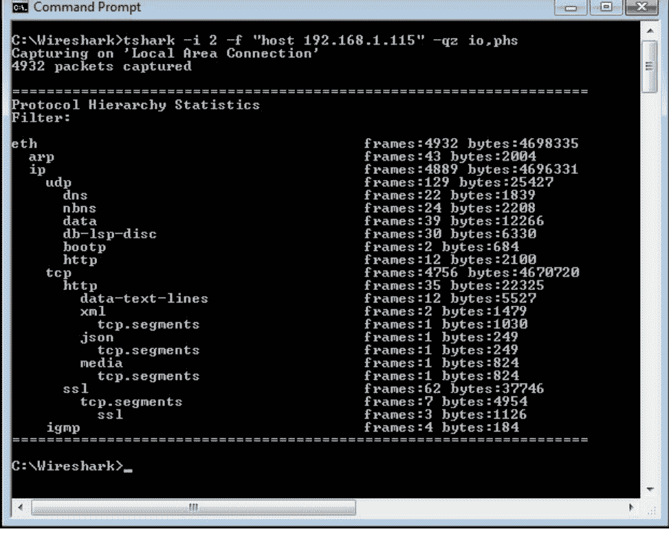
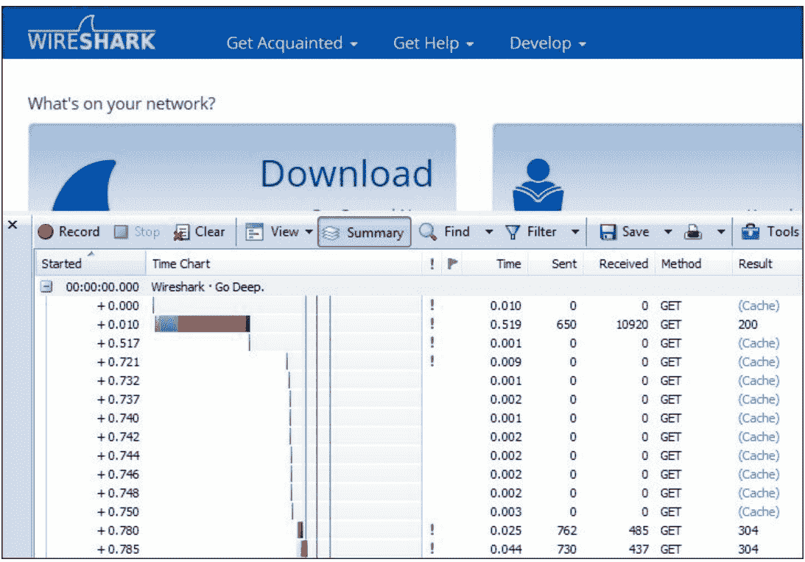
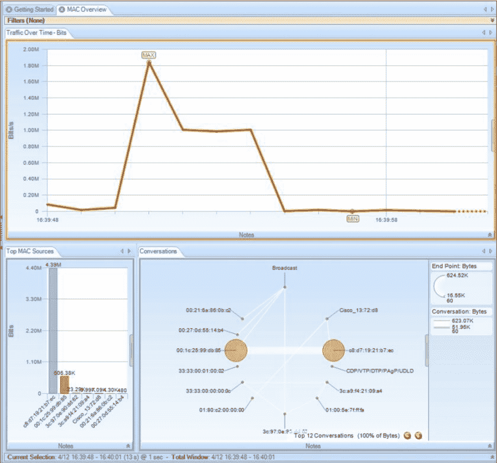
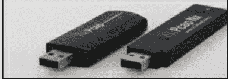

## 第 8 章 命令行和其他实用程序

Wireshark 包含许多命令行实用程序，用于操作数据包跟踪文件并提供无需 GUI 的数据包捕获，还有一些其他工具可以帮助完善您的分析工具集。

本章将涵盖的主题包括：

- 使用 Dumpcap 和 Tshark 捕获流量
- 使用 Editcap 编辑跟踪文件
- 使用 mergecap 合并跟踪文件
- 其他有用的工具

## Wireshark 命令行实用程序

安装 Wireshark 时，还会安装一系列命令行工具，包括：

- `capinfos.exe`：此命令打印跟踪文件的信息
- `dumpcap.exe`：此命令捕获数据包并保存为 libpcap 格式文件
- `editcap.exe`：此命令拆分跟踪文件、更改时间戳并删除重复数据包
- `mergecap.exe`：此命令将两个或多个数据包文件合并为一个文件
- `rawshark.exe`：此命令读取数据包流并打印字段描述
- `text2pcap.exe`：此命令读取 ASCII 十六进制转储并写入 libpcap 文件
- `tshark.exe`：此命令捕获网络数据包或显示保存的跟踪文件中的数据

`Wireshark.exe` 文件启动您熟悉的 GUI 版本，但您也可以使用多个参数从命令行启动 Wireshark；输入 `Wireshark -h` 查看选项列表和/或创建快捷方式以使用这些选项中的任何一个启动 Wireshark。

### Note

将 Wireshark 程序目录添加到系统的 `PATH` 语句中非常有帮助，这样您就可以从任何工作目录执行任何命令行实用程序。

## 使用 Tshark 捕获流量

Tshark 可用于捕获网络数据包和/或显示来自捕获或先前保存的数据包跟踪文件的数据；数据包可以显示在屏幕上或保存到新的跟踪文件。

使用 Dumpcap 执行基本捕获时使用的相同语法也适用于 Tshark，因此我们在此不重复。然而，Tshark 提供了非常广泛的额外功能，相应的命令行选项数量很多，可以像所有 Wireshark 实用程序一样，通过在命令提示符中输入 `tshark -h` 来查看。

许多 Tshark 选项用于查看统计信息；以下屏幕截图说明了命令语法示例以及从捕获中获得的统计结果（在按 Ctrl + C 结束捕获后）：



## 使用 Mergecap 合并跟踪文件

您可以使用 Mergecap 将两个或多个跟踪文件合并为一个文件。基本语法如下：

```
mergecap -w <outfile.pcapng> infile1.pcapng infile2.pcapng …
```

例如：

```
mergecap -w merged.pcap source1.pcapng source2.pcapng
source3.pcapng
```

一个有时可能想要在 Mergecap（以及其他几个命令行实用程序）中使用的有用选项是 -s <snaplen>。这将在每个帧开始后的指定长度处截断数据包，从而生成更小的文件；<snaplen> 的典型值为 128 字节：

```
mergecap -w merged_trimmed.pcapng -s 128 source1.pcapng
source2.pcapng
```

## Mergecap 批处理文件

如果要合并的捕获文件具有多种命名格式，您可以创建一个 `MergeTraces.bat` 文件，其中包含以下 Windows 批处理命令：

```
```bat
@echo off
cls
echo MergeTraces.bat
echo.
echo Merges multiple packet trace files with a .pcapng extension into one .pcapng file
echo.
echo Usage: Copy MergeTraces.bat into the directory with the .pkt files and execute
echo The utility will generate a 'MergedTraces.pcap' file
echo and a 'MergedFileList.txt' file which lists the .pcapng files processed.
echo.
echo.
echo IMPORTANT!! You must type 'CMD /V:ON' from this window which enables
echo 'Delayed environment variable expansion' in order to properly execute
echo this batch utility.
echo.
echo You must also add the path to Wireshark's mergecap.exe to your path statement.
echo.
echo If you've not done this, Type Ctrl-C to exit; Otherwise pause
echo.
echo Deleting old MergedFileList.txt...
if exist "MergedFileList.txt" del MergedFileList.txt
for %%f in (*.pcap-ng) do echo "%%f" >> MergedFileList.txt
echo Deleting old MergedTraces.pcapng...
if exist "MergedTraces.pcapng" del MergedTraces.pcapng
echo Preparing to merge:
echo.
type MergedFileList.txt
echo.
echo Merging..........
set FILELIST=
for %%f in (*.pcap-ng) do set FILELIST=!FILELIST! %%f
:: DEBUG
:: echo %FILELIST%
```
```

```
 mergecap -w MergedTraces.pcapng %FILELIST%
 echo.
 if exist MergedTraces.pcapng @echo Done!
 if NOT exist MergedTraces.pcapng @echo Error!! -- Check your
 settings.
 echo.
```

将批处理文件复制到仅包含要合并的数据包跟踪文件的目录中并执行它。批处理文件将把所有 .pcapng 文件合并为一个名为 `MergedTraces.pcapng` 的文件。这比尝试在命令行中指定一长串唯一的源文件要容易得多，特别是如果文件名包含日期时间戳。如果需要处理 .pcap 文件，请在批处理命令中将所有 .pcapng 实例更改为 .pcap；您也可以按需更改输出文件名。

### Note

您也可以通过将文件点击并拖放到 Wireshark 桌面上来合并跟踪文件。文件将在选择 Wireshark **File** 菜单中的 **Merge** 后根据其时间戳按时间顺序合并。只要总文件大小不超过 1GB，此方法效果相当不错。

您可以在 https://www.wireshark.org/docs/man-pages/mergecap.html 获取更多 Mercgecap 选项的信息和示例。


## 其他有用的工具

Wireshark 是一个极其通用且有用的工具。然而，有些事情它做起来并不容易，甚至完全无法完成，因此我们将讨论一些你可能希望加入分析工具集的其他工具。

### HttpWatch

HttpWatch 是一款基于数据包的性能分析工具，可与 Internet Explorer 和 Firefox 浏览器集成，以图形化方式显示浏览器与网站之间 HTTP 交互的统计值。这类工具使用户能够轻松发现和测量重大延迟发生的时间及其来源。

以下截图展示了通过加载 www.wireshark.org 主页获得的 HttpWatch 可视化和数值分析结果：



你可以从 http://www.httpwatch.com/ 获取有关 HttpWatch 的更多信息。此外，Fiddler 也是一款类似的性能分析工具，可在 http://www.telerik.com/fiddler 找到。

### SteelCentral Packet Analyzer 个人版

SteelCentral Packet Analyzer（以前称为 Cascade Pilot）提供标准版和个人版两个版本。与 Wireshark 不同，该工具能够打开并分析数 GB 大小的跟踪文件；你可以快速隔离感兴趣的会话，右键单击该会话，将其保存为单独的报文跟踪文件，或者直接从同一菜单启动 Wireshark 并将该会话传递给它。

此外，该工具还提供了多种称为**视图**的网络分析屏幕，可从各种性能角度提供图形显示和报告。以下截图展示了一组**MAC 概览**视图：



有关 SteelCentral Packet Analyzer 产品的更多信息，请访问 [http://www.riverbed.com/products/performance-management-control/network-performance-management/packet-analysis.html](http://www.riverbed.com/products/performance-management-control/network-performance-management/packet-analysis.html)。

### AirPcap 适配器

如果你使用 Wireshark 分析无线网络，就需要一个无线适配器，它能够查看所有可用信道，并提供 Radiotap 报头，该报头为每个帧提供附加信息，例如无线电信道和信噪比强度。

在 Windows 平台上，与 Wireshark 或 SteelCentral Packet Analyzer 配合使用的主流无线适配器是 **Riverbed AirPcap 适配器**，可从 Riverbed 网站获取。AirPcap 适配器插入 USB 端口，并包含与 Wireshark 集成并提供 Radiotap 报头信息的驱动程序。有多种产品型号可供选择，覆盖范围逐步扩展至不同 WLAN 频段；其中 AirPcap Nx 覆盖范围最广。下图展示了其中两款适配器：



有关 Riverbed AirPcap 适配器的更多信息，请访问 http://www.riverbed.com/products/performance-management-control/network-performance-management/wireless-packet-capture.html。
