### 第 1 章 认识 Wireshark

在本章中，你将学习：

- 定位 Wireshark
- 启动数据捕获
- 配置启动窗口
- 使用时间值和摘要
- 配置着色规则和导航技术
- 保存、打印和导出数据
- 在**首选项**菜单中配置用户界面
- 配置协议首选项

#### 简介

在本章中，我们将介绍与 Wireshark 相关的基本任务。在本书的前言中，我们讨论了网络故障排除以及在该过程中可以提供帮助的各种工具。在得出需要使用 Wireshark 协议分析器的结论后，现在是时候在网络中定位它，进行基本配置，并使其更加用户友好。

虽然将 Wireshark 设置为基本数据捕获被认为非常简单直观，但在特殊情况下我们可以使用许多选项；例如，当我们通过连接连续捕获数据并希望将捕获文件拆分为多个小文件时，或者当我们希望查看参与连接的设备名称而不仅仅是 IP 地址时，等等。在本章中，我们将学习如何为这些特殊情况配置 Wireshark。

另一个重要问题是在哪里放置 Wireshark 来捕获数据。应该在防火墙之前还是之后？应该连接到路由器的哪一侧？在局域网侧还是广域网侧？在每一侧我们应该预期收到什么？所有这些问题以及更多内容都将在本章的“定位 Wireshark”方案中介绍，并附上如何操作的建议。

本章将涉及的另一个重要问题是如何配置时间值，即你希望 Wireshark 如何呈现捕获数据包的到达时间。当我们捕获对时间敏感的应用程序的数据时，这一点非常重要，此时查看 TCP 连接或 UDP 流中数据包的时序至关重要。

下一个方案将介绍文件操作，即如何保存捕获的数据，无论是保存全部还是部分数据、仅保存过滤后的数据、将数据导出为各种格式、合并文件（例如，当你想要合并两个不同路由器接口上的捕获文件时）等等。

本章还将讨论的一个问题是如何配置着色规则。也就是说，如何配置 Wireshark 以不同的颜色呈现不同的数据包和协议。虽然 Wireshark 默认具有自己的着色方案，但我们可能希望针对特殊情况进行配置，例如，为我们监控的特定协议或预期的特定错误或事件赋予特殊颜色。“配置着色规则和导航技术”方案将讨论这些问题。

本章的最后两个方案将介绍 Wireshark 首选项的配置。这些方案讨论如何配置用户界面，即配置 Wireshark 窗口、列以及每个列中显示的内容、文本格式等，同时还包括特定的协议配置；例如，默认应将哪些 TCP 端口解析为代理服务、是否验证协议校验和、是否计算 TCP 时间戳、如何解码协议头中的字段等。

#### 定位 Wireshark

在理解问题并决定使用 Wireshark 之后，第一步将是决定将其放置在哪里。为此，我们需要一份精确的网络拓扑图（至少是与我们的测试相关的网络部分）。

其原则是找到你想要监控的设备，将你的笔记本电脑连接到该设备所连接的同一台交换机，并为被监控设备配置端口镜像或端口监控。此操作使您能够看到进出被监控设备的所有流量。

你可以监控局域网端口、广域网端口、服务器或路由器端口，或连接到网络的任何其他设备。

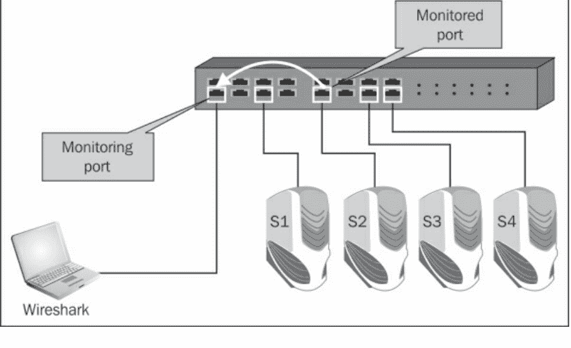

在上图中，Wireshark 软件（安装在左侧的 PC 上）和端口镜像（也称为端口监控，按图中方向配置在交换机上）将监控进出服务器 S2 的所有流量。当然，我们也可以直接将 Wireshark 安装在服务器本身上，这样我们就能够直接在服务器上查看流量。

一些局域网交换机供应商还支持其他功能，例如：

- **监控整个 VLAN**：我们可以监控服务器的 VLAN、电话 VLAN 等。在这种情况下，你将看到特定 VLAN 上的所有流量。
- **将多个端口监控到单个分析器**：我们可以同时监控服务器 **S1** 和 **S2** 上的流量。
- **过滤**：过滤是指选择并相应配置是监控入站流量、出站流量，还是两者都监控。

### 准备工作

要开始使用 Wireshark，请前往 Wireshark 网站，并下载该工具的最新版本。

Wireshark 的更新版本可在网站 http://www.wireshark.org/ 上找到，位于 **Download** 标题下。下载 http://www.wireshark.org/download.html 上可用的最新 Wireshark 稳定版。

每个 Wireshark Windows 安装包都附带最新稳定版的 WinPcap，该组件对于实时数据包捕获是必需的。WinPcap 驱动程序是用于流量捕获的 UNIX Libpcap 库的 Windows 版本。

### 如何操作...

让我们来看看典型的网络架构和网络设备，它们的工作原理，如何在需要时配置它们，以及 Wireshark 的位置。

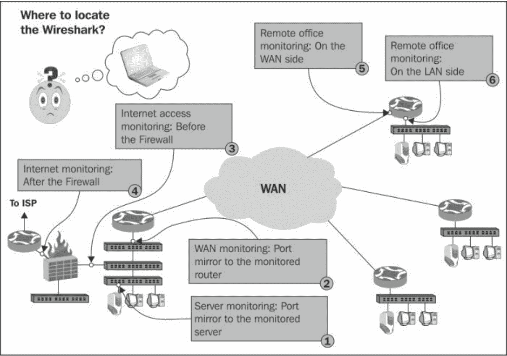

让我们来看一下前述图表中的简单且常见的网络架构。

#### 监控服务器

这将是我们最常见的需求之一。它可以通过将端口监控配置到服务器（在前述图表中编号为 1），或直接在服务器本身上安装 Wireshark 来实现。

#### 监控路由器

configure，但为您提供额外的监控功能，例如 **Simple Network Management Protocol (SNMP)**。当您排查网络时，最好有一个可用的托管 LAN 交换机，即使是简单的交换机也行。

- **Hubs:** 您只需将集线器并联连接到您想要监控的链路即可，由于集线器是半双工设备，路由器和 SP 设备之间发送的每个数据包都将在您的 Wireshark 上被监视。这种方法最大的缺点是集线器本身会减慢流量，从而影响测试。在许多情况下您还想监控 1 Gbps 端口，而由于没有适用于此的集线器，您将不得不将速度降至 100 Mbps，这同样会影响流量。因此，集线器并不常用。

#### 监控防火墙

监控防火墙时，取决于您监控的是内部端口（图表中编号为 3）还是外部端口（图表中编号为 4）。在内部端口上，您将看到所有内部地址以及由内部网络中的用户发起的所有流量，而在外部端口上，您将看到我们发出的外部地址（由 NAT 从内部地址转换而来）；您将看不到被防火墙阻止的来自内部网络的请求。如果有人从互联网攻击防火墙，您（希望）只能在外部端口上看到它。

### 工作原理...

要了解端口监控的工作原理，首先要了解 LAN 交换机的工作方式。LAN 交换机转发数据包的方式如下：

- 1. LAN 交换机持续学习连接到它的设备的 MAC 地址。
- 2. 现在，如果数据包发送到目标 MAC 地址，它将只转发到交换机知道该 MAC 地址来自的物理端口。
- 3. 如果发送广播，它将被转发到交换机的所有端口。
- 4. 如果发送多播并且 Cisco Group Management Protocol (CGMP) 或 Internet Group Management Protocol (IGMP) 被禁用，它将被转发到交换机的所有端口（CGMP 和 IGMP 是使多播数据包仅转发到特定多播组上的设备的协议）。
- 5. 如果数据包发送到交换机不认识的 MAC 地址（这是一个非常罕见的情况），它将被转发到交换机的所有端口。

因此，当您将端口监控配置到特定端口时，您将看到进出该端口的所有流量。如果您将笔记本电脑连接到网络，而不进行任何配置，您将只看到进出您笔记本电脑的流量，以及来自网络的广播和多播。

### 还有更多...

在捕获数据时，有一些棘手的情况您应该注意。

其中一种情况是监控 VLAN。监控 VLAN 时，您应该注意几个重要问题。第一个问题是，即使您监控一个 VLAN，数据包也必须物理上通过您所连接的交换机，才能看到它。例如，如果您监控在网络中配置的 VLAN-10，而您连接到楼层交换机，您将看不到从其他交换机到中央交换机上服务器的流量。

这是因为在构建网络时，用户通常连接到楼层交换机，在楼层的一个或多个位置，这些交换机连接到建筑物中央交换机（或两个冗余交换机）。要监控 VLAN 上的所有流量，您必须连接到所有 VLAN 流量都经过的交换机，这通常是中央交换机。

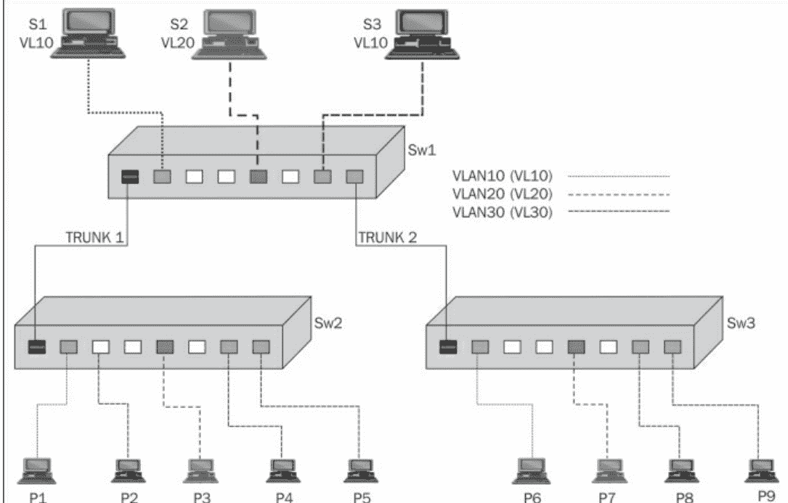

### 另请参阅

有关如何配置端口镜像的信息，请参阅厂商的说明。它可以称为 **port monitor**、**port mirror** 或 **SPAN**（**Switched Port Analyzer** 来自 Cisco）。

还有高级功能，例如远程监控（监控未直接连接到您交换机的端口）、高级过滤（例如过滤特定 MAC 地址）等。还有一些高级交换机本身具有捕获和分析功能。也可以监控虚拟端口（例如 LAG 或 Ether channel 组）。对于所有情况，请参阅厂商的规格。

## 开始捕获数据

在本教程中，我们将学习如何开始捕获数据，以及在我们已在网络中定位 Wireshark 后，在各种捕获场景下会得到什么。

### 准备工作

在计算机上安装 Wireshark 后，您唯一需要做的就是从桌面、程序文件或快速启动栏启动分析器。

这样做后，将打开以下窗口（版本 1.10.2）：

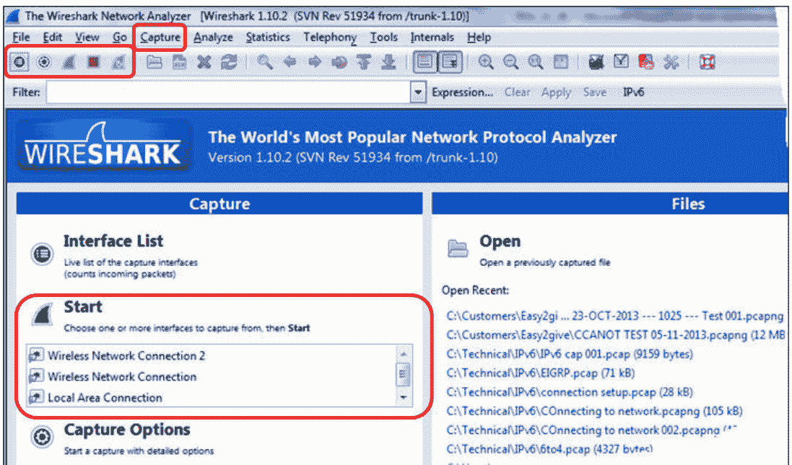

### 如何操作...

您可以从顶部栏 **Capture** 菜单开始捕获，或从带有捕获符号的快速启动栏开始，或从 Wireshark 主屏幕左中部的捕获窗口开始。有您可以选择的选项。

#### 如何选择要开始捕获的接口

如果您简单地点击 Wireshark 中第三个靠右的绿色图标并开始捕获，Wireshark 将在软件中配置的默认接口上开始捕获（本章后面在 Preferences 菜单中配置用户界面的教程中会解释）。要选择您想要捕获的接口，请点击 **List the available capture interfaces** 符号，**Wireshark Capture Interfaces** 窗口将打开。

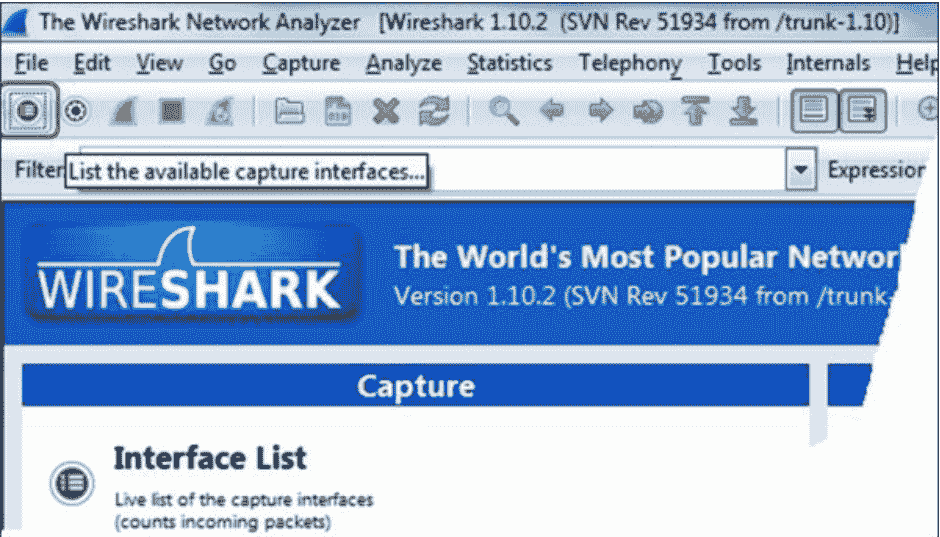

查看哪个接口处于活动状态的最佳方法就是简单地查看接口窗口右侧的流量运行情况。在那里您将看到 Wireshark 看到的每个接口的总 **Packets** 数，以及每个接口的 **Packets/sec** 数。

#### 如何配置您从其捕获数据的接口

要配置您从其捕获数据的接口，请从 Capture 菜单中选择 Options。以下窗口将出现：

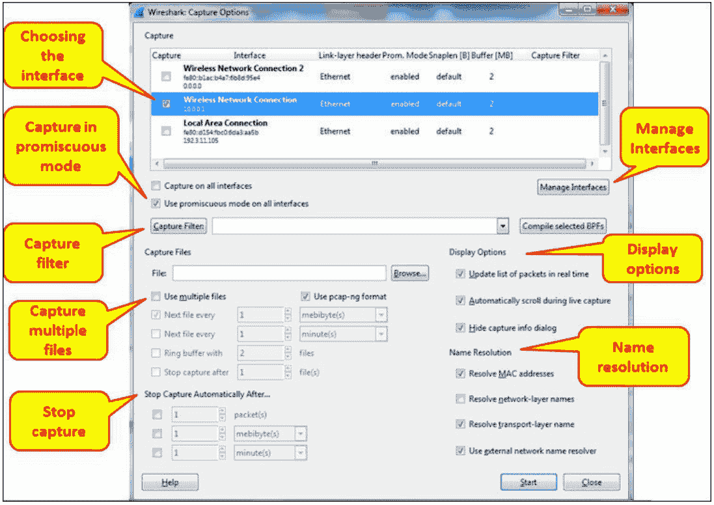

在前述窗口中您可以配置以下参数：

- 1. 在窗口的上方，选择您想要从其捕获数据的接口。
- 2. 在窗口的左侧，您有复选框 Use promiscuous mode on all interfaces。选中后，Wireshark 将捕获计算机接收到的所有数据包。取消选中它将只捕获 intended for the computer 的数据包。
- 3. 在某些情况下，选中此复选框时，Wireshark 将不会在无线接口上捕获数据；因此，如果您在无线接口上开始捕获数据却看不到任何内容，请取消选中它。

4. 在窗口的左中部，你有 **Capture Files** 字段。你可以在此处写入文件名，Wireshark 将在此处指定的路径下以此名称保存捕获的文件，并加上 0001、0002 等扩展名。此功能在捕获大量数据时非常重要；例如，在负载很重的接口上捕获数据，或在较长时间内捕获数据时。你可以让软件在经过特定时间间隔、文件大小或数据包数量后打开新文件。

5. 在窗口的左下部，你有前面截图中标记为 **Stop Capture Automatically** 的区域。在此区域，你可以让软件在经过特定时间间隔、文件大小或数据包数量后停止捕获数据。

6. 在窗口的右中部，你可以更改 **Display** 选项并选择复选框 **Update list of packets in real time**、**Automatically scroll during live capture** 和 **Hide capture info dialog**，后者可关闭烦人的捕获窗口（在你开始捕获时出现的弹出窗口）。在大多数情况下你无需在此处更改任何内容。

7. 在窗口的右下部，你可以配置 MAC 地址、IP DNS 名称以及 TCP/UDP 端口号的解析选项。最后一个复选框 **Use external network name resolver** 使用系统配置的名称解析器（在大多数情况下为 DNS）来解析网络名称。

## There's more...

在捕获时间很重要，且你希望在一個或多个接口上捕获数据并与所监控的服务器进行时间同步的情况下，你可以使用 **Network Time Protocol (NTP)** 将你的 Wireshark 和被监控的服务器与中央时间源同步。

当你希望并行查看 Wireshark 捕获文件和服务器日志文件，并查找在两者中都显示的事件时，这一点很重要。例如，如果你在捕获文件中看到重传，同时在被监控的服务器上出现服务器或应用程序错误，你就会知道重传是由于服务器错误而不是网络问题造成的。

Wireshark 软件从操作系统时钟（Windows、Linux 等）获取时间。要配置操作系统以使用时间服务器，请参阅你所使用的操作系统的相关手册。

在 Microsoft Windows7 中，按如下方式配置：

- 1. 进入 **Control Panel**。
- 2. 选择 **Clock, Language, and Region**。
- 3. 在 **Date and Time** 下，选择 **Set the time and date** 并切换到 **Internet time** 选项卡。
- 4. 点击 **Change Settings** 按钮。
- 5. 更改服务器名称或 IP 地址。

### Note

在 Microsoft Windows7 及更高版本中，时间服务器有一个默认设置。只要所有设备都调谐到它，你就可以像使用其他任何时间服务器一样使用它。

NTP 是一种用于时间同步的网络协议。当你将网络设备（路由器、交换机、FW 等）和服务器配置为使用同一时间源时，它们将与该源进行时间同步。同步的准确性取决于时间服务器的准确性，该准确性以等级或层级衡量。等级越高，准确性越高。等级 1 为最高。通常你会有 2 到 4 级。

NTP 最初在 RFC 1059（NTPv1）中标准化，然后在 RFC 1119（NTPv2）中标准化；近几年常用的版本是 NTPv3（RFC1305）和 NTPv4（RFC 5905）。

你可以在多个网站上获取 NTP 服务器列表，其中包括 http://support.ntp.org/bin/view/Servers/StratumOneTimeServers 和 http://wpollock.com/AUnix2/NTPstratum1PublicServers.htm。

## See also

你可以在以下位置获取有关 Pcap 驱动程序的更多信息：

- For WinPcap visit: http://www.winpcap.org
- For Libpcap visit: http://www.tcpdump.org

## Configuring the start window

在本菜谱中，我们将看到启动窗口的一些基本配置。我们将讨论主窗口、文件格式和查看选项的配置。

- Status Bar

## Main Toolbar

在主工具栏中，你有以下截图中显示的图标：

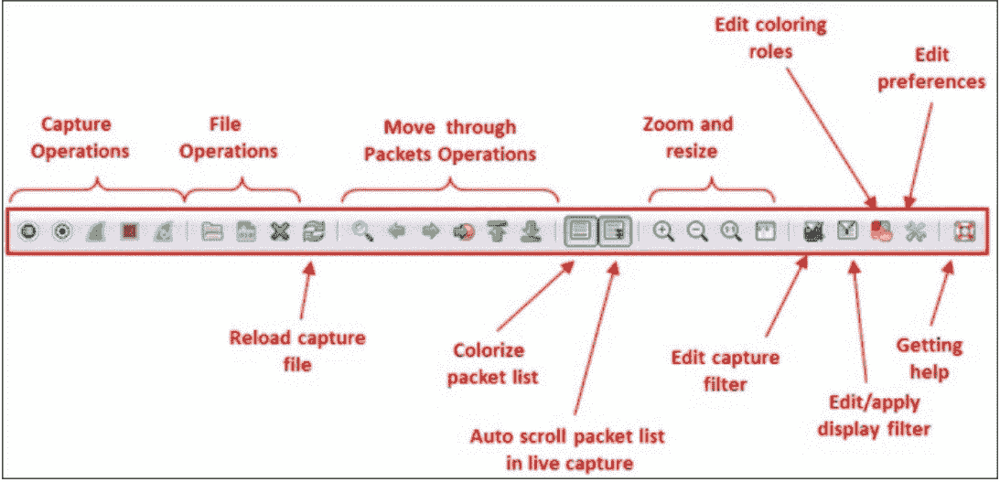

最左边的五个符号用于捕获操作，然后是文件操作、缩放和“转到数据包”操作、着色和自动滚动、缩放和调整大小、过滤器、首选项和帮助的符号。

## Display Filter Toolbar

在过滤器工具栏中，你有以下字段：

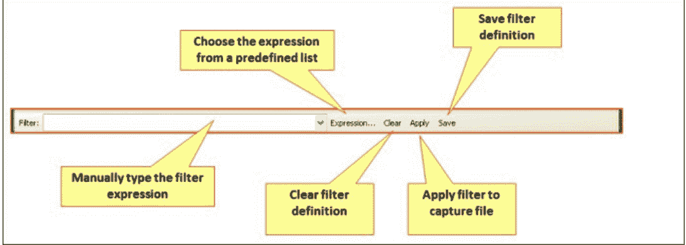

## Status Bar

在 Wireshark 窗口下方的状态栏中，你可以看到以下截图中显示的数据：

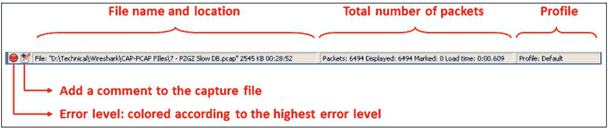

在前面的截图中你可以看到以下内容：

- Errors in the expert system
- The option to add a comment to the file
- The name of the captured file（在捕获期间，它会显示软件分配的临时名称）
- Total number of captured packets, displayed packets（那些实际显示在屏幕上的数据包），and marked packets（你标记过的数据包）。

## How to do it...

在这部分我们将逐步配置主菜单。

### Configuring toolbars

通常对于常规数据包捕获，你无需更改任何内容。当你想要通过网络捕获无线数据（不仅仅来自你的笔记本电脑）时则不同；你将必须启用无线工具栏，这可以通过在视图菜单下点击它来完成，如以下截图所示：

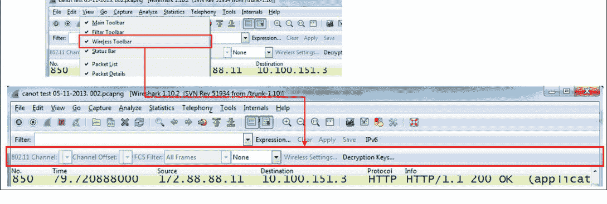

### Configuring the main window

要配置捕获的主菜单，你可以配置 Wireshark 显示以下窗口：

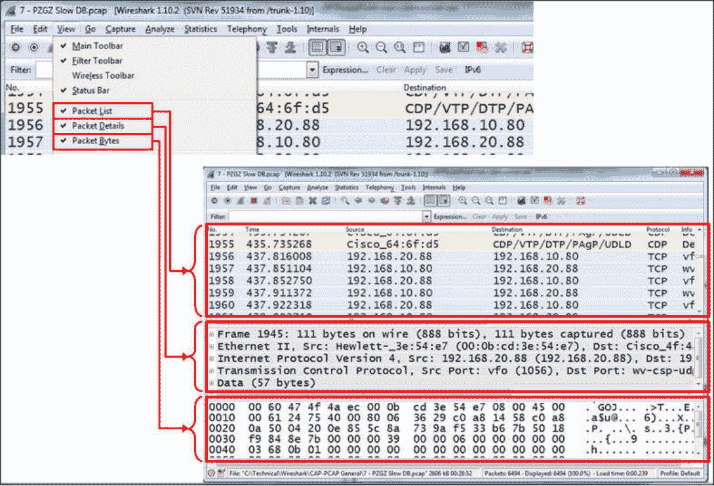

在大多数情况下你无需在此处更改任何内容。在某些情况下，你可以取消数据包字节的显示，当你不需要查看它们时，你将获得更多“空间”用于数据包列表和详细信息。

## Name Resolution

**Name Resolution** 是将第 2 层（MAC 地址）、第 3 层（IP 地址）和第 4 层（端口号）转换为有意义信息的翻译。

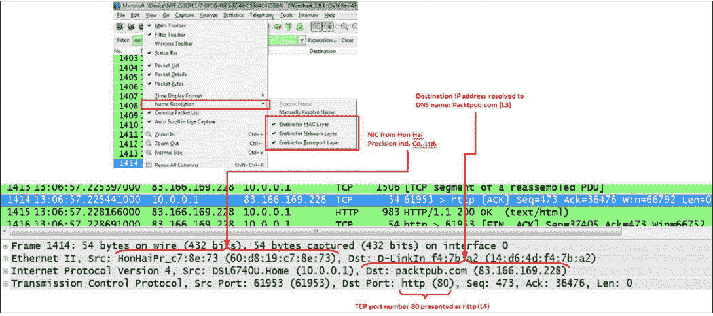

在前面的截图中，我们看到 MAC 地址 **60:d8:19:c7:8e:73**（来自 **Hon Hai Precision Ind.**, 由 Lenovo 使用），网站（即 [Packtpub.com](https://Packtpub.com)），以及 HTTP 端口号（即 80）。

## Colorizing the packet list

通常你开始捕获是为了建立网络上正常流量是什么样子的基线配置文件。在捕获期间，你查看捕获的数据，你可能会发现可疑的 TCP 连接、IP 或以太网连接，并希望以另一种颜色查看它们。

为此，右键单击属于你想要着色的对话的数据包，选择 Ethernet、IP 或 TCP/UDP（TCP 或 UDP 的外观取决于数据包），并为该对话选择颜色。

在示例中你可以看到我们想要为 **Transport Layer Security (TLS)** 对话着色。

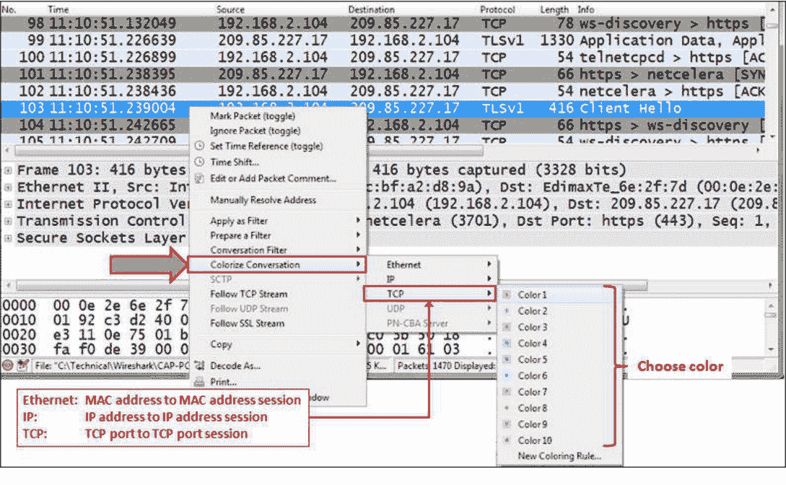

要取消着色规则：

- 1. 进入 **View** 菜单。
- 2. 在菜单的下部，选择 **Reset Coloring 1-10** 或简单地按 Ctrl + 空格键。

## Auto scrolling in live capture

要配置 Wireshark 在捕获数据包时自动滚动，请执行以下操作：

- 1. 进入 **View** 菜单。
- 2. 标记 **Auto Scroll in Live Capture** 项目。
- 3. Zoom

缩放进出：

- 1. 进入 **View** 菜单。
- 2. 点击 **Zoom In** 或按 Ctrl + + 放大。
- 3. 点击 **Zoom Out** 或按 Ctrl + - 缩小。

## Using time values and summaries

时间格式配置是关于时间列（默认配置下从左数第二列）将如何呈现。在某些场景中，这一点非常重要；例如，在你想要查看 TCP 连接中数据包之间的时间间隔时，当你从多个源捕获数据并希望查看每个数据包的确切时间时，等等。

### 准备工作

要配置时间格式，请转到“查看”菜单，然后在“时间显示格式”下，您将看到以下窗口：

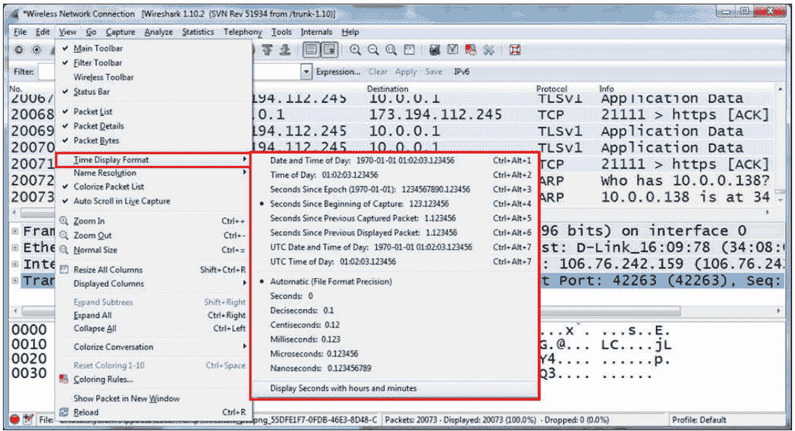

### 如何操作...

您可以从以下选项中进行选择：

- **日期和时间（前两个选项）**：这在排查与时间相关的网络事件时很有用，例如，当您知道某个事件发生在特定时间，并且想要查看网络在同一时间发生了什么时。
- **自纪元以来的秒数**：自 1970 年 1 月 1 日起的秒数。纪元是作为系统参考时间而选定的任意日期，而 1970 年 1 月 1 日被选为 Unix 和类 Unix 系统的纪元。
- **自捕获开始以来的秒数**：默认配置。
- **自上一个捕获数据包以来的秒数**：这也是一个常见功能，可让您查看数据包之间的时间差。当监控对时间敏感的流量时，这很有用（数据包之间的时间差很重要），例如 TCP 连接、实时视频流、VoIP 呼叫等。
- **自上一个显示数据包以来的秒数**：这是一个很有用的功能，可在您配置显示过滤器且仅呈现捕获数据的一部分时使用（例如 TCP 流）。在这种情况下，您将看到数据包之间的时间差，这在某些应用中很重要。
- **UTC 日期和时间**：提供相对的 UTC 时间。

子菜单的下半部分提供了时间显示的格式。仅在需要更精确的测量时才更改它。

您也可以使用 Ctrl + Alt + 键盘上的任意数字键来选择各种选项。

### 工作原理...

这很简单。Wireshark 基于系统时钟工作，并按系统中的时间呈现时间。默认情况下，您会看到自捕获开始以来的时间。

## 配置着色规则和导航技术

着色规则定义了 Wireshark 如何对捕获数据中的协议和事件进行着色。使用着色规则将极大地帮助您进行网络故障排除，因为您可以以不同颜色查看不同协议，并且还可以为不同事件配置不同颜色。

着色规则使您能够根据各种过滤器配置新的着色规则。它可以帮助您为不同场景配置不同的着色方案并将其保存在不同的配置文件中。这样，您就可以为解决 TCP 问题配置着色规则，为解决 SIP 和电话问题配置规则，等等。

### 提示

您可以配置 Wireshark 配置文件以保存 Wireshark 配置；例如，预定义的颜色、过滤器等。要执行此操作，请从 **编辑** 菜单中导航到 **配置配置文件**。

### 准备工作

要开始使用着色规则，请按以下步骤操作：

1. 转到 **查看** 菜单。
2. 在菜单的下半部分，选择 **着色规则**。您将看到以下窗口：

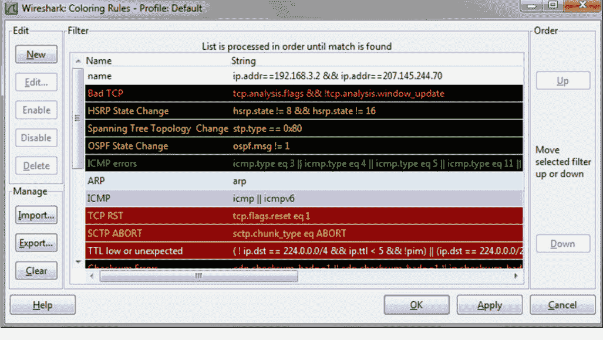

### 如何操作...

我们现在将继续介绍着色规则：

单击“新建”按钮，您将看到以下窗口：

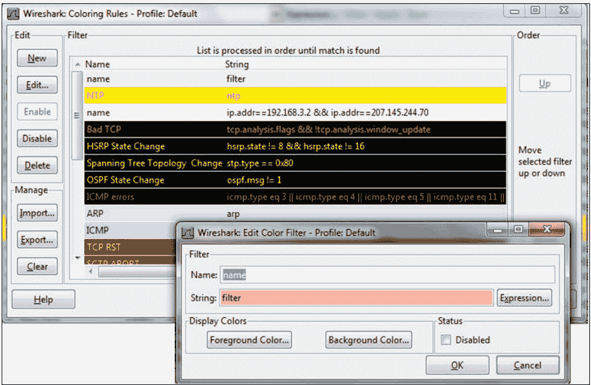

要配置新的着色规则，请按照以下步骤操作：

1. 在“名称”字段中，填写规则的名称。例如，为网络时间协议填写 NTP。
2. 在“字符串”字段中，填写过滤器字符串，即您希望规则显示的内容（我们将在第 3 章《使用显示过滤器》中讨论显示过滤器）。您可以单击“表达式”按钮并获取预配置的过滤器列表。
3. 单击“前景色”按钮并为规则选择前景色。这将是数据包列表中数据包的前景色。
4. 单击“背景色”按钮并为规则选择背景色。这将是数据包列表中数据包的背景色。
5. 如果要编辑现有规则，请单击 **编辑** 按钮。您也可以单击 **导入** 按钮导入现有着色方案，或单击 **导出** 规则导出当前方案。

### 提示

着色规则的顺序很重要。请确保着色规则的顺序是实现的顺序。例如，应用层协议应排在 TCP 或 UDP 之前，以便 Wireshark 以其颜色着色它们，而不是常规的 TCP 或 UDP 颜色。

### 工作原理...

与 Wireshark 中的许多操作一样，您可以对过滤后的数据配置各种操作。着色规则机制只是将着色规则应用于预定义的过滤器。

### 另请参阅

您可以在 http://wiki.wireshark.org/ColoringRules 上找到各种类型的着色方案，以及许多其他示例，通过简单的互联网搜索即可找到。

## 保存、打印和导出数据

在本教程中，我们将讨论文件操作，例如保存、导出、打印等。

### 准备工作

启动 Wireshark 或打开已保存的文件。

### 如何操作...

我们可以保存整个文件，并以各种格式和文件类型导出特定数据。在以下段落中，我们将看到如何操作。

要保存包含捕获数据的整个文件，请执行以下步骤：

1. 在 **文件** 菜单中，单击 **保存**（或按 Ctrl + S）以使用其自己的名称保存文件。
2. 在 **文件** 菜单中，单击 **另存为**（或按 Shift + Ctrl + S）以使用新名称保存文件。

要保存文件的一部分，例如仅显示的数据：

1. 在 **文件** 菜单下导航到 **导出指定数据包**。您将看到以下窗口：
2. 在窗口的左下角，您会看到可以选择要保存的数据部分。
3. 要保存所有捕获的数据，请选择“所有数据包”和“已捕获”。
4. 要仅保存显示的数据，请选择“所有数据包”和“已显示”。
5. 要仅保存文件中的选定数据包（选定数据包只是您在数据包列表窗口中单击的数据包），请选择“选定数据包”。
6. 要保存标记的数据包（即通过在数据包列表窗口中右键单击它并从菜单中选择“标记数据包切换”而标记的数据包），请选择“标记数据包”。
7. 要保存两个标记数据包之间的数据包，请选择“从第一个到最后一个标记”选项。
8. 要保存一系列数据包，请选择“范围”并指定要保存的数据包范围。
9. 在数据包列表窗口中，您可以手动选择忽略数据包。在“导出”窗口中，您可以选择忽略这些数据包而不保存它们。

在所有上述选项中，您可以选择来自整个捕获文件的数据包，或来自屏幕上显示的数据包（在应用显示过滤器后在数据包列表中显示的数据包）。

### 以各种格式保存数据

您可以以各种格式保存 Wireshark 捕获的数据，以便使用其他工具进行进一步分析。

您可以将文件保存为以下格式：

- **纯文本** (*.txt)：将数据包数据导出为纯文本 ASCII 文件。
- **PostScript** (*.ps)：将数据包数据导出为 PostScript 格式。
- **逗号分隔值：数据包摘要** (*.csv)：将数据包摘要导出为 CSV 文件格式，以便与电子表格程序（如 Microsoft Excel）一起使用。
- **C 数组到数据包字节** (*.c)：将数据包字节导出为 C 数组，以便 C 程序导入。
- **PSML 或 XML 数据包摘要** (*.psml)：将数据包数据导出为 PSML，这是一种仅包含数据包摘要的基于 XML 的格式。有关此格式的更多详细信息，请参阅 http://www.nbee.org/doku.php?id=netpdl:psml_specification。
- **PDML - XML 数据包详细信息** (*.pdml)：将数据包数据导出为 PDML，这是一种包含数据包详细信息的基于 XML 的格式。有关此格式的更多详细信息，请参阅 http://www.nbee.org/doku.php?id=netpdl:pdml_specification。

要保存文件，请从“文件”菜单中选择“导出数据包分解”，您将看到以下窗口：

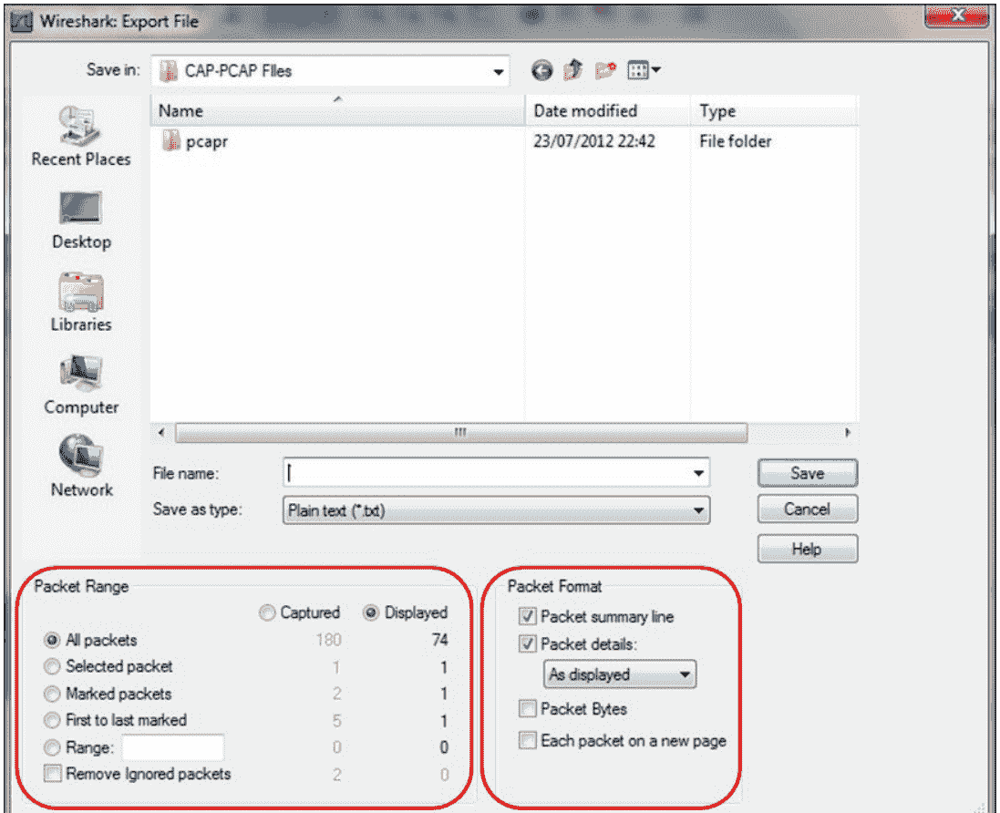

在前面的截图中，左侧标记的框里，你选择要保存的数据包。过程与上一节配方相同。右侧标记的框里，你选择要保存的文件格式。

# 如何打印数据

要打印数据，请从 File 菜单中点击 Print 按钮，你将得到以下窗口：

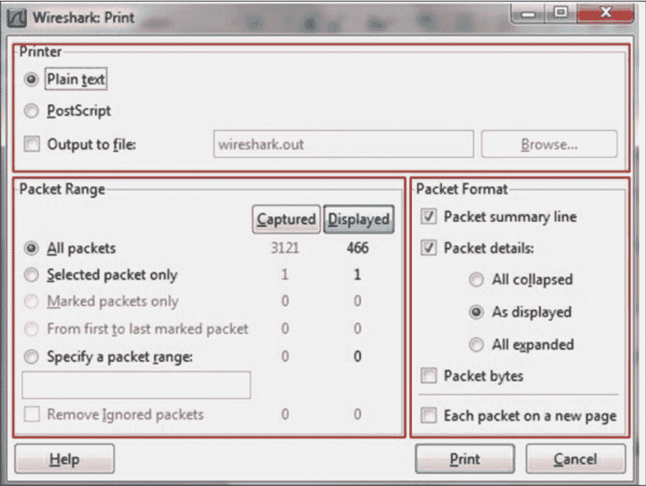

在 Wireshark **Print** 窗口中，你有以下选择：

- 在上部窗口中，你选择要打印的文件格式
- 在左下部窗口中，你选择要打印的数据包（与 Export 窗口类似）
- 在右下部窗口中，你选择打印数据的格式，以及从 Wireshark 窗口打印的数据窗格：
  - **Packet Summary** 窗格
  - **Packet Details** 窗格
  - **Packet Byte** 窗格

## How it works...

数据可以以文本格式、postscript（用于支持 postscript 的打印机）或保存到文件的方式打印。配置完此窗口并点击打印后，常规的打印窗口将会出现，你可以選擇打印机。

# 在 Preferences 菜单中配置用户界面

在 **Preferences** 窗口中，你可以更改大量参数，包括呈现的数据、文件默认保存位置、Wireshark 默认捕获数据的接口等等。

本章中我们将提及的是在各种捕获场景下更改后会有所帮助的常用参数。

## Getting ready

要配置 **User Interface**，我们将从 **Edit** 菜单中选择 **Preferences** 选项。你将得到以下窗口：

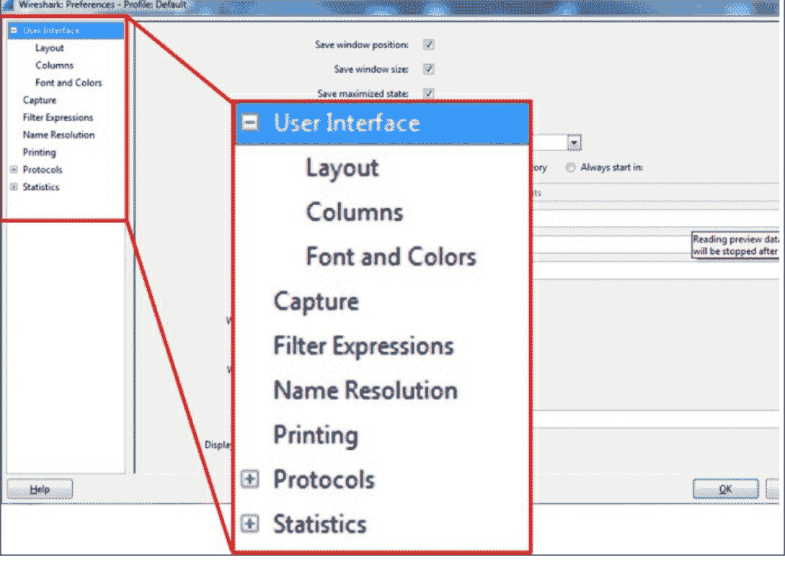

我们将查看以下参数的配置：

- **Columns**
- **Capture**
- **Name Resolution**

## How to do it...

在本节中，我们将了解如何更改参数以帮助使用 Wireshark。

### 更改和添加列

我们在数据包窗格中看到的默认列是编号、时间、源和目标地址、协议、长度和信息列，如以下截图所示：

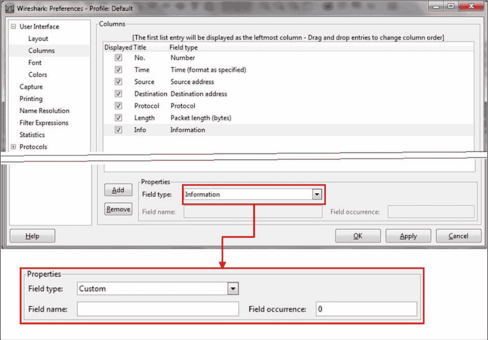

要向数据包窗格添加新列：

1. 你可以从 **Field type** 中选择其中一个预定义参数作为新列添加。其中这些参数包括时间增量、IP DSCP 值、端口号等。

2. 当你在字段类型中填写 **Custom** 时，会出现一个非常重要的功能。在这种情况下，你可以为 **Field name** 填写任何过滤器字符串。例如，你可以添加以下内容：

- 添加字符串 `tcp.window_size` 以查看 TCP 窗口大小（影响性能）。
- 添加字符串 `ip.ttl` 以查看每个数据包的 IP **TTL (Time-To-Live)** 参数。
- 添加 `rtp.marker` 以查看 RTP 数据包中设置的每个标记的实例。
- 正如我们在后面的章节中将看到的，此功能将有助于我们快速解决网络问题。

# 更改捕获配置

在捕获数据之前可以配置一些参数。在 **Preferences** 窗口中选择 **Capture** 菜单，以下窗口将会出现：

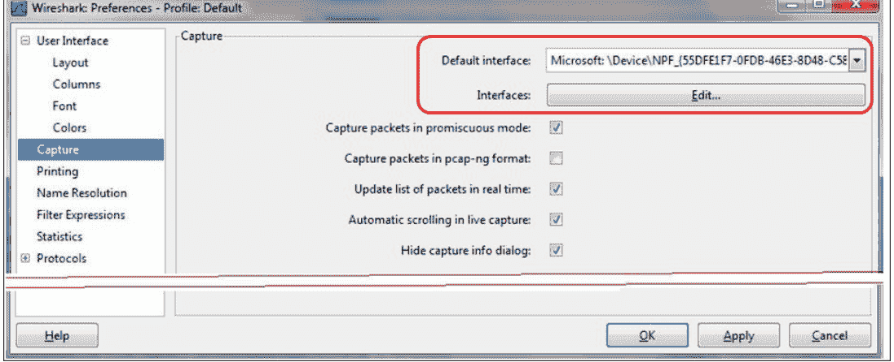

要更改捕获开始时默认的接口，只需点击 **Edit** 按钮，并标记你希望设为默认的接口。当然，你每次开始新捕获时都可以更改它，这只是默认值。

# 配置名称解析

Wireshark 在三层支持 **Name Resolution**：

- **Layer 2**：通过将 MAC 地址的第一部分解析为厂商名称。例如，**14:da:e9** 将显示为 AsusTeckC (ASUSTeK Computer Inc.)。
- **Layer 3**：通过将 IP 地址解析为 DNS 名称。例如，**157.166.226.46** 将解析为 www.edition.cnn.com。
- **Layer 4**：通过将 TCP/UDP 端口号解析为端口名称。例如，端口 80 将解析为 HTTP，端口 53 解析为 DNS。

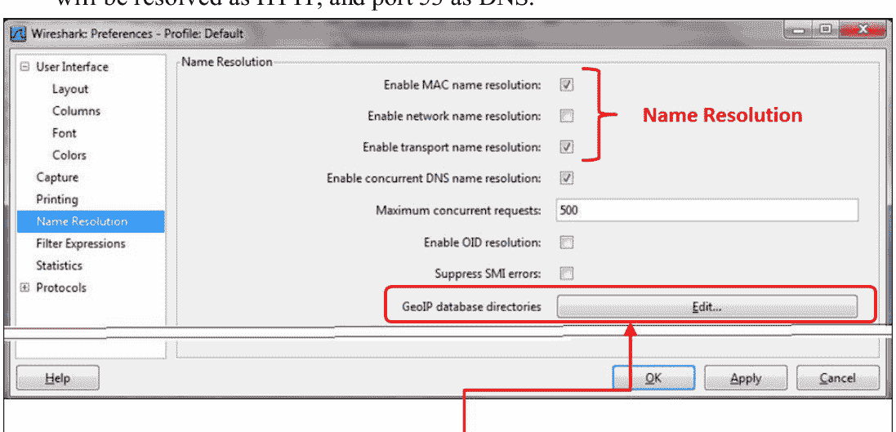

# Tip

在 TCP 和 UDP 中，只有客户端最初打开会话的目标端口才有意义。连接打开的源端口是一个随机数（高于 1024），因此将其翻译为端口名称没有意义。

Wireshark 默认解析第 2 层 MAC 地址和第 4 层 TCP/UDP 端口号。解析 IP 地址可能会因大量 DNS 查询而减慢 Wireshark 的速度；因此请谨慎使用。

## How it works...

非常简单。这是 Wireshark 的配置菜单。在这里你可以配置本配方中描述的参数以及一些其他参数。你可以参考 Wireshark 手册 www.wireshark.org 获取更多信息。

## 配置协议首选项

配置协议首选项使我们能够更改 Wireshark 捕获和呈现常见协议的方式。在本配方中我们将学习如何配置最常见的协议。

## Getting ready

1. 进入 **Edit** 菜单下的 **Preferences**，你将看到以下窗口：

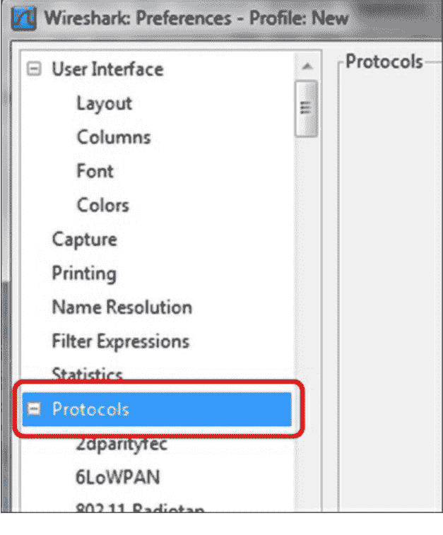

2. 点击协议左侧的 + 号，协议列表将被打开。在协议列表下你会找到常见和不太常见的协议。在本部分我们将讨论常见配置，我们将在协议章节中深入协议细节，即第 7 章 Ethernet、LAN Switching、和 Wireless LAN 到第 14 章 Understanding Network Security。

## How to do it...

在本配方中，我们将讨论以下基本协议（基本是指它们无处不在，而非简单）：

- IPv4 和 IPv6
- TCP 和 UDP

# 配置 IPv4 和 IPv6 首选项

当你选择配置 IPv4 或 IPv6 参数时，你将得到以下窗口：

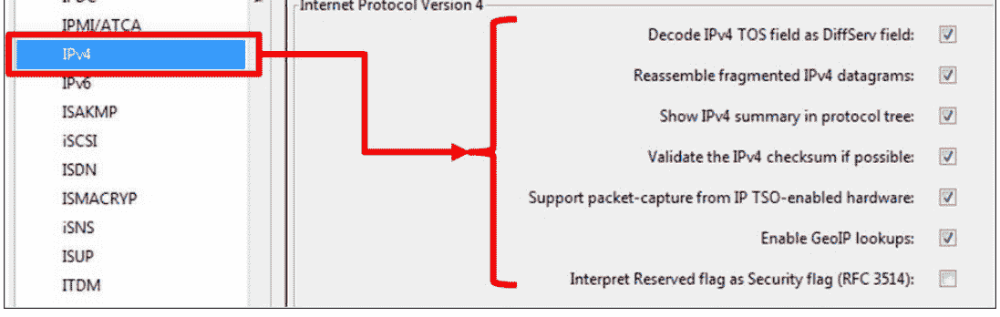

你可以更改的参数有：

- **Decode IPv4 ToS field as DiffServ Field**：原始 IP 协议带有一个名为 **Type Of Service (ToS)** 的字段，用于在网络中实现 IP 服务质量。90 年代初，**Differentiated Services (DiffServ)** 标准改变了 IP 设备对该字段的查看方式。取消选中此复选框将按原始 IP 标准显示该字段。
- **Enable GeoIP lookups**：GeoIP 是一个数据库，使 Wireshark 能够将 IP 地址呈现为地理位置。在 IPv4 和 IPv6 中启用此功能将启用此呈现。此功能涉及名称解析，因此可能减慢实时数据包捕获速度。

# 配置 TCP 和 UDP

在 UDP 中，没有太多可更改的内容。非常简单的协议，具有非常简单的配置。而在 TCP 中，则有一些可以更改的参数。

你在 TCP 首选项中可以做的多数更改是在 Wireshark 解析捕获数据的方式上。

- **Validate the TCP checksum if possible**：在某些 NIC 中，你可能会看到许多“校验和错误”。这是由于 TCP 校验和卸载通常在某些 NIC 上实现。问题可能是 NIC 实际上在 Wireshark 捕获数据包后才添加校验和，因此如果你看到许多 TCP 校验和错误，第一件事就是禁用此复选框并验证这是否不是问题。
- **Analyze TCP Sequence numbers**：必须选中此复选框才能使 Wireshark 提供 TCP 分析，这是其主要也是最重要的功能之一。
- **Relative Sequence Numbers**：当 TCP 打开连接时，它从一个随机序列号开始。选中此复选框时，Wireshark 会将其规范化为“0”，因此你看到的不是真实数字，而是从“0”开始递增的数字。在大多数情况下，相对数字更容易处理。
- **Calculate conversations timestamps**：选中此复选框时，TCP 解析器将在每个数据包中显示自连接开始以来的时间。这在连接非常快、时间至关重要的情况下会有所帮助。

### 工作原理...

使用**首选项**菜单中的**协议**功能，可以为 Wireshark 软件增加更多的分析功能。但这里要小心，不要添加太多功能，以免拖慢数据包捕获和分析速度。

### 更多内容...

你可以通过 http://wiki.wireshark.org/HowToUseGeoIP 获取有关 GeoIP 的更多信息。
