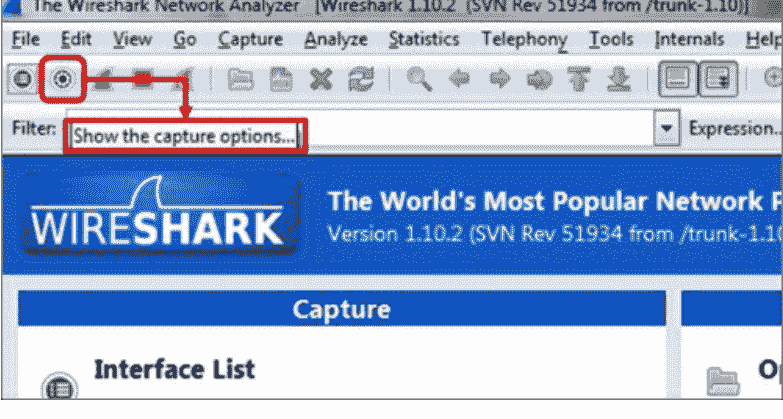
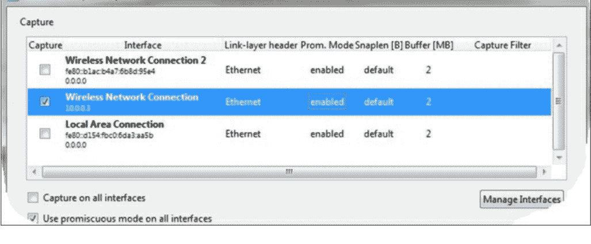
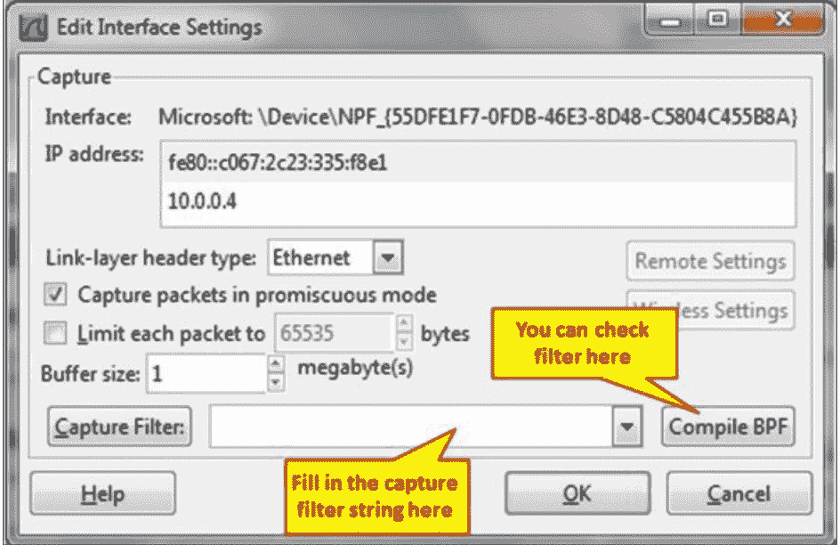
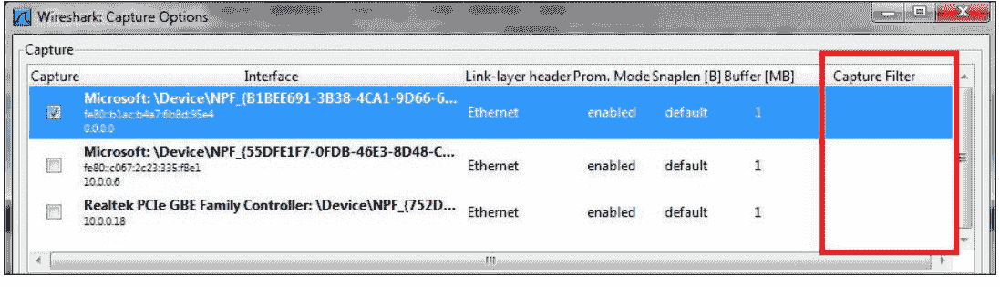
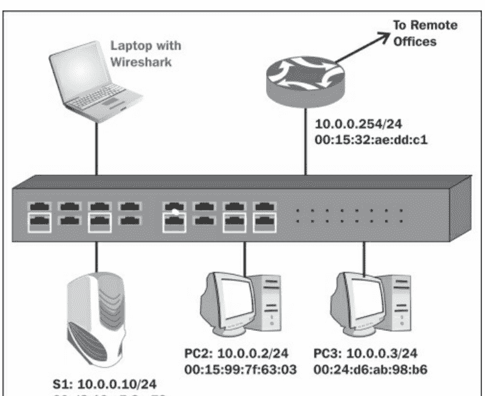
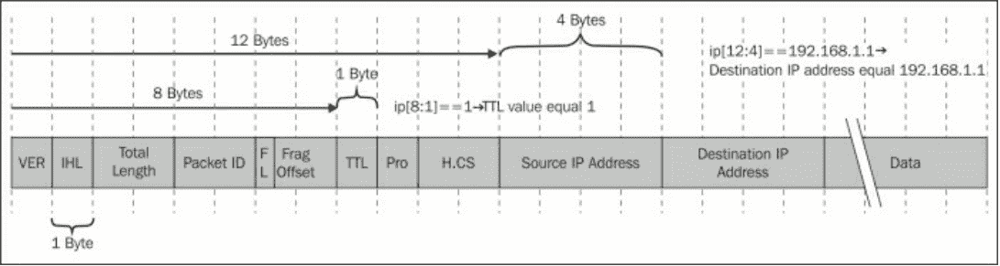
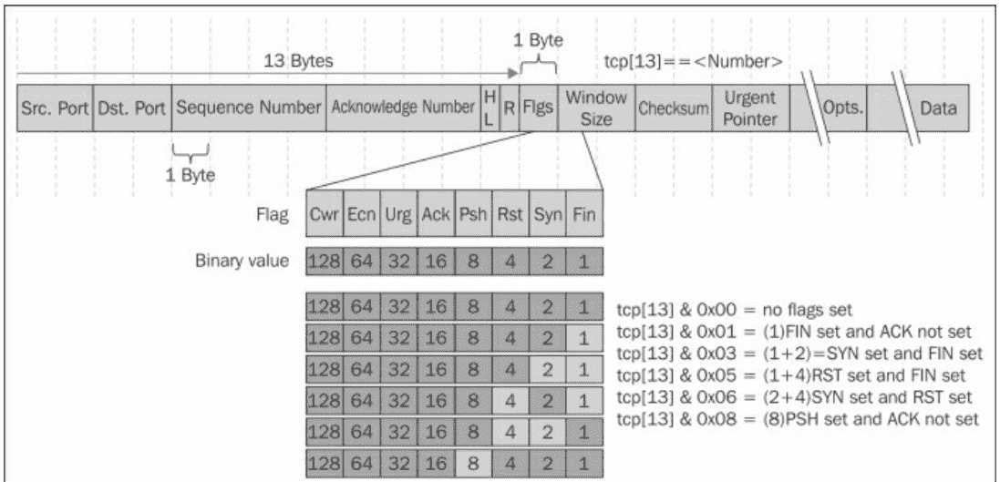
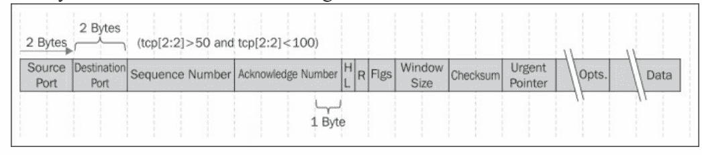
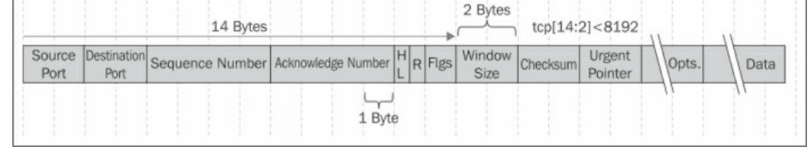

## 第 2 章 使用捕获过滤器

本章将涵盖以下主题：

- 配置捕获过滤器
- 配置以太网过滤器
- 配置主机和网络过滤器
- 配置 TCP/UDP 和端口过滤器
- 配置复合过滤器
- 配置字节偏移和负载匹配过滤器

### 简介

在第一章节中，我们讨论了如何安装 Wireshark、如何将其配置为基本操作，以及如何在网络中定位它。在本章和下一章中，我们将讨论捕获过滤器（第 2 章，使用捕获过滤器）和显示过滤器（第 3 章，使用显示过滤器）。

区分这两种过滤器非常重要：

- 捕获过滤器是在我们开始捕获数据之前配置的，因此只有符合过滤器的数据才会被捕获。所有其他数据都将丢失。本章将介绍这些过滤器。
- 显示过滤器是在数据捕获之后对数据进行过滤的过滤器。在这种情况下，所有数据都会被捕获，然后你配置希望显示的数据。这些过滤器将在第 3 章，使用显示过滤器中介绍。

**提示**

捕获过滤器基于 `libpcap/WinPcap` 库中提供的 `tcpdump` 语法，而显示过滤器的语法是几年后提出的。因此，请记住，显示过滤器和捕获过滤器具有不同的语法！

在某些情况下，你需要配置 Wireshark 仅捕获接口上看到的部分数据，例如：

- 当监控链路上有大量数据在传输，而你只想捕获自己关心的数据时
- 当你只想捕获所监控 VLAN 上特定服务器进出数据时
- 当你只想捕获特定应用程序或应用（例如，你怀疑网络中 DNS 存在问题，只想分析与互联网之间进出的 DNS 查询和响应）时

还有许多其他情况，你希望只捕获特定数据，而不是捕获网络上运行的所有数据。使用捕获过滤器时，只会捕获预定义的数据，所有其他数据包将被忽略，因此你将只得到所需的数据。

**提示**

使用捕获过滤器时务必小心。在网络环境中，许多情况下不同应用程序和服务器之间存在依赖关系，而这些依赖关系并不总是被你所察觉；因此，当你使用带捕获过滤器的 Wireshark 进行网络故障排查时，请确保不要过滤掉那些可能导致问题“消失”的连接。一个常见且简单的例子是，仅过滤 TCP 端口 80 上的流量以监控疑似缓慢的 HTTP 响应，而问题可能出在你无法看到的响应缓慢或无响应的 DNS 服务器上。

在本章中，我们将介绍如何配置简单、结构化、字节偏移和负载匹配的捕获过滤器。

### 配置捕获过滤器

我们建议在配置捕获过滤器之前，仔细设计你想要捕获的内容，并为此准备好过滤器。别忘了——未通过过滤器的内容将会丢失。

Wireshark 提供了一些预定义的过滤器供你使用，你也可以按照下一个技巧中的描述自行配置。

### 准备工作

要配置捕获过滤器，请打开 Wireshark，然后按照本技巧中的步骤操作。

### 操作步骤...

要在开始捕获之前配置捕获过滤器，请执行以下步骤：

1. 要配置捕获过滤器，请点击左侧第二个按钮，即 **显示捕获选项…** 按钮，如下面的截图所示：



2. 将打开 **Wireshark：捕获选项** 窗口，如下面的截图所示：



3. 双击要在其上配置捕获过滤器的接口（你可以按照第 1 章，介绍 Wireshark 中的描述验证哪个接口是活动接口）。

4. 将打开 **编辑接口设置** 窗口，如下面的截图所示：



5. 现在，我们可以通过在“Wireshark：捕获过滤器”窗口中直接编写过滤器字符串来配置捕获过滤器，或者点击“捕获过滤器：”按钮；将打开以下窗口：

Wireshark 捕获过滤器 - 配置文件：新建

编辑

捕获过滤器

- 以太网类型 0x0806 (ARP)
- 不包含广播和多播
- 不使用 ARP
- 仅 IP
- IP 地址 192.168.0.4
- 仅 IPX
- 仅 TCP
- 仅 UDP
- TCP 或 UDP 端口 80 (HTTP)
- HTTP TCP 端口 (80)

新建

删除

属性

过滤器名称：

过滤器字符串：

帮助

确定

取消

输入捕获过滤器名称

输入捕获过滤器字符串

### 工作原理...

**Wireshark：捕获过滤器**窗口使你可以根据**伯克利数据包过滤器（BPF）**配置过滤器。编写过滤器字符串后，你可以点击 **编译 BPF** 按钮，BPF 编译器将检查你的语法，如果语法错误，你将收到错误消息。

此外，当你在捕获过滤器文本框中输入过滤器字符串时，如果过滤器字符串正确，它会变成绿色；如果错误，则会变成红色。

BPF 过滤器仅检查语法是否正确，不检查条件是否正确。例如，如果你输入字符串 `host` 而不带任何参数，将会收到错误，字符串变为红色；但如果你输入 `host 192.168.1.1000`，它将通过，窗口变为绿色。

**提示**

BPF 是源自 1992 年 12 月 Steven McCanne 和 Van Jacobson 在加州大学伯克利分校劳伦斯伯克利实验室发表的论文《The BSD Packet Filter: A New Architecture for User-level Packet Capture》中的一种语法。该文档可见于：http://www.tcpdump.org/papers/bpf-usenix93.pdf。

捕获过滤器由包含过滤表达式的字符串组成。该表达式选择哪些数据包将被捕获，哪些数据包将被忽略。过滤表达式由一个或多个原语组成。原语通常由一个标识符（名称或编号）后跟一个或多个限定词组成。限定词有三种不同类型：

- **Type（类型）**：这些限定词说明标识符名称或编号所指的内容类型。可能的类型有 `host`（主机名或地址）、`net`（网络）、`port`（TCP/UDP 端口），等等。
- **Dir（方向）**：这些限定词指定传输到 ID 和/或从 ID 传输的特定方向。例如，`src` 表示源，`dst` 表示目标，等等。
- **Proto（协议）**：这些限定词将匹配限制到特定协议。例如，`ether` 表示以太网，`ip` 表示互联网协议，`arp` 表示地址解析协议，等等。

标识符是我们测试的实际条件。标识符可以是地址 10.0.0.1、端口号 53 或网络地址 192.168.1（这是针对网络 192.168.1.0/24 的标识符）。

例如，在过滤器 `tcp dst port 135` 中：

- `dst` 是方向限定词
- `port` 是类型限定词
- `tcp` 是协议限定词

### 更多内容...

你可以在不同接口上配置不同的捕获过滤器：



当你在一个设备的两个接口上捕获流量，并希望检查两侧的不同数据包时，可以使用此功能。

捕获过滤器存储在 Wireshark 目录下名为 cfilters 的文件中。在此文件中，你可以找到预定义的过滤器以及你已配置的过滤器，并且可以将该文件复制到其他计算机。该目录的位置将根据 Wireshark 的安装方式和运行平台而有所不同。


## 另请参阅

1. Wireshark 捕获过滤器基于 `tcpdump` 程序。你可以在 http://www.tcpdump.org/tcpdump_man.html 上找到参考资料。
2. 你也可以在 http://wiki.wireshark.org/CaptureFilters 上 Wireshark 手册页找到有用的信息。

## 准备工作

基本 Layer 2 过滤器如下：

- `ether host <Ethernet host>`: 获取以太网地址
- `ether dst <Ethernet host>`: 获取以太网目的地址
- `ether src <Ethernet host>`: 获取以太网源地址
- `ether broadcast`: 捕获所有以太网广播数据包
- `ether multicast`: 捕获所有以太网多播数据包
- `ether proto <protocol>`: 仅过滤协议标识符中指示的协议类型
- `vlan <vlan_id>`: 仅通过特定 VLAN 的数据包，该 VLAN 在标识符字段中指示

要否定过滤规则，只需在原语前输入 `not` 或 `!` 即可。例如：

`Not ether host <Ethernet host>` 或 `! Ether host <Ethernet host>` 将捕获不是来自/发往标识符字段中指定的以太网地址的数据包。

## 如何做...

让我们看一下下面的图表，其中我们有一个服务器、PC 和路由器，连接到一个 LAN 交换机。Wireshark 在连接到 LAN 交换机的笔记本电脑上运行，并对整个交换机进行端口镜像（到 VLAN1）。

图中 /24 表示法指的是 24 位的子网掩码，即二进制中 11111111.11111111.11111111.00000000 或十进制中 255.255.255.0。



按照《配置捕获过滤器》配方中的说明进行操作，并按如下方式配置过滤器：

1. 要仅捕获来自/发往特定 MAC 地址的数据包，例如前一图像中的 PC3，配置 `ether host 00:24:d6:ab:98:b6`。
2. 要捕获发往目的 MAC 地址的数据包，例如前一图像中的 PC3，配置 `ether dst 00:24:d6:ab:98:b6`。
3. 要捕获来自源 MAC 地址的数据包，例如前一图像中的 PC3，配置 `ether src 00:24:d6:ab:98:b6`。
4. 要捕获广播数据包，配置 `ether broadcast` 或 `ether dst ff:ff:ff:ff:ff:ff`。
5. 要捕获多播数据包，配置 `ether multicast`。
6. 要捕获特定的 Ether Type（十六进制值中的数字），配置 `ether proto 0800`。

## 其工作原理...

捕获过滤器与源主机和目的主机的工作方式很简单——捕获引擎只需将条件与实际 MAC 地址进行比较，并仅通过相关内容。

广播地址是目的地址全为 1 的地址，即 ff:ff:ff:ff:ff:ff，因此当你配置广播过滤器时，只有这些地址会通过过滤器。广播地址可以是：

- L3 IPv4 广播转换为 L2 广播；例如，发送到 10.0.0.255 的 IP 数据包（类 C 子网，如前例所示），将被转换为目的 MAC 字段中的 L2 广播。
- 与网络相关的广播；例如，IPv4 ARP（地址解析协议）在网络操作的一部分中发送广播。

**提示**

与网络相关的广播是为网络的常规操作而发送的广播。其中包括 ARP、路由更新、发现协议等。

在多播过滤器中，有 IPv4 和 IPv6 多播：

- 在 IPv4 中，多播 MAC 地址在 MAC 地址以字符串 01:00:5e 开头时传输。所有 MAC 地址以此字符串开头的包将被视为多播。
- 在 IPv6 中，多播地址在 MAC 地址以字符串 33:33 开头时传输。所有 MAC 地址以此字符串开头的包将被视为多播。

以太网协议指的是以太网数据包中 ETHER-TYPE 字段，表示将是上层协议。常见的数值有 IPv4 的 0800、IPv6 的 86dd 和 ARP 的 0806。

## 还有更多...

- 要为特定 VLAN 配置过滤器，使用 `vlan <vlan number>`
- 要在多个 VLAN 上配置过滤器，使用 `vlan <vlan number> and vlan <vlan number> and vlan <vlan number>...`

## 另请参阅

大约有一百个 ETHER-TYPE 代码，其中大多数未使用。你可以参考 http://www.mit.edu/~map/Ethernet/Ethernet.txt 获取更多代码，或简单地在互联网上浏览以太网代码。

## 配置主机和网络过滤器

谈到主机和网络过滤器时，我们指的是基于 IP 地址的 Layer 3 过滤器。在本配方中，我们将参考这些过滤器以及我们可以用它们做什么。

## 准备工作

基本的 Layer 3 过滤器如下：

- `ip or ip6`: 捕获 IP 或 IPv6 数据包。
- `host <host>`: 获取主机名或地址。
- `dst host <host>`: 获取目的主机名或地址。
- `src host <host>`: 获取源主机名或地址。

**提示**

主机可以是 IP 地址或与该数字相关的主机名。你可以例如输入过滤器 host www.packtpub.com，它将显示与 Packt 网站相关 IP 地址的所有数据包。

- `gateway <Host name or address>`: 它捕获到或来自硬件地址但不至 IP 地址的流量。此过滤器捕获通过指定路由器的流量。此过滤器需要一个主机名，该主机名可被本地系统的名称解析过程使用并找到（例如，DNS）。
- `net <net>`: 所有到或来自指定 IPv4/IPv6 网络的数据包。
- `dst net <net>`: 所有到指定 IPv4/IPv6 目的网络的数据包。
- `src net <net>`: 所有来自指定 IPv4/IPv6 源网络的数据包。
- `net <net> mask <netmask>`: 所有到/来自特定网络和掩码的数据包。此语法不适用于 IPv6 网络。
- `dst net <net> mask <netmask>`: 所有到/来自特定网络和掩码的数据包。此语法不适用于 IPv6 网络。
- `src net <net> mask <netmask>`: 所有到/来自特定网络和掩码的数据包。此语法不适用于 IPv6 网络。
- `net <net>/<len>`: 所有到/来自 <net> 网络且 <len> 位长度的数据包。
- `dst net <net>/<len>`: 所有到/来自 <net> 网络且 <len> 位长度的数据包。
- `src net <net>/<len>`: 所有到/来自 <net> 网络且 <len> 位长度的数据包。
- `broadcast`: 所有广播数据包。
- `multicast`: 所有多播数据包。
- `ip proto <protocol code>`: 它捕获 IP 协议字段等于 <protocol> 标识符的数据包。可以有各种协议，例如 TCP（代码 6）、UDP（代码 17）、ICMP（代码 1）等。
- `ip6 proto <protocol>`: 它捕获 IPv6 数据包，其协议如类型字段所示。请注意，此原语不遵循 IPv6 扩展头链。

**提示**

在 IPv6 头中，头中有一个字段可以指向可选的扩展头，该扩展头指向下一个扩展头，依此类推。在当前版本中，Wireshark 捕获过滤器不遵循此结构。

- `icmp[icmptype]==<identifier>`: 它捕获 ICMP 数据包，其中标识符为 ICMP 代码，例如 `icmp-echo` 和 `icmp-request`。

## 如何做...

按照《配置捕获过滤器》配方中提到的说明进行操作，并按如下方式配置过滤器：

1. 要捕获到/来自主机 10.10.10.1 的数据包，配置 `host 10.10.10.1`。
2. 要捕获到/来自主机 www.cnn.com 的数据包，配置 `host www.cnn.com`。
3. 要捕获到主机 10.10.10.1 的数据包，配置 `dst host 10.10.10.1`。
4. 要捕获来自主机 10.10.10.1 的数据包，配置 `src host 10.10.10.1`。
5. 要捕获到/来自网络 192.168.1.0/24 的数据包，配置 `net 192.168.1` 或 `net 192.168.1.0 mask 255.255.255.0` 或 `net 192.168.1.0/24`。
6. 要捕获所有数据而不包括广播或不包括多播，配置 `not broadcast` 或 `not multicast`。
7. 要捕获到/来自 IPv6 网络 2001::/16 的数据包，配置 `net 2001::/16`。
8. 要捕获到 IPv6 主机 2001::1 的数据包，配置 `host 2001::1`。
9. 要仅捕获 ICMP 数据包，配置 `ip proto 1`。
10. 要仅过滤 ICMP Echo 的 ping，你可以使用 ICMP 消息或消息代码。配置 `icmp[icmptype]==icmp-echo` 或 `icmp[icmptype]==8`。


## 工作原理...

对于主机过滤，当你输入主机名时，Wireshark 会将该名称转换为 IP 地址，并捕获与该地址相关的数据包。例如，如果你配置了过滤器 host www.cnn.com，名称解析服务（通常是 DNS）会将其转换为 IP 地址，并显示与该地址往来通信的所有数据包。请注意，在这种情况下，如果 CNN 网站将你重定向到位于其他地址的其他网站，则只会捕获发往第一个地址的数据包。

## 更多内容...

更多有用的过滤器：

- `ip multicast`：IP 组播数据包
- `ip broadcast`：IP 广播数据包
- `ip[2:2] == <number>`：IP 数据包大小
- `ip[8] == <number>`：TTL（生存时间）值
- `ip[9] == <number>`：协议值
- `(ip[12:4] == ip[16:4])`：IP 源地址等于 IP 目的地址
- `ip[2:2] == <number>`：IP 数据包总长度
- `ip[9] == <number>`：协议标识符

这些过滤器将在本章末尾的“配置字节偏移和负载匹配过滤器”小节中进一步说明。如下面的示意图所示，其原理是：方括号中的第一个数字表示从协议头起始处开始的字节数，第二个数字表示要检查的字节数。



## 另请参阅

更多过滤器请参考 tcpdump 手册页：http://www.tcpdump.org/tcpdump_man.html。

## 配置 TCP/UDP 和端口过滤器

在本小节中，我们将介绍第 4 层 TCP/UDP 端口过滤器，以及如何在捕获过滤器中使用它们。

## 准备工作

基本的第 4 层过滤器如下：

- `port <port>`：当数据包是第 4 层协议（如 TCP 或 UDP）时，此过滤器将捕获发往或来自标识符字段中指定端口的数据包
- `dst port <port>`：当数据包是第 4 层协议（如 TCP 或 UDP）时，此过滤器将捕获发往标识符字段中指定目的端口的数据包
- `src port <port>`：当数据包是第 4 层协议（如 TCP 或 UDP）时，此过滤器将捕获来自标识符字段中指定源端口的数据包

端口范围匹配过滤器如下：

- `tcp portrange <p1>-<p2>` 或 `udp portrange <p1>-<p2>`：端口范围在 p1 到 p2 之间的 TCP 或 UDP 数据包
- `tcp src portrange <p1>-<p2>` 或 `udp src portrange <p1>-<p2>`：源端口范围在 p1 到 p2 之间的 TCP 或 UDP 数据包
- `tcp dst portrange <p1>-<p2>` 或 `udp src portrange <p1>-<p2>`：目的端口范围在 p1 到 p2 之间的 TCP 或 UDP 数据包

## 操作步骤...

按照“配置捕获过滤器”小节中的说明操作，并按如下方式配置过滤器：

- 1. 要捕获发往端口 80（HTTP）的数据包，请配置 `dst port 80` 或 `dst port http`。
- 2. 要捕获发往或来自端口 5060（SIP）的数据包，请配置 `port 5060`。
- 3. 要捕获发往或来自端口 5060（SIP）的数据包，请配置 `port 5060`。
- 4. 要捕获所有 TCP 连接的开始（SYN 标志）和结束（FIN 标志）数据包，请配置 `tcp[tcpflags] & (tcp-syn|tcp-fin) != 0`。

### 提示

在 `tcp[tcpflags] & (tcp-syn|tcp-fin) != 0` 中，务必注意这是一个按位与运算，而不是逻辑与运算。例如，010 或 101 等于 111，而不是 000。

- 5. 要捕获所有 RST（复位）标志设置为 1 的 TCP 数据包，请配置 `tcp[tcpflags] & (tcp-rst) != 0`。
- 6. 长度过滤器按如下方式配置：
  - `less <length>`：仅捕获长度小于或等于 length 标识符的数据包。这相当于 `len <= <length>`。
  - `greater <length>`：仅捕获长度大于或等于 length 标识符的数据包。这相当于 `<len >= length>`。

例如，

- `tcp portrange 2000-2500`
- `udp portrange 5000-6000`

端口范围过滤器可用于那些使用一段端口范围而非特定端口的协议。

## 工作原理…

第 4 层协议（主要是 TCP 和 UDP）是连接终端应用程序的协议。一端的终端节点（例如 Web 客户端）向另一端（例如 Web 服务器）发送消息，请求与其建立连接。发送请求的进程和接收请求的进程的代码称为端口号。第 9 章“UDP/TCP 分析”将进一步讨论此问题。

在 TCP 和 UDP 中，端口号都表示应用程序的代码。它们之间的区别在于，TCP 是面向连接的可靠协议，而 UDP 是无连接的不可靠协议。还有一个名为**流控制传输协议（SCTP）**的附加第 4 层协议，你可以将其视为 TCP 的高级版本，它也使用端口号。

TCP 标志在数据包中发送，用于建立、维持和关闭连接。当数据包中的特定位被设置为 1 时，即会发出一个信号。最常用的标志如下：

- **SYN**：用于打开连接的信号
- **FIN**：用于关闭连接的信号
- **ACK**：用于确认已接收数据的信号
- **RST**：用于立即关闭连接的信号
- **PSH**：用于将数据推送给终端进程（应用程序）处理的信号

使用捕获过滤器，你可以过滤与特定应用程序往来通信的数据包，以及过滤开启了特定标志的数据包。

## 更多内容...

一些有问题的场景（大多是攻击...）如下：

- `tcp[13] & 0x00 = 0`：未设置任何标志（空扫描）
- `tcp[13] & 0x01 = 1`：设置**FIN**且未设置**ACK**
- `tcp[13] & 0x03 = 3`：设置**SYN**和**FIN**
- `tcp[13] & 0x05 = 5`：设置**RST**和**FIN**
- `tcp[13] & 0x06 = 6`：设置**SYN**和**RST**
- `tcp[13] & 0x08 = 8`：设置**PSH**且未设置**ACK**

在下面的示意图中，你可以看到其工作原理。`tcp[13]` 表示从协议头起始处开始的字节数，其中 0、1、3、5、6 和 8 这些值对应标志的位置。



## 另请参阅

第 9 章“UDP/TCP 分析”对 UDP 和 TCP 进行了更深入的描述。

## 准备工作

结构化过滤器按以下格式编写：

```
[not] primitive [and|or [not] primitive ...]
```

以下修饰符常用于 Wireshark 捕获过滤器：

- `!` 或 `not`
- `&&` 或 `and`
- `||` 或 `or`

## 操作步骤...

要配置结构化过滤器，只需根据前面小节中学到的内容编写条件，使条件满足你的需求即可。

一些常用的过滤器如下：

- 1. 要仅捕获单播数据包，请配置 `not broadcast and not multicast`。
- 2. 要捕获发往 www.youtube.com 的 HTTP 数据包，请配置 `host www.youtube.com and port 80`。
- 3. 要捕获与特定主机之间往来通信的 telnet 流量，请配置 `tcp port 23 and host 192.180.1.1`。
- 4. 要捕获所有并非来自 192.168.1.1 的 telnet 流量，请配置 `tcp port 23 and not src host 192.168.1.1`。

## 工作原理...

结构化过滤器的一些示例：

要捕获从源端口范围 5000-6000 发往 tcp 端口 23（Telnet）的数据，请配置 `tcp dst port 23 and tcp src portrange 5000-6000`。

## 更多内容...

一些有趣的示例如下：

- `host www.mywebsite.com and not (port 80 or port 23)`
- `host 192.168.0.50 and not tcp port 80`
- `host 10.0.0.1 and not host 10.0.0.2`

## 准备工作

要配置字节偏移和负载匹配过滤器，请启动 Wireshark，并按照本章开头的“配置捕获过滤器”小节中的说明进行操作。

## 操作步骤...

- 1. 字符串匹配过滤器用于检查数据包头中的特定字符串。其格式如下：
  
  `proto [Offset: bytes]`
  
  使用此过滤器，我们可以针对 IP、TCP 和 UDP 中的字符串创建过滤器。
- 2. 对于 IP 字符串匹配过滤器，你可以创建以下过滤器：
  
  `ip [Offset:Bytes]`
- 3. 要匹配应用数据，即查看 TCP 或 UDP 承载的应用数据，最常见的用法是：`tcp[Offset:Bytes]` 或 `udp[Offset:Bytes]`。


### 工作原理...

偏移量过滤器的一般结构如下：

```
proto [Offset in bytes from the start of the header : Number of bytes to check]
```

字符串匹配过滤器的常见示例如下：

1. 要过滤目标 TCP 端口在 50 到 100 之间的数据包，请配置 (tcp[2:2] > 50 and tcp[2:2] < 100)。

这里我们从 TCP 头部起始处开始偏移两个字节，然后检查接下来的两个字节，要求其小于 100 且大于 50。



2. 要检查 TCP 窗口大小小于 8192，请配置 tcp[14:2] < 8192。

这里我们从 TCP 头部起始处偏移两个字节，然后检查接下来的两个字节（窗口大小）是否小于 8192。



在 http://www.wireshark.org/tools/string-cf.html 中有一个很好用的字符串匹配捕获过滤器生成器。

### 更多内容...

你还可以在 `tcpdump` 手册页中查看更多过滤器：

1. 要打印进出端口 80 的所有 IPv4 HTTP 数据包（即只打印包含数据的数据包，而不是例如仅含 SYN、FIN 或 ACK 的数据包），请配置以下过滤器：`tcp port 80 and ((ip[2:2] - ((ip[0]&0xf)<<2)) - ((tcp[12]&0xf0)>>2)) != 0`。
2. 要打印每个涉及非本地主机的 TCP 会话的起始和结束数据包（SYN 和 FIN 数据包），请配置 `tcp[tcflags] & (tcp-syn|tcp-fin) != 0 and not src and dst net <localnet>`。
3. 要打印未通过以太网广播或多播发送的 IP 广播或多播数据包，请配置 `ether[0] & 1 = 0 and ip[16] >= 224`。
4. 要打印所有不是回显请求/应答（即不是 ping 数据包）的 ICMP 数据包，请配置 `icmp[icmptype] != icmp-echo and icmp[icmptype] != icmp-echoreply`。
