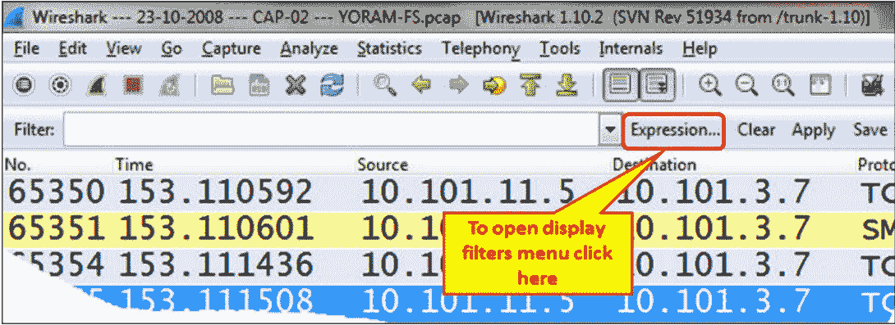
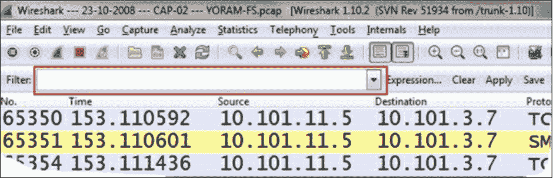
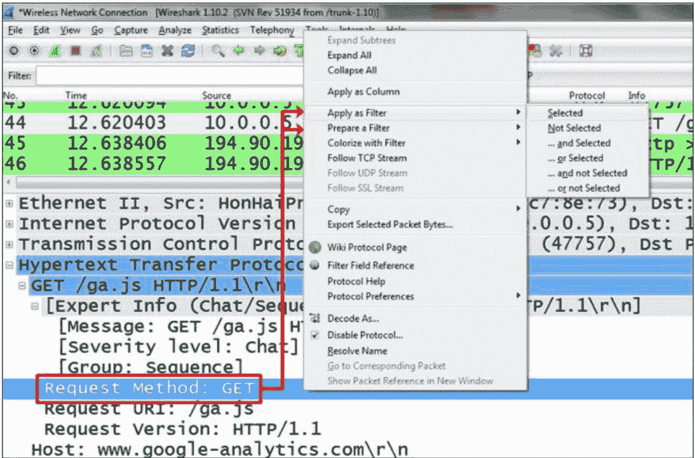
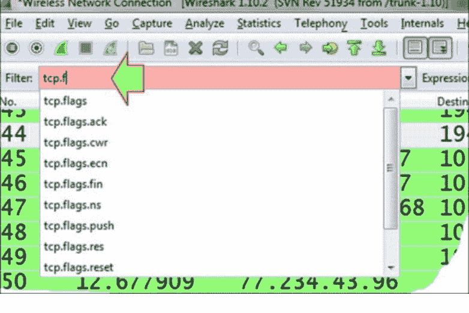
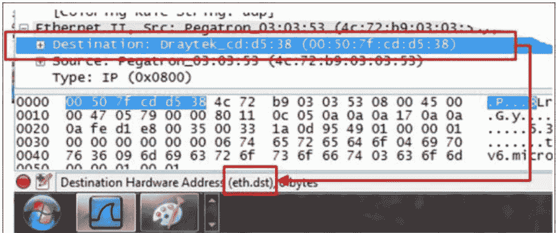
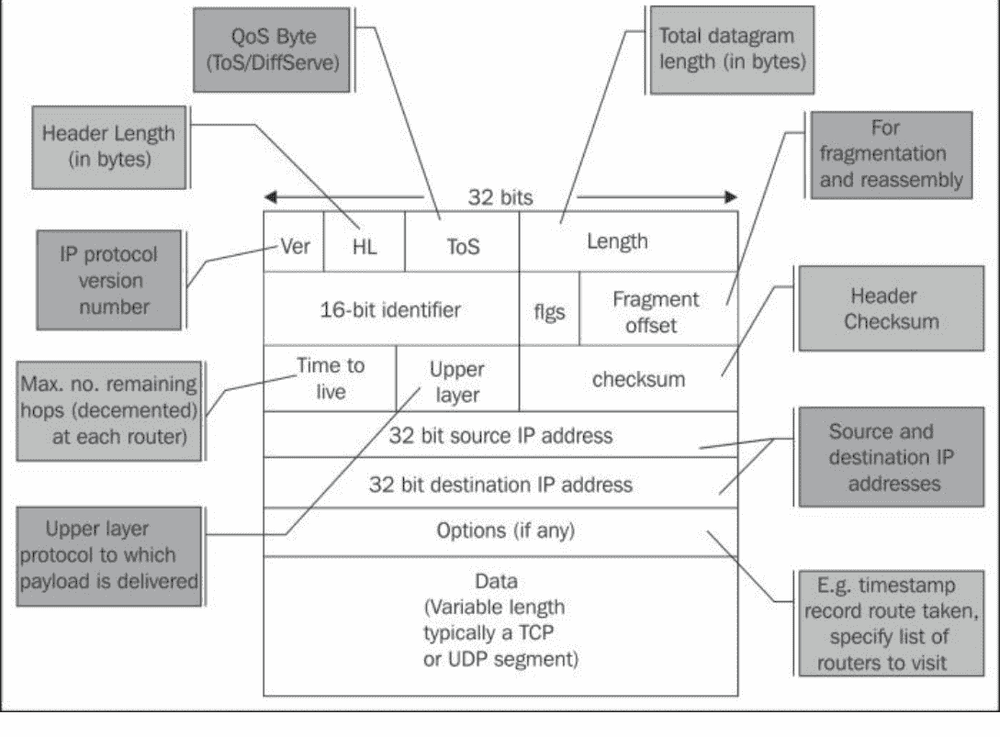
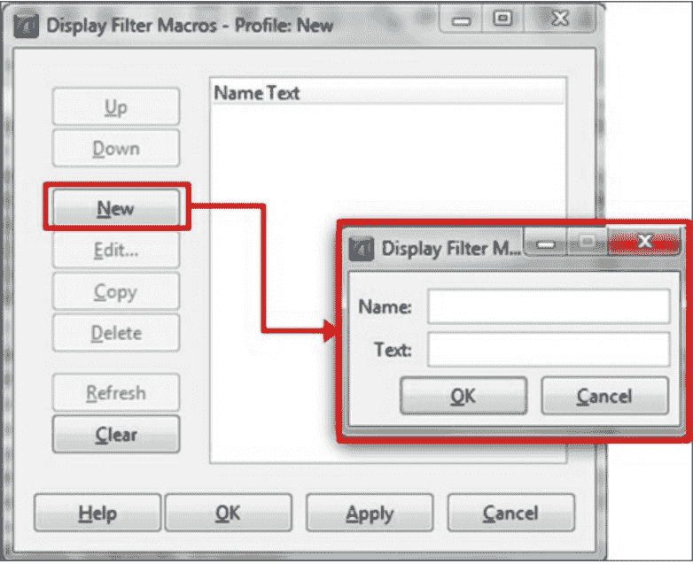

## 第 3 章 使用显示过滤器

在本章中，你将学习以下内容：

- 配置显示过滤器
- 配置以太网、ARP、主机和网络过滤器
- 配置 TCP/UDP 过滤器
- 配置特定协议过滤器
- 配置子字符串操作符过滤器
- 配置宏

### 简介

在本章中，我们将学习如何使用显示过滤器。显示过滤器是我们在捕获数据之后（无论是否经过捕获过滤器过滤）应用的过滤器，用于只显示部分数据。

实现显示过滤器可以定位各种类型的数据：

- 参数，如 IP 地址、TCP 或 UDP 端口号、URL 和服务器名称
- 条件，如“数据包长度小于...”和 TCP 端口范围
- 现象，如 TCP 重传、重复及其他类型的 ACK、各种协议错误代码和标志位存在性
- 各种应用程序参数，如短消息服务（SMS）的源和目的号码，以及服务器消息块（SMB）服务器名称

任何通过网络发送的数据都可以被过滤，过滤后，你可以根据它创建统计信息和图表。

正如我们将在本章的操作步骤中描述的那样，配置显示过滤器有多种方式：从预定义菜单中配置、从数据包面板中配置，或者直接编写语法。

### 提示

使用显示过滤器时，不要忘记所有数据都已被捕获，显示过滤器仅决定显示哪些数据。因此，在过滤数据之后，捕获文件仍包含已捕获的原始数据。你可以稍后保存完整数据，或仅保存显示的数据。

### 配置显示过滤器

要配置显示过滤器，你可以选择以下几种选项之一：

- 从过滤器菜单中选择
- 直接在显示过滤器窗口中编写语法（使用 Wireshark 时，过一段时间这将成为你的最爱）
- 在数据包面板中选择一个参数并将其定义为过滤器
- 在命令行中使用 `tshark` 或 `wireshark`；这将在[附录](#)中讨论

本章讨论前三个选项。

你可以在参数和运算符之间插入一个空格，或者不加空格。

每当你对组合表达式（如 eth.addr、ip.addr、tcp.port 和 udp.port）使用 != 运算符时，Wireshark 会将显示过滤器区域标为黄色，但由于以下原因，这将无法正常工作。

当你输入诸如 ip.addr != 192.168.1.100 这样的过滤器表达式时，你会看到 **数据包包含的字段 ip.addr 的值不同于 192.168.1.100。** 由于一个 IP 数据报同时包含源地址和目的地址，只要这两个地址中至少有一个不同于 192.168.1.100，该表达式就会求值为真。因此，你应该写成 !(ip.addr == 192.168.1.100)；这会显示 **所有不满足“字段 ip.addr 的值为 1.2.3.4”的数据包。**

有几种运算符，如下所示：

| C 语言风格语法 | 简写 | 描述 | 示例 |
|---|---|---|---|
| && | and | 逻辑与 | ip.src==10.0.0.1 and tcp.flags.syn==1<br>实际上，来自 IP 地址 10.0.0.1 的所有 SYN 标志以及从该地址打开（或尝试打开）的所有连接。 |
| \|\| | or | 逻辑或 | ip.addr==10.0.0.1 or ip.addr==10.0.0.2<br>进出这两个 IP 地址的所有数据包。 |
| ! | not | 逻辑非 | not arp and not icmp<br>既不是 ARP 也不是 ICMP 的所有数据包。 |

### 操作步骤...

要配置显示过滤器，你可以选择前面提到的任何一种方法。

### 从过滤器菜单中选择

要从过滤器菜单中选择，请导航到窗口上方的显示过滤器面板，然后点击“表达式...”按钮，如下面的截图所示：



当你点击“表达式...”按钮时，将打开以下窗口：

**Wireshark：过滤器表达式 - 配置文件：New**  
字段名  
关系  
值（协议）  
预定义值：  
范围（偏移量:长度）  
确定  
取消

过滤器菜单中有五个重要的面板：

- **字段名**：在此面板中，你配置过滤器参数。你可以通过输入协议名称跳转到该协议，并通过点击列表左侧的 + 号获取协议参数。

  一个例子是：输入 `ipv4` 跳转到 **IPv4** 协议，点击 + 号展开协议参数（或按两次 Enter），然后选择 **ip.addr** 来过滤特定的 IP 地址。

  另一个例子是：输入 `tcp` 跳转到 **TCP** 协议，点击协议参数左侧的 + 号，然后选择 **tcp.port** 作为源或目的端口号。

- **关系**：这是你选择操作符的面板。你可以选择 == 表示等于，!= 表示不等于，等等。

  一个例子是：输入 `sip` 跳转到 **SIP** 协议，选择 **sip.Method**，然后在 **关系** 面板中选择 ==。在 **值**（协议）面板中输入 `invite`。这将过滤所有 SIP INVITE 方法。

- **值：** 在这里，你输入之前选择的字段的值。

  一个例子是：输入 `tcp` 跳转到 **TCP** 协议，点击 + 号进入协议参数，选择 **tcp.flags.syn** 作为 TCP SYN 标志，并在 **值** 字段中输入 1。

- **预定义值：** 当你选择的字段值不是布尔值时，此字段中可能会有一个选项列表。

  一个例子是：在 **TCP** 下有一个名为 **tcp.option_kind** 的选项。此选项与 **TCP 选项** 相关（更多详情，请参阅[第9章](#)，UDP/TCP 分析）。你将获得一个可能值的列表。

- **范围（偏移量:长度）：** 此字段以 `offset:length` 格式提供字符串的长度。

### 直接在显示过滤器窗口中编写语法

等你熟悉了显示过滤器语法后，你可能会发现直接在过滤器窗口中输入过滤器字符串会更简单：



在这种情况下，当你在窗口中输入过滤器字符串时，窗口会以以下三种颜色之一亮起：

- **绿色：** 表示过滤器正确，你可以应用它。
- **红色：** 表示字符串有误。在应用之前请先修正字符串。
- **黄色：** 每当你使用 `!=` 操作符时，显示过滤器区域会变为黄色。这并不意味着你的过滤器不会工作，只是一个警告，提示它可能无法工作。

### 在数据包面板中选择参数并将其定义为过滤器


这是一个非常方便的选项。你可以从捕获文件中数据包详情窗格中选择任何字段；右键单击它，你会得到一些选项，如以下屏幕截图所示：



其中一些选项如下：

- **Apply as Filter**：这将根据你选择的字段设置一个过滤器并将其应用于捕获的数据。
- **Prepare a Filter**：这将准备一个过滤器但不应用它。它将在你点击过滤器窗口右侧的 Apply 按钮时应用。

在这两种选项中，你都可以选择配置过滤器：

- **Selected**：这将选择所选的字段和参数
- **Not Selected**：这将选择未选择的字段和参数

例如，右键单击字段 http.request.method 并选择 Selected 将得到过滤器字符串 http.request.method == GET；而选择 Not Selected 将得到字符串 `!(http.request.method == "GET")`。

你还可以选择选项 **... and selected**、**... or selected**、**... and not selected** 或 **... or not selected** 来进行结构化过滤。

## How it works...

显示过滤器是一种专有的 Wireshark 语言。显示过滤器可以在许多地方使用，这将在后面的章节中讨论。本章接下来的配方中将介绍额外的过滤器。

你始终可以使用自动完成功能来完成过滤器字符串。例如，如果你输入 `tcp.f`，如以下屏幕截图所示，自动完成功能会列出可以从 `tcp.f` 开始创建的可能显示过滤器值，即 TCP 标志（SYN、FIN、RST 等）。



## There's more...

现在我们将介绍一些额外的有帮助功能。

## What is the parameter we filter?

只要你在数据包详情窗格中标记特定字段，你就会在 Wireshark 窗口左下角的状态栏中看到相关的过滤器字符串。



## Adding a parameter column

你也可以右键单击数据包窗格中的参数并选择 Apply as Column。这将添加一个包含特定参数的列。例如，你可以选择参数 tcp.window_size_value 并将其作为列添加到数据包列表窗格中，这样你就可以在线监视 TCP 窗口大小。这会影响 TCP 性能，我们将在第 9 章 UDP/TCP Analysis 中学习。

## Saving the displayed data

要保存显示的数据，你可以导航到 File | Export Specified Packets... 并选择要保存的数据包。

## Configuring Ethernet, ARP, host, and network filters

在本配方中，我们将讨论如何配置第 2 层和第 3 层的过滤器，即基于以太网和基于 IP 的过滤器。我们还将讨论地址解析协议（ARP）过滤器。

## Getting ready

在第 2 层我们将配置基于以太网的过滤器，而在第 3 层我们将配置基于 IP 的过滤器。在以太网中，我们有基于以太网帧和 MAC 地址的过滤器，而在 IP 中，我们有基于 IP 数据包和地址的过滤器。

常见的帧增量过滤器如下：

- `frame.time_delta`：这用于当前帧和之前捕获帧之间的时间增量；这将在 [Chapter 5](#) 中显示的统计图表中使用，Using Advanced Statistics Tools
- `frame.time_delta_displayed`：这用于当前帧和之前显示帧之间的时间增量；这将在 [Chapter 5](#) 中显示的统计图表中使用，Using Advanced Statistics Tools

由于帧之间的时间可能会显著影响 TCP 性能，我们将在用于监视 TCP 性能的统计图表中使用 `frame.time_delta` 参数。

常见的第 2 层（以太网）过滤器如下：

- `eth.addr == <MAC Address>`：这用于显示特定的 MAC 地址
- `eth.src == <MAC Address>`：这用于获取源 MAC 地址
- `eth.dst == <MAC Address>`：这用于获取目标 MAC 地址
- `eth.type == <Protocol Type (Hexa)>`：这用于获取以太网协议类型

常见的 ARP 过滤器如下：

- `arp.opcode == <value>`：这用于 ARP 请求/响应
- `arp.src.hw_mac == <MAC Address>`：这用于捕获发送者的 ARP 地址

常见的第 3 层（IP）过滤器如下：

- `ip.addr == <IP Address>`：这用于获取源或目标 IP 地址
- `ip.src == <IP Address>`：这用于获取源 IP 地址
- `ip.dst == <IP Address>`：这用于获取目标 IP 地址
- `ip.ttl == <value>, ip.ttl < <value>, or ip.ttl > <value>`：这用于获取 IP TTL（生存时间）值
- `ip.len = <value>, ip.len > <value>, or ip.len < <value>`：这用于获取 IP 数据包长度值
- `ip.version == <4/6>`：这用于获取 IP 协议版本（版本 4 或版本 6）

## How to do it...

这里我们将看到第 2 层和第 3 层过滤器的一些常见示例。

| Address format | Syntax | Example |
|---|---|---|
| Ethernet (MAC) address | `eth.addr == xx:xx:xx:xx:xx:xx`<br><br>Here, x = 0 to f.<br><br>`eth.addr == xx-xx-xx-xx-xx-xx`<br><br>Here, x = 0 to f.<br><br>`eth.addr == xxxx.xxxx.xxxx`<br><br>Here x = 0 to f. | `eth.addr == 00:50:7f:cd:d5:38`<br><br>`eth.addr == 00-50-7f-cd-d5-38`<br><br>`eth.addr == 0050.7fcd.d538` |
| Broadcast MAC address | `Eth.addr == ffff.ffff.ffff` | |
| IPv4 host address | `ip.addr == x.x.x.x`<br><br>Here, x = 0 to 255. | `ip.addr == 192.168.1.1` |
| IPv4 network address | `ip.addr == x.x.x.x/y`<br><br>Here x = 0 to 255, y = 0 to 32. | `ip.addr == 192.168.200.0/24`<br><br>This covers all the addresses in the network 192.168.200.0 mask 255.255.255.0. |
| IPv6 host address | `ipv6.addr == x:x:x:x:x:x:x:x`<br><br>`ipv6.addr == x:x:x:x:x:x`<br><br>Here in the format of nnnn, n = 0 to f (Hex). | `ipv6.addr == fe80::85ab:dc2e:ab12:e6c7` |
| IPv6 network address | `ipv6.addr == x::/y`<br><br>Here x = 0 to f (Hex) and y = 0 to 128. | `ipv6.addr == fe80::/16`<br><br>This covers all the addresses that start with the 16 bits `fe80`. |

该表指的是 `ip.addr` 和 `ipv6.addr` 过滤器字符串。任何具有 IP 地址值的字段的值都可以以相同的方式编写。

## Ethernet filters

这些分为两类：

- 要仅显示从特定 MAC 地址发送或发往特定 MAC 地址的数据包，使用类似以下内容：`eth.src == 10:0b:a9:33:64:18 and eth.dst == 10:0b:a9:33:64:18`
- 要仅显示广播，使用 `Eth.dst == ffff.ffff.ffff`

## ARP filters

这些分为两类：

- 要仅显示 ARP 请求，使用 `arp.opcode == 1`
- 要仅显示 ARP 响应，使用 `arp.opcode == 2`

## IP and ICMP filters

- 要仅显示来自特定 IP 地址的数据包，使用类似以下内容：`ip.src == 10.1.1.254`
- 要仅显示不是来自特定地址的数据包，使用类似以下内容：`!ip.src == 64.23.1.1`
- 要仅显示两个主机之间的数据包，使用类似以下内容：`ip.addr == 192.168.1.1 and ip.addr == 200.1.1.1`
- 要仅显示发送到多播 IP 地址的数据包，使用类似以下内容：`ip.dst == 224.0.0.0/4`
- 要仅显示来自网络 192.168.1.0/24（掩码 255.255.255.0）的数据包，使用 `ip.src==192.168.1.0/24`
- 要仅显示到/来自特定地址的 IPv6 数据包，使用类似以下内容：
  - `ipv6.addr == ::1`
  - `ipv6.addr == 2008:0:130F:0:0:09d0:666A:13ab`
  - `ipv6.addr == 2006:0:130f::9c2:876a:130b`
  - `ipv6.addr == ::`

## Complex filters

- 要检查从网络 10.0.0.0/24 发送到包含单词 packt 的网站的数据包，使用 `ip.src == 10.0.0.0/24 and http.host contains "packt"`
- 要检查从网络 10.0.0.0/24 发送到以


## 工作原理...

以下是对本教程“操作步骤...”部分中我们所见过滤器的一些说明。

### 以太网广播

在以太网中，广播是发送到目的地址字段全为1的地址的数据包，因此，要查找网络中的所有广播，我们使用过滤器 `eth.dst == ffff.ffff.ffff`。

### IPv4 多播

IPv4 多播是发送到地址范围为 224.0.0.0 至 239.255.255.255 的地址的数据包，其二进制地址范围为 11100000.00000000.00000000.00000000 至 11101111.11111111.11111111.11111111。

如果查看二进制表示，目的多播地址是以三个1和一个0开头的地址，因此，针对 IPv4 多播目的地址的过滤器将是 `ip.dst == 224.0.0.0/4`。也就是说，以四个1（即224）开头且子网掩码为4位（`/4`）的地址，将指示从224到239的网络地址范围，从而过滤多播地址。

### IPv6 多播

IPv6 多播是发送到以 ff 开头（前两个十六进制数字为 ff）的地址的数据包，后面跟一位标志和范围。因此，当我们编写过滤器 `ipv6.dst == ff00::/8` 时，它表示显示所有发送到以字符串 ff 开头的地址的 IPv6 数据包，即 IPv6 多播。

## 另请参阅

- 有关以太网的更多信息，请参阅[第7章](#)，以太网、局域网交换和无线局域网

## 配置 TCP/UDP 过滤器

TCP 和 UDP 是第4层中提供端到端应用程序连接的主要协议。当你从一端向另一端启动应用程序时，会话从源端口开始——通常是一个大于或等于1024的随机数——并连接到目的端口，另一端是一个等待会话的知名或已注册端口。这些端口号标识了该会话上运行的应用程序。

其他类型的过滤器涉及 UDP 和 TCP 报头中的其他字段。UDP 的报头非常简单，只包含非常基本的数据；而 TCP 报头则更复杂，从中我们可以获取更多信息。

在本教程中，我们将重点介绍配置 TCP 和 UDP 显示过滤器时的各种可能性。

### 准备工作

如前所述，我们应该精确规划想要显示的内容，并据此准备好过滤器。

对于 TCP 或 UDP 端口号，请使用以下显示过滤器：

- `tcp.port == <value>` 或 `udp.port == <value>`：用于指定 TCP 或 UDP 端口（源或目的）。
- `tcp.dstport == <value>` 或 `udp.dstport == <value>`：用于指定 TCP 或 UDP 目的端口。
- `tcp.srcport == <value>` 或 `udp.srcport == <value>`：用于指定 TCP 或 UDP 源端口。

UDP 的报头结构非常简单：包含源端口、目的端口、数据包长度和校验和。因此，这里唯一重要的信息就是端口号。

另一方面，TCP 更复杂，使用了连接和可靠性机制，Wireshark 可以监控这些机制。使用 `tcp.flags`、`tcp.analysis` 和其他智能过滤器将帮助你解决性能问题（重传、重复 ACK、零窗口等）以及协议操作问题（如重置、半开连接等）。

此类别中常见的显示过滤器如下：

- `tcp.analysis`：用于 TCP 分析条件，如重传、重复 ACK 或窗口问题。此过滤器的示例如下（你可以使用自动补全功能获取可用过滤器的完整列表）：
  - `tcp.analysis.retransmission`：用于显示被重传的数据包。
  - `tcp.analysis.duplicate_ack`：用于显示被多次确认的数据包。
  - `tcp.analysis.zero_window`：用于显示连接端设备发送零窗口消息（告知发送方停止在该连接上发送数据，直到窗口大小再次增大）时的数据包。

**提示：**

`tcp.analysis` 过滤器不分析 TCP 报头；它们通过 Wireshark 专家系统提供协议分析。

- `tcp.flags`：用于判断某个或多个标志是否被设置。此过滤器的示例如下：
  - `tcp.flags.syn == 1`：用于检查 SYN 标志是否被设置。
  - `tcp.flags.reset == 1`：用于检查 RST 标志是否被设置。
  - `tcp.flags.fin == 1`：用于检查 FIN 标志是否被设置。

**提示：**

对于 TCP 标志，`tcp.flags` 过滤器用于判断特定标志是否被设置。

- `tcp.window_size_value < <value>`：用于查找较小的 TCP 窗口大小，在某些情况下这些窗口大小表示设备性能较慢。

### 操作步骤...

以下是一些 TCP/UDP 过滤器示例：

- 要过滤发送到 HTTP 服务器的所有数据包，请使用 `tcp.dstport == 80`。
- 要过滤从 10.0.0.0/24 网络发送到 HTTP 服务器的所有数据包，请使用 `ip.src==10.0.0.0/24 and tcp.dstport == 80`。
- 要过滤特定 TCP 连接中的所有重传，请使用 `tcp.stream eq 16 && tcp.analysis.retransmission`。

要隔离特定连接，请将鼠标放在要观察的连接中的某个数据包上，右键单击它，然后选择**跟踪 TCP 流**。TCP 流是在连接建立到连接拆除之间，连接两端传输的数据。字符串 `tcp.stream eq <value>` 将出现在显示过滤器窗口中。这就是你现在可以操作的流。在前面的示例中，它是流16，但也可以是任何流编号（捕获文件中的编号从流1开始）。

重传是再次发送的 TCP 数据包。可能是由多种原因导致的，如第9章“UDP/TCP 分析”中所述。

**提示：**

在监控影响性能的现象（如重传、重复 ACK 等）时，务必记住这些现象是针对特定 TCP 连接的。

其他类型的 TCP 过滤器示例如下：

- 要过滤特定连接中的所有窗口问题：
  - `tcp.stream eq 0 && (tcp.analysis.window_full || tcp.analysis.zero_window)`
  - `tcp.stream eq 0 and (tcp.analysis.window_full or tcp.analysis.zero_window)`
- 要过滤从 10.0.0.5 发送到 DNS 服务器的所有数据包：`ip.src == 10.0.0.5 && udp.port == 53`
- 要过滤 TCP 中所有包含字符串 cacti（区分大小写）的数据包或协议（例如 HTTP）：`tcp contains "cacti"`
- 要检查从 10.0.0.3 重传的所有数据包：`ip.src == 10.0.0.3 and tcp.analysis.retransmission`
- 要过滤发送到任意 HTTP 服务器的所有数据包：`tcp.dstport == 80`
- 要检查从特定主机发起的连接（如果以扫描形式出现，可能是蠕虫！）：`ip.src==10.0.0.5 && tcp.flags.syn==1 && tcp.flags.ack==0`
- 要检查发送自客户端以及发送给客户端的所有 Cookie：`ip.src==10.0.0.3 && (http.cookie || http.set_cookie)`

### 工作原理...

下面分别是 IP 和 TCP 报头结构的示意图。UDP 非常简单，只有源端口号、目的端口号、长度和校验和。在下图中，我们看到了 IP 报头结构：



IP 数据包中的一些重要字段如下：

- **版本：** 版本可以是4或6。
- **报头长度（HL）：** 报头长度为20到24字节，包含选项。
- **服务类型（ToS）：** 通常通过**差异化服务（DiffServ）**实现，为优先服务提供优先级。

**提示：**

IP 标准（1981年9月的 RFC 791）将该字段命名为服务类型（ToS）并定义了其结构。差异化服务的标准后来发布（1998年12月的 RFC 2474、RFC 2475 等），并在大多数应用程序中用于实现 ToS 字节。

- **长度：** 此字段指示以字节为单位的总数据报长度。
- **16位标识符、标志和分片偏移：** 每个数据包都有自己的数据包 ID。当与标志和偏移一起分片时，这些信息使接收方能够重新组装数据报。
- **生存时间（TTL）：** 初始值为64、128或256（取决于发送数据包的操作系统），路径上的每个路由器将值减1。这是为了防止数据包在网络中无休止地传输。路由器看到数据包中的值为1时，将其减为0并丢弃数据包。
- **上层：** 此字段包含上层协议，如 TCP、UDP 和 ICMP。
- **校验和：** 此字段表示数据包校验和。这里的原理是发送方使用错误检查机制计算数据包上的一个值，并将该值设置在校验和字段中；数据包接收方再次计算它。如果发送的值与接收到的值不相等，则视为校验和错误。
- **32位源和目的 IP 地址：** 顾名思义，即源 IP 地址和目的 IP 地址。
- **选项：** 此字段在 IPv4 中通常不使用。在下图中，你可以看到 TCP 报头：


扩展。**最大分段大小（MSS）**是 TCP 载荷的最大大小。该字段对此进行了标识。关于这一点的进一步讨论将在[第9章](Chapter 9)UDP/TCP 分析中进行。

#### 更多内容...

IP 中的 TTL 字段是一个非常有用的字段。在检查 TTL 值时，它明确地指示了数据包已经经过了多少个路由器。由于操作系统的默认值是 64、128 或 256，而数据包在互联网上穿越的最大跳数为 30（在私有网络中则要少得多）。例如，如果看到值为 120，则数据包经过了 8 个路由器；值为 52 则表示数据包经过了 12 个路由器。

#### 另请参阅

- 有关 TCP/IP 协议栈的更多信息，请参阅[第9章](Chapter 9)UDP/TCP 分析

### 配置特定协议过滤器

在本操作中，我们将查看为常见协议（如 DNS、HTTP 和 FTP）配置显示过滤器的说明和示例。

本操作的目的是学习如何配置过滤器，以帮助我们进行网络故障排除。我们将在接下来的章节中学习网络故障排除。

#### 准备工作

要执行本操作，你需要一个正在运行的 Wireshark 软件捕获；没有其他先决条件。

#### 操作步骤...

在本操作中，我们将了解一些常见协议的显示过滤器。

#### HTTP 显示过滤器

以下是一些常见的 HTTP 显示过滤器：

- 要显示发送到<"主机名">的所有 HTTP 数据包，请使用 `http.request.method == <"Request methods">`
- 要显示使用 HTTP GET 方法的数据包，请使用 `http.request.method == "GET"`
- 要显示客户端请求的 URI，请使用 `http.request.method == <"Full request URI">`；例如，`http.request.uri == "/v2/rating/mail.google.com"`
- 要显示包含特定字符串的客户端请求的 URI（例如上述所有发送到 Google 的请求），请使用 `http.request.uri contains "URI String"`；例如，`http.request.uri contains "mail.google.com"`
- 要检查通过网络发送的所有 cookie 请求（请注意，cookie 总是从客户端发送到服务器），请使用 `http.cookie`
- 要检查从服务器发送到客户端的所有 cookie 设置命令，请使用 `http.set_cookie`
- 要检查 Google 服务器发送到你的 PC 的所有 cookie，请使用 `(http.set_cookie) && (http contains "google")`
- 要检查包含 ZIP 文件的所有 HTTP 数据包，请使用 `http matches "\.zip" && http.request.method == "GET"`

#### DNS 显示过滤器

在这里，我们将了解一些常见的 DNS 显示过滤器。

要显示 DNS 查询和响应，请使用：

- `dns.flags.response == 0` 用于 DNS 查询
- `dns.flags.response == 1` 用于 DNS 响应

要仅显示包含四个或更多答案的 DNS 响应，请使用 `dns.count.answers >= 4.`

#### FTP 显示过滤器

#### 工作原理...

Wireshark 用于显示过滤器的正则表达式语法与 Perl 中的正则表达式语法相同。

一些常见的修饰符如下：

- `^`：用于匹配行的开头
- `$`：用于匹配行的结尾
- `|`：用于表示或（选择）关系
- `()`：用于分组
- `*`：用于匹配 0 次或多次
- `+`：用于匹配 1 次或多次
- `?`：用于匹配 1 次或 0 次
- `{n}`：用于精确匹配 n 次
- `{n,}`：用于匹配至少 n 次
- `{n,m}`：用于匹配至少 n 次但不超过 m 次

你可以使用这些修饰符来配置更复杂的过滤器。请看以下示例：

- 要查找包含 ZIP 文件的 HTTP `GET` 命令，请使用：

  ```
  http.request.method == "GET" && http matches "\\.zip" && !
  (http.accept_encoding == "gzip, deflate")
  ```

- 要查找包含以 `.com` 结尾的网站的 HTTP 消息，请使用：

  ```
  http.host matches "\\.com$"
  ```

#### 另请参阅

- Perl 正则表达式语法列表可在 http://www.pcre.org/ 找到，手册页可在 http://perldoc.perl.org/perlre.html 找到

### 配置子串运算符过滤器

偏移过滤器是这样一种过滤器：你实际上是在说“转到协议头中的字段 x，并检查接下来的 y 个字节是否等于……”。

这些过滤器可用于许多场景：当已知的字符串字节出现在数据包的某个位置，而你想要显示包含该字符串字节的数据包时。

#### 准备工作

要逐步完成本操作，你需要正在运行的 Wireshark 软件和正在运行的捕获；没有其他先决条件。偏移过滤器的一般表示形式为：

```
Protocols[x:y] == <value>
```

其中，x 指从头部开头算起的字节位置，y 指要检查的字节数。

#### 操作步骤...

使用子串运算符的过滤器示例如下：

- **发往 IPv4 组播地址的数据包：** `eth.dst[0:3] == 01:00:5e`（RFC 1112 第 6.4 节将 01-00-5E-00-00-00 到 01-00-5E-FF-FF-FF 的 MAC 地址空间分配用于组播寻址）
- **发往 IPv6 组播地址的数据包：** `eth.dst[0:3] == 33:33:00`（RFC 2464 第 7 节将以 33-33 开头的 MAC 地址空间分配用于组播寻址）

#### 工作原理...

Wireshark 允许你查看协议并搜索其中的特定字节。这对于协议中的已知字符串特别实用，例如给定示例中的以太网。

### 配置宏

显示过滤器宏用于为复杂的显示过滤器创建快捷方式，你可以一次性配置，之后反复使用。

#### 准备工作

要配置显示过滤器宏，请导航到**分析 | 显示过滤器宏 | 新建**。

你将看到以下窗口：



#### 操作步骤...

1. 要配置宏，请为它命名，并在文本框中填写过滤器字符串。
2. 要激活宏，只需编写 `$(macro_name:parameter1;parameter2;parameter3 ...)`。
3. 让我们配置一个简单的过滤器名称 `test01`，它接受以下参数作为值：
   - `ip.src == <value>`
   - `tcp.dstport == <value>`

   这将是一个查找来自特定源网络并前往 HTTP 端口的数据包的过滤器。

   一个接受这两个参数的宏将是：`ip.src==$1 && tcp.dstport==$2.`
4. 现在，要获取参数 `ip.src == 10.0.0.4` 和 `tcp.dstport == 80` 的过滤结果，我们应该在显示窗口栏中写入字符串 `${test01:10.0.0.4;80}`。

#### 工作原理...

宏的工作方式很简单；你在每个位置参数前面写上 $ 符号来编写过滤器字符串。运行宏时，它将按顺序接受这些参数。
