## 第 4 章 使用基本统计工具

在本章中，你将学习：

- 使用**统计**菜单中的**摘要**工具
- 使用**统计**菜单中的**协议分级**工具
- 使用**统计**菜单中的**会话**工具
- 使用**统计**菜单中的**端点**工具
- 使用**统计**菜单中的**HTTP**工具
- 配置**流量图**以查看 TCP 流
- 创建基于 IP 的统计信息

### 简介

Wireshark 的优势之一在于其统计工具。在使用 Wireshark 时，我们有各种类型的工具，从用于列出终端节点和会话的简单工具，到诸如流量图和 IO 图等更复杂的工具。

在接下来的两章中，我们将学习如何使用这些工具。在本章中，我们将了解一些为我们提供基本网络统计信息的简单工具；也就是说，谁在网络中与谁通信、哪些设备是“话痨”、网络中传输的数据包大小如何；而在下一章中，我们将介绍 IO 图和流图等工具，这些工具为我们提供更多关于网络行为的信息。

有些工具我们不会讨论；包括那些显而易见的（例如**数据包大小**）以及那些不太常见的（例如**ANSP、BACnet** 等）。

要使用**统计**工具，请启动 Wireshark，并从主菜单中选择**统计**。

# 使用“统计”菜单中的“摘要”工具

在本节中，我们将学习如何获取网络中运行数据的一般信息。

# 准备工作

启动 Wireshark，点击**统计**。

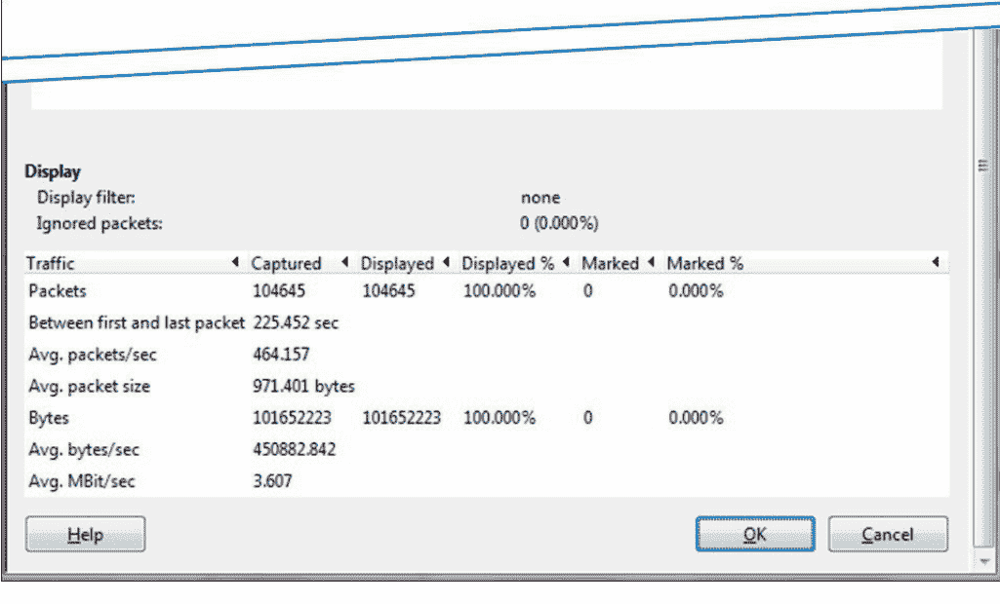

# 显示

显示过滤器：无  
忽略的数据包：0（0.000%）

| 流量 | 已捕获 | 已显示 | 显示百分比 | 已标记 | 标记百分比 |
|---|---:|---:|---:|---:|---:|
| 数据包 | 104645 | 104645 | 100.000% | 0 | 0.000% |
| 第一个和最后一个数据包之间的时间 | 225.452 秒 |  |  |  |  |
| 平均数据包/秒 | 464.157 |  |  |  |  |
| 平均数据包大小 | 971.401 字节 |  |  |  |  |
| 字节 | 101652223 | 101652223 | 100.000% | 0 | 0.000% |
| 平均字节/秒 | 450882.842 |  |  |  |  |
| 平均兆比特/秒 | 3.607 |  |  |  |  |

帮助                                                                               确定       取消

# 工作原理...

此菜单只是收集所有已捕获的数据，当定义了过滤器时，它会显示过滤后的数据。当问题是“如何简单地使用 Wireshark 来了解平均每秒的数据包或字节数？”时，这就是答案。

# 使用“统计”菜单中的“协议分级”工具

在本节中，我们将学习如何获取网络中运行数据的协议分级信息。

# 准备工作

启动 Wireshark，点击**统计**。

# 操作步骤...

要使用统计菜单中的“协议分级”工具，请执行以下步骤：

- 1. 在统计菜单中选择“协议分级”。

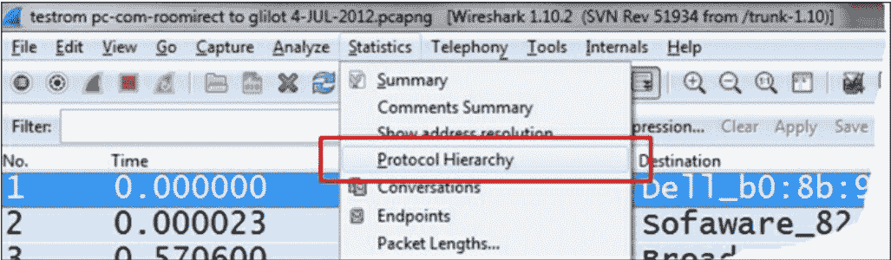

- 2. 这里你将获得关于捕获文件中协议分布的数据。你将看到捕获数据的协议分布，如下面的截图所示：

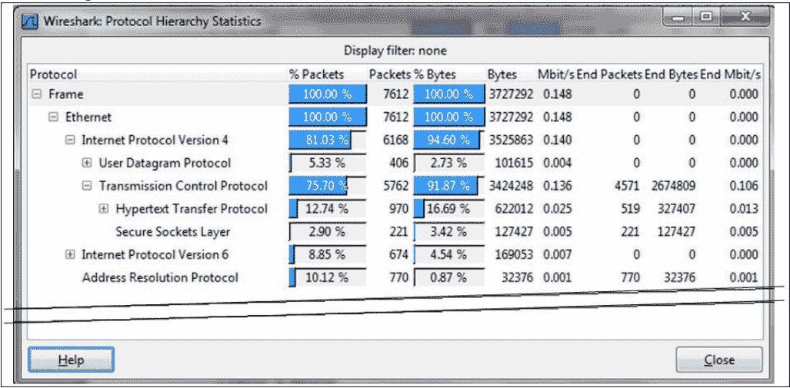

- 3. 你将在“协议分级”窗口中看到以下字段：

  - 协议：此字段指定协议名称
  - 数据包百分比：此字段指定协议数据包占捕获总数据包的百分比
  - **数据包**：此字段指定协议数据包在捕获总数据包中的数量
  - **字节百分比**：此字段指定协议字节占捕获总数据包的百分比
  - **字节**：此字段指定协议字节在捕获总数据包中的数量
  - **兆比特/秒**：此字段指定该协议相对于捕获时间的带宽
  - **结束数据包**：此字段指定该协议的数据包总数（针对解码文件中最高层的协议）
  - **结束字节**：此字段指定该协议的绝对字节数（针对解码文件中最高层的协议）
  - **结束兆比特/秒**：此字段指定该协议相对于捕获数据包和时间的带宽（针对解码文件中最高层的协议）

# 提示

**结束数据包**、**结束字节**和**结束兆比特/秒**列是那些该行协议为数据包中最后一个协议的列（即当该协议位于数据包末尾，且没有更高层信息时）。例如，这些可以是带有 TCP 负载的 TCP 数据包（例如 SYN 数据包），它们不携带任何上层信息。这就是为什么你会看到 Ethernet、IPv4 和 UDP 的结束数据包计数为 **0**，因为没有帧将这些协议作为帧中的最后一个协议。

# 工作原理...

简而言之，它会对捕获的数据进行统计计算。需要注意的一些重要事项是：

- 百分比始终指同一层协议。例如，在前面的示例中，我们看到 IPv4 占数据包的 81.03%，IPv6 占数据包的 8.85%，ARP 占数据包的 10.12%；第二层以上协议总计为 100%。
- 另一方面，我们看到 TCP 占数据的 75.70%，而在 TCP 中，只有 12.74% 的数据包是 HTTP，且几乎没有其他内容。这是因为 Wireshark 只统计带有 HTTP 头的数据包。它不统计例如确认数据包或不带 HTTP 头的数据包。

# 扩展内容...

为了确保 Wireshark 也会统计数据包，例如 TCP 数据包中的 HTTP 数据包，请禁用**允许子解析器**选项以重组 TCP 流。你可以从**首选项**菜单中执行此操作，或在**数据包详情**窗格中右键单击 TCP。

# 使用“统计”菜单中的“会话”工具

在本节中，我们将学习如何获取网络中运行的会话信息。

# 准备工作

启动 Wireshark，点击**统计**。

# 操作步骤...

要使用**统计**菜单中的**会话**功能，请执行以下步骤：

- 1. 在统计菜单中选择**会话**。

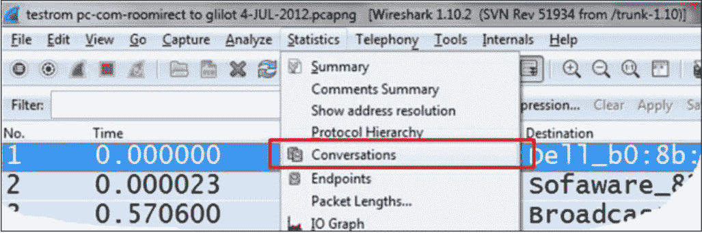

- 2. 将出现以下窗口：

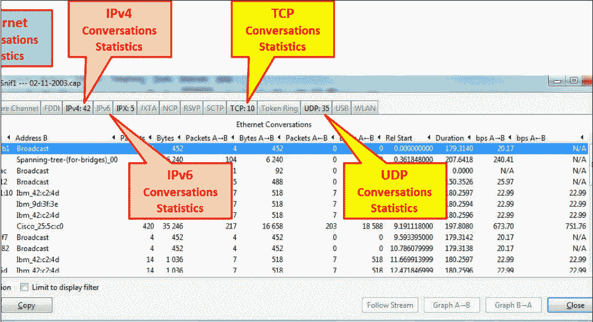

- 3. 你可以在第二层以太网统计、第三层 IP 统计或第四层 TCP 或 UDP 统计之间进行选择。
- 4. 你可以使用这些统计工具：
  - **在第二层（以太网）：** 查找并隔离广播风暴，或
  - **在第三层或第四层（TCP/IP）：** 与互联网路由器端口并行连接，检查谁在占用到 ISP 的线路。

# 提示

如果你看到大量流量发往互联网上某个特定 IP 地址的 80 端口（HTTP），只需将该地址复制到浏览器中，即可查看哪个网站对你的用户来说最“热门”。

如果没有任何结果，只需访问一个标准的 DNS 解析网站（例如 Google DNS lookup），找出是哪个流量占用了你的互联网线路。

- 5. 你还可以通过选中窗口左下方的**限制为显示过滤器**复选框，将会话统计限制为显示过滤器。这样，统计信息将显示在通过显示过滤器的所有数据包上。
- 6. 要将 IP 地址显示为名称，你可以选中**名称解析**复选框。要查看名称解析，你需要先通过导航到**视图 | 名称解析 | 为网络层启用**来启用它。
- 7. 对于 TCP 或 UDP，你可以在**数据包列表**中标记特定数据包，然后从屏幕上出现的菜单中选择**跟踪 TCP 流**或**跟踪 UDP 流**（取决于它是 UDP 还是 TCP 数据包）。这将定义一个显示过滤器，向你显示特定的数据流。

# 扩展内容...

在使用**会话**列表时，许多网络问题会直接“浮现”出来。

# 以太网会话统计

在以太网会话统计中，查找以下问题：

- 大量广播：你可能正在观察广播风暴（轻微的风暴。在严重的风暴中，你可能什么都看不到。）

# 提示

在严重的广播风暴中，通常发生的情况是，由于 Wireshark 每秒发送和接收数千甚至数万个数据包，软件会直接停止显示数据，屏幕冻结。只有当你将 Wireshark 从网络中断开时，你才能看到它。

- 如果你看到大量流量来自某个特定 MAC 地址，查看会话的第一部分；这是供应商 ID，它会给你一些关于问题设备的提示。

# 提示

尽管 MAC 地址的前半部分标识供应商，但它不一定标识 PC 本身。这是因为 MAC 地址属于安装在 PC 或笔记本电脑主板上的以太网芯片供应商，而不一定来自 PC 制造商。如果你无法识别流量到达的地址，你可以 ping 可疑设备并通过 ARP 获取其 MAC 地址，在交换机中找到 MAC 地址，如果你有管理系统，使用简单的 `find` 命令来定位它。

# IP 会话统计

在 IP 会话统计中，查找以下问题：

- 查找进出流量很大的 IP 地址。如果它是一个你已知的服务器（可能你记得服务器的地址或地址范围），那么没问题；但可能是有人扫描了网络，或者只是一台 PC 产生了太多流量。
- 查找扫描模式（详见第 14 章“理解

网络安全）。它可以是良性扫描，例如发送 ping 以发现网络的 SNMP 软件，但网络中的扫描通常不是良性的。

-   你可以在下面的截图中看到一种典型的扫描模式：

  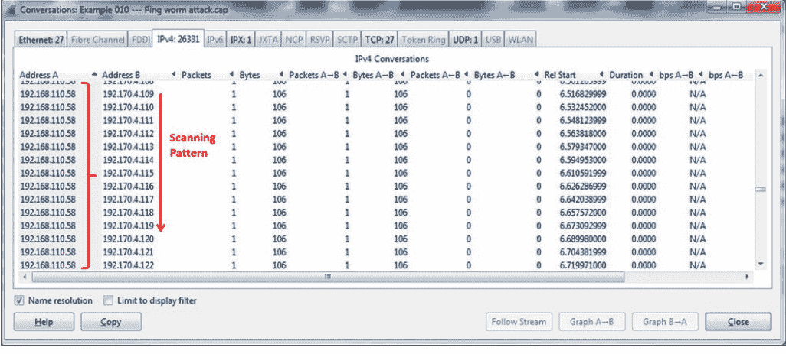

在此示例中，存在一种扫描模式。单个 IP 地址 **192.168.110.58** 向 **192.170.3.44、192.170.3.45、192.170.3.46、192.170.3.47** 等发送 ICMP 数据包（在截图中我们只看到扫描的极小一部分）。在这个案例中，我们遇到了一种感染了网络上所有 PC 的蠕虫；它一旦感染一台 PC，就会开始生成 ICMP 请求并将其发送到网络。这种窄带链路（例如 WAN 连接）很容易被阻塞。

## TCP/UDP 会话统计：

-   查找打开 TCP 连接过多的设备。每台 PC 有 10 到 20 个连接是合理的，数百个则不合理。
-   查找并尝试找出无法识别的端口号。这可能是正常的，但也可能意味着麻烦。在下面的截图中，你可以看到一次典型的 TCP 扫描：

**会话：Scanning test AUG 2013 --- 004.pcapng**

源地址 | 目标地址 | TCP 会话

| 地址 A | 端口 A | 地址 B | 端口 B | 数据包 | 字节 | 数据包 A→B | 字节 A→B | 数据包 B→A | 字节 B→A | 相对开始 | 持续时间 | bps A→B | bps B→A |
|---|---|---|---|---|---|---|---|---|---|---|---|---|---|
| 10.0.0.1 | 63033 | 81.218.230.244 | 1 | 3 | 194 | 3 | 194 | 0 | 0 | 583.044294000 | 9.0048 | 172.35 | |
| 10.0.0.1 | 63038 | 81.218.230.244 | 1 | 3 | 194 | 3 | 194 | 0 | 0 | 583.144872000 | 8.9973 | 172.50 | |
| 10.0.0.1 | 51753 | 194.90.9.48 | 3 | 2 | 112 | 1 | 58 | 1 | 54 | 834.332911000 | 0.0179 | N/A | |
| 10.0.0.1 | 62650 | 81.218.230.244 | 3 | 3 | 194 | 3 | 194 | 0 | 0 | 575.347188000 | 8.9947 | 172.55 | |
| 10.0.0.1 | 62655 | 81.218.230.244 | 3 | 3 | 194 | 3 | 194 | 0 | 0 | 575.449029000 | 8.9939 | 172.56 | |
| 10.0.0.1 | | 81.218.230.244 | 4 | 3 | 194 | 3 | 194 | 0 | 0 | 575.751373000 | 9.0133 | 172.19 | |
| 10.0.0.1 | | 81.218.230.244 | 4 | 3 | 194 | 3 | 194 | 0 | 0 | 575.852225000 | 9.0127 | 172.20 | |
| 10.0.0.1 | | 194.90.9.48 | 6 | 2 | 112 | 1 | 58 | 1 | 54 | 604.942015000 | 0.0197 | N/A | |
| 10.0.0.1 | 62444 | 81.218.230.244 | 6 | 3 | 194 | 3 | 194 | 0 | 0 | 571.290318000 | 8.9983 | 172.48 | |
| 10.0.0.1 | 62449 | 81.218.230.244 | 6 | 3 | 194 | 3 | 194 | 0 | 0 | 571.392000000 | 9.0027 | 172.39 | |
| 10.0.0.1 | 62558 | 81.218.230.244 | 7 | 3 | 194 | 3 | 194 | 0 | 0 | 569.654217000 | 9.0063 | 172.32 | |
| 10.0.0.1 | 62603 | 81.218.230.244 | 7 | 3 | 194 | 3 | 194 | 0 | 0 | 569.756481000 | 8.9967 | 172.51 | |
| 10.0.0.1 | 61613 | 81.218.230.244 | 9 | 3 | 194 | 3 | 194 | 0 | 0 | 554.866707000 | 9.0042 | 172.36 | |
| 10.0.0.1 | 61618 | 81.218.230.244 | 9 | 3 | 194 | 3 | 194 | 0 | 0 | 554.966922000 | 9.0040 | 172.37 | |
| 10.0.0.1 | 51753 | 194.90.9.1 | 13 | 1 | 58 | 1 | 58 | 0 | 0 | 53.572286000 | 0.0000 | N/A | |
| 10.0.0.1 | 51754 | 194.90.9.1 | 13 | 1 | 58 | 1 | 58 | 0 | 0 | 54.574477000 | 0.0000 | N/A | |

单一 IP 源

扫描模式

名称解析   限制显示过滤器

帮助   复制   跟踪流   图表 A→B   图表 B→A   关闭

## 使用“统计”菜单中的“端点”工具

在本节中，我们将学习如何获取捕获数据中端点信息的统计数据。

### 准备工作

启动 Wireshark，单击 **统计**。

### 操作步骤...

要查看端点统计信息，请执行以下步骤：

1.  在统计菜单中，单击“端点”。

    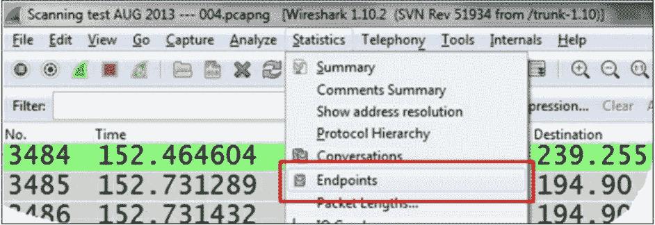

2.  将出现以下窗口：

    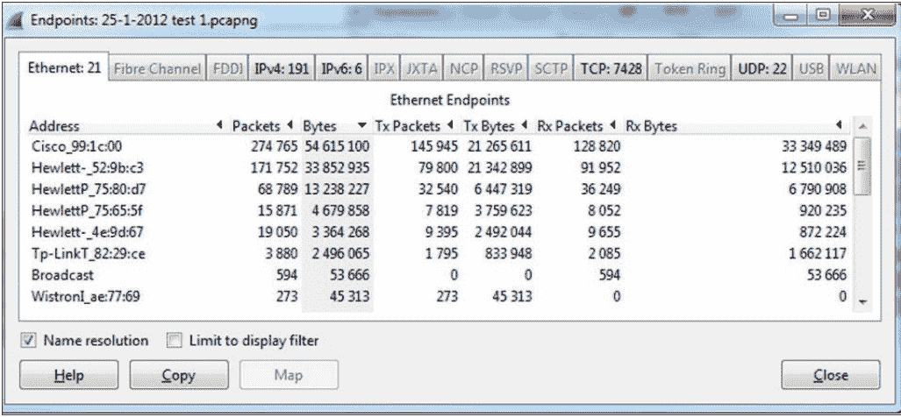

3.  在此窗口中，你将能够看到第 2、3 和 4 层的端点，即以太网、IP 以及 TCP 或 UDP。

### 工作原理...

它只是提供 Wireshark 发现的所有端点的统计信息。可能是以下几种情况之一：

-   少量以太网端点（即 MAC 地址）对应大量 IP 终端节点（即 IP 地址）：例如，当我们有一台路由器与许多远程设备发送/接收数据包时，就是这种情况；我们将看到的是路由器的 MAC 地址和众多经过它的 IP 地址。
-   少量 IP 终端节点对应大量 TCP 终端节点：这种情况适用于每台主机有大量 TCP 连接。它可以是具有大量连接的服务器常规操作，也可能是通过网络发起的一种攻击（例如 SYN 攻击）。

### 更多内容...

这里你会看到一个来自网络中心的捕获文件示例，以及我们能从中获取的信息。

在下面的截图中，我们看到一个内部网络，其中有四台 HP 服务器和一台 Cisco 路由器。我们可以从解析为厂商名称的 MAC 地址前缀看出这一点：

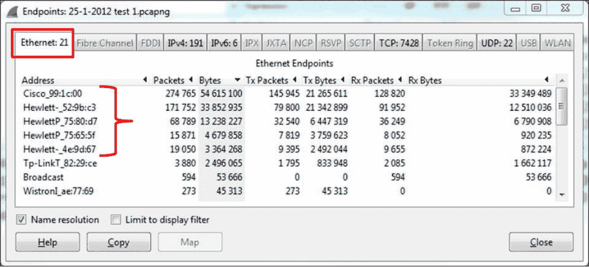

当我们选择查看 **IPv4: 191** 下的端点时，会看到许多端点来自 **192.168.10.0**、**192.168.30.0** 网络，也来自其他网络。

**端点：25-1-2012 test 1.pcapng**

**IPv4 端点**

| 地址 | 数据包 | 字节 | 发送数据包 | 发送字节 | 接收数据包 | 接收字节 | 纬度 | 经度 |
|---|---|---|---|---|---|---|---|---|
| 192.168.30.50 | 2 194 | 374 650 | 1 173 | 173 137 | 1 021 | 201 513 | - | - |
| 192.168.30.41 | 2 380 | 389 499 | 1 273 | 193 784 | 1 107 | 195 715 | - | - |
| 192.168.12.19 | 634 | 150 487 | 333 | 48 842 | 301 | 101 645 | - | - |
| 192.168.30.47 | 2 140 | 421 646 | 1 144 | 174 119 | 996 | 247 527 | - | - |
| 192.168.30.52 | 1 466 | 223 536 | 788 | 107 200 | 678 | 116 336 | - | - |
| 192.168.30.30 | 2 018 | 320 600 | 1 082 | 162 276 | 936 | 158 324 | - | - |
| 192.168.10.15 | 349 | 56 918 | 192 | 30 936 | 157 | 25 982 | - | - |
| 192.168.30.159 | 469 | 66 504 | 245 | 25 833 | 224 | 40 671 | - | - |
| 192.168.30.25 | 2 496 | 369 426 | 1 325 | 184 463 | 1 171 | 184 963 | - | - |
| 192.168.30.99 | 1 301 | 191 873 | 688 | 89 799 | 613 | 102 074 | - | - |
| 192.168.30.12 | 1 444 | 255 848 | 778 | 125 194 | 666 | 130 654 | - | - |
| 192.168.30.100 | 9 342 | 2 041 336 | 4 969 | 703 223 | 4 373 | 1 338 113 | - | - |
| 192.168.30.49 | 2 108 | 335 667 | 1 123 | 160 618 | 985 | 175 049 | - | - |

名称解析   限制显示过滤器

帮助   复制   地图   关闭

以太网：21   光纤通道   FDDI   IPv4: 191   IPv6: 6   IPX   JXTA   NCP   RSVP   SCTP   TCP: 7428   令牌环   UDP: 22   USB   WLAN

## 使用“统计”菜单中的 HTTP 工具

在本节中，我们将学习如何使用网络中传输数据的 HTTP 统计信息。

### 准备工作

启动 Wireshark，单击 **统计**。

### 操作步骤...

要查看 HTTP 统计信息，请执行以下步骤：

从“统计”菜单中选择“HTTP”。将出现以下窗口：

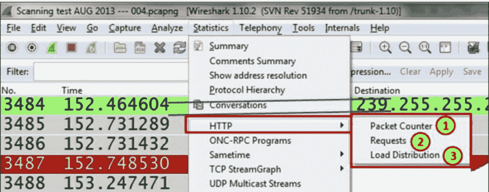

在 HTTP 子菜单中，我们有以下选项：

-   数据包计数器（在上一个截图中标记为 1）：它为我们提供发往每个网站的数据包数量。这将帮助我们确定有多少个请求和响应。
-   请求（在上一个截图中标记为 2）：用于查看对网站的请求分布。
-   负载分布（在上一个截图中标记为 3）：用于查看网站之间的负载分布。

我们将执行以下步骤来查看数据包计数器统计信息：

1.  导航到“统计”|“HTTP”|“数据包计数器”。
2.  将打开以下过滤器窗口：

    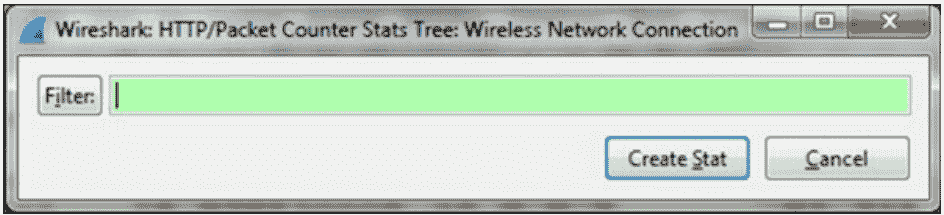

3.  在此窗口中，你可以配置一个过滤器，以查看针对这些过滤器的统计信息。如果你想查看整个捕获文件的统计信息，请将其留空。这将显示基于 IP 的统计信息，即所有 HTTP 数据包。

4.  单击“创建统计”按钮，你将看到以下窗口：

    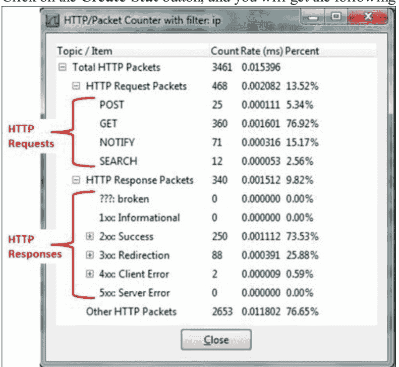

为了查看特定节点的 HTTP 统计信息，你可以使用显示过滤器格式为其配置过滤器。

我们将执行以下步骤来查看 HTTP 请求统计信息：

1. 导航到统计 | HTTP | 请求。将出现以下窗口：

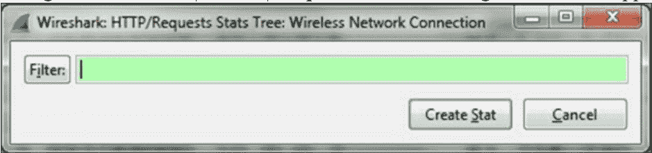

2. 选择你需要的过滤器。对于所有数据，请留空。

3. 点击创建统计按钮，将出现以下窗口：

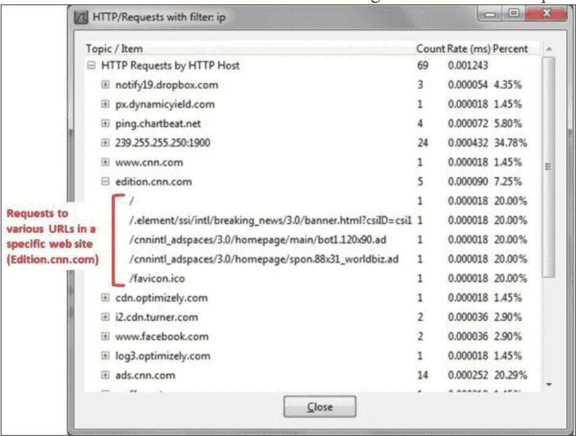

4. 要获取特定 HTTP 主机的统计信息，你可以设置过滤器 http.host contains <host_name> 或 http.host==<host_name>（取决于你需要的是具有特定名称的主机名，还是包含特定字符串的主机名），这样你就会看到针对该特定主机的统计信息。

5. 例如，通过配置过滤器 http.host contains ndi-com.com，你将获得网站 www.ndi-com.com 的统计信息（如以下截图所示）：

6. 你将得到的是：

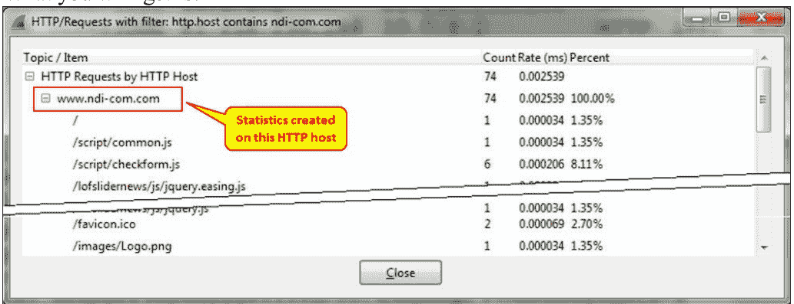

要查看 Web 或特定网站上的负载分布：

1. 导航到统计 | HTTP | 数据包计数器。
2. 将出现以下窗口：

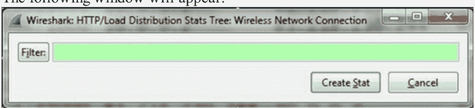

3. 选择你需要的过滤器。对于所有数据，请将其留空。
4. 点击**创建统计**按钮，将出现以下窗口：

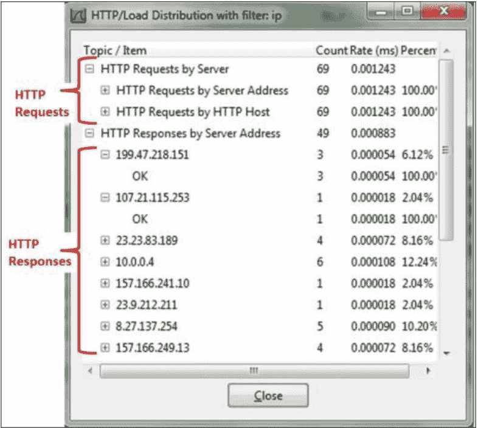

### 工作原理...

当我们打开一个网站时，它通常会向多个 URL 发送请求。在本例中，我们打开的其中一个网站是 [www.cnn.com](http://www.cnn.com)，它带我们跳转到 [edition.cnn.com](http://edition.cnn.com)，我们向该网站发送了多个请求：向根 URL、向 `breaking_news` URL，以及向主页上的另外两个位置。

### 更多内容...

要进行更深入的 HTTP 分析，你可以使用专用工具。其中最常见的是 **Fiddler**。你可以从 [http://www.fiddler2.com/fiddler2/](http://www.fiddler2.com/fiddler2/) 找到它。

Fiddler 是一款专为 HTTP 故障排查而开发的软件工具，因此它为 HTTP 提供了更多数据，并具有更好的用户界面。

## 配置流图以查看 TCP 流

在本节中，我们将学习如何使用流图功能。

### 准备工作

打开 Wireshark，从**统计**菜单中选择**流图**。将打开以下窗口：

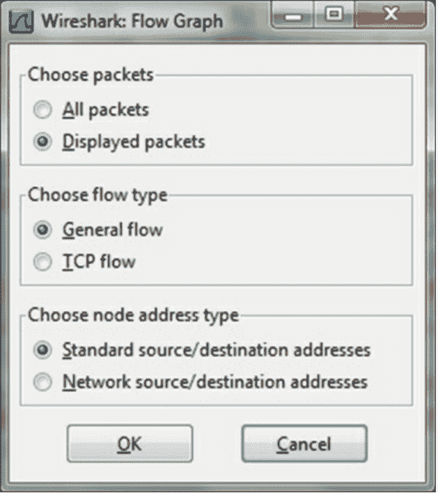

### 操作步骤...

你可以在**流图**窗口中选择多个选项，例如：

- 查看内容：
  - 选择**全部数据包**：用于查看所有已捕获的数据包
  - 选择**已显示的数据包**：用于仅查看筛选后的数据包
- 流类型：
  - 常规流将显示所有已捕获或已显示的数据包（即你之前选择的内容）。
  - TCP 流将仅显示 TCP 标志、序号和 ACK 编号。该图仅提供流的非常局部的视图。

### 工作原理...

只需根据捕获文件创建简单的统计信息即可：这里没有什么特别的要说明。

### 更多内容...

理解 TCP 问题有时相当复杂。大多数时候，最好的方法是使用具有更好图形界面的图形化软件，或者干脆拿一张纸和不同颜色的笔自己画出来。

一款很好用的软件是 Wireshark 开发人员推出的 **Cascade Pilot** 软件包，可以在 http://www.riverbed.com/us/products/cascade/wireshark_enhancements/cascade_pilot_ 找到。

你可以在下图中看到一个自己绘制的图表示例：

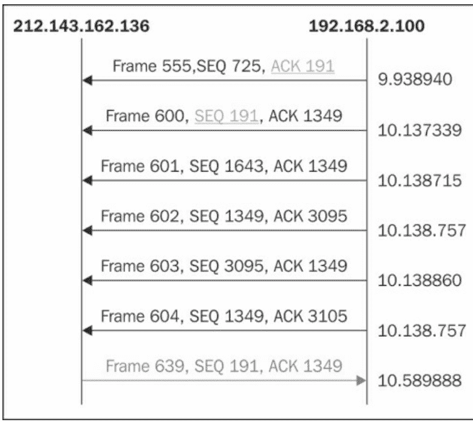

在绘制几张图之后，你就会对它们了如指掌。

## 创建基于 IP 的统计信息

在本节中，我们将学习如何创建一些基于 IP 的统计信息。我们将讨论以下统计工具：

- IP 地址
- IP 目标
- IP 协议类型

### 操作步骤...

要获取 IP 地址统计信息，请执行以下步骤：

1. 导航到 **统计 | IP 地址**。
2. 在出现的窗口中，点击**过滤器**按钮选择要使用的过滤器：
3. 如果要查看整个捕获文件的统计信息，请将其留空，系统将显示所有 IP 数据包的统计信息。
4. 如果只想查看特定 IP 地址的统计信息，请以显示过滤器语法输入过滤器。例如，过滤器 `ip.addr==10.0.0.2` 将仅显示发送到该地址或从该地址发出的 IP 数据包。
5. 输入过滤器后，你将得到以下统计信息：

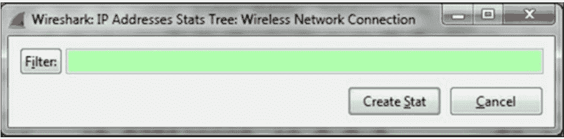

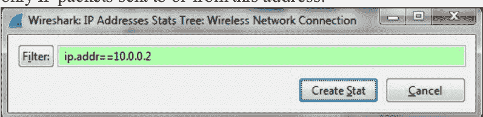

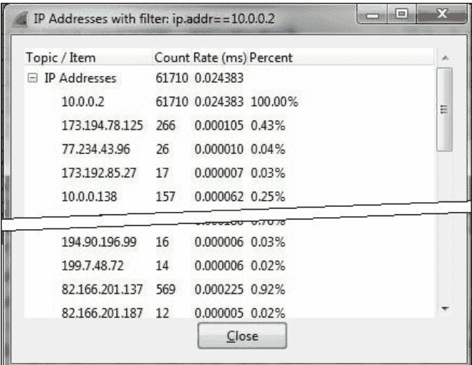

要获取 IP 和 TCP/UDP 目标统计信息，请执行以下步骤：

1. 导航到统计 | IP 目标。
2. 在以下窗口中，选择要使用的过滤器：

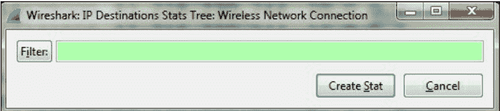

3. 此窗口将显示所有已向其目标 IP 发送数据包的 IP 地址，以及所使用的协议。
4. 你将得到以下统计信息：

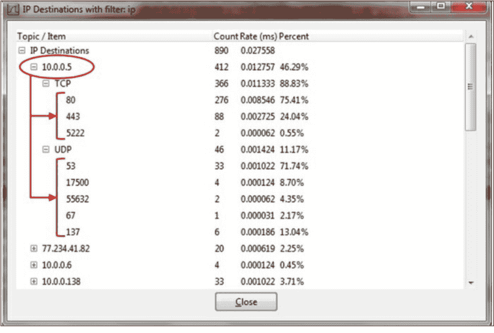

5. 在此统计表中，你可以看到主机 **10.0.0.5** 已向端口 **80、443 和 5222** 发送了 TCP 数据包，并向端口 **53** 和其他一些端口发送了 UDP 数据包。

这是一个能够暴露可疑问题的工具；例如，当你发现某个可疑端口收到了过多的数据包时，就可以开始查找原因。要获取 IP 协议类型：

1. 导航到 **统计 | IP 协议类型**。
2. 在以下窗口中，选择要使用的过滤器：

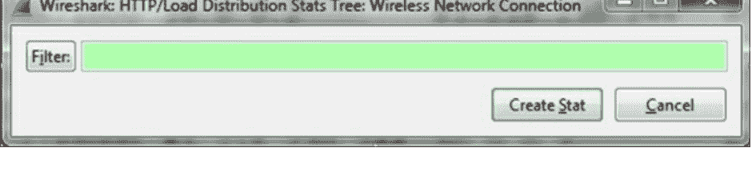

3. 你将获得运行在 IP 之上的协议统计信息，这些协议主要是 TCP 和 UDP。

| 主题/项目 | 计数 | 速率（毫秒） | 百分比 |
|---|---:|---:|---:|
| IP 协议类型 | 61925 | 0.024468 | |
|   TCP | 60650 | 0.023964 | 97.94% |
|   UDP | 1265 | 0.000500 | 2.04% |
|   无 | 10 | 0.000004 | 0.02% |

### 更多内容...

Wireshark 中还有多种选项可以提供非常相似的统计信息，包括**会话**、**协议分层**和**端点**，这些都在本章开头讨论过。你可以将它们与本节学到的方法结合使用。
