## 第 5 章 使用高级统计工具

在本章中，我们将学习以下内容：

- 使用过滤器配置 IO 图，以测量网络性能问题
- 使用 IO 图测量吞吐量
- 使用高级 Y 轴参数进行高级 IO 图配置
- 通过 TCP 流图获取信息 – 时间序列（Stevens）窗口
- 通过 TCP 流图获取信息 – 时间序列（tcp-trace）窗口
- 通过 TCP 流图获取信息 – 吞吐量图窗口
- 通过 TCP 流图获取信息 – 往返时间窗口
- 通过 TCP 流图获取信息 – 窗口缩放图窗口

### 简介

在[第 4 章](#)（使用基本统计工具）中，我们讨论了基本统计工具，例如终端用户列表、会话、捕获汇总等。在本章中，我们将了解高级统计工具，例如 IO 图、TCP 流图，以及简要介绍 UDP 组播流。

我们在这里要讨论的工具能够让我们更好地观察网络。这里有两个主要工具：

- IO 图工具让我们能够查看任意预定义过滤器的统计图；例如，单个 IP 地址上的吞吐量、两个或多个主机之间的负载、应用吞吐量、TCP 现象分布等等
- 我们将使用 TCP 流图更深入地查看单个 TCP 连接，从而能够隔离 TCP 问题及其原因

在本章中，我们将学习如何使用这些工具，在接下来的章节中，我们将使用它们来隔离并解决网络问题。


# 使用过滤器配置 IO 图表以测量网络性能问题

在本教程中，我们将学习如何使用 IO 图表工具以及如何将其配置用于网络故障排除。

# 如何操作...

运行 IO 图表工具，你将得到以下窗口：

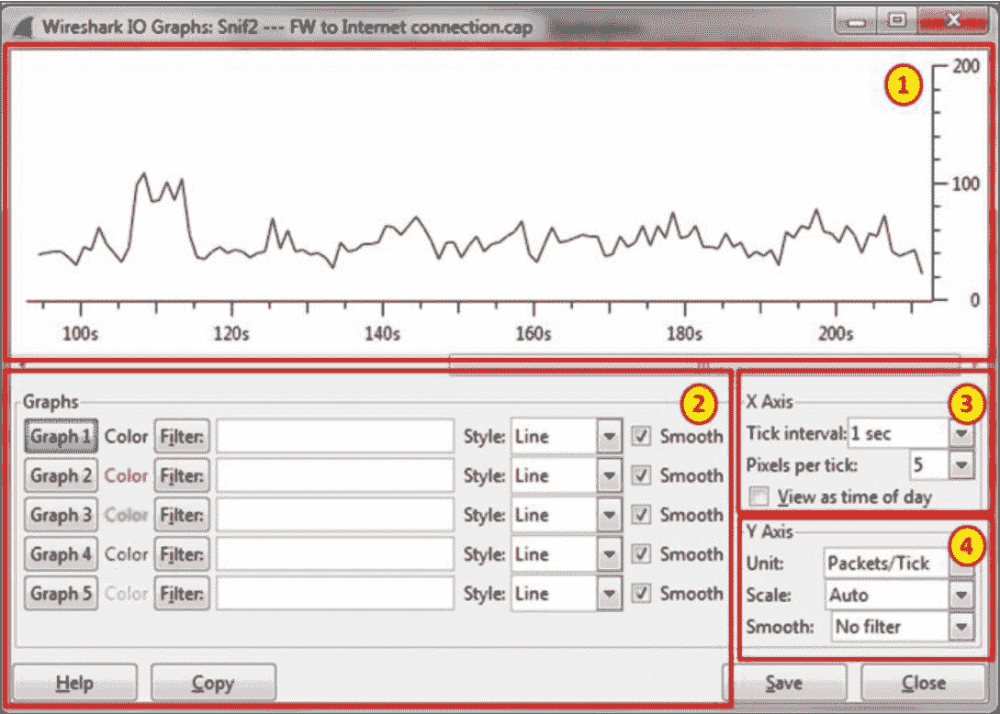

在窗口的上部，你会看到突出显示为区域 1 的图表。在左下部，突出显示为区域 2 的位置，你会看到可用于配置显示过滤器的过滤器，这些过滤器将启用特定的图表。在窗口右侧，突出显示为区域 3 和 4 的位置，你会看到 **X-Axis** 和 **Y-Axis** 配置。让我们看看我们可以配置什么以及如何操作。

## 过滤器配置

1. 在过滤器窗口中，填写符合显示过滤器格式的过滤器。只有通过此过滤器的报文才会被计入此图表。你可以在此配置五个可选过滤器。

2. 选择你想要呈现的图表类型：**Line**、**Impulse**、**FBar** 或 **Dot**。

3. 点击 **Graph** 按钮。这是为了激活过滤器图表而必需的。不要忘记它。

# X-Axis 配置

1. 选择要输入 **Tick interval:** 的值。刻度范围可以在 0.001 秒到 10 分钟之间。

# 提示

例如，如果当 X 轴刻度间隔配置为 1 秒间隔时，我们得到 1,000 packets/second 的峰值，这意味着在过去一秒内我们捕获了 1,000 个报文。当我们将 X 轴刻度间隔更改为 0.1 秒间隔时，峰值会不同，因为现在我们看到的是在过去 0.1 秒内捕获了多少报文。

2. 选择 **Pixels per tick:** 值以配置每个刻度间隔的像素数。

3. 标记 **View as time of day** 按钮以选择时间格式而不是从捕获开始的时间。

# Y-Axis 配置

1. 从 **Packets/Tick**、**Bytes/Tick**、**Bits/Tick** 或 **Advanced...** 中选择 **Unit:** 的值以选择 Y 轴刻度。

2. 为 Y 轴选择 **Scale:**。你可以将其选择为 **Linear** 或更改为 **Logarithmic**。你也可以将其保留为 **Automatic** 或在需要时更改为手动值。

3. 如果你想看到移动平均值，请选择 **Smooth:** 的值；也就是说，在每个刻度间隔中，你将看到过去刻度的平均值。你可以选择 4 到 1,024 之间的值来平滑图表。

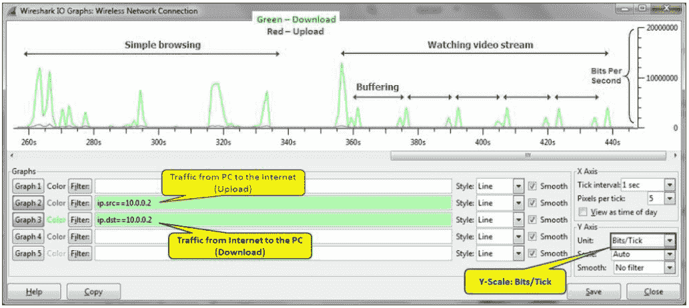

在第二个图表中，我们看到以 bits/sec 为单位的流量。这里，我们看到在使用网络连接到互联网时网络所需的带宽；也就是说，当大部分流量在下载方向时，非对称带宽。

# 还有更多...

让我们再看一个例子。这里是一个 FTP 文件下载的例子，当 10.0.52.164 下载文件时。同样，你可以看到为了在网络上获取流量，我们将 Y 轴下的 Unit: 更改为 Bits/Tick。Packets/Tick 也很重要，我们将在本书后面的应用章节（第 7-14 章）中看到其实现。

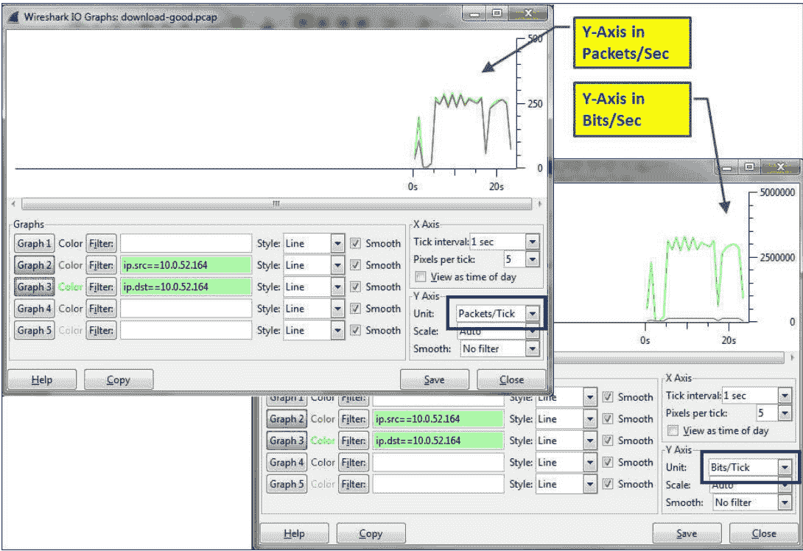

# 使用 IO Graph 进行吞吐量测量

IO Graph 是测量网络吞吐量的便捷工具。使用它，我们可以测量任何预定义过滤器的流量和吞吐量。在本教程中，我们将看到一些测量网络吞吐量的示例。

# 准备工作

将你的笔记本电脑通过 Wireshark 连接到一个网络，该网络将端口镜像到你想要测量的链路，如你在第 1 章《介绍 Wireshark》中所学。启动新的捕获或打开现有文件，并从 **Statistics** 菜单打开 **IO Graphs** 工具。

在测量吞吐量时，我们可以测量端设备之间通信链路上的吞吐量（PC 到服务器、手机到手机、PC 到互联网等）或特定应用程序的吞吐量。

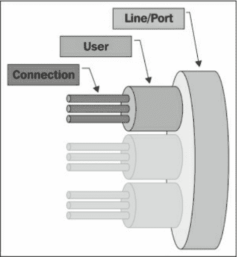

隔离网络问题的过程始于在端设备之间的链路上测量单连接的流量并查看其来源。

一些典型的测量包括主机到主机的流量、到特定服务器的所有流量、到特定服务器上特定应用程序的所有流量、特定服务器上的所有 TCP 性能现象等等。

# 如何操作...

在本教程中，我们将提供一些用于测量网络流量的基本过滤器。

## 测量端设备之间的吞吐量

要测量端设备之间的吞吐量，只需在它们的 IP 地址之间配置一个显示过滤器。

例如，要查看 10.2.10.101 和 10.2.10.240 之间的流量，配置过滤器：

```
ip.addr eq 10.2.10.240 and ip.addr eq 10.2.10.240.
```

你可以在 IO Graph 的 Filter: 框中输入过滤器，也可以通过以下步骤操作：

- 1. 将光标放在特定连接中的一个报文上。
- 2. 右键单击它并导航到 Conversation filter | IP。过滤器字符串将出现在上方的显示过滤器框中。
- 3. 将过滤器字符串从上方的显示过滤器框复制到其中一个 IO Graph Filter: 框中。
- 4. 点击 IO Graphs 窗口中的过滤器图表按钮以激活它。

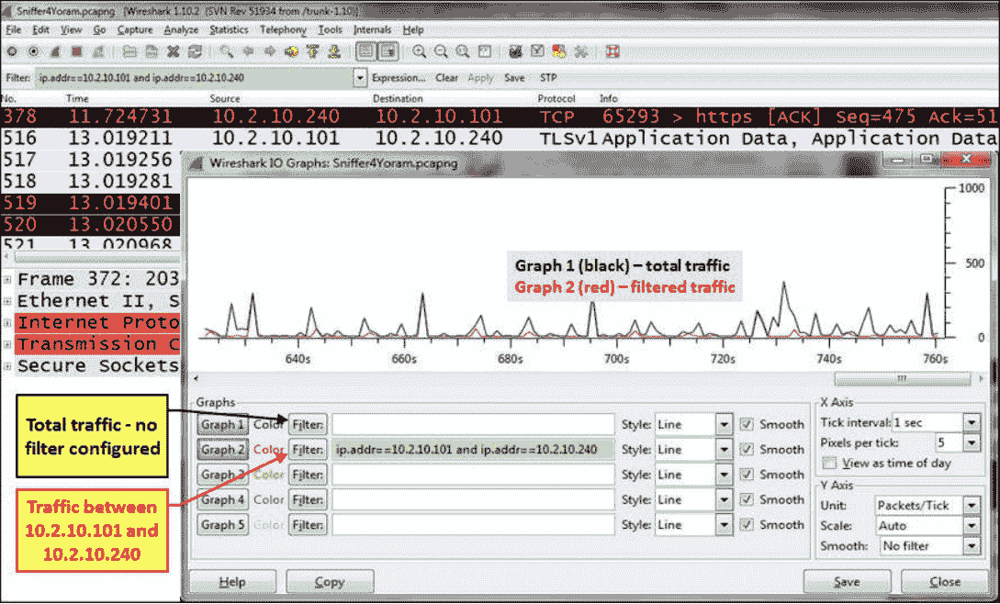

## 测量应用程序吞吐量

为了配置特定应用程序的性能测量，你可以配置一个包含特定端口号或特定连接的过滤器。

有几种方法可以隔离应用程序图表。以下是一种方法：

- 1. 在捕获的数据中，单击属于流量流的任意一个报文。在 TCP 中它将是一个特定连接；在 UDP 中它将只是两个 IP/Port 对之间的流。
- 2. 右键单击它并选择 **Follow TCP stream** 或 **Follow UDP stream**。你将得到 `tcp.streameq<number>` 或 `udp.streameq<number>`。`<number>` 只是捕获文件中的流编号。
- 3. 将字符串复制到 **IO Graphs** 窗口中的过滤器窗口，你将得到特定流的图表。

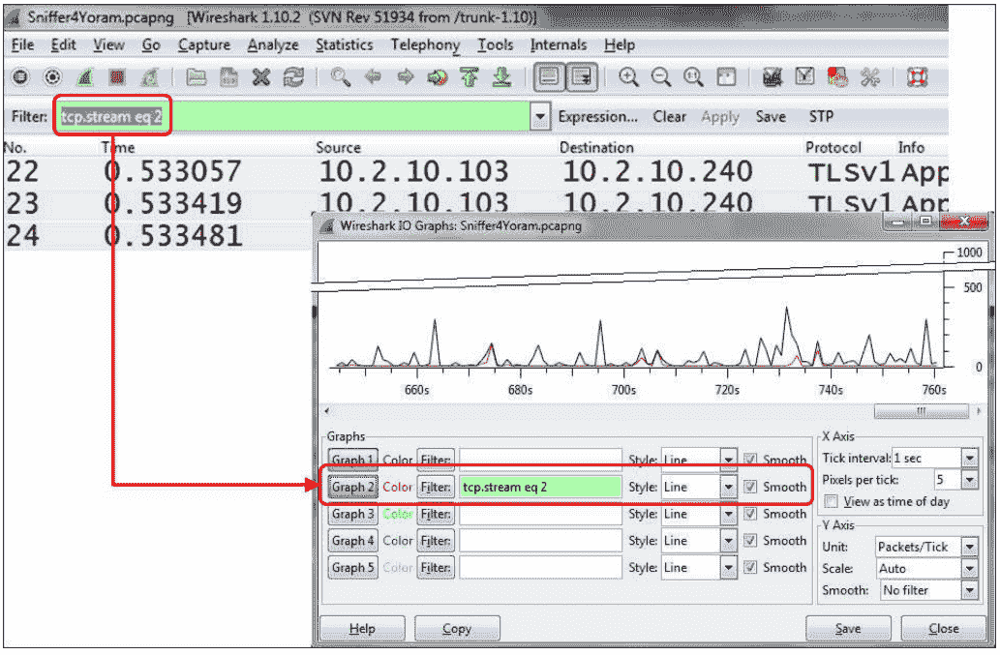

如果你想要流中特定数据的图表，请向过滤器添加信息。例如（在前面的插图中）：

- `tcp.streameq 2 and tcp.analysis.retransmissions` 将给出特定流上的所有 TCP 重传（例如指示网络缓慢、错误或丢包）
- `tcp.streameq 2 and tcp.analysis.zero_window` 将给出特定流上的所有 TCP 零窗口现象（指示终端设备缓慢）

# 其工作原理...

IO Graph 工具的强大之处在于你可以配置任何显示过滤器并以各种形状和配置将其显示为图表。报文中的任何参数都可以以这种方式进行过滤和监控。

# 还有更多...

本节解释了一些可以监控的参数示例。

## 图表 SMS 使用情况 – 查找特定订户发送的短信

- 1. 要配置过滤器，请选择使用命令 `Submit_SM` 的 **SMPP (Short Message Peer to Peer protocol)** 报文。这是发送 SMS 的 SMPP 命令。
- 2. 在过滤器中输入 `smpp.destination_addr == "phone number"`。在示例中配置了过滤器 `smpp.destination_addr == "972527098241"`。

## 图表访问 Google 网页的次数

- 1. 打开 **IO Graphs** 窗口。你可以在捕获期间打开以查看在线统计信息，或打开已保存的捕获文件。
- 2. 配置过滤器 `http.host contains "<name>"`，在我们的例子中为 `http.host contains "google"`。
- 3. 在报文列表中，你将看到（在配置相同过滤器时）以下屏幕截图中显示的信息：

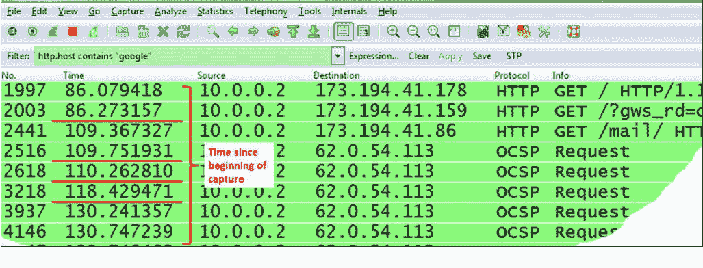

- 4. 在 **IO Graphs** 窗口中，你将看到以下图表：


## 使用高级 Y 轴参数配置高级 IO 图形

在使用 IO 图形工具进行标准测量时，我们以数据包/秒、字节/秒或位/秒为单位来衡量网络性能。有些类型的数据无法通过这些参数进行测量，这就是我们在 **Y 轴** 选项中提供 **高级...** 功能的原因。

### 准备工作

从 **Y 轴** 下的 **单位：** 下拉菜单中选择 **高级...** 功能，会打开一个更宽的 IO 图形窗口，并提供以下选项：

- **SUM (*)**：根据刻度间隔内参数的汇总值绘制图形。
- **COUNT FRAMES (*)**：统计刻度间隔内过滤帧出现的次数并绘制图形。
- **COUNT FIELDS (*)**：统计刻度间隔内过滤字段出现的次数并绘制图形。
- **MAX (*)**：根据刻度间隔内参数的最大值绘制图形。
- **MIN (*)**：根据刻度间隔内参数的最小值绘制图形。
- **AVG (*)**：根据刻度间隔内参数的平均值绘制图形。
- **LOAD (*)**：用于响应时间图形。

### 操作步骤...

要开始使用带有 **高级** 功能的 **IO 图形** 窗口，请执行以下步骤：

1. 从 **统计** 菜单启动 **IO 图形** 窗口。
2. 在 **Y 轴** 下的 **单位：** 下拉菜单中，选择 **高级...** 选项。您将看到以下窗口：

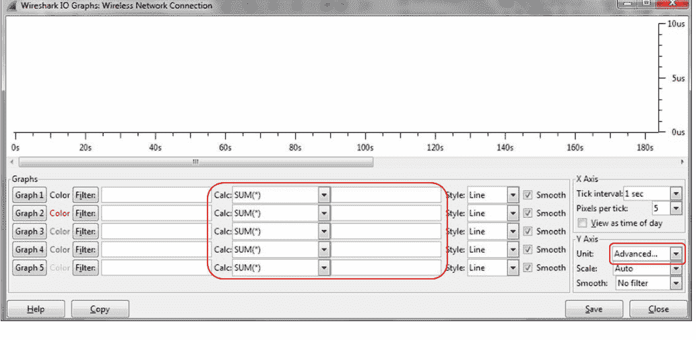

3. 您将看到带有 **SUM(*)** 字符串的新下拉菜单。
4. 选择 **SUM(*)/COUNT FRAMES (*)/COUNT FIELDS (*)/MAX(*)/MIN(*)/AVG(*)/LOAD(*)**，并配置相应的过滤器。在接下来的操作步骤中，我们将看到一些有用的示例。

### 如何监控帧间时间增量统计

帧之间的时间增量会影响 TCP 性能，在某些情况下，我们希望将这些时间增量与从网络获得的性能关联起来。

让我们看看以下捕获文件：

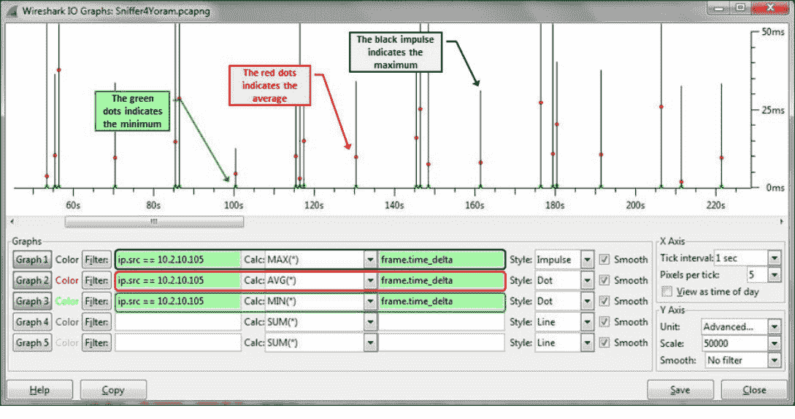

我们在屏幕截图中看到的是帧间时间增量的最小值、平均值和最大值的图形。我们该如何处理它，以及如何使用它进行网络调试？这将在[第10章] HTTP 和 DNS 中介绍。

### 如何监控流中的 TCP 重传次数

TCP 事件可以有很多类型：重传、滑动窗口事件、ACK（或缺少 ACK）以及其他事件。要查看 TCP 事件随时间变化的数量，我们可以使用带有 **高级...** 功能和 **COUNT(*)** 参数的 IO 图形工具。

为此，请执行以下步骤：

1. 从 **统计** 菜单打开 **IO 图形**。
2. 在 **Y 轴** 下，为 “单位：” 选择 **高级...**。
3. 按如下方式配置过滤器：
    - 在 **过滤器：** 按钮旁边的字段中配置 IP 源地址和目标地址过滤器
    - 在 **样式：** 左侧的字段中配置 TCP 事件
    - 在 “计算：” 字段中选择 **COUNT FRAMES (*)**，并在过滤器字段中输入 `tcp.analysis.retransmissions`

在此示例中，过滤器被配置为监控三个不同 TCP 流上的 TCP 重传。

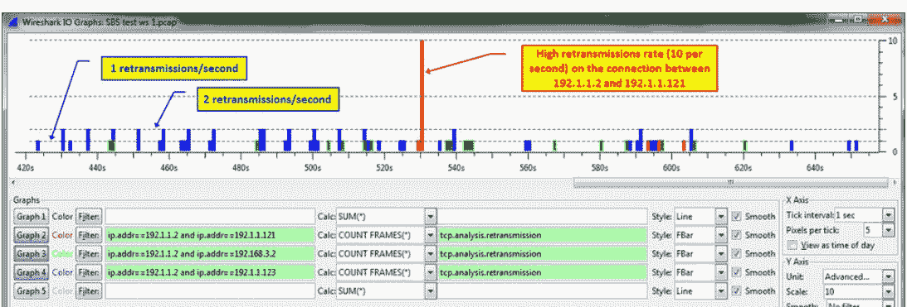

在上一个屏幕截图的图形中，您可以看到每个 TCP 流的重传以不同颜色呈现。

### 如何监控字段出现次数

在各种网络协议（主要是基于 TCP 运行的协议）中，帧间时间变化（即帧时间增量过滤器）会显著影响性能。IO 图形窗口中用于查看这些变化的工具之一是 “高级...” 配置。

为此，请执行以下步骤：

1. 右键单击可疑 TCP 流中的数据包，然后导航到 “会话过滤器 | TCP”。主过滤器框中将出现一个过滤器。
2. 从 **统计** 菜单打开 **IO 图形**。
3. 在 Y 轴下，为 “单位：” 选择 “高级...”。
4. 按如下方式配置过滤器：
    - 将过滤器定义从右侧上方的过滤器框复制到左侧的 IO 图形过滤器框
    - 在左侧输入过滤器 frame.time_delta
    - 选择 AVG(*) 以查看平均增量
5. 选择适当的 X 轴分辨率。

这里有一个示例。在以下屏幕截图中，我们看到一个包含时间的数据包列表：

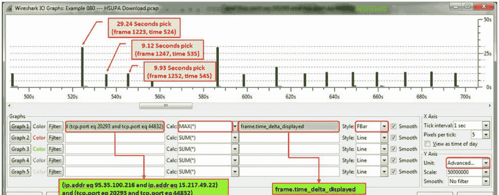

如您所见，帧之间存在时间变化。在本书的后面，我们将了解是什么导致这些问题以及如何解决它们。

### 工作原理...

IO 图形工具是 Wireshark 中最强大、最高效的工具之一。标准的 IO 图形统计可用于基本统计，而 **高级...** 功能可用于深入监控响应时间、对单个流或多个流进行 TCP 分析等。

当我们在左侧配置过滤器时，我们将过滤主机之间的流量、连接中的流量、服务器上的流量等。**高级...** 功能为我们提供有关流量的更多详细信息。以下是一些示例：

- 左侧可以看到 TCP 流；右侧可以看到该流中帧之间的时间增量
- 左侧可以看到视频/RTP 流；右侧可以看到标记位的出现

### 更多内容...

您可以随时单击 **IO 图形**，它将带您到数据包面板中的参考数据包。

## 通过 TCP 流图获取信息 – 时间序列（Stevens）窗口

Wireshark 中能够让我们更深入地了解应用程序行为的工具之一是 TCP 流图。正如我们将在接下来的操作步骤中看到的，这些图形使我们能够了解应用程序行为，并有可能定位其中的问题。

### 准备工作

打开现有的捕获文件或开始新的捕获。单击捕获文件中的特定数据包。尽管您可以在正在进行的捕获中使用此功能，但它并非用于在线统计；因此建议您先启动捕获，然后停止捕获，再使用此工具。

该图形实际上显示了字节传输随时间的推进过程。在此示例中，我们看到一条连续的斜线，这表明文件传输状况良好。

要测量文件传输的吞吐量，只需计算单位时间内传输的字节数，如下面的屏幕截图所示：

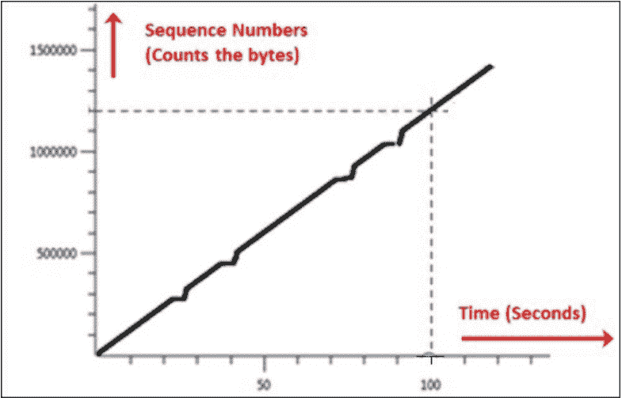

我们可以看到传输速率为 100 秒内传输 1,200,000 字节，即 12,000 字节/秒或 95 千位/秒。

3. 使用滚动条单击图形上的某个点，将放大该点周围的图形。
4. 右键单击图形上的某个点，将把我们带到捕获文件中的数据包面板。
5. 要更改图形参数，我们会有一个与图形并行打开的小窗口，如下面的屏幕截图所示：

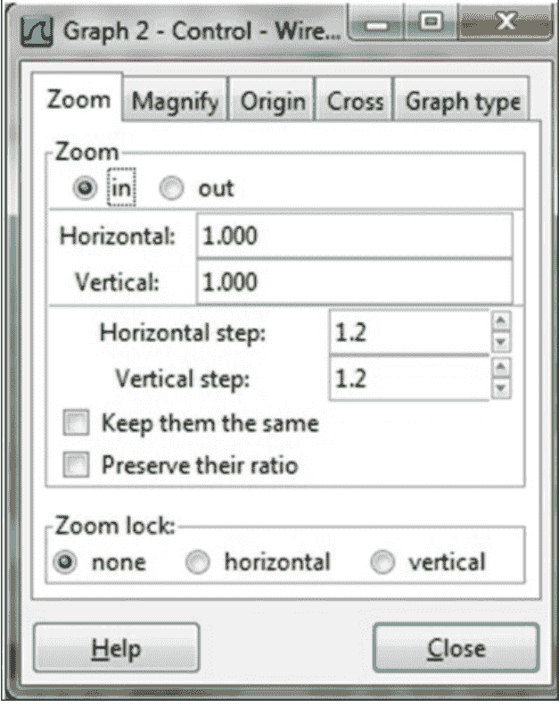

6. 要从放大切换到缩小，请单击 **in** 或 **out** 按钮。

### 工作原理...

时间序列图（Stevens）是一种简单的图形，用于统计随时间变化的 TCP 序列号。由于 TCP 序列号统计的是 TCP 发送的字节数，因此这些字节实际上是从一端发送到另一端的应用程序字节（包括应用程序标头）。

该图形（正如我们将在 TCP 和应用程序章节中学到的）可以很好地指示应用程序的行为。例如，一条斜线表示文件传输良好，而有中断的斜线则表示传输存在问题。斜率较高的斜线表示数据传输速度快，而斜率较低的斜线表示传输速率低（当然取决于刻度）。


## 更多内容...

在图表中左键单击某个点，将跳转到数据包列表窗格中的对应数据包。当你发现问题时，放大该点，左键单击它，并检查数据包出了什么问题。

查看图表时，了解正在运行的应用程序类型非常重要。某个应用程序图表中显示为问题的情况，对于另一个应用程序来说可能正是正常的网络行为。

## 通过 TCP 流图获取信息——时间序列（tcp-trace）窗口

基于 UNIX `tcpdump` 命令的 TCP 时间序列图为我们提供了所监控连接的补充数据。除了 Time-Sequence (Stevens) 中标准的序列/秒外，我们还能获得已发送的 ACK、重传、窗口大小等信息，以及更多能够帮助我们分析连接问题的细节。

## 准备工作

打开现有的捕获文件，或开始新的捕获。在捕获文件中单击某个特定数据包。尽管你也可以在实时捕获中使用此功能，但它并非为实时统计而设计；因此建议你完成一次捕获并停止后，再使用此工具。

## 操作步骤...

要查看 TCP 流图统计信息，请执行以下步骤：

- 1. 单击要监控的流中的一个数据包。

### 提示

TCP 流图是一个方向性图表，因此当你单击数据包时，该数据包应位于你想要查看统计信息的方向。例如，如果你下载一个文件并想查看下载统计信息，请单击下载方向上的数据包。

- 2. 从统计菜单导航到 TCP 流图 | 时间序列图（tcp-trace）。将打开以下窗口：

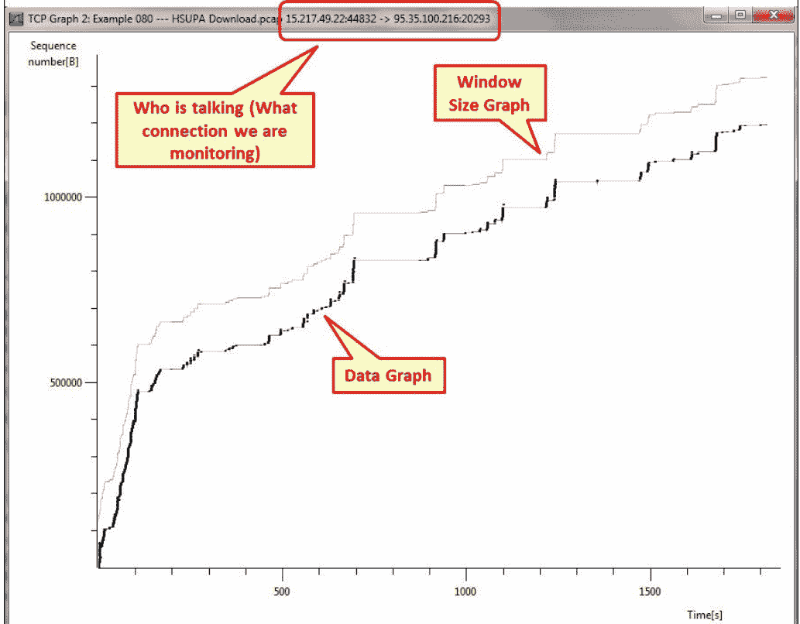

该图表下方黑色曲线表示字节传输随时间的变化，上方灰色曲线表示窗口大小。当两条曲线之间有间隙时，说明还有一定的 TCP 缓冲空间，TCP 将继续传输字节。一旦它们彼此接近并接触，就会形成窗口已满现象，从而无法继续传输数据。

3. 当我们放大到特定区域时，会得到以下截图：

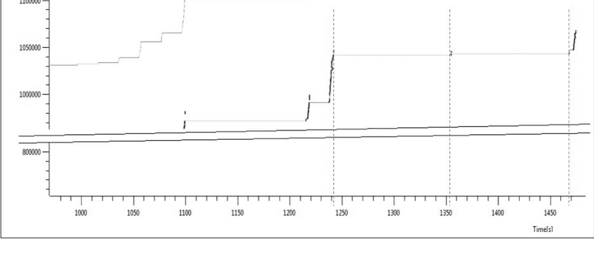

4. 当我们放大到图中的特定区域时，会得到以下捕获的数据包：

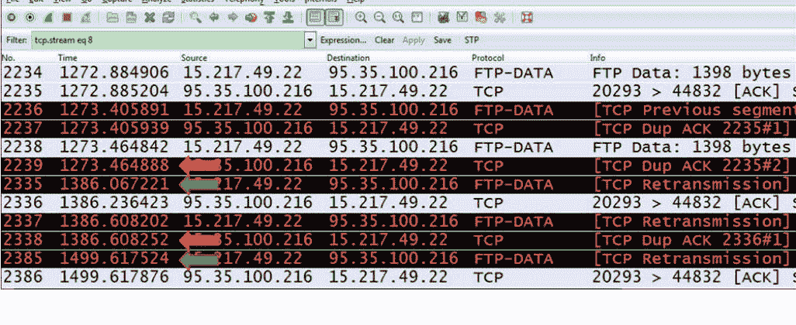

你可以看到，在捕获的数据包中，时间 1,273（捕获开始后的秒数）处有一帧，然后中断，时间 1,386 处有一个数据包，中断后，1499 处又有一个数据包。

在 TCP 流图中，你可以看到传输中的中断，当我们返回数据包列表窗格时，可以查找其中断的原因。

## 工作原理...

**时间序列**（TCP-trace）图源自 UNIX 的 `tcpdump` 命令，该命令还会检查接收方发布的窗口大小（即接收方为进程分配的缓冲区大小），以及重传的数据包和 ACK。

使用该图表可以为我们提供大量信息，稍后我们将用这些信息进行网络调试。从窗口被填充的速度快于预期，到大量重传等现象，都会通过该图表可视化地展现出来，帮助我们解决这些问题。

## 更多内容...

我们放大得越多，看到的细节就越多，如下面的截图所示：

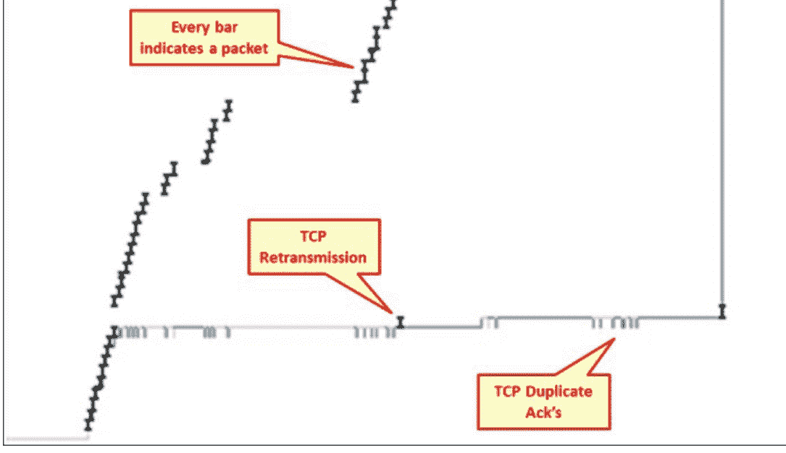

一个条形表示一个承载数据的包，其序列号范围在初始序列号和最终序列号之间。偏离常规图形、看起来像是“逃离”的条形表示重传，灰色条形表示重复 ACK。我们将在第 9 章（UDP/TCP 分析）中了解这些现象。

## 通过 TCP 流图获取信息——吞吐量图窗口

TCP 流图中的**吞吐量图**窗口使我们能够查看连接的吞吐量并检查其不稳定性。

## 准备工作

打开现有的捕获文件，或开始新的捕获。在捕获文件中单击某个特定数据包。尽管你也可以在实时捕获中使用此功能，但它并非为实时统计而设计；因此建议你完成一次捕获并停止后，再使用此工具。

## 操作步骤...

要查看 TCP 流图统计信息，请执行以下步骤：

- 1. 单击要监控的流中的一个数据包。
- 2. 从统计菜单导航到 TCP 流图 | 吞吐量图。

将打开以下窗口：

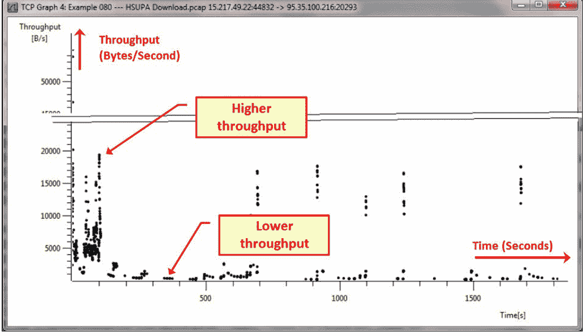

在图表中，我们看到吞吐量并不稳定，在大约 20,000 字节/秒到 1000 字节/秒之间波动。这可能是因为文件传输不稳定（本例是在 HSUPA 蜂窝连接上进行 FTP 下载时的情况），也可能只是因为应用程序本身就是这样的工作方式（例如浏览互联网）。

## 工作原理...

吞吐量图只是计算 TCP 序列号随时间的变化，由于序列号实际上是应用程序的数据，因此这给出了应用程序的吞吐量（以字节/秒为单位）。

## 更多内容...

稳定的文件传输应该看起来几乎是一条实线，如下图所示：

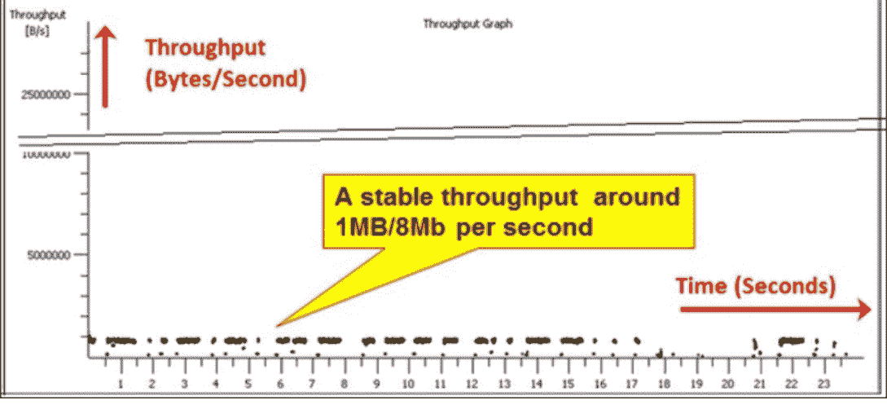

这里，MB 是兆字节，Mb 是兆比特。

## 准备工作

打开现有的捕获文件，或开始新的捕获。在捕获文件中单击某个特定数据包。尽管你也可以在实时捕获中使用此功能，但它并非为实时统计而设计；因此建议你完成一次捕获并停止后，再使用此工具。

## 工作原理...

我们在图中看到的是 TCP 序列号与确认这些序列号所需时间的对应关系。实际上，这是从发送数据包到收到该数据包的 ACK 之间的时间。

## 更多内容...

当你看到显示不稳定的图表时，这并不一定表示有问题。这也可能只是应用程序的工作方式。你会看到某个数据包花费了很长时间才被确认，这可能是因为存在问题，也可能是因为服务器正在等待响应，或者客户端正在浏览 Web 服务器，而用户在两次点击新链接之间等待。

## 通过 TCP 流图获取信息——窗口缩放图窗口

TCP 流图中的窗口缩放图使我们能够查看接收方发布的窗口大小，这是接收方处理数据能力的一个指标。结合其他图表，它让我们能够直观了解连接的性能。

## 操作步骤...

要查看 TCP 流图统计信息，请执行以下步骤：

- 1. 单击要监控的流中的一个数据包。
- 2. 从**统计**菜单导航到**TCP 流图 | 窗口缩放图**。将打开以下窗口：

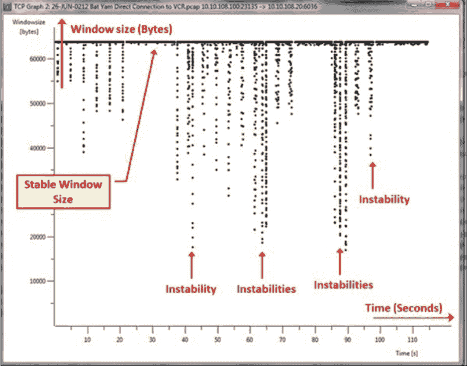

在此图中，我们可以看到由其中一端引起的不稳定性。这可能表示服务器或客户端处理速度较慢，无法处理其接收到的所有数据，因此它通过减小接收窗口大小来通知对端减少发送数据。

## 工作原理...

这里的软件只是监视连接上的窗口大小并绘制它。在[第 9 章](#)（UDP/TCP 分析）中，我们将深入探讨其中的细节。

### 更多内容...

当窗口大小减小时，应用程序吞吐量也应随之下降。  
窗口大小完全由连接的两端控制，例如客户端和服务器；窗口大小的变化与网络性能无关。
