## Chapter 7. Ethernet, LAN Switching, and Wireless LAN

在本章中我们将涵盖以下主题：

- 发现广播风暴和错误风暴
- 分析生成树协议
- 分析 VLAN 和 VLAN 标记问题
- 分析无线（Wi-Fi）问题

## Introduction

在本章中，我们将重点介绍如何查找和解决基于第 2 层的网络问题，重点关注以太网相关问题，例如广播事件和错误以及如何找出它们的来源。我们还将重点关注 LAN 协议，例如生成树、VLAN 和无线局域网。

这些问题必须在我们进入第 3 层、第 4 层和应用层之前解决，因为第 2 层问题会反映在上层协议中。例如，第 2 层的丢包会导致 TCP 重传，而 TCP 是第 4 层协议，这可能导致上层应用响应时间变慢。

## Discovering broadcast and error storms

通信网络中最棘手的问题之一是 **广播** 和 **错误风暴**。这些问题可能是由于第 2 层环路、第 2 层攻击、有问题的网络适配器或向网络发送数据包的服务造成的。

在本章中，我们将提供一些基本配方，说明如何查找、隔离和解决这些类型的问题。

> **提示：** 广播风暴是指每秒获得数千甚至数万次广播。在大多数情况下，这将完全锁定网络。

### Getting ready

在这种类型的问题中，你通常会被要求解决网络非常慢或网络已停止工作的问题。

需要记住的几个重要事实是：

- 广播不会被路由器转发。
- 广播不会在 VLAN 之间转发（这就是 VLAN 被称为 **广播域** 的原因），因此每个 VLAN 都是一个单一的广播域。
- 错误数据包不会被局域网交换机转发（至少不是通过好的交换机）。
- 多播会通过交换机转发，除非另有配置。
- 多播仅在路由器配置为这样做时才会被路由器转发。
- 每个网络中都会传输合理数量的广播。这是网络的工作方式。过多的广播可能是个问题。

> **提示：** 过多的广播和广播风暴之间存在区别。过多的广播（例如每秒几百个）会占用网络，但在大多数情况下，用户不会注意到。广播风暴会完全锁定网络。

### How to do it...

要找出问题来源，请按以下步骤操作：

1. 由于“网络缓慢”是用户感知的問題，请先提出以下问题：
   - 这个问题在总部吗？
   - 在单个分支机构？
   - 整个网络还是特定 VLAN？

当然不要问用户关于 VLAN 的问题；用户不是网络专家。询问他们所在组、所在部门运行的应用程序等。

> **提示：** 在组织网络中，VLAN 通常按部门（或多个部门）和地理区域（或多个区域）甚至按组织功能配置；例如，HR VLAN、财务 VLAN、特定软件用户的 VLAN 等。通过询问问题是否按其中一个特征出现，你将能够缩小需要查找问题范围。

2. 下一个问题应该是显而易见的：“网络是否仍在工作？” 在广播风暴中，网络会变得非常慢；在大多数情况下，应用程序会停止运行。在这种情况下，你有以下典型问题：
   - 生成树问题
   - 生成广播的设备
   - 路由环路（将在第 8 章 ARP 和 IP 分析 中讨论）

> **提示：** 我总是被问到的问题是：“多少广播算太多？” 嗯，当然对此有几个答案。这取决于网络设备正在做什么以及在它们上运行的协议。

合理数量的广播应为每台设备每分钟 1 到 2 个到 4 到 5 个。例如，如果你的网络由单个 VLAN 上的 100 台设备组成，你应该期望不超过每秒 5-10 次广播（5 次广播 x 100 台设备等于每分钟 500 次广播，即大约每秒 9-10 次）。超过这个数量也是合理的，只要它们不是成千上万地到来，并且你知道它们是什么。

### Spanning Tree Problems

在生成树问题中，你会每秒获得数千甚至数万次广播（请参阅本配方中 How it works... 部分以了解原因）。在这种情况下，你的 Wireshark，甚至你的笔记本电脑都会冻结。关闭 Wireshark，断开电缆以隔离问题，并检查交换机中的 STP 配置。

### A device that generates Broadcasts

由特定设备生成的典型广播风暴具有以下特征：

- 每秒大量广播（数千个以上）
- 在大多数情况下，广播来自单个源；但在攻击情况下，它们可能来自多个源
- 通常以恒定的包/秒速率，即帧之间的间隔几乎相等

我们可以看到如何根据前述列表中提到的参数找到广播风暴，在接下来的三个屏幕截图中。

在下面的屏幕截图中，我们看到大量广播数据包从源 MAC（HP 网络适配器）发送到 ff:ff:ff:ff:ff:ff。


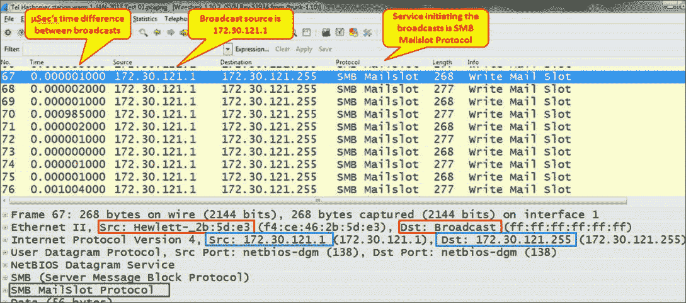

在前面的屏幕截图中我们看到时间列配置为自上一个显示数据包以来的秒数。您可以通过导航到 **View | Time Display Format** 来配置它。

下面的屏幕截图显示了 IO Graph 上的流量；我们看到每秒的总数据包数为 5,000：

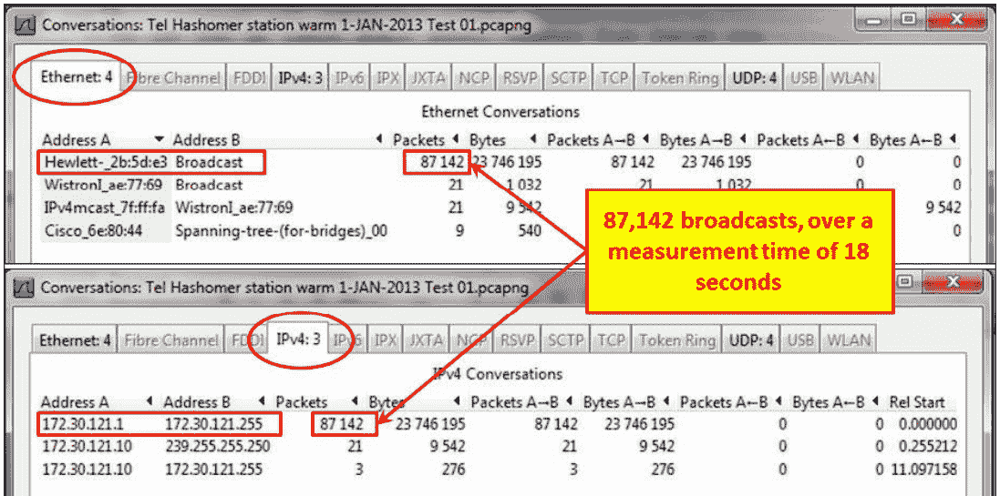

在前一种情况下，问题是一个名为 SMB Mailslot Protocol 的服务。通过简单的试错找到该服务是什么，并在导致问题的站点上禁用它就解决了问题。

> **Tip:** 需要注意的是，当您禁用服务（尤其是属于操作系统的服务）时，请确保系统继续正常运行并在一段时间内保持稳定。不要在您验证之前就离开现场！

## Fixed pattern broadcasts

您也可以有固定模式的广播，例如每隔固定时间，如以下屏幕截图所示：

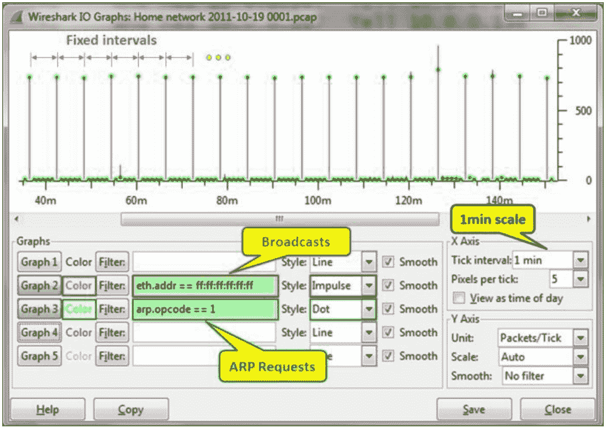

图表配置为 **Tick interval**（在 **X Axis** 下）为 1 分钟，以及以下过滤器：

- 红色过滤器用于网络中的所有广播（`eth.addr == ff:ff:ff:ff:ff:ff`）
- 绿色过滤器用于 ARP 请求广播（`arp.opcode == 1`）

我们在这里看到的是，大约每五分钟，就会有一波 ARP 请求（绿色点）。如果我们点击图表中的一个点，它会带我们到捕获窗格中的数据包。在下面的屏幕截图中，我们看到每五分钟发生的扫描模式：

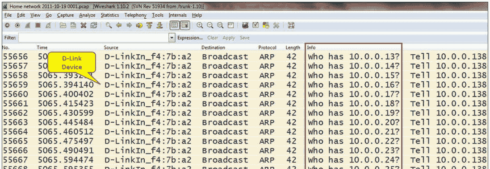

在前面的屏幕截图中，我们可以看到是 D-Link 路由器扫描内部网络。这可能是好事也可能是坏事，我们将在第 14 章《理解网络安全》中详细介绍。在任何情况下，检查我们网络中正在运行的内容都是一个好主意。

### How it works...

在 IPv4 网络中，广播相当常见，这些第 3 层广播将通过第 2 层广播发送。每当第 3 层设备向网络发送广播（以全 1 结尾的 IP 地址，参考第 8 章，ARP 和 IP 分析）时，它将被转换为第 2 层全 f 目的地址。

在基于 IP 的网络中，您会看到几种广播族。一些如下：

- TCP/IP 基于网络协议，如 ARP 请求、DHCP 请求等
- 网络协议如 **NetBIOS Name Service (NBNS)** 查询、**NetBIOS Server Message Block (SMB)**  announcements、**Network Time Protocol (NTP)** 等
- 发送广播的应用程序，如 Dropbox、Microsoft Network Load Balancing 等

在 IPv6 中，我们没有广播，但我们有单播、多播和任播。由于该协议使用多播进行发现机制、公告和其他机制，因此我们会看到很多。

### See also

- 有关 IPv4 的更多信息，请参阅 [第 8 章](Chapter 8)，ARP 和 IP 分析

## Analyzing Spanning Tree Protocols

我们所有人都使用过，或至少听说过 **STP (Spanning Tree Protocol)**。我称此配方为分析生成树协议的原因是它有三个主要版本如下：

- **Spanning Tree Protocol (STP)**：这是 1998 年的 IEEE 802.1D 标准，称为 802.1D-1998
- **Rapid Spanning Tree Protocol (RSTP)**：这是 2001 年的 IEEE 802.1W 标准，后来添加到 802.1D，称为 802.1D-2004
- **Multiple Spanning Tree (MST)**：最初在 IEEE 802.1S 中定义，后来合并到 IEEE 802.1Q

还有来自 Cisco 和其他厂商的一些专有版本。在本配方中，我们将专注于标准版本，并学习如何在 STP/RSTP/MST 操作期间可能出现的问题进行故障排除。

### How to do it...

在网络中，有几件事需要注意 STP：

- 网络上运行的是哪个 STP 版本？
- 是否有任何拓扑变化？

### Which STP version is running on the network?

Wireshark 会通过查看 **Bridge Protocol Data Units (BPDUs)** 来提供网络上运行的 STP 类型（STP、RSTP 或 MST）的版本。BPDU 是在交换机之间多播的更新帧。

协议版本为：

- 对于 STP，协议版本 ID 等于 0
- 对于 RSTP/MST，协议版本 ID 等于 3

> **Tip:** 在标准中您找不到“switch”一词；它总是“bridge”或“multiport bridge”。在本書中，我们将桥和交换机互换使用。

### Are there too many topology changes?

当您监控 STP 操作时，当您看到许多拓扑变化时可能会担心。STP 中的拓扑变化是正常的，但太多可能会影响网络性能。

拓扑变化发生在新设备连接到网络时。您可以在以下屏幕截图中看到拓扑变化：

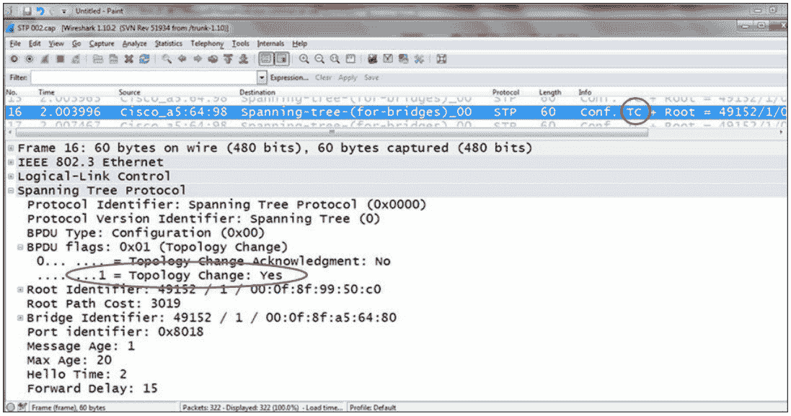

当您看到太多拓扑变化时，请配置连接到不支持 STP 的主机的 LAN 交换机端口，这些端口通常是用户经常开关机的终端站，使用 portfast 功能（适用于 Cisco 交换机；对于其他厂商，请查看厂商手册）。

> **Tip:** 在旧的 STP（IEEE 802.1D）中，连接设备到交换机端口后，交换机需要大约一分钟才能开始并转发数据包。当客户端在此期间尝试登录到网络服务器时，这可能成为一个问题。portfast 功能强制端口在几秒钟内开始转发（通常为 8 到 10 秒），以防止此类问题。

如果拓扑变化继续，请检查可能出现的问题以及谁导致了它。

故障后恢复服务。

在下面的图中，我们看到最初如何将所有交换机用它们之间的多个连接连接起来，以及 STP 如何创建树：

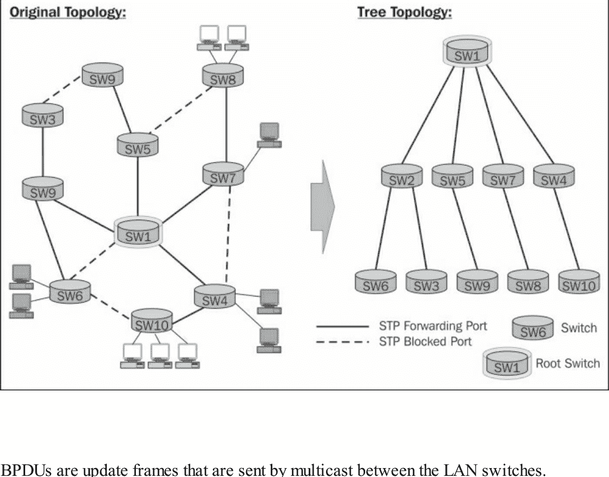

BPDU 是在 LAN 交换机之间通过多播发送的更新帧。

首先，在以太网级别，如以下屏幕截图所示，数据包将从发送更新的交换机的源 MAC 多播：

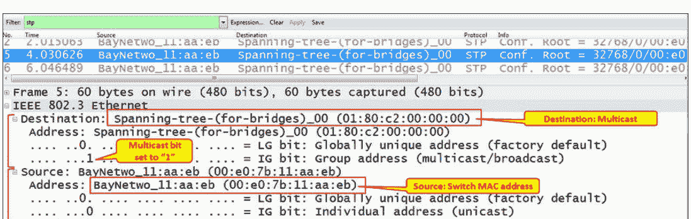

BPDU 由以太网 802.3 帧承载，其格式如下一个图所示：

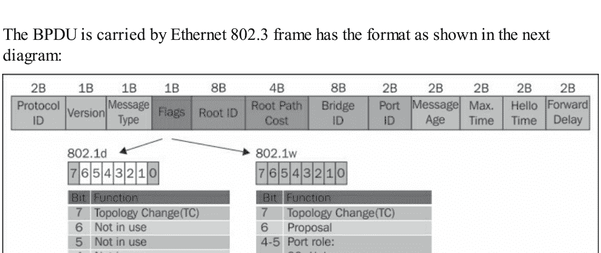

在下面的表中，您可以看到 STP 帧中的字段：

| Field | Bytes | What is it | Values | Display filter |
| Hello Time | 2 | Time between BPDUs. | Usually 2 seconds | `stp.hello` |
| Forward Delay | 2 | The Forward Delay field indicates the length of time that bridges should wait before transitioning to a new state after a topology change. | Usually 15 seconds | `stp.forward` |

请注意，在 MST 的情况下，将为 MST 参数添加额外的头。

### Port states

在 STP 中，端口状态如下：

- **Disabled**: 在此状态下不转发帧也不接收 BPDU
- **Blocking**: 在此状态下不转发帧，但会接收 BPDU
- **Listening**: 在此状态下不转发帧，但端口会监听帧
- **Learning**: 在此状态下不转发帧，但会捕获 MAC 地址
- **Forwarding**: 在此状态下转发帧，并捕获 MAC 地址

当您将设备连接到 LAN 交换机时，端口会经历这些阶段，所花费的时间如下：

- 从 Blocking 到 Listening 需要 20 秒
- 从 Listening 到 Learning 需要 15 秒
- 从 Learning 到 Forwarding 需要 15 秒

在 RSTP 和 MST 中，端口状态如下：

- **Discarding**: 在此状态下丢弃帧
- **Learning**: 在此状态下不转发帧，并捕获 MAC 地址
- **Forwarding**: 在此状态下转发帧，并捕获 MAC 地址

从 Discarding 到 Forwarding 的整个端口状态转换应需要几秒钟，具体取决于网络拓扑和复杂性。


## 更多内容...

对于生成树（Spanning Tree）调试，最好的方法是直接从局域网交换机获取数据。一个配置良好的 SNMP 陷阱（trap）发送到管理系统也能对此有所帮助。

以下是一些 STP 数据包的示例：

- 在下面的截图中，你会看到一个 STP 帧。可以看到源 MAC 地址是北电（Nortel）地址，在 BPDU 本身中，你会看到根网桥标识和网桥标识相等；这是因为发送该数据包的网桥是根网桥。端口 ID 是 8003，这表示在北电交换机中对应端口号 3。

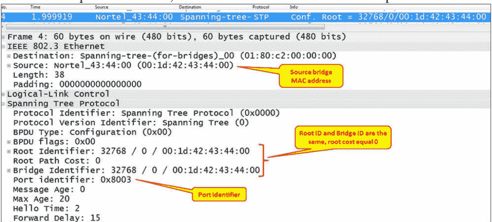

- 在下面的截图中，你会看到一个快速 STP（Rapid STP）BPDU。这里可以看到协议标识符等于 2，端口状态为指定（designated）。

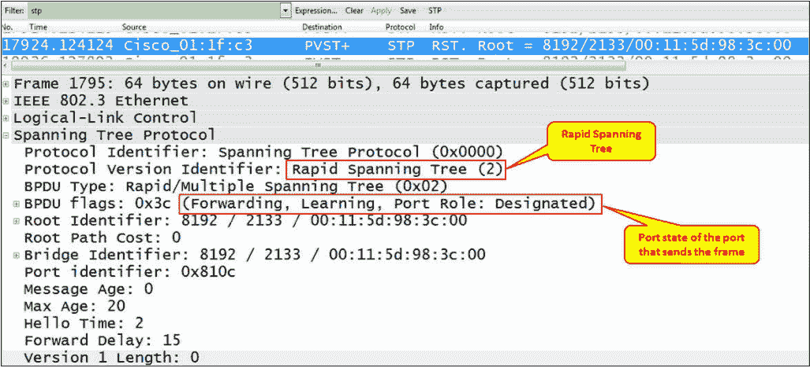

- 在上一个截图中，你会看到一个 MST（多生成树）的示例。这里我们在标准 STP 帧之后立即看到 MST 扩展。

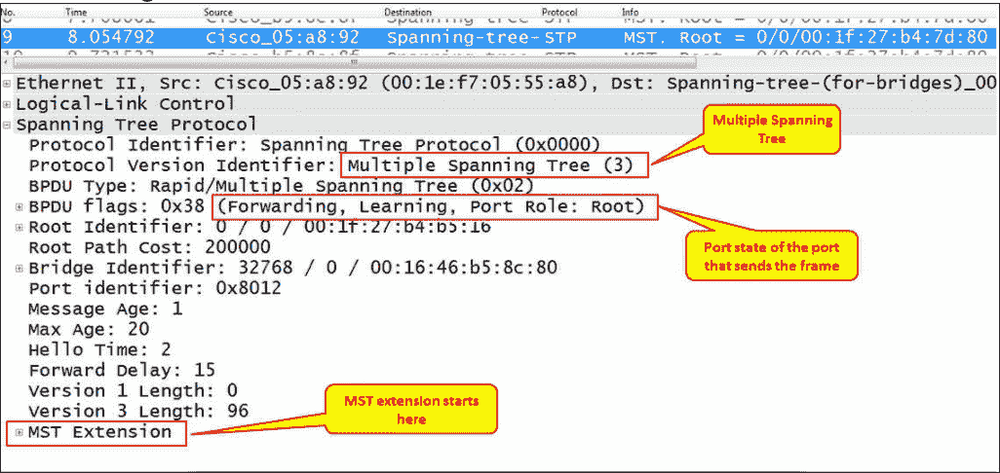

## 分析 VLAN 与 VLAN 标记问题

**VLAN**，或**虚拟局域网**（Virtual LAN），是一种将局域网划分为彼此之间没有任何连接的独立局域网的机制，“虚拟”这个名字正由此而来。在本节中，我们将介绍监控 VLAN 流量的方案。

本方案旨在向读者概括介绍如何使用 Wireshark 处理 VLAN 问题。解决相关问题的一个更简单的方法是使用厂商的命令行界面（CLI）（如 Cisco IOS、Juniper JUNOS 等）。

## 准备工作

在本方案中，我们将讨论两个问题：

- 如何监控 VLAN 内部的流量
- 如何查看经过 VLAN 标记端口的带标记帧

在第一种情况下，需要进行简单的配置。在第二种情况下，有一些需要注意的地方。

在 VLAN 上抓包时，你不一定会在数据包中看到 VLAN 标记。你是否能看到 VLAN 标记实际上取决于你运行的操作系统，以及你的网络接口卡（NIC）和 NIC 驱动程序是否支持此功能。

# 注意

你的操作系统和 NIC 是否支持 VLAN 标记完全取决于操作系统和 NIC 的厂商。请查看厂商手册或通过 Google 搜索来查明。

在下图中，你可以看到一个典型的 VLAN 拓扑。上层交换机通过两条 trunk 端口（这些端口会对以太网帧进行标记）连接到下层交换机。在该网络上，你拥有 VLAN 10、20 和 30，而连接到各个 VLAN 的 PC 将无法看到其他 VLAN 中的 PC。

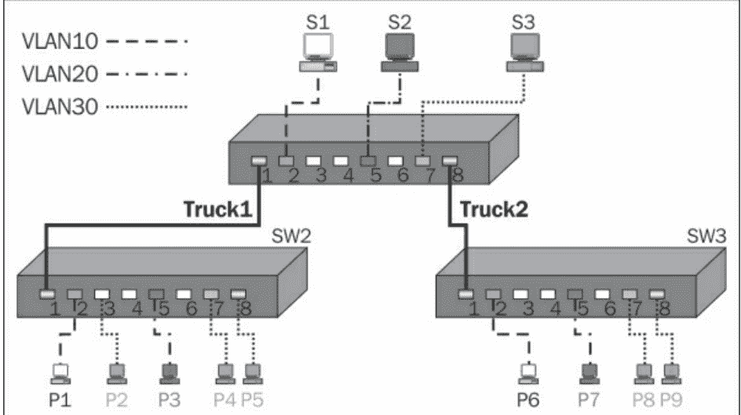

## 如何操作...

将 Wireshark 连接到你要监控的交换机。我们来看看上述配置（如前面的图所示）。

### 监控 VLAN 内部的流量

要监控整个 VLAN 上的流量：

1. 将笔记本电脑连接到中心交换机，并连接到其中一个端口。
2. 配置端口镜像，从被监控的 VLAN 镜像到你连接的端口。例如，如果你将笔记本电脑连接到 SW1 的 4 号端口，并希望监控 VLAN10 的流量，命令如下（在 Cisco 中）：

```
Switch(config)#monitor session 1 source vlan 10
Switch(config)#monitor session 1 destination interface
fastethernet 0/4
```

这将显示通过中心交换机 SW1 转发的 VLAN10 流量。

#### 提示

有关如何在不同厂商的网站上配置端口镜像的更多信息，请搜索 `SPAN`（Cisco）、`port mirror` 或 `mirroring`（HP、DELL、Juniper 等）。在刀片中心监控流量时，通常只能监控物理端口上的流量；不过，有些应用程序可以让你仅监控刀片上某个特定服务器的流量（例如 Cisco Nexus 1000V）。

### 查看经过 VLAN 标记端口的带标记帧

监控带标记的流量并非一件简单的事。你在用 Wireshark 抓包时是否能看到 VLAN 标记，取决于你使用的网卡、其上运行的驱动程序，以及它们对 VLAN 标记的处理方式。

验证你的笔记本电脑能否捕获带标记帧的最简单方法如下：

1. 通过端口镜像开始捕获带标记端口上的流量。如果你看到了标记，就可以继续你的工作。
2. 如果看不到任何标记，请进入网卡配置。在 Windows 7 中，你可以通过单击“开始”按钮，然后依次导航到 **控制面板 | 网络和**

Internet | 查看网络状态和任务 | 更改适配器设置 | 本地连接。接下来，按照下面截图所示的步骤操作：

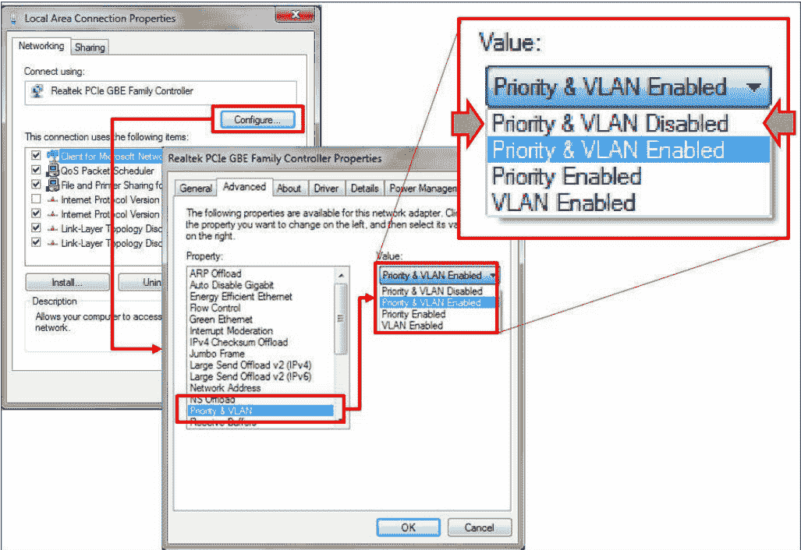

3. 将适配器配置为禁用优先级和 VLAN（Priority & VLAN Disabled）。这样会将标记传递给 WinPcap 驱动程序和 Wireshark。

# 注意

在上一张截图中，我们看到了一个带有 Realtek 网卡的联想笔记本电脑的示例。该示例展示的是常见设备，但在其他笔记本电脑或服务器上可能有所不同。原理应当相同：通过提取 VLAN 标记来禁用适配器对该标记的处理，以便将其转发给 WinPcap 驱动程序并在 Wireshark 中显示。

## 工作原理...

标记（tag）是添加到数据包中的一小段数据，用于为其添加 VLAN 信息。该标记是一个 4 字节长的字符串（32 位），如下面的某个图所示。

大多数网卡及其驱动程序只会将 VLAN 标记直接传递给上层进行处理。在这种情况下，Wireshark 会看到 VLAN 标记并显示它们。

在更复杂的网卡和驱动程序中，VLAN 标记将由网卡本身处理。这包括一些最常见的采用 Intel 和 Broadcom 千兆芯片组的网卡。在这些情况下，你必须禁用 VLAN 功能。

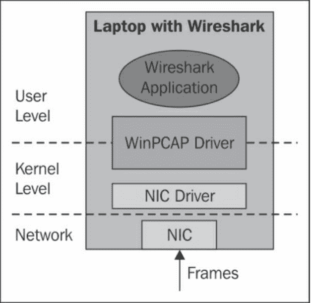

在配置 NIC 驱动程序以确保它不会处理 VLAN 标记时，数据包将被简单地转发给 WinPcap 驱动程序，并由 Wireshark 显示。

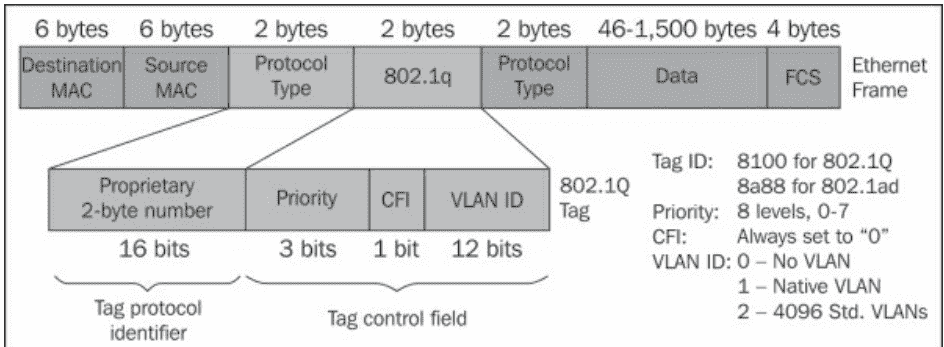

## VLAN 标记

在下面的截图中，你会看到一个带标记帧的示例；该帧被标记为 VLAN ID = 20。

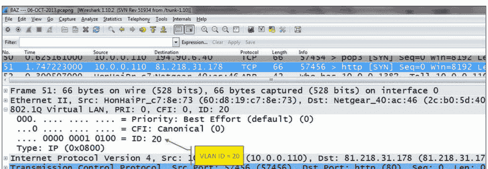

## 更多内容...

Wireshark 也会捕获双重标记，就像 802.1ad 标准一样。这些标记被称为服务标记（service tags），在服务提供商边缘添加，用于区分提供商标记和客户标记。提供商标记称为 **S-Tag**（802.1ad），客户标记称为 **C-Tag**（802.1Q）。这也被称为 QinQ 机制。

## 另请参阅

- 有关 WinPcap 的更多信息，请访问 WinPcap 主页 http://www.winpcap.org/
- 有关 UNIX/Linux 库的更多信息，请参考 tcpdump 主页 http://www.tcpdump.org/

## 分析无线（Wi-Fi）问题

无线局域网（Wi-Fi）在过去十年中变得非常流行，从早期的 802.11b，到 802.11g，再到支持高带宽无线通信的最新 802.11n 标准。

还有新兴的标准，例如 IEEE 802.11ac，相关产品已进入市场，同时 802.11ad 仍在开发中。

在本方案中，我们将学习如何解决 Wi-Fi 问题，以及如何使用 Wireshark 捕获 Wi-Fi 帧并进行基本的流量分析。

## 准备工作

当用户抱怨通过 Wi-Fi 连接时性能不佳时，请尽量带着笔记本电脑靠近用户所在位置，并确认你的 Wi-Fi 适配器已启用。

## 如何操作...

基本工具就在笔记本电脑中（如下面的截图所示），在这里你可以获得以下第一手信息：

- 信号强度，即接收信号强度指示（RSSI）。在某些情况下，你只会看到信号质量；在其他情况下，你还会看到 dBm 数值。

- 接入点 ID，即服务集标识（SSID）

- 所使用的安全协议

- 无线类型（如下面的截图所示，为 802.11n）

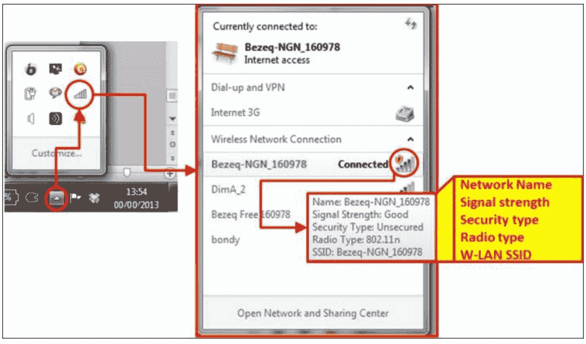

你也可以使用专用软件（其中许多是免费软件）来发现可用的 Wi-Fi 网络和信道（有些来自笔记本厂商，有些来自其他厂商）。在下面的截图中，你可以看到由名为 WIFI Locator（http://tcpmonitor.altervista.org/）的软件发现的一组无线网络列表；但是，还有许多其他软件也提供基本的发现功能：


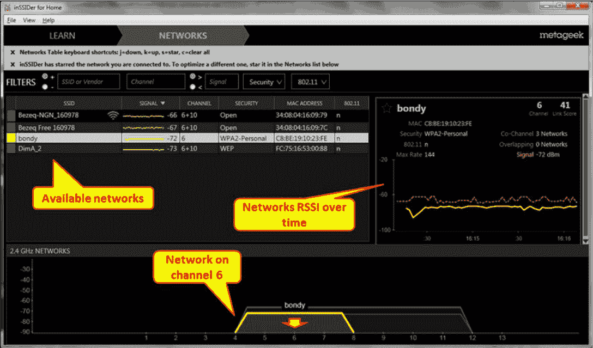

+   1. 尝试找出以下问题：
+      - 在同一区域内工作在同一信道上的不同接入点（AP）
+      - 较低的 RSSI 值（以低于 -90dBm 的 RSSI 数值表示）
+   2. 下一步是使用频谱分析仪检查你所在区域使用了哪些频率。在机场、海港和军事区域等地，你可能会遇到频率干扰。Fluke Networks、Agilent 和 Anritsu 等多家供应商都提供频谱分析仪。
+   3. 可以使用 Wireshark 分析 Wi-Fi 控制帧。首先要查看的是 AP 是否在发送信标帧。在下面的截图中，你可以看到这些帧：

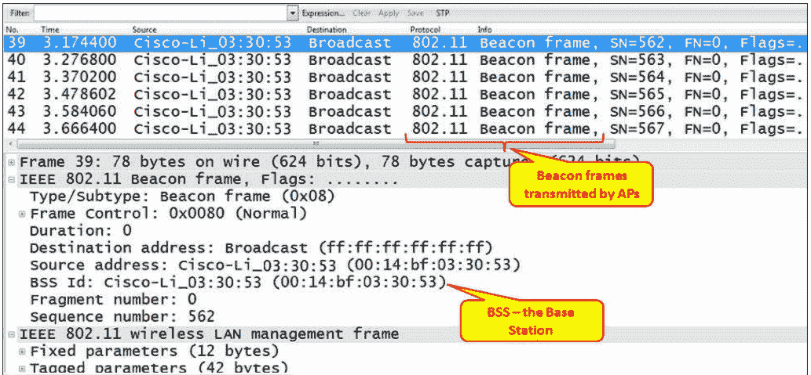

工作站可以发送信标探测请求帧来查找附近的接入点。

## 提示

当工作站想要从另一个 Wi-Fi 设备获取信息时，例如确定范围内的接入点，它会发送探测请求帧。

工作站也可以确认来自接入点的信标帧，以便注册到该 AP。

## 提示

接入点定期发送信标帧，以通告其存在并传递信息。这些信息包括时间戳、SSID 以及与接入点相关的其他参数。无线网卡会持续扫描所有 802.11 无线信道并侦听信标，以便选择最佳的接入点进行关联。

+   4. 在接受并确认信标帧后，将开始标准的 DHCP 过程，如第8章“ARP与IP分析”所述。

## 工作原理...

无线局域网标准以 IEEE 802.11 委员会为基础。这些标准从 802.11a、802.11b、802.11g、802.11n 开始，最近又加入了用于更高带宽的 802.11ac 和 802.11ad。

如下图所示，无线局域网基于接入点（AP）构建，无线客户端通过连接到接入点来接入网络。

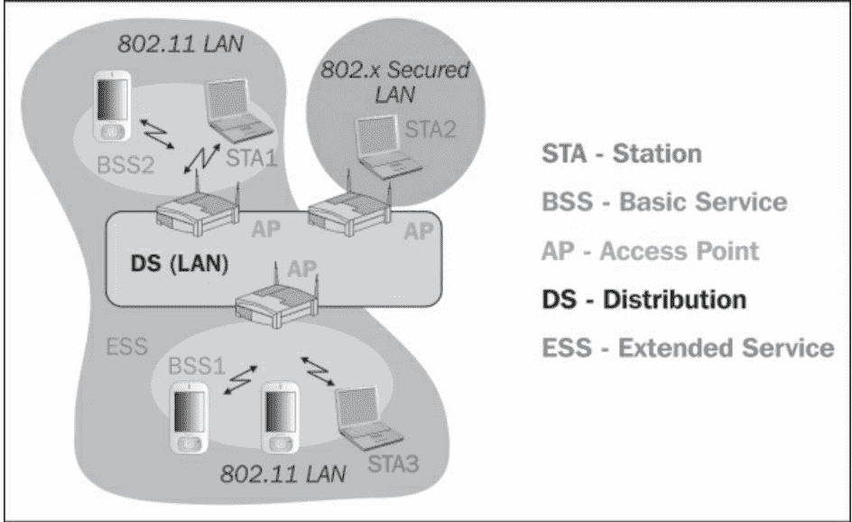

目前最常见的无线标准是 802.11n，它使用先进的多输入多输出（MIMO）调制技术，可搭配最多四根天线，并辅以其他技术来提升带宽。
