## 第8章 ARP 与 IP 分析

在本章中，我们将介绍以下内容：

+   - 使用 ARP 分析连通性问题
+   - 使用 IP 流量分析工具
+   - 使用 GeoIP 查找 IP 地址的物理位置
+   - 发现分片问题
+   - 分析路由问题
+   - 发现重复的 IP
+   - 分析 DHCP 问题

## 简介

在本章中，我们将学习如何分析第3层（IP）以及从第3层到第2层的解析（ARP）。我们将讨论互联网协议（IP）、地址解析协议（ARP）、动态主机配置协议（DHCP）、路由问题等，以及在排查这些协议时可能遇到的问题。

我们将首先介绍各种协议的正常行为，然后说明可能出现的问题以及如何解决。

通常，在分析网络问题时，我们会自下而上进行排查：如果无法建立连接，请按以下顺序查找问题：

+   1. **第1层**：检查电缆是否已连接，交换机和你 PC 上的链路 LED 是否亮起。此步骤需要手动执行。
+   2. **第2层**：检查 ARP 是否已发现目的 MAC 地址。如果是远程位置，请检查沿途每两个节点/路由器之间的连通性。这可以通过命令行完成（参见后面的 ARP 技巧）。
+   3. **第3层**：使用 `ping` 命令检查目的地，如果没有收到响应，则对其进行路由追踪。这可以通过命令行完成，在某些情况下也可以使用 Wireshark。
+   4. **第4层**：检查对端的进程/服务器是否有响应。此步骤需要使用 Wireshark 执行。
+   5. **第5-7层**：检查应用程序问题。此步骤需要使用 Wireshark 执行。

在第7章“以太网、局域网交换和无线局域网”中，我们讨论了第1层和第2层。在本章中，我们将讨论第3层（即 IP）以及第3层与第2层之间的解析过程（即 ARP）。在第9章“UDP/TCP分析”中，我们将讨论第4层（即 TCP 和 UDP），并在本书其余部分讨论应用层。

## 使用 ARP 分析连通性问题

IP 使用 ARP 来根据目标设备的 IP 地址解析出目的 MAC 地址。当我们向目的地发送数据包时，第一个数据包是 ARP 请求，用于查找目的地的 MAC 地址。我们从目的地获取该地址，然后向它发送其他数据包。

## 提示

ARP 操作仅在本地进行，也就是说，作为广播的 ARP 请求只会在局域网内发送。当你向 IP 网络（具有相同的 IP 网络和掩码）中的设备发送数据包时，ARP 将尝试找到其地址。当你向网络之外的主机发送数据包时，会发送 ARP 来查找默认网关的 MAC 地址。

## 准备工作

我们将使用三种方法来查找基本的连通性问题：

+   - 标准命令行（在 MS-Windows 中，转到**开始**，并在命令窗口中输入 `run`。在 Linux 中使用任何可用的 Shell）
+   - Wireshark
+   - 直接连接到局域网交换机或路由器，并从那里获取信息

## 提示

要连接到通信设备（路由器、交换机等），首先需要使用控制台电缆（在 Cisco 中，这是浅蓝色扁平电缆）进行连接；为设备配置 IP 地址后，就可以通过 Telnet、HTTP 或 SNMP 软件访问该设备。通过所有这些方法，你可以读取设备计数器，从而获得流量、错误、CPU 利用率等信息。

在接下来的每个操作步骤中，我们将确切地看到使用什么以及在哪里使用。

## 操作步骤...

在本节中，我们将看到几个连通性问题以及如何处理它们。让我们看看下图中这个非常简单的网络。在这里，我们可以看到一个典型的网络，并讨论可能出现的某些连通性问题。

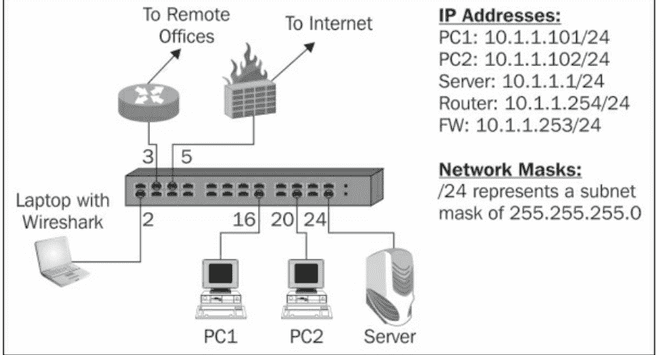

在网络中，我们可以看到两台 PC——PC1 和 PC2——分别连接到交换机的 16 和 20 端口；一台服务器连接到交换机的 24 端口；一台路由器连接到交换机的 3 端口，将我们连接到远程办事处；一台防火墙连接到交换机的 5 端口，将我们连接到互联网。我们安装了 Wireshark 的笔记本电脑连接到 2 端口。

让我们看看这里可能发生的一些问题以及如何解决它们。

让我们考虑情况1：PC 无法连接到服务器时：

+   1. 从 PC1 和 PC2 ping 服务器。
+   2. 如果没有响应，请在命令行中输入 ARP -a。在 ARP 表中，你应该能看到服务器的 IP 地址及其 MAC 地址。
+   3. 如果你看到了服务器的 MAC 地址，那么很可能是服务器上运行的防火墙阻止了 ICMP 请求。为了测试，请禁用防火墙并再次测试。

## 提示

防火墙、VPN 客户端或带有某些防火墙功能的防病毒软件都可能阻止 ICMP 请求。在测试网络连通性问题时，请不要忘记这一点。

4. 如果你已经 ping 通了，但你的应用程序仍然无法工作，请参阅第9章“UDP/TCP分析”，并从那里继续排查。

你已完成情况1中的步骤1到3，但仍然没有收到 ping 响应（显示请求超时）。

+   5. 连接到局域网交换机，获取交换机已学习的 MAC 地址列表。

## 提示

在每台可管理的交换机中，你都可以查看交换机已学习的 MAC 地址列表，以及交换机是在哪些端口上学习到这些地址的。

在 Cisco 中，相应的命令是 `show mac-address-table` 或 `show mac address table`（取决于 IOS 版本）。

+   6. 如果你没有看到 PC 和服务器的地址，请检查物理问题，例如电缆故障、适配器问题和交换机端口问题。为此，你可以简单地更换电缆，或在测试时更换交换机、更换交换机上的端口等。

现在让我们看看如何使用 Wireshark 来解决这个问题。

+   7. 当客户端抱怨无法连接到某个特定设备（服务器、打印机等）时，你可以将 Wireshark 连接到该端口（通过端口镜像），然后你会看到大量 ARP 请求且没有响应。你可以在下图中看到这样的示例：

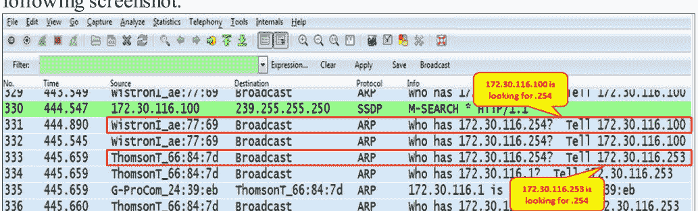


- 8. 在此示例中，我们看到 **172.30.116.100** 和 **172.30.116.253** 都在查找 **172.30.116.254** 的 MAC 地址，但没有收到任何回复。
- 9. 在这种情况下，请在交换机中检查 MAC 地址是否已被学习；若没有，则检查物理问题。

## ARP 欺骗与中间人攻击

中间人攻击的一种类型是，攻击者将自己以太网网卡的 MAC 地址注入其想监听设备的 ARP 缓存。一旦 ARP 缓存被成功毒化，每个受害设备在与另一台设备通信时，都会将所有数据包发送给攻击者。当然，攻击者在读取数据后会将其重新转发给它们。

这被称为中间人攻击，因为攻击者被置于两个受害设备之间通信路径的中间。这也被称为 ARP 欺骗，因为攻击者实际上用错误信息毒化了受害者的 ARP 缓存。

在下图中，我们看到了一个中间人攻击的示例：

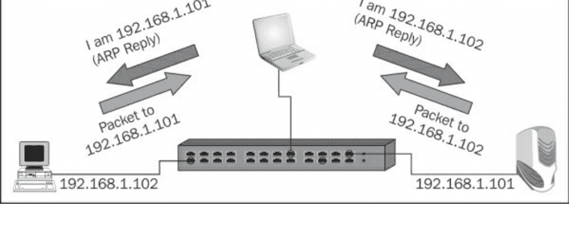

以下截图展示了 Wireshark：

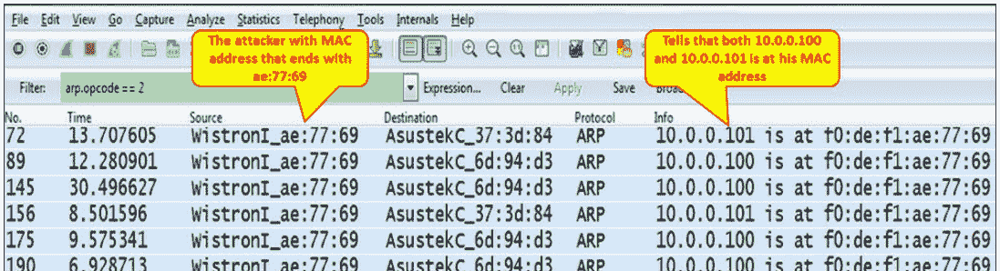

## 免费 ARP（Gratuitous ARP）

免费 ARP 发生在设备想要验证是否有其他设备使用自己的 IP 地址时。在这种情况下，你会看到一个源地址字段和目标地址字段相同的 ARP 报文。免费 ARP 并无不妥。有些设备就是以这种方式工作的，例如，扫描已连接设备的家用路由器。

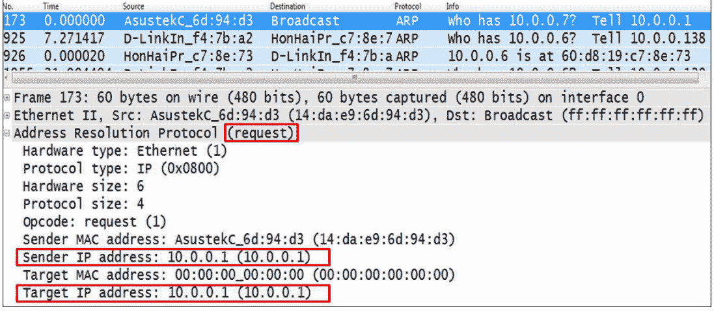

## ARP 扫描

当出于某种原因，我们看到某台设备使用 ARP 请求或响应来扫描网络，以获取信息或攻击网络时，就会用到 ARP 扫描。

在观察 ARP 扫描时，只需检查以下内容：

## 工作原理

当我们在局域网内从自己的 IP 地址向目的 IP 地址发送数据包时，数据是被封装在以太网帧中的 IP 数据包。

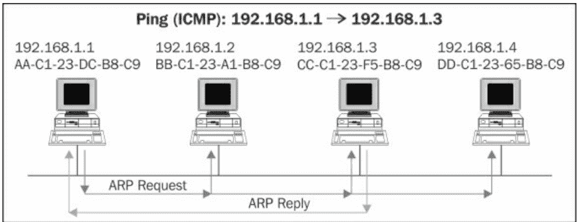

例如，我们在同一局域网内从 192.168.1.1 向 192.168.1.3 发送一个 Ping（ICMP 请求）。要发送数据包，我们需要目的地的 IP 地址和 MAC 地址，但我们只有它的 IP 地址。我们知道这个 IP 地址，因为这就是我们的目的地。

为了找出目的地的 MAC 地址，我们只需向局域网发送一个 ARP 广播，询问连接在局域网上的所有设备：谁拥有 IP 地址 192.168.1.3？如果目的主机在线，它会发送一个带有目的 MAC 地址的 ARP 响应。

从此刻起，源主机会将数据保存在一个缓存中，即 ARP 缓存，下次要发送数据时，它会直接将数据发送到目的地址。

ARP 缓存在主机缓冲区中保留数分钟（具体时间取决于操作系统）。当最后一个数据包发送到目的地后，ARP 条目会在几分钟后被清除。

ARP 请求将是发送到局域网的广播，如下面的截图所示：

ARP 响应将是一个由我们查找的目的地发送给源主机的数据包，其中包含所需的 MAC 地址，如下面的截图所示：

任何不符合标准且属于已知例外的情况（例如，免费 ARP、路由器发起的 ARP 扫描）都应该被检查！

## 更多内容

这里有一个简短示例，帮助理解 ARP 的工作原理。在下图中，我们看到了一个有趣的情况：两台设备连接到同一局域网，但位于不同的子网，并且默认网关配置为各自自身的 IP 地址。问题是：它们之间的 Ping（或任何通信）能正常工作吗？

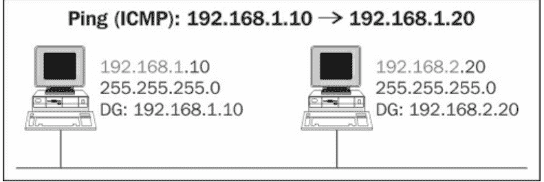

凭直觉，你可能会回答不行，因为这是两台处于不同子网的设备，因此它们之间需要一台路由器。但让我们看看实际在线路上发生了什么：

- **192.168.1.10** 想要向 **192.168.2.20** 发送数据包。由于默认网关配置为其自身地址，它认为目的地与它在同一局域网，于是发送 ARP 请求。
- 由于我们与目的地处于同一局域网，目的地会收到 ARP 请求（因为这是广播），并以自己的 MAC 地址回复 **192.168.1.10**。
- 现在，源主机拥有了目的地的 MAC 地址。它向该地址发送数据包，尽管两台设备不在同一 IP 子网，目的地仍然能收到数据包。

另一个重要问题是代理 ARP（Proxy ARP）。通信中的代理是代表他人执行某项操作的设备，而代理 ARP 则是一种技术，在这种技术中，一台主机（通常是路由器）会应答本应发给另一台机器的 ARP 请求。

代理 ARP 概念在多种场景中得以应用，例如：

- 当在路由器前面放置一台设备时，例如广域网加速/优化设备。当你将该设备配置为桥接（或透明）模式时，它会应答本应发给路由器的 ARP 请求。
- 防火墙、网页过滤器以及以透明模式工作并位于服务器前方的其他设备。
- 当某款软件除了其安装所在服务器的 IP 地址外，还需要另一个 IP 地址时。

## 使用 IP 流量分析工具

IP 是 TCP/IP 协议栈中的网络层协议，承载着所有上层信息。无论是 HTTP、视频、IP 电话还是其他应用，IP 都是它们的第 3 层协议。在本节中，我们将了解一些有助于分析 IP 流量的工具。

### 准备工作

只需打开 Wireshark，将其连接到网络，为目标测试设备配置端口镜像，然后启动即可。

### 操作步骤

有几种工具和配置可以帮助你分析 IP 流量，其中包括：

- IP 统计
- IP 名称解析

### IP 统计工具

当你在监控通信线路、与服务器的连接、上网流量或任何其他类型的流量时，有几种工具可用于监控源 IP 和目的 IP。

以下是查看源 IP 和目的 IP 的步骤：

- 1. 从菜单中选择“视图 | 名称解析”，并勾选“网络层”对应的“启用”。如果你正在查看已存在的文件，更改后点击“重新加载”图标。捕获屏幕上除了 IP 地址外，还会显示 DNS 名称。

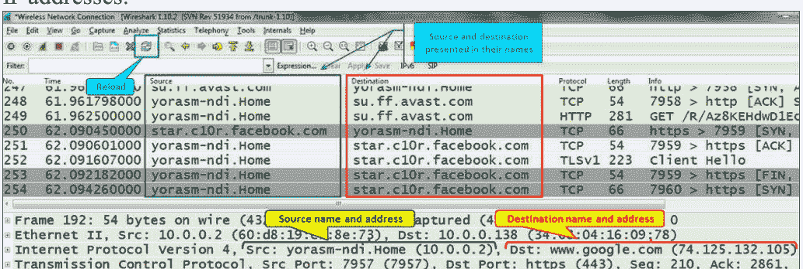

- 2. 要查看统计信息，请从“统计 | 对话”菜单中选择，并在窗口左下角勾选“名称解析”，如下一个截图所示：

对话：Microsoft: \Device\NPF_{53DFE1F7-0FDB-46E3-8D48-C5804C455B8A}

IPv4 对话

| 地址 A | 地址 B | 数据包 | 字节 | 数据包 A→B | 字节 A→B | 数据包 B→A | 字节 B→A |
|---|---|---|---|---|---|---|---|
| e2094.b.akamaiedge.net | yoras m-ndi | 824 | 772 542 | 531 | 732 520 | 293 | 40 022 |
| dgdsbygo8mp3h.cloudfront.net | yoras m-ndi | 780 | 716 894 | 491 | 690 885 | 289 | 26 009 |
| e2774.dscb.akamaiedge.net | yoras m-ndi | 662 | 607 431 | 422 | 589 343 | 240 | 18 088 |
| e144.dscb.akamaiedge.net | yoras m-ndi | 558 | 385 484 | 317 | 204 936 | 241 | 80 548 |
| yoras m-ndi | cdn.cnn.com.c.footprint.net | 503 | 35... | ... | ... | 280 | 367 207 |
| 192.168.43.1 | yoras m-ndi | 362 | ... | ... | ... | 193 | 15 593 |
| cisco-tags.cisco.com | yoras m-ndi | 313 | 85 341 | 140 | 52 429 | 173 | 32 912 |
| news-tags.cisco.com | yoras m-ndi | 277 | 89 342 | 124 | 59 560 | 153 | 29 782 |
| groups.l.google.com | yoras m-ndi | 245 | 148 053 | 140 | 129 016 | 105 | 19 037 |
| yoras m-ndi | cdn.cnn.com.c.footprint.net | 204 | 117 155 | 105 | 13 308 | 99 | 103 847 |
| orig-10001.nrg.cotcdn.net | yoras m-ndi | 202 | 65 878 | 95 | 43 023 | 107 | 22 855 |
| talk.l.google.com | yoras m-ndi | 166 | 46 820 | 91 | 36 215 | 75 | 10 605 |
| a122.g1.akamai.net | yoras m-ndi | 152 | 37 157 | 76 | 15 271 | 76 | 21 886 |
| star.c10r.facebook.com | yoras m-ndi | 138 | 31 654 | 73 | 23 417 | 65 | 8 237 |

IP 对话 名称解析 标记以供名称解析 限制为显示过滤器 帮助 复制 跟踪流 关闭

以太网：5 光纤通道 FDDI IPv4：88 IPv6 JPX JXTA NCP RSVP SCTP TCP：217 令牌环 UDP：180 USB WLAN


## 它是如何工作的...

这非常简单。Wireshark 使用笔记本电脑上配置的 DNS 服务器来将 IP 地址翻译成名称。在某些情况下，了解有问题的流量模式会非常有帮助。这些可以例如是：

- 违反公司政策的不允许访问网站的流量。
- 自动软件更新，例如，反病毒网站和 Microsoft 更新。解决办法是中央服务器下载软件，而所有公司 PC 都从该服务器获取软件和更新。
- 如果在组织设备上安装了工具栏，工具栏流量可能会导致大量流量（想想你公司每台设备额外增加 50-100 个打开的连接，加上常规流量）。

## 还有更多...

例如，你可以看到一个安装了 Conduit 工具栏的浏览器。一旦运行它，你就会看到许多连接到你知道的网站，以及你不知道的网站的连接。在这里，例如，你可以看到连接到 Conduit 网站的连接，也连接到 **内容分发网络 (CDN)** 供应商。

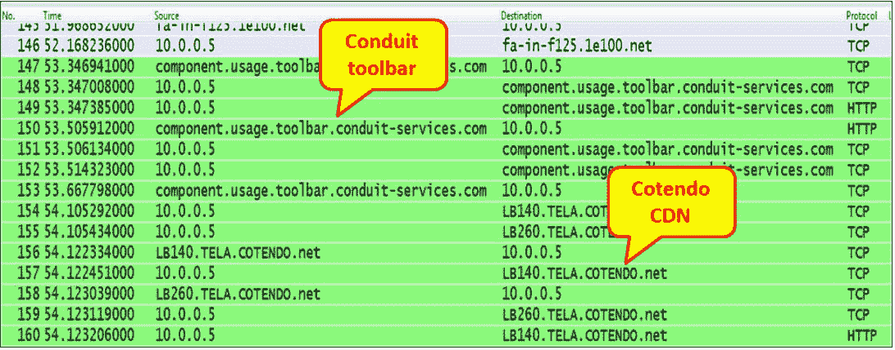

要查看确切的网站和页面，当然可以，选择 **Statistics | HTTP** 并选择相关功能（以 IP 配置为过滤器）。

高效使用工具栏的一些规则：

- 制定关于使用什么和不使用什么的政策，并阻止用户安装不允许的工具栏
- 监控你到互联网的线路，并确保流量去向何处

## 使用 GeoIP 查找 IP 地址的物理位置

Wireshark 1.1.2 及更高版本可以使用 GeoIP（商业版）和 GeoLite（免费版）数据库来查找 Wireshark 发现的 IP 地址的城市、国家、AS 编号和其他信息。

## 准备工作

1. 前往以下网站：http://dev.maxmind.com/geoip/geolite.
2. 对于 IPv4，下载以下文件（二进制文件）：
   - GeoLite Country
   - GeoLite City
   - GeoLite ASN
3. 对于 IPv6，下载以下文件：
   - GeoLite Country (IPv6)
   - GeoLite City (IPv6)
   - GeoLite ASN (IPv6)

### 提示

**自治系统 (AS)** 是在 **外部网关协议 (EGPs)** 中使用的术语，用于标识由同一网络运营商控制的所有路由器。当你通过两个不同的 **互联网服务提供商 (ISPs)** 连接到互联网时，你将拥有自己的 AS，而两个 ISP 各自拥有其 AS。在使用两个不同的 **互联网服务提供商 (ISPs)** 配置到互联网的连接时，AS 会与 EGP 路由协议一起配置。EGP 协议的市场标准是 **边界网关协议版本 4 (BGPv4)**。

你将获得包含国家、城市和自治系统 (AS) 编号的二进制文件。

## 如何操作...

下载文件后，请按照以下步骤操作：

1. 将所有文件放在同一目录中（你也可以将它们放在不同目录中，但会不方便）。
2. 现在，你必须告诉 Wireshark 文件在哪里。前往 **Edit | Preferences | Name Resolution** 并选择 **GeoIP database directories**。
3. 添加 GeoIP 目录的完整路径，如以下屏幕截图所示：

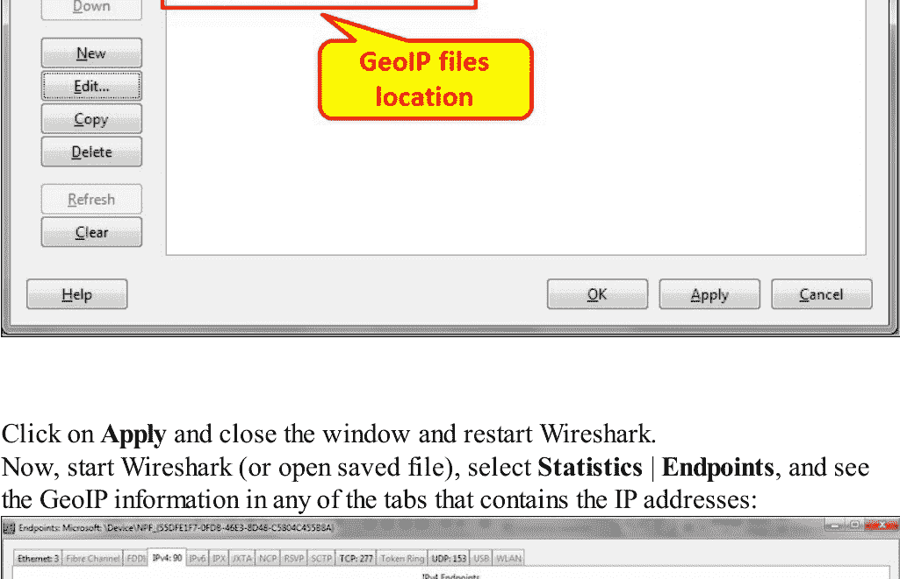

4. 点击 **Apply** 并关闭窗口并重新启动 Wireshark。
5. 现在，启动 Wireshark（或打开已保存的文件），选择 **Statistics | Endpoints**，并在包含 IP 地址的任何选项卡中查看 GeoIP 信息：


6. 你也可以在 IP 数据包详细树中查看 GeoIP 数据。要启用此功能，请前往 Edit | Preferences | Protocols | IP 并确保已勾选 Enable GeoIP lookup。

5129 64.355772000 yoras m-ndi d2n6o0n31iqeta.cloudfront.net TCP 54 55780 > http [ACK] Seq=

Internet Protocol Version 4, Src: yoras m-ndi (192.168.43.191), Dst: d2n6o0n31iqeta.cloudfront.net (:

Version: 4
Header Length: 20 bytes

Source: yoras m-ndi (192.168.43.191)

Destination: d2n6o0n31iqeta.cloudfront.net (54.240.162.90)

[Source GeoIP: unknown]

[Destination GeoIP: United States, AS16509 Amazon.com, Inc., Seattle, WA, 47.634399, -122.342201]
[Destination GeoIP Country: United States]
[Destination GeoIP AS Number: AS16509 Amazon.com, Inc.]
[Destination GeoIP City: Seattle, WA]
[Destination GeoIP Latitude: 47.634399]
[Destination GeoIP Longitude: -122.342201]

IP and DNS Information

GeoIP Information

## 它是如何工作的...

IP 地址由 **互联网号码分配机构 (IANA)** 提供，IANA 是互联网标准组织 (ISO) 的一个下属组织，分配给称为区域互联网注册管理机构的区域组织（RIPE-NCC、APNIC、AFRINIC、LACNIC 和 ARIN），然后它们分配给国家 ISP，国家 ISP 再分配给个人客户。GeoIP 只是这些位置的数据库，因此它根据此数据库解析 Wireshark 捕获的 IP 地址。

GeoLite 文件是免费的 IP 地理位置数据库，每月更新一次。它可以在 http://dev.maxmind.com/geoip/geolite#IP_Geolocation-1 找到。

## 还有更多...

GeoIP 可以用于多种原因：

- 查看组织中的人员正在连接的站点（网站、FTP 服务器等）
- 解析来自世界各地到你组织的连接的源 IP 地址
- 娱乐

## 查找分片问题

分片是 IP 中的常见机制，它将大型 IP 数据包分成更小的尺寸数据包，以便适应第 2 层以太网帧。在大多数情况下，该机制不应有任何问题，但由于该机制可能会出现性能问题。

## 准备工作

只需打开 Wireshark，将其连接到网络，将端口镜像配置到你要测试的设备，然后启动它。分片主要会影响交互式应用程序，例如数据库，这些是我们应该寻找问题的地方。

## 如何操作...

当分片发生时，你会看到 UDP 或 TCP 数据包以及分片的 IP 协议数据包，如以下屏幕截图所示：

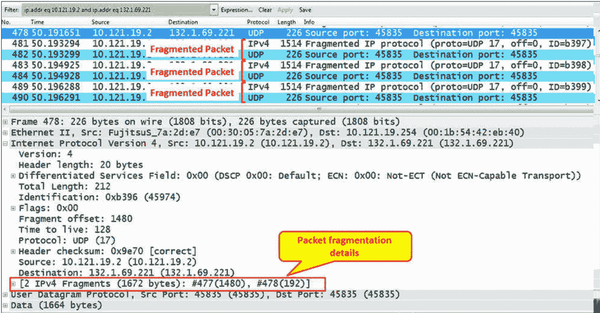

在怀疑性能问题时，例如，数据库客户端与服务器的连接缓慢，请按照以下步骤操作以查看问题是否由于分片引起：

1. 测试客户端和服务器之间的连接，以验证没有其他问题。
2. 查找客户端和服务器之间的分片。分片将显示为前一个屏幕截图中的情况（IPv4 分片）。
3. 如果你怀疑分片是问题的原因，请联系一位优秀的数据库管理员（DBA），他将调整数据库以发送不会导致网络分片的数据包。
4. 以太网中推荐的数据包大小不超过 1460 字节减去 TCP 头部大小。因此，从接口传出的段大小应为 1420-1440 字节。

在我们需要更多字节用于头部的情况下，例如，当我们使用隧道机制和 TCP 选项时，DBA 将不得不进一步减小此大小。最好的方法就是简单地将其减小到你不会看到任何分片的大小。

## 它是如何工作的...

了解定义通过网络发送的数据单元大小的两个术语很重要，如下图所示：

- **最大传输单元 (MTU)：** 这是包括头部和数据的 IP 数据包大小
- **最大段大小 (MSS)：** 这是 TCP 有效载荷的最大大小，即上层协议和数据的大小

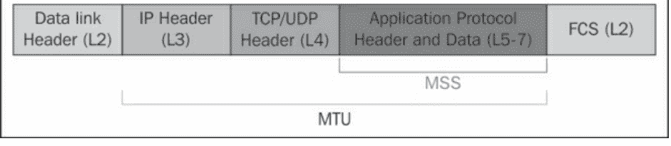

IPv4 中使用的分片机制如下图所示：

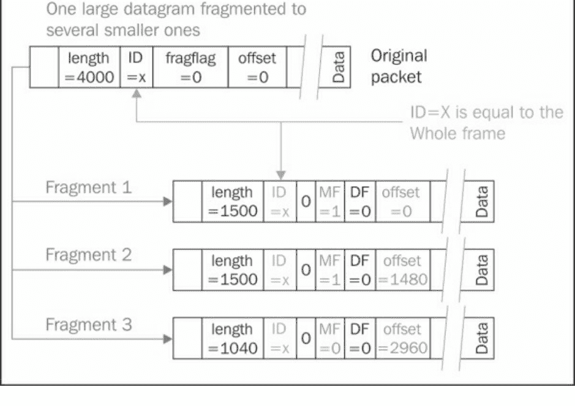


- 1. 一个原始的大数据包进入 NIC 或路由器，其数据包大小需要进行分片。
- 2. 数据包根据原始大小被分片成几个部分。
- 3. 对于分片，我们有以下字段：
  - **ID**：这与原始数据包的 ID 相同
  - **Bit 0**：始终为 0
  - **Bit 1 (DF 位)**：0 = 可分片，1 = 不分片。
  - **Bit 2 (MF 位)**：0 = 最后分片，1 = 还有更多分片
  - **分片偏移**：这表示从原始数据包开头开始的字节数

在 IPv4 中，NIC 本身可以对数据包进行分片，以及通往目的地的途中每台路由器都可以进行分片。

在 IPv6 中，分片只能由发送方完成，而不能由通往目的地的路由器完成。在 IPv6 中，分片由扩展头实现。

which is the first fragment leaving the NIC, we see:

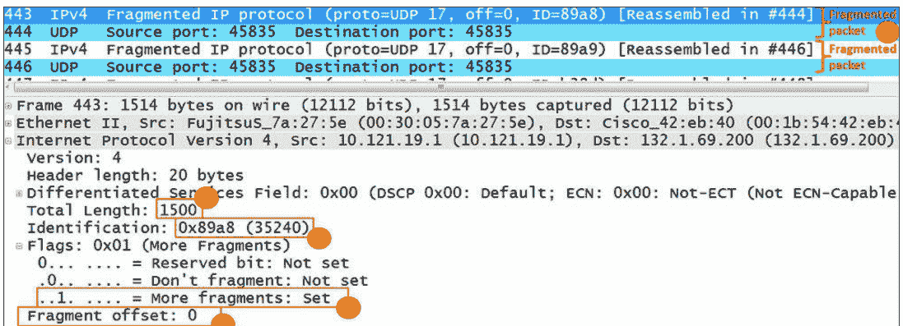

在前面的屏幕截图中，我们看到数据包 443 和 444 (1) 都是原始数据包的分片。在数据包 443 中，我们看到总长度为 1500 字节 (2)，ID 为 0x89a8 (3)，更多分片标志已设置 (4)，意味着后面还有更多分片要跟随，并且分片偏移为 0 (5)，意味着这是流中的第一个分片。

在下一张屏幕截图中，我们看到下一个分片，即捕获文件中的数据包 444：

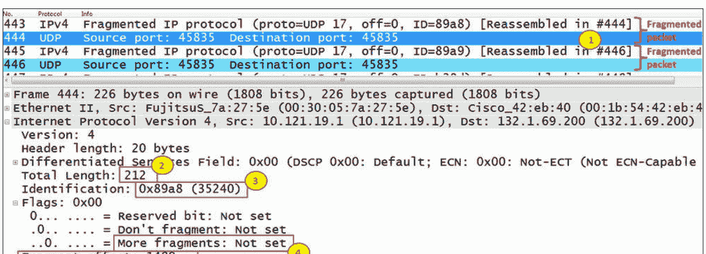

在数据包 444 中，我们看到总长度为 212 字节 (2)，ID 为 0x89a8 (3)，与数据包 443 相同，更多分片标志未设置 (4) 意味着这是来自原始数据包的最后一个分片，并且分片偏移为 1480 (5)，意味着这是来自原始数据包的第二个分片。

## 分析路由问题

网络中最关键的问题之一是路由。这些包括路由环路、无法到达目的地以及更多。大多数路由问题在解决时不需要使用 Wireshark。在大多数情况下，一些路由原理和协议的知识加上常识就能解决问题。在本配方中，我们将尝试提供一些基本提示以及一些基本问题，以便 Wireshark 可以提供帮助。

### 准备工作

首先，确保你熟悉非常基本的命令，`Ping` 和 `Tracert`（或 `Traceroute`）。在大多数情况下，这些命令加上登录路由器将帮助你解决这些问题。

在本配方中，我们将展示捕获文件中可以指示路由问题的一些重要内容。

### 如何操作...

在本节中，我们不会像通常那样给出要做什么的配方，而是提及需要关注和注意的事情。

在你应该注意的事情中，最关键的是：

- 第一个也是最重要的，**生存时间 (TTL)** 消息。TTL 值为 0 应该引起警报，因为在大多数情况下，这意味着环路。Wireshark 不会告诉你环路来自哪里，但看到这些消息是出了问题的警报。典型的消息将是：TTL 在传输中过期。
- 以下 ICMP 消息应指示路由器或多个路由器中的配置问题：
  - **目标网络不可达**：它通常表示其中一个网络路由器中缺少路由
  - **目标主机不可达**：它通常表示目的地网络上的设备（例如 PC）未连接到网络或其上未配置默认网关
- 另一个应该引起注意的问题是，当你看到数据包从源 IP 地址到目的地，反向到源，反向到目的地，等等，而 TTL 值在每个数据包中减少一时，这明显表明存在环路。

### 还有更多...

典型的路由问题可以在以下插图中看到。在此网络中，我们有一个中央数据中心和两个远程办公室。该网络是这样构建的，以便从远程办公室到中央数据中心提供冗余。

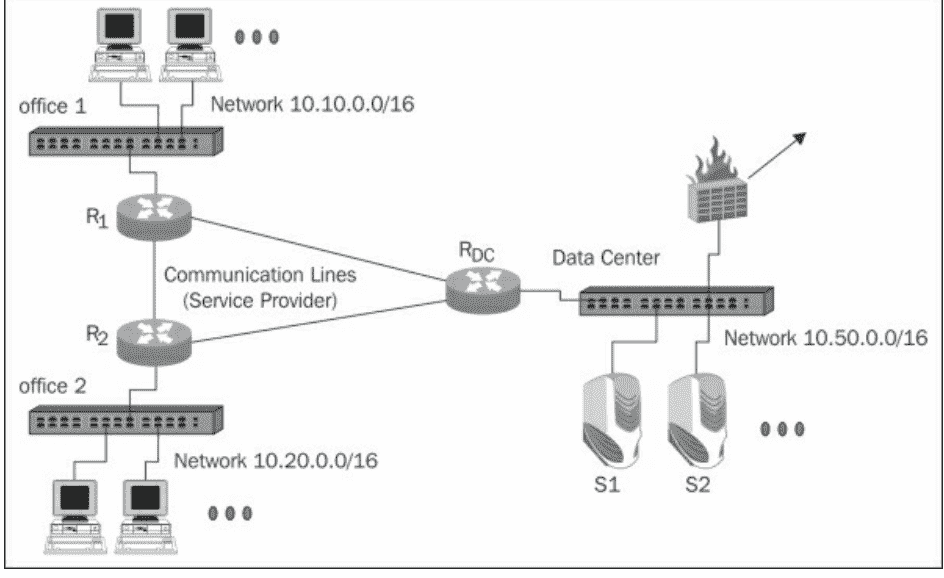

EIGRP 在路由器中运行，另外还有到 Internet 的静态路由。以下部分（且与案例相关）的路由表如下所示（仅表示与示例相关的路由）：

| 路由器 | 目标网络 | 下一跳 | 管理成本 | 发现协议 |
|---|---|---|---|---|
| R_DC | 10.10.0.0/16 | R1 | 5 | EIGRP |
| R_DC | 10.20.0.0/16 | R2 | 5 | EIGRP |
| R_DC | 0.0.0.0/0 | FW | 1 | Static |
| R1 | 10.50.0.0/16 | R_DC | 5 | EIGRP |
| R1 | 0.0.0.0/0 | R_DC | 1 | Static |
| R2 | 10.50.0.0/16 | R_DC | 5 | EIGRP |
| R2 | 0.0.0.0/0 | R_DC | 1 | Static |
| FW | 10.10.0.0/16 | R_DC | 1 | Static |
| FW | 10.20.0.0/16 | R_DC | 1 | Static |
| FW | 0.0.0.0/0 | ISP | 1 | Static |

问题是，我们曾遇到一个非常罕见的情况，即通往中心的两个线路，R1 到 R_DC 和 R2 到 R_DC，都被切断了（最后一公里被一台拖拉机切断）。

当然，两个办公室立即断开连接。问题是为什么拥有数百台 PC 另外还有数据中心的中央办公室变得非常缓慢，尤其是在 Internet 上。

当我将 Wireshark 连接到中央交换机并对整个交换机进行端口镜像时（端口镜像到 VLAN1），我看到了环路。数据包在服务器和防火墙之间传输，每个数据包的 TTL 递减。这是一个环路。

发生了什么？

- 1. 两条线路被切断的瞬间，EIGRP 在路由器 R_DC 中停止看到 R1 和 R2。
- 2. 当服务器向网络 10.10.0.0/16 或 10.20.0.0/16 发送数据包时，服务器将其发送到其默认网关；即 R_DC。
- 3. 当数据包到达它时，R_DC 将其发送到防火墙。这是当 EIGRP 变得非活动时生效的到 0.0.0.0 的路由。
- 4. 防火墙收到数据包并将其发送回 R_DC。这是他在路由表中的内容。
- 5. 数据中心中所有服务器发送到远程位置的数据包开始在服务器和防火墙之间乒乓，这足以减慢服务器和访问 Internet 的速度。

## 查找重复 IP

IP 网络中最令人讨厌的问题之一是重复的 IP 地址。有趣的是，如果你熟悉问题的原因以及如何找到它，它就成为最简单的问题之一来解决。

### 准备工作

当你怀疑网络中存在重复地址时，首先要做的是使用简单的 CLI 命令——ARP 和 Ping。如果找不到问题，将 Wireshark 连接到交换机并在大型网络中连接到网络中的每个 VLAN，然后逐步移动直到找到问题。

### 如何操作...

我们从现象开始，例如访问服务器或另一台设备缓慢，访问 Internet 缓慢，以及你收不到回复的所有 ping。

- 1. 当你访问网络设备缓慢时，可能会出现的问题之一是该设备的 IP 地址与另一个地址冲突。为验证这一点，ping 该 IP 地址。

  **提示：** 在某些设备中，当其地址与相同地址冲突时，驱动程序将简单地关闭（Windows 操作系统屏幕左下角的小符号）。在其他设备中，你不会收到冲突的任何通知，这就是问题出现的地方。

- 2. 在命令行界面 (CLI) 中输入 `arp -a`。在 Windows 中使用 `cmd` 命令（或 Linux 中的任何 shell）。如果对于你 ping 的 IP 地址你得到两行且 MAC 地址不同，这就是重复的。

- 3. 在 Google 上搜索两个设备的 MAC 地址，地址的第一部分将告诉你厂商是谁。这将引导你找到麻烦制造者。

- 4. 如果你需要设备的位置，登录你的 LAN 交换机（当然当你有托管交换机时），从交换机 MAC 地址表中，你将看到你连接到的交换机端口。

  **提示：** 有一种软件会显示连接到每个交换机的设备列表以及它们的 MAC 地址、IP 地址、DNS 名称等。在 Google 上搜索 switch port mapper 或 switch port mapping tools，你会找到很多。

- 5. 如果 Ping 和 ARP 没有得到任何结果，只需启动 Wireshark 并端口镜像网络 VLAN。Wireshark 将显示重复地址错误以及相关详细信息。

- 6. 你将收到的错误消息如下图所示：


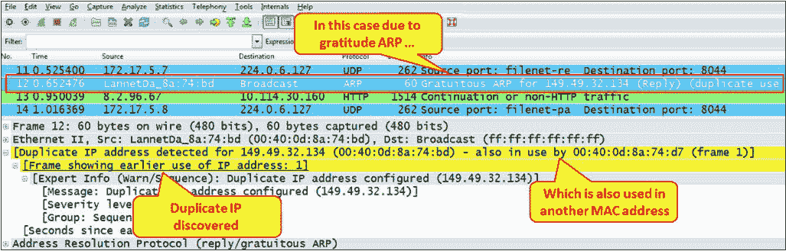

In this case due to gratuitous ARP ...

Duplicate IP address detected for 149.49.32.134 (00:40:0d:8a:74:bd) - also in use by 00:40:0d:8a:74:d7 (frame 1)

Frame showing earlier use of IP address: 1

Duplicate IP discovered

Which is also used in another MAC address

## How it works...

When you ping an IP address that appears twice on your local network, the two devices (or more) that have the same IP address will answer to the ARP request that you sent, and your ARP cache will have two entries for the same IP address.

In many cases, your device will indicate it by closing its IP driver and notify you by a pop-up window or any other type of notification that you will be aware of.

In other cases, the colliding devices will not notify the conflict, and then you will find a problem only with Pinging and ARP, as described before.

In any case, when you connect Wireshark to the network and see duplicate IP messages, don't ignore it.

## There's more...

Duplicate IP usually happens when there are two identical addresses in the network, but it becomes even more interesting when you have three identical addresses.

You can see a funny example for this in the upcoming screenshot:

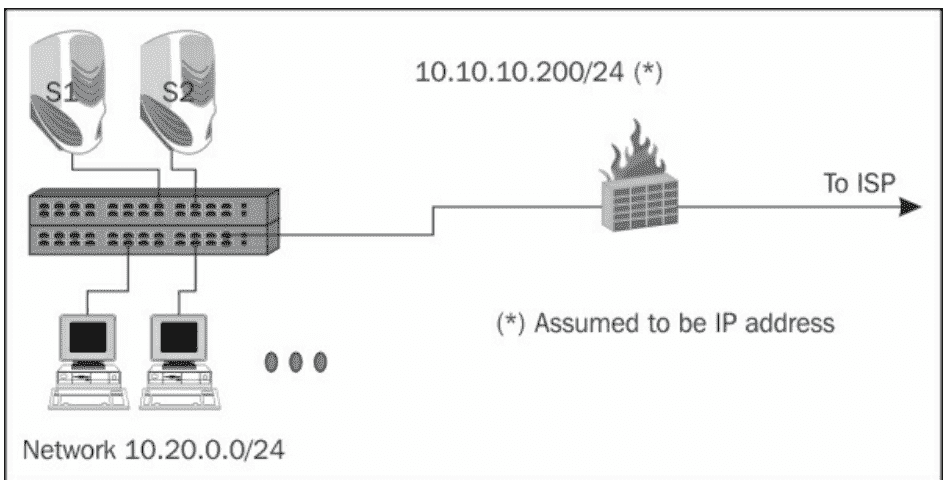

In this customer network, they've internal network of around 150 devices with connectivity to the Internet through a firewall. The problem was a very slow connection to the Internet.

When they did a ping to a server on the Internet (any server), they got the following responses:

```
Reply from 173.194.35.148: bytes=32 time=98ms TTL=51
Request timed out.
Reply from 173.194.35.148: bytes=32 time=124ms TTL=51
Request timed out.
Reply from 173.194.35.148: bytes=32 time=134ms TTL=51
Request timed out.
Reply from 173.194.35.148: bytes=32 time=582ms TTL=51
Request timed out.
```

The customer made some changes to the network, the network became even slower, and pinging the same server on the Internet got them the following response:

```
Reply from 173.194.35.148: bytes=32 time=98ms TTL=51
Request timed out.
Request timed out.
Reply from 173.194.35.148: bytes=32 time=124ms TTL=51
Request timed out.
Request timed out.
Reply from 173.194.35.148: bytes=32 time=134ms TTL=51
Request timed out
Request timed out...
```

When I came into the picture, the first thing I did was to ping the server on the Internet and type ARP -a to see what I got. And what I saw was the IP address 10.10.10.200 with three different MAC addresses. Of course, it was a three-time duplicate address, and digging into the problem showed me what actually happened there, as illustrated in the following figure:

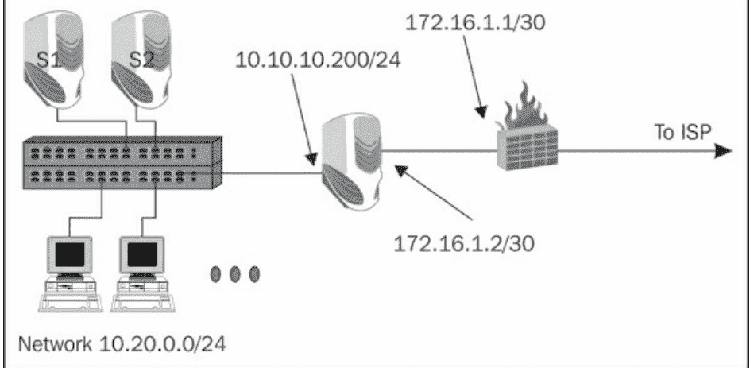

What happened was that the network default gateway to the Internet was not actually the firewall, but a web-filtering device that was located between the network and the firewall with the address 10.10.10.200, while the network between it and the firewall was 172.16.1.2/30.

What actually happened is explained as follows:

+   1. In the first place, they configured the DHCP server on the network to exclude addresses 10.10.10.201-254, so the FW address was not excluded.

## Getting ready

When you have a DHCP server on your network, and PCs are not able to receive IP addresses automatically, just connect Wireshark with port mirror to the device that doesn't receive the address, connect and disconnect the device from the network, or simply use the `ipconfig /release` and `ipconfig /renew` commands. Now, we will have a look at what can go wrong.

## How to do it...

Have a look at the DHCP procedure described in the How it works ... section. Anything that is not going according to this procedure is wrong, so check for the following:

+   1. Did the client send the `DHCP Discover` packet?
+   2. If it did, the client works fine.
+   3. If it didn't:
+      - Something is wrong with the client. Check if the client is configured with DHCP (obtain an IP address automatically as marked in the TCP/IP configuration window).
+      - It can be that the client is physically not connected to the network. It happens a lot with wireless communications (WiFi), where the client does not have connectivity to the network and therefore, does not send the `DHCP Discover` packet since it doesn't have a network to send it over.
+   4. The client sends `DHCP Discover` and receives `DHCP Offer` from a single server. This is ok; continue watching the wire.
+   5. The client sends `DHCP Discover` and receives `DHCP Offer` from two or more servers. This is a problem. You have more than one DHCP server on your LAN, and you might get different address allocations to clients on the LAN. Turn off one of the servers (at least the DHCP service on it).
+   6. You receive DHCP Discover and send DHCP Request; this is fine.
+      - If you immediately receive `DHCP Ack` with the IP parameters, everything is fine.
+      - If you don't receive anything, and you send another `DHCP Request`, it can be a slow or non-responsive server. Check it.
+   7. If you receive a DHCP Decline message, it is the server that has refused your request.
+      1. It can be that the server does not have available addresses. In this case, extend your address range.
+      2. It can be also that the server has allocated your previous IP address to someone else. This is a server configuration issue; so if you need this feature, configure the server to save IP addresses per clients.

## How it works...

DHCP is considered to be a simple protocol, but actually it is very complex. When you connect a client to the network, it will go through the following steps:

+   1. `DHCP Discover`: The client initializes a limited version of TCP/IP and broadcasts a request looking for a DHCP server. The request is sent from UDP port 68 to UDP port 67.
+   2. `DHCP Offer`: DHCP servers listen on UDP port 67, and if a server receives the request, it answers with a DHCP offer, that is offering to provide the service of address assignment.
+   3. `DHCP Request`: The client receives the DHCP offer and sends back a request to receive information. The request will be, for example, the IP address that we requested before (because we had it before), for our MAC address so that the server will recognize us as a prior client with a saved IP address and other parameters.
+   4. `DHCP Ack`: Here the server sends the requested information, including the IP address, subnet mask, default gateway, DNS servers, and other parameters that are configured on the server.

In the next screenshot, we see a standard procedure of DHCP that works properly:

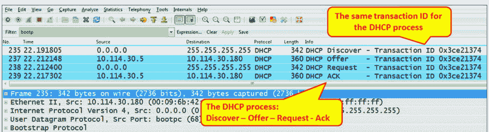

## There's more...

A very common problem is when you connect a device to your network, you receive an IP address and you don't have any idea where it came from. Usually, this is because someone has connected a DHCP server to your LAN without telling you. In most of the cases, it will be a small Internet router. This is very simple to find out:

+   1. If you type `ipconfig` and get an address that you don't know, it might be a problem.
+   2. Since the router we suspect is connected to the network, assign your IP address, subnet mask, and a default gateway. When you ping your default gateway, you actually ping the router, which is likely to be the troublemaker.
+   3. Type `ARP -a` to give you the troublemaker's MAC address. This will tell you two things:
+      - Who is the vendor? When you know who is the vendor is (D-Link, Edimax, Netgear, and many others), you can simply go and look for it.
+      - By logging into the LAN switch, the MAC address will also tell you which port it is connected to. Go to your communications room and disconnect it.
+   4. Of course, while listening to the port with Wireshark, you will see the vendor MAC address easily.


