## 第9章 UDP/TCP 分析

本章包含以下操作指南：

- 配置 TCP 和 UDP 偏好设置以进行故障排查
- TCP 连接问题
- TCP 重传——它们来自哪里以及为什么
- 重复 ACK 和快速重传
- TCP 乱序数据包事件
- TCP 零窗口、窗口满、窗口变化和其他窗口指示器
- TCP 重置及其发生原因

### 简介

**传输控制协议（TCP）**和**用户数据报协议（UDP）**的目标是在终端应用之间传递信息，例如，从 Web 客户端到 Web 服务器、邮件客户端到邮件服务器，等等。这是通过为终端应用提供标识并在它们之间转发数据包来实现的。这些标识称为端口号，端口号及其 IP 地址合称为套接字。在下图中，你可以看到当从浏览器打开到 Web 服务器的连接时会发生什么。Web 服务器在端口 80 上监听，而你将从例如端口 1024 打开一个连接。

因此，服务器在端口 80 上监听请求，并将响应发送到你的端口 1024。

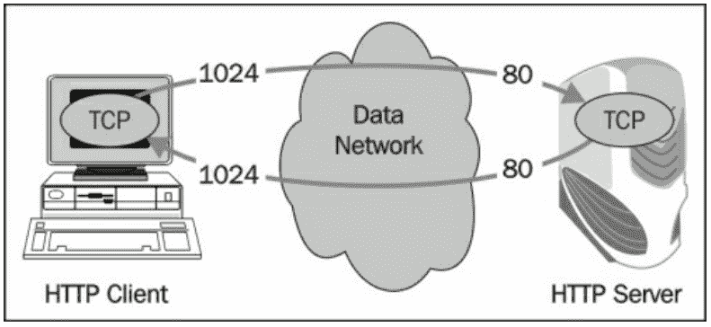

TCP 是一种可靠的、面向连接的协议，而 UDP 不支持连接和可靠性，只是在两个终端进程之间传输数据报。

#### 提示

还有一个额外的第 4 层协议，称为 SCTP（流控制传输协议）。该协议可以看作是 TCP 的改进版本，主要用于服务提供商的网络。SCTP 不在本书的讨论范围之内。

在本章中，我们将重点关注 TCP、其行为、各种问题，以及如何使用 Wireshark 来定位和解决这些问题。

### 配置 TCP 和 UDP 偏好设置以进行故障排查

在大多数情况下，你可以使用 Wireshark 默认的 TCP 和 UDP 网络分析参数，但也有一些更改可以配置。这些更改将在**偏好设置**窗口中进行配置。

#### 操作步骤...

在本节中，我们将看到如何配置 TCP 和 UDP 偏好设置。

##### UDP 参数

让我们看看一些可能影响 UDP 捕获的参数：

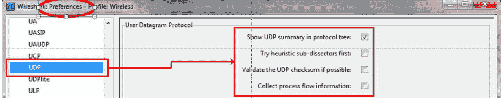

你可以在 UDP 中配置以下参数：

- **在协议树中显示 UDP 摘要**：如果希望协议树中显示 UDP 摘要行，请勾选此按钮（默认已设置）
- **首先尝试启发式子解析器**：在使用注册到特定端口的子解析器之前，先尝试使用启发式方法对数据包进行解码
- **如果可能，验证 UDP 校验和**：验证 UDP 校验和
- **收集进程流信息**：收集进程流信息

默认情况下，只设置了第一个参数。在大多数情况下，这已经足够了。

##### TCP 参数

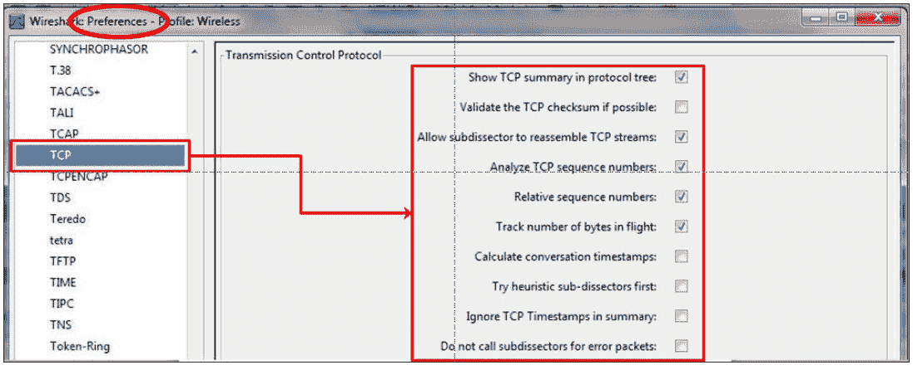

你可以在 TCP 中配置以下参数：

- **在协议树中显示 TCP 摘要**：如果希望协议树中显示 TCP 摘要行，请勾选此按钮（默认已设置）。
- **如果可能，验证 TCP 校验和**：此功能可能会降低性能。在大多数情况下，这不是必需的。
- **允许子解析器重组 TCP 流**：此选项用于流分析（默认已设置）。
- **分析 TCP 序列号**：设置此选项后，Wireshark 会分析序列号并跟踪重传、重复 ACK 等现象，这是 Wireshark 的重要功能之一。
- **相对序列号**：设置此选项后，Wireshark 将显示每个从 seq=0 开始的 TCP 连接。
- **跟踪在途字节数**：此设置使 Wireshark 能够跟踪网络中未确认字节的数量（默认已设置）。
- **计算会话时间戳**：此功能启用 TCP 时间戳选项的计算。
- **首先尝试启发式子解析器**：在使用注册到特定端口的子解析器之前，先尝试使用启发式方法对数据包进行解码。
- **在摘要中忽略 TCP 时间戳**：忽略 TCP 头中的时间戳选项。
- **对错误数据包不调用子解析器**：此选项不分析错误的 TCP 数据包。

#### 工作原理...

TCP 偏好设置中有一些参数我想多说几句。

关于**相对序列号**，当你查看一个 TCP 连接时，你会发现它总是以等于零的序列号开始。这些是 Wireshark 归零后的相对数字。真实数字是 TCP 进程选取的 0 到 2^32 之间的数字，这些数字难以跟踪。TCP 标准没有为此数字的选取设定任何规则。

**计算会话时间戳**指的是 TCP 数据包的时间戳选项。TCP 时间戳选项携带两个 4 字节的时间戳字段，如下图所示：

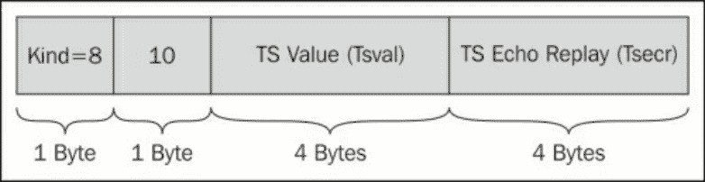

时间戳选项要解决的问题是 TCP 对延迟变化的敏感性。解决方案（如 RFC 1323 所述）是以下列方式使用 TCP 选项（对于每个 TCP 连接）：

- 发送方在每个发送的数据段中放置一个时间戳（Tsval 字段）
- 接收方在 ACK 段中反映这些时间戳（Tsecr 字段）

然后，通过一次减法，发送方即可为每个 ACK 段获得准确的 RTT 测量值（对于一个合理的接收方，这将对应于每隔一个数据段）。这种机制称为**往返时间测量（RTTM）**。

#### 更多内容...

UDP 是一种非常简单的协议，其头部也非常简单，只包含四个字段：源端口、目的端口、数据包长度和校验和。接收方使用校验和来检查是接受数据包还是丢弃它。如果数据包被丢弃，则没有恢复机制。在某些情况下，应用程序会恢复它（例如，DNS 会再次发送请求），而在某些情况下则不会。

TCP 则更复杂。它是一种面向连接的可靠协议，具有排序机制、流量控制和拥塞控制。这些主题将在本章后面讨论。

SCTP 是一种可靠的、面向连接的协议，允许每个连接传输多个流，可选地将多个用户消息捆绑到单个 SCTP 数据包中，支持 cookie、多归属和其他机制。它最初是为在蜂窝网络中传输信令消息而开发的，后来与其他应用协议一起实现。

## TCP 连接问题

当两个 TCP 进程希望通信时，它们会打开连接，发送数据，然后关闭连接。当你打开浏览器访问互联网、从邮件客户端连接到邮件服务器，或通过 Telnet 连接到路由器或任何其他基于 TCP 工作的应用程序时，都会发生这种情况。

当 TCP 打开连接时，它会从源端口向目的端口发送一个打开连接的请求。

在应用程序的建立或关闭过程中可能会出现一些问题。使用 Wireshark 来定位和解决这些问题是本操作指南的目标。

### 准备工作

如果你遇到以下问题之一，请使用 Wireshark 来找出原因。

这些问题可能有很多类型。其中包括：

- 你尝试运行一个应用程序，但它不工作。你尝试浏览互联网，但没有得到任何响应。
- 你尝试使用邮件，但无法连接到邮件服务器。
- 问题可能由简单的原因导致，例如服务器宕机、应用程序未在服务器上运行，或者通往服务器的网络在某处中断。
- 问题也可能由更复杂的原因导致，例如 DNS 问题、服务器内存不足导致无法连接（例如，由于应用程序占用内存过高）、IP 地址重复，以及许多其他原因。

在本操作指南中，我们重点关注这些通常很容易解决的“可行/不可行（GO/NO-GO）”问题。

## 如何操作...

在这里你将看到一些指示，以及当你使用 Wireshark 调试 TCP 连接问题时可以看到的内容。通常这些问题表现为尝试运行一个应用程序却得不到任何结果。

当你尝试运行一个应用程序时，例如数据库客户端、邮件客户端、观看摄像机服务器等等，并且没有得到任何输出，请按照以下步骤操作：

- 1. 验证服务器和应用程序是否正在运行。
- 2. 验证你的客户端是否正在运行，你是否已配置 IP 地址（手动或通过 DHCP），并且已连接到网络。
- 3. Ping 服务器并验证你是否能够连接到它。

## 提示

在某些情况下，你无法 Ping 到服务器，但仍然可以连接到应用程序。这可能是因为防火墙阻止了 ICMP 消息，因此如果你无法 Ping 到某个目标，并不一定意味着有问题。防火墙可能是网络中的专用设备，也可能是安装在终端设备上的 Windows（或 Linux/UNIX）防火墙。

- 4. 在捕获文件中，查找以下其中一种模式：
  - 三个 SYN 消息且没有响应（在下面的截图中）
  - SYN 消息收到重置（RST）响应

在两种情况下都可能是防火墙阻止了特定应用程序，或应用程序未运行。

在下面的截图中，我们看到一个简单的案例，我们根本无法访问 web 服务器 81.218.31.171（数据包 61、62 和 63）。这可能是因为防火墙不允许访问，或服务器本身存在问题。我们也可以看到我们已连接到另一个网站（108.160.163.43，数据包 65、66 和 67），因此连接问题仅针对 81.218.31.171。

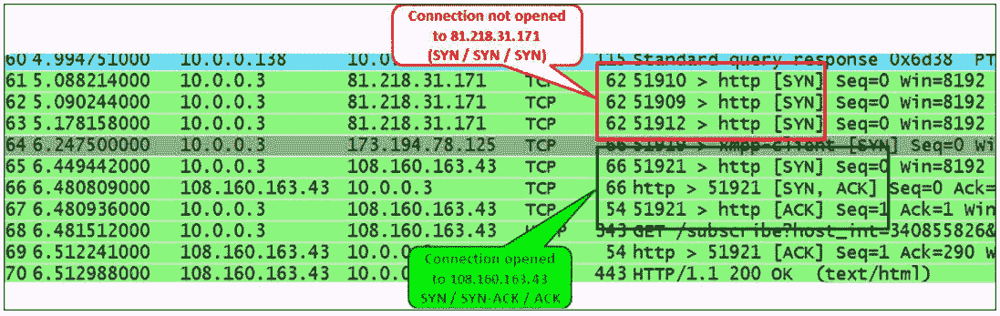

在下一张截图中，我们看到同一种情况的稍微复杂一些的案例。在这种情况下，我们有一个客户想要登录并在远程站点观看摄像机的摄像机服务器。摄像机服务器的 IP 地址为 135.82.12.1，问题是客户能够获取服务器的主网页和登录窗口，但无法登录系统。在下面的截图中，我们可以看到我们打开了到 IP 地址 135.82.12.1 的连接。我们看到 TCP 连接已打开到 HTTP 服务器，一开始看起来没有连接问题：

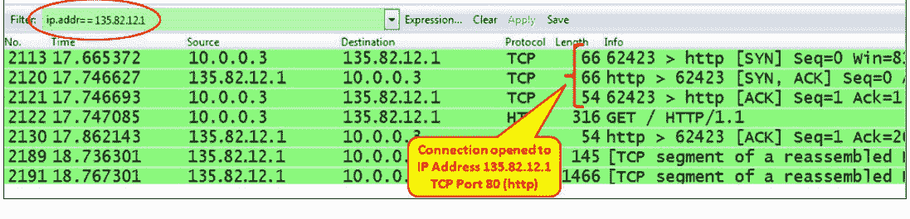

问题出现时我们过滤所有发往 IP 地址 135.82.12.1 的流量，也就是摄像机服务器。

在这里我们看到，当我们尝试连接到 TCP 端口 6036 时，我们收到 RST/ACK 响应，这可能是：

- - 阻止端口 6036 的防火墙（这里就是这种情况）
- - 当配置了端口地址转换（PAT）时，我们仅转换端口 80

而不是 6036

- - 用户名和密码的身份验证在 TCP 端口 6036 上进行，防火墙仅允许端口 80，身份验证被阻止，应用程序无法工作

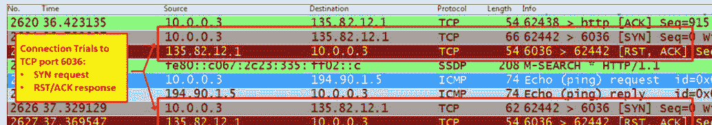

总之，当你无法连接到服务器时，请检查服务器和客户端是否已在整个网络中转发所有 TCP/UDP 端口，以及是否存在你不知道的端口。

## 提示

在某些情况下，当你在网络中安装新应用程序时，最好在客户端和服务器上连接 Wireshark，并检查它们之间实际运行了什么。软件公司并不总是告诉你他们在网络上传输了什么（有时是因为他们自己也不知道！），防火墙可能会阻止你并不知情的信息。

服务器收到的窗口大小。

在 TCP 头部的选项字段中，我们有以下主要选项：

- - **最大报文段长度（MSS）**：这是 TCP 数据报的最大大小，即从 TCP 头部开始到整个数据包末尾的字节数。
- - **窗口大小（WSopt）**：该因子与 TCP 头部中的窗口大小字段相乘，以通知接收方更大的缓冲区大小。由于头部中的最大窗口大小为 64 KB，因子为 4 时可得到 64 KB 乘以 4，即 256 KB 的窗口大小。
- - **SACK**：选择性确认是一种选项，使连接的双方能够确认特定数据包，因此当单个数据包丢失时，只会重新发送该数据包。连接建立时，双方必须就 SACK 达成一致。
- - **时间戳选项（TSopt）**：该参数已在本章前面解释过，指的是客户端与服务器之间延迟的测量。

到此阶段，双方：

- - 同意建立连接
- - 知道对方的初始序列号
- - 知道对方的窗口大小

## 提示

在建立连接时，任何不是完整的三次握手的情况都应被视为问题。这包括 SYN 没有响应、SYN 然后 SYN/ACK 但没有最后的 ACK、SYN 被重置（RST 标志等于 1）应答等等。

## TCP 重传 – 它们来自哪里以及为什么

当 TCP 发送一个数据包或一组数据包（请参阅后面的“工作原理…”部分）时，它会等待确认以确认这些数据包已被接受。重传显然是由于数据包未到达，或确认未及时到达而发生的。这可能有各种原因，找到原因就是本菜谱的目标。

## 准备工作

当你发现网络变慢时，重传可能是原因之一。将 Wireshark 连接到可疑客户端或服务器的端口镜像上，并观察结果。

在本菜谱中，我们将看到使用 Wireshark 遇到的一些常见问题，以及它们所表示的含义。

## 如何操作...

让我们开始：

- 1. 在相关接口上开始捕获数据。
- 2. 进入 **Analyze | Expert Info** 菜单。
- 3. 在 **Notes** 下，查找 **Retransmissions**。
- 4. 你可以点击 (+) 标志，重新传输列表将会打开。单击每一行，数据包捕获窗格中将显示重传。
- 5. 现在是重要的问题：如何定位问题。

### 提示

当你通过通信线路、服务器接口、互联网链路或任何其他线路捕获数据包时，你可能会有来自许多 IP 地址、许多应用程序的流量，甚至每个应用程序上的特定过程，例如访问数据库应用程序中的特定表。这里重要的是要定位发生重传的 TCP 连接。

- 6. 你可以通过以下方式查看重传来自哪里：
  - 在 **Expert Info** 窗口中逐个移动数据包，并查看它在数据包捕获窗格中带你到哪些数据包（适合有经验的用户）
  - 在数据包窗格中，配置显示过滤器 `expert.message == "Retransmission (suspected)"`，你将获得捕获文件中的所有重传
  - 应用过滤器后，然后在 **Statistics à Conversations** 窗口的右下角检查 **Limit to display filter** 部分

### 案例 1 – 对多个目标的重传

在下面的截图中，你可以看到我们有许多重传，分散在多个服务器之间，目标端口为 80（HTTP）。我们还可以从这里看到 `10.0.0.5` 端口发送了重传，因此数据包在前往互联网的途中丢失了，或来自 web 服务器的确认未及时返回。

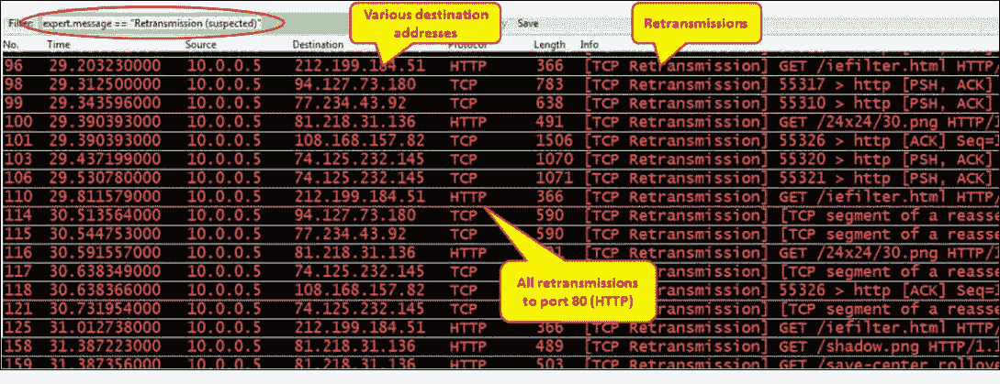

好吧，显然互联网线路上出了问题。我们怎么知道是什么问题？

- 1. 从 **Statistics** 菜单打开 **IO Graph**。
- 2. 在这种情况下（案例 1），我们看到线路几乎是空的。可能是一个错误，或前往互联网的另一条负载线路。
- 3. 你可以通过登录通信设备或使用任何 SNMP 浏览器（当设备上配置了 SNMP 代理时）来检查导致数据包丢失的丢包和错误。参考以下截图：

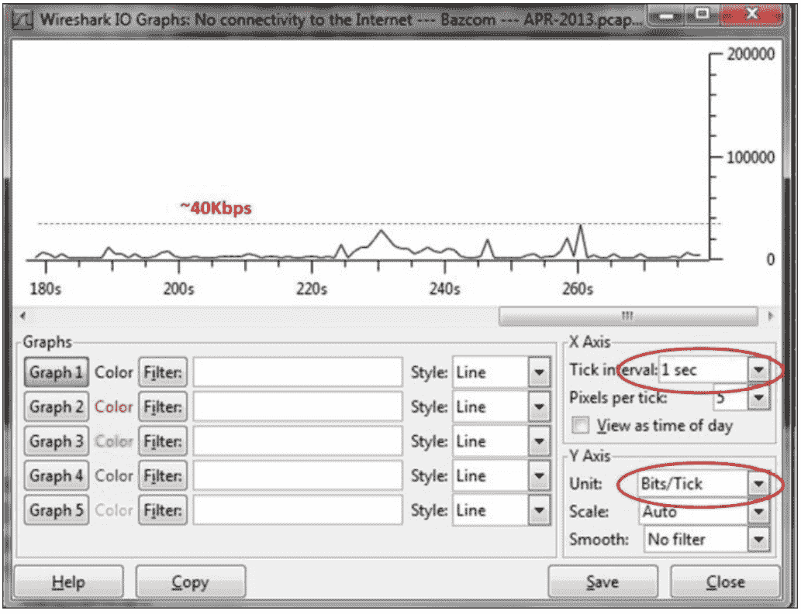

## 案例 2 – 单个连接上的重传

如果所有重传都发生在单个 IP 和单个 TCP 端口号上，则说明这是一个运行缓慢的应用。我们可以在下面的截图中看到这一点：

对于单连接上的重传，请执行以下步骤：

- 1. 我们也可以通过从“统计”菜单打开“会话”，并勾选“限制为显示过滤器”复选框来验证这一点；这样我们将获得所有存在重传的会话，在本例中是一个单独的会话。
- 2. 如下面的截图所示，选择 IPv4 选项卡，我们将看到重传来自哪些 IP 地址：
- 3. 如下面的截图所示，选择 TCP 选项卡，我们将看到重传来自哪些端口号（或应用）：

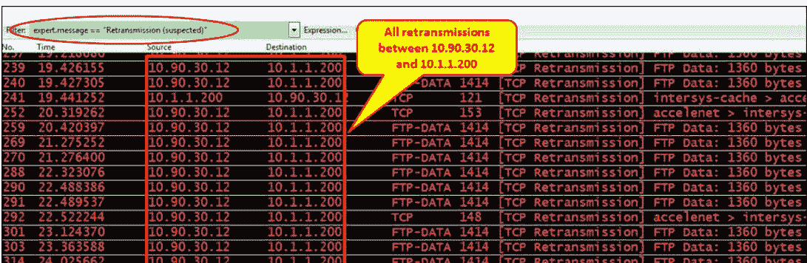

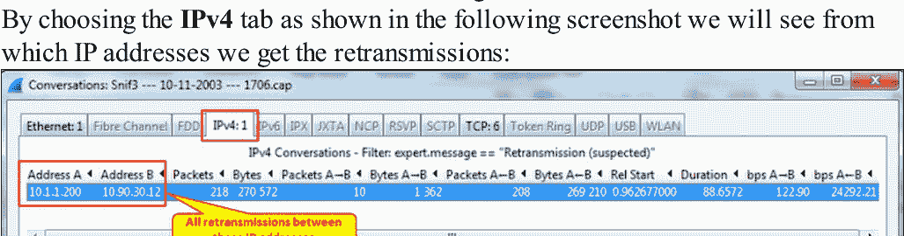

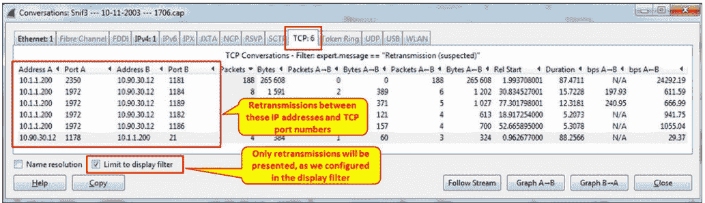

要隔离问题，请执行以下步骤：

- 1. 查看 IO 图，并确保线路不繁忙。

### 提示

通信线路繁忙的迹象是，线路的 IO 图呈现一条非常接近线路最大带宽的直线。例如，如果你有一条 10 Mbps 的通信线路，你对其进行端口镜像，并在 IO 图中看到一条接近 10 Mbps 的直线，这就是线路负载过重的明显迹象。一条不繁忙的通信线路会有许多起伏、峰值和空闲间隔。

- 2. 如果线路不繁忙，那么问题可能出在 IP 地址 10.1.1.200 的服务器上（10.90.30.12 正在发送大部分重传，因此可能是 10.1.1.200 响应缓慢）。
- 3. 从数据包窗格中我们看到该应用是 FTP-DATA。FTP 服务器可能以主动模式工作。因此，我们在一个端口（2350）上打开了连接，而服务器将端口更改为 1972，所以这可能是一个缓慢且无响应的 FTP 软件（最终这里的问题正是如此）。

## 案例 3 – 重传模式

在 TCP 重传中，需要注意的一个重要事项是，重传是否具有你可以看到的某种模式。

在下面的截图中，我们看到所有重传都来自单个连接，即单个客户端与服务器上的 NetBIOS 会话服务（TCP 端口 139）之间。

这看起来像一个简单的服务器/应用问题，但当我们查看数据包捕获窗格时，会看到一些有趣的现象（参见下面的截图）：

总共 251 次重传

NetBIOS – SSN（会话服务）

所有重传都在单个连接上

重传之间相隔 30-35 毫秒

有趣的是，当我们查看重传的模式时，会发现它们每 30 毫秒周期性地发生。这里的时间格式是秒，因为前面是通信线路延迟的信息。请参阅“工作原理……”一节，了解其应有的样子。

- 2. 检查延迟变化，延迟变化可能由以下原因导致：

  - 延迟可能由不稳定的或繁忙的通信线路导致。在这种情况下，使用 Ping 命令会看到延迟变化。通常这种情况会发生在带宽较窄的线路上，在某些情况下也会发生在蜂窝线路上。
  - 延迟可能由负载过重或效率低下的应用导致。在这种情况下，你只会看到该特定应用上出现大量重传。
  - 延迟可能由负载过重的通信设备（CPU 负载、缓冲区负载等）导致。你可以通过直接访问通信设备来检查这一点。
- 3. 使用第 13 章“排查带宽和延迟问题”中介绍的 Wireshark 工具。

### 提示

关于 TCP 重传，最重要的是：只要重传数量不是太多，重传就是 TCP 的一种自然行为。当重传率在 0.5% 左右时，性能开始下降；当重传率在 5% 左右时，开始出现断开连接。这还取决于应用及其对重传的敏感程度。

## 找出问题所在

当你在通信链路（到互联网、服务器上、站点之间或任何其他链路）上看到重传时，请执行以下操作：

- 1. 定位问题——是特定的 IP 地址、特定的连接、特定的应用，还是其他问题。
- 2. 检查问题是否由通信链路、数据包丢失、服务器或 PC 缓慢导致。检查应用是否运行缓慢。
- 3. 如果并非由上述任何原因导致，请检查延迟变化。

## 工作原理……

让我们看看 TCP 的正常运行方式，以及可能出现的问题的原因。

## TCP 序列/确认机制的常规操作

TCP 内置的机制之一是重传机制。该机制能够恢复损坏、丢失、重复或乱序传送的数据。

这是通过为每个传输的字节分配一个序列号，并期望接收方返回确认（ACK）来实现的。如果在超时间隔内未收到 ACK，则重传数据。

在接收端，使用序列号来验证信息是否按发送顺序到达。如果不是，则将其重新排列到原来的状态。

该机制的工作方式如下：

- 1. 在建立连接时，双方告知对方自己的初始序列号。
- 2. 发送数据时，每个数据包都有一个序列号。序列号表示 TCP 负载中第一个字节的编号。发送的下一个数据包将具有前一个数据包的序列号加上前一个数据包中的字节数，再加一（见下一个截图）。
- 3. 当发送数据包时，RTO（重传超时）计数器开始从发送时刻起计时。

### 提示

重传超时定时器基于 Van Jacobson 拥塞避免和控制算法，该算法基本上说明 TCP 能够容忍高延迟，但不能容忍快速的延迟变化。

- 4. 当接收方收到数据包时，它会回复一个 ACK（确认）数据包，告诉发送方发送下一个数据包。在下面的截图中，你将看到其工作方式：
  1. 你可以从这里看到，10.0.0.7 正在从 62.219.24.171 下载文件。该文件通过 HTTP 下载（Wireshark 窗口已配置为从“编辑 | 首选项”的列配置中显示 tcp.seq 和 tcp.ack，如第 1 章“Wireshark 简介”中所述）。

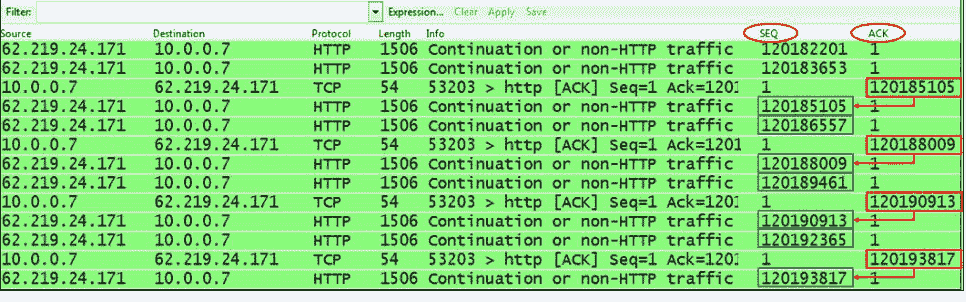

- 2. 你可以从这里看到，`62.219.24.171` 发送一个序列号为 `120185105` 的数据包，然后发送一个序列号为 `120186557` 的数据包。当收到这两个数据包时，客户端 `10.0.0.7` 告诉服务器发送下一个数据包，ACK = `120188009`，之后服务器发送序列号为 `120188009` 的数据包，再下一个数据包的序列号为 `120189461`，依此类推。

你可以看到它的示意图。

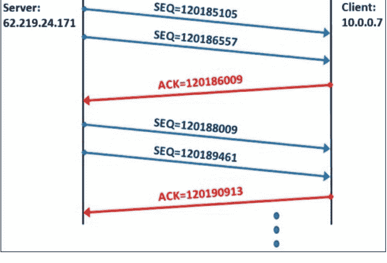

## 什么是 TCP 重传，它们会导致什么

当数据包确认丢失，或 ACK 未按时到达时，发送方将执行两件事：

- 1. 按照本方案前面所述，再次发送数据包。
- 2. 降低吞吐量。

在下一个截图中，我们看到了重传会降低发送方吞吐量的示例（为清晰起见添加了红色细线）：

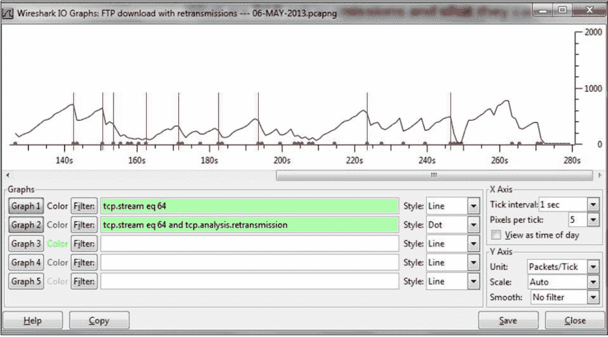

## 更多内容……

TCP 能够容忍高延迟，只要这些延迟相当稳定即可。定义 TCP 在延迟变化下的行为（除其他作用外）的算法被称为 Van Jacobson 算法（以其发明者的名字命名）。Van Jacobson 算法允许容忍高达平均延迟 3-4 倍的延迟，因此例如，如果你的延迟为 100 毫秒，TCP 将容忍高达 300-400 毫秒的延迟，只要这些延迟不频繁变化。

## 参见

你可以查看 Van Jacobson 算法，网址为 http://ee.lbl.gov/papers/congavoid.pdf。

## 重复 ACK 与快速重传

你会在 TCP 中看到的另一个现象是所谓的重复 ACK 和快速重传。这一现象同样由性能问题引发，在本节中，我们将重点讨论如何发现它们以及它们所指示的问题。

### 准备工作

当你发现网络变慢时，重复 ACK 可能是原因之一。将 Wireshark 连接到端口镜像上，将其接入可疑的客户端或服务器，然后查看结果。

### 操作步骤...

在大多数情况下，重复 ACK 的产生是因为高延迟、延迟抖动，或某个端点响应缓慢，根本未对 ACK 请求作出回应。

在查找通信缓慢的原因时，重复 ACK 可能是原因之一。

- 1. 当你看到数量合理的重复 ACK（例如 1% 或 2%）时，这可能不是你的问题。
- 2. 当你看到大量重复 ACK（比如十个）时，你可能遇到了：
  - 一条非常繁忙的通信线路，导致延迟变化
  - 无响应的服务器或客户端（取决于谁未响应）
- 3. 快速重传是针对重复 ACK 而发送的数据包。
- 4. 在下面的截图中，你会看到该问题的一个示例。在该示例中，你可以看到在收到 51 个 DupACK（重复 ACK）后发送了一个快速重传数据包：

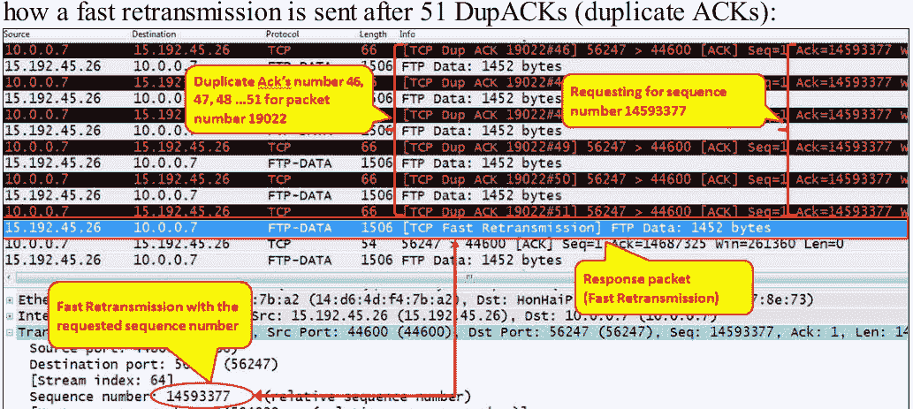

- 5. 以下是解决该问题的方法：
  - 如果重复 ACK 和重传的数量较少（低于 1%），则可以容忍。
  - 当这种情况发生在蜂窝网络或无线网络中，或发生在互联网连接上时，延迟和延迟变化在这些网络中很常见，因此你实际上无能为力。
  - 如果这种情况发生在你所在组织的网络中，则可能是一个问题。如果是在局域网中，请检查严重问题，例如交换机缓冲区和 CPU 负载。

### 工作原理...

当检测到某个数据包丢失（未收到预期的序列号）或收到意外的序列号时，就会产生重复 ACK。在这种情况下，接收方会生成一个 ACK，指示它希望接收的下一个预期序列号。接收方将持续生成 ACK 请求缺失的报文段，直到收到它为止。

在发送端，当它收到三个具有相同值的相同 ACK（原始 ACK 和两个重复 ACK）时，它会假定发生了数据包丢失，并重新发送丢失的数据包，无论 RTO 是否已过期。重新发送的数据包称为快速重传。

重复 ACK 还会降低网络上传输的吞吐量。吞吐量降低多少取决于 TCP 版本。在早期版本的 TCP（即 Tahoe、Reno 和 New-Reno）中，其思路是：一旦出现重复 ACK，发送方就将吞吐量降低到之前的一半。如果出现大量 DupACK，吞吐量将降至最低。

在下面的截图中，你会看到由重复 ACK 和重传所导致问题的典型示例：

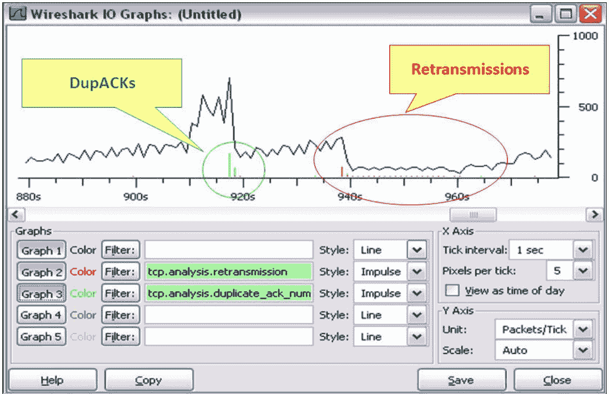

在此截图中，我们看到首先重复 ACK 将吞吐量降低到之前的大约 40%，然后重传将其降至最低。

### 扩展阅读...

重复 ACK 中使用的机制称为快速恢复。近年来，出现了一些高级 TCP 版本，尤其是针对蜂窝网络的版本，以改善 TCP 在高延迟和变化延迟条件下的行为。在这些示例中，你可能会看到发送方和接收方行为的一些差异，例如性能下降较轻、恢复速度较快等。尽管如此，TCP 的特征行为仍然得以保留。

## TCP 乱序数据包事件

你会在网络中看到的另一个现象是**前一段丢失**和**乱序报文段**。两者都与数据包乱序到达有关，在某些情况下表明存在问题。

当你在网络连接上看到此现象时，可能是由网络问题或捕获中断引起的。在本节中，我们将重点讨论这一问题及其可能导致的后果。

### 准备工作

启动 Wireshark，并将其连接到镜像端口上。本节中我们要重点关注的三个现象是：

- - **前一段丢失**：当一个数据包到达时，其序列号高于该连接上预期的下一个序列号，表明被标记的数据包之前的一个或多个数据包未到达。
- - **乱序数据包**：当一个数据包的序列号低于该连接上先前收到的数据包时，就会出现此情况。
- - **前一段未捕获**（Wireshark 1.8.x 及更高版本）：这与前一段丢失类似。

### 操作步骤...

#### 何时会发生？

你可能会在以下事件中看到这些情况：

- - **在捕获开始时：** 当你在一个已建立的连接上开始捕获时，会发生此事件。在这种情况下，你会在连接上看到没有 SYN/SYN-ACK/ACK 的数据包，因此 Wireshark 会认为出现了问题。
- - **真实的数据包丢失：** 在这种情况下，你还会看到丢失数据包的重传和/或重复 ACK，告知发送方重新发送丢失的数据包。

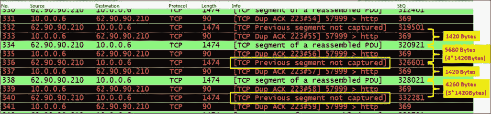

在上面的截图中，我们看到了一个严重数据包丢失的典型示例。这里我们看到 10.0.0.6 正在尝试浏览网站 62.90.90.210。在此期间，1420 字节的 TCP 报文段被发送到 Web 服务器，我们看到在报文段 334 和 336 之间丢失了三个数据包，在报文段 338 和 340 之间丢失了两个数据包。在这两种情况下，Wireshark 都会提示：**TCP 的前一报文段未被捕获。**
- - **延迟变化：** 这可能是由于数据包从源到目的地经过不同路由所致。要检查这一点，请使用 Tracert，并查看源和目的地之间的路由变化（如果发生在组织网络中），例如，你可以在路由器上配置陷阱，以便在发生这种情况时通知你。
- - **数据捕获问题：** 数据包可能已被正确发送和接收，但 Wireshark 未能捕获到它们。这可能是由各种原因导致的：
  - 由于流量非常大，Wireshark 可能会在高比特率（超过 150-180 Mbps）下丢失数据包。为避免此问题，请使用其他工具（大多是商业工具）。
  - 如果你的笔记本电脑性能不够强，内存或 CPU 不足会导致 Wireshark 无法足够快地工作。这一点很容易发现，而且你可能已经意识到了。

- - 当局域网交换机上的端口缓冲区过小时，数据包可能会被丢弃。连接到交换机（通过控制台或 Telnet 连接），并使用交换机命令行检查该问题。
- - 在无线网络上捕获数据时，由于某种原因，你无法看到所有已发送的数据包。请参阅[第 7 章](Chapter 7)，以太网、局域网交换和无线局域网。

### 工作原理...

在这种情况下，事情很简单。TCP 发送方将数据包发送给接收方。这些数据包按字节编号。当一个数据包未按顺序到达时，Wireshark 就会注意到这是一个问题。我们可能有两个原因：

- - **真实问题**：在这种情况下，你会看到重传和重复 ACK，这是 TCP 对乱序接收数据包的响应
- - **捕获问题**：在这种情况下，你只会看到乱序数据包，并且由于你看不到对疑似丢失和乱序数据包的任何响应，它们可能实际上并未丢失

## 准备工作

使用端口镜像将 Wireshark 连接到可疑的链路或服务器，并开始捕获。
记录捕获窗口中出现的每个窗口消息。

## 如何操作...

有几种类型的窗口消息你应该注意：

### TCP Zero Window、Zero Window Probe 和 Zero Window Violation

TCP Zero Window 在接收方通告的接收窗口大小为零时发生（在 TCP 头部的 window 字段中）。这告诉发送方停止发送数据，因为接收方的缓冲区已满。这表明接收方存在问题，可能是：

- 内存分配不足的弱服务器
- 应用程序未接收到足够缓冲区的问题，因此 TCP 必须告诉发送方停止发送数据
- 应用程序消耗内存过多，导致操作系统限制应用程序资源

TCP **Zero Window Probe** 是发送方发送的消息，用于查看接收方的 Zero Window 条件是否仍然存在。该消息通过向接收方发送下一个数据字节来工作。如果接收方仍以窗口为零作出回应，发送方会在再次探测前将计时器加倍。

发送方忽略接收方的 Zero Window 条件并发送额外的字节数据。TCP Zero Window Violation 可以指示 TCP 错误或协议栈中的 bug。

为了检查问题所在，请检查这些事件是否来自：

- 特定的终端设备（服务器或客户端），这将表明终端设备存在问题。
- 特定应用程序中的问题，这将表明存在通用应用程序问题。
- 当你在应用程序中执行特定操作时出现问题，例如打开特定表、向打印机发送文件、创建报表或应用程序中的任何其他操作。在这种情况下，当然是应用程序问题。

### TCP Window Update

TCP 向连接的另一端发送 Window Update，以指示其已更改缓冲区大小，并且准备好接受更高或更低的数据速率（缓冲区大小决定发送方被允许发送的吞吐量）。这可能发生在以下情况：

- TCP 接收方从 Zero Window 条件中恢复，并要求发送方重新开始发送数据。在这种情况下，你无需做任何事，只需检查导致第一次 Zero Window 的问题即可。
- TCP 接收方频繁更改窗口大小。在这种情况下，检查是什么干扰了接收方。它可能是应用程序问题、内存问题，或终端设备上的任何其他性能问题。

如果你看到这种现象，无需担心。这是 TCP 的工作方式。

## TCP Window Full

此消息表明发送的数据包将完全填满接收方的接收缓冲区。这会在接收方尚未发送任何确认先前数据接受的 ACK 的情况下发生，因此这将是发送方在接受接收方 ACK 之前发送的最后一个数据包。

在接收方，收到此数据包的瞬间，它将向发送方发送 Zero Window 消息，从而停止发送数据。

此事件触发的原因与触发 Zero Window 的原因相同。它只是对无响应的服务器或应用程序的指示。一个典型示例显示在以下屏幕截图中：

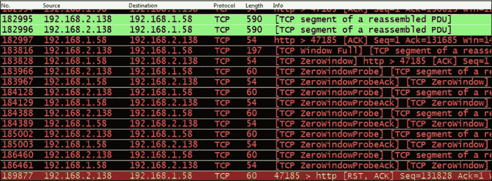

在前面的屏幕截图中我们看到：

- 1. 数据包 183816，192.168.2.138 告诉 192.168.1.58 发送方窗口是

## 它是如何工作的...

TCP Sliding Window 机制的工作方式如下：

- 1. 连接建立后，发送方向接收方发送数据，填满接收方窗口。
- 2. 发送若干数据包后，接收方向发送方发送 ACK，确认其已接受发送的字节。发送 ACK 会清空接收方窗口。
- 3. 当发送方填满窗口时，接收方清空窗口并发送信息确认，此过程是连续的。
- 4. 增加接收方窗口大小会告诉发送方提高吞吐量，减少它会告诉发送方降低吞吐量。它根据以下 WS/RTT 规则工作（根据 TCP 版本有所变化）：

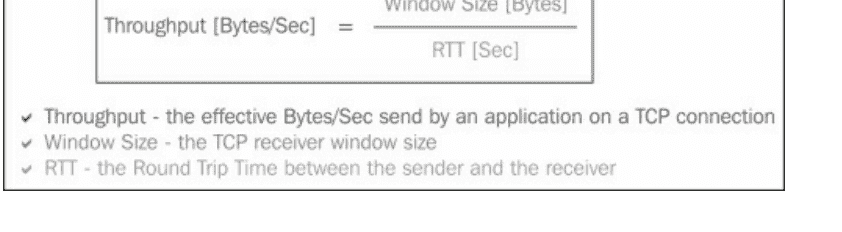

## 更多内容...

你也可以使用 TCP 吞吐量图和 IO 图来查看这些问题。在 TCP 吞吐量图中，使用 TCP trace 图，其中上线表示窗口大小，其与下线的距离表示窗口左侧的内容。两者之间没有距离表示 Zero Window。

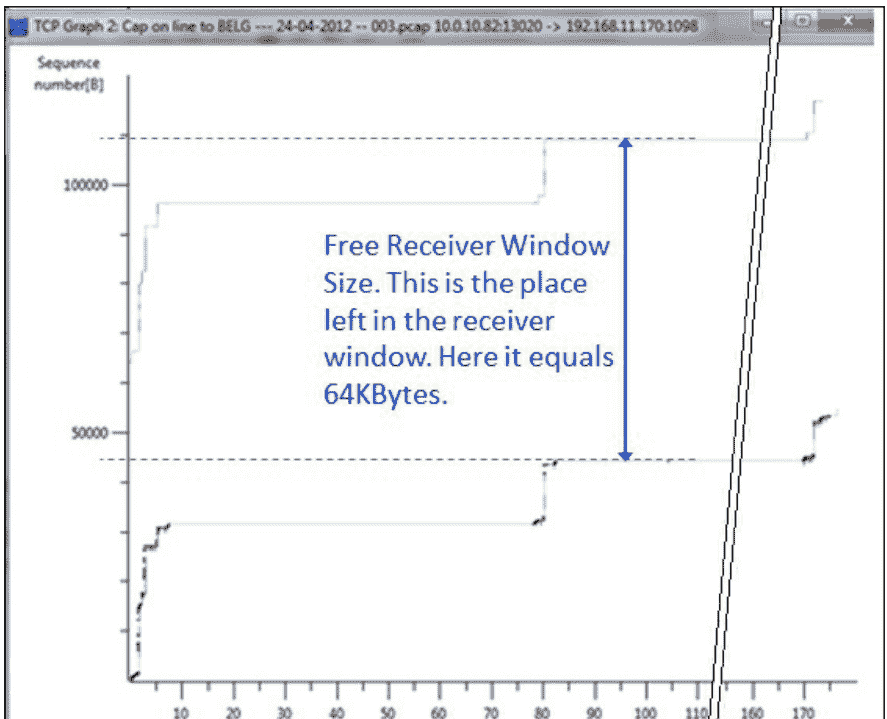

线条之间固定的距离（如前面的屏幕截图所示）表示接收方正常运行。当线条越来越靠近时，表示发送方压倒了接收方。只要线条不重叠，TCP 将继续发送数据。

## TCP 重置及其发生原因

在正常操作期间，TCP 将使用 SYN 信号打开连接，并使用 FIN 信号关闭连接。TCP 的一个特点是由于问题或为了提高效率，可以更快地关闭连接。

在本配方中，我们将描述这些情况，以及如何准确理解发生了什么，以及它是否属于正常情况或出了问题。

## 准备工作

使用端口镜像将 Wireshark 连接到可疑的链路或服务器，并开始捕获。记录捕获窗口中出现的每个窗口消息。TCP 重置可以在多种情况下发送。有些指向协议的正常工作，有些则表明存在故障或问题。在本配方中，我们将了解其原因，并尝试指出问题以及如何解决它们。

## 如何操作...

Reset 是 TCP 发送的信号，用于告诉接收方中断连接。Reset 是通过将 RST 标志设置为 1 发送的。

## 重置不是问题的案例

TCP 中关闭连接的标准方式是通过 FIN 和 FIN-ACK 信号。问题是，为了关闭连接，你需要四个数据包：来自一方的 FIN/ACK 和 ACK，以及来自另一方的相同数据包。例如，当你打开一个标准网页时，可能打开数十个连接（主页面、新闻栏、广告、定期更新的图片等），为了关闭所有这些连接，你将需要数百个 FIN 和 FIN-ACK 数据包的标准方式。为了防止这种情况发生，Web 服务器在许多情况下会向你发送请求的数据，然后通过重置中断连接。这是标准做法，取决于应用程序。

## 重置可能表明问题的案例

在某些情况下，重置可能表明存在问题（不一定是通信问题）：

- 由防火墙发送的重置：当你尝试打开到远程服务器的连接且未得到任何响应时，你可能会看到返回的 RST 信号。这是防火墙阻止连接。在下一个屏幕截图中，你可以看到每个发送的 SYN 都被 RST 回复。

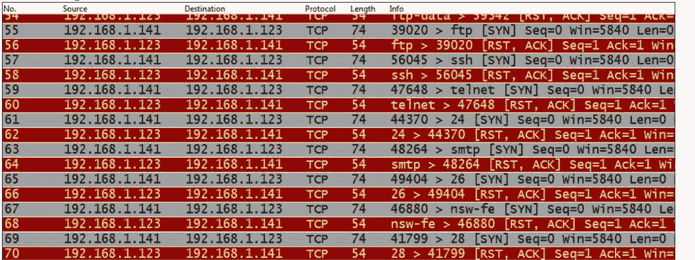

- 由于某一方出现问题而发送的重置：这里可能有许多原因。其中一些如下：

- 一个原因是连续五次重传未被 ACK 回复。当发送方对重传没有任何回复时，它将向另一方发送重置信号，告诉其中断连接。
- 另一个原因是连接在几分钟内没有任何流量（几分钟是多少取决于操作系统的默认值）。通常打开连接的一方会发送重置（通常但不总是，取决于实现）。

## 如何工作...

这里很简单。Reset 是一个用于断开连接的信号。这里需要记住的是，一切都取决于应用程序。如果程序员选择在特定情况下发送 RST，那么这就是你在捕获文件中会看到的内容。对于你看到的每个重置，尝试弄清楚导致它的原因，你就能从重置发送前的包中理解它。
