## 第10章. HTTP 和 DNS

在本章中，我们将学习以下配方：

- 过滤 DNS 流量
- 分析常规 DNS 操作
- 分析 DNS 问题
- 过滤 HTTP 流量
- 配置 HTTP 首选项
- 分析 HTTP 问题
- 导出 HTTP 对象
- HTTP 流程分析和 Follow TCP Stream 窗口
- 分析 HTTPS 流量 – SSL/TLS 基础

### 引言

**域名系统 (DNS)** 是一种用于将名称解析为 IP 地址的协议。它在你浏览网站时通过互联网使用，然后 DNS 将 Web 服务器名称解析为 IP 地址。它也在企业网络中使用，用于查找服务器名称并将其翻译为 IP 地址。

**超文本传输协议 (HTTP)** 和 **安全 HTTP (HTTPS)** 都用于浏览互联网，或连接到组织内部或云中托管的其他软件。HTTPS 在使用 SSL/TLS 保护 HTTP 以隐藏明文数据交换不被黑客窃取时使用。它在连接你的银行、网络邮件账户（例如 Gmail 或 Hotmail）或任何其他安全应用程序时使用。

在本章中，我们将讨论这些协议，它们的工作原理，以及如何使用 Wireshark 来查找其中的常见错误和问题。

### 过滤 DNS 流量

DNS 是一种负责将名称解析为 IP 地址的协议。在本配方中，我们将学习如何过滤与 DNS 服务相关的<|message|>重要参数。

#### 准备工作

当怀疑网络问题时，对怀疑的服务器进行端口镜像或在服务器上安装 Wireshark，然后开始捕获数据。

#### 如何操作...

有一些常见的过滤器可以帮助你排查 DNS 问题。常见的显示过滤器如下所示：

- 基本过滤器仅用于过滤 DNS 流量。过滤器为 `dns`。
  - 用于仅过滤 DNS 查询，我们有 `dns.flags.response == 0`
  - 用于仅过滤 DNS 响应，我们有 `dns.flags.response == 1`

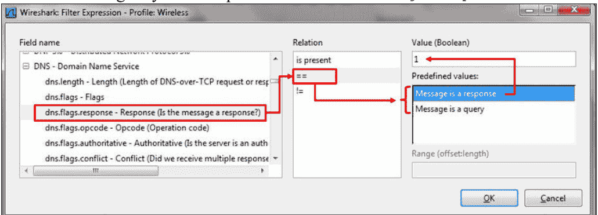

- 用于过滤错误代码，我们有以下过滤器：
  - 无错误 (rcode—回复代码)，我们有 `dns.flags.rcode == 0`，在以下截图中标记
  - 无此名称，我们有 `dns.flags.rcode == 3`

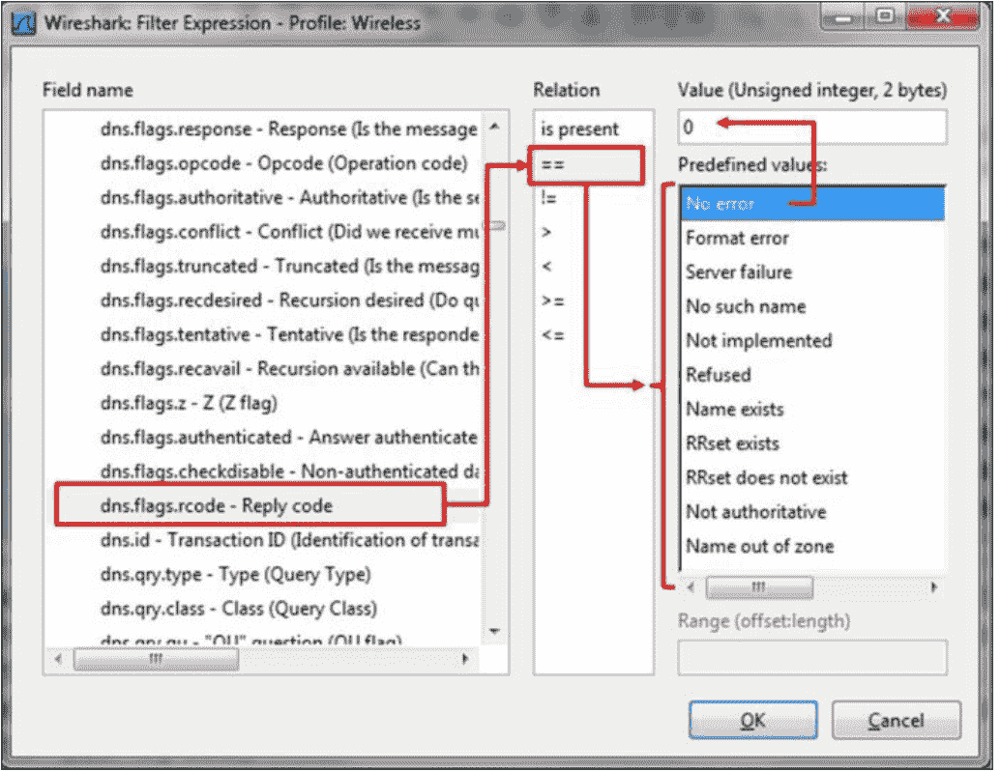

- 用于搜索问题，我们有以下过滤器：
  - **当查找特定 URL 时：** 例如，当你不确定你的 PC 是否发送了 DNS 查询时，使用 `dns.qry.name == "URL Name"`
  - 当查找包含特定 URL 的查询时：对于这种情况我们有 `dns.qry.name contains "URL Name"`
- 用于过滤 DNS 操作码（标准查询或其他请求或通知），我们有以下过滤器：
  - 仅过滤标准查询：`dns.flags.opcode == 0`
  - 仅过滤反向查询：`dns.flags.opcode == 1`
  - 过滤服务器状态请求：`dns.flags.opcode == 2`
  - 过滤区域更改通知：`dns.flags.opcode == 4`
  - 过滤动态更新：`dns.flags.opcode == 5`

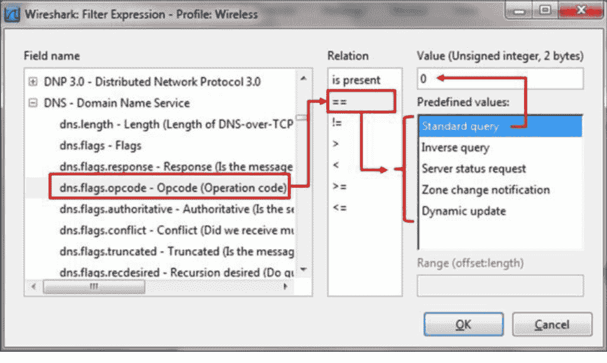

- 用于查询查询类型（递归/非递归）：
  - 对于递归查询我们有 `dns.flags.recdesired == 1`
  - 对于非递归查询我们有 `dns.flags.recdesired == 0`

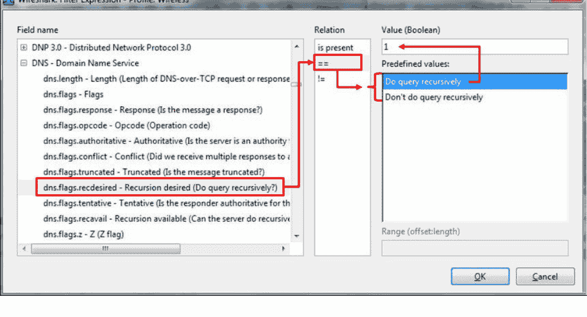

所有其他显示过滤器可以通过单击 Wireshark 窗口顶部显示过滤器窗口右侧的表达式按钮找到。

#### 如何工作...

显示过滤器在 [第 3 章](#) 中有深入描述，*使用显示过滤器*。如 [第 3 章](#) 中所述，*使用显示过滤器*，你可以执行以下操作之一来过滤 DNS 参数：

- 单击显示过滤器窗口右侧的表达式按钮，并从 DNS 中选择所需的过滤器
- 进入数据包详细信息，右键单击所需字段，然后选择 **应用过滤器** 或 **准备过滤器**
- 直接在 Wireshark 窗口顶部的过滤器窗口中写入过滤器字符串

#### 还有更多...

DNS 是一个相当复杂的协议，本章的目的是提供解决此协议和实现中常见问题的方法。这里没有提到所有过滤器；完整的 DNS 过滤器列表可以在 [http://www.wireshark.org/docs/dfref/d/dns.html](http://www.wireshark.org/docs/dfref/d/dns.html) 找到。

### 分析常规 DNS 操作

在本配方中，我们将了解如何判断 DNS 是否正常工作。我们将看到一些 DNS 操作的场景，以及可能出现什么问题。

#### 准备工作

打开 Wireshark 并开始捕获数据。你应该镜像使用 DNS 的设备，或 DNS 服务器本身。

#### 如何操作...

将 Wireshark 连接到所监控设备附带的 LAN 交换机，并将端口镜像配置到你怀疑问题来自的设备。按以下步骤操作：

1. 在用户投诉的情况下，为监控用户设备配置端口镜像。
2. 在网络中出现一般问题的情况下，将端口镜像配置到 DNS 服务器：
   - 当 DNS 服务器配置在内部服务器上时，在服务器上配置端口镜像
   - 当 DNS 服务器配置在外部服务器上时，将端口镜像配置到连接你到互联网的链路

#### 如何工作...

DNS 是用于名称解析的主要协议，它在浏览互联网时使用。它也用于在组织网络中工作。DNS 标准描述了三种功能：

- 命名空间，即 DNS 名称的外观以及它们如何分配
- 名称注册过程，即我们如何注册 DNS 名称以及它们如何通过 DNS 服务器网络转发
- 解析过程，即名称如何解析为 IP 地址

在本配方中，我们将重点关注第三个主题，即当我们浏览互联网、发送或接收电子邮件，或访问组织内部服务器时会发生什么。基本的 DNS 操作如以下图所示：

#### DNS 操作

用户程序（Web 浏览器、邮件客户端等）通过解析器与 DNS 服务器交互，解析器也是操作系统的一部分。解析器与提供所需 IP 的外部名称服务器交互（名称服务器可以是本地或远程；它对解析器来说是外部的）。用户查询 DNS 服务器的方式特定于操作系统。DNS 查询和响应在解析器和名称服务器之间发送和接收。

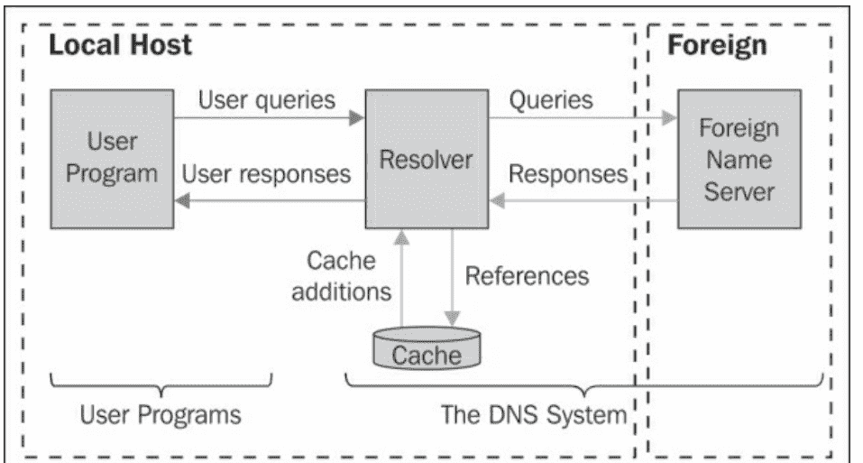

本地名称服务器通常位于组织网络中，并与你的 ISP 的 DNS 服务器交互。在家庭或小型办公室网络的情况下，你的 DNS 服务器可以配置在连接你到互联网的路由器上，或直接连接到你的 ISP 的 DNS 服务器：

- 当 DNS 服务器位于路由器上时，你查询路由器上的 DNS，路由器查询你的 ISP DNS
- 当你的 DNS 服务器位于 ISP 网络中时，你直接查询 DNS 服务器

#### DNS 命名空间

DNS 命名空间基于分层树结构，如下图所示。结构如下：

- 根服务器网络 (http://www.iana.org/domains/root/servers)。
- 顶级域名服务器网络 (TLDs) (http://www.iana.org/domains/root/db)。
- 每个顶级域名都有类似于 IANA 管理的名称服务器。顶级域名包含二级域名。TLD 是最高级别的服务器，例如下图所示的国家服务器。
- 二级域名 (SLDs) 包含组织和国家的域名和名称。二级域名中的名称由指定的组织或国家管理。

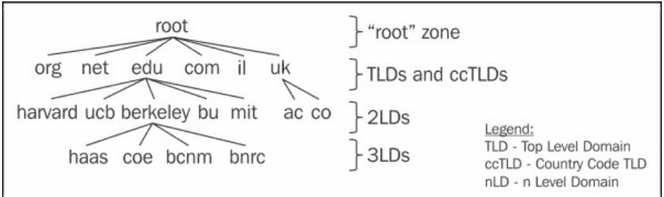

有一些重要定义，如下图所示：

- 域：它构成 ndi-com.com 下的所有分支，在本例中为二级域名
- 区域：它是 DNS 命名空间中 DNS 域的连续部分，其数据库记录存在并在特定 DNS 数据库文件中管理


on one or multiple DNS servers

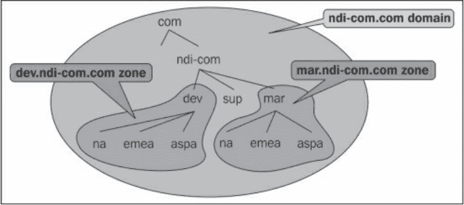

## The resolving process

There are two reasons for using DNS servers:

- The first reason is that it is used for internal communication in your organization. In this case, you have a DNS server in your organization, which resolves the IP addresses to names in your organization.
- It is used for connecting to the Internet, browsing, sending mails, and so on.

When both services are used, you will send the DNS query to your organization server, which will send the query to the Internet. For example, when you want to get to a local server in your organization, you will send a DNS query to the local DNS, and you will get the server IP. When you browse a website on the Internet, your local DNS server forwards the request to the external DNS, for example, the ISP DNS.

Is it the correct DNS server you have configured? Theoretically, when you connect to the Internet, you can configure any DNS server in the world. Usually, the best DNS server to use is the nearest one. In your organization, you should configure your local DNS as first priority, and then the DNS servers of your ISP.

There are various utilities to check the DNS response. Some of them are as follows:

- **Namebench** from Google ([http://code.google.com/p/namebench/downloads/detail?name=namebench-1.3.1-Windows.exe&can=2&q=](http://code.google.com/p/namebench/downloads/detail?name=namebench-1.3.1-Windows.exe&can=2&q=))
- **DNS Benchmark** from GRC ([https://www.grc.com/dns/benchmark.htm](https://www.grc.com/dns/benchmark.htm))

## There's more...

When a process on the end device is looking for the IP address of a specific name, it interacts with the local resolver that goes out to the DNS servers. When the DNS server does not find the entry you are looking for in its database, it can respond in two ways—**recursive** or **iterative**:

- **Recursive mode**: In this mode, when the application (for example, a web browser) wants to resolve the name of the website [www.packtpub.com](http://www.packtpub.com), it sends a DNS request to the local DNS server (marked as **1** in the following diagram). The local DNS server sends the request to a root server (marked as **2** and **3** in the following diagram), then to the TLD (marked as **3** and **4** in the following diagram), and finally to the authoritative server of [www.packtpub.com](http://www.packtpub.com), which gives us the required address (marked as **6** and **7** in the following diagram). Then, the local DNS server sends us the required address (marked as **8** in the following diagram). In each one of the responses, the resolver gets the DNS to query in the next step.

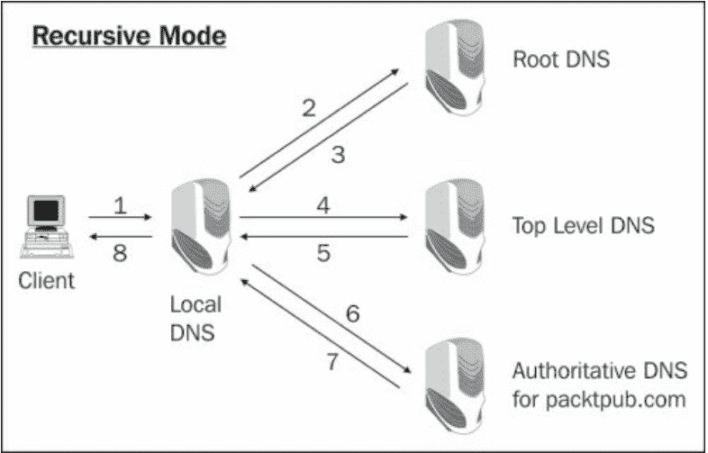

- **Iterative mode**: In this mode, a DNS client can receive a response from the DNS server that will tell the client where to look for the requested name. When the application (for example, a web browser) wants to browse the website [www.packtpub.com](http://www.packtpub.com), it sends a DNS request to the local DNS server (marked as **1** in the following diagram). The local server forwards the request to a root DNS server (marked as **2** in the following diagram). If it doesn’t know the answer, it forwards the request to the TLD (marked as **3** in the following diagram) and the authoritative DNS (marked as 4 in the following diagram). Then, the answer is sent all the way back to the client (marked as 5, 6, 7, and 8 in the following diagram):

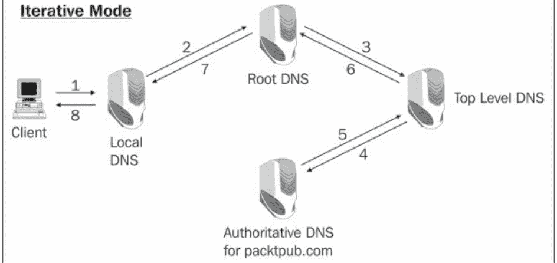

## Analysing DNS problems

In the previous recipe, we saw how to identify a normal operation of DNS. In this recipe, we will learn how to discover problematic behavior of DNS, and how to figure out its source.

## Getting ready

A DNS problem can result in bad performance while browsing the Internet, slow network while working inside the organization network, or any other performance issues. We will see how to isolate these problems and how to find out whether it is a DNS issue or not.

The DNS consecutive queries: In this case, the DNS server simply does not answer. This is illustrated in the following screenshot:

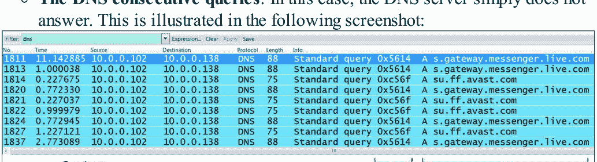

When you right-click on one of the packets in the preceding screenshot and choose Follow UDP Stream, you will see that the DNS resolver on your PC sends several queries (with increasing time intervals between them), and then stops. This is shown in the next screenshot:

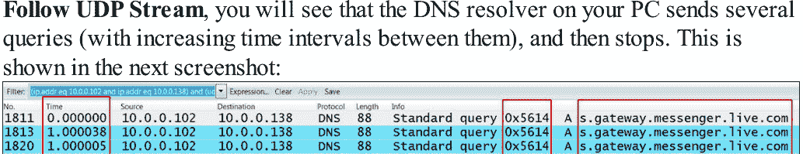

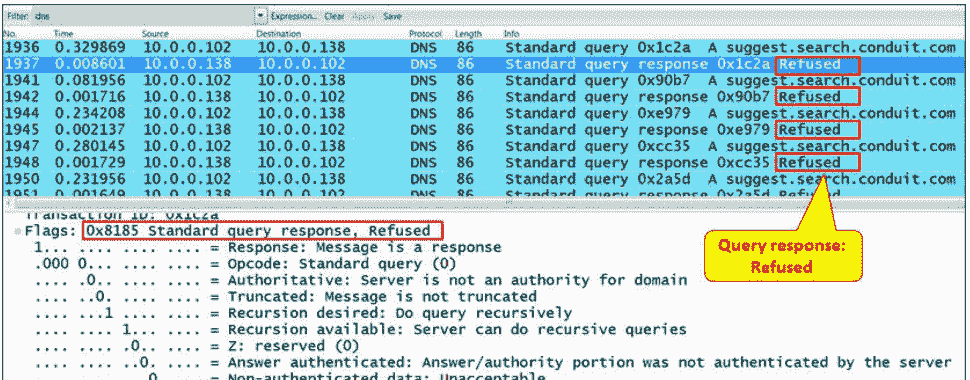

## DNS slow responses

How will you know that this is the problem?

- 1. When you are browsing the Internet and getting very slow responses, perform the following steps:
  - 1. Port mirror the connection to the Internet, and check if you have any bottleneck on the way to the Internet. You can use the IO graphs for this purpose, as described in Chapter 5, Using Advanced Statistics Tools.
  - 2. Verify that you don't have a significant number of retransmissions or duplicate ACK's indicating a connection problem.
  - 3. Verify that you don't have any window-related problem, such as zero window or window full.
- 2. If answers are no for the preceding checks, it might be a DNS problem. You can have DNS problems in two cases:
  - When working in your organization
  - When connecting to the Internet
- 3. These issues can be resolved in two ways:
  - When facing problems in your organization, port mirror the switch port that is connected to the DNS server
  - When facing problems with the Internet, port mirror the switch port that connects your organization to the Internet
- 4. Watch the DNS response time that you get. There are several ways to locate the problem, and they are given as follows:
  - The simplest way is to right-click on a packet from a DNS query stream, choose Follow UDP Stream, and then check the time between the query and response.
  - Another way is to use IO graphs for this purpose. In the IO Graphs window, choose Advanced in the Y Axis configuration and configure the filter dns.time with AVG(*) in the Graph lines. Refer the following screenshot:

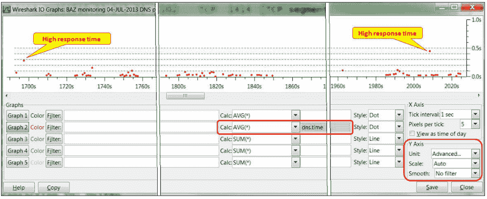

You will get a graph of the DNS response times throughout the capture time.

In this graph, you will see that most of the response times fall below 100mSec, which is quite reasonable. We have two peaks that indicate a probable problem, one at the beginning of the capture with 300 ms, and one at the end of the capture with 450 ms.

### Tip

Reasonable times inside the organization (in a local site) should be not more than tens of milliseconds. When browsing the Internet, a good response time should be less than 100 ms, while up to 200 ms is still tolerant.

## How it works...

There are six basic types of DNS response codes defined in RFC 1035. Additional error codes (up to 21) were defined in later standards (RFC 2136, RFC 2671, RFC 2845, and RFC 2930). Error codes can be found at http://tools.ietf.org/html/rfc2929#section-2.3.

The most common codes are shown in the following table:

| Error code | Name | What is it (RFC 1035) | Why it happens | What to do |
|---|---|---|---|---|
| 0 | No error condition | No error, everything works fine. | This signifies that everything is working. | Be happy. |
| 1 | Format error | The DNS server couldn't interpret the query. | This error code is usually shown when the DNS server does not support DNS extensions, for example, EDNS0 (RFC 2671). | In most cases, there is nothing to do. The DNS request will be sent again without the extension. If the problem still exists, change the DNS server. |
| 2 | Server failure | The DNS server was not able to process the query due to a problem with the name server. | This error code signifies that there is a problem in the DNS server. | Configure another DNS server and check again. |
| 3 | Name error | This is meaningful only for responses that are coming from authoritative name servers. | This error code signifies that the domain name requested in the query does not exist. | Check the domain name. |
| 4 | Not Implemented | The DNS server does not support the requested type of query. |  |  |
| 5 | Refused | The DNS server refuses to perform the specified operation due to policy reasons. | A name server may not wish to provide the information to the particular requester. A name server may not wish to | This occurs due to connectivity problems, if the forward DNS is not configured, or if there is a problem in one of the DNS servers on the way. |


执行特定操作。

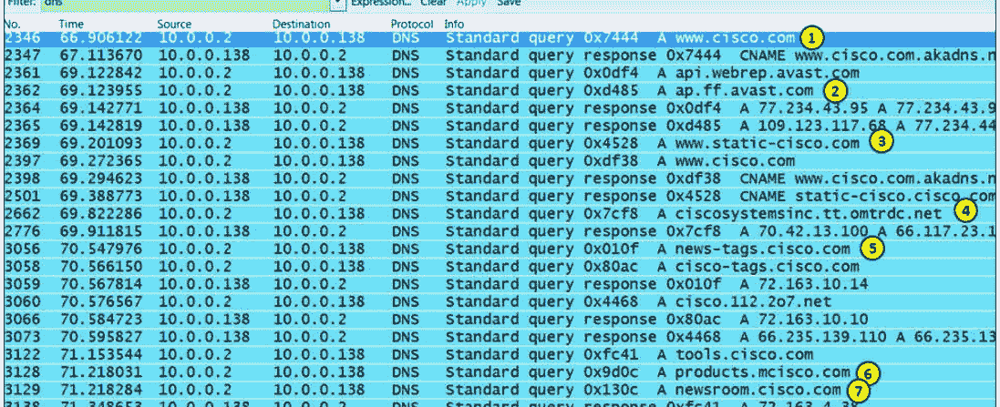

它首先对 www.cisco.com 的 A 记录发起 DNS 查询（如前面的截图中的 1 标记），然后依次查询 ap.ff.avast.com（如前面的截图中的 2 标记），这是 Avast 杀毒软件的网页防护服务器；接着查询 www.static-cisco.com（如前面的截图中的 3 标记）、ciscosystems.tt.omtrdc.net（如前面的截图中的 4 标记）、news（如前面的截图中的 5 标记）、products（如前面的截图中的 6 标记）和 newsroom（如前面的截图中的 7 标记）站点。

当我们查看响应时间图（如下一个截图所示）时，可以看到 DNS 响应时间高达 600 毫秒。这就解释了为什么打开 Cisco 整个网页需要几秒钟。

## Wireshark IO 图表：Microsoft: \Device\NPF_{55DFE1F7-0FDB-46E3-8D48-C5804C455B8A}

62.0s 64.0s 66.0s 68.0s 70.0s 72.0s 74.0s 76.0s 78.0s
0.0s 0.5s 1.0s

图表
图表 1 颜色 过滤器：计算：SUM(*) 样式：线
图表 2 颜色 过滤器：计算：SUM(*) dns.time 样式：点
图表 3 颜色 过滤器：计算：SUM(*) 样式：线
图表 4 颜色 过滤器：计算：SUM(*) 样式：线
图表 5 颜色 过滤器：计算：SUM(*) 样式：线

X 轴
刻度间隔：0.1 秒
每刻度像素数：5
按一天中的时间查看
Y 轴
单位：高级...
缩放：自动
平滑：无过滤器

帮助 复制 保存 关闭

## 过滤 HTTP 流量

可以在 HTTP 中配置很多过滤器。在本节中，我将重点介绍此场景中最常用的显示过滤器。

## 准备就绪

按照前几节所述配置端口镜像，并快速查看[第 2 章](#)，使用捕获过滤器。

## 操作步骤...

要配置 HTTP 过滤器，可以直接在显示窗口栏中编写过滤表达式；打开表达式窗口，并通过右键单击数据包面板中的所需参数来选择 HTTP 参数（如第 3 章“使用显示过滤器”所述）。

可以在 HTTP 上配置各种过滤器：

-   基于名称的过滤器
    -   对特定网站的请求：http.host == "www.packtpub.com"
    -   对包含单词 PacktPub 的网站的请求：http.host contains "packt.pub"
    -   从 PacktPub 转发的请求：http.referer == "http://www.packtpub.com/"
-   请求方法过滤器
    -   所有 GET 请求：http.request.method == GET
    -   所有 HTTP 请求：http.request
    -   所有 HTTP 响应：http.response
    -   所有非 GET 的 HTTP 请求：http.request and not http.request.method == GET
-   错误代码过滤器
    -   HTTP 错误响应（客户端错误代码 4xx，服务器错误代码 5xx）：http.response.code >= 400
    -   HTTP 客户端错误响应：http.response.code >= 400 and http.response.code <= 499
    -   HTTP 服务器错误响应：http.response.code >= 500 and http.response.code <= 599
    -   HTTP 响应代码 404（未找到）：http.response.code == 404

### 提示

当你配置一个简单的过滤器，例如 http.host == packtpub 时，不需要用 "" 字符将其括起来。如果你需要更复杂的字符串，例如 packtpub\r\n，或多个单词的字符串，则需要用 "" 括起来，例如 "http.host == packtpub\r\n"。

## 工作原理...

让我们看看 HTTP 的一些细节。

### HTTP 方法

主要的 HTTP 请求方法发布在 RFC 2616 中。随着时间推移，还标准化了其他一些 HTTP 方法。后来通过 RFC 2616 的更新（2817、5785、6266 和 6585）以及其他标准（RFC 2518、3252、5789）增加了更多方法。

以下是 RFC 2612 中描述的基本方法：

-   **OPTIONS**：用于客户端请求以确定 Web 服务器的能力。
-   **GET**：用于请求一个 URL。
-   **HEAD**：类似于 `GET`，但服务器不应在响应中返回消息主体。
-   **POST**：用于向服务器发送数据。例如，使用 Webmail 时，它将用于发送电子邮件命令。
-   **DELETE**：用于请求服务器删除由 `Request-URI` 标识的资源。
-   **PUT**：用于请求将所附实体存储在请求所附的 Request-URI 下。
-   **TRACE**：用于请求对请求消息进行远程应用层环回。
-   **CONNECT**：用于连接代理设备。

### 状态码

以下是 HTTP 标准化的消息代码类别：

| 类别 | 类别名称 | 用途 |
|---|---|---|
| 1xx | 信息 | 提供一般信息，不指示失败或成功 |
| 2xx | 成功 | 表示客户端请求的操作已被接收、接受并成功处理 |
| 3xx | 重定向 | 表示用户代理需要采取进一步操作才能完成请求 |
| 4xx | 客户端错误 | 表示客户端错误 |
| 5xx | 服务器错误 | 表示服务器错误 |

完整的 HTTP 状态码列表可在 http://www.iana.org/assignments/http-status-codes/http-status-codes.xhtml 找到。

## 更多内容...

在某些情况下，你会在数据包详细信息面板中的 HTTP 行下方看到一行名为 **基于行的文本数据：text/html** 的内容。如以下截图所示：

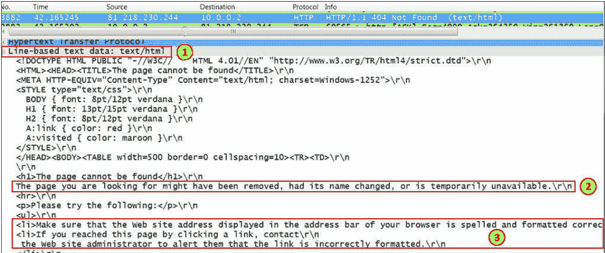

你会在数据包详细信息面板中看到 **基于行的文本数据** 紧靠在 HTTP 行下方（如前面的截图中的 1 标记）。在其下方，你会看到一些解释（如前面的截图中的 2 和 3 标记），说明错误的可能原因。

## 配置 HTTP 偏好设置

使用 HTTP 时，你可以更改一些偏好设置。让我们看看它们是什么。

## 操作步骤...

1.  选择 **编辑 | 偏好设置**。
2.  在 **协议** 下，选择 **HTTP**。你将看到以下窗口：

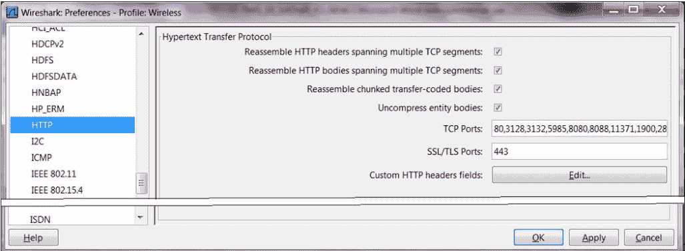

-   默认情况下，上方四行处于选中状态。这些选项用于在低层发生分片时重组 HTTP 头和主体。
-   在 **TCP 端口** 字段中，你将看到 Wireshark 将其解析为 HTTP 的端口号列表。在此列表中，你会看到默认端口 80、通常用于代理的端口 8080 和 8088 等。如果你的应用程序使用 HTTP 但端口未列出，请在此处添加。
-   HTTPS 也是如此——默认是 443（用于安全 HTTP，即基于 SSL/TLS 的 HTTP）。如果你使用其他端口，请在此处添加。

### 自定义 HTTP 头字段

自定义 HTTP 头字段使我们能够在 `http.header` 过滤器下创建新的 HTTP 显示过滤器。

让我们看以下截图中的示例：

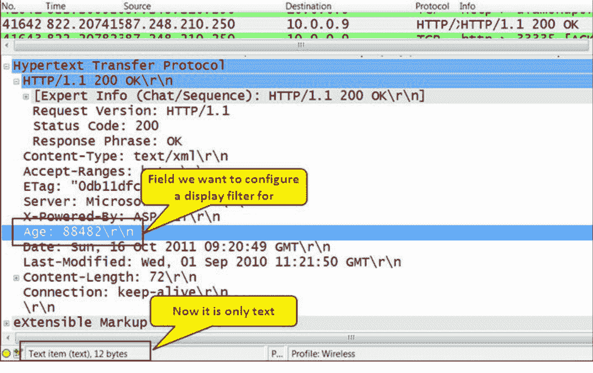

要在 `http.header` 过滤器下创建新的 HTTP 显示过滤器，请执行以下步骤：

1.  在 HTTP 偏好设置窗口中（如下一个截图中的 1 标记），点击 **自定义 HTTP 头** 字段中的 **编辑** 按钮。
2.  点击 **新建**（如前面的截图中的 2 标记）。
3.  在 Header name 中，输入要用于 http.header 扩展的过滤器名称（如前面的截图中的 3 标记）。

例如，如果要对 Age 参数配置过滤器，请在 Header name 字段中输入名称 Age（区分大小写！）。

4.  在 Field desc 字段中，输入任何能提醒你已配置内容的描述。

例如，输入 老化时间 ...（任何描述都可以，只是一个提示）。

5.  点击 **确定**。

6.  在 **显示过滤器** 文本框中，你将能够使用 http.header.Age 过滤器。

例如，你将能够配置包含 88482 的显示过滤器 http.header.Age，它会显示所有 Age 字段包含该请求数字的数据包。

### 提示

此过滤器配置最常用于使用专有参数时。


### 如何工作...

重组功能很重要，因为在某些情况下会使用 IP 分片，因此 TCP 消息也会被分割。标记重组选项只是告诉 Wireshark 对监控的数据包进行重组（接收方正在做的事情，因此能够理解它）。

### 还有更多...

通常只有在 Wireshark 看到有效的 HTTP 头时，才会将端口 80 的解剖数据包显示为 HTTP。如果您想将所有端口 80 的数据包都显示为 HTTP，请执行以下步骤：

- 1. 进入 **Preferences**，并在 **Protocols** 中选择 **TCP**。
- 2. 取消选中/禁用 **Allow dissector to reassemble TCP streams**。

## 分析 HTTP 问题

归根结底，当然是如何分析 HTTP 问题。这正是本食谱要讲的内容。HTTP 问题可能是由于服务器或客户端缓慢、TCP 性能问题以及本食谱中将看到的其他原因造成的。

### 准备工作

当您在浏览互联网时遇到性能不佳的情况时，将 Wireshark 通过端口镜像连接到出现问题的 PC；当整个网络都遭受性能不佳的影响时，对通往互联网的连接进行端口镜像。

### 如何操作...

缓慢浏览问题可能有各种原因，我们将逐步找出原因。步骤如下：

- 1. 首先，检查您是否只是互联网线路负载过高、通信线路错误率过高，或是这些导致大多数问题的明显问题（有关更多详细信息，请参阅 [Chapter 4]，使用基本统计工具 和 [Chapter 5]，使用高级统计工具）。
- 2. 为排除 TCP 问题（在 [Chapter 9]，UDP/TCP 分析 中有详细说明），请检查以下细节：
    - 在 **Expert info** 窗口中，您不会得到太多重传和重复 ACK（最高 0.5-0.8% 仍可容忍）。
    - 确保 HTTP 连接上不会出现重置。这可能是由于防火墙或站点限制造成的。
- 3. 确保您不会出现以下 DNS 问题：
    - 响应时间缓慢，如本章前面所述
    - 名称未找到、不正确等
- 4. 如果以上情况均不适用，好吧，让我们深入研究 HTTP。

### 提示

不要忘记整体审视网络和 IT 环境。您无法将 TCP 与 HTTP 分开，也无法将 DNS 问题与应用程序的缓慢浏览分开。可能是您有一个非常缓慢的 HTTP 服务器；由于其响应缓慢，您会得到 TCP 重传。或者，由于 DNS 服务器缓慢，您会在几秒钟后才打开网页。只需逐步进行并隔离问题即可。

当您第一次打开网页时，可能需要几秒钟。在这种情况下，您应检查以下条件：

- 1. 检查线路是否未被占用。
- 2. 检查线路延迟（ping 网站即可完成此操作）。
- 3. 查找错误代码。通常您会在浏览器上看到错误原因，但并非总是如此。
- 4. 配置过滤器 `http.response >= 400` 并查看有多少错误。在以下各节中，我们将看到几个需要您注意的示例。

### 信息代码

| Code | Status | Explanation | What to do |
|---|---|---|---|
| 100 | Continue | Request completed successfully and the session can continue. | - |
| 101 | Switching protocols | The server is changing to a different HTTP version. It will be followed by an `Upgrade` header. | - |

### 成功代码

| Code | Status | Explanation | What to do |
|---|---|---|---|
| 200 | OK | Standard OK response. | - |
| 201 | Created | The request has been fulfilled and a new resource has been created. | - |
| 202 | Accepted | The request was accepted and is still in process. | - |
| 203 | Non-authoritative information | The request was received with content from another server, and it was understood. | - |
| 204 | No content | The request was received and understood, and the answer that is sent back has no content. | - |
| 205 | Reset content | This is a server request to the client to reset the data that was sent to it. | - |
| 206 | Partial content | Response for a partial document request. | - |

### 重定向代码

| Code | Status | Explanation | What to do |
|---|---|---|---|
| 300 | Multiple choices | The requested address refers to more than one file. It can happen, for example, when the resource has been removed, and the response provides a list of potential locations for it. | - |
| 301 | Moved permanently | The requested resource has been moved permanently. Future requests should be forwarded to the attached URI. | - |
| 302 | Moved temporarily (found) | Page has been moved temporarily, and the new URL is available. Usually, you will be automatically forwarded. | Usually, you will see a Found code, and then another GET to the URL indicated |
| 303 | See other | The response to the request can be found in a different URI. It should be retrieved using an HTTP GET to that resource. | - |
| 304 | Not modified | When a request header includes an if modified since parameter, this code will be returned if the file has not changed since that date. | - |
| 305 | Use proxy | The requested resource must be accessed through a proxy. | Check what proxy is required |

### 客户端错误

| Code | Status | Explanation | What to do |
|---|---|---|---|
| 400 | Bad request | The request could not be understood by the server due to a syntax problem. The request should be modified by the client before resending to it. | Check the website address. This can also happen due to a site error. |
| 401 | Authorization required | The client is denied access due to the lack of authentication codes. | Check your username and password. |
| 402 | Payment required | Reserved for future use. |  |
| 403 | Forbidden | The client is not allowed to see a specific file. This can be due to the server access limit. | Check the credentials. Also, there are fewer chances that the server is loaded. |
| 404 | Not found | The requested resource could not be found. | This can be because the resource was deleted, or it never existed before. It can also be due to URL misspellings. |
| 405 | Method not allowed | The method you are using to access the file is not supported or not allowed by the resource. |  |
| 406 | Not acceptable | Content generated by the resource is not acceptable according to the client request. | Check/update your browser. |
| 407 | Proxy authentication required | Request authentication is required before it can be performed. | The client must first authenticate itself with the proxy. |
| 408 | Request timed out | It took the server longer than the allowed time to process the request. | Check response time and load on the network. |
| 409 | Conflict | The request submitted by the client cannot be completed because it conflicts with some established rules. | Can be because you try to upload a file that is older than the existing one or similar problems. Check what the client is trying to do. |
| 410 | Gone | The URL requested by the client is no longer available from that system. | Usually this is a server problem. It can be due to a file that was deleted or location was forwarded to a new location. |
| 411 | Content length required | The request is missing its Content-Length header. | Compatibility issue on a website. Change/update your browser. |
| 412 | Precondition failed | The client has not set up a configuration that is required for the file to be delivered. | Compatibility issue on a website. Change/update your browser. |
| 413 | Request entity too long | The requested file was too big to process. | Server limitation. |
| 414 | Request URI too long | The address you entered was overly long for the server. | Server limitation. |
| 415 | Unsupported media type | The file type of the request is not supported. | Server limitation. |

客户端错误的简单示例在以下屏幕截图中给出。要到达此窗口，请执行以下步骤：

- 1. 右键单击带有错误代码的数据包。
- 2. 选择 **Follow TCP stream**。您将得到以下窗口：


```
GET /poker-client/broadcast.htm HTTP/1.1
Accept: image/gif, image/jpeg, image/pjpeg, image/pjpeg, application/x-shockwave-flash, application/x-ms-application, application/x-ms-xbap, application/vnd.ms-xpsdocument, application/xhtml+xml, application/vnd.ms-excel, application/vnd.ms-powerpoint, application/msword, */*
Referer: http://www.888poker.com/poker-client/promotions.htm
Accept-Language: en-us
Accept-Encoding: gzip, deflate
User-Agent: Mozilla/4.0 (compatible; MSIE 7.0; Windows NT 5.1; Trident/4.0; GTB7.1; Mozilla/4.0 (compatible; MSIE 6.0; Windows NT 5.1; SV1) ); .NET CLR 1.1.4322; .NET CLR 2.0.50727; OfficeLiveConnector.1.3; OfficeLivePatch.0.0; .NET CLR 3.0.4506.2152; .NET CLR 3.5.30729; InfoPath1)
Host: www.888poker.com
HTTP/1.1 404 Not Found
Date: Sun, 16 Oct 2011 09:11:58 GMT
Server: Microsoft-IIS/6.0
srv: 2344432
```

3. 您可以看到以下情况：

    -   我尝试浏览 URI /poker-client/broadcast.htm（在前面截图中标记为 1 和 3）
    -   该 URI 由引用页转发：
          http://www.888poker.com/poker-client/promotions.htm（在前面截图中标记为 2）
    -   状态码为 404 Not Found（在前面截图中标记为 4）

需要说明的是，我当时并不是在玩扑克，而是在处理一个网络问题。

## 服务器错误

| 状态码 | 状态 | 说明 | 应对措施 |
|------|--------|-------------|------------|
| 500 | 内部服务器错误 | Web 服务器遇到意外情况，导致无法执行客户端访问请求的 URL 的请求。 | 通常是在运行 CGI 程序时 Perl 代码出现问题导致的响应。 |
| 501 | 未实现 | 服务器无法执行该请求。 | 服务器问题。 |
| 502 | 错误的网关 | 您尝试访问的服务器正在返回错误。 | 服务器问题。 |
| 503 | 服务不可用 | 所请求的服务或文件当前不可用。 | 服务器问题。 |
| 504 | 网关超时 | 网关已超时。此消息类似于 408 超时错误，但此错误发生在服务器网关处。 | 服务器已关闭或无响应。 |
| 505 | HTTP 版本不受支持 | 服务器不支持您想要用于与服务器通信的 HTTP 协议版本。 | 服务器不支持该 HTTP 版本。 |

由于各种原因，您可能会获得 503 服务不可用状态。在下面的示例中，一个小办公室遇到了以下问题：他们可以浏览 Facebook，但一旦点击此站点上的链接，新页面就会被阻止。在下面的截图中，您可以看到问题仅仅是一个阻止了它的防火墙（显然）。

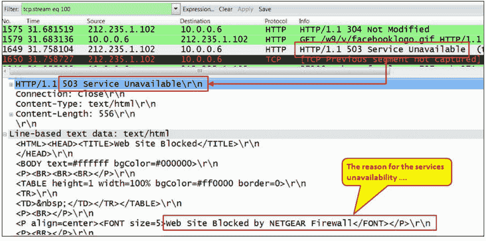

### 工作原理...

在标准 HTTP 浏览中，您应该看到如下非常简单的模式：

1. TCP 打开连接（三次握手）。
2. HTTP 发送 `GET` 命令。
3. 数据下载到您的浏览器。

**提示**

在大多数情况下，打开一个网页会建立多个连接——很多时候有几十个。例如，当您打开一个新闻页面（[www.cnn.com](http://www.cnn.com)、[www.foxnews.com](http://www.foxnews.com)、[www.bbc.co.uk](http://www.bbc.co.uk)）时，它会打开主页、新闻栏、广告、温度窗口、到其他站点的连接等等。如果一个页面打开了近一百个甚至更多的连接，请不要感到惊讶。

### 更多内容...

当您在数据包详细信息窗格中看不到任何内容时，请右键单击一个数据包并选择**跟随 TCP 流**。这将为您提供一个详细的窗口（如前面的截图所示），其中包含大量连接数据。

另一个广泛用于 HTTP 的工具是 **Fiddler**。可以在 <http://fiddler2.com/> 找到它。Fiddler 是一个用于 HTTP 调试的免费工具。它不在本书的讨论范围之内。

## 导出 HTTP 对象

导出 HTTP 对象是一个简单的功能，用于导出 HTTP 统计信息——即通过 HTTP 访问的网站和文件。

### 准备工作

要导出 HTTP 对象，请选择**文件 | 导出对象 | HTTP**。

### 操作步骤...

要导出 HTTP 对象，请按照以下步骤操作：

1. 您可以在捕获运行时使用此功能，或者先保存捕获的文件。您将看到以下窗口：

    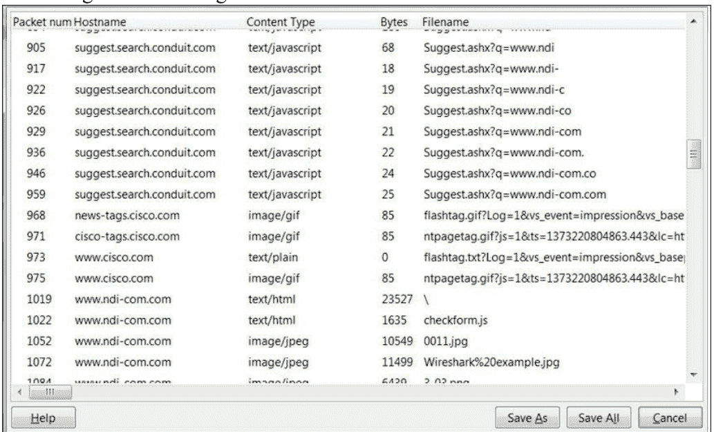

2. 从这里，您可以获得已访问网站的列表，包括每个网站中访问的文件。您可以看到网站、文件类型、大小和名称。

3. 您可以使用“Save As”或“Save All”按钮将数据保存到文件中。

4. 在“Content Type”列中，您将看到以下内容：
    - 文本：text/plain、text/html、text/javascript——如果是 JavaScript，请检查它是什么，它可能是一个安全风险
    - 图像：image/jpeg、image/gif 和其他类型的图像——您可以使用查看器打开它们
    - 应用程序：application/json、application/javascript 和其他类型的应用程序
    - Wireshark 发现的任何其他文本文件

**提示**

要使导出 HTTP 对象功能正常工作，请先转到 TCP 首选项并启用 TCP 数据包重组（允许子解析器重组 TCP 流）。

您将获得一个包含捕获文件中所有对象的目录。对象可以是图片（例如，前面截图中的数据包 1052 和 1057）、文本（前面截图中的数据包 1019、1022 等）以及其他类型。

### 工作原理...

此功能会扫描当前打开的捕获文件或正在运行的捕获中的 HTTP 流，获取重组的对象，如 HTML 文档、图像文件、可执行文件和其他可读格式，并允许您将它们保存到磁盘。保存的对象随后可以用合适的查看器打开，或者对于可执行文件，只需单击即可执行。此功能可用于多种目的，包括监听和保存对象以进行备份（例如，通过电子邮件发送的文件）。

### 更多内容...

您可以使用多个软件以图形方式执行相同的操作，其中一些如下：

- **Xplico** ([http://www.xplico.org/](http://www.xplico.org/))
- **NetworkMiner** ([http://www.netresec.com/?page=NetworkMiner](http://www.netresec.com/?page=NetworkMiner))

**提示**

当您看到一个未知网站带有您不认识的应用，以及一个看起来可疑的文件名时，请用 Google 搜索一下；这可能是一个风险（我们将在[第 14 章，理解网络安全](#)中再次讨论这个主题）。

## HTTP 流分析与“跟随 TCP 流”窗口

本书前面简要讨论过的**跟随 TCP 流**功能是一个非常实用的功能，可以帮助您深入了解在监控网络时捕获的 TCP 流。在本节中，我们将看到它的一些优势。

### 准备工作

对您想要监控的设备或链路进行端口镜像，然后开始数据包捕获。

### 操作步骤...

1. 要打开“跟随 TCP 流”窗口，请执行以下步骤：
2. 右键单击您想要查看的流中的一个数据包。
3. 您选择的流会被 Wireshark 过滤。您将在此显示过滤器栏中看到捕获中流的编号。您将看到以下窗口：

    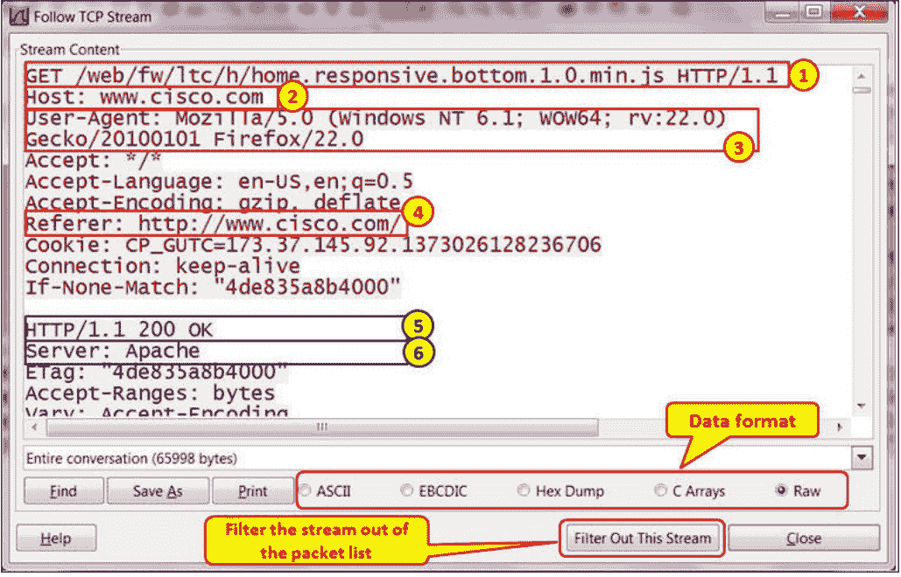

4. 您可以看到流详细信息，例如：
    - GET 方法（在前面截图中标记为 1）
    - 请求的主机（HOST）（在前面截图中标记为 2）
    - 客户端类型，本例为 Mozilla Firefox（在前面截图中标记为 3）
    - 引用页（referrer），本例为 Cisco（在前面截图中标记为 4）
    - HTTP OK 响应（在前面截图中标记为 5）
    - 服务器类型（在前面截图中标记为 6）

5. 这些是明显的示例。当遇到问题或需要调查的问题时，您可以在这里看到许多类型的参数，它们将指示以下情况：


6. 你还可以检查以下内容：

   - 某个用户正在使用 Kazaa 客户端进行文件共享（如下面的截图所示）。

     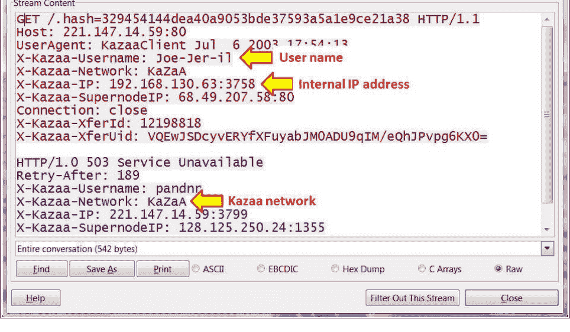

   - 在下面的截图中，你可以看到一个软件错误。快速用 Google 搜索会发现这是一个历史遗留问题，但其他错误也可以通过这种方式发现。

     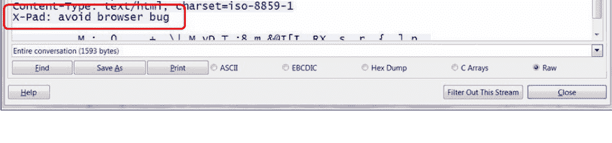

### 工作原理...

跟踪 TCP 流（Follow TCP Stream）功能会分析从首个 SYN/SYN-ACK/ACK 握手到连接结束（以 RST 或 FIN 数据包为标志）的 TCP 数据。它还会隔离出特定的数据流，帮助我们追踪其中的错误和问题。

### 更多内容...

使用“跟踪 TCP 流”功能可以发现并定位许多问题，后续章节将进一步讨论。请使用该功能来隔离 TCP 流。

## 分析 HTTPS 流量 – SSL/TLS 基础

HTTPS 是 HTTP 的安全版本。这里的“S”表示它由**安全套接层/传输层安全（SSL/TLS）**保护。当你连接银行账户、网络邮件服务或任何其他基于 HTTP 且需要安全保护的服务时，就会用到它。

在本节食谱中，我们将了解 HTTPS 通信的工作原理，以及在使用 HTTPS 通信时可能出现哪些故障。

### 准备工作

对可疑设备或链路进行端口镜像，该设备或链路会转发来自多台设备的流量，然后开始捕获。HTTPS 使用 TCP 端口 443，这正是我们应该关注的。

### 操作步骤...

要监控 HTTPS 会话，请执行以下步骤：

1. HTTPS 会话的建立可以分为四个或五个步骤。本食谱的“工作原理...”部分对此进行了描述。

2. 观察会话建立过程中数据包的顺序，确保你收到的消息与下图所示的顺序一致（括号中你会看到数据包中应显示的内容）：

    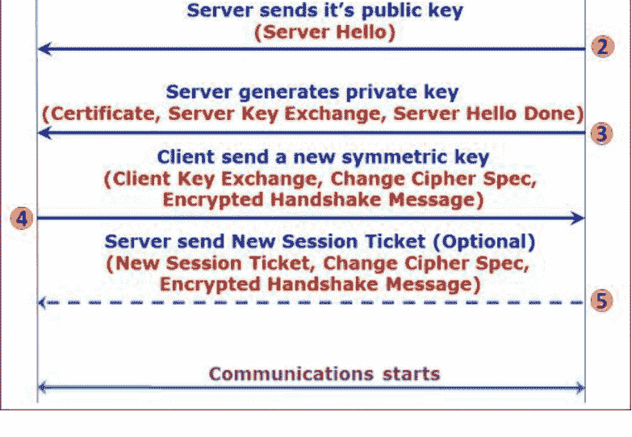

3. RFC 2246 中描述了一些常见错误：

   - **close_notify**：此消息通知接收方，发送方已完成在此连接上的消息发送。之后可以恢复会话。
   - **unexpected_message**：如果收到不适当的消息，则返回此警报。这是一个严重错误，可能表示某一方的实现有问题。
   - **bad_record_mac**：如果收到的记录带有不正确的消息认证码（MAC），则返回此警报。这是一个严重错误，可能表示某一方的实现有问题。
   - **decryption_failed**：如果 TLS 密文以错误方式解密，则返回此警报。这是一个严重消息，可能表示某一方的实现有问题。
   - **record_overflow**：如果收到的 TLS 密文记录长度超过允许长度，则返回此警报。这是一个致命错误，通常表示某一方的实现有问题。
   - **decompression_failure**：此消息表示解压缩函数收到了错误的输入。这是一个严重错误，可能表示某一方的实现有问题。
   - **handshake_failure**：收到此警报消息表示发生协商错误，即发送方在给定可用选项的情况下无法协商出一组安全参数。这是一个严重错误，可能表示某一方的实现有问题。
   - **bad_certificate**：这是证书错误。当证书损坏、包含未正确验证的签名或出现任何其他错误时发生。
   - **unsupported_certificate**：表示收到的证书不是受支持的证书类型。
   - **certificate_revoked**：表示证书已被其签发者撤销。
   - **certificate_expired**：表示证书无效或已过期。
   - **certificate_unknown**：表示证书因未指定的原因未被接受。
   - **illegal_parameter**：表示握手过程中的某个字段超出范围或与其他字段不一致。这是一个严重错误，可能表示某一方的实现有问题。
   - **unknown_ca**：表示收到了有效证书，但因无法与已知可信的 CA 匹配而未被接受。这是一个严重错误，应向证书签发者核实。
   - **access_denied**：表示收到了有效证书，但未通过接收方的访问控制批准，发送方决定不继续进行协商。
   - **decode_error**：表示消息过长，因此无法解码。这是一个严重错误，可能表示某一方的实现有问题。
   - **decrypt_error**：表示握手加密操作失败，包括因签名验证、密钥交换或 finished 消息验证失败而导致的失败。
   - **export_restriction**：表示检测到不符合出口限制的协商。
   - **protocol_version**：表示客户端尝试协商的协议版本不受支持。
   - **insufficient_security**：当协商失败时返回此警报，因为服务器要求的安全密码套件高于客户端所支持的安全级别。
   - **internal_error**：这是与连接对端无关的内部错误。
   - **user_canceled**：表示握手因协议失败之外的原因而被取消。
   - **no_renegotiation**：在初始握手之后，由客户端或服务器发送，以响应 hello 请求。

出现上述任何一种失败，连接都将无法建立。

### 工作原理...

**SSL** 和 **TLS** 是用于保护特定应用（如 HTTP、SMTP、Telnet 等）的协议。SSL 1.0、2.0 和 3.0 版本由 Netscape 在 90 年代中期为其 Navigator 浏览器开发，而 TLS 则是由 IETF 制定的标准（`RFC 2246`、`RFC 4492`、`RFC 5246`、`RFC 6176` 等）。TLS 1.0 于 1999 年 1 月首次在 `RFC 2246` 中引入，作为 SSL 3.0 的升级版（参见 http://tools.ietf.org/html/rfc2246 第三段）。

TLS 握手协议包含以下用于建立 TLS 连接的过程：

1. 交换 hello 消息以确定要使用的算法，并交换随机值用于密钥生成。
2. 交换必要的加密参数，使客户端和服务器能够协商出预主密钥。
3. 交换证书和加密信息，使客户端和服务器能够相互认证。
4. 根据预主密钥和交换的随机值生成主密钥。
5. 让客户端和服务器验证对端是否计算出了相同的安全参数，并验证握手过程未被攻击者篡改。

这些过程按以下顺序执行：

1. 选择加密算法：
   - **Client Hello** 消息（在下图中标记为 **1**）
   - **Server Hello** 消息（在下图中标记为 **2**）
2. 认证服务器并交换密钥（在下图中标记为 **3**）。
3. 认证客户端并交换密钥（在下图中标记为 **4**）。
4. 完成握手（在下图中标记为 **5**）。

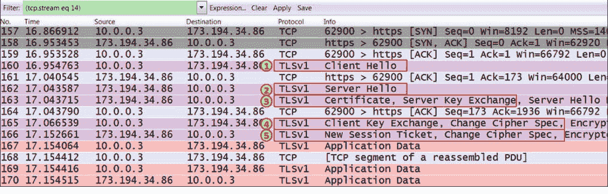

下面来看看它是如何工作的。在上面的截图中，我们可以看到 TCP 如何建立连接（数据包 157–158–159），数据包 160 则开始 TLS 握手。具体细节如下：

1. 在数据包 160 中，客户端发送一条 **Client Hello** 消息，开始协商。
2. 服务器以 **Server Hello** 消息作为应答。
3. 服务器向客户端发送证书。
4. 客户端获取证书并生成预主密钥。
5. 服务器创建主密钥，随后会话开始。这是一个可选消息。

### 提示

这指的是一种机制（定义于 RFC 4507），它允许 TLS 服务器恢复会话，并避免保存每个客户端的会话状态。TLS 服务器将会话状态封装到一个票据（ticket）中，并转发给客户端。客户端之后可以使用获得的票据恢复会话。例如，当你重新打开与网络邮件账户（Gmail、Hotmail 等）的连接时就会发生这种情况，这种场景很常见。

客户端与服务器之间的通信将在第 4 步或第 5 步之后开始。

我们逐一来看：

在第 1 步中，数据包 160 是一条 **Client Hello** 消息，它是 TLS 握手过程中的第一个数据包。我们可以从下图中看到其中一些参数：


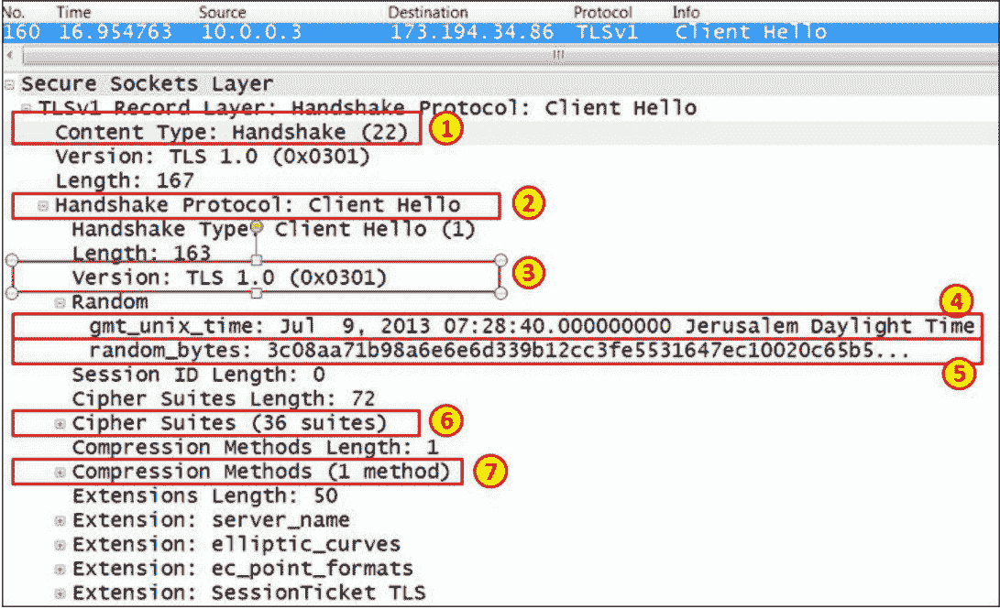

- 高亮区域1显示该数据包的内容是一次握手（`ssl.record.content_type == 22`）。
- 高亮区域2显示该数据包是从客户端发送到 Web 服务器的**客户端问候（Client Hello）**消息，此消息启动握手。
- 高亮区域3显示客户端支持的最高 SSL 和 TLS 版本。
- 高亮区域4显示将用于密钥生成过程的客户端时间。
- 高亮区域5显示由客户端生成的、用于密钥生成过程的随机数据。
- 高亮区域6显示客户端支持的密码套件。这些密码套件按优先顺序排列。
- 高亮区域7显示客户端支持的数据压缩方法。

如下面的截图所示，数据包162是一个**服务器问候（Server Hello）**消息，其中包含以下详细信息：

- 高亮区域1显示该数据包的内容是一次握手（`ssl.record.content_type == 22`）。
- 高亮区域2显示本次会话将使用的 TLS 版本。
- 高亮区域3显示该数据包是从服务器发送到客户端的服务器问候消息。
- 高亮区域4显示密钥生成过程中使用的服务器时间。
- 高亮区域5显示由服务器生成的、用于密钥生成过程的随机数据。
- 高亮区域6显示本次会话将使用的密码套件。它是从客户端发送的密码列表中选择的。
- 高亮区域7显示本次会话将使用的数据压缩方法。

下一个数据包是服务器发送证书的响应：

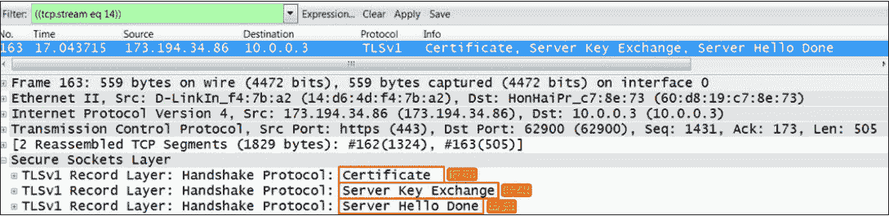

- 高亮区域**1**显示服务器发送**证书（Certificate）**命令，其中包含服务器的证书。点击此行左侧的 (+) 号并深入查看详细信息，你将看到证书颁发者、有效期、算法和其他数据。
- 高亮区域**2**显示服务器发送**服务器密钥交换（Server Key Exchange）**命令（通常是 Diffie-Hellman），其中包含所需参数（公钥、签名等）。
- 高亮区域**3**显示服务器发送**服务器问候结束（Server Hello Done）**命令。此命令表示服务器已完成 SSL 握手此阶段的操作。下一步是客户端身份验证。

下一个数据包（本例中为数据包165）是服务器发送证书的响应。

筛选：((tcp.stream eq 14)) 表达式... 清除 应用 保存
编号 时间 源 目的 协议 信息
165 17.066539 10.0.0.3 173.194.34.86 TLSv1 客户端密钥交换
安全套接层
TLSv1 记录层：握手协议：客户端密钥交换
内容类型：握手（22）
版本：TLS 1.0 (0x0301)
长度：70
握手协议：客户端密钥交换
握手类型：客户端密钥交换（16）
长度：66
EC Diffie-Hellman 客户端参数
公钥长度：65
公钥：04dc3f11956841d6665992ff5a2f5cb13e7577a91e8b3000...
TLSv1 记录层：更改密码规范协议：更改密码规范
内容类型：更改密码规范（20）
版本：TLS 1.0 (0x0301)
长度：1
更改密码规范消息
TLSv1 记录层：握手协议：加密的握手消息

- 高亮区域1显示客户端发送客户端密钥交换命令。此命令包含由客户端创建并使用服务器公钥加密的预主密钥。对称加密密钥由客户端和服务器根据客户端和服务器问候消息中交换的数据生成。
- 高亮区域2显示客户端向服务器发送更改密码规范通知。这样做是为了表明客户端将开始使用新的会话密钥进行哈希计算和加密。

最后一步是服务器向客户端发送新会话票据，其外观类似于以下截图中的示例：

筛选：((tcp.stream eq 14)) 表达式... 清除 应用 保存
编号 时间 源 目的 协议 信息
166 17.152661 173.194.34.86 10.0.0.3 TLSv1 新会话票据、更改密码规范、加密握手
帧166：线路上的 280 字节（2240 位），接口 0 上捕获到 280 字节（2240 位）
以太网 II，源：D-LinkIn_f4:7b:a2 (14:d6:4d:f4:7b:a2)，目的：HonHaiPr_c7:8e:73 (60:d8:19:c7:8e:73)
互联网协议版本 4，源：173.194.34.86 (173.194.34.86)，目的：10.0.0.3 (10.0.0.3)
传输控制协议，源端口：https (443)，目的端口：62900 (62900)，序列号：1936，确认号：331，长度：226
安全套接层
TLSv1 记录层：握手协议：新会话票据
TLSv1 记录层：更改密码规范协议：更改密码规范
TLSv1 记录层：握手协议：加密的握手消息

## 更多内容...

多次有人问我，是否可以解密经过 SSL/TLS 加密的会话。如果你拥有私钥，那么是可能的；该私钥由你所连接的服务器提供，而要获得它并非易事。

有一些方法可以劫持此密钥，在某些情况下这些方法会奏效。但这并非显而易见，而且无论如何都不属于本书的目标范围。如果你获得了私钥，只需在首选项窗口的协议列表中添加该密钥，然后继续操作。有关此功能的更多详细信息，可从 [http://wiki.wireshark.org/SSL](http://wiki.wireshark.org/SSL) 以及许多其他网站和博客获取。
