## 第11章 分析企业应用的行为

在本章中，我们将介绍以下主题：

- 发现网络上运行了什么
- 分析 FTP 问题
- 分析电子邮件流量并排查电子邮件问题——POP、IMAP 和 SMTP
- 分析 MS-TS 与 Citrix 通信问题
- 分析 NetBIOS 协议中的问题
- 分析数据库流量和常见问题

## 简介

Wireshark 的重要用途之一就是应用分析和故障排除。当应用变慢时，可能是由于局域网（在有线局域网中相当少见）、广域网服务（由于带宽不足或高延迟而常见），或服务器/客户端缓慢（我们将在 TCP 窗口问题中看到）。也可能是由于应用本身缓慢或存在问题。

本章的目的是深入研究应用程序的工作方式，并提供一些指导和解决方案来隔离和解决这些问题。在第一个方案中，我们将学习如何发现并分类运行在我们网络上的应用程序。然后，我们将介绍各种类型的应用程序，了解它们的工作方式、网络如何影响其行为，以及可能出现的问题。

在本章中，我们将学习如何使用 Wireshark 来解析和排查企业网络中常用的应用程序。这些应用程序包括 FTP、各种电子邮件协议、Microsoft 终端服务器和 Citrix、数据库、NetBIOS 协议等。

## 发现网络上运行的内容

监控一个新网络时，首先要做的事情就是找出网络上运行了哪些内容。网络上有各种类型的应用程序和网络协议，当它们全部在网络上运行时，可能会相互影响和干扰。

在某些情况下，你会拥有不同的 VLAN、不同的**虚拟路由转发（VRFs）**，或者连接到**刀片服务器**中虚拟端口的服务器。最终，所有内容都运行在相同的基础设施上，它们之间可能会相互影响。

### 提示

VRF 和 VLAN 之间经常存在混淆。尽管它们的用途非常相似，但配置的位置不同。VLAN 在局域网中配置，以提供 OSI 第 1 层和第 2 层的网络隔离；而 VRF 是路由表的多个实例，使它们可以在同一台路由器中共存。这是一种第 3 层操作，用于分隔不同客户的网络。VRF 用于**多协议标签交换（MPLS）**，通过同一路由器网络为不同客户提供第 3 层连接，使任何客户都无法看到其他客户的网络。

### 提示

术语**刀片服务器**指的是一种服务器机箱，前面是服务器架，后面是 LAN 交换机。它有几个不同的缩写；例如，IBM 称之为**刀片中心**，HP 称之为**刀片系统**。


## 准备工作

进入新网络后，第一件事就是连接 Wireshark 嗅探网络上的流量。请确保遵循以下几点：

- 当需要监控服务器时，对服务器端口做端口镜像，查看其网络连接上的流量。
- 当需要监控远程办公室时，对连接 WAN 的路由器端口做端口镜像，然后检查其上的流量。
- 当需要监控到互联网的慢速连接时，对该连接做端口镜像，查看发生了什么。

在本节中，我们将学习如何使用 Wireshark 工具分析正在运行的流量以及可能导致问题的原因。

## 如何做...

要分析谁在通信，请执行以下步骤：

1. 使用上一节提到的选项之一连接 Wireshark。
2. 可以使用以下工具：
   - 导航到 **统计 | 协议分层** 查看网络上运行的协议及其在总流量中的百分比
   - 导航到 **统计 | 会话** 查看谁在通信以及使用了哪些协议
3. 在 **协议分层** 功能中，会弹出一个窗口，帮助您分析谁在网络中通信。如下图所示：

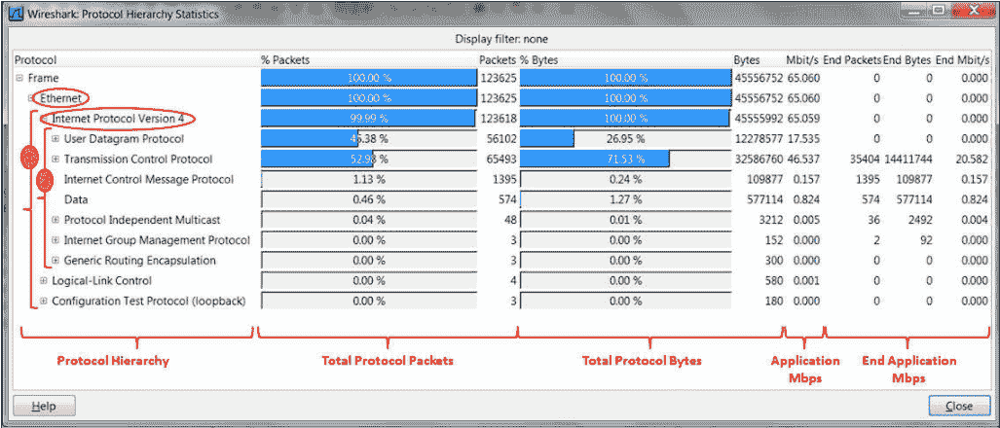

4. 在屏幕截图中可以看到协议分布：
   1. **以太网**：IP、逻辑链路控制（LLC）和配置测试协议（回环）
   2. **互联网协议版本 4**：用户数据报协议（UDP）、传输控制协议（TCP）、协议无关组播（PIM）、互联网组管理协议（IGMP）和通用路由封装协议（GRE）
5. 如果单击 + 号，将显示所有底层协议。
6. 要查看特定协议的吞吐量，请按下图所示向下单击到协议。您将看到捕获期间应用程序的平均吞吐量（本例中为 HTTP）：

7. 单击 HTTP 左侧的 + 号，将打开通过 HTTP 运行的协议列表（XML、MIME、JavaScript 等）及其在捕获期间的平均吞吐量。

## 更多内容...

在某些情况下（尤其是需要准备管理报告时），需要提供网络统计的图形化视图。有多种可用来源，例如：

- **Etherape（适用于 Linux）**：http://etherape.sourceforge.net/
- **Compass（适用于 Windows）**：http://download.cnet.com/Compass-Free/3000-2085_4-75447541.html?tag=mncol:1（来自 Wildpackets）

## 准备工作

使用 FTP 时，如果怀疑存在连接或响应缓慢的问题，请将端口镜像配置到以下任一位置：

- FTP 服务器端口
- 客户端端口
- 流量经过的链路

如有必要，配置捕获或显示过滤器。

## 如何做...

要检查 FTP 性能问题，请执行以下步骤：

1. 首先，如前几章所述，检查是否存在以太网、IP 或 TCP 问题。在许多情况下，响应缓慢是由网络问题引起的，而不一定是应用程序问题。
2. 检查 TCP 重传和重复 ACK。检查这些问题是否出现在整个流量中，还是仅出现在 FTP 连接上。
3. 在 FTP 文件传输中复制单个文件时，IO 图中应出现一条直线，TCP 流图（时间序列）中应出现一条直线梯度。
4. 在下图中，我们可以看到在 TCP 流图（时间序列）中，一个糟糕的 FTP 是什么样子：

如果在多个连接上遇到此问题，可能是因为网络缓慢影响了整个流量。

如果仅在到同一服务器或客户端的 FTP 连接上遇到此问题，则可能是服务器或客户端缓慢。

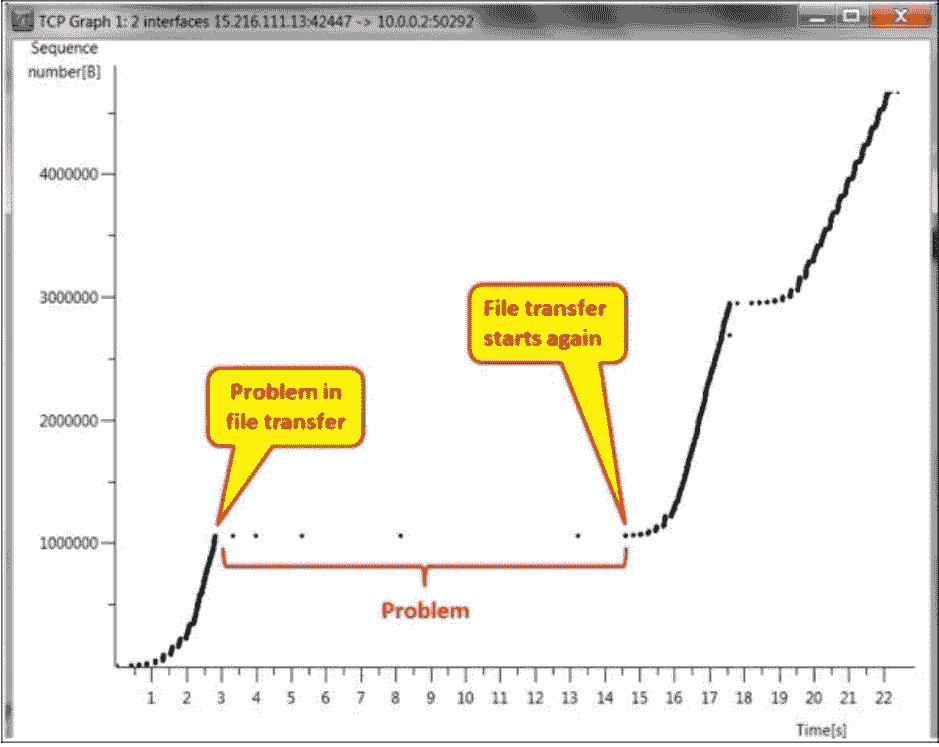

5. 在下图中，我们可以看到它在 IO 图（配置了过滤器）中的样子：

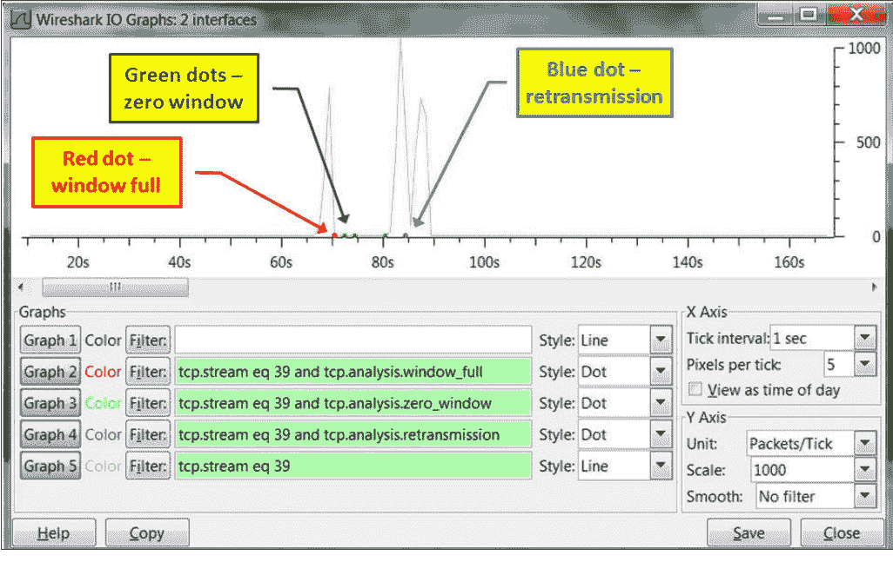

6. 在下面的屏幕截图所示的捕获文件中，我们可以看到 TCP 窗口问题。这些问题列举如下：

- 1. 服务器 `15.216.111.13` 向客户端发送 **TCP 窗口已满** 消息，表示服务器发送窗口已满（数据包 `5763`）。
- 2. 客户端 `10.0.0.2` 向服务器发送 **TCP 零窗口** 消息，告知服务器停止发送数据（数据包 `5778`）。
- 3. 服务器继续向客户端发送 **TCP 零窗口探测** 消息，询问客户端窗口是否仍为零窗口（即告诉服务器不要再发送数据）。客户端以 **TCP 零窗口探测确认** 回复这些消息，表示情况仍然如此（数据包 `5793` 到 `5931`）。
- 4. 过了一段时间，客户端向服务器发送 **TCP 窗口更新** 消息，告诉服务器开始提高 FTP 吞吐量（数据包 `5939`）。

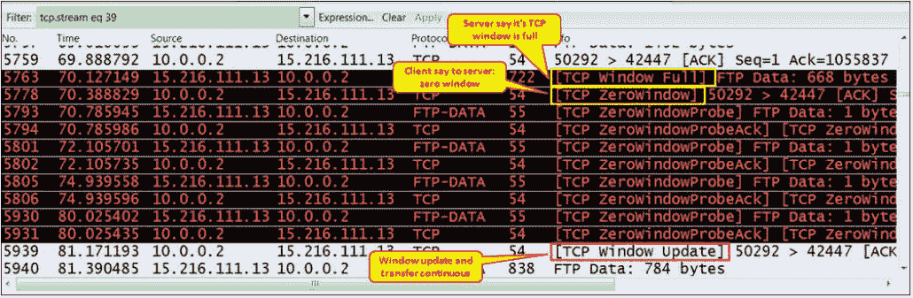

7. 在上述情况下，只是客户端缓慢。我们通过处理并删除一些不必要的进程解决了问题。

如果遇到连接问题，可能是由于服务器无法正常工作、防火墙在途中阻止了连接，或者服务器或客户端上安装的软件阻止了连接。在这种情况下，请执行以下步骤：

- 1. TCP 连接是否通过 `SYN/SYN-ACK/ACK` 数据包正确建立？如果没有，可能是由于：
  - 防火墙阻止了通信。请与系统管理员核实。
  - 服务器未运行。请在服务器上检查——进程表、FTP 服务器管理等。
  - 服务器上的软件阻止了连接。可能是带有额外防火墙的防病毒软件、VPN 客户端或任何其他安全或保护软件阻止了连接。
  - 也请检查客户端的连接。可能是 VPN 客户端、客户端上的防火墙等阻止了连接。

- 2. 在主动模式下，客户端打开到服务器的连接，然后服务器再打开另一个连接。请确保途中的防火墙支持此操作，或使用被动模式。

## 工作原理...

FTP 有两种模式：主动和被动。在主动模式下，服务器向客户端打开另一个连接；而在被动模式下，是客户端向服务器打开第二个连接。让我们看看它是如何工作的。

在被动模式下，操作如下图所示：

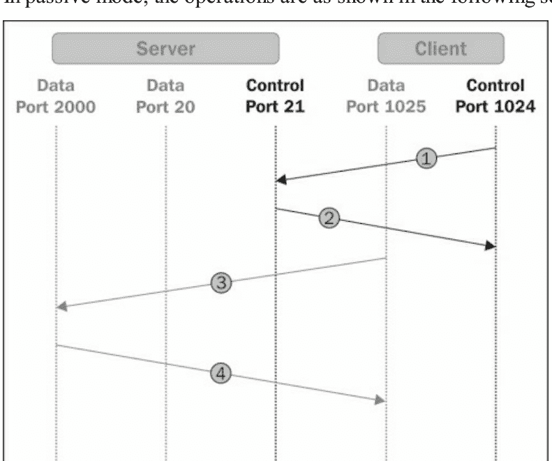

- 1. 客户端从随机端口 P（示例中为 1024）向服务器端口 21 打开一个控制连接。
- 2. 服务器从端口 21 应答客户端端口 1024。
- 3. 现在，客户端从端口 P+1（示例中为 1025）向服务器已打开并通知客户端的某个数据端口（示例中为端口 2000）打开一个数据连接。
- 4. 服务器从数据端口（示例中为 2000）应答发起连接的客户端端口，即数据端口 P+1（示例中为 1025）。

在主动模式下，操作略有不同：

- 1. 客户端从随机端口 P（示例中为 1024）向服务器端口 21 打开一个控制连接。
- 2. 服务器从端口 21 应答客户端端口 1024。
- 3. 服务器从端口 20 向客户端端口 P+1（示例中为 1025）打开数据连接。
- 4. 客户端从数据端口 P+1（示例中为 1025）应答服务器端口 20。

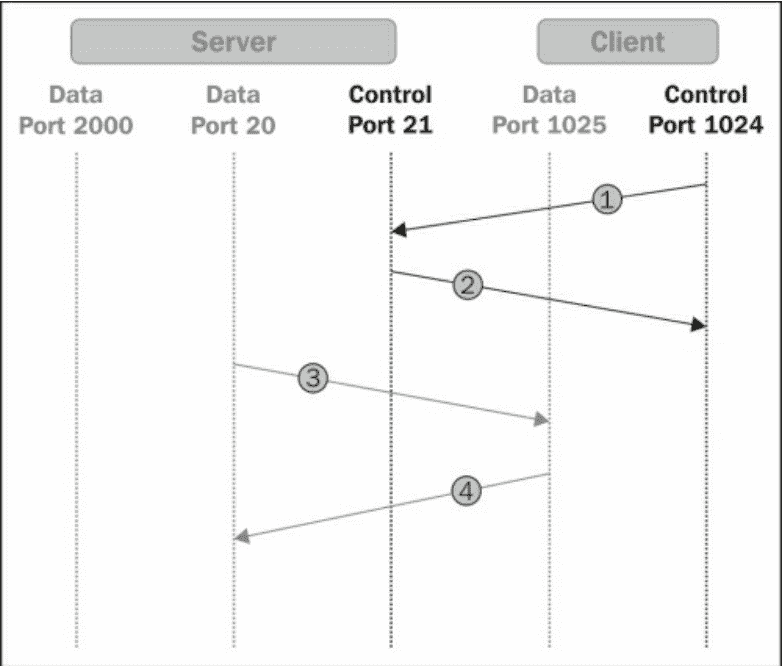

## 更多内容...

FTP 是一个非常简单的应用程序；在大多数情况下，FTP 问题有非常简单的解决方案。例如：

- **问题 1：** 我监控了一条国际连接，网络一侧有 FTP 客户端，另一侧有 FTP 服务器。客户抱怨性能缓慢，并归咎于国际服务提供商。与服务提供商核实后，他们说该连接几乎未加载（10 Mbps 线路的 20%），这一点我在检查线路时也确认了。当我查看 TCP 问题（重传、窗口问题等）时，发现没有问题。为了验证，我移除了 FTP 服务器并安装了另一个（有很多免费的），然后就开始正常工作了。这只是一个低效 FTP 服务器的简单问题。
- **问题 2：** 客户抱怨连接到 FTP 服务器时，每 5 或 6 次尝试后连接就会被拒绝。当我用 Wireshark 检查时，看到了 FTP 连接被拒绝的消息（并且我已经从客户的投诉中知道了这一点），所以看起来像是走进了死胡同。为了验证，我开始停止服务器上运行的服务，问题就出现了。是一款防病毒软件干扰了这个特定的 FTP 服务器。

底线是：即使使用 Wireshark（以及其他软件），有时常识会对你更有帮助。


## 分析电子邮件流量并排查电子邮件问题 – POP、IMAP 和 SMTP

邮件客户端到服务器以及服务器到服务器通信的常见邮件协议是**邮局协议第3版（POP3）**、**简单邮件传输协议（SMTP）**和**互联网消息访问协议第4版（IMAP4）**。

另一种常见的访问电子邮件的方法是网页访问邮件，你可以使用 Gmail、Yahoo! 和 Hotmail 等常见邮件服务器。其中一些示例包括来自微软及其他公司的 Outlook Web 客户端的 **Outlook Web Access（OWA）** 和 **RPC over HTTPS**。

在本方案中，我们将讨论最常见的客户端-服务器和服务器-服务器协议：POP3 和 SMTP。我们还将通过其他方法来看一些典型问题。

## 准备工作

当用户抱怨邮件问题时，首先检查是否存在任何明显的问题，例如错误的用户名、错误密码和未配置的认证协议。如果没有，请通过端口镜像将 Wireshark 连接到投诉的客户端；如果有许多此类客户端，请将端口镜像配置到公共服务器或连接到它的通信线路上（当存在远程服务器时）。

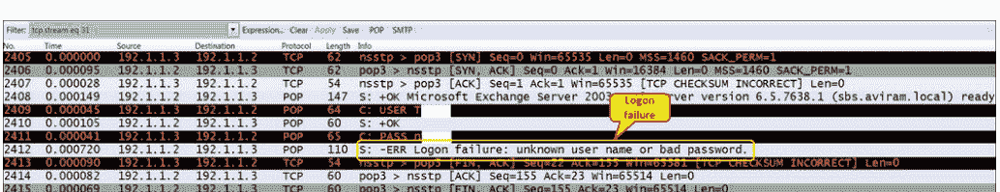

5. 在邮件传输期间，请注意邮件客户端很容易占满窄带通信线路。你可以通过配置带有 POP 过滤器的 I/O 图轻松检查这一点。

6. 始终检查常见的 TCP 指示：重传、零窗口、窗口满等。它们可能表示通信线路繁忙、服务器缓慢，以及来自通信线路或终端节点和服务器的其他问题。这些问题大多会导致连接速度缓慢。

## SMTP 通信

SMTP 通常用于以下目的：

- 服务器到服务器的通信，其中 SMTP 是服务器之间运行的邮件协议
- 在某些客户端中，POP3 或 IMAP4 被配置用于接收消息（从服务器到客户端的消息）；而 SMTP 被配置用于发送消息（从客户端到服务器的消息）

当你怀疑服务器到服务器的通信缓慢时，请按照以下步骤解决问题。

- 1. 检查服务器是否位于同一站点：
  - 如果它们位于同一站点，则可能是服务器缓慢或另一个应用程序问题。在大多数情况下，局域网不会引起任何问题——尤其是当两台服务器位于同一数据中心时。
  - 如果它们不在同一站点（当服务器通过广域网连接位于远程站点时），请检查广域网连接的负载。发送大型邮件时，它们很容易阻塞这些线路——尤其是当它们是窄带（几 Mbps）时。
- 2. 首先，查找 TCP 问题；并检查你是在 SMTP 上看到这些问题，还是在所有其他应用程序上看到这些问题。例如，在下面的截图中，你可以看到许多 TCP 重传：

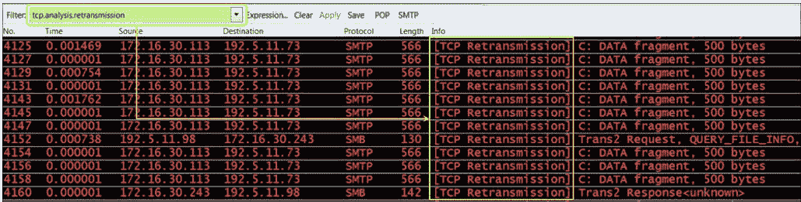

3. 检查这些问题是否是由 SMTP 服务器缓慢引起的。这是邮件问题吗？查看下面的截图，你会看到我使用了 TCP 会话统计。在勾选“限制为显示过滤器”复选框并点击窗口顶部的“数据包”选项（以获取数据包数量较多的列表）后，我们可以看到，在重传的数据包中，只有 793 个数据包是 SMTP 数据包。在 172.16.30.247 和 172.16.30.2 之间的端口 445（Microsoft DS）上有 9014 个数据包被重传，在 172.16.30.180 和 192.5.11.198 之间的端口 80（HTTP）上有 2319 个数据包被重传，等等。

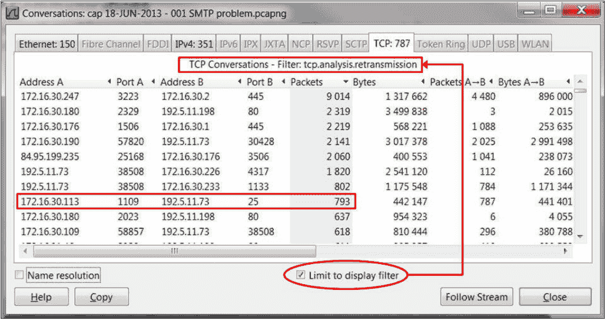

4. 在这种情况下，SMTP 仅受通信不良的影响。这不是 SMTP 问题。

5. 检查 SMTP 错误。在下面的截图中，你会看到错误代码 451，它也被称为处理服务器错误时的本地错误。此外，还列出了错误列表。

## 提示

当出现问题时，在大多数情况下服务器或客户端会告诉你。你只需查看消息并在 Google 上搜索它们。稍后我们会看到许多这样的例子。

你还可以在 RFC 1893（http://www.ietf.org/rfc/rfc1893.txt）中找到 SMTP 状态代码列表。

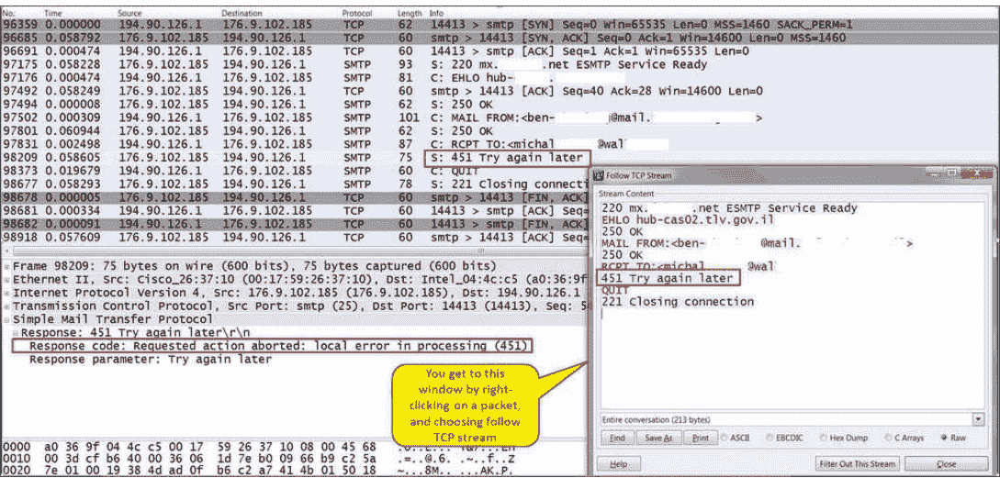

- 1. 当你想知道双方发送了哪些错误时，请按下面的截图所示配置一个过滤器：

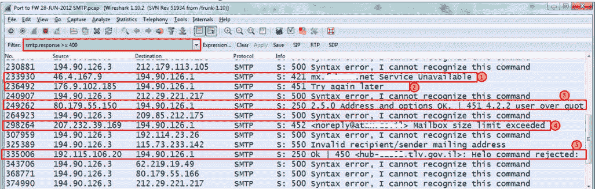

- 2. 在这里你可以看到各种事件：
  - **代码 421：** 这表示邮件服务可能不可用（1）。
  - **代码 452：** 这表示服务器无法响应，并告诉你稍后重试。这是由于服务器负载或服务器问题导致的（2）。
  - **代码 451：**（截图中显示的是代码 250，请参见下面的注释）这表示用户超出配额（3）。
  - **代码 452：** 这表示邮箱大小限制已超出（4）。
  - **代码 450：**（截图中显示的是代码 250，请参见下面的注释）这表示未找到主机（5）。

## 提示

在 SMTP（与许多其他协议一样）中，你可以在同一条消息中获得多个错误代码。你在 Wireshark 的数据包列表中看到的可能是第一个错误代码，也可能只是部分列表。要查看 SMTP 消息中的完整错误列表，请转到数据包详细信息并打开特定的数据包，如下面的截图所示。

当你看到太多代码时，这表示服务器不可用。请与服务器管理员核实。

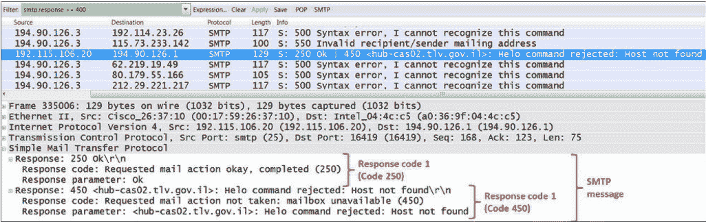

## 其他一些方法和问题

我之前提到的一些其他常见方法是网页邮件和 RPC over HTTP：

- 在网页邮件中，我们通过 HTTPS 连接到服务器；因此这完全就像使用 HTTPS 一样，如[第10章](#)（HTTP 和 DNS）所述。登录服务器后，如果出现任何问题，都将是 HTTPS 问题。
- RPC over HTTPS 也是一样。由于 RPC 是一种通常会加载网络的协议，它被认为对高延迟和抖动敏感。微软提出了一种解决方案，让其 Outlook 客户端通过 HTTPS 工作，而不是使用标准 RPC。同样，由于通信通过 HTTPS 运行，问题将是 HTTPS 问题。

## 工作原理...

邮件客户端大多使用 POP3 与服务器进行通信。在某些情况下，它们也会使用 SMTP。当需要对服务器进行操作时，例如，当你需要查看远程服务器上存在的消息而无需下载到客户端时，会使用 IMAP4。服务器到服务器的通信通常由 SMTP 实现。

## 提示

IMAP 和 POP 之间的区别在于，在 IMAP 中，邮件始终存储在服务器上。如果你删除它，它将无法从任何其他设备访问。在 POP 中，删除已下载的电子邮件可能会或可能不会删除服务器上的该电子邮件。

一般来说，SMTP 状态代码分为三类，其结构有助于你理解到底出了什么问题。SMTP 状态代码的方法和细节将在下一节中讨论。

## POP3

POP3 是一种应用层协议，邮件客户端使用它从服务器检索电子邮件消息。一个典型的 POP3 会话如下面的截图所示：

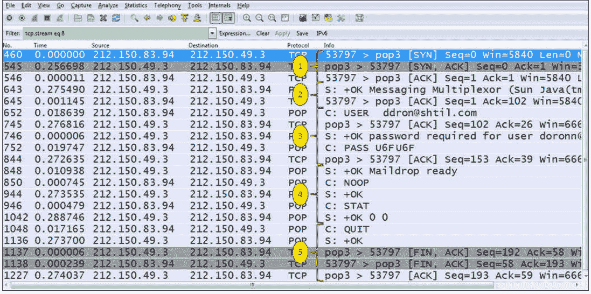

- 1. 客户端打开到服务器的 TCP 连接。
- 2. 服务器向客户端发送一条 OK 消息（**OK Messaging Multiplexor**）。
- 3. 用户发送用户名和密码。
- 4. 协议操作开始。**NOOP**（无操作）是发送以保持连接打开的消息，**STAT**（状态）由客户端发送到服务器以查询消息状态。服务器以消息数量及其总大小作为响应（在数据包 1042 中，**OK 0 0** 表示没有消息，总大小为零）。
- 5. 当服务器上没有邮件消息时，客户端发送 **QUIT** 消息（1048），服务器确认它（数据包 1136），然后 TCP 连接关闭（数据包 1137、1138 和 1227）。

在加密连接的情况下，它看起来几乎相同（见下面的截图）。在连接建立（1）之后，会有几条 POP 消息（2），TLS 连接建立（3），然后是加密的应用数据。

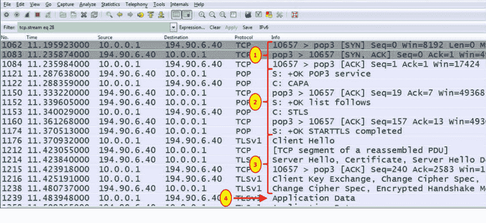

### SMTP 和 SMTP 错误代码（RFC3463）

SMTP 状态代码的结构如下：

```
class . subject . detail
```

例如，当你看到状态代码 450 时，它表示以下内容：

- **类 4** 表示这是一个临时问题


- **主题 5** 表示这是一个邮件投递状态
- **详情 0** 表示未定义错误（RFC 3463，第 3.6 节）

下表列出了各个类别：

| 状态代码 | 含义 | 原因 |
|---|---|---|
| 2.x.xxx | 成功 | 操作成功 |
| 4.x.xxx | 持久临时失败 | 临时条件阻止了服务器发送邮件。可能是由于服务器负载或网络瓶颈所致。通常，重新发送邮件会成功。 |
| 5.x.xxx | 永久失败 | 永久性问题阻止了服务器发送邮件。通常是服务器错误或兼容性问题。 |

下表列出了各个主题：

| 状态代码 | 它是什么 | 可能的原因 |
|---|---|---|
| x.0.xxx | 其他或未定义状态 | - |
| x.1.xxx | 寻址状态 | - |
| x.2.xxx | 邮箱状态 | - |
| x.3.xxx | 邮件系统状态 | - |
| x.4.xxx | 网络和路由状态 | - |
| x.5.xxx | 邮件投递协议状态 | - |
| x.6.xxx | 邮件内容或媒体状态 | - |
| x.7.xxx | 安全或策略状态 | - |

状态详情的列表太长，无法在此一一列出。完整列表可在标准页面 [http://tools.ietf.org/html/rfc3463](http://tools.ietf.org/html/rfc3463) 中找到。

下表列出了一些常见的状态代码：

| 状态代码 | 它是什么 | 可能的原因 |
|---|---|---|
| 220 | 服务就绪 | 服务正在运行并准备好执行邮件操作。 |
| 221 | 服务关闭传输通道 | 通常正常。这是服务器在不再需要服务时关闭服务的方式。 |
| 250 | 请求的邮件操作已完成 | 邮件投递成功。 |
| 251 | 非本地用户，邮件将被转发 | 一切正常。 |
| 252 | 无法验证用户 | 服务器无法验证该用户。邮件仍将被投递。 |
| 421 | 服务不可用 | 邮件传输服务不可用，并且由于临时事件无法处理传入邮件。这可能是由于服务器问题（服务未运行）或服务器限制导致的。 |
| 422 | 邮件大小问题 | 收件人邮箱已超出配额或对传入邮件有限制。 |
| 431 | 内存不足或磁盘已满 | 服务器磁盘已满或内存不足。请检查服务器。 |
| 432 | 传入邮件队列已停止 | 可能是由于服务器错误（某项服务已停止）导致的。 |
| 441 | 接收服务器无响应 | 发送邮件的服务器表明目标服务器没有响应。 |
| 442 | 连接错误 | 与目标服务器的连接存在问题。 |
| 444 | 无法路由 | 服务器无法确定邮件的下一跳。 |
| 445 | 邮件系统拥塞 | 邮件服务器暂时拥塞。 |
| 447 | 投递时间已过期 | 拒绝系统认为邮件已过旧。这通常是由于排队或传输问题导致的。 |
| 450 | 未执行请求的操作 | 邮件无法传输。这通常是由于远程服务器上的邮件服务出现问题。 |
| 451 | 无效命令 | 这表示命令不受支持或顺序错误。接收服务器已中止该操作。这主要是由于发送或接收服务器上的负载过高。 |
| 452 | 未执行请求的操作 | 接收服务器存储空间不足。 |
| 500 | 语法错误 | 服务器发送的命令未被识别为有效的 SMTP 或 ESMTP 命令。 |
| 512 | DNS 错误 | 无法定位作为已发送邮件目标的主机服务器。 |
| 530 | 身份验证问题 | 接收服务器要求进行身份验证，或者您的服务器已被接收服务器加入黑名单。 |
| 542 | 收件人地址被拒绝 | 该消息表示您的服务器地址已被接收服务器拒绝。这通常是由于反垃圾邮件系统、IDS/IPS 系统、智能防火墙或其他安全系统所致。 |

## 更多内容...

电子邮件有时被称为网络“无声杀手”之一，尤其是在使用非对称线路接入互联网的小型企业中。发送文本消息时，它们几乎不会消耗网络带宽；但当你通过窄带上行链路向 ISP 发送一个几兆甚至几十兆的大文件时，办公室里的其他用户将遭受持续数秒甚至数分钟的网络变慢。我在许多小型办公室中见过这个问题。

邮件客户端的另一个问题是，在某些情况下（可配置），邮件客户端被设置为在启动时从服务器下载所有新数据。如果您的客户抱怨所有员工在办公室开始一天工作的时间段网络变慢，那可能是因为数十或数百个客户端同时打开了邮件客户端，而邮件服务器位于广域网（WAN）上。

## 分析 MS-TS 和 Citrix 通信问题

**Microsoft 终端服务器（MS-TS）** 使用 **远程桌面协议（RDP）** 和 **Citrix Metaframe 的独立计算架构（ICA）** 协议，广泛用于 PC 和瘦客户端的本地及远程连接。关于这类应用需要记住的重要一点是：它们通过网络传输屏幕变化。如果变化很少，只需要低带宽；如果变化很多，则需要高带宽。

另一点是，这些应用的流量完全是非对称的。下行流量从几十 Kbps 到几 Mbps 不等，而上行流量最多只有几 Kbps。在使用这些应用时，别忘了据此设计网络。

在本节中，我们将了解这些应用的一些典型问题以及如何定位它们。为方便叙述，我们将使用 Microsoft TS 来指代；每当我们写到 MS-TS，都指的是这一类应用中的所有程序，例如 Citrix Metaframe。

### 准备工作

当怀疑 MS-TS 性能缓慢时，首先与用户确认具体问题是什么。然后将 Wireshark 连接到网络，对投诉的客户端或服务器进行端口镜像。

### 操作步骤...

要定位涉及 MS-TS 的问题，首先需要前往用户处询问问题。请按照以下步骤操作：

- 1. 当用户抱怨网络缓慢时，问他们一个简单的问题：他们看到的是屏幕上显示的数据变慢，还是切换窗口时变慢？
- 2. 如果他们说窗口切换非常快，那就不是 MS-TS 的问题。MS-TS 问题会导致窗口变化缓慢、画面冻结、图形文档滚动缓慢等。
- 3. 如果他们说他们正在尝试生成一份报告（当软件运行在 MS-TS 上时），但报告需要很长时间才生成，这是数据库问题，而不是 MS-TS 或 Citrix 的问题。
- 4. 当用户通过高延迟通信线路使用 MS-TS 并快速输入时，可能会遇到字符延迟。这是因为 MS-TS 正在传输窗口变化，在高延迟下这些窗口变化的传输会变慢。
- 5. 使用 Wireshark 测量通信线路时：
    - 使用 IO 图监控线路
    - 使用过滤器监控上行和下行方向
    - 在 y 轴上配置“位/刻度”
- 6. 您将得到以下截图：

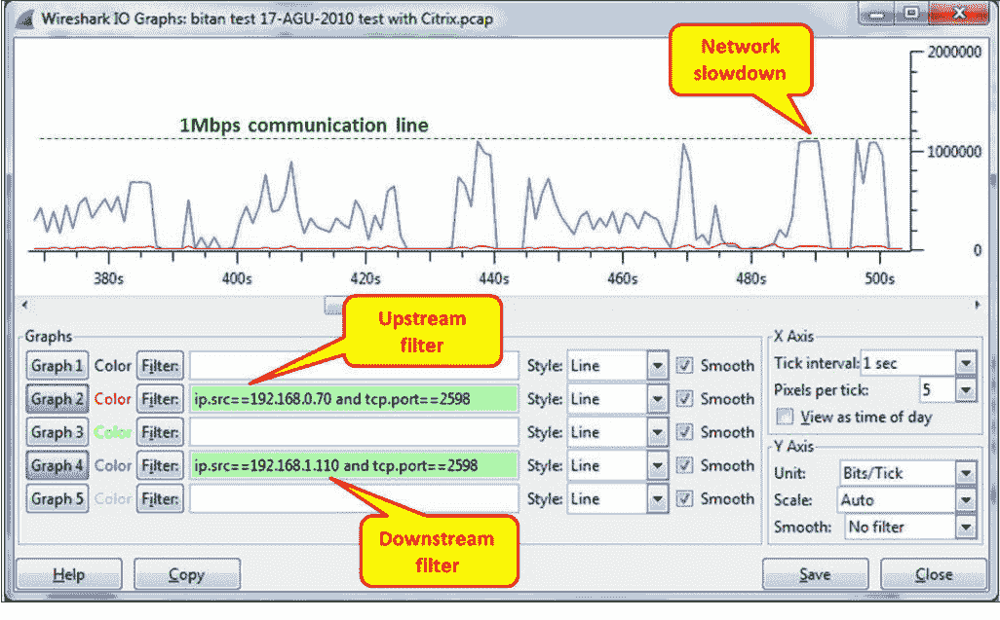

- 7. 在上面的截图中，您可以看到一个典型的下行流量高、上行流量极低的流量模式。注意 **Y 轴** 被配置为 **位/刻度**。在 485 秒到 500 秒之间，您会看到吞吐量达到最大值。这时应用会变慢，用户开始感觉到画面冻结、菜单移动非常缓慢等现象。

### 提示

当 Citrix ICA 客户端连接到演示服务器时，它使用 TCP 端口 2598 或 1494。

- 8. 在监控 MS-TS 服务器时，别忘了客户端通过 MS-TS 访问服务器，而服务器通过安装在服务器上的另一个客户端访问应用程序。性能问题可能来自 MS-TS，也可能来自应用程序。
- 9. 如果问题确实是 MS-TS 的问题，则有必要弄清楚是网络问题还是系统问题：
    - 使用 Wireshark 检查网络是否出现负载。诸如前一张截图所示的负载，只需增加通信线路即可解决。


- 检查服务器的性能。诸如 MS-TS 之类的应用程序大多消耗内存，因此请主要检查内存（RAM）问题。

## 工作原理...

MS-TS、Citrix Metaframe 以及各类应用程序只是通过网络传输窗口变化。从你的客户端（装有软件客户端的 PC 或瘦客户端）连接到终端服务器；终端服务器再运行各种客户端，用于从它连接到其他服务器。在下图中，你可以看到终端服务器操作的原理：

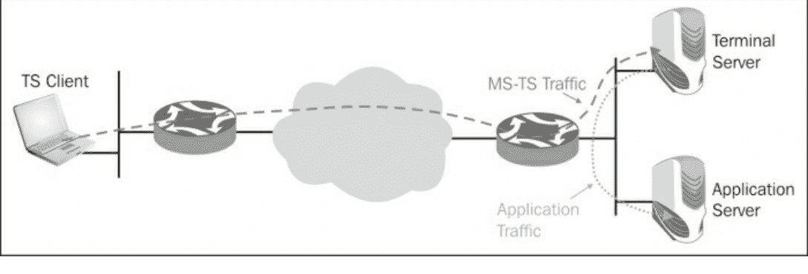

## 分析 NetBIOS 协议中的问题

**网络基本输入/输出系统（NetBIOS）** 是一套于 20 世纪 80 年代初为局域网通信开发的协议。几年后，微软将其用于局域网上的网络通信，随后又将其迁移到 TCP/IP 上运行（NetBIOS over TCP/IP，RFC 1001 和 1002）。

在当今网络中，NetBIOS 提供三种服务：

- **名称服务**（端口 137）：用于名称注册以及名称到 IP 地址的解析。
- **数据报分发服务**（端口 138）：用于客户端和服务器发布服务通告。
- **会话服务**（端口 139）：用于主机之间的会话协商。该服务用于访问文件、打开目录等。

在本章中，我们将探讨 NetBIOS 协议套件的一些常见问题，并学习如何尝试解决它们。由于 NetBIOS 协议集相当复杂，可能出现问题的场景数以百计，因此我们将提供一些指南，说明如何查找常见问题以及可能出错的地方。

### 准备工作

NetBIOS 协议在 Windows 环境中运行，同时 MAC 和 Linux 机器也通过它与 Windows 通信。当这些环境中出现不稳定、响应缓慢、断连等问题时，NetBIOS 问题可能是原因之一。面对这些问题时，用于解决它们的工具是 Wireshark。它会显示网络上的流量，而 Windows 工具则会显示客户端和服务器中运行的内容。

### 操作步骤...

为了尝试找出可能的问题，请将安装有 Wireshark 的笔记本连接到网络，并按下文所述对可疑客户端或服务器进行端口镜像。在接下来的章节中，我们将看到几种问题场景。

有许多与 NetBIOS 一起使用的预定义过滤器。你可以通过单击 **显示过滤器** 窗口右侧的 **表达式** 按钮找到它们。

1. 常规 NetBIOS 命令以 `netbios` 开头。
2. NetBIOS 名称服务以 `nbns` 开头。
3. NetBIOS 数据报服务以 `nbds` 开头。
4. NetBIOS 会话服务以 `nbss` 开头。
5. SMB 以 `smb` 开头。

#### 常规测试

首先，全面查看一下网络。然后，寻找可疑的模式：

1. 将 Wireshark 连接到网络。只要与出现问题的客户端处于同一广播域，任何一个端口都可以。
2. 配置显示过滤器 `nbns.flags.response == 0`。它会给出 NBNS 请求。你会看到许多广播，如下图所示：

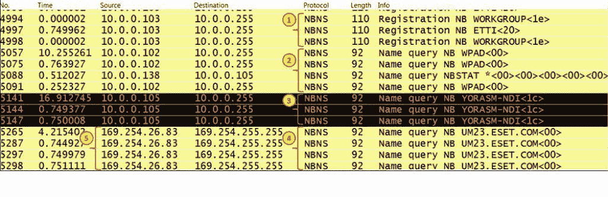

3. 正如你在上图中看到的，在捕获文件中你会看到以下内容：
    - **NBNS 注册数据包 (1)：** 在示例中，有名为 WORKGROUP 和 ETTI 的注册。NBNS 服务器将通过向请求节点发出肯定或否定的名称注册响应来接受或拒绝名称注册。如果没有收到任何响应，请求节点将假定注册成功。
    - NBNS 查询（2、3 和 4）：针对指定名称发送查询。如果存在 NBNS 服务器（即域控制器），你将看到以下响应之一：
        - 请求的名称不存在（代码 3）
        - 无错误（代码 0）

4. 确保没有来自以 169.254 开头的地址的注册或任何其他请求 (5)。这些是自动专用 IP 寻址（APIPA）地址。这实际上意味着该 PC 被配置为自动接受地址（通过 DHCP），但没有收到地址。
5. 还有很多公告数据包。它们将通过 UDP 端口 138 广播。在这里，你会看到每个工作站都会通告其功能：工作站、服务器、打印服务器等。例如，你可以在这里看到：
    - 172.16.100.10 的名称为 FILE-SRV，它具备工作站、服务器和 SQL 服务器的功能 (1)
    - 172.16.100.204 的名称为 GOLF，它具备工作站、服务器和打印队列服务器的功能 (2)

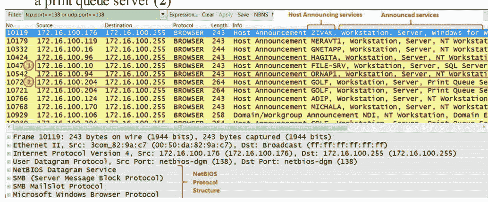

6. 有些蠕虫和病毒会利用 NetBIOS 名称服务扫描网络。请注意异常模式，如大规模扫描、高广播速率等。
7. 确认广播不要太多。每台设备每分钟 5 到 10 次广播是合理的。超过这个数量通常意味着出现了问题。

#### 提示

你在这里可以看到数百种消息场景。可以使用 Wireshark 专家系统、Google 和常识来发现问题。

#### 特定问题

以下是一些在常规操作中可能会遇到的问题：

1. 使用服务器消息块（SMB）协议（该协议用于在网络上浏览目录、复制文件和其他操作）时，你可能会看到一些错误代码。错误代码的完整列表见 Microsoft MSDN：http://msdn.microsoft.com/en-us/library/ee441884.aspx。
2. 代码 0 表示 STATUS_OK，即一切正常且没有问题。任何其他代码都应进行检查。
3. 在下面的示例中，你会看到一条 STATUS_ACCESS_DENIED 消息。这是你应该留意的众多错误代码之一。在示例中，访问 IP 地址以 203 开头的服务器上的 \\NAS01\HOMEDIR（出于安全原因隐藏完整地址）被拒绝。
4. 当你尝试通过浏览来查看主目录时，Windows 通常会显示“拒绝访问”（ACCESS DENIED）消息或类似提示。当应用程序试图访问某个目录但无法访问时，就可能出现此问题。在这种情况下，你可能会看到“拒绝访问”消息、通信问题的软件消息，或程序员为你设计的任何其他消息。此时使用 Wireshark 可以定位确切的错误，而 Google 会告诉你错误原因。

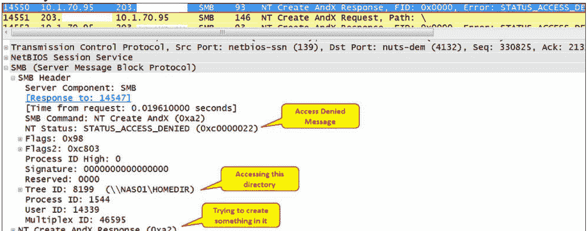

5. 在下一个示例中，我们看到了在 `\\NAS01\SAMM (3)` 上进行会话设置 (1) 时出现的状态 `STATUS_MORE_PROCESSING_REQUIRED (2)`。
    - 查看前面提到的链接，我们会发现这是因为在指定的命名管道上还有更多数据可读取。
    - 在 Google 上快速搜索会告诉我们，这可能表明存在凭据问题。请与系统管理员核实。

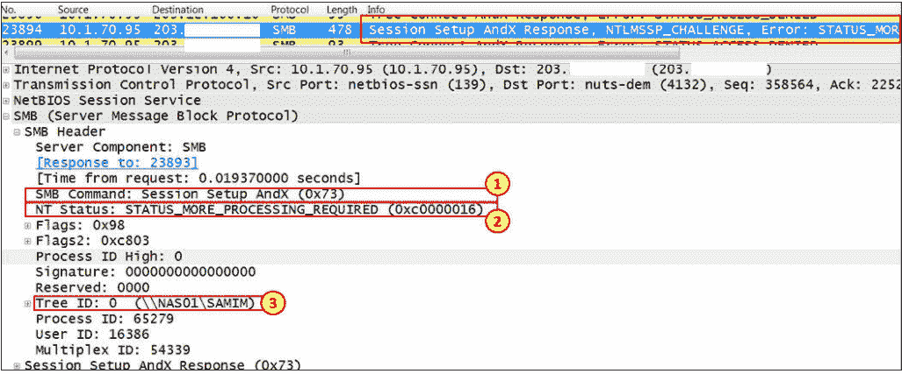

6. 要查看所有 SMB 错误消息，请键入过滤器 `smb.nt_status != 0x0`。你将看到所有错误响应，如下图所示：

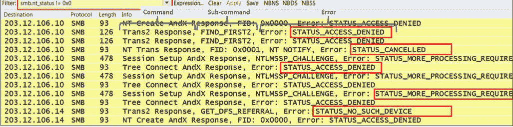

### 工作原理...

正如我们在本节引言中所见，NetBIOS 提供三种服务：**NetBIOS 名称服务（NBNS）**、**NetBIOS 数据报分发服务（NBDS）** 和 **NetBIOS 会话服务（NBSS）**。

NBNS 是负责注册名称并将名称转换为 IP 地址的服务。当客户端在域控制器中注册其名称时，注册就发生了。客户端发送注册请求，然后会收到响应，告知注册是否成功或该名称是否已被另一台设备注册。微软环境曾使用 WINS 实现该服务，但当时大多数网络并未使用它，后来它被 DNS 取代。该服务通过 UDP 端口 137 工作。

NBDS 用于客户端和服务器发布服务通告。借助该服务，网络上的设备会通告自己的名称、能够向网络中的其他设备提供的服务，以及如何连接到这些服务。该服务通过 UDP 端口 138 工作。

NBSS 用于在主机之间建立会话、打开或保存文件，以及在网络上执行远程文件和其他会话操作。该服务通过 TCP 端口 139 工作。

还有其他协议，例如**服务器消息块（SMB）**，它通过 NBSS 运行以进行事务操作，通过 NBDS 运行以发布服务通告；**SPOOLS** 用于打印机请求，以及若干其他协议。深入讨论 NetBIOS 的细节超出了本书的范围。如果你需要排查 NetBIOS 协议问题，请遵循本节中的说明——特别注意错误消息和注意事项。


# 更多内容……

在本节中，我将展示一些示例，以帮助您更好地理解NetBIOS协议。

## 示例1 – 应用程序冻结

在下面的截图中，我们看到应用程序冻结的原因：

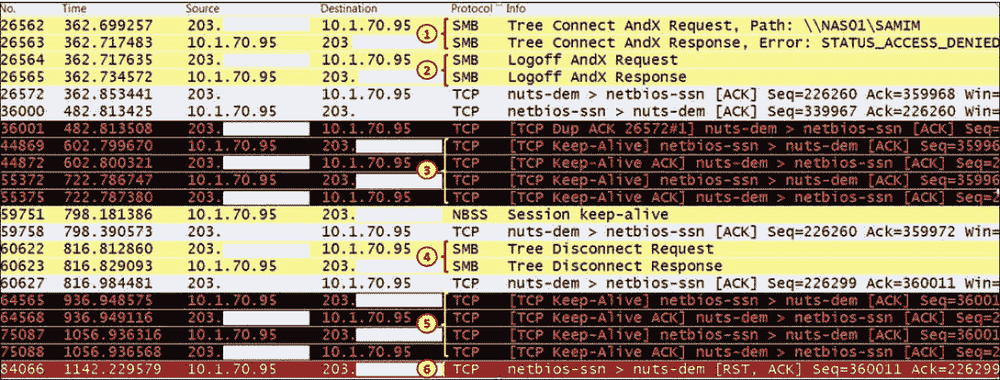

在该示例中，我们观察到以下几点：

- 1. 一个IP地址以203开头的客户端，正尝试连接到IP地址为`10.1.70.95`的服务器上的`\\NAS01\SAM1M`共享，并收到了`STATUS_ACCESS_DENIED`错误。
- 2. 客户端注销，服务器确认了该操作。
- 3. 由于应用程序在等待，TCP通过keep-alive消息保持连接。
- 4. 过了一段时间，客户端发送断开请求，服务器批准了该请求。
- 5. 应用程序继续等待，TCP通过keep-alive保持连接。
- 6. TCP以`RST`（重置）关闭连接。

客户在这里看到的是应用程序冻结。

## 示例2 – 由SMB引起的广播风暴

在我某个客户的网络中，我接到一个紧急电话，说一个远程办事处与总部断开了连接。一些网络细节如下：

- 远程办事处的地址位于子网172.30.121.0/24，默认网关为172.30.121.254。
- 总部的地址位于子网172.30.0.0/24。远程办事处与中心之间的连接通过MPLS网络上的L3 IP-VPN建立。

为了解决这个问题，我执行了以下操作：

- 1. 我尝试ping总部中的服务器，但没有收到响应。
- 2. 我联系了为中心提供线路的服务提供商，他们说在他们的监控系统上没有看到线路上的任何负载。
- 3. 我ping了本地路由器172.30.121.254，但没有收到响应。这意味着局域网中的PC无法访问它们的本地路由器，即默认网关。
- 4. 我将Wireshark通过端口镜像连接到路由器端口，看到了类似下面的截图：

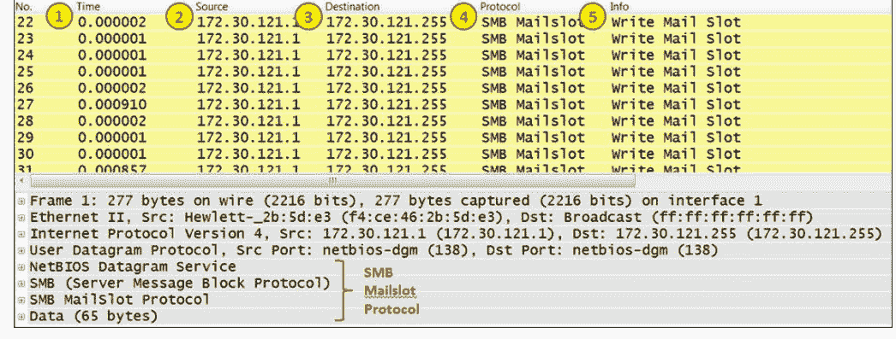

- 5. 我看到一个IP地址为172.30.121.1的主机在微秒级时间内(1)生成了大量数据包。这些数据包是广播包(3)，生成它们的服务是Write Mail Slot(5)，由SMB Mailslot协议(4)发送。
- 6. 为了了解数据包的数量，我使用了IO Graphs功能。我得到了每秒5000个数据包，产生了10 Mbps的流量，这阻塞了那个老旧的路由器端口（将路由器端口改为100 Mbps或1 Gbps也无济于事。它同样会被阻塞）。
- 7. 当我在Google或微软网站上没有找到任何相关信息时，我开始停止我不了解的服务，并跟踪广播发生了什么。

最终，导致问题的服务名为LS3Bcast.exe。我停止了它，并确保它不会再次运行，就这样解决了。

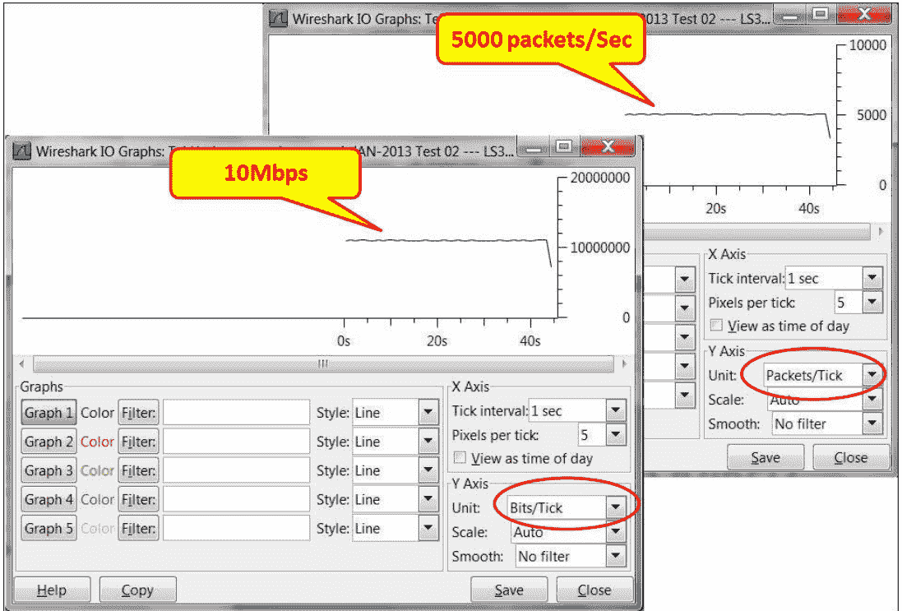

## 分析数据库流量和常见问题

有些人可能会疑惑我为什么在这里添加本节内容。毕竟，数据库被认为是IT环境中完全不同的分支。一边是数据库和应用程序，另一边是网络和基础设施。确实如此，因为不应该是我们来调试数据库；那是DBA的工作。但通过网络中传输的信息，我们可以看到一些有助于DBA解决问题的问题。

在大多数情况下，IT人员会先来找我们，因为人们会把一切都归咎于网络。我们必须确保问题不是来自网络，仅此而已。在少数情况下，我们会在捕获文件中看到一些细节，这些细节可以帮助DBA完成他们的工作。

## 准备工作

当IT团队来找我们抱怨“网络慢”时，需要进行一些检查以确认事实并非如此。请按照下面一节中的说明操作，以确保我们避免“网络慢”的问题。

## 操作步骤……

在遇到数据库问题时，请按以下步骤操作：

- 1. 当你收到“网络响应缓慢”的投诉时，开始提出以下问题：
  - 问题是局部的还是全局的？只发生在远程办事处，还是中心也有？当问题出现在整个网络时，这不是广域网带宽问题。
  - 所有客户端都遇到同样的情况吗？如果不是，可能存在只影响部分用户的特定问题，因为只有这些用户在运行某个导致问题的特定应用程序。
  - 客户端和服务器之间的通信线路负载高吗？是哪个应用程序导致了负载？
  - 是所有应用程序都运行缓慢，还是只有使用特定数据库的应用程序慢？也许是一些PC老旧且不堪重负，或者是一台资源耗尽的服务器？
- 2. 完成上述问题排查后，让我们开始工作：
  1. 打开Wireshark并开始捕获数据包。您可以将端口镜像配置到特定PC、服务器、VLAN或连接远程办事处的路由器上，以便获取客户端数据。
  2. 查看TCP事件（专家信息）。它们发生在整个通信链路上，还是特定的IP地址上，还是特定的TCP端口号上？这将帮助您隔离问题，并确认问题是否出在特定链路、服务器或应用程序上。
- 3. 如果您在网络中发现问题，请按照前几章学到的方法解决它们。但是，有些网络问题会影响数据库行为。在下面的示例中，我们看到一个客户端通过一条往返延迟为35至40毫秒的通信线路与服务器通信时的行为。
  1. 我们查看TCP流编号8(1)，连接开始于

### 提示

在测量到互联网的连接流量时，您会看到到网站、邮件服务器等的大量重传和重复ACK。这就是互联网。在一个组织中，您应该预期重传率为0.1%至0.5%。连接到互联网时，重传率可能会高得多。

TCP SYN/SYN-ACK/ACK。我已将其设置为参考(2)。我们可以看到整个连接占用了371个数据包(3)。

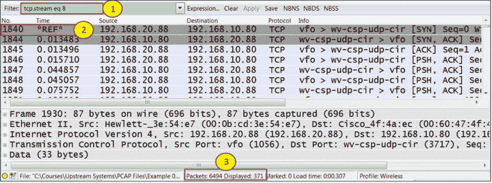

2. 连接继续进行，我们看到数据库请求和响应之间的时间间隔约为35毫秒。

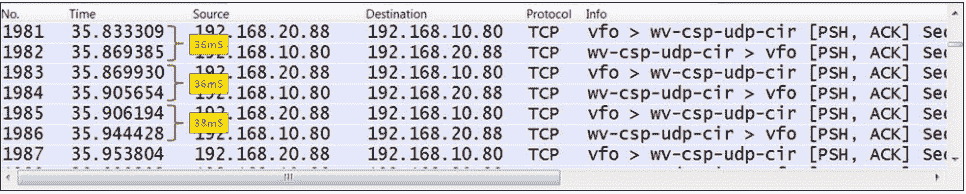

- 3. 由于我们有371个数据包来回传输，371*35毫秒大约为13秒。再加上可能发生的一些重传和一些低效情况，这会导致用户等待10到15秒甚至更长时间才能得到数据库查询结果。
- 4. 在这种情况下，您应该与DBA协商如何显著减少网络中传输的数据包数量；或者您可以改用其他访问方式，例如终端服务器或Web访问。

4. 另一个可能发生的问题是，您会遇到软件问题，这会在捕获文件中反映出来。如果您查看下面的截图，您会看到有五次重传(1)，然后客户端打开了一个新连接(3)。这看起来像TCP问题，但它只发生在软件的某个特定窗口期。这仅仅是软件中的一个进程停止了处理，从而阻止了TCP对客户端做出响应(2)。

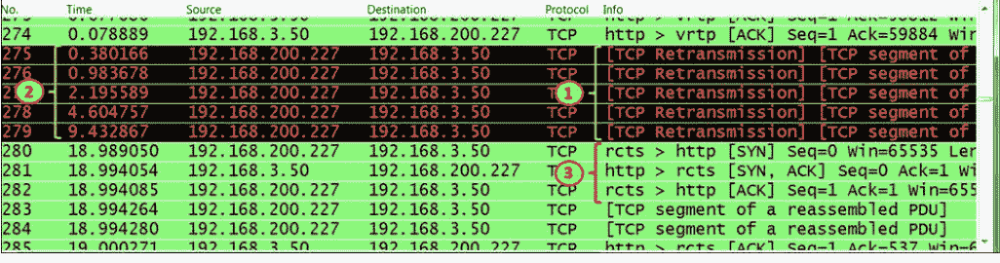

## 工作原理……

嗯，数据库的工作原理对我来说一直是个谜。我们的任务是找出它们如何影响网络，这正是我们在本节中学到的内容。

## 更多内容……

当您右键单击数据库客户端到服务器会话中的一个数据包时，会打开一个包含会话信息的窗口。这对于DBA查看网络上正在传输的内容很有帮助。

当您遇到延迟问题时，例如通过蜂窝线路或国际连接访问互联网时，数据库客户端到服务器的通信可能并不总是足够高效。您可能需要改用Web或终端方式访问数据库。

一个重要的方面是数据库的工作方式。如果客户端访问数据库服务器，而数据库服务器使用另一台服务器共享的文件，那么客户端-服务器之间的工作可能很好；但问题可能出在数据库服务器到文件服务器共享文件之间的通信上。在开始测试之前，请确保您了解所有这些依赖关系。

最重要的是，确保您的朋友中有非常专业的DBA。总有一天您会需要他们的。


