## 第12章 SIP、多媒体与IP电话

在本章中，我们将学习如何使用 Wireshark 来解决和排查 IP 电话、语音和视频通话、视频流以及其他类型的多媒体会话问题。本章包含以下操作步骤：

- 使用 Wireshark 的功能进行电话与多媒体分析
- 分析 SIP 连接
- 分析 RTP/RTCP 连接
- 视频和监控应用的故障排查场景
- IPTV 应用的故障排查场景
- 视频会议应用的故障排查场景
- RTSP 的故障排查

### 简介

各类多媒体应用在现代通信网络中占据了相当大的比重。这些应用包括电话、视频会议、监控系统、远程教学系统等等。

多媒体应用对网络的要求与其他企业应用不同。诸如 HTTP、电子邮件和文件共享等应用需要高带宽，而电话呼叫例如只需要不到 100 Kbps，但对延迟敏感，并且对抖动（延迟变化）非常敏感。大多数应用要求向远程办公室的客户端提供高下行带宽，而监控系统则需要上行方向，因为它们在总部监控器上被观看，因此监控器实际上是从远程站点下载视频。

在本章中，我们将重点讨论这些语音、视频和多媒体应用，它们在网络连接上的行为方式，以及当它们无法正常工作时如何用 Wireshark 排查问题。

在本章中，我们将重点讨论**会话初始协议（SIP）**、**实时传输协议 / 实时传输控制协议（RTP/RTCP）**、**实时流协议（RTSP）**以及其他常见多媒体协议。

我们将首先介绍 Wireshark 为排查语音和多媒体会话提供的可用工具。我们将重点讨论如何解决 SIP 问题以及如何排查 RTP/RTCP 会话，然后学习如何排查视频系统，包括视频会议和监控系统。

### 使用 Wireshark 的功能进行电话与多媒体分析

首先，让我们看看 Wireshark 为监测语音、视频和多媒体提供了哪些工具。

#### 准备工作

在遇到语音通话、视频会议通话或其他多媒体会话问题时，请将装有 Wireshark 的笔记本电脑连接到网络，并对以下设备之一进行端口镜像，如下面的拓扑图所示：

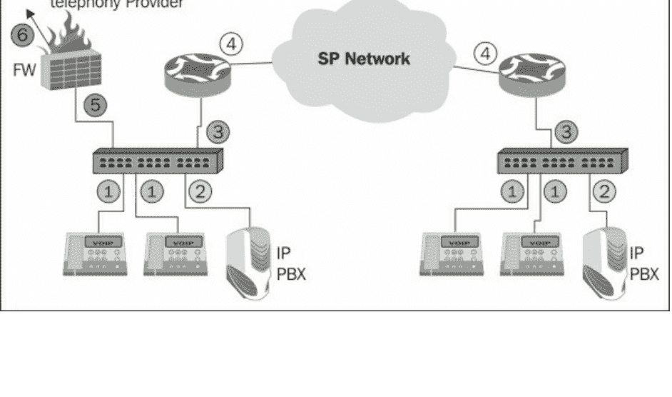

按照以下步骤使用 Wireshark 的功能进行电话与多媒体分析：

1. 在怀疑特定客户端出现问题时，监测本地或远程客户端 **(1)**。
2. 在怀疑存在影响整个 IP 电话网络的核心问题时，监测本地或远程 **IP PBX** 系统 **(2)**。
3. 在怀疑跨办公地点连接出现问题时，监测到路由器 **(3 和 4)** 的连接。
4. 监测防火墙的 LAN 端口 **(5)** 或到服务提供商的连接 **(6)**。该连接通常通过互联网，但也可能是到服务商的直连线路。

#### 操作步骤...

在 Wireshark 窗口中，打开 **Telephony**（电话）菜单，如下面的截图所示：

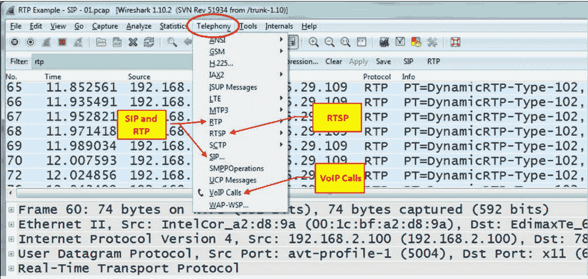

对于电话网络，请使用以下菜单：

1. 要查看 RTP 信息，请导航到 **RTP | Show All Streams**（RTP | 显示所有流），如下面的截图所示：

   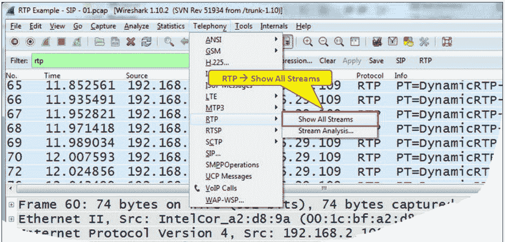

2. 将打开以下窗口：

   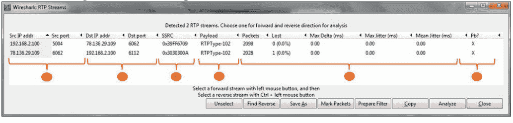

3. 在 RTP 流窗口中，您将看到以下详细信息：
   - 源 IP 地址和 UDP 端口
   - 目的 IP 地址和 UDP 端口
   - 同步源标识符（SSRC），即 RTP 流标识符
   - RTP 负载类型（通常是编解码器类型）
   - 流数据，即捕获的数据包总数、丢包数、数据包之间的最大间隔时间、最大抖动和平均抖动
   - 问题? 用于指示流中是否存在一般性问题

   在窗口底部，您会看到以下按钮：
   - **Unselect**（取消选择）：当您通过单击选择流后，“取消选择”按钮将取消该选择。
   - **Find reverse**（查找反向流）：在语音或多媒体通话中，反向流是相反方向的流（将以浅灰色高亮显示）。
   - **Save as**（另存为）：此按钮可用于以 `rtpdump` 格式保存流。有关该格式的信息，请访问 http://www.cs.columbia.edu/irt/software/rtptools/。
   - **Mark packets**（标记数据包）：无法使用。
   - **Prepare filter**（准备过滤）：在显示过滤窗口中准备一个显示过滤器。
   - **Copy**（复制）：此选项可将 RTP 流复制到文本文件中。要执行此操作，请单击 **Copy**，打开文本编辑器，然后将内容粘贴到文本文件中。
   - **Analyze**（分析）：当您单击某个流，然后点击 **Analyze** 按钮时，将打开 **RTP Stream Analysis**（RTP 流分析）窗口。也可以通过单击某个 RTP 数据包并导航到 **Telephony | RTP | Stream Analysis** 菜单来打开同一窗口。
   - **Close**（关闭）：单击此按钮将关闭窗口。

4. 要查看 SIP 信息，请导航到 **Telephony | SIP**。在打开的 **SIP Packet Counter**（SIP 数据包计数器）窗口中输入 `ip`（或 `udp` 或 `sip`），将打开 **SIP statistics with filter: ip**（带过滤器 ip 的 SIP 统计）窗口，如下面的截图所示：

   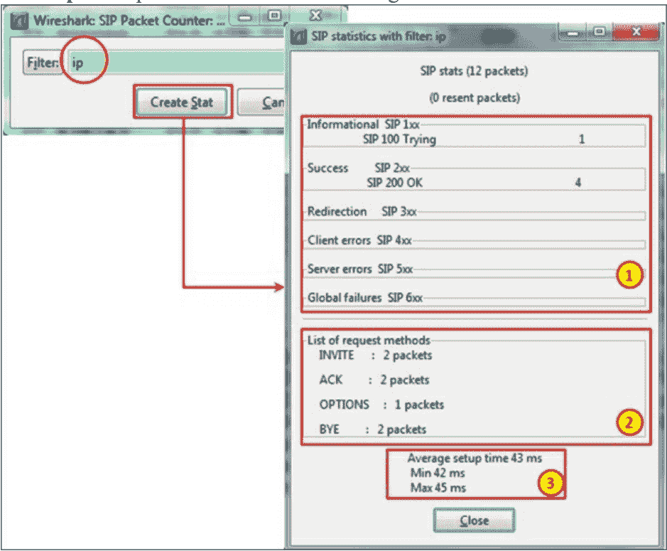

   在该窗口中，您将获得以下 SIP 统计信息：
   - 使用 SIP 响应码发送的数据包数量（在上一张截图中编号为 1）
   - 每种 SIP 方法（即 SIP 命令）发送的总数（在上一张截图中编号为 2）
   - 会话建立时间的最小值、最大值和平均值（在上一张截图中编号为 3）

5. 要获取 RTSP 统计信息，请导航到 **Telephony | RTSP | Packet Counter**，在弹出的窗口中输入 `ip`、`rtsp`，或者直接留空，然后点击 **Create Stat**，将打开一个窗口，如下面的截图所示：

   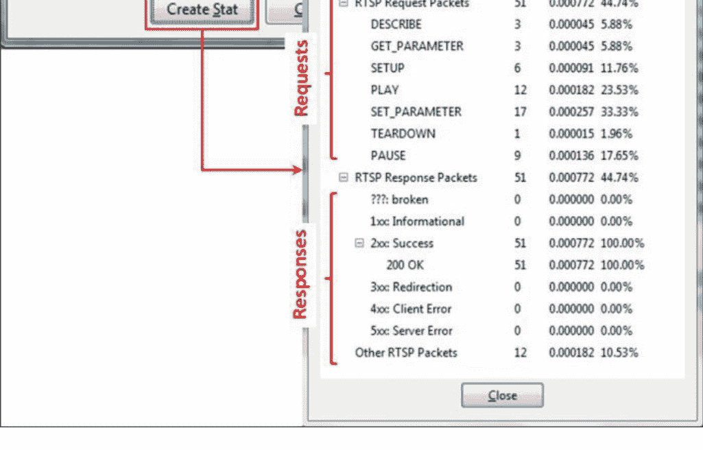

6. 要查看捕获了哪些电话呼叫，请导航到 **Telephony | VoIP Calls**。将打开一个窗口，如下面的截图所示：

   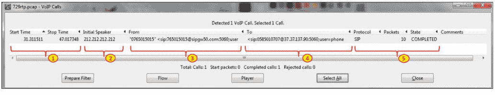

7. 在 VoIP 通话中，您会看到以下参数：
   - 会话的开始和结束时间，用于给出呼叫时长（在上一张截图中编号为 1）
   - 会话起始来源的 IP 地址（在上一张截图中编号为 2）
   - 会话起始来源的 SIP 地址（在上一张截图中编号为 3）
   - 会话目标的 SIP 地址（在上一张截图中编号为 4）
   - 会话协议（通常是 SIP）、协议数据包数量以及会话状态（在上一张截图中编号为 5）

#### 工作原理...

要传输语音、视频或多媒体，我们需要实现两个功能。第一个是承载媒体流（主要是语音或视频），第二个是信令，即建立和终止呼叫、邀请参与者加入呼叫等。多年来，针对信令提出了两套协议：

- **ITU-T** 协议族，包括作为整套协议总协议的 **H.323**，用于注册和地址解析的 **H.225**，用于控制的 **H.245**，以及其他一些协议。
- **IETF** 协议族，包括作为信令协议的 SIP（RFC 3261 及其后续更新）和描述会话参数的**会话描述协议（SDP）**（RFC 4566）。

ITU-T 协议族在过去几年中逐渐被淘汰，如今大多数应用都使用 IETF 协议族，这也是我们在本章关注的重点。在下图中，您可以看到 IETF 协议族的结构。

对于媒体流传输，两套协议族都使用 RTP 和 RTCP（RFC 3550 及其后续更新）。RTP 用于媒体传输，RTCP 用于控制流的质量。

有几种协议可用于通过基于 IP 的网络传输多媒体会话，如下面的拓扑图所示：

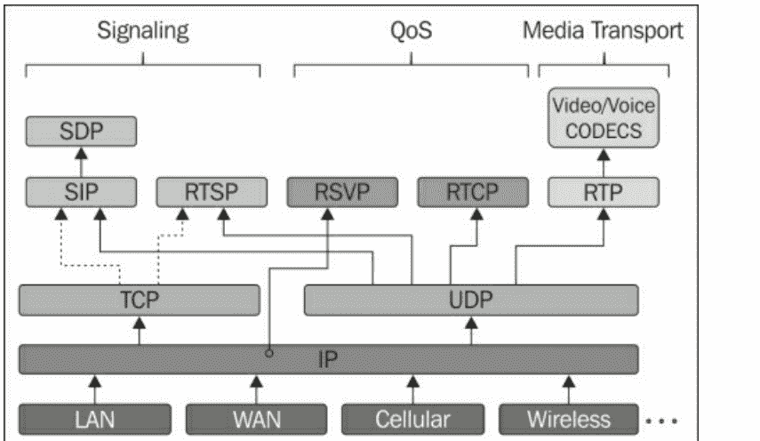


**SIP** 用于在终端客户端之间发送的结构化数据包进行信令控制。**SDP** 数据由 SIP 消息承载，用于描述会话。RTSP 用于控制流，通常是视频传输（典型如 IPTV 流）。

**RTP** 用于承载媒体。在 **RTP** 之上，我们有各种语音和视频压缩的编解码器类型。

**RTCP** 用于控制流的质量，而 RSVP 是一种通过网络建立服务质量的协议。

所有这些协议都由 TCP/IP 协议族承载，如前面的图所示。在本章后面，你将看到其中大多数协议的详细描述。

## 更多内容...

SIP 使用固定的端口号；因此，Wireshark 总是会将这些端口视为 SIP 会话——SIP 使用端口 5060，而 SIP over TLS（即通过 TLS 加密的 SIP）使用端口 5061。标准允许通过 TCP 或 UDP 使用 SIP，但在大多数情况下，它会通过 UDP 使用。

另一方面，RTP 和 RTCP 不使用标准的固定端口。RTP 使用偶数端口号，相应的 RTCP 流使用下一个更高的奇数端口号。例如，如果 RTP 在一端使用端口 5004，在另一端使用端口 2006，那么 RTCP 将分别使用端口 5005 和 2007。这就是为什么 Wireshark 默认不会解析 RTP、RTCP 等，而是会显示 UDP 流量。

要解析它，你可以执行以下操作：

- 1. 右键单击 RTP 流中的一个数据包（当前看起来像 UDP），然后点击**解码为**。在打开的窗口中，选择 **RTP**。
- 2. 你可以转到**编辑 | 首选项**，从协议列表中选择 **RTP**。在 RTP 窗口中，选择**尝试在会话之外解码 RTP**，在大多数情况下，RTP 将以此方式自动解码。对于 RTCP 也可以这样做。

## 分析 SIP 连通性

正如我们在上一个秘籍中所学的，**SIP**（RFC 3261 及各种扩展）是一种信令协议，用于在一个或多个参与者之间创建、修改和终止用户会话。在发送 SIP 请求时，会话参数通过 **SDP**（**SDP**，RFC 4566）发送，使用户能够在彼此之间就一组兼容的媒体类型达成一致。当会话创建后，语音或视频由 RTP 承载，并可选地由 **RTCP** 控制（RTCP 是可选的，可由多媒体应用程序使用，但它不是强制性的协议）。

SIP 将端点定义为**用户代理（UA）**，创建会话的过程涉及 UA 协商，以便就它们希望创建的会话特征达成一致。对于其他服务，如定位会话参与者、注册、呼叫转接等，SIP 定义了称为**服务器**的网络主机，UA 可以向其发送注册、会话邀请和其他请求。

在本秘籍中，我们将讨论协议族中信令部分，即 SIP，以及如何使用 Wireshark 来排查信令问题，而在下一个秘籍中，我们将学习 **RTP** 和 **RTCP**。

IP 语音和视频的问题可分为两类：

- - **呼叫建立、修改和终止的问题**：这类问题包括拿起电话却听不到拨号音、听到拨号音但无法拨号、拨号后对方没有收到呼叫等情况。这类问题通常由信令问题引起。
- - **质量问题**：这些是与质量相关的问题，例如语音质量、通话期间的干扰（如噪音）、视频冻结等，通常由网络问题、RTP 问题或各种媒体问题引起。

在本秘籍中，我们将讨论第一类问题，在下一个秘籍中讨论第二类问题。

### 提示

需要注意的是，并非该领域的所有问题都是网络问题，在许多情况下，它们将是设备（例如电话交换机或终端设备）配置不当的结果。

## 准备工作

当面临第一类问题时，大多数情况下你遇到的是信令问题。将 Wireshark 连接到网络，然后按照本秘籍中的步骤来解决它。

SIP 中有两大类消息：**方法**和**响应**。方法是由会话一方发起的命令，响应是作为答复生成的。

在排查 SIP 会话时，请跟踪响应及其内容。这里只列出了主要类型。

## 操作步骤...

将 Wireshark 连接到网络后，请按照以下步骤操作：

- 1. 当 UA 希望建立多媒体会话时，它会向远端 UA 发送 **INVITE** 方法。在下图中，你可以看到一个基本呼叫流程的示例。

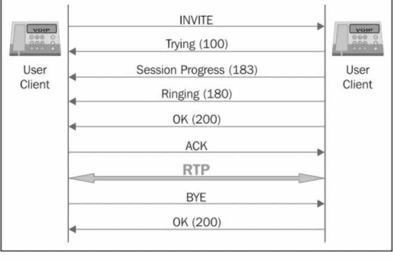

### 提示

SIP 中的终端设备称为**用户代理（UA）**。用户代理可以发起或接收呼叫。UA 可以是 IP 电话、摄像机、软件客户端，或任何参与 SIP 会话的设备或软件。

- 2. 在下面的截图中，你看到一个电话呼叫流程的示例：

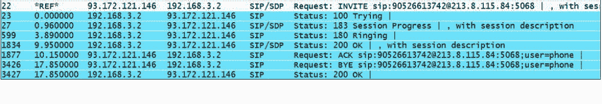

- 3. 要查看详细的呼叫流程，请导航到**统计 | 流量图**，并勾选以下选项：
- - 显示的数据包
- - 通用流
- - 标准源/目标地址

**图形分析**窗口如下所示，供参考：

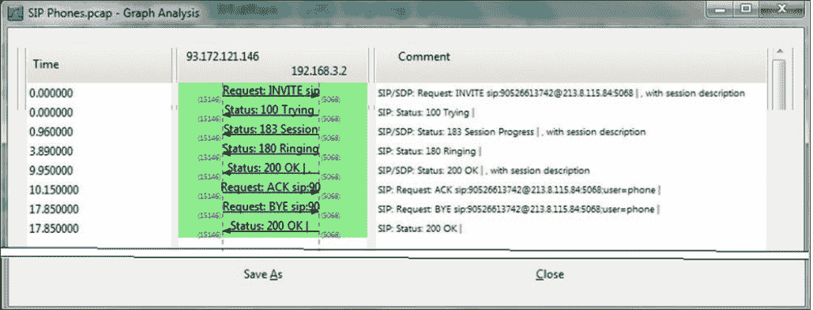

- 4. 在 **INVITE** 之后，你应该会看到来自对端的 **Trying**、**Session Progress**、**Ringing** 或其组合。
- 5. 我们可以在这里看到会话如何在发起方 **93.172.121.146** 和响应方 **192.168.3.2** 之间进行：
  1. 会话发起方发送 **INVITE** 方法；这始终是开始对话的第一个数据包。
  2. 响应方以 **Trying**（代码 100）、**Session progress**（代码 183）回复，并在三秒后以 **Ringing**（代码 180）回复。然后它以 **OK**（代码 200）回复，表示电话听筒已拿起。

  **提示**

  并非所有这些消息都必须存在，在某些情况下，你只会看到其中一些，这也是正常的。在本章后面，我们将了解如何判断这是问题还是只是标准的协议行为。

  3. 发起方发送 ACK，会话即建立。

- 6. 如果在此阶段收到错误消息，则连接将无法建立。

### 提示

### 提示

不要忘记 SIP 通过 UDP 工作，由于 UDP 在发送请求之前不会向对端打开任何连接，因此请求可能仅仅因为网络可达性问题而无法到达目的地。因此，当你没有收到响应时，很可能是因为网络问题导致 INVITE 根本没有到达目的地。

7. 当用户客户端之间有电话交换机时，会话将如下面的截图所示。你会听到 IP 电话交换机、呼叫管理器、IP PBX 等术语。它们都指处理设备之间信令的电话交换机。SIP 术语共同组成了一个代理，我们将在本秘籍的“工作原理...”部分讨论它。

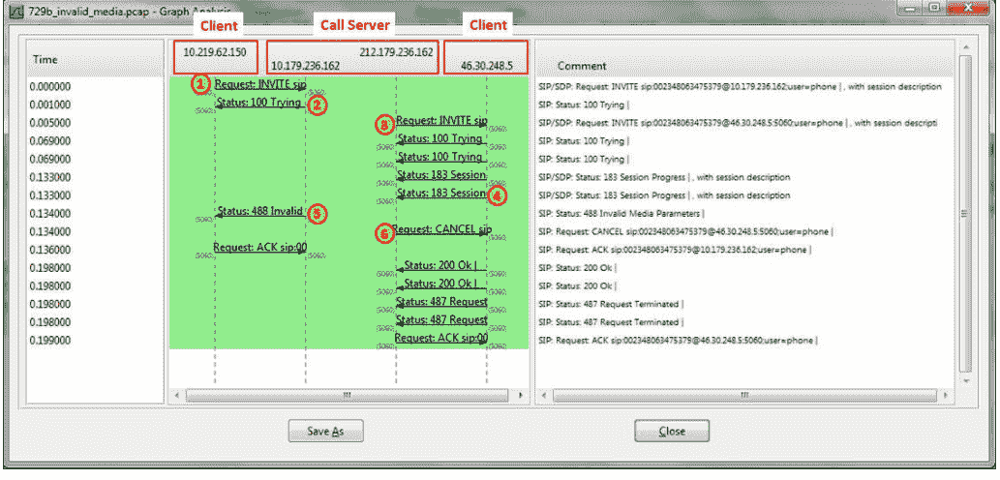

8. 在这里你可以看到交换机有两个接口——第一个在内网（10.179.236.162），第二个在外网（212.179.236.162）：

- 1. 左侧的客户端 10.219.62.150 向交换机发送 INVITE 请求（在上面的截图中编号为 1）。
- 2. 交换机回复说正在 Trying（在上面的截图中编号为 2）。
- 3. 交换机向右侧的客户端发送 INVITE（在上面的截图中编号为 3）。
- 4. 客户端发送 Trying（代码 100），然后会话进展（代码 183）到交换机（在上面的截图中编号为 4）。
- 5. 过了一段时间，交换机发现客户端没有响应，并且为了通知


发起方会收到代码 **488**，表示无效或不可接受，并附带未接受原因的说明（在上面的截图中编号为 5）。

- 6. 交换机向右边的客户端发送 **Cancel** 消息（在上面的截图中编号为 6）。

- 9. 要对 SIP 中的问题进行排查，请执行以下操作：
  - 1. 绘制包含所有组件的网络拓扑。
  - 2. 检查错误代码。
  - 3. 找出错误的原因。

- 10. SIP 错误代码及其可能的原因如下表所示。除非另有说明，代码均定义于 RFC 3261。

## 1xx 代码 – 临时/信息响应

1xx 代码，即临时或信息响应代码，表示已收到的请求仍在处理中，接收方向发送方通知当前状态。具体如下表所示：

| 代码 | 事件名称 | 原因 |
|---|---|---|
| 100 | 尝试中 | 请求已被服务器接收并接受，正在为这次呼叫采取行动。 |
| 180 | 振铃 | 接收到呼叫的 UA 正在提醒终端用户。这是在此过程中发送回客户端的消息。 |
| 181 | 呼叫转发 | 呼叫正在被转发到另一个目的地。 |
| 182 | 排队中 | 被叫方暂时不可用，服务器保存消息以便稍后投递。 |
| 183 | 会话进度 | 会话正在由接收服务器处理。关于呼叫进度的更多细节可以在消息头中传递。 |

## 2xx 代码 – 成功

2xx 代码，即成功响应代码，表示操作已成功接收、理解并被接受。具体如下表所示：

| 代码 | 事件名称 | 原因 |
|---|---|---|
| 200 | 成功 | 请求已被接受、处理并成功完成。 |
| 202 | 已接受 | 请求已被接受进行处理，但处理尚未完成（RFC 3265）。 |

## 3xx 代码 – 重定向

3xx 代码表示需要执行重定向操作才能完成请求。具体如下表所示：

| 代码 | 事件名称 | 原因 |
|---|---|---|
| 300 | 多种选择 | 请求中的地址解析出了多个选择，接收服务器可以将其转发到其中之一。UA 可以使用 contact 头字段中的地址进行自动重定向，也可以在重定向消息之前与发送方确认。 |
| 301 | 永久移动 | 在 Request-URI 中的地址处无法找到该用户，请求客户端应尝试 contact 头字段中提供的地址。发送方应更新其本地目录以反映此变更。 |
| 302 | 临时移动 | 请求客户端应重试 contact 头字段中提供的新地址。 |
| 305 | 使用代理 | 必须通过代理访问所请求的资源，代理地址由 contact 字段给出。 |
| 380 | 替代服务 | 呼叫未成功，因此接收方发送此响应，以便在接收方提供替代服务。这些服务在消息体中描述。 |

## 4xx 代码 – 客户端错误

4xx 代码，即客户端错误代码，表示请求包含错误的语法或无法在此服务器上完成。具体如下表所示：

| 代码 | 事件名称 | 原因 |
|---|---|---|
| 400 | 错误请求 | 由于语法错误，请求无法被处理。 |
| 401 | 未授权 | 收到的请求需要用户认证。通常客户端会向用户请求认证信息。 |
| 402 | 需要付费 | 保留供将来使用。 |
| 403 | 禁止 | 服务器已理解请求，但拒绝执行。客户端不应再次尝试。 |
| 404 | 未找到 | 服务器通知客户端，在 Request URI 指定的域中该用户不存在。 |
| 405 | 方法不允许 | 客户端发送的方法不允许其使用。响应中会包含一个 `allow` 头字段，以通知发送方允许使用哪些方法。 |
| 406 | 不可接受 | 请求标识的资源只能生成响应实体，其内容特征不符合请求中发送的 `accept` 头字段的要求。 |
| 407 | 需要代理认证 | 客户端必须通过代理服务器进行认证。 |
| 408 | 请求超时 | 服务器无法在预期时间内响应。客户端可以在一段时间后重新发送请求。 |
| 410 | 已消失 | 请求的资源在服务器上不再可用，且转发地址未知。此状况被认为是永久性的。 |
| 413 | 请求实体过大 | 服务器拒绝处理请求，因为请求实体的主体大于服务器能够或愿意处理的大小。 |
| 414 | Request-URI 过长 | 服务器拒绝处理请求，因为 Request URI 的长度超过了服务器能够或愿意解释的范围。 |
| 415 | 不支持的媒体类型 | 服务器拒绝处理请求，因为请求的消息体格式不受服务器支持。 |
| 416 | 不支持的 URI 方案 | Request URI 对服务器而言是未知的，因此服务器无法处理该请求。 |
| 420 | 错误扩展 | 服务器无法理解从客户端收到的协议扩展。 |
| 421 | 需要扩展 | 接收到请求的 UA 需要特定的扩展才能处理该请求，但此扩展未列在请求的 supported 头字段中。 |
| 423 | 间隔过短 | 服务器拒绝请求，因为请求所刷新的资源的过期时间太短。 |
| 424 | 位置信息错误 | 此响应代码表示由于位置内容而拒绝请求。这表明位置信息格式错误或不令人满意（RFC6442）。 |
| 428 | 使用 Identity 头 | 当验证者收到缺少 Identity 头的 SIP 请求时发送此响应，以表示请求应附带 Identity 头重新发送（RFC4474）。 |
| 429 | 提供引用者身份 | 此响应提供引用者身份（RFC3892）。 |
| 433 | 不允许匿名 | 表示服务器拒绝满足请求，因为请求者是匿名的（RFC5079）。 |
| 436 | 身份信息错误 | 当 Identity-Info 头中存在错误信息时使用此响应（RFC4474）。 |
| 437 | 不支持的证书 | 当验证者无法验证 Identity-Info 头中 URI 引用的证书时使用此响应（RFC4474）。 |
| 438 | 无效的身份头 | 当验证者（接收方 UA）收到带有 Identity 签名的消息，但该签名与验证者计算的摘要字符串不符时使用此响应（RFC4474）。 |
| 470 | 需要同意 | 这是对包含 URI 列表的请求的响应，列表中至少有一个 URI 使得中继没有访问权限（RFC5360）。 |
| 480 | 暂时不可用 | 被叫方的终端系统已成功联系，但被叫方当前不可用。 |
| 481 | 呼叫/事务不存在 | 接收 UA 收到的请求与任何现有事务或对话框都不匹配。 |
| 482 | 检测到环路 | 服务器检测到了环路。 |
| 483 | 跳数过多 | 服务器收到的请求中 Max-Forwards 头字段的值为零。 |
| 484 | 地址不完整 | 服务器收到的请求包含不完整的 Request-URI。 |
| 485 | 有歧义 | Request-URI 不明确。响应中可以在 Contact 头字段中列出可能的地址。 |
| 486 | 此处忙 | 被叫方的终端系统已成功联系，但被叫方当前无法或不愿意通过此终端系统接听更多呼叫。 |
| 487 | 请求已终止 | 请求已被 BYE 或 CANCEL 请求终止。 |
| 488 | 此处不可接受 | 不对 Request-URI 指定的特定资源进行接受。 |
| 491 | 请求待处理 | 接收 UA 有一个待处理的请求。 |
| 493 | 无法解密 | 请求包含加密的 MIME 消息体，接收方无法解密。 |

## 5xx 代码 – 服务器错误

5xx 代码，即服务器错误代码，表示服务器未能完成一个明显有效的请求。具体如下表所示：

| 代码 | 事件名称 | 原因 |
|---|---|---|
| 500 | 服务器内部错误 | 意外状况导致服务器无法完成请求。 |
| 501 | 未实现 | 服务器不支持完成请求所需的功能。 |
| 502 | 坏网关 | 网关或代理在尝试完成请求时，从所访问的下游服务器收到了无效响应。 |


### 工作原理...

SIP 是一种应用层控制协议，用于在两个或多个终端节点之间建立、维护和终止通话。

SIP 定义了两类基本的网络实体——客户端和服务器：

- 客户端是发送 SIP 请求的实体（或应用程序）
- 服务器是响应这些请求的实体（或应用程序）

为了实现与其他网络类型的连接，我们使用网关。网关连接 SIP 与**公共交换电话网络（PSTN）**，或连接 SIP 与 H.323。

如下图所示，客户端由**用户代理客户端（UAC）**和**用户代理服务器（UAS）**组成，每个客户端都可以发起或响应请求。

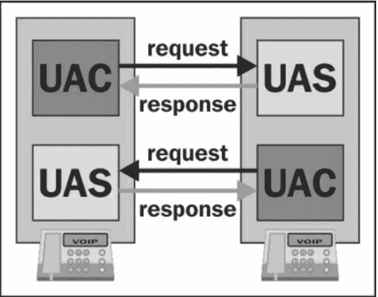

SIP 服务器可以有多种类型：

- **代理服务器：** 它从用户代理或另一个代理接收 SIP 请求，并将请求转发或代理到另一个位置
- **重定向服务器：** 它从用户代理或代理接收请求，并返回重定向响应（3xx），指明请求应发送到哪里
- **注册服务器：** 它接收 SIP 注册请求，并将用户代理信息更新到位置服务或其他数据库

在下图中，你可以看到它们是如何协同工作的：

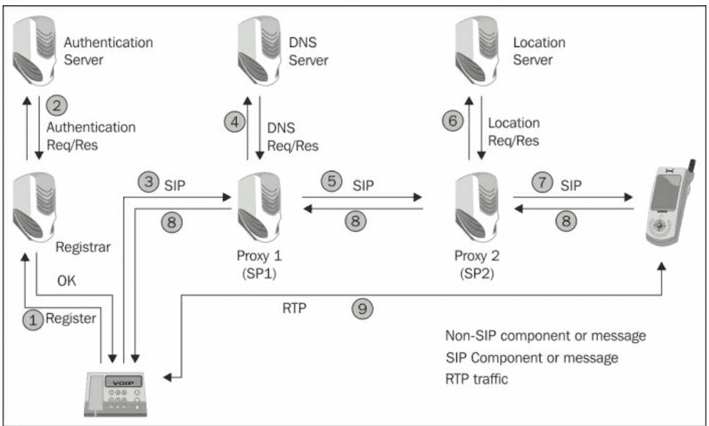

IP 电话向注册服务器注册（1）。注册服务器与组织服务器核对（2），如果一切正常，则向提供商的代理发送 SIP 请求（3）。提供商的代理通过 DNS 服务器查询请求客户端域名的 IP 地址（4），然后将请求转发到目的地代理（5）。目的地代理发现客户端不在其位置，便向位置服务器查询其位置（6）。找到后，SIP 请求被转发到目的客户端（7）。目的客户端向发送方确认接受请求（8）。当一切就绪时，RTP 会话在会话建立时 SDP 描述的 UDP 端口上打开（9）。

SIP 消息的构建方式如下图所示：

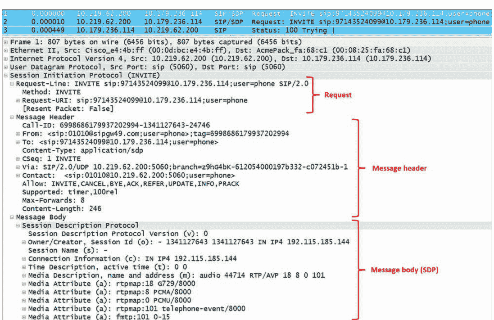

第一部分是请求行，其中包含：

- 方法；本例中为 INVITE
- 请求的 URI

第二部分是消息头，其中包含：

- Call-ID：提供通话的唯一 ID
- From：指示通话的发起方
- To：指示通话的接收方
- CSeq：包含序列号，序列号由一个整数后跟请求方法组成。通话期间每个连续的请求都会有更高的 CSeq 序号，呼叫方和被叫方各自维护独立的 CSeq 计数。
- Via：指示请求到目前为止所经过的路径，并指示响应路由时应遵循的路径。
- Contact：包含一个或多个 SIP URI，向会话中的另一方提供联系发起用户所需的信息
- **Allow**：指示允许哪些方法
- **Supported**：指示是否支持诸如定时器之类的参数
- **Max-Forwards**：到达目的地所允许的最大跳数
- **Content-Length**：消息体的字节数
- **Message Body**：包含发送方支持的编解码器信息；例如，支持的定时器

## 分析 RTP/RTCP 连接

在前一篇操作指南中，我们讨论了信令，即 SIP 和 RTP。在本篇中，我们将学习如何使用语音或视频呼叫本身，以及可能出现的问题。

问题总是始于用户抱怨语音或视频质量差、语音清晰度低、噪音等。

另外，别忘了，在 Wireshark 中可能一切看起来正常，但应该进一步调整 IP PBX，例如增大传输音量。

### 准备工作

当特定客户端出现问题时，使用端口镜像将 Wireshark 连接到客户端端口。当连接到同一链路的所有客户端都出现问题时，使用端口镜像将 Wireshark 连接到该链路。

### 操作步骤...

要定位性能问题，请执行以下步骤：

- 1. 使用端口镜像连接 Wireshark 后，开始捕获。
- 2. 确保有正在进行的通话。
- 3. 从**电话**菜单中，导航到 **RTP | 显示所有流**。这将显示你正在监控的端口上运行的所有 RTP 流。
- 4. 将打开以下窗口：

  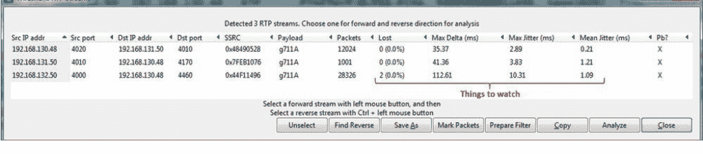

- 5. 需要重点关注的参数包括丢失的数据包、**最大差值（ms）**、**最大抖动（ms）**和**平均抖动（ms）**。

#### 提示

对于 IP 上的交互式语音和视频，延迟值高于 300 ms（RTT）和抖动值高于 50 ms 被认为是有问题的。有关此主题的进一步讨论见本操作指南中的“工作原理...”部分。

出现延迟时，请按照以下步骤定位问题：

- 1. 使用简单的 ping 测试检查网络两端之间的延迟：
  - 1. 如果看到高延迟，请检查它是否对于您正在测量的通信线路是典型的（参见本操作指南中“更多内容...”部分的典型延迟列表）。
  - 2. 如果是典型延迟，您无需在此处处理。请与电话和交换机提供商联系，寻求其设备的优化方案。
  - 3. 如果延迟超出预期，请从您的笔记本电脑 ping 这两部电话，并检查延迟来自何处。
  - 4. 当您定位到延迟较高的链路时，沿链路逐步 ping，以查看延迟来自何处。
  - 5. 同时，使用 Wireshark 检查线路负载。延迟可能由负载引起，而且大多数情况下会伴随抖动出现。
- 2. 延迟也可能来自以下来源：
  - **拥塞链路：** 使用 Wireshark 检查该情况。
  - **路由器负载：** 使用提供商工具、SNMP 工具或路由器 CLI 来测量这些设备上的负载（请参阅提供商手册）。可能是 CPU 负载、内存负载等。
  - **路由器缓冲区中的排队延迟：** 请查阅供应商手册。

出现抖动时，请按照以下步骤定位问题：

- 1. 使用与延迟测量相同的方法，尝试找出抖动来自何处。
- 2. 抖动可能来自多个来源：
  - **线路拥塞：** 使用 `ping` 命令检查线路，看看是否存在问题
  - **路由器负载（CPU/内存）：** 请查阅供应商手册，了解如何监控这些参数

出现数据包丢失时，请按照以下步骤定位问题：

- 1. 使用 `ping` 命令检查链路上是否存在数据包丢失。
- 2. 如果是，请检查沿线设备是否有数据包丢失。
- 3. 您也可以在数据包列表窗口中点击特定的 RTP 数据包，然后导航到 **RTP | 流分析**。它将显示该数据包所属流的各项参数。将打开以下窗口：

  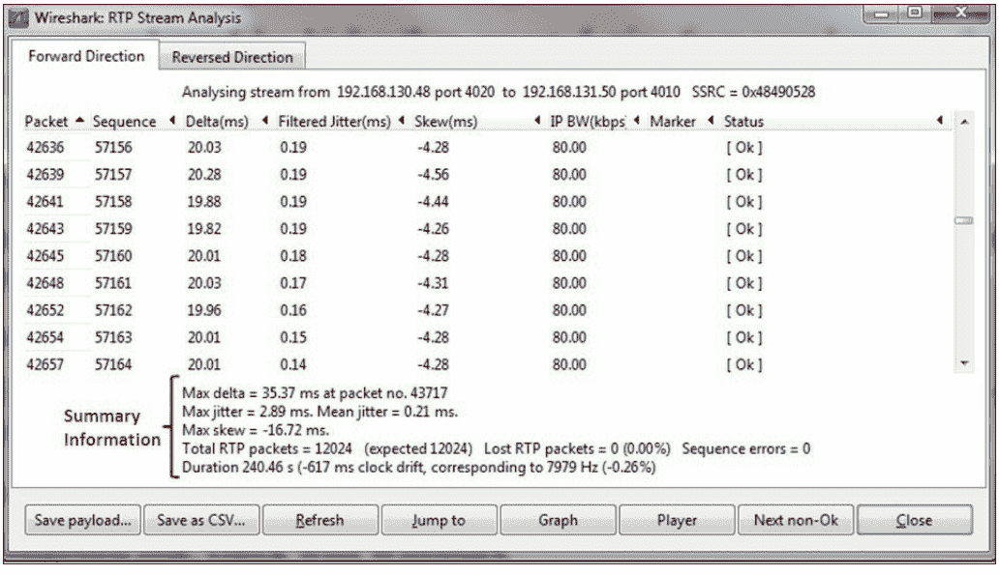

- 4. 在窗口中，您将看到已打开流的以下参数：
  - Packet：此参数表示捕获文件中的数据包数量。
  - Sequence：此参数表示 RTP 序列号。
  - Delta (ms)：这是流中当前数据包与上一数据包之间的时间差。
  - Filtered Jitter (ms)：此参数表示真实到达时间与 RTP 时间戳参数之间的差。该值应尽可能低，最好为零。
  - Skew (ms)：此参数表示数据包相对于其应有时间点是提前（或延迟）了多少。例如，如果数据包速率为每秒 20 个数据包，则数据包之间应有 50 ms 间隔；如果一个数据包在上一个数据包之后 49 ms 到达，则偏斜为 -1 ms。
  - IP BW (kbps)：此参数表示 IP 层的带宽消耗，即包含直到第 3 层的所有报头。
  - Marker：此参数指示标记是否已设置（SET=1，UNSET=0）。标记指示各种现象，例如静默周期结束和视频帧结束，并由应用程序添加。
  - Status：此参数允许您检查状态是否正常。

- 5. 从摘要信息窗口中，我们可以看到最大抖动为 2.89


ms；这个值非常低，因此我们不应该在此处预期任何问题。

6. 在 RTP 流分析窗口下部中间位置单击 Graph 按钮，将会打开以下 IO 图表：

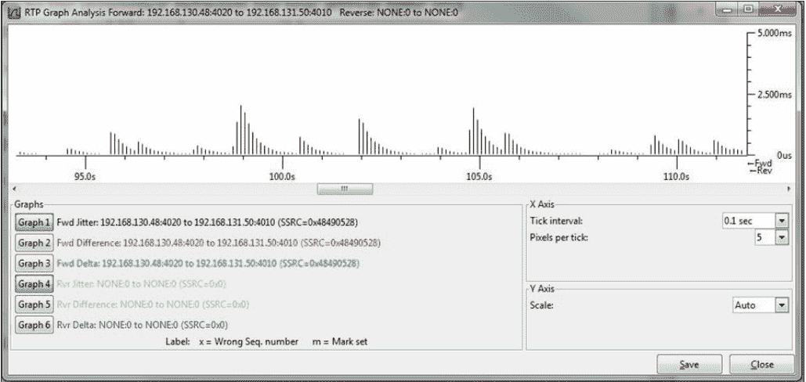

7. 在这种情况下，我们可以看到网络看起来很好——抖动小于 2.500 ms。

8. 当我们使用 Wireshark 且之前各点中测量的所有参数看起来都正常时，连接性问题很可能就是设备本身的配置问题。

9. 你可能会看到一些问题，例如序列号错误和时间戳错误（见以下截图）。这些错误通常是由于抖动和延迟问题引起的。

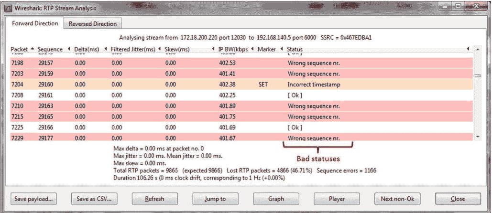

## How it works...

RTP 与 RTCP 结合使用（两者最初在 RFC 3550 中标准化）。RTP 用于承载媒体流（音频和视频），而 RTCP 用于监控传输统计信息和服务质量。在建立会话时，RTP 使用偶数端口，而 RTCP 使用下一个对应的奇数端口（高一位）。

RTP 提供了定时恢复、丢失检测和纠正、负载和源标识以及媒体同步的机制。

RTCP 指定了在会话的源和目的地之间交换的报告。报告包含诸如发送的 RTP-PDU 数量、丢失的 RTP-PDU 数量、到达抖动等统计信息。这些报告可由应用程序用于修改发送方的传输速率，并用于诊断目的。

### RTP principles of operation

RTP 位于 UDP 之上，UDP 位于 IP 之上。在下图中，你可以看到 RTP 数据包结构：

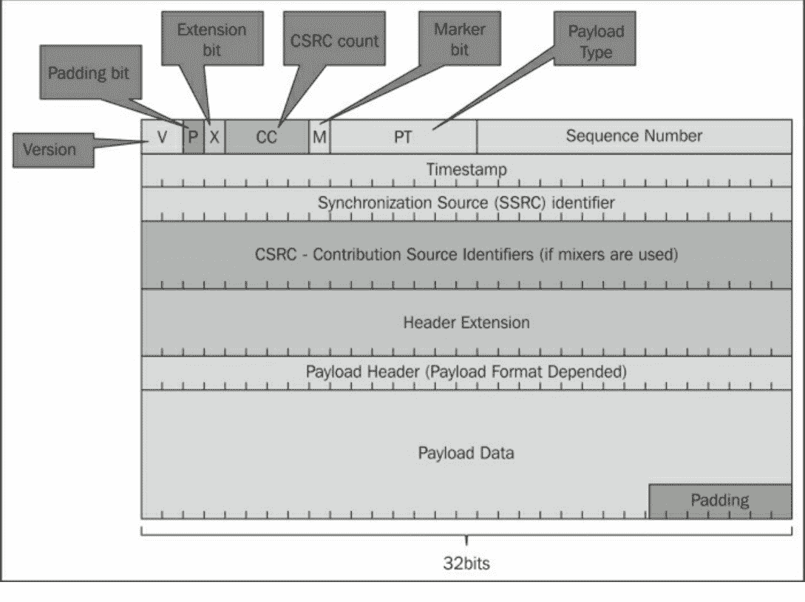

头部中的字段如下：

- **Version (V)：** 此字段指示 RTP 版本
- **Padding (P)：** 此字段指示数据包末尾包含一个或多个额外的填充字节，这些字节不属于负载
- **Extension bit (X)：** 此字段指示在标准头部之后跟随头部扩展
- **CSRC count (CC)：** 此字段包含在固定头部之后跟随的 CSRC 字段的数量
- **Marker (M)：** 此字段用于指示应用程序事件，例如视频帧边界
- **Payload type：** 此字段标识 RTP 负载的格式，以便接收应用程序进行解释
- **Sequence number：** 此字段在发送的每个 RTP 数据包时递增一。接收方用它来检测数据包丢失
- **Timestamp：** 此字段反映 RTP 数据流中八位字节的采样率
- **Synchronization source (SSRC)：** 此字段是随机选择的流标识符，因此在同一 RTP 会话中不会有两个同步源具有相同的 SSRC 标识符
- **Contributing source identifiers list (CSRC)：** 此字段标识包含在此数据包中的负载的贡献源（即流源）

在下图中，你可以看到序列号和时间戳机制的工作方式：

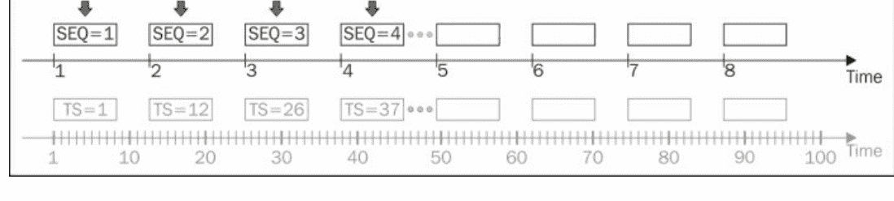

正如我们在图中看到的，每个传输的 RTP 数据包的序列号都会增加一，而时间戳则按数据包所覆盖的时间增加。例如，数据包 1 的序列号和时间戳都设为 1；数据包 2 的序列号为 2，时间戳为 12；其他数据包也以这种方式继续。接收方会收到序列号以告知数据包的顺序，以及时间戳以告知它们离开发送方的时间。接收方将同时使用这两者来回放接收到的数据。

### The RTCP principle of operation

RTCP 有几种报告类型，其中发送方和接收方会相互更新已发送和接收的数据。在下图中，你可以看到一个示例，其中我们看到一个发送方报告，告诉接收方发送了多少个数据包和八位字节、时间戳信息以及接收方可用于的其他参数。

```
File Edit View Go Capture Analyze Statistics Telephony Tools Internals Help
Filter:
Expression... Clear Apply Save SIP RTP
No. Time Source Destination Protocol Info
13014 89.845598 212.179.237.161 37.26.146.90 RTCP Sender Report Source
Frame 13014: 138 bytes on wire (1104 bits), 138 bytes captured (1104 bits)
Ethernet II, Src: AcmePack_fa:60:80 (00:08:25:fa:60:80), Dst: All-HSRP-routers_1f
Internet Protocol Version 4, Src: 212.179.237.161 (212.179.237.161), Dst: 37.26.146.90
User Datagram Protocol, Src Port: 60131 (60131), Dst Port: 43555 (43555)
Real-time Transport Control Protocol (Sender Report)
[Stream setup by SDP (frame 12022)]
10.. .... = Version: RFC 1889 Version (2)
..0. .... = Padding: False
...0 0001 = Reception report count: 1
Packet type: Sender Report (200)
Length: 12 (52 bytes)
Sender SSRC: 0x49424f58 (1229082456)
Timestamp, MSW: 3550373021 (0xd39e649d)
Timestamp, LSW: 1766374618 (0x6948bcda) Timestamp information
[MSW and LSW as NTP timestamp: Jul 4, 2012 06:43:41.411266000 UTC]
RTP timestamp: 87538356
Sender's packet count: 246
Sender's octet count: 4920 Packets/Octets information
Source 1
Real-time Transport Control Protocol (Source description)
Real-time Transport Control Protocol (Goodbye)
```

## There's more...

延迟可能来自多个来源：

- **Coding delay：** 这是数字处理语音信号产生的延迟。
- **Handling delay (packetization)：** 这是构建数据包并将语音信息插入其中的所需时间。
- **Serialization delay：** 这是在通信线路上传送数据包时产生的固定延迟。该延迟取决于数据包大小和线路速度。
- **Typical delays (round trip)：** 这是在通信线路上 ping 时可预期的延迟（以下所有点均指未加载的线路）：
  - **Over a LAN：** 延迟小于 1 ms。
  - **Over a WAN connection：** 在短距离连接中延迟为 1–2 ms（最长 250–300 km / 150–190 英里），在长距离连接中约为 15–20 ms（例如美国海岸到海岸）。在旧网络中，你可以再加上几十毫秒。
  - **For home connections, usually xDSL or CaTV：** 延迟在 10 到 25 ms 之间。
  - **For inter-continent connections：** 延迟在 100 到 200 ms 之间。
  - **For cellular connections：** 延迟在旧的 2.5G 网络（GPRS 或 CDMA 1X）中为 300 ms 至 600 ms，3.0G（UMTS 或 EVDO）为 120 至 150 ms，HSDPA、HSUPA 和 HSPA+ 为 60 至 100 ms，LTE 网络则降至 20 至 50 ms。
  - **For satellite communications：** 延迟为 500 至 600 ms。

### Tip

通信线路上的延迟是光信号穿越距离所需的时间与服务提供商网络上的交换或路由延迟所消耗的时间之和。虽然自 2000 年代初以来的技术（例如 MPLS 或运营商以太网）已在快速交换机和路由器中实现，但 2000 年之前的旧技术（如帧中继或 ATM）交换时间较慢，因此延迟会更高。

## Troubleshooting scenarios for video and surveillance applications

在过去的 10 到 12 年里，安全和监控系统在通信网络中扮演了更大、更重要的角色。我们在这些类型的网络中可能会看到的问题通常始于由于带宽不足导致的视频冻结，但也可能更复杂，正如本菜谱中所讨论的那样。在本菜谱中，我们将讨论这些系统的一些问题以及如何处理和解决它们。

### Getting ready

通常，你会被叫去解决用户观看安防摄像头时遇到的问题。在这种情况下，你可以端口镜像特定的摄像头（1）、远程站点的通信线路（2）以及摄像头服务器（3），或者你可以使用过滤器监控到远程网络的中心线路（4）。

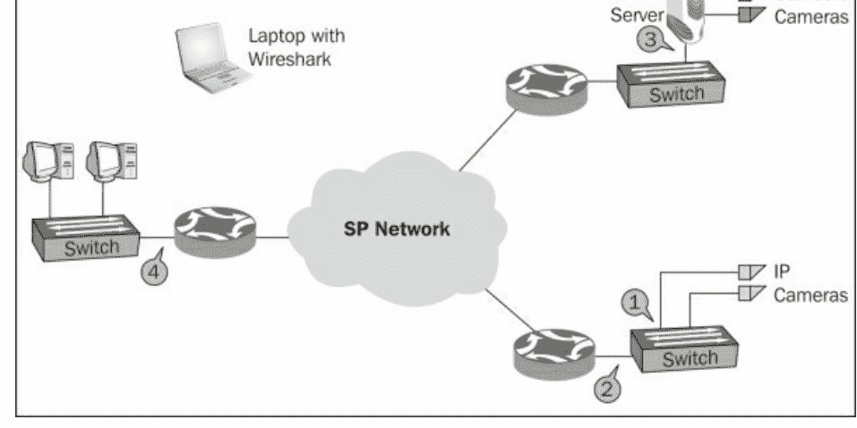


## 操作步骤...

要识别此网络中的问题，请按照以下步骤操作：

- 1. 首先，如果可能的话，在查看器与本地连接的摄像头（通过局域网）之间配置端口镜像。这样做时，你将能够记下所尝试的每种画面分辨率所需的带宽。

**提示：** 观看视频时，带宽最低可为 128 Kbps（用于低分辨率的极简单黑白电影），对于分辨率合理的黑白或彩色视频流，平均约为 0.5 到 1.0 Mbps，而高清流媒体（通常为 6 到 8 Mbps）则可达每秒数兆比特。

- 2. 作为基本要求——确保你的带宽充足。
  - 当画面冻结时，使用 I/O 图监控带宽。确保带宽充足且线路未完全占满。
  - 为了确保你只查看摄像头或摄像头服务器所消耗的带宽，请配置一个过滤器，指向其 IP 地址。

**提示：** 视频流可以通过 UDP 和 RTP，或通过 TCP 传输。UDP 主要用于交互式应用，而 TCP 主要用于观看远程摄像头。

- 3. 确保没有数据包丢失、明显延迟或抖动。
  - 对于数据包丢失，请登录通信设备或使用 SNMP。
  - 对于延迟和抖动，可以使用 `ping` 命令或图形工具（其中许多是免费的，例如来自 Colasoft 的工具）。
- 4. 在监控远程摄像头视频流时，如果出现短暂冻结，请导航到统计 | TCP 流图 | 时间序列（Stevens）。确保所有 I 帧和 P 帧都按固定间隔接收。

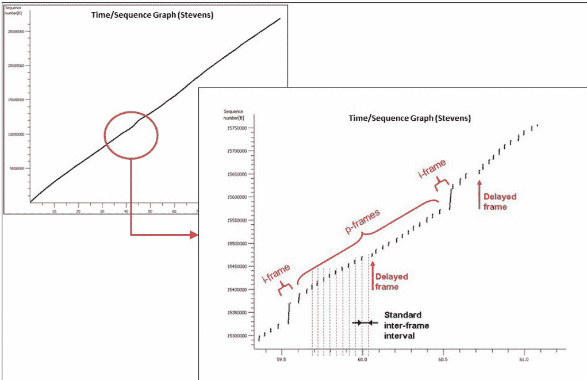

- 5. 这里的问题是，客户现场有摄像头将视频传输到中央服务器，中央服务器再将视频传输到监视器。我们在上图中看到的是服务器延迟了部分 P 帧，这就是导致该情况下短暂冻结的原因。结果证明是服务器上的软件问题。
- 6. 尝试登录摄像头服务器时，可能有多个端口正在使用，你可能无法看到画面；或者可能出现你获得了画面但其他内容不显示的情况。要验证所有 TCP 端口号都已开放，可以执行以下操作：
  - 检查防火墙（如果你与摄像头服务器之间存在防火墙），确认连接是否被阻止。
  - 在 Wireshark 中，确保没有出现三次 SYN，这表明有某种东西阻止了你对服务器的访问。
- 7. 在下面的截图中，你可以看到 HTTP 会话（1）如何在内部办公地址 10.0.0.3 与网络摄像机的外部地址 82.82.182.182 之间运行（不要使用这些地址；它们只是示例值）。在第 2614 行，你会看到一个 SYN 数据包从 10.0.0.3 发送到 82.82.182.182；该数据包在第 2615 个数据包中通过 TCP RST（重置）PDU（2）被阻止。相同事件还会再出现两次（3 和 4）。你看到一个已建立的连接并不表示没有其他连接正在尝试建立。

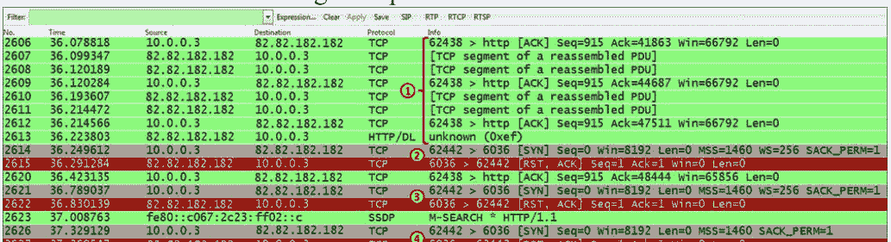

- 8. 在这种情况下，HTTP 连接可以连接到 Web 服务器。要登录，需要打开另一个连接。由于登录连接被阻止，因此可以看到摄像头服务器，但无法登录并观看视频。

## 工作原理...

视频流由 **I 帧**（帧内编码帧）、**P 帧**（预测帧）和 **B 帧**（双向预测帧）组成。I 帧是包含完整画面的帧，而 P 帧包含相对于前一帧的变化。还有 B 帧，它也使用对下一帧的预测机制。

在 TCP 中，每个视频帧（I、P 或 B）都被分散到多个 TCP 数据包中；因此，当你遇到 TCP 问题（重传等）时，会直接影响视频流。

## 更多内容...

视频传输质量取决于你使用的编解码器、每秒传输的帧数、帧之间的时间间隔，以及可在摄像头或摄像头服务器上配置的更多参数。请确保所有参数都设置正确，以获得良好的画面。

## IPTV 应用的故障排查场景

IPTV 应用在过去几年中变得越来越流行，同时越来越多的电视台正在转向互联网。在线学习应用以及其他各种类型的应用也越来越受欢迎。

基本上，IPTV 应用使用 TCP，你会遇到的问题大多是 TCP 问题，例如重传。在本方案中，我们将看到一些示例。

### 准备工作

当收到关于视频质量、画面冻结等问题的投诉时，请将 Wireshark 实例连接到设备或链路的端口镜像上。

### 操作步骤...

开始捕获，然后执行以下步骤：

- 1. 打开 I/O 图，并确认存在缓冲类型的流量，如下面的截图所示：
- 2. 如果看到线路在顶部被阻塞，请检查你的互联网带宽并相应调整查看器（通常会自动完成）。
- 3. 检查 TCP 重传、重复 ACK 和 TCP 窗口问题，如果发现任何问题，请逐一排查以找出干扰传输的原因。

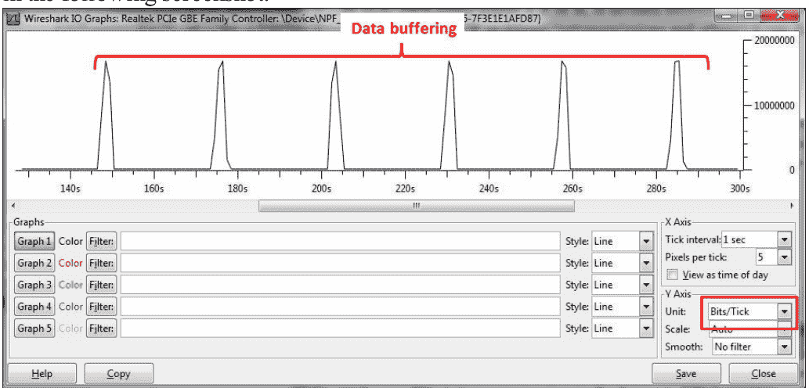

### 工作原理...

从网络角度来看，IPTV 只不过是一个在 TCP 连接上运行的简单应用程序。

### 更多内容...

在对它进行故障排查时，请按照[第 9 章](#)（UDP/TCP 分析）中介绍的常规 TCP 故障排查流程进行操作。

## 视频会议应用的故障排查场景

视频会议使用与标准电话相同的协议，但有一个区别：在电话中，每个方向只有一个数据流；而在视频会议中，每个方向有一个数据流和一个视频流。当你在终端设备上捕获数据时，会看到四个数据流：两个是你发送给对端的，另外两个是对端发回给你的。

另一个区别是，某些视频会议应用仍在使用 H.323 协议族，因此你需要排查的是 H.225 和 H.245 连接问题，而不是 SIP 问题。由于大多数应用使用 SIP 和 IETF 协议栈，因此我们只关注这些。

## RTSP 故障排查

RTSP 是一种应用层控制协议，用于控制一个或多个时间同步的连续媒体流（如音频和视频）。RTSP 的目的是提供对远程媒体服务器的控制。当我们点击 **播放**、**暂停**等按钮时，就会使用它；它也可以用于邀请新的媒体服务器在屏幕上显示内容，例如用于会议。虽然 RTSP 是控制协议，但流媒体本身通常由 RTP（承载数据）和 RTCP（用于监控数据传输）来执行。

RTSP 标准（RFC 2326）没有定义任何传输协议，但大多数实现使用 TCP。RTSP 在观看 IPTV 时通常会被用到。在本方案中，我们将学习如何监控和排查这些流。

### 准备工作

在遇到传输干扰的情况下，应使用 RTSP 监控；例如，媒体播放器控制出现问题，或者与服务器连接出现问题。RTSP 的工作方式如下图所示：

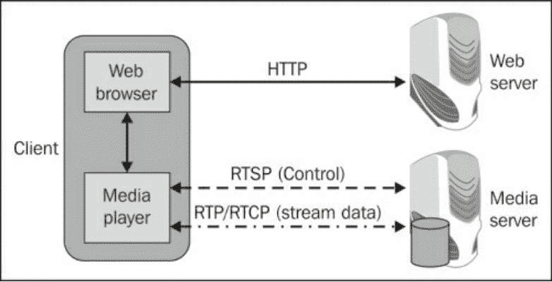

在监控流时，我们可能会遇到 RTP/RTCP 问题（本章前面已讨论）、HTTP 问题（第 10 章 HTTP 和 DNS 中讨论），甚至 TCP 问题（第 9 章 UDP/TCP 分析中讨论）。在本方案中，我们将讨论 RTSP（上图中带有长划线的中心线）。

Web 服务器和媒体服务器可以位于单个或多个物理服务器上，也可以位于不同的虚拟机上。无论哪种情况，功能均如图中所示。


## 如何操作...

要查找RTSP问题，请将Wireshark实例通过端口镜像连接到遇到问题的客户端；如果有多个客户端，则将其连接到公共链路或服务器。

- 1. 要查看所有RTSP流量，请使用TCP端口554过滤数据包；对应的过滤器是`tcp.port==554`。

### 提示

过滤器`tcp.port == 554`会显示该端口上的所有流量，而过滤器`rtsp`只显示Wireshark识别为RTSP头的数据包。

- 2. 要查看RTSP请求和响应，请按本章前文所述，从**统计**菜单中选择**RTSP | 数据包计数器**。错误响应是代码值高于400的响应。

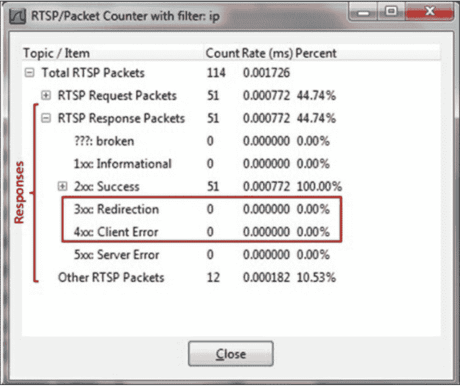

- 3. 查找4xx或更高的RTSP响应代码。为此，可以配置显示过滤器`rtsp.status >= 400`。

## 工作原理...

与SIP（用于信令，而RTP用于媒体传输）一样，RTSP控制的流可以使用任何传输协议；在许多情况下，它们也使用RTP。该协议在语法和操作上故意与HTTP相似，并使用相同的语法。

最常见的RTSP方法（命令）如下（C-客户端，S-服务器）：

| 命令 | 方向 | 功能 |
|---|---|---|
| OPTIONS | C到S或S到C | 确定服务器/客户端的能力 |
| DESCRIBE | C到S | 获取媒体流的描述 |
| ANNOUNCE | C到S或S到C | 宣布新会话的描述 |
| SETUP | C到S | 创建媒体会话 |
| PLAY | C到S | 开始媒体传输 |
| RECORD | C到S | 开始媒体录制 |
| PAUSE | C到S | 暂停媒体传输 |
| REDIRECT | S到C | 重定向到另一台服务器 |
| TEARDOWN | S到C | 立即执行拆除 |

响应类别如下：

| 代码系列 | 类型 | 含义 |
|---|---|---|
| 1xx | 信息性 | 请求已收到，继续处理 |
| 2xx | 成功 | 操作已成功接收、理解并被接受 |

## 更多内容...

在下面的截图中，您可以看到一个典型的RTSP流：

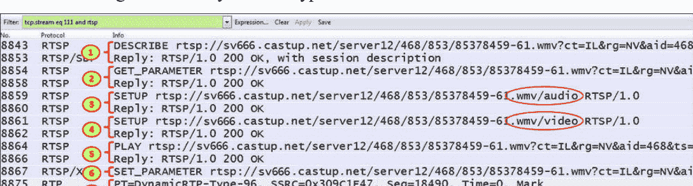

典型的RTSP流按以下顺序处理：

- 1. 向服务器发送**DESCRIBE**请求，要求从该服务器检索请求URL所标识的演示或媒体对象的描述，服务器回复**200 OK**。
- 2. **GET_PARAMETER**请求检索URI中指定的演示或流的参数值。
- 3. 发送**SETUP**请求以打开音频流，并用**200 OK**确认。
- 4. 发送**SETUP**请求以打开音频流，并用**200 OK**确认。
- 5. 向服务器发送**PLAY**请求以开始播放流。
- 6. 向服务器发送**SET_PARAMETER**请求，以设置URI指定的演示或流的参数值。
- 7. 流开始使用RTP播放。

在下面的截图中，我们看到了流的分解过程：

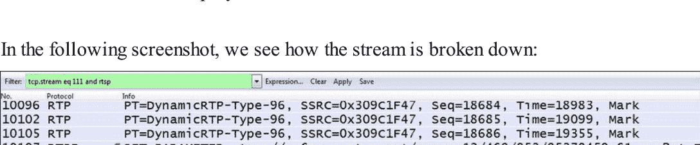

流的分解过程如下：

- 1. 向服务器发送**SET_PARAMETER**，以设置URI指定的演示或流的参数值。
- 2. 向服务器发送第二个**SET_PARAMETER**请求。
- 3. 发送**TEARDOWN**命令以关闭连接。
