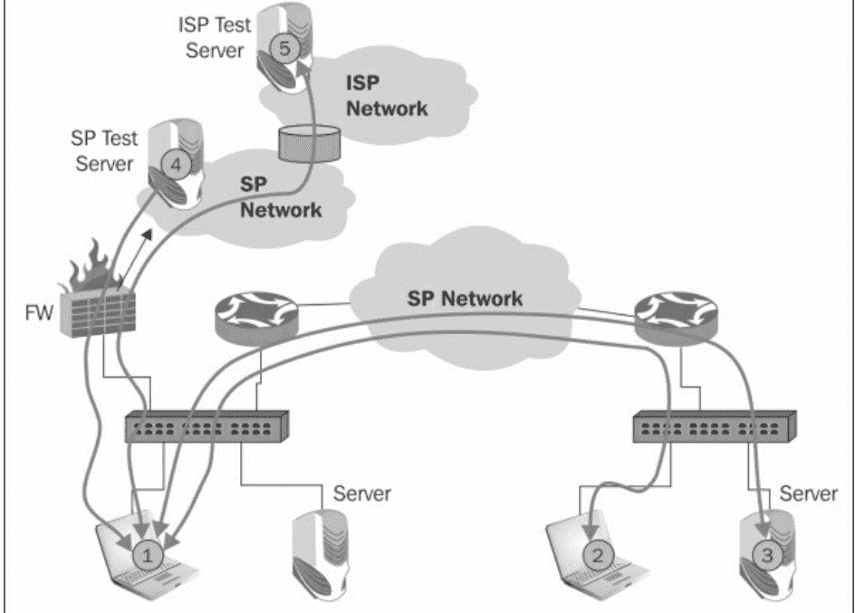
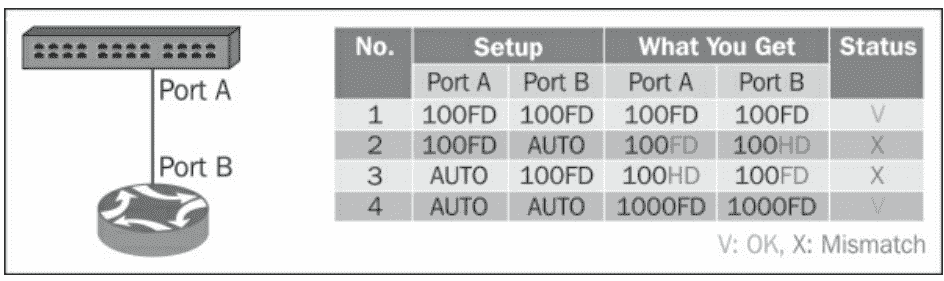
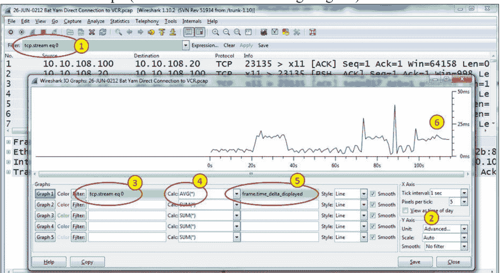
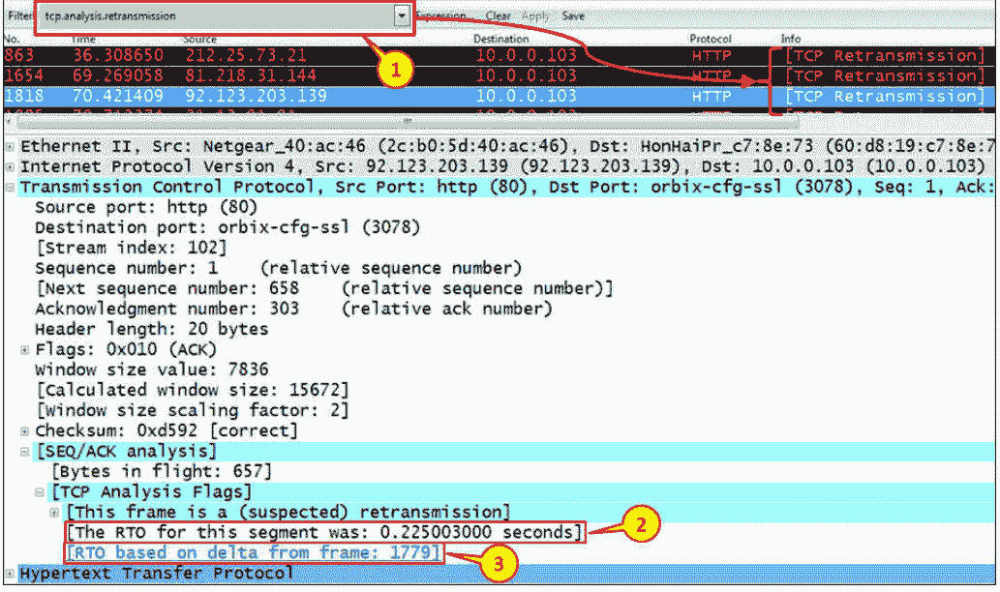
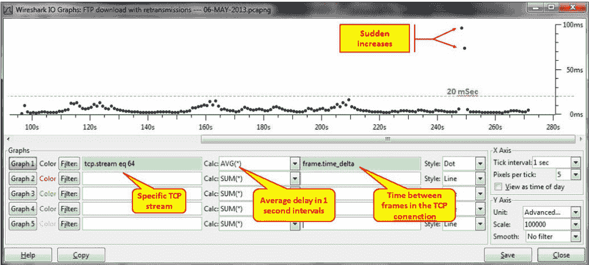
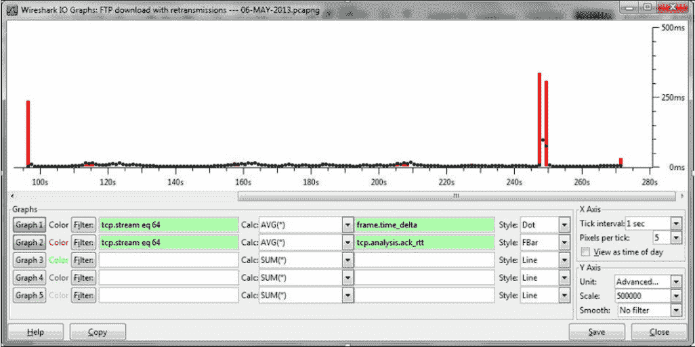
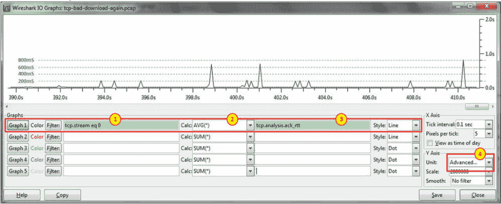
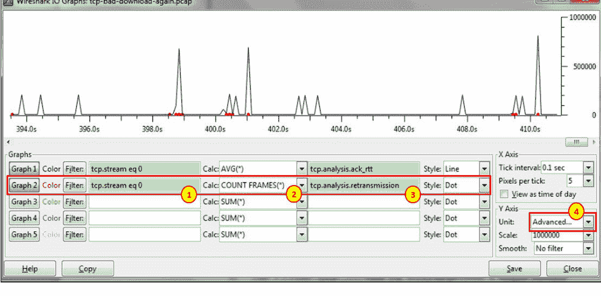
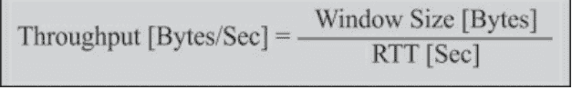

## 第13章 排除带宽和延迟问题

本章包含以下方案：

- - 测量通信链路上的总带宽
- - 通过网络连接测量每个用户和每个应用的带宽和吞吐量
- - 使用Wireshark监控抖动和延迟
- - 发现与延迟/抖动相关的应用问题

## 简介

在测量通信线路时，我们应该注意四个主要参数：**带宽**、**延迟**、**抖动**和**数据包丢失**。虽然有些应用需要高带宽，但也有其他应用对延迟和抖动更敏感。数据包丢失会影响所有类型的应用，但有些应用对其更敏感，有些则不那么敏感。

在本章中，我们将学习如何测量这些参数，如何检查由此引起的网络问题，以及如何在可能的情况下解决它们。

## 测量通信链路上的总带宽

在本方案中，我们将了解如何测量通信线路上的总带宽。首先当然是要与服务提供商核实通信线路。检查它是对称线路还是非对称线路；如果是非对称线路，请检查两个方向上的带宽是多少。

## 准备工作

您可能需要测试两种情况：

- - 当您测量两个办公室之间的通信线路时：在这种情况下，将您的笔记本电脑（或网络上的任何PC）连接到局域网，并确认线路另一端是否有服务器或另一台PC
- - 当您测量到互联网的通信线路时，请确保您在**服务提供商（SP）**端或**互联网服务提供商（ISP）**端有一台测试服务器

## 如何操作...

要检查通信线路上的带宽，请按照以下步骤操作：

- 1. 询问以下详细信息：
  1. 询问SP线路带宽是多少。
  2. 如果是到互联网的线路，除了前一步外，还要询问ISP到互联网的带宽是多少。
- 2. 在远程位置找到服务器、PC或笔记本电脑。

### 提示

使用PC或笔记本电脑进行测试时，请不要忘记PC本身应足够强大以生成流量。一台标准的Windows 7机器每个TCP连接大约能生成200 Mbps；当打开多个连接时，可能会遇到其他限制，如磁盘性能等。因此，建议先在局域网上试传输（实际上没有带宽限制），然后再测试SP或ISP线路。如果使用FTP，请使用高效的FTP工具（例如FileZilla）。当然，最好的方法是使用测试设备（如果可用）。专门的测试设备可从许多供应商处获得，例如VeEX、Fluke Networks和IXIA。

- - 如果您想测试两个站点之间的带宽，请在编号为1和2或编号为1和3的节点之间下载然后上传一个大文件。足够大的文件应能在线路上加载一段可观的时间，即一分钟或更长时间。例如，如果您想测试10 Mbps（兆比特每秒）的线路，请使用至少10/8 = 1.25 MB（兆字节）的文件。
- - 如果您想测试到互联网的连接，通常可以先在服务提供商（下图中编号为1到4）上进行测试，然后再到互联网服务提供商（下图中编号为1到5）上进行测试。

### 提示

如果可能，最好使用IP或UDP测试，因为复制文件是通过TCP进行的，所以可能会遇到影响测试的TCP问题。为此，请使用Iperf或其他可以生成IP或UDP流量的测试工具。

在下图中，您可以看到两个通过服务提供商（SP）线路连接的本地网络。左侧站点通过防火墙连接到互联网。到互联网的连接通过服务提供商（SP，服务器4）到达互联网服务提供商（ISP，服务器5）。

按照以下步骤测量通信线路上的带宽：

- 1. 使用Wireshark的“统计 | IO 图”进行测试。

### 提示

不要忘记Wireshark在处理高带宽线路时有其自身的局限性。在这种情况下，您可以将其配置为使用多个文件。就我个人而言，在监控200-300 Mbps及更高带宽的线路时，我更喜欢使用其他工具（例如Omnipeek）。

- 2. 测试企业网络时，您可以使用诸如Iperf（http://sourceforge.net/projects/iperf/）之类的软件工具。

以下是使用 IPerf 测量网络带宽的步骤：

+   1. 在连接的两端都安装 Iperf。
+   2. 将其中一侧配置为客户端，另一侧配置为服务器。
+   3. 开始测试并使用 I/O Graphs 验证您是否具有稳定的带宽。

## Tip

下载或上传文件时，请使用单个大文件而不是多个文件的目录。当传输许多小尺寸文件时，打开和传输每个文件都需要时间，因此测试结果不会很好。

当获得的带宽低于预期时，请执行以下步骤：

+   1. 当获得的值比预期高或低约 5% 时，可能是由于本食谱中 There's more... 部分提到的原因。检查配置以及线路运行的技术（SDH/SONet、Carrier Ethernet 等）
+   2. 如果您使用文件复制测试线路，并在 IO 图表中看到锯齿状，可能线路上存在错误。检查 TCP 重传，然后检查连接到服务提供商的交换机/路由器端口的错误。

## Tip

要检查交换机或路由器端口统计信息，您可以使用控制台或 telnet 连接到它并使用交换机或路由器命令（例如 Cisco 中的 **show interface** 命令）。您也可以使用 SNMP 管理软件或任何 MIB 浏览器并浏览 `IfInErrors` 和 `InOutErrors` 对象。

+   3. 如果您看到降级为预期值的 80 到 90 百分比（例如，您测试 100 Mbps 的线路，得到 10 到 20 Mbps）；在大多数情况下，这是 **duplex-mismatch** 问题。如本食谱的 How it works... 部分所示。

并不常见，但也可能是您的服务提供商存在配置问题。请与他们核实。如果以上情况均不成立，则可能是原因。

## How it works...

首先，有两种不同的定义；区分它们很重要：

+   - **Bandwidth**：这是在通信线路上可以传输的总比特每秒
+   - **Throughput**：这是连接两端之间传输的有效应用字节每秒

要检查通信线路的带宽，您可以向服务提供商索取线路详细信息，或者您只需在上面传输一些流量，使用 Wireshark 或 SNMP 工具，看看您得到什么。

大多数双工不匹配问题发生的情况是，当您在一侧使用以太网以 100 Mbps 全双工连接，而另一侧配置为自动协商时。

正如您在图中看到的，当您将设备（本例中为路由器）连接到交换机时，当两侧都手动配置时，例如配置为 100 Mbps 全双工（FDX），预期配置将会生效（前述图中编号为 1）。

当将两侧都配置为自动协商时（前述图中编号为 4），也将正常，并且将自动设置为 1 Gbps（在千兆适配器的情况下）。

在其中一侧配置为 100 FDX 而另一侧配置为自动协商的情况下，自动协商将自动设置为 100 Mbps 半双工（HDX）。在这种情况下，当一侧设置为 HD 而另一侧设置为 FD 时，会丢失许多数据包，您

## There's more...

当我们在特定带宽下购买一条线路时，可能会得到比我们购买的略多或略少。例如，当我们购买 10 Mbps 线路，且线路通过 **Synchronous Digital Hierarchy (SDH)** 或 **Synchronous Optical Network (SONet)** 线路运行；10 Mbps 由 5 个 VC-12 组成，即 5*2.176 Mbps，因此总带宽将为 10.88 Mbps。

另一方面，如果例如我们通过互联网使用站点到站点 VPN，且线路为 10 Mbps，即使我们有非常好的互联网连接（例如两端连接到同一 ISP），VPN 本身的加密机制也会占用线路的 5 到 10%，并且在测量时，您将得到大约 9.0 到 9.5 Mbps。在这种情况下，例如，当您通过线路传输文件时，您会看到线路以 10 Mbps 加载（即带宽），而文件复制可用的通常在 9.0 到 9.5 Mbps 之间（即吞吐量）。

## Measuring bandwidth and throughput per user and per application over a network connection

在许多情况下，我们不仅需要知道连接的总带宽（通信线路或服务器端口），还需要知道确切的消费者，即流量来自哪些 IP 地址和端口号。在本食谱中，我们将看到如何测量它。

为了看到这一点，您可以使用从交换机收集数据的专有工具（**RMON1, RMON2, sFlow**）或路由器（**Cisco Netflow** 或 **Juniper Jflow**），或使用 Wireshark 并将端口镜像到通信链路，这就是本食谱将要学习的内容。

## How to do it...

要获取有关使用通信链路的用户和应用程序的基本统计信息，请执行以下步骤：

+   - 对于总体统计：
+     1. 从 **Statistics** 菜单中选择 **Conversations**。
+     2. 在 **Conversations** 窗口中，您可以看到迄今为止捕获的总数据包数统计信息。
+     3. 您也可以使用图形工具，例如 **Compass**（[Chapter 11](Chapter 11)，Analyzing Enterprise Applications, Behavior）。
+   - 对于流分析，使用带有 IP 地址和/或端口号过滤器的 IO 图表：
+     1. 从 **Statistics** 菜单中选择 **IO Graphs**。
+     2. 在 **IO graphs** 窗口（[Chapter 5](Chapter 5)，Using Advanced Statistics Tools）中，配置 IP 和端口号以及您希望监控的应用程序的显示过滤器。
+   - 对于持续监控，使用具有环形缓冲区的多个文件的 Wireshark，或使用 Netflow 或 Jflow 等工具进行路由器监控。

## How it works...

使用 Wireshark，正如我们在 [Chapter 1, Introducing Wireshark](#) 中学习的那样，我们捕获数据并分析它。

在 Netflow、Jflow 以及从路由器收集数据的应用程序中，路由器会定期将收集的数据发送到分析它的管理控制台。

在 **Remote Monitoring 1 (RMON1)** 和 **Remote Monitoring 2 (RMON2)** 中，当终端交换机支持时，您可以使用读取 RMON1/RMON2 MIB 的 SNMP 软件访问数据。虽然 RMON1 为您提供第 1 层到第 2 层统计信息，但 RMON2 在实现时为您提供第 3 层到第 4 层统计信息。RMON 的主要标准发布在 RFCs 2613、2819、3577 和 4502 中。在各种应用程序和设备中，例如防火墙、**Intrusion Detection Systems (IDS)**、**Deep Packet Inspection (DPI)** 设备和 WAN 加速器，您将从受监控设备获取数据。

## Monitoring jitter and delay using Wireshark

抖动和延迟是可能显著影响各种网络应用程序的特性。为了监控通信线路上的抖动和延迟，您可以使用简单的或图形化的 Ping 工具来显示线路特性。另一方面，Wireshark 不测量端到端延迟，但它对网络流量的影响，即帧间延迟以及它如何影响应用程序。

在本食谱中，我们将看到如何使用 Wireshark 工具监控这些参数，并在下一个食谱中看到如何发现由它们引起的问题。

## Getting ready

为了监控通信线路上的延迟，首先使用 `ping` 命令来感受线路，然后将端口镜像配置到您要监控的端口。

## How to do it...

要监控帧间延迟：

+   1. 从 **Statistics** 中选择 **IO Graph**。
+   2. 要监控特定数据流中帧之间的时间：
+      1. 在 TCP 或 UDP 流中单击一个数据包。
+      2. 单击 **Follow TCP Stream** 或 **Follow UDP stream**。
+      3. 复制显示的过滤器字符串（在下一张截图中编号为 1）。
+   3. 从统计信息打开 **IO Graph**。
+   4. 在 **IO Graph** 中，在 **Y Axis** 部分（窗口右下角），选择 **Advanced...**（在以下图中编号为 2）。
+   5. 将 **TCP stream number**（在以下图中编号为 1）复制到 IO Graph 中的 **Filter** 字段（在以下图中编号为 3）。
+   6. 选择 **AVG(*)**（在前述图中编号为 4）。
+   7. 配置过滤器 `frame.time_delta_displayed`（在前述图中编号为 5）。
+   8. 在图表中（在前述图中编号为 6），您可以看到帧间时间为毫秒。
+   9. 通过导航到 **Statistics | TCP Stream Graph | Round Trip Time Graph**，您

## How it works...

该软件只需在链路上捕获数据包，并显示它们之间的时间差。需要注意的是存在延迟或抖动，但我们看不到其来源。

**Delay** 是数据包从网络一端到另一端所需的时间。通常称为 RTT。延迟可以用简单的 Ping 或图形化 Ping 工具进行测量。延迟以秒为单位测量 – 毫秒（ms）、微秒（µs）等。

IP 网络中的 **Jitter** 衡量延迟的变化。例如，如果我们平均延迟为 100 ms，且在 80 ms 到 120 ms 之间变化，则抖动为 20%。

## There's more...

许多网站上都免费提供图形化 Ping 工具。你可以使用，例如，http://www.colasoft.com/download/products/download_ping_tool.php。

## Discovering delay/jitter-related application problems

抖动和延迟会影响各种类型的应用程序。在运行于 TCP 上的应用程序中，高延迟会降低可以发送的有效吞吐量，而高抖动会导致数据包丢失和重传。在运行于 RTP 上的多媒体应用程序中，RTP 运行于 UDP 之上，高抖动和延迟会引起语音和视频质量的严重干扰。

在本配方中，我们将深入探讨：行为对 TCP 的影响，以及它如何影响应用程序行为。RTP over UDP 的行为已在第 12 章 SIP、多媒体和 IP 电话中讨论。

## Getting ready

当你 ping 远程站点并得到高延迟，而在 Wireshark 中看到许多重传时，这可能是由于网络或应用程序延迟过高。将 Wireshark 连接到网络并将端口镜像配置到你要测试的链路。

本配方的目的是检查 TCP 重传和重复 ACK 是否由于延迟和抖动或其他问题引起。

## How to do it...

在遇到大量 TCP 重传时，执行以下测试：

- 1. 检查重传是否来自同一应用程序或同一 IP 地址。在这种情况下，这是慢速应用程序或慢速设备，很可能不是网络延迟问题。

如果重传分布在各种应用程序和设备之间，则可能是由于不稳定的线路导致网络延迟。

- 2. 配置显示过滤器 tcp.analysis.retransmissions（在下图中编号为 1）。数据包列表中将出现所有重传的列表。

- 3. 在数据包详细信息窗格下方，展开 TCP Analysis Flags，你将得到：
  - 原始数据包被重传的时间（在前一图中编号为 2）。在本例中，为 0.225003000 秒。
  - 被重传的数据包（在前一图中编号为 3）。在本例中，为数据包编号 1779。

- 4. 通常，重传超时（RTO）计时器对于本地连接约为 0.2 秒，对于国际连接则高达 0.3 到 0.4 秒。先假设为 0.2 秒。参考本配方中的 How it works... 部分

了解 RTO 机制的解释。

## 5. 要检查连接上的 TCP 延迟，请使用 IO Graphs 并使用以下过滤器，如下图所示：

- `tcp.stream eq <the stream number>` 要获取流号，右键单击数据包并选择 **Follow TCP stream**。
- `frame.time_delta` 查看 TCP 流中帧之间的时间差。此参数实际上显示第 2 层中的帧间 delta，但由于它仅针对流显示，因此它将向我们显示特定 TCP 流中的帧间 delta。

你得到一个显示非常稳定的连接的图表，延迟低于 20 ms，除了在时间 250s（捕获开始后 250 秒）时的两次延迟增加外，这导致了重传。

## 6. 当我们在同一连接上添加 tcp.analysis.ack_rtt 过滤器时，我们可以看到 TCP 数据包和 ACK 之间的延迟。

在下图中，你可以看到一个图表，它是延迟并非由于线路延迟问题而导致的示例：

7. 你可以在这里看到我已配置：

- Y 轴中的 Advance 选项
- Filter 字段：tcp.stream eq 0（在前一图中编号为 1）以呈现单个流
- 计算 AVG(*) 以查看平均值（2）
- 你还可以配置 MAX(*) 和过滤器 tcp.analysis.ack_rtt 以查看

确认每个 TCP 序列所需的时间

我们得到的是确认每个 TCP 数据包所需的时间。

- 8. 现在，让我们配置 **IO Graphs** 以查看是否存在 TCP 重传，以及它们为何发生：
  - 使用相同的 IO Graph 并在 Y 轴中使用 **Advance**，并配置第二条线。
  - **Filter** 字段：**tcp.stream eq 0**（在前一图中编号为 1）以呈现单个流。
  - 计算 **COUNT FRAMES(*)** 以查看平均值。
  - 过滤器 `tcp.analysis.retransmissions` 以查看确认每个 TCP 数据包所需的时间。

- 9. 我们可以从这里看出，所有重传都发生在延迟显著增加时，因此这是一个延迟问题。我们无法从这里判断延迟来自网络、终端设备还是应用程序，因此为了隔离问题，请检查重传的分布情况（参见 _第 9 章，UDP/TCP Analysis_）。
- 10. 不是由于 RTT 增加而导致的重传很可能是由于数据包丢失。

## How it works...

TCP 使用重传机制来确保在没有来自远程数据接收者的任何反馈的情况下进行数据交付。此计时器的持续时间称为 **Retransmission Time Out (RTO)**。该机制首次在 RFC1122 中标准化，该规范规定 RTO 应按 Jacobson V. 和 M. Karels 的 Congestion Avoidance and Control 文章（1988 年）中概述的方式计算。对此 RFC 的更新于 2000 年 11 月在 RFC 2988 中发布，后来在 RFC 6298 Computing TCP's Retransmission Timer，2011 年 6 月中发布。

## There's more...

对于延迟变化，你还可以导航到 **Statistics | TCP Stream Graph | Round Trip Time Graph.**

在遇到高延迟时，它也会影响你从网络中获得的吞吐量。这就是所谓的带宽延迟乘积，如下图所示：

从这里我们可以看出，延迟越高，吞吐量越低。在具有高延迟的网络中，例如旧的蜂窝网络、卫星线路和长距离国际线路，我们有几种方法可以提高应用程序的吞吐量。其中这些方法包括使用每个应用程序多个连接的应用程序，使用 TCP 增加窗口大小（作为默认在 Window Vista 及更高版本以及各种 Linux 版本中提供）。
