## Chapter 14. Understanding Network Security

在本章中，我们将介绍以下配方：

- Discovering unusual traffic patterns
- Discovering MAC- and ARP-based attacks
- Discovering ICMP and TCP SYN/Port scans
- Discovering DoS and DDoS attacks
- Locating smart TCP attacks
- Discovering brute-force and application attacks

## Introduction

信息安全是信息系统中最迷人的领域之一，其目的是保护组织的系统免受可能以各种模式出现的内部和外部攻击。这些攻击可能来自互联网或内部网络，因此，它们都通过网络传输，因此，可以使用 Wireshark（以及后面提到的其他工具）进行监控。

为了监控网络免受恶意流量，我们必须首先了解什么是正常流量。然后我们可以尝试找出恶意流量与正常流量有何不同。在异常流量中，我们可能会看到 ARP、IP 或 TCP 扫描、没有查询的 DNS 响应、异常 TCP 标志、未知 IP 地址或端口号，其用途我们不了解，等等。

了解安全问题和网络问题之间的区别并区分它们也很重要。例如，ICMP 扫描可能是恶意软件扫描网络，也可能是发现网络的管理软件，而 TCP SYN 扫描可能是蠕虫，也可能是软件错误。我们将在每个配方中详细阐述这些内容。

在本章中，我们将首先区分正常和异常网络流量，然后了解各种类型的攻击，它们来自何处以及如何隔离和解决它们。

## 发现异常流量模式

在本教程中，我们将了解什么是正常和异常流量模式，以及如何区分它们。

### 准备工作

第一件事是定位 Wireshark。有如下几个选项（见下图）：

1. 当你怀疑攻击来自互联网时，将 Wireshark 放在防火墙之后（1）；当你怀疑攻击穿过了防火墙时，将其放在防火墙之前（2）。
2. 当你怀疑恶意流量来自远程办公地点时，在路由器之前（3）或之后（4）对中心线路上的流量进行端口镜像。在这种情况下，你可以使用 IP 网络过滤可疑流量，查看来自不同办公地点的流量模式，以隔离有问题的办公地点。
3. 你也可以在远程办公地点的路由器之前（7）或之后（6）对流量进行端口镜像。
4. 当一台 PC 或服务器成为怀疑对象时，在交换机上对其端口进行端口镜像（5）或（8）。

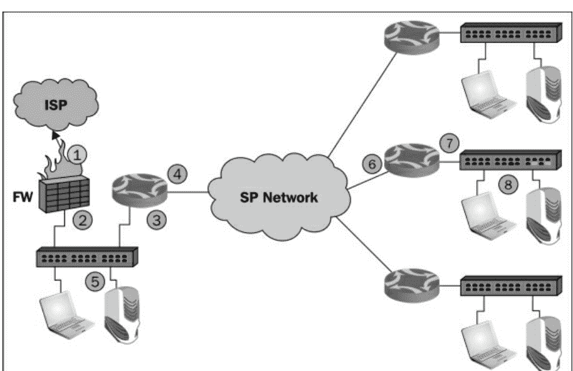

现在，我们将尝试了解我们应该关注哪些类型的流量、哪些类型的流量是正常的，以及哪些流量应该被跟踪。

在开始测试之前，请确保你拥有最新的网络拓扑，其中包含：

- 服务器的 IP 地址和局域网的 IP 地址范围
- 路由器、交换机和其他通信设备的 IP 地址和拓扑
- 安全设备——防火墙、**入侵检测系统/入侵防御系统（IDSs/IPSs）**、**Web 应用防火墙（WAF）**、数据库和应用防火墙、防病毒系统，以及任何其他拥有 IP 地址并生成、过滤或转发网络流量的设备
- 网络上运行的应用程序有哪些，包括 TCP/UDP 端口号和软件的 IP 地址

### 如何操作...

当你监控组织内部流量时，应检查以下内容：

1. 来自已知地址（组织内）的流量：
   - **正常：** 来自已知地址和地址范围的流量
   - **可疑：** 来自/前往你不知道的地址的流量
2. 应用程序和端口号：
   - **正常：** 包括标准端口号，80（HTTP）、137/8/9（NetBIOS）、3389（RDP）、20/21（FTP）、25、110（邮件）、53（DNS）等。要确定网络上运行的应用程序，并验证这些是你看到的唯一端口号。
   - **可疑：** 包括不常见的端口号，即不属于服务器上运行的应用程序的端口号（例如，发往 Web 服务器的 RDP 数据包）。
3. TCP 模式：
   - **正常：** TCP SYN/SYN-ACK/ACK 表示连接建立，单个重置（RST）表示快速连接拆除，FIN/FIN-ACK 数据包表示正常连接拆除，以及标准数据包和确认
   - **可疑：** 大量发往单个或多个目标或来自多个来源的 SYN 数据包（通常是以扫描模式出现，本章后面会介绍）、异常的标志组合（RST/FIN、URG）等
4. 大量发往你不知道的单个或多个站点的流量：
   - **正常：** 流量模式通常不是固定带宽。当你保存或打开文件、浏览互联网、发送或接收邮件，或通过 RDP 访问服务器时，你会看到流量有升有降。
   - **可疑（某些情况下）：** 固定带宽模式可能表明有人连接到了你的设备，但也可能表明有人在通过互联网收听广播（100-150 Kbps）、观看视频（某些情况下）等。当你看到固定带宽的流量模式时，请检查它是什么。下面的截图展示了一种固定带宽模式：

Wireshark IO Graphs: Tel Hashomer station warm 1-JAN-2013 Test 02 --- LS38cast-EXE.pcapng

5. 广播：
   - **正常：** NetBIOS 广播、ARP 广播（不太多）、DHCP（不太多）、应用程序广播（通常每隔几秒或更长时间一次）等
   - **可疑：** 每台设备每秒数十、数百、数千甚至更多的广播
6. DNS 查询和响应：
   - **正常：** 偶尔每个客户端每秒最多几十次的标准查询-响应模式
   - **可疑：** 大量 DNS 查询和/或响应、没有查询的响应等

### 工作原理...

网络取证与你在电视上看到的警匪剧非常相似。出现了问题；于是，你前往犯罪现场（即你的网络）寻找证据（即网络中留下的痕迹）。

你要寻找的是与犯罪现场（你的网络）不匹配的东西、遗留的东西（异常流量模式）、指纹和 DNA（能够识别攻击者的模式）。

在接下来的教程中，我们将详细了解可能表明发生犯罪的各种攻击和异常，并学习如何隔离和解决这些问题。

一些可能来自网络的常见攻击包括：

- **病毒：** 这些是攻击你的计算机并试图造成损害的小程序。病毒应由防病毒软件发现并清除。
- **蠕虫：** 这些通常是试图在网络中自我复制的程序。它们对资源消耗有重大影响，例如带宽消耗和 CPU 负载。重要的是，一旦你解决了问题，一切就会恢复正常。
- **拒绝服务（DoS）和分布式拒绝服务（DDoS）：** 这些攻击会拒绝网络资源的访问。这类攻击通常很容易发现，因为它们具有容易定位的独特行为。
- **中间人攻击：** 在这种攻击中，攻击者拦截消息，然后重新发送它们。这样，攻击者可以窃听流量或在流量到达目的地之前修改它。
- **扫描：** 有多种类型的扫描，从通常属于 DDoS 形式的简单 ICMP 扫描，到 TCP 扫描（例如，向各种端口号发送 SYN 请求，试图建立与服务器上运行的服务的连接），再到试图连接到你服务器上运行应用程序的应用扫描。
- **应用层攻击：** 这些攻击通过在服务器操作系统或应用程序中故意制造故障，针对你服务器上的应用程序。

在接下来的教程中，我们将逐一介绍它们（以及更多）。

### 更多内容...

一个重要的异常迹象是，网络中的服务器、PC、通信链路或任何其他实体无缘无故变得缓慢。例如：

- 当服务器变慢时，检查硬件和软件问题，检查网络问题，同时还要检查是否有人正在攻击它
- 当从远程办公地点到中心的链路变慢时，可能是由于负载（持续或突然），但也可能是因为攻击（通常是 DoS/DDoS）导致其阻塞
- 当 PC 变慢时，可能是因为它在执行你已知的某些操作，但不止一种可能性，要检查你未知的情况

这里需要提到的是，有多种系统可以保护我们免受攻击；下面列出了其中一些：

- **防火墙：** 它们阻止未经授权的流量进入特定区域。防火墙可以位于互联网连接处、组织服务器之前、组织区域之间，甚至可以作为每台 PC 上的个人防火墙。
- **网络访问控制（NAC）：** 这些系统只允许授权用户连接到网络。当未经授权的设备连接到网络时，你会看到该设备上的链路会被开启并立即关闭，未授权设备将在 MAC 层被阻止。
- **IDS/IPS：** 这些系统可以识别入侵模式并阻止它们。这里通常有两道防线——一道在 ISP 网络，一道在客户场所。IDS/IPS 可以是位于防火墙和互联网之间的专用设备，也可以是防火墙上的附加软件。
- **Web 应用防火墙（WAF）、应用防火墙、数据库防火墙和其他应用保护设备：** 这类产品是第 7 层保护设备，它们检查应用程序内部并转发或阻止应用层攻击。
- **Web 过滤器和邮件过滤器：** 这些设备扫描邮件和/或 Web 内容，只转发允许的消息和流量。

上述功能可以以不同设备的形式出现，可以作为虚拟机（VM）上的软件，也可以作为同一设备上的功能。

## 另见

在本方案中，我们讨论了一些安全组件。下面是一些示例：

- **防火墙**：Checkpoint（[www.checkpoint.com](www.checkpoint.com)）、Juniper SSG 系列（[http://www.juniper.net/us/en/products-services/security/ssg-series/](http://www.juniper.net/us/en/products-services/security/ssg-series/)）、Cisco ASA 系列（[http://www.cisco.com/en/US/products/ps5708/Products_Sub_Category_Home.htm](http://www.cisco.com/en/US/products/ps5708/Products_Sub_Category_Home.htm)）以及其他许多产品。
- **NAC**：这一类中，例如有 Forescout（[http://www.forescout.com/solutions/network-access-control/](http://www.forescout.com/solutions/network-access-control/)）和 Enterasys（[http://www.enterasys.com/company/literature/nac-ds.pdf](http://www.enterasys.com/company/literature/nac-ds.pdf)）。
- **IDS/IPS**：这一类中，例如有 Juniper IDP 设备系列（[http://www.juniper.net/us/en/products-services/security/idp-series/](http://www.juniper.net/us/en/products-services/security/idp-series/)）和 Check Point 防火墙软件刀片（[http://www.checkpoint.com/products/ips-software-blade/](http://www.checkpoint.com/products/ips-software-blade/)）。
- **WAF**：这里例如有 Imperva（[http://www.imperva.com/products/wsc_web-application-firewall.html](http://www.imperva.com/products/wsc_web-application-firewall.html)）和 F5（[http://www.f5.com/glossary/web-application-firewall/](http://www.f5.com/glossary/web-application-firewall/)）。数据库防火墙也可用，例如来自 Imperva（[http://www.imperva.com/products/dsc_database-firewall.html](http://www.imperva.com/products/dsc_database-firewall.html)）和 Oracle（[http://www.oracle.com/us/products/database/security/audit-vault-database-firewall/overview/index.html](http://www.oracle.com/us/products/database/security/audit-vault-database-firewall/overview/index.html)）。
- **Web 和邮件过滤**：这里例如有 McAfee（[http://www.mcafee.com/au/products/email-and-web-security/index.aspx](http://www.mcafee.com/au/products/email-and-web-security/index.aspx)）、Blue Coat（[http://www.bluecoat.com/security-policy-enforcement-center](http://www.bluecoat.com/security-policy-enforcement-center)）和 Websense（[http://www.websense.com/content/Home.aspx](http://www.websense.com/content/Home.aspx)）。

## 发现基于 MAC 和 ARP 的攻击

Wireshark 可以轻松发现多种类型的基于 MAC 的第 2 层攻击以及第 2/3 层 ARP 攻击。这些攻击通常由扫描器（在下一个方案中介绍）和中间人攻击（在第 8 章“ARP 和 IP 分析”的“使用 ARP 分析连接问题”方案中介绍）引起。在本方案中，我们将看到一些典型的攻击模式及其含义。

### 准备工作

当在网络中看到过多的 ARP 请求或非标准的 MAC 地址时，将 Wireshark 通过端口镜像连接到它们的来源，然后开始捕获。

### 操作步骤...

若要查找基于 ARP/MAC 的攻击，请按以下步骤操作：

1. 将 Wireshark 连接到网络上的任意端口。
2. 查找大量的 ARP 广播。由于 ARP 请求是广播，它们会分布在整个第 2 层网络中（即单个 VLAN 内）。在下面的截图中，你可以看到典型的 ARP 扫描模式。需要注意的是，这种 ARP 扫描可能是一个以这种方式工作的应用程序，例如，用于发现网络的 SNMP 软件，以及使用免费 ARP 的路由器。只有当它来自无法识别的来源时，才说明存在问题。

   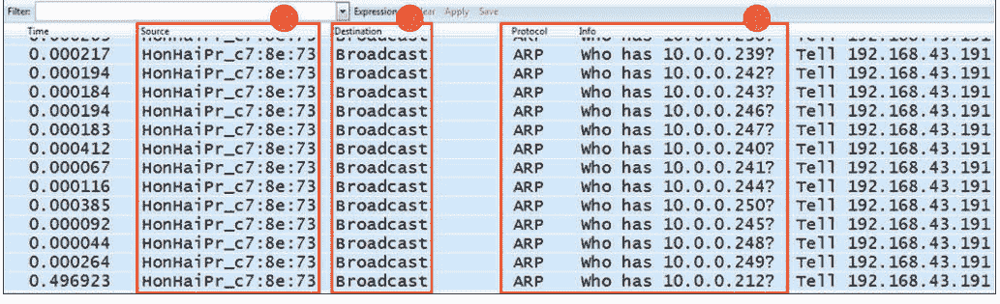

3. 还有一些可疑的 MAC 模式。当你看到以下情况时，可以识别出它们：
   - 两个相同的 MAC 地址对应不同的 IP 地址。这可能是同一网络适配器上配置了两个 IP 地址，这是正常的；但也可能是一种攻击模式，即有人将其 MAC 地址改成了服务器的 MAC 地址（这可以在任何适配器上实现）。
   - 上述情况也可能表示中间人攻击，如第 8 章“ARP 和 IP 分析”中“ARP 欺骗和中间人攻击”一节所述。

### 工作原理...

ARP 向网络发送广播，询问某个特定 IP 目的地的 MAC 地址。任何不符合此模式的行为都应被视为恶意行为。

### 补充说明...

ARP 请求也可能来自发现网络的 SNMP 软件（自动发现功能）、发送免费 ARP 的 DHCP 服务器等。每当你看到 ARP 在扫描某些内容时，这不一定是问题；关键在于谁发送了这些请求。关于 ARP 过程的更多信息，请参阅第 8 章“ARP 和 IP 分析”。

## 发现 ICMP 和 TCP SYN/端口扫描

扫描是将数据包发送到网络设备的过程，目的是查看谁在响应 ping 请求、查找正在监听的 TCP/UDP 端口，并发现网络上有哪些类型的共享资源，包括系统和应用程序资源。

### 准备工作

扫描攻击通常通过以下方式被发现：用户抱怨网络响应缓慢、管理系统发现服务器或通信线路上的异常负载，以及攻击进行时，识别可疑使用模式的**安全信息和事件管理系统（SIEM）**也会检测到攻击。在这些情况下，将带有端口镜像的 Wireshark 部署在尽可能靠近你怀疑受到感染的区域，然后开始捕获。

### 操作步骤...

要发现问题，请按以下步骤操作：

1. 在靠近问题的接口上启动 Wireshark 并开始捕获：
   - 如果通往互联网的线路变慢，就对这条线路进行端口镜像；
   - 如果服务器变慢，就对服务器进行端口镜像；
   - 如果远程办事处变慢，就对通往它们的线路进行端口镜像。
2. 如果你发现 Wireshark 没有响应，这很可能是因为你遇到了一次非常猛烈的攻击，每秒产生数千甚至更多数据包，导致 Wireshark（或你的笔记本电脑）无法处理。在这种情况下，停止 Wireshark（如有必要，在 Windows 中按 Ctrl+Alt+Del，或在 Unix 中使用 kill 命令），并将其配置为捕获多个文件（参见第 1 章“Wireshark 入门”中的“开始捕获数据”方案）。
3. 你可能会看到各种模式，它们都有相同的行为——在大多数情况下是大规模扫描、ICMP 或 TCP，但也有其他类型。理解它们的最好方式是通过一些示例来观察。
4. 在下图中，你会看到一个遭受攻击的网络。来自所有远程站点的用户都抱怨网络非常慢。他们都在访问图中左侧的中心服务器。

   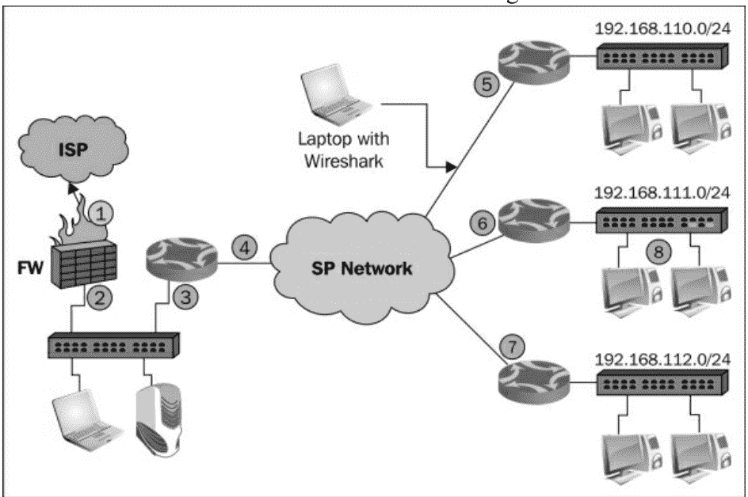

   当我将 Wireshark 连接到某个远程站点时（如下图所示），我看到了大量 ICMP 请求（3），它们来自 LAN 192.168.110.0（1），发往随机目标（2）。这是随机的吗？

   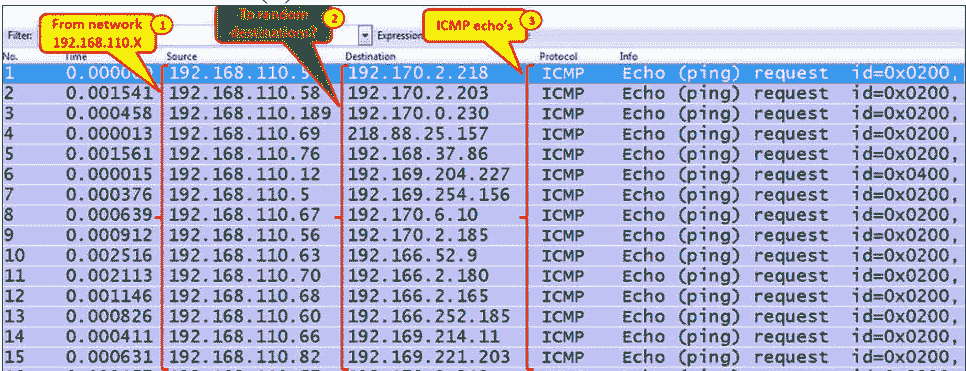

   另外，请注意数据包之间的时间间隔。如果是扫描行为，这个间隔通常非常短。

   当你进入“统计 | 会话”时，会看到一些有趣的现象：

   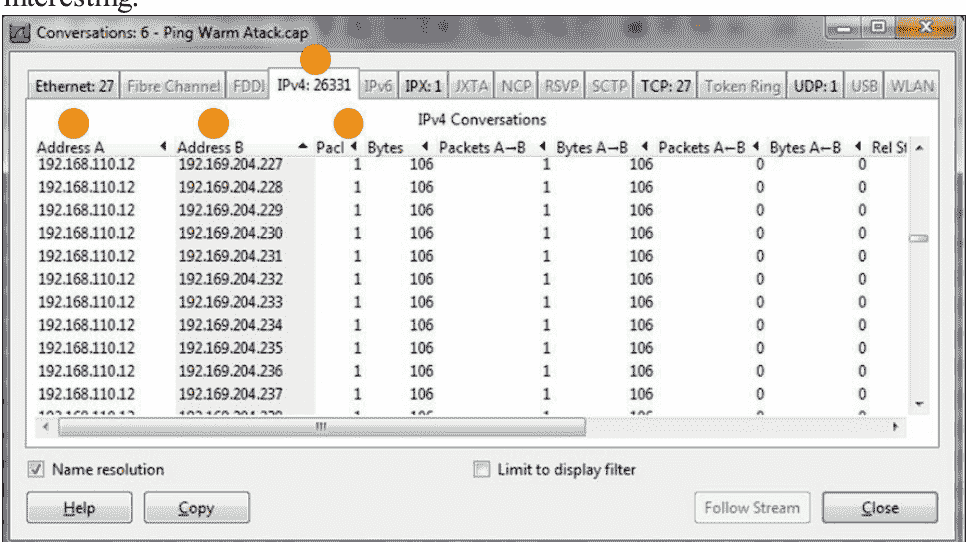

   当我们按地址 A（1）对表格排序时，会看到一种 ICMP 请求模式，这些请求来自网络 192.168.110.0 上的不同地址（这里只显示其中很小一部分，即 192.168.110.12 正在扫描网络）。

   这种蠕虫只是用 ICMP 请求扫描网络。一旦有人响应，蠕虫也会感染该主机；几分钟后，所有通信线路都会被从远程办事处发出的 ICMP 请求阻塞。

### 提示

### 结论

当你在通信信道或链路上看到大量 ping 扫描，也就是数千甚至更多个 ping 时，应检查是否存在问题。可能是 SNMP 软件在发现网络，但也可能是蠕虫，它会淹没你的通信线路或服务器链路（或两者）。

5. 另一种常见的扫描类型是 TCP-SYN 扫描。在这种情况下，攻击者使用 TCP-SYN 包扫描随机 TCP 端口，等待某个主机以 SYN-ACK 响应。一旦发生这种情况，攻击者有两种选择：
   - 攻击者继续发送 SYN 包并接收 SYN-ACK，从而在被攻击设备上留下大量半开连接；
   - 攻击者以 ACK 回应，从而建立连接，并像在 DoS/DDoS 攻击中那样让连接保持打开，或试图利用这条连接危害被攻击设备。
6. TCP-SYN 扫描会呈现为以下截图中的某种模式：
   - 你会看到大量 SYN 包，而受攻击节点没有返回任何响应。

   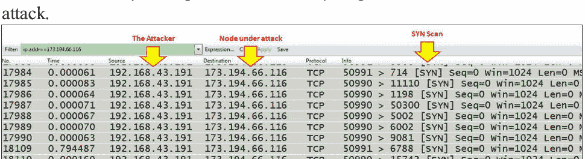

   - 你会看到大量 SYN 包，并且每个 SYN 包都会收到一个 TCP RST 包作为响应。这通常发生在你为正在遭受攻击或即将遭受攻击的设备配置了防火墙时。

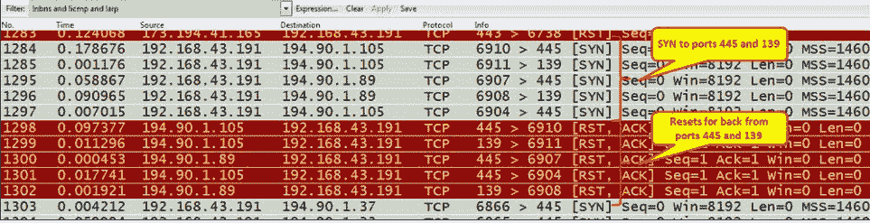

- 您也可以看到连续的 SYN 和 RST 数据包。当有端口号处于开启状态时，您会看到扫描器与受害主机建立连接时完整的 SYN/SYN-ACK/ACK 过程，如下图所示：

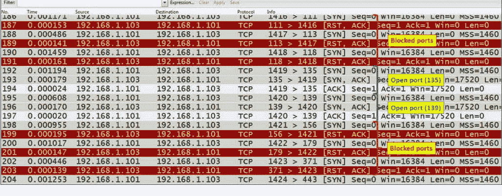

- 7. 始终留意异常的流量模式。例如，过多的 ICMP 请求就是扫描的一个明显迹象。注意是否有针对客户端的多个 ICMP 请求、ICMP 时间戳请求、按升序或降序排列的 ICMP 请求等。这些模式可能表明存在恶意扫描。
  - 当您怀疑有扫描时，点击目标（地址）列标题，即可按目标地址对数据包列表排序。这样更容易看出扫描模式。
  - 下面的截图展示了这种情况的一个示例：

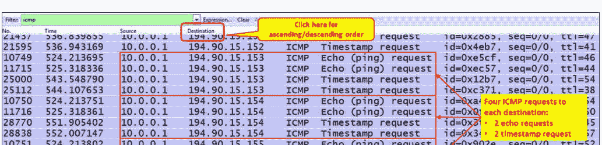

8. 对于应用层扫描，可能存在多种类型：

- **NetBIOS 扫描**：寻找对 NetBIOS 端口的大规模扫描
- **HTTP**：寻找对 HTTP 80 端口的 SYN 请求，以及后续的 HTTP 请求
- **SMTP**：寻找对 TCP 25 端口的大规模扫描
- **SIP**：寻找对 5060 端口的大量请求

其他类型的应用根据其端口号被扫描。

## 工作原理...

大多数扫描器分几个步骤工作：ARP 扫描、ICMP，然后是 TCP 或 UDP。其原理很简单：

- 如果扫描器位于局域网内，它会向整个局域网发送 ARP 广播。
- 扫描器发送 ICMP 请求，部分 ICMP 请求会得到应答。
- 当有人应答 ARP 或 ICMP 请求时，扫描器会上升到 TCP 和 UDP 层，开始扫描第 4 层端口。当扫描器发现某个端口开放时，便会开始应用层扫描。
- 在应用层扫描中，扫描器向应用程序发送命令，试图让应用程序回应，从而尝试攻破它。

## 补充内容...

近年来，大多数现代入侵检测/防御系统（IDS/IPS）都知道如何处理 ICMP 扫描、TCP SYN 扫描以及各种产生大量标准、已知攻击模式流量的扫描类型。如果您拥有此类系统，并且您通过具备相应系统的 ISP 连接互联网，那么您可能已经免受这些简单类型的攻击。

这些系统通常以两种方式工作：

- 基于 NetFlow/Jflow 的 IDS/IPS，可识别来自多个源的大量流量；通过阻止或修改路由表来使这些数据包无法到达 ISP 网络，从而中和攻击。
- 基于内容的 IDS/IPS，检查流量模式，并据此决定是否转发。

来自内部网络的攻击不会被外部设备过滤，因此更为常见。本章后面的“定位智能 TCP 攻击”配方中会讨论更复杂的攻击类型。

防止来自互联网攻击的方法是，通过具有高效 IDS/IPS 系统的 ISP 连接，同时使用自己的防护系统。防止来自内部网络攻击的方法是，实施组织安全策略，并配合适当的防护软件，如防病毒软件和个人防火墙。

## 另请参阅

在上一节中，我提到了组织安全策略的问题，即如何实施一套规则来保护您的组织。有关此主题的更多信息，在互联网上广泛可得。一些涵盖此领域的有趣网站包括：

- http://www.cert.org/work/organizational_security.html
- http://www.praxiom.com/iso-17799-4.htm
- http://www.sans.org/reading-room/whitepapers/policyissues/1331.php
- http://www.sans.org/security-resources/policies/

## 发现 DoS 和 DDoS 攻击

**拒绝服务（DoS）** 和 **分布式拒绝服务（DDoS）** 是旨在拒绝用户访问网络服务的攻击。可能被拒绝的服务包括：

- **通信线路**：这通常通过产生大量流量来淹没和阻塞通信线路实现。
- **应用程序和服务（Web 服务、邮件服务等）**：这通常通过将服务器加载到无法处理客户端请求的程度来实现。

DoS/DDoS 攻击可能是我们之前配方中讨论的扫描的结果。区别在于，DoS/DDoS 是一种以拒绝用户访问的方式拖慢服务器或网络的扫描。

在本配方中，我们将看到一些常见的 DoS/DDoS 模式，并学习如何识别和阻止它们。

## 准备就绪

DoS/DDoS 通常在某个网络资源（即通信线路或服务器）变得非常缓慢且无法正常工作时被发现。

当您识别到此类资源时，使用端口镜像将 Wireshark 连接到该设备并开始数据包捕获。在本配方中，我们将介绍一些常见的 DoS/DDoS 攻击及其特征。

## 操作步骤...

将 Wireshark 连接到网络，对您怀疑遭受 DoS/DDoS 攻击的资源端口进行端口镜像。通常，这可能是变得非常慢的服务器、负载过重的通信线路，或任何其他停止运行或变得非常慢的资源。

- 1. 当通信线路（例如互联网连接）变得非常慢时，使用端口镜像将 Wireshark 连接到该线路。
- 1. 尝试定位流量来自哪里。
- 2. 我对服务器做了端口镜像，然后得到了以下结果：

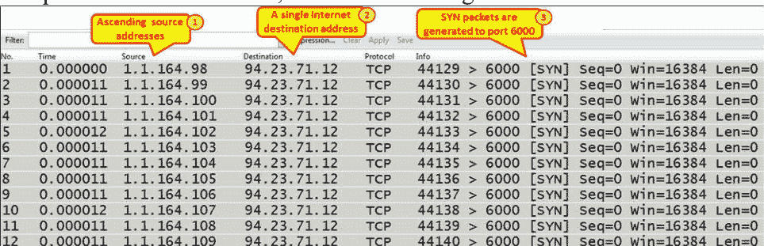

- 3. 我们看到源地址按升序排列，向互联网地址 94.23.71.12 产生流量。

### 提示

当您查看配置为“相对前一个显示数据包的时间”的时间列时，您会看到帧与帧之间只有 11-12 微秒。当您看到 TCP-SYN 以这种速率到达时，肯定有问题。检查一下！

- 4. 由于源地址未知，我检查了它们的 MAC 地址。得到的结果是：

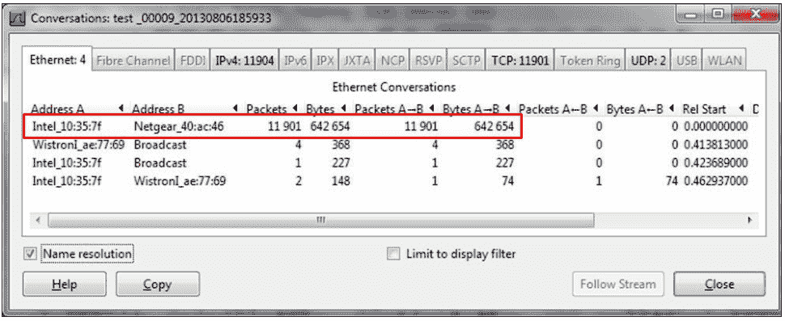

5. 问题是所有源地址都来自同一个 MAC 地址；所以我检查了它们的 MAC 地址，所有 IP 地址都来自同一个 MAC 地址，即服务器的 MAC 地址。

### 提示

### 结论

检查 SYN 扫描，并验证它们来自哪些 IP 和 MAC 地址。可能是一只蠕虫在生成并非主机自身的源地址。

2. 另一个示例可以是从单个攻击者发起的简单 SYN 扫描，如下图所示。查找 SYN 并观察它们扫描的端口号。您可能会看到：

- 无响应
- 重置数据包
- SYN-ACK 响应

3. 此类攻击可能产生多种后果：

- 如果无响应或重置响应，则被攻击的服务器运行正常。如果服务器以 SYN-ACK 响应应答，则可能对服务器构成风险。
- 风险在于，如果打开的连接过多（SYN/SYN-ACK/ACK）或半开连接过多（SYN/SYN-ACK），服务器可能会因这些连接而变慢。
- 下图展示了典型的 TCP SYN 攻击。当 SYN 攻击阻塞通信线路或将服务器加载至停止运行的程度时，它就变成了 DoS/DDoS。

| 序号 | 时间 | 源地址 | 目标地址 | 协议 | 信息 |
|---|---|---|---|---|---|
| 55372 | 0.000025 | 10.0.0.103 | 10.0.0.10 | TCP | 33928 > 1082 [SYN] Seq=0 Win=1024 Len=0 MSS=1460 |
| 55373 | 0.000025 | 10.0.0.103 | 10.0.0.10 | TCP | 33928 > 15003 [SYN] Seq=0 Win=1024 Len=0 MSS=1460 |
| 55374 | 0.000034 | 10.0.0.103 | 10.0.0.10 | TCP | 33928 > 6567 [SYN] Seq=0 Win=1024 Len=0 MSS=1460 |
| 55375 | 0.000025 | 10.0.0.103 | 10.0.0.10 | TCP | 33928 > 458 [SYN] Seq=0 Win=1024 Len=0 MSS=1460 |
| 55376 | 0.000026 | 10.0.0.103 | 10.0.0.10 | TCP | 33928 > 8383 [SYN] Seq=0 Win=1024 Len=0 MSS=1460 |
| 55377 | 0.000035 | 10.0.0.103 | 10.0.0.10 | TCP | 33928 > 2100 [SYN] Seq=0 Win=1024 Len=0 MSS=1460 |
| 55378 | 0.000025 | 10.0.0.103 | 10.0.0.10 | TCP | 33928 > 1721 [SYN] Seq=0 Win=1024 Len=0 MSS=1460 |
| 55379 | 0.000025 | 10.0.0.103 | 10.0.0.10 | TCP | 33928 > 8994 [SYN] Seq=0 Win=1024 Len=0 MSS=1460 |
| 55380 | 0.000025 | 10.0.0.103 | 10.0.0.10 | TCP | 33928 > 6699 [SYN] Seq=0 Win=1024 Len=0 MSS=1460 |
| 55381 | 0.000025 | 10.0.0.103 | 10.0.0.10 | TCP | 33928 > 10616 [SYN] Seq=0 Win=1024 Len=0 MSS=1460 |
| 55382 | 0.000025 | 10.0.0.103 | 10.0.0.10 | TCP | 33928 > 2381 [SYN] Seq=0 Win=1024 Len=0 MSS=1460 |
| 55383 | 0.000024 | 10.0.0.103 | 10.0.0.10 | TCP | 33928 > 55555 [SYN] Seq=0 Win=1024 Len=0 MSS=1460 |
| 55384 | 0.000025 | 10.0.0.103 | 10.0.0.10 | TCP | 33928 > 8193 [SYN] Seq=0 Win=1024 Len=0 MSS=1460 |
| 55385 | 0.000026 | 10.0.0.103 | 10.0.0.10 | TCP | 33928 > 10001 [SYN] Seq=0 Win=1024 Len=0 MSS=1460 |
| 55386 | 0.000025 | 10.0.0.103 | 10.0.0.10 | TCP | 33928 > 5904 [SYN] Seq=0 Win=1024 Len=0 MSS=1460 |

TCP SYN 扫描

# 工作原理...

拒绝服务（Denial of Service）是一种拒绝网络服务使用的攻击方式。其实现方式是让被攻击设备将硬件资源（CPU、内存等）分配给攻击者，从而使用户无法获得任何资源。

拒绝服务是指对网络资源发起攻击。分布式拒绝服务（Distributed DoS）则是指攻击来自多个来源。

# 更多内容...

DoS/DDoS 攻击有时很难被发现，因为它们可以模拟真实情况。例如：

+   1. Ping 扫描也可能来自管理系统。
+   2. HTTP GET 请求，即 Web 服务器接收的正常请求。
+   3. SNMP GET 请求。

为了发现问题，需要对上述及其他类似流量的数量和来源进行监控。在下图中，我们可以看到在追踪特定 TCP 流时获得的信息。

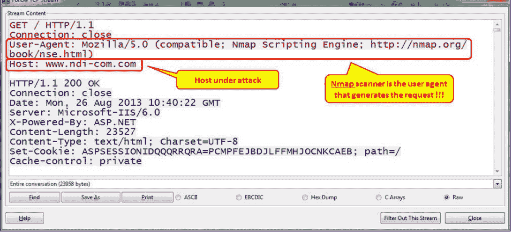

# 定位狡猾的 TCP 攻击

另一种攻击方式是发送未知的 TCP 数据包，希望被攻击设备不知道如何处理它们，从而将其放行。这类攻击广为人知，如今网络中部署的大多数现代防火墙都会拦截它们；尽管如此，我还是会简要介绍一下。

# 准备工作

当我进入一个新网络时，通常会把笔记本电脑连接到网络上，观察网络上有哪些流量。首先，我会连接到几个交换机上，查看广播流量。然后，我会对关键服务器和通信线路配置端口镜像，再观察上面的流量。

为了查找异常流量，需要对通信链路和核心服务器进行端口镜像，并检查是否出现异常的流量模式。

# 操作步骤...

你应该留意的流量模式包括：

+   - **ACK 扫描：** 通常会向多个端口发送大量 ACK 数据包，以破坏现有的 TCP 连接。

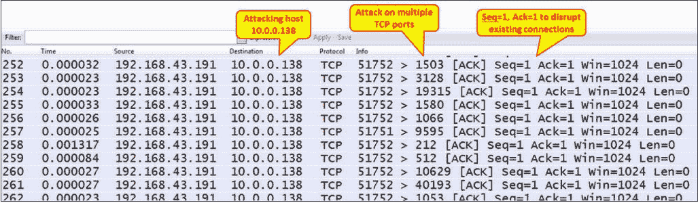

+   - **异常标志位组合：** 这指的是带有 URG 标志、FIN 与 RST、SYN-FIN 等的任何组合。异常标志组合并不是常见的带或不带 ACK 的 SYN、FIN 或 RST。在下面的截图中，你可以看到这种情况的一个示例。FIN/PSH/URG 这些操作组合在一起被称为 Xmas 扫描。

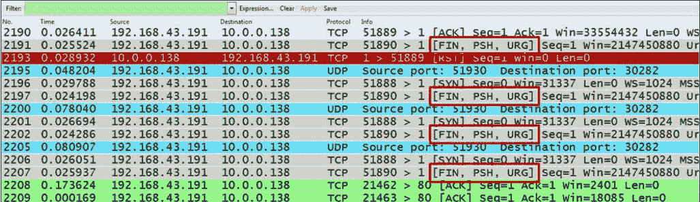

所有标志位都设置为“0”的 TCP 扫描称为 Null 扫描。

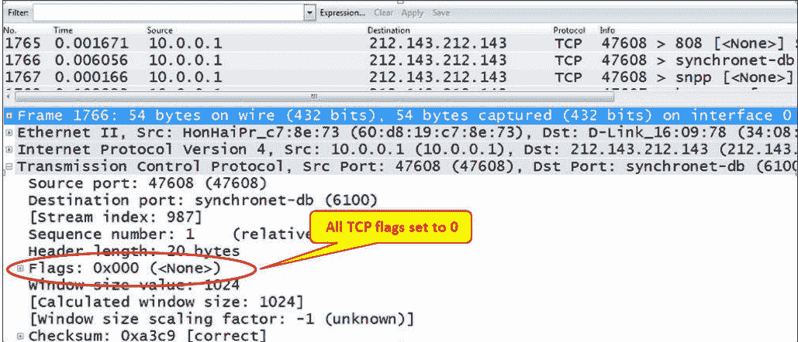

+   - 大规模 FIN-ACK 扫描：大量 FIN 和 ACK 标志位设置为“1”的数据包被发送到多个端口，目的是使端口关闭或仅仅是为了淹没网络。

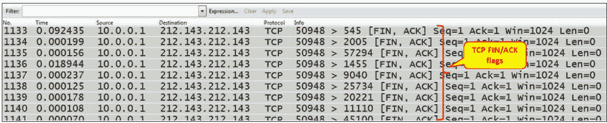

# 工作原理...

TCP 扫描有多种类型，其假设是：当我们向目标发送 RST 或 FIN 标志（带或不带 ACK）以扫描不同端口号时，会使目标关闭连接；而当我们向目标发送异常的标志组合时，会使目标忙于处理，从而导致其速度变慢并断开现有连接。

这些扫描大多广为人知，并且防火墙和入侵检测/防御系统都能很好地防范。

# 更多内容...

你也可以配置预定义过滤器来捕获这些类型的攻击，但在怀疑发生此类事件时，最好的做法是检查捕获的数据，寻找异常的数据模式。

# 另请参阅

关于扫描类型，请访问 [Nmap.org](http://nmap.org) 网页：

[http://nmap.org/book/man-port-scanning-techniques.html](http://nmap.org/book/man-port-scanning-techniques.html)

# 发现暴力破解和应用攻击

网络攻击的下一步是了解各种类型的暴力破解攻击。暴力破解攻击是一种试错方法，用于从受害者那里获取信息，例如试图查找组织服务器、用户目录和破解密码。

### 准备工作

暴力破解攻击通常不会在网络中产生非标准负载，发现它们的方式通常是依靠 IDS 系统，或者当怀疑有人试图入侵网络时发现。在本节中，我们将学习如何识别典型的暴力破解攻击。

2. 另外，留意是否有过多 HTTP 错误消息。下面的截图展示了一些示例。选择 统计 | HTTP | 数据包计数 | PC。如果收到过多错误消息，请检查其来源。

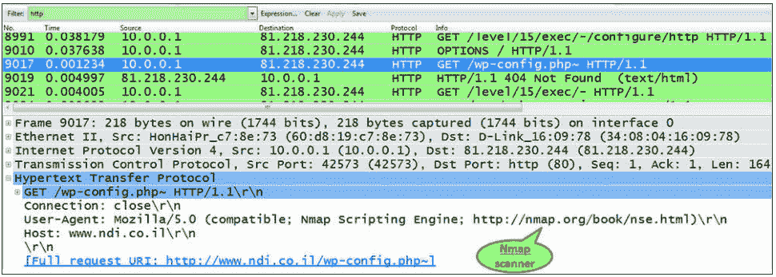

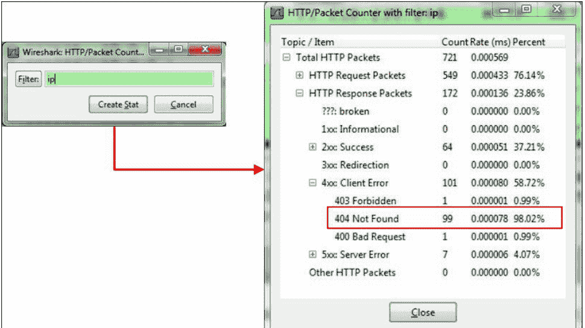

# 工作原理...

暴力破解攻击是一种试错攻击，向目标发送请求，希望其中一些请求能得到响应。由于这些请求大部分都会被拒绝（如果你的服务器配置正确的话），因此大量的 **未找到** 消息、禁止消息和其他错误代码可能就是此类攻击的某些症状。

# 更多内容...

要发现 HTTP 错误码，请配置显示过滤器 `http.response.code >= 400`。这同样适用于 SIP 以及任何使用类似 HTTP 状态码的协议。要查找已知的扫描器，只需使用 **编辑 | 查找** 数据包功能，并查找常见的扫描器名称。在下面的截图中，你可以看到 Nmap 的一个示例，它是其中常见的扫描器之一。我们在 **数据包字节** (2) 中选择了字符串 **nmap.org** (1)。

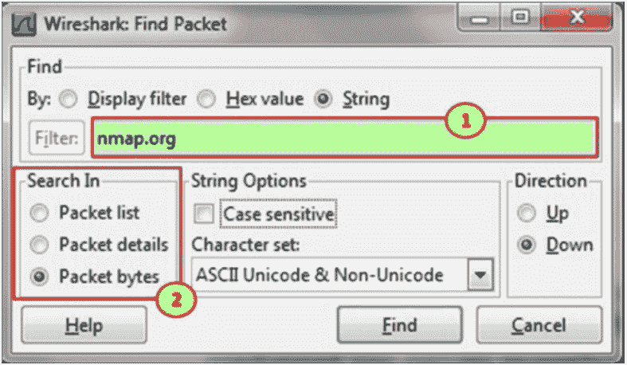

这就是我们得到的内容：

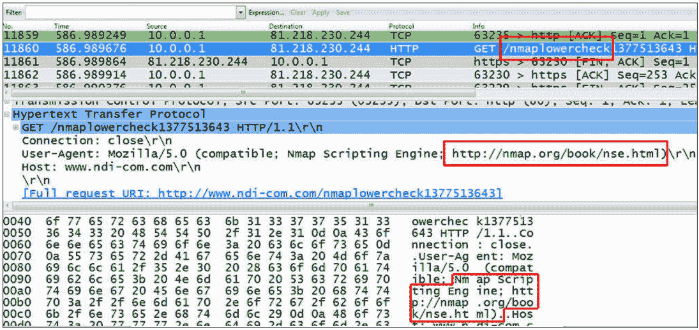

另一个重要问题是暴力破解攻击，即攻击者试图猜测密码以侵入服务器。

在下面的截图中，你会看到攻击者试图入侵一个受到良好保护的 FTP 服务器时发生的情况。

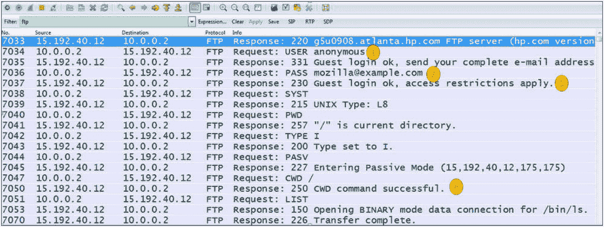

+   1. 由于是 FTP，第一次尝试使用用户名 anonymous (1)，密码由攻击者选择 (2)，登录当然会被允许 (3)，然后攻击者进入系统 (4)。
