### 第1章 欢迎来到使用 Wireshark 进行数据包分析的世界

本章向您介绍 TCP/IP 模型的基础知识，并通过一个示例数据包捕获让您熟悉 Wireshark 的图形用户界面（GUI）。您将了解以下主题：

- 什么是 Wireshark？
- 它是如何工作的？
- TCP/IP 模型简要概述
- 数据包分析简介
- 为什么使用 Wireshark？
- 了解 Wireshark 的 GUI
- 首次数据包捕获

### Wireshark 简介

Wireshark 是最先进的数据包捕获软件之一，它让系统/网络管理员的工作变得轻松，并证明了它在安全倡导者群体中的价值。Wireshark 又被称为协议分析器，可帮助 IT 专业人员调试网络层问题。该工具在优化网络性能方面非常有用。

Wireshark 的核心工作是剖析网络层数据包，并根据用户的需求向其展示数据包详细信息。如果您每天都需要处理数据包级网络问题，那么 Wireshark 非常适合您，它可用于多种故障排查目的。

### TCP/IP 模型简要概述

接下来，我们来讨论网络世界中最重要的主题。为了理解所有这些内容如何联系在一起，我们需要了解 TCP/IP 模型的基础知识。即使是计算机世界也需要一套通信规则和条例，而这由网络协议负责处理，这些协议管理数据包/段/帧在主机之间专用信道上的传输。

TCP/IP 模型最初被称为 DoD 模型，该项目由美国国防部监管。TCP/IP 模型负责数据包生命周期的方方面面，即：数据包如何生成，单个数据包如何附加所需的信息集合（PDU），数据包如何传输，如何开始运作，如何通过中间节点路由到目的地，如何与其他数据包重新整合以得到完整信息，等等。

如果您对网络协议的基础知识有任何疑惑，我建议您先快速回顾一下再继续阅读，因为本书需要您熟悉 TCP/UDP 协议。等您回来后，您将能够自己设想并回答所有这些问题。

第二层是**传输层**。该层的唯一目的是创建套接字，使两台主机能够通过它们进行通信（您可能已经知道网络套接字的重要性），这对于在两台设备之间建立单独连接至关重要。

同一时刻，两台主机之间可能存在多个连接。IP 地址和端口号共同实现了这一点。当我们讨论基于 WAN 的通信时，需要 IP 地址（在基于 LAN 的通信中，实际数据传输通过 MAC 地址进行）。如今，单个系统可以借助端口号通过多个信道与多个设备进行通信。除了受限制的端口号范围外，每个系统都可以自由指定一个随机端口用于通信。

该层也是两台主机之间通信的骨干。工作在该层的最常见协议是 TCP 和 UDP，具体说明如下：

- **TCP：**这是一种面向连接的协议，通常被称为可靠协议。首先，在两台主机之间建立专用信道，然后传输数据。接着，发送方通过专用信道发送均分的数据块，接收方对收到的每个数据块发送确认。最常见的情况是，发送方会等待特定时间，然后再次发送相同的数据块以确保传输。例如，如果您正在下载某些内容，TCP 会负责确保每个比特都成功传输。
- **UDP：**这是一种无连接协议，通常被称为不可靠的通信形式。但它很简单，因为没有创建专用信道，发送方只关心将数据块发送到目的地，无论是否被接收。这种通信形式实际上不会影响通信质量；将比特从发送方传输到接收方这一唯一目的已经实现。例如，如果您正在玩基于局域网的游戏，丢失几个字节不会破坏您的游戏体验，因此用户体验不会受到损害。

第三层是**互联网层**，负责数据的往返传输。该层工作的主要协议是 **IP（互联网协议）**，这是该层最重要的协议。IP 提供路由功能，使得特定数据包能够到达其目的地。该层包含的其他协议还有 ICMP 和 IGMP。


最后一层是**链路层**（通常也称为网络接口层），它紧邻网络硬件。TCP/IP 并未在这一层指定协议；然而，有若干协议被实现，例如**地址解析协议（ARP）**和**点对点协议（PPP）**。该层关注的是信息比特如何在真实的线路中传输。它建立和终止连接，并负责将信号从模拟转换为数字，反之亦然。网桥和交换机等设备在这一层工作。

客户端和服务器的 IP 地址与 MAC 地址的组合是通信过程的核心，其中 IP 地址由网关分配给设备，或者通过静态方式分配，而 MAC 地址来自**网卡（NIC）**，每个与其他主机通信的设备都应具备网卡。当数据从应用层向链路层传输时，一些信息比特会以头部或尾部的形式附加到数据比特上，这使得 TCP/IP 模型的各层能够相互协调。添加这些额外比特的过程称为数据封装，在此过程中，会在网络模型的末端生成一个**协议数据单元（PDU）**。

PDU 由正在发送的信息以及作为头部或尾部一部分附加的各种协议信息组成。当 PDU 到达最底层时，它已经嵌入了实际传输所需的全部信息。一旦到达目的地，随着 PDU 在 TCP/IP 模型中逐层向上传递，所嵌入的头部和尾部 PDU 元素会被一层一层地剥离。

下图描述了封装的过程：

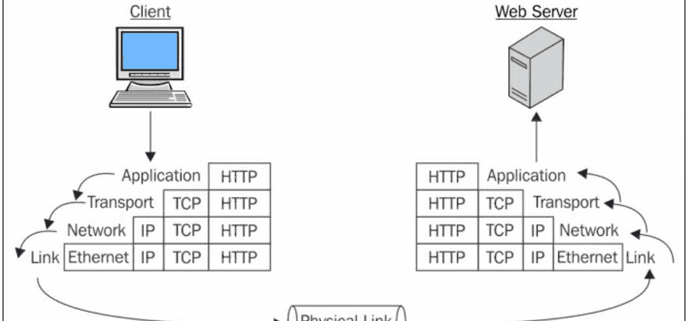

图 1.1：数据封装

## 使用 Wireshark 进行数据包分析简介

数据包分析（也称为数据包嗅探或协议分析）用于在网络（以太网或 Wi-Fi）上传输时拦截并捕获实时数据，以了解网络中正在发生的事情。数据包分析由诸如 Wireshark 之类的协议分析器完成，这些分析器可在互联网上获得。其中一些是免费的，一些用于商业用途则需要付费。在本书中，我们将使用 Wireshark 来执行网络分析；Wireshark 是一款开源软件，也是互联网上最好的免费网络分析器。

在当今的网络环境中，可能会出现许多问题；为此，我们需要随时配备最新的工具集，以便在任何情况下都能轻松进行故障排查。这些问题中的每一个都从数据包层面开始，并可能逐渐升级为严重的网络停机。即使系统中运行的最好的协议和服务也可能出错并表现出恶意行为。为了找到问题的根源，我们需要深入数据包层面以更好地理解它。如果你需要维护你的网络，那么你绝对需要关注数据包层面。数据包分析可用于以下方面：

- 通过检查数据包及其具体细节来分析网络问题，从而使你能够更好地掌控网络。
- 检测网络入侵企图，以及是否存在试图进入你的网络的恶意用户，或者他们已经访问了你网络中的某些内容。
- 通过在安全设备中建立防火墙规则，然后通过 Wireshark 监控每条规则，来检测内部或外部用户对网络的滥用。
- 隔离已被利用的系统，使受影响的系统不会成为恶意用户攻击你网络的跳板。
- 监控数据在网络中实时传输的动态，以便更好地控制允许和受限的数据类别。例如，假设你想为防火墙创建一条规则来阻止访问 BitTorrent 站点。从你可管理的路由器上就可以阻止这些访问，但要了解请求来自何处，则可以通过 Wireshark 轻松审计。
- 通过根据你的需求过滤最具体的数据包，并创建特定的捕获过滤器供你参考，从而收集和报告网络统计信息，这从长远来看对你很有帮助。
- 了解谁在网络中以及他们在做什么，是否有他们不被允许做的事情，是否有人在尝试绕过网络限制。所有这些简单的日常任务都可以通过 Wireshark 轻松完成。
- 调试客户端/服务器通信，以便可以审计网络中节点之间通信的所有请求和响应，从而维护网络的完整性。
- 查找隐藏在你网络角落并占用带宽的应用程序。它们可能使你的网络不安全，或者使其对公共网络可见。通过这些不被注意的应用程序，各种形式的网络流量可以在没有任何限制的情况下进入。
- 调试网络协议实现以及当前运行设备中各种错误配置导致的任何异常。

识别你的网络可能遭受的可能攻击或恶意攻击，分析它们，控制/监督它们，并为任何可能的恶意活动做好准备。

在执行数据包分析时，你应注意以下事项：哪些协议可以被解析，根据你的专业知识可以使用哪些最佳软件，哪种协议分析器最适合你的网络需求。在这个领域，经验确实很重要；一旦你开始使用 Wireshark，你会逐渐产生新的想法，以更高级的方式排查和分析你的数据包。

数据包嗅探器可以解析常见的网络协议（如 IP 和 ICMP）、传输层协议（如 TCP 和 UDP）以及应用层协议（如 DNS 和 HTTP）。

由于 Wireshark 的图形用户界面（GUI）呈现的信息量过于庞大，对某些用户来说它可能显得复杂，这也可被视为其缺点之一。有一些 CUI/GUI 工具可以解决这个问题。它们使用起来非常简单，界面也更简洁，例如 TShark、tcpdump、Fiddler 等。

## 如何进行数据包分析

当捕获流量时，要么捕获所有原始数据，要么只捕获头部数据而不捕获数据包的完整内容。捕获的信息会从原始数据解码为人类可读的形式，使用户能够更精确地理解网络之间交换的数据。

## 什么是 Wireshark？

Wireshark 是一款数据包嗅探软件，全世界的 IT 专业人士都将其用于分析目的。你可以从 [https://www.wireshark.org/download.html](https://www.wireshark.org/download.html) 免费下载。

Wireshark 可以安装在多种平台上，包括 Linux、Mac 和 Windows（大多数版本）。这是一款开源软件，这意味着该软件的代码及其所需的库可以从我们之前提到的同一网站下载。

数据包嗅探的一个重要关键方面是，将数据包嗅探器放置在物理网络中的什么位置，才能最大限度地发挥其作用；数据包嗅探通常被称为接入线路。

接入线路不仅仅是让你在系统上启动 Wireshark；在启动嗅探器之前，人们还需要了解一些事情。例如，将嗅探器放置在组织基础设施中的适当位置，具备不同网络设备的工作知识，因为每种网络设备（集线器、交换机、路由器和防火墙）的行为都不同。了解它们各自的工作方式以及网络设备如何处理网络流量也很重要。将嗅探器放置在正确的位置会以细致的方式影响你的数据包分析体验，如果操作正确，最终可能会带来显著的效果。

放置好嗅探器后，你应确认你的网卡（NIC）支持混杂模式。启用该模式后，你的接口卡将开始获取那些并非发往你的机器或经由你的机器路由的数据包。网络中的广播流量可以被同一网络中的每个客户端捕获并分析。网络设备广播多种类型的流量，支持混杂模式的接口可以侦听这些流量。

ARP 协议的流量是广播的。地址解析协议负责将 MAC 地址解析为 IP 地址，反之亦然。交换机等设备会向所有设备发送 ARP 数据包，要求正确的设备用其 MAC 地址进行响应。渐渐地，交换机会维护一张 MAC 地址及其对应 IP 地址的列表，这甚至被称为 CAM 表（内容可寻址存储器）。现在，每当任何主机想要在局域网（LAN）中与其对应的其他对等节点通信时，传输所需的信息（如 IP 和 MAC 地址）就会从交换机传达给发送方。


通过 ARP 流量，可以轻松捕获和记录不同设备的信息。

## 工作原理

Wireshark 自带 libcap/Winpcap 驱动，可让您将网卡切换到混杂模式；只有在数据包是直接、有意发送到您设备的情况下，才不需要在混杂模式下嗅探。在基于 Windows 的系统中，您需要拥有管理员权限才能嗅探和分析数据包。每个协议分析器通常都遵循三个步骤：收集、转换和分析。具体描述如下：

- **收集**：这是第一步，您需要选择一个特定的接口进行监听，通过该接口可以从网络中获取一定量的原始数据。这可以通过将接口切换到混杂模式来实现，这样在捕获网络中广播的所有流量后，就可以在 Wireshark 图形界面中显示出来。
- **转换**：这一步旨在提高所收集二进制数据的可读性。Wireshark 等协议分析器可以将网络数据包转换为更简单、更易读的格式，从而让我们这些使用者能够更好地理解数据包，并轻松解决日常问题。
- **分析**：在最后这个步骤中，完成网络数据包的收集和转换后，便开始逐步分析数据，我们会查看协议的具体细节及其特定配置信息。然后，我们继续查看主机和目的地址以及它们所共享的信息类型。其余的分析工作则取决于用户自己，以及他们如何过滤和审查所收集的数据。

如果您想深入了解数据包捕获和分析的过程，就需要精通网络协议及其工作原理，因为网络上发生的所有通信都由各种协议所控制，例如 ARP、**动态主机配置协议 (DHCP)**、**域名服务 (DNS)**、**传输控制协议 (TCP)**、**互联网协议 (IP)**、HTTP 等。

协议是管理两个网络设备之间通信过程并控制其运行环境的规则和条例。每种协议根据其实现方式和应用场景，具有不同的复杂程度。大多数协议的工作方式基本相同：它们发送请求并等待确认，收到确认后，便允许设备进行通信。

数据成功传输后，为了确保通信成功且不丢失任何一位数据，连接需要被优雅地终止。在数据传输过程中，协议还需要维护通信的完整性，也就是说，如果发送方发送了 `abc` 信息，接收方应按照相同的顺序和方式接收到该信息。如果数据位在传输过程中被篡改，则说明所使用的协议并不可靠。分析所有这些任务是任何网络协议分析器的基础工作职责。

## 捕获方法

网络数据包可以通过多种技术进行捕获。根据需求，协议分析器会以特定的配置方式部署在网络中的特定位置。

**集线器分流 (Hubbing out)** 在您的交换机不支持端口镜像时是可行的。要使用此技术，您需要将目标电脑从交换网络中拔出，然后将集线器连接到交换机，再将分析器和目标设备连接到集线器上，使其成为同一网络的一部分。

现在，协议分析器和目标设备处于同一个广播域中。您的分析器将轻松捕获发生目标设备或源自目标设备的每个数据包。但请确保目标设备知晓在您创建集线器分流进行分析时可能发生的数据丢失。下图将帮助我们更精确地理解这一概念：

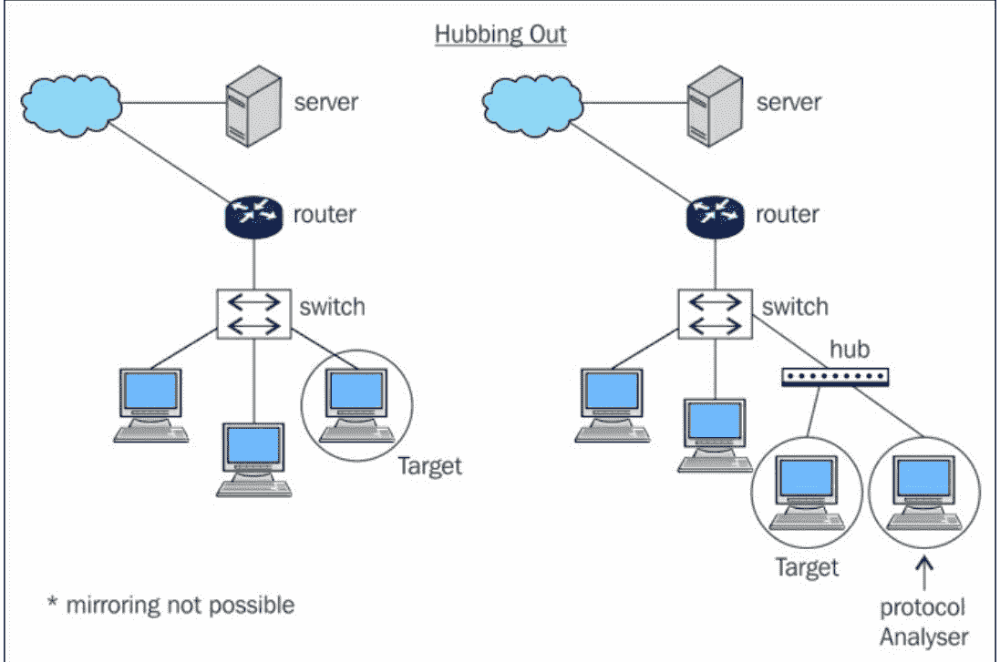

图 1.3：集线器分流

## ARP 欺骗

这是一种不道德的捕获网络流量的方式，我们试图在双方之间模仿另一台设备。例如，假设我们的默认网关位于 192.168.1.1，客户端位于 192.168.1.2。这两台设备都必须维护一个本地 ARP 缓存，以便它们在局域网内发送数据包时无需额外开销。现在的问题是，ARP 缓存中保存了什么类型的信息，以及以何种形式保存。让我告诉您，查看 ARP 缓存的命令是 `arp -a`，它会显示与特定 IP 地址关联的 MAC 地址。执行 `arp -a` 命令（该命令在大多数平台上都适用）后，会生成一个包含设备 IP 地址及其 MAC 地址的表格。请看下面的图，它展示了 ARP 欺骗的正常场景：

```
ARP 缓存（之前）

192.168.1.1 - (服务器)
192.168.1.2 - AA:BB:EE
192.168.1.3 - AA:BB:DD

192.168.1.2 - (客户端)
192.168.1.1 - AA:BB:CC
192.168.1.3 - AA:BB:DD

192.168.1.3 - (攻击者)
192.168.1.1 - AA:BB:CC
192.168.1.2 - AA:BB:EE
```

既然我们已经了解了 ARP 缓存中存储的内容，接下来让我们尝试欺骗它。

```
ARP 缓存（之后）

192.168.1.1 - (服务器)
192.168.1.2 - AA:BB:DD
192.168.1.3 - AA:BB:DD

192.168.1.2 - (客户端)
192.168.1.1 - AA:BB:DD
192.168.1.3 - AA:BB:DD

192.168.1.3 - (攻击者)
192.168.1.1 - AA:BB:CC
192.168.1.2 - AA:BB:EE
```

# 图 1.4：ARP 欺骗（正常场景）

现在您已经理解了 ARP 协议的重要性及其工作原理，我们可以尝试用攻击者的 MAC 地址来欺骗默认网关和客户端的 ARP 缓存。简单来说，我们将用攻击者的 MAC 地址替换默认网关 ARP 缓存中客户端的 MAC 地址。同样，我们也会在客户端中执行相同操作，用攻击者的 MAC 地址替换默认网关的 MAC 地址。因此，从默认网关发往客户端以及从客户端发往默认网关的每个数据包，都将被发送到攻击者的机器上。

如果攻击者已配置了端口转发，收到的数据包将被转发到真正的目的地址，而不会向客户端和默认网关透露任何数据包被嗅探的迹象。

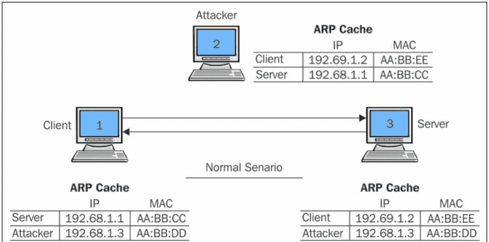

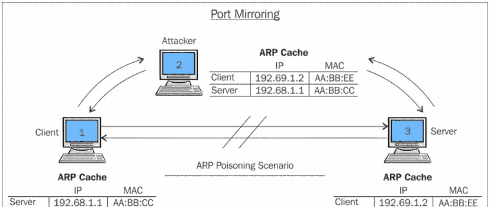

图 1.5：ARP 欺骗（被欺骗后的场景）

除了这两种技术之外，市场上还有各种硬件设备，通常称为分流器 (tap)，可以放置在任意两台设备之间来嗅探和分析流量。尽管在某些场景下这种技术能有效捕获网络流量，但应在受控环境中实践或部署，因为它可能对企业内部网络造成恶意影响。

## 穿越路由器

在处理路由环境时，数据包分析的主要方面是将嗅探器放置在正确的位置，以便从中收集所需信息。处理路由结构需要更多技能，因为有时您需要重新考虑嗅探器的放置位置。考虑一个包含三个路由器的路由环境：

路由器 1、路由器 2 和路由器 3 协同工作；每个路由器各连接 2-3 台 PC。路由器 1 充当根节点，控制其子网络节点（路由器 2 和路由器 3）。路由器 3 的客户端无法连接到路由器 1 的客户端。为了解决这个问题，组织的管理员已将嗅探器放置在路由器 3 区域内。

一段时间后，管理员收集了相当多的数据包，但仍然无法检测到网络中的异常。因此，他/她决定将嗅探器移动到网络中的另一个区域。将嗅探器放置在路由器 1 区域后，管理员看到了之前一直寻找的非常有用的数据包流。这是一个相当简单的移动嗅探器的示例，在某些情况下可能会有所帮助。关键在于，将嗅探器放置在您的网络基础设施中是一项非常重要的任务。

读完这些内容后，我希望您现在想看看 Wireshark 的实际界面，那么让我们来看一下该软件的图形用户界面，以及我们如何初始化网络数据包的捕获过程。

如果您尚未安装 Wireshark，可以从 https://www.wireshark.org/download.html 免费获取副本。要了解本书中的插图，您还需要熟悉该界面。


## 为什么使用 Wireshark？

我希望我不是唯一一个痴迷于 Wireshark 为我们带来的数据包捕获场景的简洁性的人。我将简要指出大多数人之所以青睐 Wireshark 而非其他嗅探器的原因：

- **用户友好**：对于我们所见过或用过的每一个 GUI，选项呈现得有多容易、使用起来有多方便，这一点确实很重要（我想，即使是那些不懂数据包分析的人，也可以在没有任何专业知识的情况下开始在 Wireshark 中捕获数据包）。
- **健壮性**：Wireshark 可以处理的信息量非常惊人；我这么说的实际意思是，这类软件在试图显示网络中传输的数据包时，可能会因为每秒捕获和显示的数千个数据包而挂起或崩溃。然而，Wireshark 不会——这要大大归功于 Wireshark 的创建者，他们把它构建得非常好。
- **跨平台**：是的，这一条绝对在列表上。这款免费软件可以安装在管理员如今用于计算目的的任何平台上，无论是基于 Linux、Windows 还是 Macintosh 的平台。
- **过滤器**：Wireshark 中有两种过滤选项：
  - 选择要捕获的内容（捕获过滤器）
  - 选择捕获后要显示的内容（显示过滤器）
- **成本**：Wireshark 是免费的，由一个专注的社区开发和维护。Wireshark 也提供一些付费的专业工具。更多详情请参阅 Wireshark 官网。
- **支持**：Wireshark 由一群遍布全球的贡献者非常积极地开发。我们可以注册 Wireshark 的邮件列表，或者通过 GUI 本身访问在线文档来获得帮助；还有各种在线论坛可供使用以获得最有效的帮助；要去 Google 搜索付费的 Wireshark 支持以了解更多信息。

## Wireshark 图形用户界面

在我们讨论它的强大功能之前，让我借此机会解释一下 Wireshark 的历史以及它是如何诞生的。

Wireshark 诞生于上世纪 90 年代末。来自堪萨斯城的年轻大学毕业生 Combs 开发了 Ethereal（Wireshark 的基础版本），而在他完成这一惊人发明时，他已经找到了一份工作，并签署了正式合同。服务几年后，Combs 决定辞职，并通过进一步开发 Ethereal 来追求自己的梦想。不幸的是，根据法律条款，Combs 的发明属于公司的专有软件。尽管如此，Combs 还是离开了工作岗位，开始开发 Ethereal 的新版本，并将其命名为 Wireshark。自 2006 年以来，Wireshark 一直在积极开发中，并在全球范围内使用。它支持当今实际部署的大多数协议（超过 800 种）。

### 安装过程

按照以下步骤在您的系统上安装 Wireshark：

- 1. 在本书中，我将使用 Mac 电脑；对于其他平台，安装过程是一样的。有些操作系统，如 Kali Linux，预装了 Wireshark。
- 2. 因此，如果你使用的是 Macintosh，首先需要下载 X11 Quartz（XQuartz-2.7.7），它将模拟一个运行 Wireshark 的环境（对于 Windows，只需下载与你的处理器兼容的相应可执行文件）。
- 3. 现在，你可以安装我们之前在本书中下载的 Wireshark（Wireshark 1.12.6 Intel 64）。
- 4. 两者都成功安装后，我们需要重启计算机。
- 5. 重启电脑后，启动 Wireshark。数据包分析器一打开，你就会看到 X11 服务器会自动启动。你无需担心它，只需让它留在后台即可。
- 6. 完全打开后，它将如下图所示：

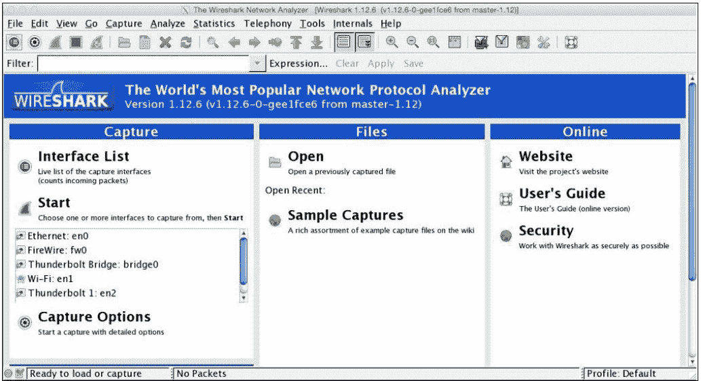

# 图 1.6：Wireshark 屏幕

在我们继续并开始第一次捕获之前，我们需要对可用的选项和菜单有所了解。

Wireshark GUI 中有六个主要部分，具体说明如下：

- **菜单栏**：这以通用形式表示组织在“应用程序”菜单中的工具。
- **主工具栏**：包含经常使用的工具，可以高效利用软件。
- **数据包列表窗格**：该窗口区域显示 Wireshark 捕获的各种数据包。
- **数据包详细信息窗格**：该窗口显示与数据包列表窗格中所选数据包相关的详细信息。例如，我们可以查看源 IP 地址和目的 IP 地址，以及用于通信的不同协议，这些协议按自下而上的方式（从链路层到应用层）排列。数据包信息按不同的协议类别列出，可展开以获取所选数据包的更多详细信息。
- **字节窗格**：该窗格以十六进制字节及其 ASCII 字符的形式显示数据包中的数据。
- **状态栏**：显示已捕获数据包总数等详细信息。

下面的截图将帮助你识别应用程序中的不同部分，请在继续阅读后续章节之前确保自己熟悉所有这些部分。

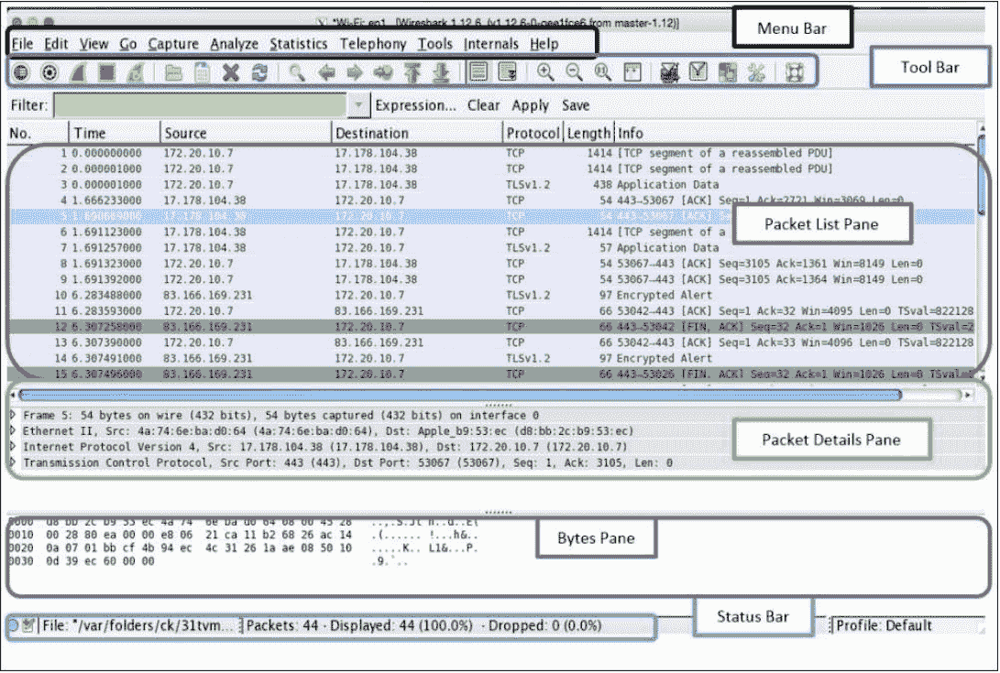

在工具栏区域，我们有一些有用的工具。我想简要介绍其中一些：

- ：这让你可以选择要监听的接口
- ：通过它，你可以自定义捕获过程
- [开始/停止/重新启动图标]：这些用于开始/停止/重新启动捕获过程
- [打开图标]：用于打开已保存的捕获文件
- [保存图标]：用于将当前捕获保存到文件中
- [重新加载图标]：用于重新加载当前捕获文件
- [关闭图标]：用于关闭当前捕获文件
- [后退图标]：用于返回最近访问过的数据包
- [前进图标]：此图标用于前进到最近访问过的数据包
- [跳转到数据包图标]：用于转到特定的数据包编号
- [颜色编码切换图标]：打开/关闭数据包的颜色编码
- [自动滚动切换图标]：用于打开/关闭自动滚动
- [缩放图标]：用于放大、缩小和重置缩放为默认值
- [颜色编码配置图标]：用于根据需求更改颜色编码
- [数据包过滤器图标]：用于缩小窗口范围以捕获数据包
- [图标]：这用于配置显示过滤器，只查看所需内容

即使选择了可用的接口，有时你也无法在数据包列表窗格中看到任何数据包。造成这种情况的原因可能有很多，其中一些列举如下：

- 你没有任何网络流量
- 网络中传输的数据包不是发往你的设备的
- 你没有激活混杂模式，或者没有混杂模式的选项

启动 Wireshark 应用程序后，你会看到类似下面的截图出现在屏幕上。虽然第一眼看上去并不那么有趣，但让它有趣的是那些正在流动的数据包。是的，我指的就是捕获数据包。

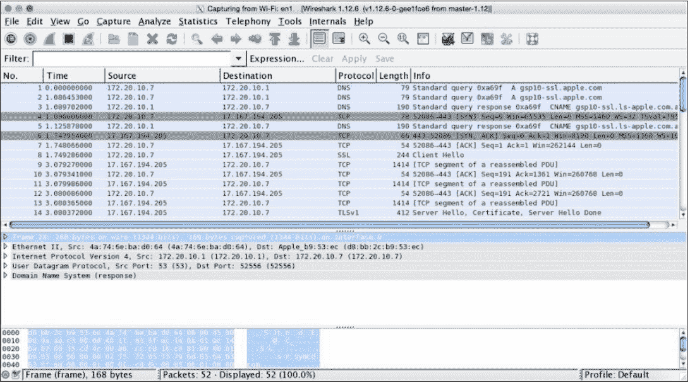

图 1.7：Wireshark 捕获屏幕

## 开始我们的第一次捕获

既然你已经了解了 Wireshark 的基础知识，并且学会了如何安装 Wireshark，我认为你已经准备好开始你的第一次捕获了。我将通过以下一系列步骤指导你开始/停止/保存你的第一次 Wireshark 捕获：

- 1. 打开 Wireshark 应用程序。
- 2. 选择一个要监听的接口。

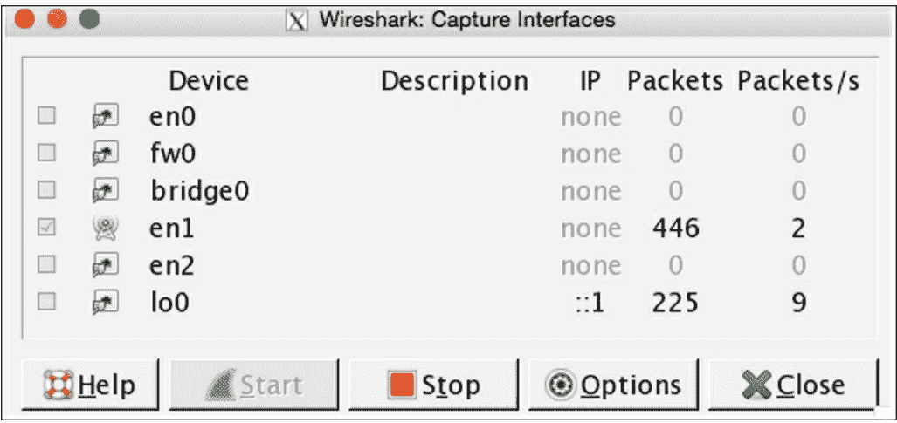

图 1.8：接口窗口

- 3. 在点击“开始”之前，我们有“选项”按钮，它给了我们自定义捕获过程的优势；但到目前为止，我们将使用默认配置。

# 提示

确保激活了混杂模式，这样我们就能捕获不是发往我们机器的流量。


**图 1.9：** 捕获自定义屏幕

4. 点击开始按钮以启动捕获过程。
5. 打开你的浏览器。
6. 访问你想要的任何网站。

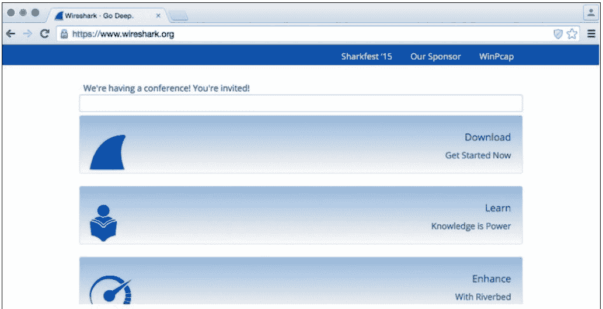

**图 1.10：** Wireshark 网站

7. 切回 Wireshark 屏幕；如果一切顺利，你应该能在 Wireshark GUI 的数据包列表窗格内看到大量正在被捕获的数据包。

要停止捕获，你只需点击工具栏区域中的停止捕获按钮，或点击 **捕获** 菜单栏下的 **停止**。

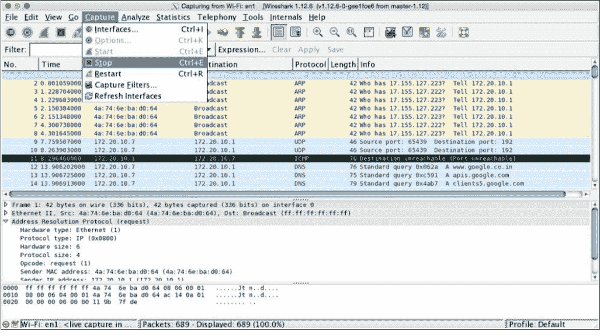

**图 1.11：** 停止捕获

8. 我知道到现在你会看到大量的信息，但不用担心。我在这里是为了让你简单化。
9. 数据包分析的真正过程始于你捕获了数据包——我的意思是数据包过滤。我们将在即将到来的章节中详细讨论数据包过滤。
10. 现在，最后一步是为以后使用保存捕获文件：

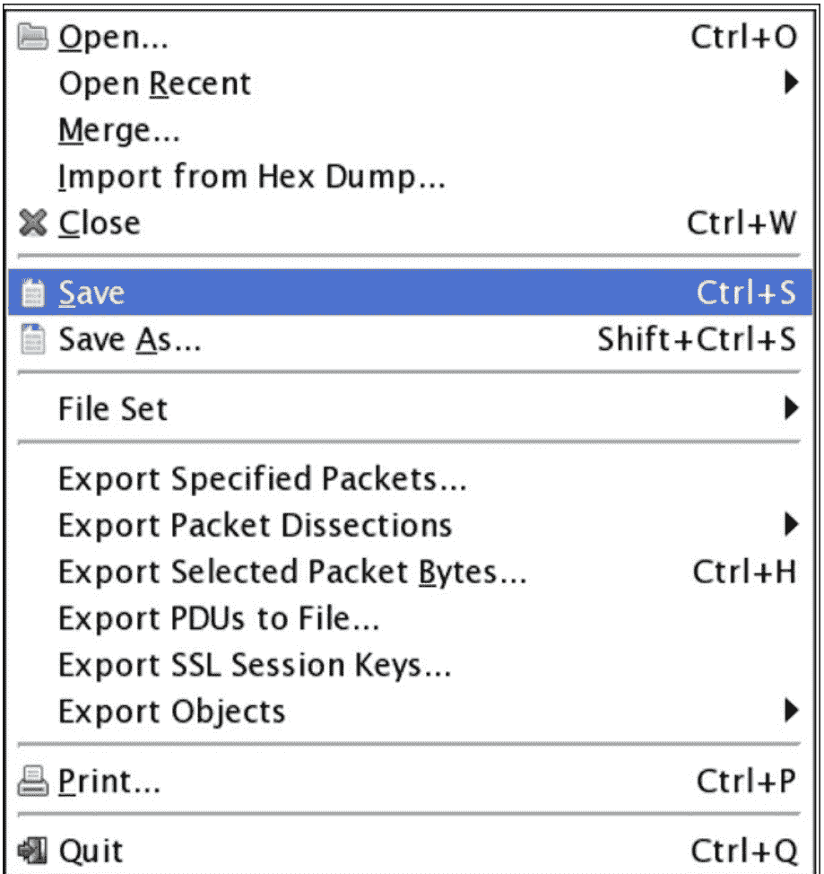

11. 使用默认的 .pcapng 扩展名将你的文件保存在你的文件夹中。

如果你已经读完所有步骤到这里，我鼓励你创建你的第一个捕获文件。

## 摘要

本章奠定了基础网络概念的基础，并介绍了 Wireshark GUI。Wireshark 是一种协议分析器，被全球的 IT 专业人员用于捕获和分析网络层数据包。

TCP/IP 模型有四层：应用层、传输层、网络层和链路层。数据在从一层传递到另一层时会被封装；底部产生的最终数据包称为完整的 PDU，它实际上在信道上传输。

要安装 Wireshark，你只需访问 http://www.wireshark.org 然后下载此开源软件的适当版本。Wireshark 社区由现实世界的极客管理；这可以成为学习和故障排除的好来源。

Wireshark GUI 用户友好、功能强大且平台独立；即使是新的 IT 专业人员也能轻松适应该工具。

协议分析的一个重要方面是将嗅探器放置在正确的位置；每个组织的架构都不同，我们可能需要应用不同技术以获取正确的数据包来使用。

Hubbing out、端口镜像、ARP 欺骗和窃听是一些可用于在不同情况下监控和分析流量的有用技术。

Wireshark 工具窗口共有六个主要部分：菜单栏、主工具栏、数据包列表窗格、数据包详细信息窗格、字节窗格和状态栏。

在数据包分析场景中使用后退/前进键会非常有用。应该了解主工具栏区域显示的所有工具。

在下一章中，你将学习如何在 Wireshark 中使用不同类型的过滤器。

### 练习题

1. **Q.1** TCP/IP 中有多少层？请列出它们。
2. **Q.2** TCP/IP 模型中哪一层处理第 2 层地址？
3. **Q.3** 链路层也称为？
4. **Q.4** HTTP 协议使用 TCP 还是 UDP？
5. **Q.5** IP、ICMP 和 __________ 是互联网层中的协议。
6. **Q.6** 你知道 Wireshark 窗口有多少个部分？
7. **Q.7** ARP 是第 3 层协议——真/假？
8. **Q.8** TCP 协议是否遵循三次握手？
9. **Q.9** 端口镜像技术只能通过交换机实现——真/假？
10. **Q.10** Hubbing out 技术使用路由器将一台 PC 与其对等设备隔离——真/假？
11. **Q.11** TCP 是不可靠的协议——真/假？
12. **Q.12** 安装 Wireshark 并使用你的无线接口开始一次示例捕获。将你的捕获文件保存在桌面上，名称为 `first.pcap`，并关闭 Wireshark。
13. **Q.13** 在 Wireshark 中打开你的 `first.pcap` 捕获文件并检查你总共捕获了多少个数据包。
14. **Q.14** 哪个窗格以 HEX 和 ASCII 形式显示我们捕获的每个数据包的信息？
15. **Q.15** 从捕获选项窗口关闭混杂模式，并观察你是否仍能从其他设备接收数据包。
