## 第 2 章. 在 Wireshark 中过滤

本章将讨论 Wireshark 中可用的不同过滤选项，即捕获过滤器和显示过滤器。我们还将了解如何创建和使用不同的配置文件。以下是本章将涵盖的主题：

- 捕获过滤器的介绍
- 为什么以及如何使用捕获过滤器
- 实验——捕获过滤器
- 显示过滤器的介绍
- 为什么以及如何使用显示过滤器
- 实验——显示过滤器
- 彩色化流量
- 创建新的 Wireshark 配置文件
- 实验——配置文件

我希望你准备好使用 Wireshark 中存在的不同过滤选项来分析数据包，并重用我们在用户定义配置文件中之前创建的过滤器。我将指导你使用一种技术，根据某些表达式过滤数据包，我们将使用可用的不同原语创建这些表达式。

在我们继续创建出色的过滤器之前，我想提到另一个用于查找数据包的有趣工具：查找实用程序。

### 过滤器的介绍

在 Wireshark 的世界里，有两种过滤器可以用于实时流量和已保存的捕获文件。过滤器增强了数据包分析的灵活性，其中特定用户被赋予查看他/她想要查看的内容以及捕获他们想要捕获内容的特权。

这两种过滤器是捕获过滤器和显示过滤器。现在，让我们详细看看它们中的每一个。

### 捕获过滤器

这使你能够捕获你想要捕获的内容——其他内容将被丢弃。捕获数据包是一项处理器密集型任务，Wireshark 也会占用相当多的主内存。因此，有时我们需要为其他进程节省资源，这些资源可用于分析数据包，在某些情况下，我们只想捕获符合我们表达式的数据——其余的将被丢弃。

Wireshark 提供了一些有趣的选项来配置接口，它将捕获仅符合特定表达式的流量，这可以通过 **捕获选项** 窗口实现，如以下屏幕截图所示：

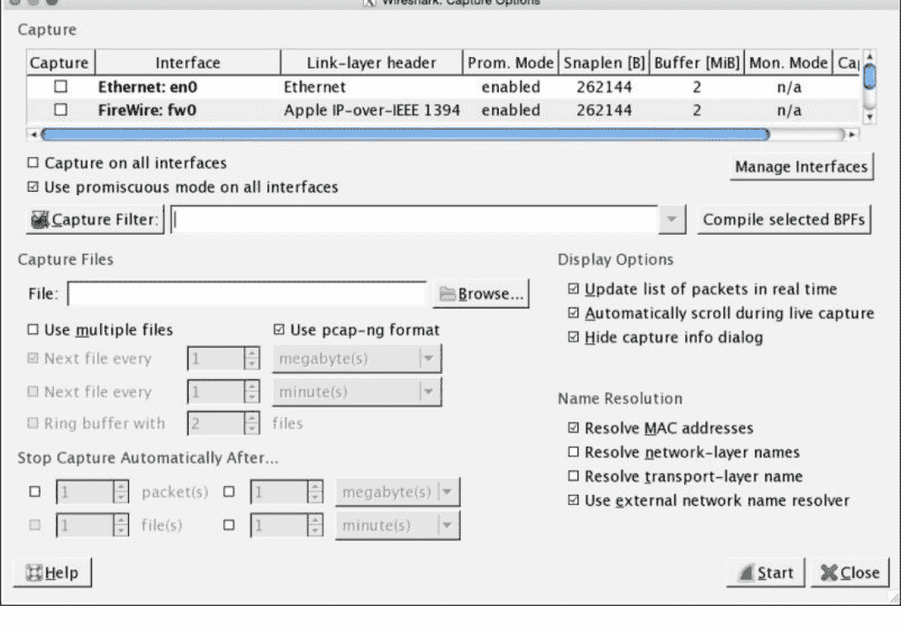

**图 2.1：** 捕获选项对话框

这里，以下要点列出了各种捕获选项对话框相关细节：

- **捕获**：在此窗口中，你可以选择要从中捕获数据包的接口，甚至可以同时选择多个接口以监听所有接口。每个接口的详细信息列在单独的列下，例如 **捕获**、**接口**、接口名称、是否启用混杂模式等。在 **捕获** 对话框下，你会看到一个复选框来切换混杂模式，你甚至可以选择 **在所有接口上启用混杂** 选项，以便只需一次点击即可激活你所需的功能。
- **管理接口**：此按钮便于添加或删除新的监听接口。你甚至可以添加远程机器接口，在这种情况下，你需要具有 root 级别权限。
  - **捕获过滤器**：点击此 **捕获过滤器** 按钮后，你将能够看到类似此处所示的对话框。已配置的捕获过滤器默认列出，在这里，我们也可以创建和保存自定义捕获过滤器。

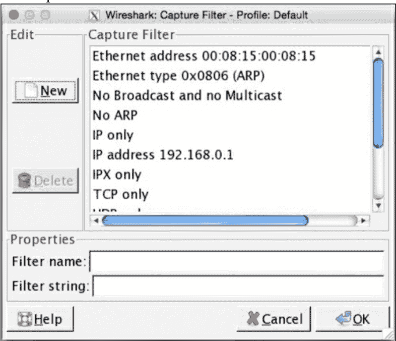

**图 2.2：** 默认捕获过滤器


首先，用户可以使用这些默认的过滤配置文件，了解如何创建自定义过滤字符串。一旦你熟练掌握了基础知识，就可以继续使用同一个窗口创建自己的自定义过滤器，但务必确保你遵循了**伯克利数据包过滤（BPF）**语法。BPF 语法是一种行业标准，被多种协议分析器使用，这使得你的过滤器配置文件具有可移植性。

让我们一起来创建一个过滤器，以便更好地掌握它；考虑这样一个场景：我们需要捕获位于 `192.168.1.1`（将此 IP 地址更改为你所监控的 Web 服务器的地址）的 Web 服务器发出的数据包，然后按照以下步骤操作：

- 1. 打开**捕获选项**对话框。
- 2. 点击**捕获过滤器**。
- 3. 点击**新建**。
- 4. 在**过滤器名称**文本框中写入 `Web server 192.168.1.1`。
- 5. 在过滤器字符串文本框中写入 `host 192.168.1.1 and port 80`。

## Wireshark：捕获过滤器 - 配置文件：默认

### 编辑

### 捕获过滤器

- - 仅 IPX
- - 仅 TCP
- - 仅 UDP
- - TCP 或 UDP 端口 80（HTTP）
- - HTTP TCP 端口（80）
- - 无 ARP 且无 DNS
- - 与 www.wire 之间的非 HTTP 和非 SMTP 流量
- - Web 服务器 192.168.1.1

新建

删除

### 属性

过滤器名称：Web 服务器 192.168.1.1

过滤器字符串：host 192.168.0.1 and port 80

帮助

取消

确定

6. 完成上述操作后，点击**确定**；如果一切输入正确，捕获过滤器按钮旁边的文本框将显示为绿色背景，如下面的截图所示：

捕获过滤器：host 192.168.0.1 and port 80

图 2.4：创建示例捕获过滤器

- - **捕获文件**：此选项使你能够灵活地将捕获的数据包保存到系统中已存在的文件中。如果你不选择任何文件，捕获的数据包将被添加到你所选的文件中。系统将创建一个临时文件，并将数据写入其中，之后可以将其保存到用户指定的位置。为此，请写入使用绝对路径引用的文件名，或点击**文件**文本框旁边的**浏览**来选择位置。

如果选择多个文件选项，则可以将数据包保存到多个文件中，此时我们可以自定义更多选项，具体如下：

- - **下一个文件每隔**：在捕获一定量的数据后，Wireshark 将创建一个新文件，并将你的数据添加到其中。例如，我希望在 Wireshark 捕获 2 MB 数据后创建一个新文件。
- - **下一个文件每隔**：经过一定时间后，Wireshark 将创建一个新文件，并将你的数据包添加到其中。例如，我希望在捕获过程每进行 5 分钟后创建一个新文件。
- - **环形缓冲区**：使用此选项，你可以限制新文件的创建。Wireshark 使用**先进先出（FIFO）**选项将数据写入多个文件集。例如，你已经选择了**环形缓冲区**选项，并将文件数增加到 5，并且配置了每捕获 5 MB 数据就创建一个新文件。

现在，根据此配置，一旦你开始捕获数据包，每捕获 5 MB 数据，就会创建一个新文件并将数据包写入其中。一旦超过了你在**环形缓冲区**区域中指定的限制，Wireshark 将不再创建新文件，而是会回退到第一个文件并向其追加数据。下面的截图显示了类似的配置：

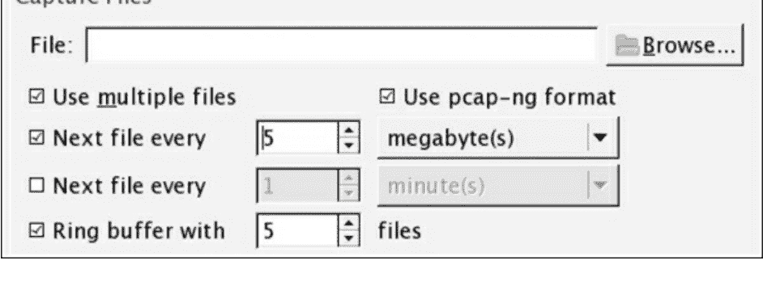

图 2.5：捕获文件选项

- - **停止捕获设置**：此选项允许你在触发特定条件后停止捕获过程；我们有四种不同类型的触发器。激活这些触发器可以阻止 Wireshark 捕获新的数据包，具体如下：

- - **数据包**：在达到特定数据包数量后停止捕获。
- - **文件**：在创建一定数量的文件后停止捕获。
- - **兆字节**：在捕获一定量的数据后停止捕获。
- - **分钟**：在运行一定时间后停止捕获。

你可能想问一个问题：如果我们同时选择多个选项会怎样？比如，如下图所示。

你可以同时激活多个选项；Wireshark 将在满足任一条件时立即停止捕获。

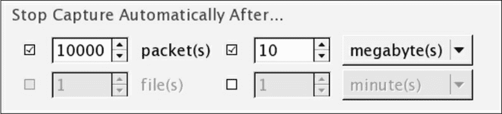

图 2.6：停止捕获选项

- - **显示选项**：此部分中有几个选项可用来限制数据包及其相应信息在**数据包列表窗格**选项和**协议分级**窗口中的显示方式。请参阅下图。

如果选择**实时更新数据包列表**，你将观察到**数据包列表窗格**会在 Wireshark 捕获到新数据包时立即更新，并且窗格会自动向上滚动。根据需要选择这些选项；否则，这两个任务所占用的资源可用于其他进程。

如果勾选**隐藏捕获信息对话框**复选框，显示统计信息（以百分比表示）的**协议分级**窗口将被隐藏。如果你没有特定用途，我建议你取消勾选所有这些选项。

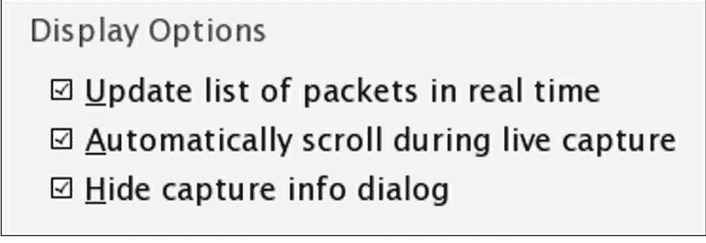

图 2.7：显示选项

- - **名称解析**：如果选中，此功能可以将第 2 层、第 3 层和第 4 层地址解析为对应的名称；为了更好理解，请参阅下面的截图：

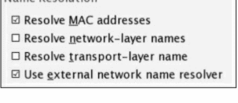

图 2.8：名称解析

## 为什么使用捕获过滤器

当周围有大量数据包流动时，只捕获满足你需求的流量非常有用。在分析生产环境时，创建自定义捕获过滤器会非常方便。捕获过滤器在实际捕获过程开始之前应用。通常，Wireshark 捕获的每个数据包都会传递给捕获引擎，以便将其转换为人类可理解的格式，但如果你应用了捕获过滤器，Wireshark 将丢弃不符合你表达式的数据包。所有被丢弃的数据包都不会传递给捕获引擎。相比之下，显示过滤器更加具体和强大；在使用捕获过滤器时，你应该小心，因为不符合你所创建表达式的数据包一旦被丢弃，就无法恢复。

**伯克利数据包过滤器（BPF）**语法用于创建捕获过滤器，并且多种协议分析器也使用它，从而保持了行业标准。学习和练习起来都相当容易，只需使用基本格式来构建表达式即可。

## 如何使用捕获过滤器

使用前面提到的 BPF 语法，我们通过捕获过滤器对话框创建了一个简单的捕获过滤器；让我们详细讨论一下，因为了解 BPF 非常重要，它被多种分析器使用。

如果你使用 BPF 语法，则必须遵循特定的格式结构，该结构由两个参数组合而成：标识符和限定符，具体说明如下：

- - **标识符**：这是你希望在数据包中查找的值。例如，如果你要过滤某个 IP 地址的数据包，那么你的捕获过滤器将类似于 `host 192.168.1.1`，其中值 `192.168.1.1` 是标识符。
- - **限定符**：限定符分为三个不同的类别：
  - - **类型**：类型限定符有三种：`host`、`port` 和 `net`。简而言之，类型限定符指的是你的标识符所指向的名称或数字。例如，在你的 `host 192.168.1.1` 过滤器中，`host` 就是类型限定符。
  - - **方向**：有时，当你需要从特定目的地或源捕获数据包时，我们也可以指定方向限定符。例如，在 `src host 192.168.1.1` 捕获过滤器中，`src` 指定我们仅捕获来自特定主机的数据包。同样，如果你指定 `dst host 192.168.1.1`，则只会捕获发往 `host 192.168.1.1` 的数据包。
  - - **协议**：这指的是协议限定符，它使我们能够指定要在表达式中包含的特定协议，用于捕获目的。例如，如果你想捕获来自你的主机 `192.168.1.1` 的 `http` 流量，那么你的表达式将类似于 `src host 192.168.1.1 and tcp port 80`。

在前面的示例中，我们使用连接运算符（&/and）将两个表达式组合在一起。类似地，我们还有选择运算符（|/or）和否定运算符（!/not），可以用来组合并创建复杂的过滤器。

例如，根据我们之前创建的过滤器 `src host 192.168.1.1 and tcp port 80`，所有源自 `192.168.1.1` 且发往端口 80 的数据包都将被捕获。

如果你在 `src host 192.168.1.1` 和 `tcp port 80` 之间添加 `or` 运算符，那么


## 一个示例捕获过滤器

虽然 Wireshark 本身提供了多种过滤器，可以让你对 BPF 语法有一个概览，但要访问默认提供的过滤器，请前往**捕获 | 捕获过滤器**，或点击主工具栏中的**捕获选项**按钮，然后点击**捕获过滤器**。在同一个窗口中，我们还可以选择创建新过滤器，这一点我们已经讨论过了。

请参考下表了解示例捕获过滤器：

| 过滤器 | 描述 |
|---|---|
| host 192.168.1.1 | 与主机 192.168.1.1 关联的所有流量 |
| port 8080 | 与端口 8080 关联的所有流量 |
| src host 192.168.1.1 | 源自主机 192.168.1.1 的所有流量 |
| dst host 192.168.1.1 | 发往主机 192.168.1.1 的所有流量 |
| src port 53 | 源自端口 53 的所有流量 |
| dst port 21 | 发往端口 21 的所有流量 |
| src 192.168.1.1 and tcp port 21 | 源自 192.168.1.1 且与端口 21 关联的所有流量 |
| dst 192.168.1.1 or dst 192.168.1.2 | 发往 192.168.1.1 或发往主机 192.168.1.2 的所有流量 |
| not port 80 | 与端口 80 无关的所有流量 |
| not src host 192.168.1.1 | 非源自主机 192.168.1.1 的所有流量 |
| not port 21 and not port 22 | 与端口 21 或端口 22 无关的所有流量 |
| tcp | 所有 TCP 流量 |
| Ipv6 | 所有 IPv6 流量 |
| tcp or udp | 所有 TCP 或 UDP 流量 |
| host www.google.com | 所有进出 Google IP 地址的流量 |
| ether host 07:34:aa:b6:78:89 | 与指定 MAC 地址关联的所有流量 |

### 注意

了解 BPF 语法至关重要。当你更深入地使用 Wireshark 时，你会感受到它的重要性。我建议你在熟悉语法后练习一次。

## 使用协议头值的捕获过滤器

捕获过滤器可以根据协议头字段中的偏移值来创建。创建此类过滤器的语法类似于 `proto[offset:size(optional)]=value`。其中，`proto` 是你要过滤的任何协议，`offset` 是对应值在头部中的位置，`size` 是你所查找数据的长度，`value` 是你要查找的数据。

例如，假设我们只想捕获 ICMP 回复包；现在，如果你观察下面的图，会注意到 ICMP 头部类型位于第一个位置，偏移计数从 0 开始。因此，在这种情况下偏移值为 0，该字段大小为 1 字节。我们已经拥有了创建捕获过滤器所需的全部信息，所以最终表达式将类似于 `icmp[0:1]=0`。

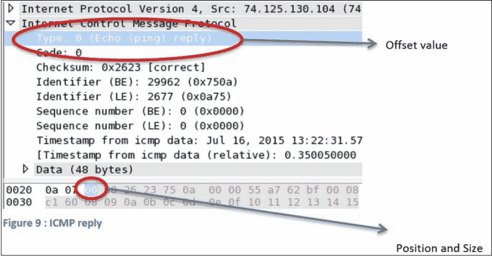

图 2.9：ICMP 回复

让我们尝试在 Wireshark 中应用相同设置；然后我们会 ping www.google.com 来检查它是否有效。


图 2.10：ICMP 捕获过滤器

让我们 ping www.google.com，看看它是否有效。

```
charits-MacBook-Pro:~ NotFound$ ping www.google.com
PING www.google.com (74.125.130.104): 56 data bytes
64 bytes from 74.125.130.104: icmp_seq=0 ttl=40 time=350.085 ms
64 bytes from 74.125.130.104: icmp_seq=1 ttl=40 time=559.549 ms
64 bytes from 74.125.130.104: icmp_seq=2 ttl=40 time=282.911 ms
64 bytes from 74.125.130.104: icmp_seq=3 ttl=40 time=420.467 ms
64 bytes from 74.125.130.104: icmp_seq=4 ttl=40 time=311.638 ms
64 bytes from 74.125.130.104: icmp_seq=5 ttl=40 time=539.921 ms
```

图 2.11：浏览 google.com

因此，Wireshark 将只捕获 ICMP 回复包。使用同样的技术，你可以根据协议头值过滤流量：

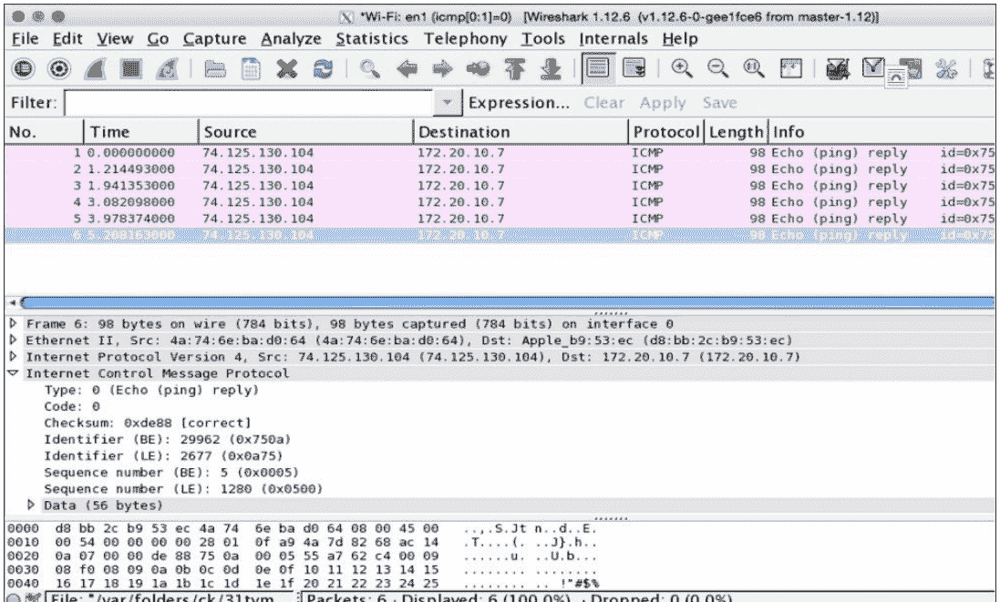

下表列出了一些基于字节的 TCP 和 ICMP 捕获过滤器示例；也请尝试练习一下：

| 过滤器 | 描述 |
|---|---|
| icmp[0] = 0 | ICMP 请求包 |
| icmp[0:1] = 8 | ICMP 回复包 |
| icmp[0:1] = 3 | ICMP 目标主机不可达包 |
| tcp[13] = 2 | 仅 TCP SYN 标志包 |
| tcp[13] = 18 | 仅 TCP SYN/ACK 标志包 |
| tcp[13] = 32 | 仅设置了 TCP URG 标志的包 |

## 显示过滤器

与捕获过滤器相比，显示过滤器更加灵活和强大。显示过滤器不会丢弃任何数据包；相反，数据包会被隐藏，以便于查看。丢弃数据包并不是一种非常有效的做法，因为一旦数据包被丢弃，就无法恢复。当你应用显示过滤器时，只会显示符合过滤器规范的数据包。在 Wireshark 窗口状态栏的第二列中，应用过滤器后你会看到显示的数据包数量。

在**数据包列表窗格**上方的**过滤器**对话框中，可以对捕获文件使用显示过滤器。显示过滤器比捕获过滤器更受欢迎。显示过滤器所使用的语法可以轻松地调整和应用。对于新用户来说，显示过滤器就像一种超能力，让你能够在运行时隐藏那些不符合当前场景需求的数据包。

显示过滤器可以基于多种不同的约束条件创建，例如 IP 地址、协议、端口号以及特定协议中的头部值。有大量的条件工具和连接运算符可以用来创建复杂的表达式。你可以组合不同的表达式集合，以得到我们正在寻找的更具体的数据包集合。**数据包列表窗格**中显示的每一个数据包都可以根据数据包包含的字段进行过滤。

显示过滤器不会删除数据；相反，数据包会被隐藏，一旦清除列表窗格上方**过滤器**对话框中的过滤器，它们就会再次可见。例如，要仅显示 ICMP 数据包，只需在过滤器对话框中输入 `ICMP`，然后点击**应用**；这真的很简单，不是吗？如果你想再次查看所有数据包，只需点击**清除**按钮，一切就会恢复正常。

Wireshark 有一个非常棒的功能，可以在你创建过滤器时提供帮助。只需点击**过滤器**对话框末尾的**表达式**按钮，选择要过滤的协议，如果有值的话再指定该值。

使用**过滤器表达式**对话框真的很容易，如果你是初学者，这对你来说是一大福音。让我们学习如何使用表达式对话框。


### 图 2.12：过滤器表达式

- 1. 如前面的截图所示，点击“表达式”按钮。
- 2. 此时，你将看到一个“表达式”窗口，如下面的截图所示：

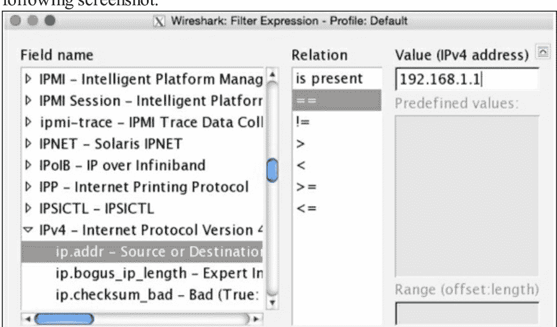

- 3. 例如，如果你只想查看与 ip:192.168.1.1 关联的数据包，只需在“字段名称”中向下滚动找到 IPv4，然后展开该部分并选择 ip.addr 选项。
- 4. 然后，在旁边的“关系”框中，选择要添加到表达式中的运算符。
- 5. 最后，在“值（IPv4 地址）”框中写入你要查找的 IP。
- 6. 最后，只需点击“确定”。如果你正确完成了以上所有步骤，你将能够看到来自你所指定 IP 的数据包（将 192.168.1.1 改为你的 IP 地址）。
- 7. 在“值”框下方有一个“预定义值”框，当某个协议限制我们只能使用一组特定的值时，就会用到它。你可以在这里选择一个值。
- 8. 在“预定义值”框下方有一个“范围”框，如果协议允许，我们可以输入一个值范围，例如 1-78、0-5、120-255。

这是创建显示过滤器最简单的方法之一；还有另一种方法也可以创建此类过滤器。手动输入过滤器可以极大地提高你的工作效率，但这需要比新手用户更多的技巧。

在我们开始深入手动创建过滤器之前，我想让你了解一些其他内容，例如比较运算符和逻辑运算符。它们可以用来为 Wireshark 创建简单乃至最复杂的过滤器。

下表列出了用于创建显示过滤器的比较运算符：

| 运算符 | 描述 |
|---|---|
| ==/eq | 等于 |
| !=/ne | 不等于 |
| </lt | 小于 |
| <=/le | 小于等于 |
| >/gt | 大于 |
| >=/ge | 大于等于 |

接下来，让我们看看用于将不同条件组合在一起的逻辑运算符。下表列出了所有这些运算符：

| 运算符 | 描述 |
|---|---|
| AND/&& | AND 逻辑运算符用于我们希望表达式的两个部分都为真时。例如，ip.src==192.168.1.1 and tcp 过滤器只会显示源自 IP 192.168.1.1 且与 TCP 协议关联的数据包。只有匹配这两个表达式的数据包才会显示。 |
| OR/\|\| | OR 逻辑运算符用于当我们一次只关注一个条件为真时；即使两个条件都为真，那也没关系。例如，port 53 or port 80 过滤器会显示所有与 |


## 保留过滤器以备后用

有时候，你会遇到这样的需求：能够访问之前创建的过滤器会让你的工作变得既简单又快捷。Wireshark 提供了这样的功能，你可以通过保存的名称来保留显示过滤器，并在以后需要时随时使用。此选项将为你节省大量输入复杂显示过滤器所需的时间和精力。要为自己创建一个，请按照以下步骤操作：

- 1. 转到 **分析 | 显示过滤器**；这将为你打开一个窗口，如下面的截图所示：

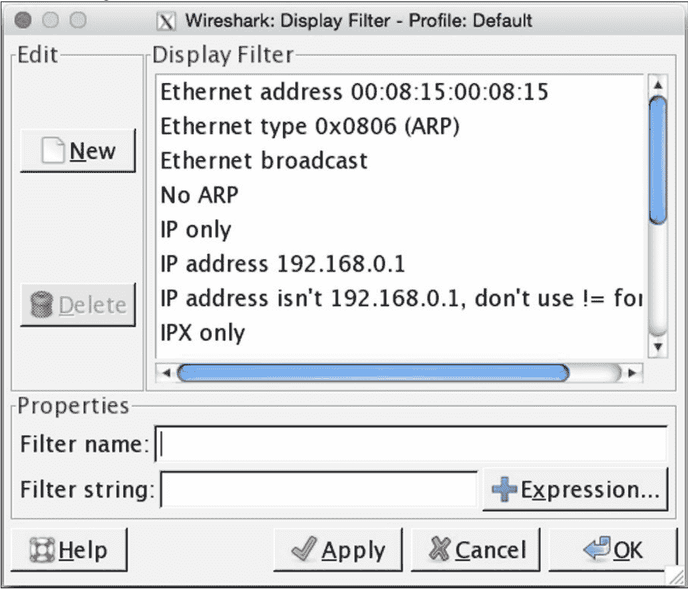

图2.13：添加显示过滤器

## 使用查找对话框搜索数据包

如果你想根据特定条件查找数据包，可以使用“查找”对话框。它提供了几种有用的搜索技术，可以轻松有效地应用于已捕获的文件或实时运行的捕获。你可以通过导航到 **编辑 | 查找数据包** 或使用快捷键 Ctrl + F 来访问查找工具。

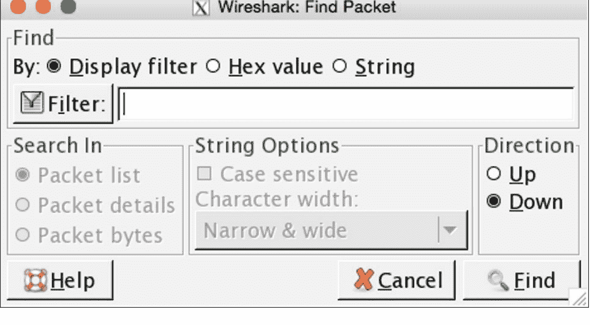

图2.15：查找数据包对话框

让我们看看其中一些可配置的选项：

- **显示过滤器**：捕获流量后，在分析时，如果你只想查看基于特定 IP/端口/协议的某些特定数据包，那么满足特定条件的数据包将显示在列表中，例如：
  - `The ip.addr == 192.168.1.1`（基于 IP 地址）
  - `The port 8080`（基于端口号）
  - `http`（基于协议）
- **十六进制值**：如果你正在查找的某个数据包有十六进制值，则可以选此选项。只需输入用冒号分隔的物理地址，例如：
  - `0A:C4:22:90:45:00`
  - `AA:BB:CC`

**字符串**：下一个也是最后一个选项是基于文本字符串的搜索，你可以输入 DNS 服务器名称、机器名称以及任何你已知的已解析名称（输入任何字符串或单词），例如：

- Cisco
- 管理员
- Web 服务器
- Google

**搜索范围**：此功能使我们能够在特定窗格中搜索。例如，如果你正在 **字节** 窗格中查找与值 **Google**（将与数据包字节窗格中的 ASCII 值匹配）相匹配的数据包，那么我们可以继续，首先选择 **字符串** 选项，然后勾选 **搜索范围** 复选框并选择 **数据包字节**。

**字符串选项**：要使用此功能，首先选择 **字符串** 选项，然后选择 **区分大小写**，然后如果需要，还可以选择字符宽度（但我建议除非你有特定原因，否则不要更改此设置）。

- **方向**：最后一个选项更改搜索方向；你可以将其更改为向上或向下。

一旦你自定义了选项，输入文本并点击 **查找**。这将给你第一个符合条件的确切捕获。要在匹配的数据包之间来回移动，可以使用 Ctrl + N（下一个）和 Ctrl + B（上一个）。

## 为流量着色

为了获得更好、更便捷的查看体验，Wireshark 为我们提供了一项功能，我们可以为想要突出显示的特定类型的流量着色。流量着色的目的是区分不同的流量集合。使用不同于默认规则的颜色来标记特定的流量集合，就像大海捞针一样。

大多数协议的默认配置文件已经创建，因此我们能够在数据包列表窗格中以不同颜色看到流量。你可以通过导航到 **视图 | 编辑着色规则** 或单击主工具栏上的 **编辑着色规则** 按钮来打开一个窗口，如下面的截图所示：

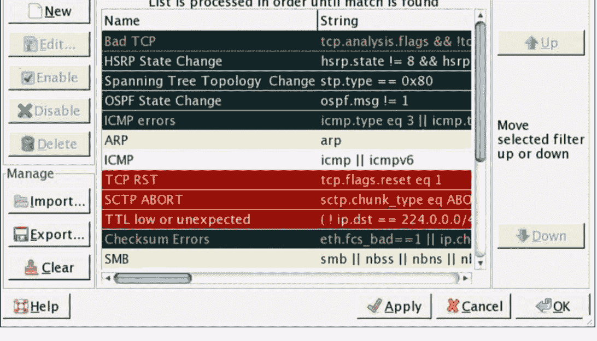

当前作为全局配置文件的一部分保存的、用于以特定前景色和背景色为流量着色的所有规则都会列在此对话框中。每个

图2.17：运行在 172.16.136.1 上的 Web 服务器

来自 Linux 访问 Web 服务器的正常流量如下图所示：

| 编号 | 时间 | 源 | 目的 | 协议 | 长度 | 信息 |
|---|---|---|---|---|---|---|
| 1 | 0.00000000 | 172.16.136.129 | 172.16.136.1 | TCP | 60 | 55658-80 [SYN] Seq=0 Win=2920 |
| 2 | -0.950618696.077286000 | 172.16.136.1 | 172.16.136.129 | TCP | 64 | 80-55658 [SYN, ACK] Seq=0 Ack |
| 3 | -2021440336.836621000 | 172.16.136.129 | 172.16.136.1 | TCP | 52 | 55658-80 [ACK] Seq=1 Ack=1 |
| 4 | -1898165200.561362000 | 172.16.136.1 | 172.16.136.129 | TCP | 52 | [TCP Window Update] 80-55658 |
| 5 | 41863044.612094000 | 172.16.136.129 | 172.16.136.1 | HTTP | 355 | GET /xampp/ HTTP/1.1 |
| 6 | 0.001038000 | 172.16.136.1 | 172.16.136.129 | TCP | 52 | 80-55658 [ACK] Seq=1 Ack=304 |
| 7 | 0.084997000 | 172.16.136.1 | 172.16.136.129 | HTTP | 940 | HTTP/1.1 200 OK (text/html) |
| 8 | 0.085422000 | 172.16.136.129 | 172.16.136.1 | TCP | 52 | 55658-80 [ACK] Seq=304 Ack=88 |
| 9 | 381882809.099438000 | 172.16.136.129 | 172.16.136.1 | HTTP | 400 | GET /xampp/head.php HTTP/1.1 |
| 10 | 0.106560000 | 172.16.136.1 | 172.16.136.129 | TCP | 52 | 80-55658 [ACK] Seq=889 Ack=65 |
| 11 | -1437096632.910449000 | 172.16.136.129 | 172.16.136.1 | TCP | 60 | 55659-80 [SYN] Seq=0 Win=2920 |
| 12 | -950618696.095408000 | 172.16.136.1 | 172.16.136.129 | TCP | 64 | 80-55659 [SYN, ACK] Seq=0 |
| 13 | -136085583.409139000 | 172.16.136.129 | 172.16.136.1 | TCP | 52 | 55659-80 [ACK] Seq=1 Ack=1 Wi |
| 14 | -1321431987.061550000 | 172.16.136.1 | 172.16.136.129 | TCP | 52 | [TCP Window Update] 80-55659 |

2. 现在一切已启动并运行，我们将尝试从 Linux 手动进行一些目录列表，这最终会产生 HTTP 404 错误消息。

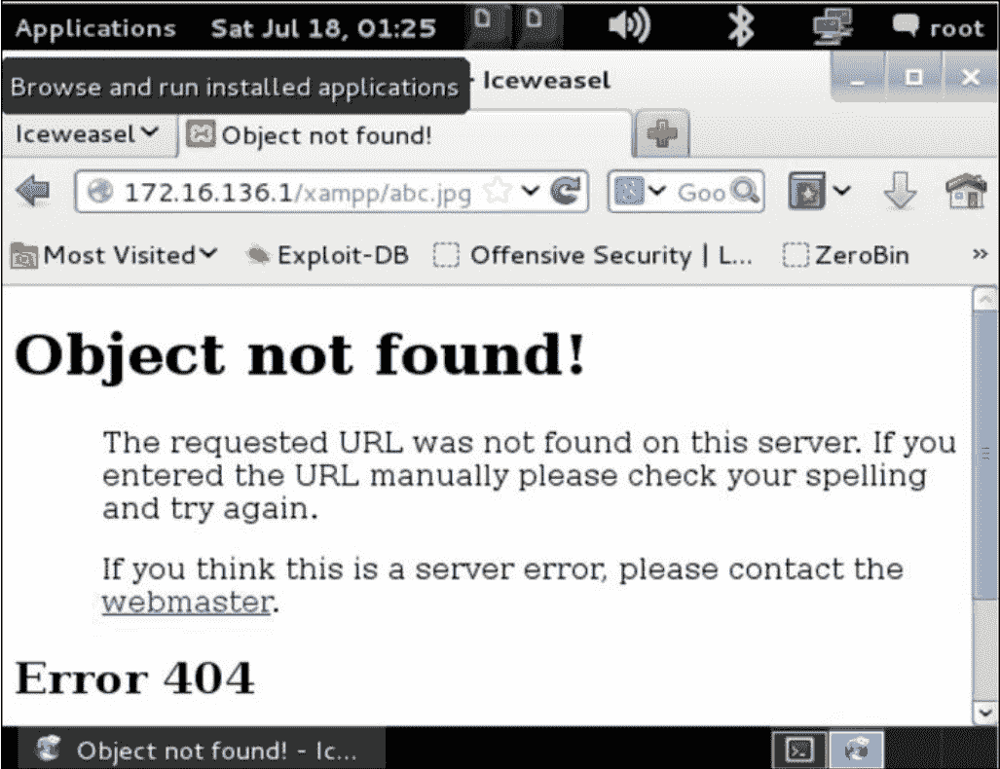

通过此请求生成的流量会被捕获，可以在下面的截图中看到：

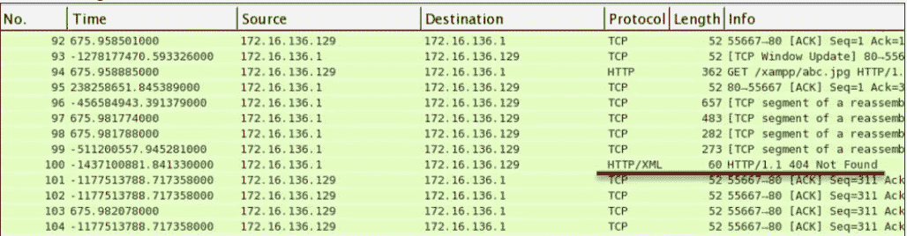

我们可以从前面的捕获流量中看到，客户端请求了 **abc.jpg** 资源，但该资源不可用；因此，客户端收到了 **404 Not found** 错误。

- 3. 我们之所以能轻松发现，是因为只有一个客户端请求单个资源。考虑一个生产环境，其中存在数千个客户端，它们可能会执行相同的操作。在这种情况下，使用不同的规则为特定的数据包集合着色将改变游戏规则。

- 4. 导航到 **编辑着色规则 | 新建**。在 **名称** 框中输入 **HTTP 404**。在 **字符串** 框中输入 `http.response.code==404`。选择 **前景色** 选项为青色，选择 **背景色** 选项为黑色。然后，点击 **确定**，并导航到 **应用 | 确定**。

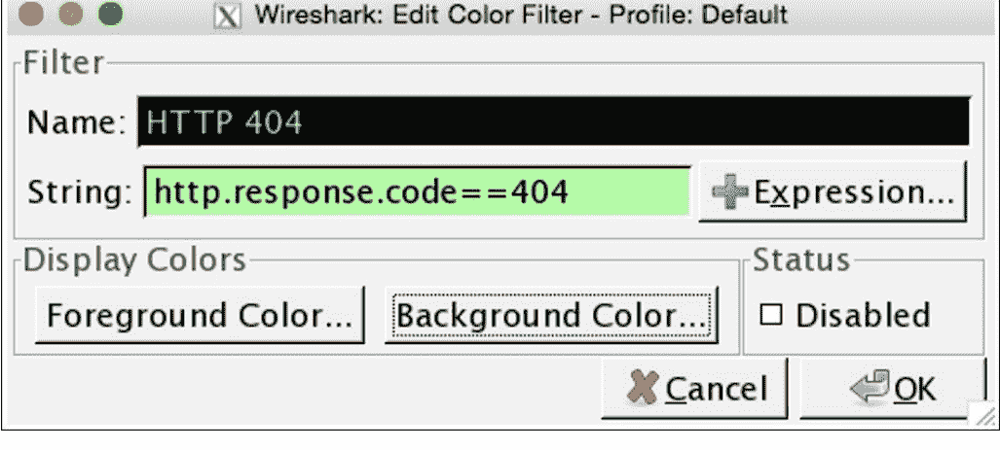

- 5. 一旦你点击 **应用**，你将看到只有 `HTTP 404` 错误数据包会根据你的新着色规则着色。

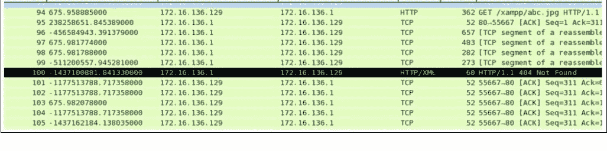

图2.19：应用新着色规则后

尝试在虚拟环境中进行同样的操作，以便更深入地了解该主题。

在 **编辑着色规则** 对话框中列出的着色规则将从上到下进行检查。每个数据包都附有着色规则信息，可以从 **数据包详细信息窗格** 的 **帧** 部分列出。考虑下面的截图说明：

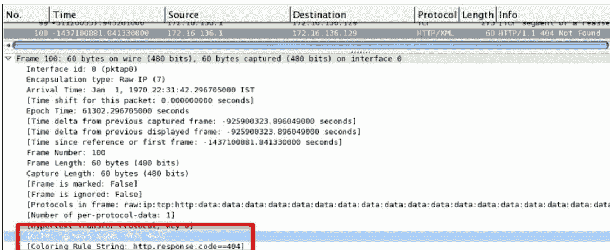

图2.20：帧头中的着色信息

## 创建新的 Wireshark 配置文件

Wireshark 中的配置文件类似于定制环境，可以在审计网络时节省大量时间。配置文件是一组不同的组件，例如捕获过滤器、显示过滤器、时间偏好、列偏好、协议偏好、颜色配置等，它们组合在一起，为你提供可能即时需要的特定场景。

在 Wireshark 中导入和导出配置文件非常容易，这在审计没有预装工具的网络时非常有用。只需将配置文件复制并粘贴到某个目录中即可使用。要创建配置文件，请按照以下步骤操作：

- 1. 右键单击状态栏中的配置文件列。
- 2. 在弹出对话框中点击 **新建...**。
- 3. 现在，选择任何你希望用作模板的配置文件，并输入新配置文件的名称。


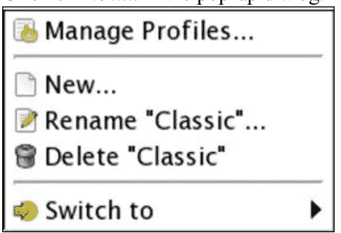


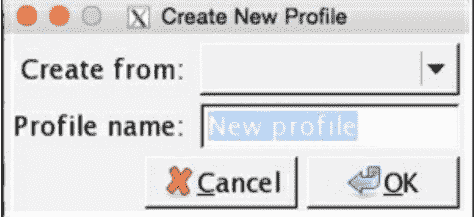

4. 然后，单击“确定”。

现在，在状态栏中，你会看到同一个配置文件已被激活。你将要在这个配置文件中进行的更改都会保留在这里，例如，你可以创建捕获/显示过滤器、更改协议首选项以及更改颜色首选项。这意味着，对某个配置文件所做的更改不会影响其他已保存配置文件的内容。


这样，我们可以针对特定场景创建不同的配置文件，从而节省时间并简化任务。

## 摘要

使用查找工具有时非常有用，可以从Wireshark的“编辑”菜单访问。查找工具为我们提供了多种搜索数据包内容的途径。

过滤流量可以让你只看到感兴趣的数据包；过滤器有两种类型：显示过滤器和捕获过滤器。

显示过滤器会隐藏数据包，一旦你创建的表达式被清除，所有数据包将重新可见。而捕获过滤器会丢弃不满足你所创建表达式的数据包。被丢弃的数据包不会传递给捕获引擎。

捕获过滤器使用BPF语法，这是一种行业标准，也被其他多种协议分析器使用。

在基于特定表达式过滤某类流量时，颜色首选项非常有用。由于匹配的数据包会以不同的配色方案显示，区分数据包将变得容易。

配置文件就像特定场景的预设，可以节省你的时间和工作量。对配置文件的不同组成部分（如显示/捕获过滤器以及颜色/协议/时间首选项）所做的更改，都会保留在该配置文件内。

从Wireshark导出配置文件和各种设置非常简单，这使得该软件更具可移植性。

在下一章中，你将学习如何使用Wireshark的高级功能，如图表和统计选项。

## 练习题

1. **Q.1** 解释显示过滤器和捕获过滤器之间的区别，并说明在系统资源利用方面哪种更高效。
2. **Q.2** 解释**查找工具**和**过滤器**之间的区别。使用查找工具按十六进制值进行搜索。
3. **Q.3** 创建一个捕获过滤器，仅捕获ARP广播数据包。
4. **Q.4** 创建一个捕获过滤器，捕获除发往你的物理地址和从你的物理地址发出的数据包之外的所有数据包。
5. **Q.5** 创建一个捕获过滤器，仅捕获TCP SYN数据包和TCP ACK数据包。
6. **Q.6** 创建一个捕获过滤器，仅捕获从你的机器发送的HTTP流量。
7. **Q.7** 创建一个显示过滤器，仅显示源自你IP的数据包。
8. **Q.8** 创建一个显示过滤器，仅查看与安全套接层协议相关的数据包。
9. **Q.9** 创建一个显示过滤器，仅查看ICMP目标主机不可达的数据包。
10. **Q.10** 创建一个显示过滤器，仅查看设置了FIN和ACK标志的TCP数据包。
11. **Q.11** 创建一个显示过滤器，显示头部长度大于40的TCP数据包。
12. **Q.12** 将所有DNS查询类型A数据包的配色方案更改为你选择的颜色。
13. **Q.13** 将所有HTTP错误消息的配色方案更改为你选择的颜色。
14. **Q.14** 使用默认配置文件创建一个名为DNS的配置文件，并在该配置文件中创建一个将捕获DNS流量的捕获过滤器。然后，将所有DNS响应数据包的配色方案更改为你选择的颜色。
