## 统计菜单

Wireshark中的统计数据不仅仅通过记录的数字呈现；还有图形化功能，可以以图表形式展示数据。这样一来，分析过程变得更加轻松高效。Wireshark提供了多种类型的图表，我们可以利用这些图表收集有价值的信息。

命令行工具就像武士的剑，能够增强普通用户的能力，使其成为并表现得像高级用户。在本章中，我们将介绍几个基于命令的内置工具。

### 使用统计菜单

该菜单提供了大量与网络统计相关的工具，帮助用户获取从常规信息到特定协议相关详细信息等各种信息。

关于捕获的数据包、应用的过滤器、标记的数据包以及其他各种统计数据，都可以在“统计”菜单中查看。虽然该选项仅用于了解信息，但有时非常有用。

要访问摘要统计信息，请单击**统计 | 摘要**；随后你将看到一个窗口，如下方截图所示。

“摘要”对话框分为几个部分，如下所示：

- **文件：** 文件的名称、位置、使用的格式和封装等常规信息列在此下面。
- **时间：** 本部分将告诉你第一个和最后一个数据包被捕获的时间以及经过的时间（总捕获时长）。
- **捕获：** 这里列出操作系统名称及版本，以及用于从实时网络流量中捕获数据包的接口。
- **注释：** 这里显示用户为参考而提到的任何注释。
- **接口：** 这里列出用于捕获流量的每个接口的详细信息。
- **显示：** 本部分提供关于已使用的任何显示过滤器的统计信息，以及应用过滤器后被忽略的数据包百分比。

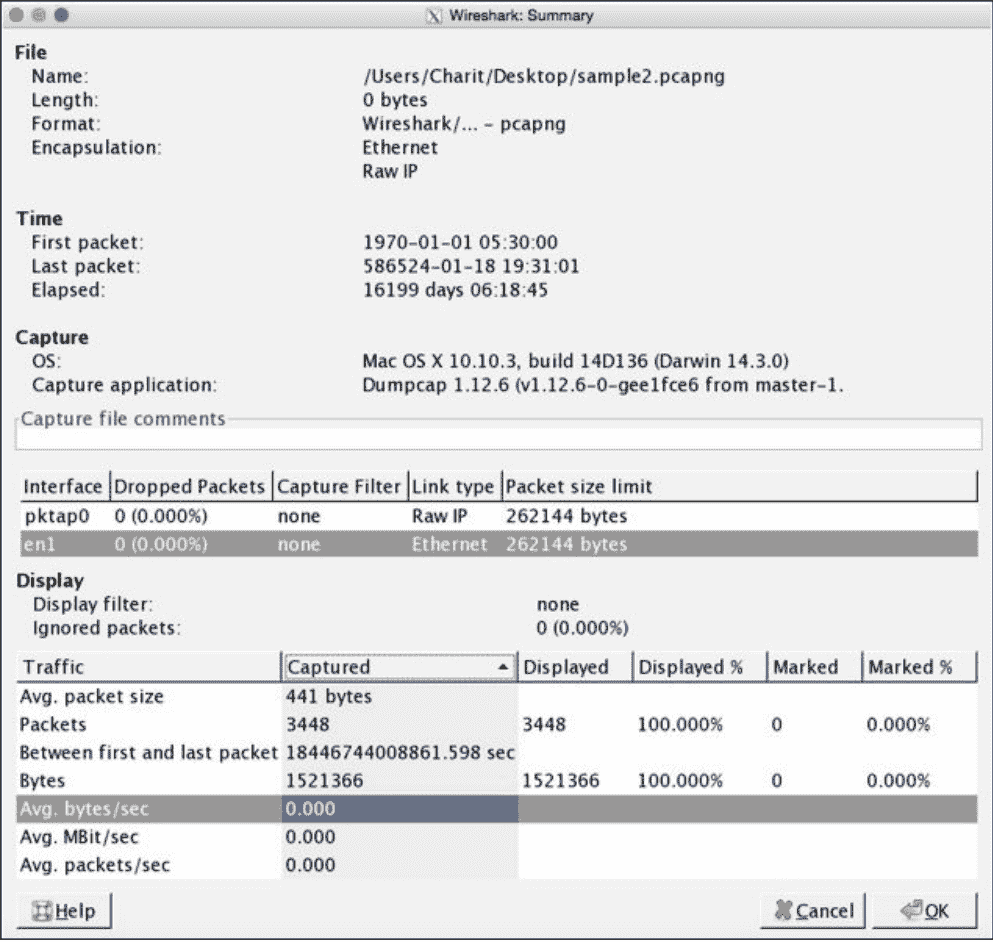

图3.1：摘要对话框

就在**显示**部分下方，你会看到几列列出各种详细信息，其中包括以表格格式呈现的摘要，这些摘要按不同类别分组，例如平均数据包大小、捕获的数据包总数、第一个和最后一个数据包捕获之间的时间间隔等。

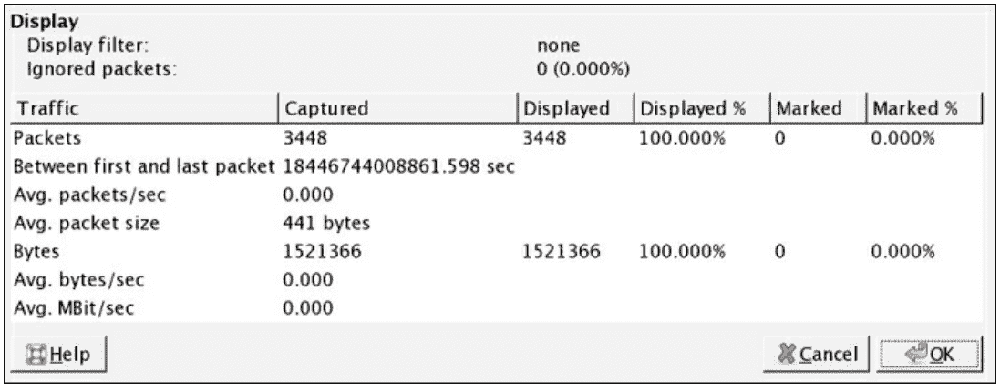

图3.2：无显示过滤器（截图1）

例如，假设我们有一个捕获文件，并对其应用了显示过滤器 http。之后，我们可以访问“摘要”选项。请查看以下截图，并尝试对它们进行比较，以了解显示过滤器在数据包相关摘要的呈现上会产生什么差异。

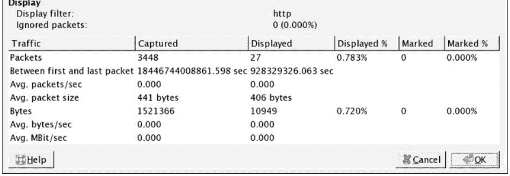

图3.3：带显示过滤器（截图2）

现在，应用过滤器后，可以观察到统计信息中列出的值之间的差异。也就是说，应用显示过滤器 http 后，Displayed% 列中的值与之前不带显示过滤器时相比有所不同。

请参阅以下截图：

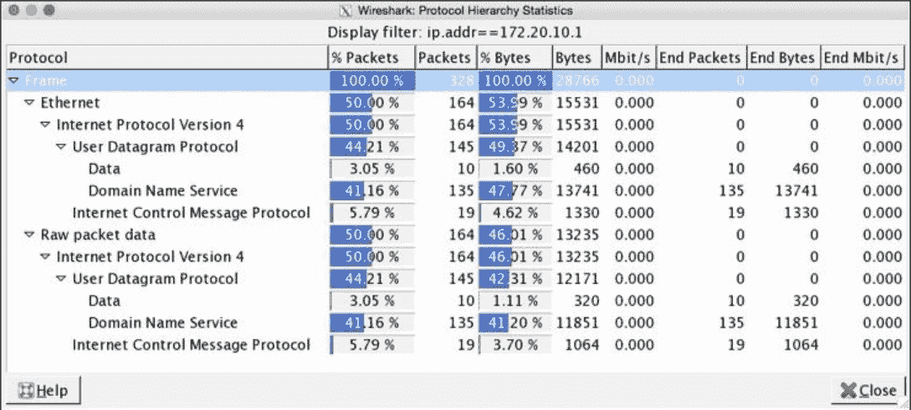

图3.5：应用显示过滤器后的协议层次结构窗口

使用“协议层次结构”窗口，你也可以创建过滤器。只需右键单击你想要使用的协议，然后继续指定表达式，如下方截图所示：

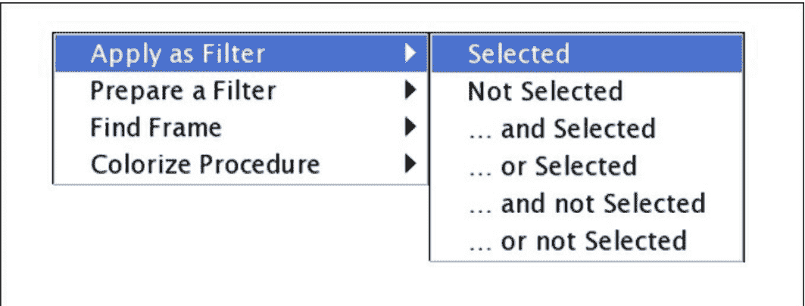

在某些情况下，你网络中的某台主机已被入侵，你可能会观察到与特定主机相关的一些异常流量。在这种情况下，**协议层次结构**窗口将证明其价值。

### 会话

当网络中的两台设备相互连接时，它们应当进行通信；这被视为正常行为。然而，假设你的网络连接了数千台设备，而你想找出产生过多流量的最活跃设备，那么在这种情况下，**会话**窗口将非常有用。

要访问这个好用的工具，请单击**统计 | 会话**。之后，你将看到一个如下方截图所示的窗口，其中以多列形式列出了各种详细信息，包括传输的数据包、传输的字节数、流量流向、设备的MAC地址以及其他各种详细信息。在顶部，你会看到各种协议分别显示在不同的选项卡中，并且在每个活动协议选项卡旁边，你会看到一个数字，表示唯一会话的数量。

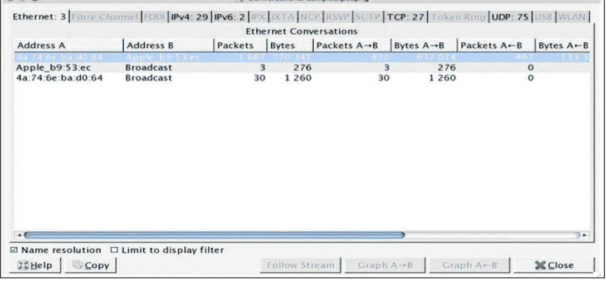

图3.6：会话窗口

例如，如果你正在寻找生成了大量数据包且发生了主要数据传输的设备，那么请打开**会话**对话框，转到**IPv4**选项卡，并按降序对数据包列进行排序。这里，列出的设备位于


第一行就是你的答案。请看下面展示相同内容的截图。

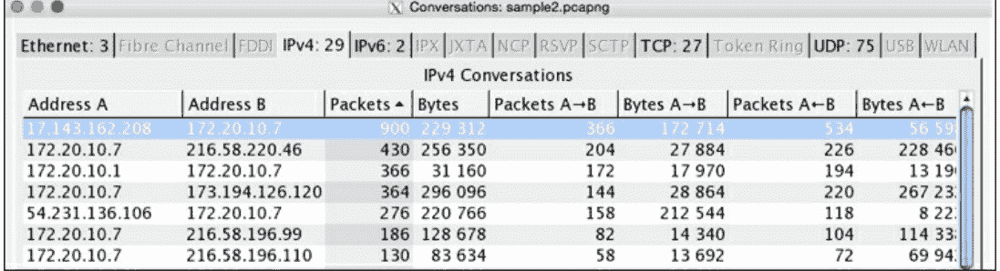

图 3.7：最繁忙的设备

在第一行中，我们可以看到每个端点发送和接收了多少数据包/字节，以及总耗时。如果你想为此创建过滤器，请右键单击第一行，然后创建你正在考虑的相关表达式。我选择了第一个选项 A<->B，它只显示与地址 A 和地址 B 关联的数据包：

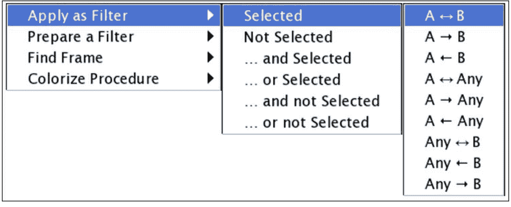

相应的过滤器将被插入到“显示过滤器”对话框中，如下面的截图所示：


“**会话**”对话框让我们能够以更细粒度的形式收集和分析详细信息，可在排查和审计网络基础设施时用于多种场景。

## 端点

在 Wireshark 中，彼此共享数据的两个设备通常被称为端点。正如我们所注意和观察到的，如果一台主机打算与网络上的另一台主机通信，它们就需要某种形式的地址来发送和接收数据包——是的，我说的是每台设备都持有的物理地址。

每台主机都可以借助“**网络接口卡（NIC）**”进行通信，该网卡持有一个物理地址（通常称为 MAC 地址），并且该地址用于在本地网络上进行通信。在这种基础设施中进行通信的设备被称为端点。Wireshark 为我们提供了分析和收集有关这两个设备信息的功能。

例如，假设我们观察到网络上流过大量流量，这根据我们的日常流量模式来看有些不寻常。现在，我们想弄清楚是哪个（哪些）设备导致了流量模式的变化。对我们来说，“**端点**”对话框可以派上用场，它可以通过“**统计**”菜单下的“**端点**”菜单访问，其外观类似于下面的截图。在继续打开“**端点**”对话框之前，只需从“**数据包列表**”窗格中单击任意一个 TCP 数据包。你会看到顶部有一系列选项卡，每个选项卡对应一个不同的协议。其中一些显示为活动状态，一些显示为不活动状态，因为如果你的流量中有与某个协议相关的数据包，列出该特定协议的选项卡将显示为活动状态；否则，它将显示为不活动状态。

默认情况下，大多数情况下你会看到“**以太网**”选项卡（列出第 2 层 MAC 地址）。除了协议之外，你还会看到一个数字，它表示针对该特定协议捕获的端点数量。在我们的例子中，我们看到的是“**3**”，并且在“**主**”窗格中可见到同样数量的行。

在“**主**”窗格中，可以查看每个端点的更多具体详细信息，例如传输的数据包总数、传输的字节总数，以及单个端点接收和发送的总字节数和数据包数。

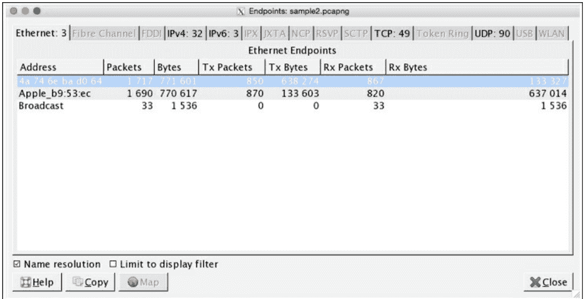

图 3.8：端点窗口

现在，如果你想分析其他协议，只需单击你选择的任意选项卡。我单击了 IPv4 选项卡，并使用“数据包”列对主窗格进行了排序，结果如下面的截图所示：

仅通过查看“端点”对话框，我现在就可以轻松地发现，最大数据量是从 IP 172.20.10.7 传输的。这可能是单个 IP 与某个服务器通信，也可能是某个服务器以适中的速率与我们网络上的多台机器通信。

| 地址 | 数据包 | 字节 | 发送数据包 | 发送字节 | 接收数据包 | 接收字节 |
|---|---|---|---|---|---|---|
| 4a:74:6e:ba:d0:64 | 1,717 | 771,601 | 850 | 638,274 | 867 | 133,327 |
| Apple_b9:53:ec | 1,690 | 770,617 | 870 | 133,603 | 820 | 637,014 |
| 广播 | 33 | 1,536 | 0 | 0 | 33 | 1,536 |

## 使用 IO、流和 TCP 流图

在众多其他报告工具中，Wireshark 也提供了图形化功能，它可以以一种有趣的格式呈现捕获的数据包，使分析过程更加高效且易于适应。与滚动数千个数据包来找出任何网络相关问题的原因相比，图形化功能要有效得多。如果有数量庞大的数据包需要分析，那么图形可以大大提高生产力。我们将讨论多种类型的图形，先从 IO 图开始。

### IO 图

这是使用捕获文件中的数据包创建的基本图形之一。要创建 IO 图，请在捕获文件中任选一个 TCP 数据包，然后点击“统计”下的“**IO 图**”。请参考下面的截图：

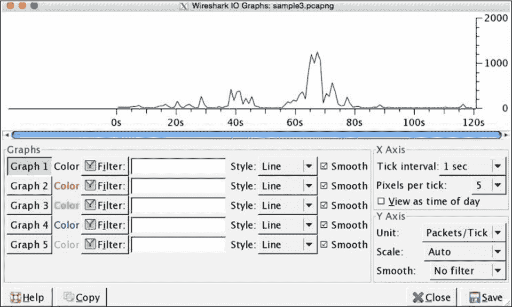

图 3.10：IO 图

这样，你可以看到流量中的高点和低点，这可以用来解决问题，甚至可以用于监控目的。在上面的图形中，x轴上的数据表示以秒为单位的时间，y轴上的数据表示每个刻度内的数据包数量。如果需要，可以更改 x 轴和 y 轴的刻度，其中 x 轴的范围在 10 到 0.001 秒之间，y 轴的值范围在数据包/字节/位之间。

从上面的图形中，我们可以很容易地看出，在捕获过程的第 60 到第 80 秒之间，网络最为活跃，在捕获过程的每一秒中产生了大约 1000 个数据包。现在，你会意识到，在仅仅 4-5 秒内从数千个数据包中收集这些特定信息是多么容易；这正是图形化功能带给你的能力。

在绘图区域的正下方，你可以看到“**图形**”部分，其中列出了各种工具，例如图形 1-5、若干过滤器、线条格式以及其他各种详细信息。让我们通过一个示例来了解它们各自的功能。

上面的图形显示了我们网络流量的总体形态。现在，我的需求是只想在同一张图中单独查看 UDP 流量的频率，并用红色线条绘制。要实现这样的需求，请按照以下步骤操作：

- 在从上往下数第二个过滤器框中输入 UDP 作为过滤器
- 单击“**图形 1**”按钮以停用它
- 单击“**图形 2**”按钮以启用它
- 现在，你将看到与下图相同的窗口：

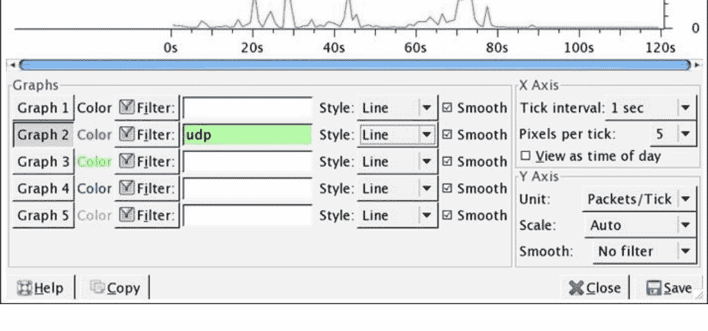

图 3.11：仅包含 UDP 流量的 IO 图

只需几个步骤，分析特定的 UDP 流量就变得更加容易。从上面的图形可以清晰地看到，大多数 UDP 流量是在捕获过程的第 70 到第 80 秒之间生成的，并且产生了超过 250 个数据包。

### 流图

这是 Wireshark 中最实用的功能之一，它能在我们面临大量断开连接、丢失帧、重传流量等场景时提供故障排查帮助。流图让我们可以创建基于列的图形，该图形总结了两个端点之间的流量流向，甚至允许我们以简单的基于文本的格式导出结果。这是验证客户端和服务器之间连接的最简单方法。

例如，我有一个 web 服务器运行在 172.16.136.1，一个客户端运行在 172.16.136.129。客户端会向 web 服务器请求某个资源。让我们看看此类请求的流图是什么样的。会产生数百个数据包，但我们只查看 HTTP 数据包，以使结果更集中且易于理解。点击“统计”下的“流图”，然后在弹出的对话框中，选择“已显示的数据包”。点击“确定”。请参考下面展示相同内容的截图：

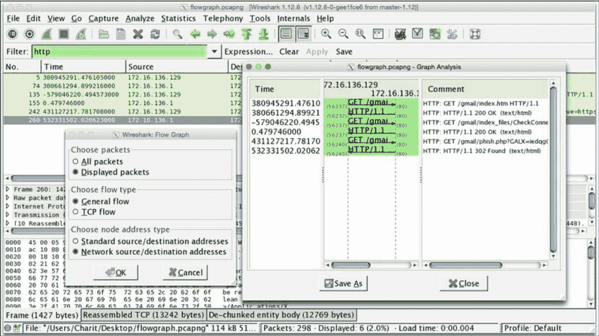

图 3.13：流图


现在，通过**图形分析**窗口，我们可以查看某个请求是在什么时间发出的，我们收到了什么响应，使用了哪个 TCP 端口，同时还附有一些通俗易懂的英文注释，并且流量流向也已标记出来。这样我们就能轻松理解 TCP 数据包的流动方式。

## TCP 流图

本节包含几张图。每张图都以不同的图形形式描绘网络流量。让我们逐一查看它们。

## 往返时间图

**往返时间（RTT）** 是指从发送数据包到收到对应 ACK 所经历的时间，也就是说，对于主机发送的每一个数据包，都会收到一个 ACK（TCP 通信），该 ACK 用于确认数据包是否成功送达。从数据包传输到收到 ACK 所消耗的总时间称为往返时间。请按以下步骤自行创建该图：

- 在**数据包列表**窗格中选择任意一个 TCP 数据包。
- 导航到**统计 | TCP 流图 | 往返时间图**。
- x 轴表示 TCP 序列号，y 轴表示以秒为单位的 RTT。
- 图上每个绘制点代表一个数据包的 RTT。如果图中没有显示任何内容，则您可能选择了方向相反的数据包。
- RTT 图通常被网络管理员用来识别可能导致网络运行缓慢的拥塞或延迟。
- 要进一步调查，只需单击图中任意一个 RTT 点，Wireshark 就会在列表窗格中跳转到该特定数据包。

下面的 RTT 图表示正常的 Web 流量，在图的某些点可以观察到延迟：

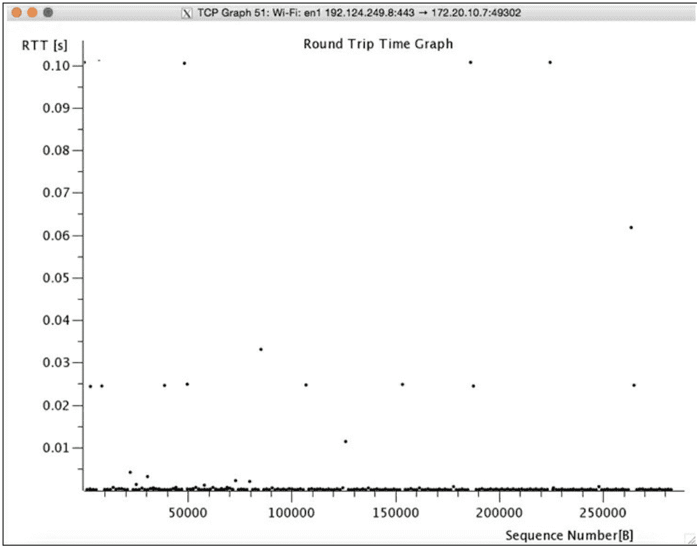

# 图 3.14：往返时间图

瓶颈和延迟通常可以通过垂直排列的 RTT 绘制点来识别，这些点描绘了发送设备发出的数据包是先排队然后一次性发送，还是数据包遭受了重复 ACK 或数据包丢失（需要重传），从而增加了 RTT 时间。

## 吞吐量图

该图与描述流量流向的 IO 图非常相似。但有一个重要区别：吞吐量图描述的是单向流量，而 IO 图描述的是双向流量。对于在列表窗格中选择的每个 TCP 数据包，吞吐量图可能不同。如果看到空白图，只需选择另一个 TCP 数据包并重新尝试创建该图。请按以下步骤自行创建：

- 1. 打开包含数据包的跟踪文件。
- 2. 如有需要，应用显示过滤器。
- 3. 从列表窗格中选择任意一个 TCP 数据包。
- 4. 导航到“统计 | TCP 流图 | 吞吐量图”。
- 5. 瞧！完成了。

在标题栏中，显示了通信主机的 IP 地址以及流量方向。x 轴表示以秒为单位的时间，y 轴表示以字节/秒为单位的吞吐量。请参阅下图（图 3.15）：

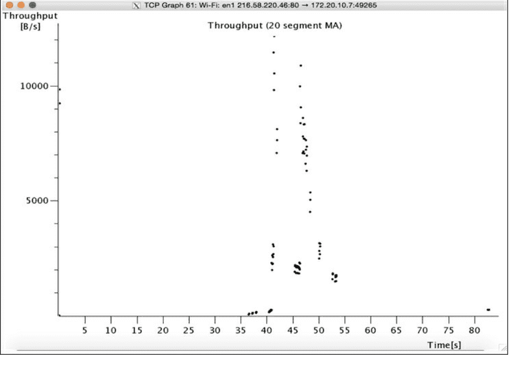

图 3.15：吞吐量图

## 时间序列图（tcptrace）

该图描绘了 TCP 数据随时间变化的流。显示的流量是单向的（沿一个方向移动）。时间序列图让我们了解当前正在传输的段、已收到段的确认信息，以及客户端能够容纳的缓冲区区域。要创建此图，请按以下步骤操作：

- 1. 打开要使用的捕获/跟踪文件。
- 2. 点击列表窗格中的任意 TCP 数据包。
- 3. 导航到“统计 | TCP 流图 | 时间序列图（tcptrace）”。
- 4. 现在您应该会看到类似以下内容：

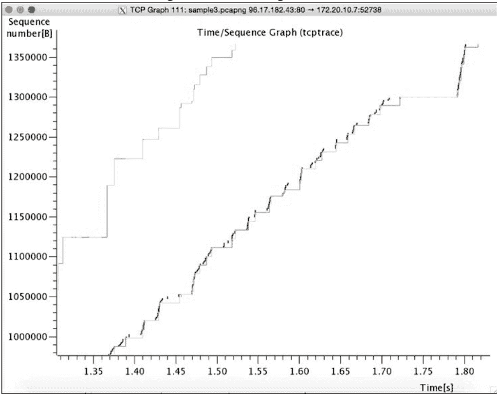

图 3.16：时间序列图（tcptrace）

图的 x 轴表示以秒为单位的时间，y 轴表示 TCP 序列号。TCP 序列号随每个数据包发送的数据字节数而递增，也就是说，如果序列号为 1，并且我们发送的数据包包含 10 字节数据，则序列号将增加 10。因此，下一个要发送的数据包的序列号将是 11。当绘制的线更陡时，数据吞吐量更大；通常，图形绘制从左下角开始到右上角。

实际上每张图上都会绘制三条线。写有多个“I”的线是 TCP 数据段，“I”流越长，数据包中的数据就越多。TCP 段下方的线是已发送数据的 ACK 流，顶部的线表示计算出的客户端接收窗口。

客户端接收窗口线与 TCP 段线之间的距离就是窗口大小。这两条线越靠近，可缓冲的数据就越少，反之亦然。请考虑以下放大的截图以进一步理解：

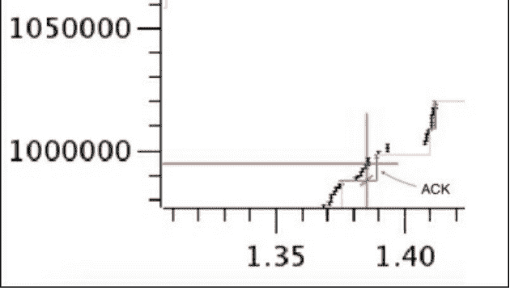

图 3.17：吞吐量图

假设在 1.38 秒时，主机 A 正在发送字节 995,000，与此同时，主机 A 收到了针对字节 990,000 的 ACK，这表明仍有 5,000 字节未确认（在途）。这里需要注意的一点是，深灰色的线表示已收到的 ACK。

## 跟踪 TCP 流

Wireshark 提供了一项功能，可以将纯文本协议数据包流重新组装为易于理解的格式。

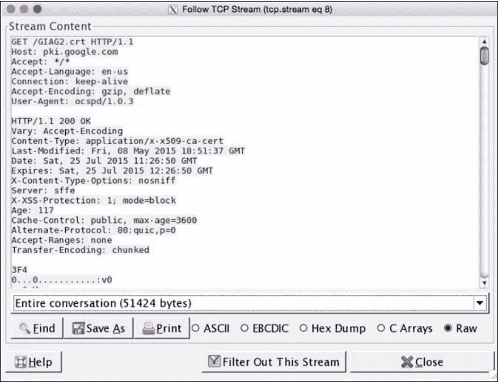

图 3.18：跟踪 TCP 流窗口

例如，组装一个 HTTP 会话将向您显示客户端发送的 GET 请求以及从服务器收到的相应响应。跟踪 TCP 流对话框中显示的请求和响应遵循特定的颜色编码。红色文本表示客户端已发送的请求，蓝色文本表示从服务器收到的响应。如果协议是 HTTP，那么您几乎可以用纯文本查看所有内容；如果协议是 HTTPS，那么大部分内容将被加密，因此在屏幕上会显示乱码（也有办法解密 HTTPS 流量，我们将在后续章节中讨论）。在排查 HTTP 会话问题（大多数应用层协议也是如此）时，跟踪 TCP 流选项能提供很大帮助。

在对话框底部，有一个下拉菜单，您可以选择查看通信的任一侧，也可以选择整个通信，其中包含客户端和服务器之间同时共享的请求和响应。除了仅以 RAW 格式查看数据外，您还可以选择 ASCII、EBCDIC、十六进制转储和 C 数组格式。

如果您希望保存对话框中显示的内容，请点击**另存为**，它会将内容保存为简单的文本格式。同样，要打印，您可以点击**打印**。如果您想查看当前正在查看的跟踪 TCP 流数据包之外的所有内容，请点击**过滤掉此流**。要关闭对话框，请点击**关闭**。

要查看 TCP 流，请按以下步骤操作：

- 1. 打开捕获/跟踪文件。
- 2. 如有需要，应用显示过滤器。
- 3. 从列表窗格中选择任意一个数据包。
- 4. 右键点击选中的数据包，然后点击**跟踪 TCP 流**。

按照上述步骤操作后，即可获得一个简单的数据查看视图。现在，判断谁发起了连接将变得相当容易。

点击访问 Expert

左下角的红点可以显示不同的颜色，例如青色、黄色、绿色、蓝色和灰色，其中每种颜色都有特定的含义，如下所列：

- 红色：表示错误
- 黄色：表示警告
- 青色：表示注释
- 蓝色：表示聊天


- **绿色**：这指的是注释
- **灰色**：这表示无

现在，让我们来看一下 Expert Infos 对话框，并讨论其中包含的各种其他元素。请参考以下截图进行说明：

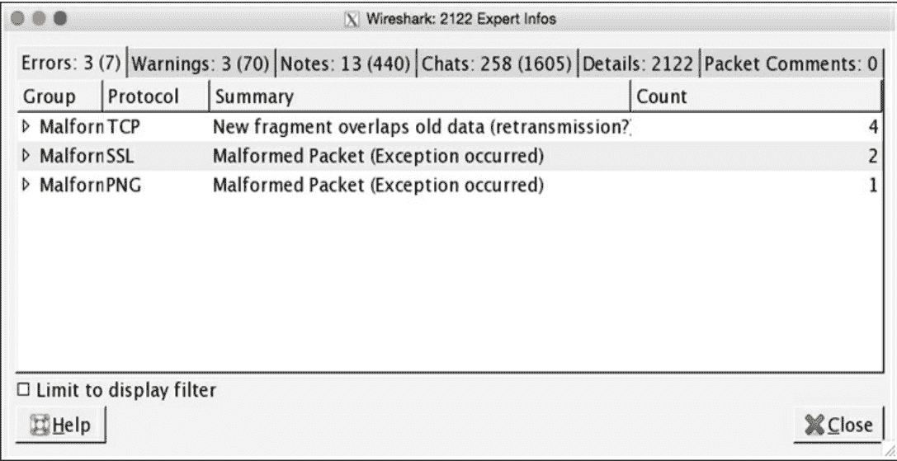

图 3.19：Expert Infos 对话框

正如你所看到的，标题栏下方列出了多个选项卡，这些选项卡根据数据包的严重级别和信息类别列出了相应的数据包。Expert Infos 对话框中主要有四个部分，它们指向问题的可能原因，因此仔细检查会很有帮助。每个选项卡都包含该部分的名称和两个数字：一个在括号内，一个在括号外。括号内的数字表示已被标记为包含该类别数据包的总数，括号外的数字表示被标记数据包的唯一类别总数。

我们将逐一介绍每个部分，并总结数据包被标记和列在不同类别（如聊天、注释、警告、详细信息等）下的标准：

- **聊天**：这些是关于当前通信的常规消息。属于此部分的数据包如下所列：
  - **窗口更新：** 这使发送方知道 TCP 接收窗口大小已被更新。
- **注释**：这些是不寻常的消息，可能是也可能不是当前正常通信的一部分。属于此部分的数据包如下所列：
  - **零窗口探测：** 假设从客户端接收数据包的服务器无法以客户端发送数据包的相同速度处理所接收的数据包，从而导致数据包丢失。在这种情况下，服务器将向客户端发送一个零窗口数据包，以在保持连接活动的同时暂停发送数据包一段时间。
  - **保持活动确认：** 保持活动数据包的接收方发送此确认作为响应。
  - **零窗口探测确认：** 这与零窗口探测示例相关。客户端将响应服务器的请求发送零窗口探测确认。
  - **窗口已满：** 这通知发送主机 TCP 接收窗口当前已满。
  - **TCP 重传：** TCP 数据包由于重复确认、数据包丢失或重传计时器到期而再次重传。
  - **重复确认：** 如果你考虑 TCP 三次握手通信，对于另一端收到的每个数据包，发送方都应该收到一个确认数据包。如果接收方收到序列号已被接收过的数据包，则会产生重复确认。在数据包丢失的情况下也会发生这种情况。
- **警告消息：** 这些是不寻常的消息，可能不属于你的常规通信。属于此部分的数据包如下所列：
  - **零窗口：** 当接收方试图通知发送方暂停发送一段时间，因为 TCP 接收窗口已满时，会观察到这些消息。
  - **保持活动：** 当在通信中捕获到任何保持活动消息时，会观察到这些消息。
  - **已确认丢失的数据包：** 当收到某个丢失数据包的确认时，会观察到这些消息。
  - **前一个分段丢失：** 当接收到乱序的意外数据包时，会观察到这些消息。
  - **乱序：** 当数据包以某种随机顺序被接收，从而表示没有顺序时，会观察到这些消息。可以进一步调查。

也可以为每个类别创建显示过滤器；只需右键单击所选类别，然后选择要创建的过滤器类型。请参考以下截图进行说明：

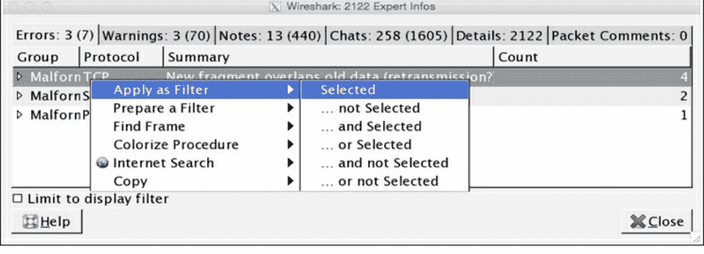

**Expert Infos** 对话框的主要动机是查找跟踪文件中存在的异常。对于新手用户来说，在跟踪文件中查找网络问题变得更容易、更快捷。查看 **Expert Infos** 对话框可以更好地了解网络数据包的异常行为。正如我们已经讨论过的，**Expert Infos** 对话框可用于基于 TCP/IP 的协议；对于其余的协议，可用的信息不多。

找出有价值信息的最佳方法是分别查看各个选项卡，而不是查看**详细信息**选项卡，因为正如我们所讨论的，这可能会很耗时，并且可能导致各种误解。像你这样的用户不应该完全依赖 **Expert Infos**；有时，你跟踪的文件会包含未在 **Expert Infos** 对话框中列出的异常。也许，也需要进行手动分析。

所选数据包详细信息窗格中显示的协议字段将根据 **Expert Infos** 对话框的严重级别进行着色；请查看以下截图以供进一步参考：

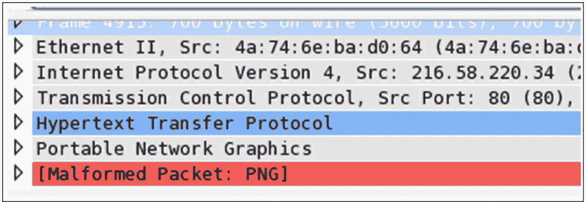

图 3.21：协议字段中的着色规则

从前面的截图我们可以轻松识别出，对于这个特定的数据包，在"错误"和"聊天"部分有一个条目（红色表示错误，蓝色表示聊天）。单个数据包也可能列在 Expert Infos 对话框的两个部分中。

## 命令行技巧

通过默认安装 Wireshark，会安装一些命令行工具。这些命令行工具是某种协议分析器，当你没有 GUI 界面可以使用，或者没有安装 GUI 的选项时，就可以利用它们。Wireshark 中有很多工具可以做到这一点，它们分别是 Capinfos、Dumpcap、Editcap、Mergecap、Rawshark、Reordercap、Text2pcap 和 Tshark。

用于协议分析目的的最常见且广泛使用的命令行工具是 Tshark，它能够通过监听实时线路来捕获数据，甚至还可以分析你已经保存的跟踪文件。捕获的数据包被转换为可理解的形式并打印到标准输出，或者你可以将它们保存到你选择的文件中。Wireshark 使用的解析器与 Tshark 使用的相同。

Tshark 使用 pcap 库从实时线路或已保存的文件中捕获和转换数据包。就像 Wireshark 的过滤选项一样，我们可以在 Tshark 中启用过滤器。Tshark 中有多个可自定义的选项，可以利用它们以更高级的方式使用它。

Wireshark 有一个 CLI 版本，在语法和两者同样支持的各种选项方面几乎与 Tshark 相似。让我们通过一个示例更好地理解这个主题。例如，假设我们有一个 Apache Web 服务器和 FTP 运行在位于 `172.16.136.128` 的 Windows XP 机器上，还有一个 Macintosh 客户端运行在 `172.16.136.1`。使用我们的自定义基础设施，我们将生成一些网络数据包，并尝试使用 Tshark 进行捕获和分析。

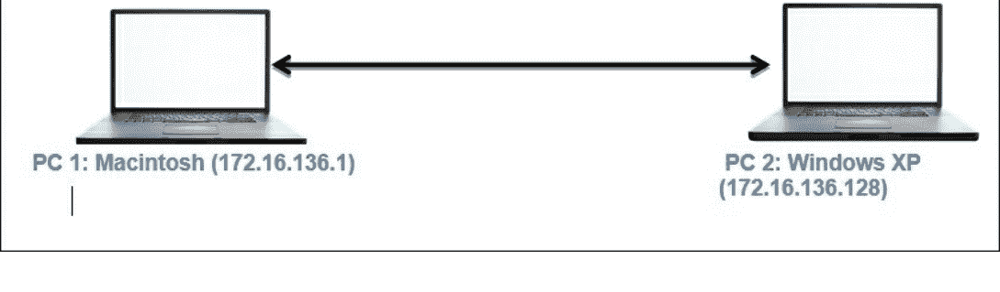

在 Windows PC 上工作时，你可能必须在开始使用 Tshark 之前创建环境变量。以下截图属于 Tshark，在 CLI 中显示 `tshark -h`（帮助选项）：

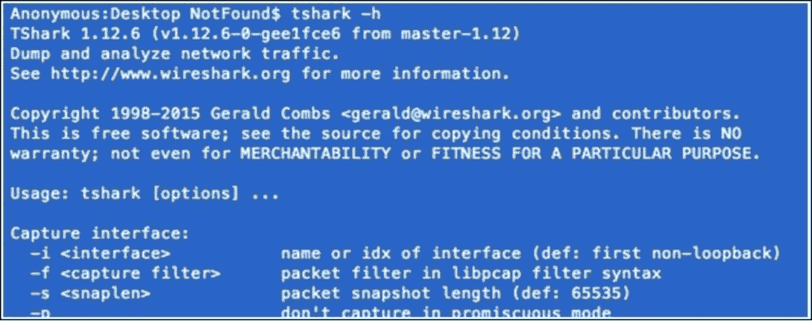

图 3.22：Tshark 帮助

我们将从基础开始，最终转向创建过滤器，然后我们将使用基于 CLI 的工具 Tshark 收集统计信息：

- 我们应该知道的第一件事是我们有多少可用于捕获数据包的接口。使用以下命令检查 `tshark -D`：

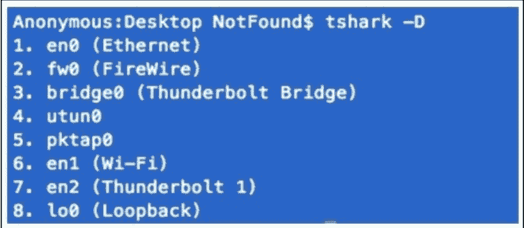

图 3.23：可用的接口


如果你没有指定任何用于捕获的接口，`tshark` 会自己选择第一个可用接口。接口可以通过名称选择，也可以通过它们出现的序号选择。参考前面的截图，其中显示了所有可用的接口。

- 我有一个自定义接口 `pktap0`，它用于监听我的客户端和服务器之间的连接。因此，启动捕获过程的命令将是 `tshark -i pktap0` 或 `tshark -i 5`：


- 现在，让我们从客户端访问托管在服务器上的网页来生成一些 HTTP 流量（我使用 `curl` 命令行工具进行浏览）：


- 一旦执行了前面的命令，`tshark` 就会在 `pktap0` 接口上捕获几个数据包。可以看到为便于理解而翻译后的数据包摘要。请参考下面的截图：

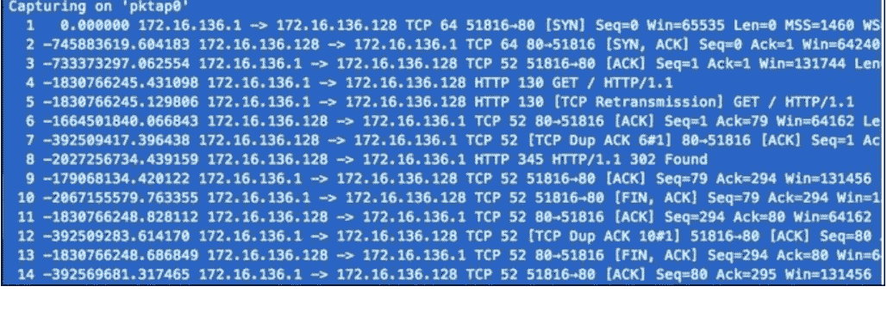

图 3.24：在 pktap0 上捕获的数据包

如果想在任何时候停止捕获过程，请按 Ctrl + C。

- 要将翻译后的数据包保存到文件，我们需要在命令中指定 `-w` 开关，该开关会将原始数据包保存到指定的文件：

```
Anonymous:Desktop NotFound$ tshark -i pktap0 -w http.txt
Capturing on 'pktap0'
11
```

总共捕获了 11 个数据包，并且在桌面上创建了一个名为 http.txt 的文本文件，其中将包含原始数据，如下面的截图所示：

```
Anonymous:Desktop NotFound$ cat http.txt

?M<+?????????.Mac OS X 10.10.3, build 14D136 (Darwin 14.3.0)4Dumpcap

D136 (Darwin 14.3.0)`'???@E@f?@k???????lP??f?????
???x`'dA???_@@E@?@?},?????P?l?@.j?f????a??
@@q??????lP??f???@i?
???xT??4??9??E??@H???????lP??f??@:?h
???xGET / HTTP/1.1
User-Agent: curl/7.37.1
Host: 172.16.136.128
Accept: */*
```

图 3.25：存储在文件中的原始数据

- 如果你想保存正常的翻译形式（如 Wireshark 列表窗格中显示的那样），如标准输出所示，只需将 tshark 命令的输出重定向到你选择的文件，如下面的截图所示：

```
Anonymous:Desktop NotFound$ tshark -i pktap0 >> http2.txt
Capturing on 'pktap0'
11
```

如你所见，11 个数据包被捕获并重定向到文本文件 http2。让我们看看 http2.txt 文件中存储了什么：

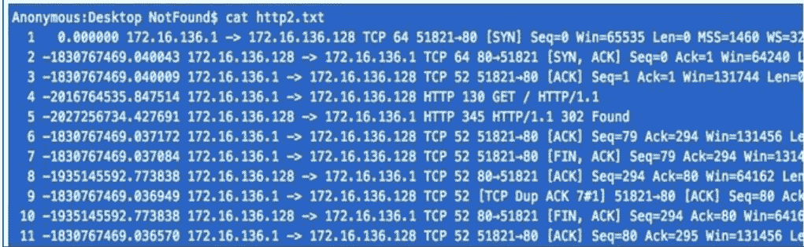

希望到现在你已经清楚理解了保存原始数据包和翻译后的数据包这两种方式的区别。这两种技术都可以用于多种场景。

- 接下来要学习的重要内容是 Tshark 中可用的不同过滤器（捕获、读取和显示）。我们已经了解了捕获过滤器和显示过滤器，但这里还有一类，即读取过滤器。读取过滤器与捕获过滤器非常相似，因为它们都可以过滤来自实时网络的数据包。然而，读取过滤器还能够从已保存的文件中过滤数据包。使用读取过滤器可能会消耗较多处理器资源，并且可能发生数据包丢失等情况，所以在使用之前要三思。要显示过滤器，使用 `-f` 开关；`-R` 用于读取过滤器；`-Y` 用于显示过滤器。现在，我将使用以下语法只捕获 FTP 数据包：

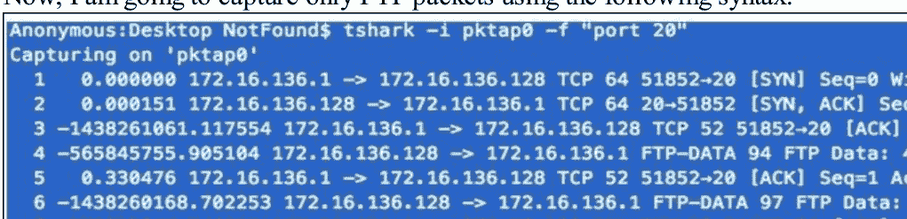

在应用过滤器时，有一个限制：如果过滤器表达式中间有空格，则必须将其指定为单个参数。然后，我们需要写入

- 现在，让我们尝试使用 `http.pcap` 文件创建一个显示过滤器。我想使用 `http` 协议过滤来自位于 `172.16.136.128` 的 Web 服务器的所有数据包。
- 首先我捕获了客户端和服务器之间的通信。并将流量保存在文件 `HTTP.pcap` 中。

一旦我有了足够的数据包，我就会应用显示过滤器，如下面的截图所示：

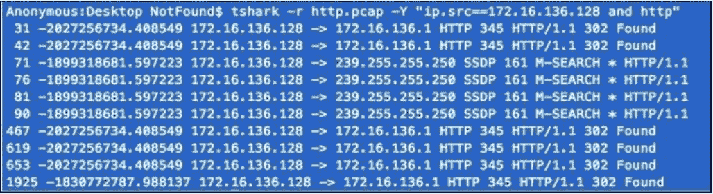

图 3.26：Tshark 显示过滤器

- 假设你想快速收集 `http.pcap` 文件中关于 http 协议的统计信息。对于这种需求，我们可以使用这个命令：`tshark -r <file-name> -q -z <expression>`

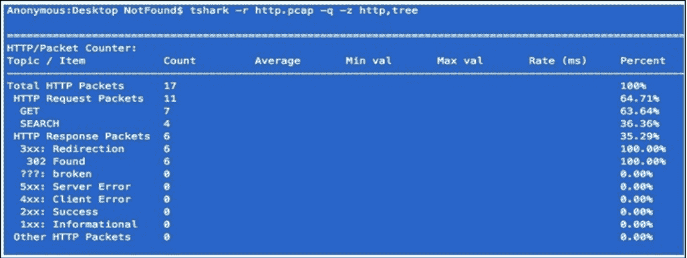

`-q` 开关使标准输出保持安静（这通常在与 Wireshark 中的统计信息一起使用时使用），`-z` 开关用于激活可用的各种统计选项。这两个开关经常一起使用。

- 在结束之前，让我们再看一个简单的例子；我想从 http.pcap 文件中找出在整个捕获期间总共有多少台主机。对于这种需求，请参考下面的截图：

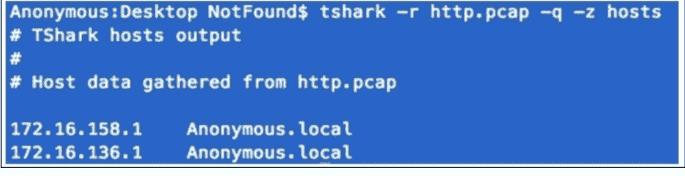

在这里，你学习了 CLI 工具 Tshark 的基本理论和实践概念，以及如何根据我们的需求捕获和过滤数据。借助 Tshark，理解协议的工作方式变得非常容易；我们看到了多种收集和分析数据包的技术。Tshark 的统计功能非常丰富，这有助于中等用户成为更高级的用户，更好地理解如何分析网络数据包。

## 总结

Wireshark 的“统计”菜单包含一些选项，可以从独特的视角为我们提供见解。在本章中，我们讨论了诸如“摘要”、“对话”、“端点”和“图表”等功能。

“摘要”是一个信息性功能，提供你正在处理的数据、过滤器和跟踪文件的详细信息。“对话”窗口详细说明了两个或多个主机之间通信的数据。“端点”对话框概述了连接到网络并进行通信的设备。“协议分层”窗口让我们了解通信中使用的协议，也就是说，它让我们了解主机用于通信的协议分布情况。

图表是以图形方式表示有关数据包的统计信息。我们可以轻松地发现网络是否出现问题；我们可以匹配网络性能并排查日常发生的常见问题。

IO 图表告诉我们网络的基本状态，并允许我们创建过滤器。由于这些图表，匹配网络性能和区分特定协议变得容易。“流量图”以基于列的方式描绘数据流，并创建一个简单界面来理解网络中数据包的流向。TCP 流图有几种类型，但它们的目标是描述我们网络的吞吐量，即了解在特定时间段内传输了多少数据。

使用“追踪 TCP 流”选项，你可以将以原始数据形式列出的数据包重新组合，这些数据包易于阅读。有不同的选项可以将形式更改为 ASCII、十六进制等。

“专家信息”对话框会告诉你可能正常或不正常的信息。所有这些信息都与你的数据包有关；信息是在协议解析器的帮助下生成的，协议解析器将数据包转换为正常形式，如果发现异常，则会在对话框中的某个部分和某个类别下列出。

安装 Wireshark 时也会安装命令行工具。最常用的工具是 Tshark，它的工作方式类似于 Wireshark 和 tcpdump。它使用 pcap 库，其他主要协议分析器也使用该库。使用 tshark，你可以监听实时网络，也可以处理已保存的捕获文件。过滤和

## 练习

Q.1. “统计”菜单的用途是什么？它包含哪些工具？

Q.2. 使用“对话”对话框，你能找出网络上最繁忙的主机吗？如果能，怎么做？

Q.3. 想一个使用“端点”窗口可能有用的场景。

Q.4. 是否可以使用“端点”窗口创建显示过滤器？

Q.5. 在查看对话窗口时关闭名称解析功能。如果开启它，会有什么不同？

Q.6. 使用已保存捕获文件中的“摘要”选项能否帮助你在应用显示过滤器后找出被忽略的数据包总数？

Q.7. 描述在分析数据时使用不同图表技术的好处。

Q.8. 使用 IO 图表，创建一个过滤器，用绿色线条绘制 DNS 流量。

Q.9. 创建一个 IO 图表，用红色显示 UDP 流量以及常规 TCP 流量。然后，将 y 轴单位改为字节。

Q.10. 为 FTP 数据包创建一个显示过滤器，并在“流量图”中应用该过滤器。然后，自定义它以检查 SEQ 号和 ACK，而不是详细信息。

Q.11. 使用之前捕获的文件，创建一个往返时间图，并找出 RTT 最高的数据包。然后，检查该数据包的序列号，并通过与图表比较来验证其序列号。

Q.12. 在服务器和客户端之间创建吞吐量图。尝试找出吞吐量达到峰值的时间，并尝试检查以字节/秒为单位的平均吞吐量。

Q.13. 如果你需要以原始数据形式查看 TCP 数据包，你会选择哪个选项来定制同一窗口，以便只查看来自服务器端的响应？

Q.16. 指出使用“追踪 TCP 流”对话框的至少 5 个好处。


问17：解释“专家信息”对话框的意义，并弄清楚“警告”部分共有多少种类别。

问18：使用命令行协议分析器，开始抓取你当前正在工作的网络接口流量，并将所有流量保存到名为 traffic.pcap 的文件中（至少抓取一分钟流量）。

问19：使用 tshark 仅抓取 DNS 流量，并将所有捕获的数据包保存到名为 DNS.pcap 的文件中。

问20：创建一个显示过滤器，从我们之前生成的 traffic.pcap 文件中过滤出 HTTP 和 SSL 流量，并将过滤后的流量保存到一个名为 HTTP.txt 的新文件中。

问21：使用 tshark 中可用的统计功能，找出 traffic.pcap 文件中的主机总数，并将属于你选择的某一台主机（例如 Google、Yahoo、Apple 等）的所有 IP 地址保存到名为 hosts.txt 的文件中。

问22：使用 tshark 中可用的统计功能，从 traffic.pcap 文件中检查参与通信过程的主机的以太网地址，并找出列表中通信量最多的主机。

问23：使用 tshark 的统计功能查看 traffic.pcap 文件的协议分布情况。
