## 第4章 检查应用层协议

本章将带你了解常见的应用层协议，并让你更容易发现任何异常。你将通过研究最常见的协议来理解和分析应用层协议的正常行为，并了解它们常见和不常见的行为。

- DNS——正常与异常
- 实验——DNS
- FTP——正常与异常
- 实验
- HTTP——正常与异常
- 实验——HTTP
- SMTP——正常与异常
- 实验——SMTP
- SIP——正常与异常
- 实验——SIP
- VoIP——正常与异常
- 实验——VoIP
- 解密加密流量
- 练习题

我们将介绍一些最常见的应用层协议，这些协议支配着当今大大小小的网络。我不想花费太多时间，直接带你踏上这段精彩的协议之旅。

## 域名系统

想象一个互联网世界，你必须输入一串随机的数字值（IP 地址）而不是名称来访问网站。同时，假设每个数字都不同。那么，你能记住多少个 IP 地址呢？5 个？10 个？也许最多 50 个？因此，你只能访问 50 个网站。这听起来确实不可行。

假设你不只是记住 IP 地址，而是将每个地址记下来，并在后面写上你想给该网站起的名称，以便弄清楚哪个网站有什么用途。这样，你可以为自己创建一个 Excel 文件，其中 IP 地址写在你为网站起的名称旁边。通过这种方式，你或许可以收集超过一千个网站地址供以后使用。

为了让你拥有不受限制的网络体验，DNS 会来拯救你，它所做的事情与你在上一个例子中做的完全一样。DNS 创建一个包含网站及其 IP 地址以及域名的数据库。区域文件中的一行记录通常被称为资源记录。区域文件中的每条记录都被称为资源记录。DNS 默认在端口 53 上分别使用 TCP 和 UDP 来实现不同目的。

作为客户端，当你尝试从局域网环境访问网站时，你的请求会通过内部 DNS 服务器发送，该服务器会查找它所包含的资源记录。这个请求被称为 DNS 查询。如果你的 DNS 服务器已经保存了你所查找域名的 IP 地址，你的客户端机器将收到来自内部 DNS 服务器的回复，其中包含你正尝试访问的网站的 IP 地址。这样，你就可以构建 IP 数据包并开始通信。这个回复被称为 DNS 响应。

### 剖析 DNS 数据包

一个 DNS 数据包由几个独特的字段组成，下面简要介绍：

- **事务 ID**：这是一个数字，用于将特定域名查询与其对应的响应连接起来。
- **查询/响应**：每个 DNS 数据包根据其包含的内容被标记为查询或响应。
- **标志位**：每个查询和响应都设置了不同的标志位，如下所示。
  - **响应**：该消息是查询还是响应。
  - **操作码**：这决定了所包含查询的类型。操作码范围在 0–15 之间。请参考下表：

| 操作码 | 描述 |
|---|---|
| 0 | 标准查询 |
| 1 | 反向查询 |
| 2 | 服务器状态请求 |
| 3 | 未分配 |
| 4 | 通知 |
| 5 | 更新 |
| 6–15 | 未分配 |

- **截断**：这决定数据包在尺寸较大（大于 512 字节）时是否被截断。
- **期望递归**：如果你要查找的资源记录不存在，你的客户端发送的查询预计会从一个 DNS 服务器到另一个 DNS 服务器进行递归搜索过程。
- **可用递归**：如果该位被设置，则表示你的客户端请求的递归是可用的，并且如果你在一个服务器上找不到所需内容，你的查询将被转移到另一个 DNS 进行查找过程。

- 保留（z）：如 RFC 1035 所定义；保留供将来使用，所有查询和响应都必须设置为零。
- 响应码：此字段中的值表示响应。

- 响应码：此字段用于表示是否存在错误以及错误的类型。以下是你可能收到的可能代码值：

| 代码 | 描述 |
|------|-------------|
| 0 | 无错误 |
| 1 | 格式错误 |
| 2 | 服务器故障 |
| 3 | 名称错误 |
| 4 | 未实现 |
| 5 | 拒绝 |

- 问题数：表示数据包中存在的查询数量。
- 回答数：表示对发送查询的响应中答案的数量。
- 权威资源记录数：表示作为响应发送的权威资源记录数量。
- 附加资源记录数：表示作为响应发送的附加资源记录数量。
- 查询区：发送到 DNS 服务器的查询，在收到的响应中也应相同。
- 回答区：作为对我们查询的响应而来的答案。响应也可以有多个。答案基本上由响应我们查询的资源记录组成。
- 类型：此字段表示发送的查询类型。常见查询类型请参考下表。

| 类型 | 描述 |
|------|-------------|
| A | 主机地址 |
| NS | 名称服务器 |
| MX | 邮件交换 |
| SOA | 起始授权机构 |
| PTR | 指针记录 |
| AAAA | IPv6 地址 |
| AXFR | 全区域传输 |
| IXFR | 增量区域传输 |

- **附加信息**：此字段包含包含资源记录的附加信息。它不是回答查询所必需的。

### 剖析 DNS 查询/响应

客户端向拥有名称解析信息的 DNS 服务器发送查询。利用这些信息，客户端可以开始基于 IP 的通信。有时，客户端查找的信息在它所请求的 DNS 服务器上不可用。在这种情况下，如果期望递归，DNS 服务器本身会将查询传输到它知道的任何邻居 DNS。整个查询和响应过程仅通过两个数据包完成。请参考下面的图 4.1，我正在尝试访问 https://www.google.co.in。来自我位于 192.168.1.103 的客户端的请求被发送到位于 192.168.1.1 的默认网关。该网关会将我的查询转发到它所知道的 DNS 服务器：

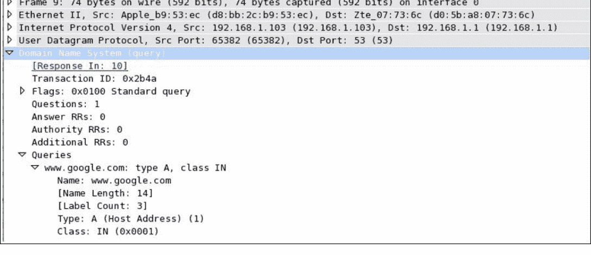

图 4.1：DNS 查询

如果你注意到，这里 DNS 使用 UDP 作为底层协议。如果你想了解更多关于生成的 DNS 查询的信息，只需展开标志部分。该部分将列出各种详细信息，例如递归是否可用、是否期望递归、查询是否被截断、响应码是什么、查询的操作码是什么等等。请参考以下截图。


```text
▼ Flags: 0x0100 Standard query
    0.... .... .... .... = Response: Message is a query
    .000 0.... .... .... = Opcode: Standard query (0)
    .... ..0. .... .... = Truncated: Message is not truncated
    .... ....1 .... .... = Recursion desired: Do query recursively
    .... .... .0.. .... = Z: reserved (0)
    .... .... ....0 .... = Non-authenticated data: Unacceptable
```

展开的 Flags 部分表明该 DNS 数据包的类型是查询，数据包未被截断，并且如果可用，则期望进行递归查询。

针对此查询，你将看到另一个具有相同事务 ID 的数据包，它表示特定查询的关联。这就是响应数据包。对我们查询的响应通常包含我们要查找的域的 IPv4 地址。我们会收到一个 IP，或者可能收到多个可用 IP。如果我们查找的域不可用，那么可能会返回其可能的 CNAME。

请参阅图 4.2 来理解这一点：

```text
▷ Frame 10: 154 bytes on wire (1232 bits), 154 bytes captured (1232 bits) on interface 0
▷ Ethernet II, Src: Zte_07:73:6c (d0:5b:a8:07:73:6c), Dst: Apple_b9:53:ec (d8:bb:2c:b9:53:ec)
▷ Internet Protocol Version 4, Src: 192.168.1.1 (192.168.1.1), Dst: 192.168.1.103 (192.168.1.103)
▷ User Datagram Protocol, Src Port: 53 (53), Dst Port: 65382 (65382)
▼ Domain Name System (response)
    [Request In: 9]
    [Time: 0.004678000 seconds]
    Transaction ID: 0x2b4a
▷ Flags: 0x8180 Standard query response, No error
    Questions: 1
    Answer RRs: 5
    Authority RRs: 0
    Additional RRs: 0
▷ Queries
▼ Answers
    ▷ www.google.com: type A, class IN, addr 173.194.36.84
    ▷ www.google.com: type A, class IN, addr 173.194.36.83
    ▷ www.google.com: type A, class IN, addr 173.194.36.82
    ▷ www.google.com: type A, class IN, addr 173.194.36.80
    ▷ www.google.com: type A, class IN, addr 173.194.36.81
```

图 4.2：DNS 响应

## 异常 DNS 流量

名称解析问题可能对网络性能产生重大影响。你可能遇到的最常见 DNS 问题之一是查找 DNS 服务器数据库中不存在的内容。有时，你试图访问一个确实存在的网站，但你的 DNS 服务器无法解析你给出的域名。也可能是超时情况，即你的客户端等待 DNS 响应的时间超过了预期时间。

在下面的图 4.3 中，我正在尝试检查 http://google.com 域的 A 记录，这实际上是一种不正确的语法。希望它不会被解析：

```text
Anonymous:~ NotFound$ host -t a http://google.com
Host http://google.com not found: 3(NXDOMAIN)
```

图 4.3：http://google.com 的 A 记录

正如预期，我们收到了“未找到”错误。我只尝试了一次，但客户端尝试了两次来解析给定的域名。捕获到的内容如图 4.4 所示：

| 序号 | 时间 | 源 | 目标 | 协议 | 长度 | 信息 |
| --- | --- | --- | --- | --- | --- | --- |
| 1 | 0.000000000 | 192.168.1.103 | 192.168.1.1 | DNS | 77 | 标准查询 0xcdc1 A http://google.com |
| 2 | 0.009283000 | 192.168.1.1 | 192.168.1.103 | DNS | 77 | 标准查询响应 0xcdc1 无此名称 |
| 3 | 0.053794000 | 192.168.1.103 | 192.168.1.1 | DNS | 77 | 标准查询 0xbb93 A http://google.com |
| 4 | 0.056583000 | 192.168.1.1 | 192.168.1.103 | DNS | 77 | 标准查询响应 0xbb93 无此名称 |

图 4.4：DNS 响应 - 无此名称

你可能会遇到多种情况而陷入困境。最好的选择是首先为自己的网络设定一个基准，然后尝试将你的问题与你创建的基准进行比较。例如，检查你尝试解析的名称，启动协议分析器，深入查看名称解析查询和响应。了解完成查询、响应过程等需要多长时间。网络上的每个设备都维护一个本地 DNS 缓存（hosts 文件），它最初用于解析你请求的任何域。如果本地 DNS 缓存没有该域的条目，则请求将被转发到本地网络的 DNS 服务器，由该服务器执行查找。如果找到，将发送其响应。否则，来自本地 DNS 服务器的请求将被转发到本地 DNS 服务器配置查找的外部 DNS 服务器。

## 文件传输协议

自从互联网出现以来，我们一直在使用 FTP。即使在互联网仍是政府和公司组织使用的封闭网络时，FTP 也是备受关注的。

FTP 使用 TCP 协议在指定通道上发起和传输文件。将创建两个通道：一个是命令通道，另一个是专门的数据通道。命令通道用于发送和接收命令及其响应。数据通道用于在客户端和服务器之间发送数据。

通常，FTP 服务器使用端口 21 监听连接，客户端使用任意随机端口发送和接收数据。按照标准，端口 21 用于命令通道，端口 20 用于数据通道。但是，你会观察到使用随机端口号来传输 TCP 数据段。

### 剖析 FTP 通信

客户端与服务器通信时使用两种模式：主动模式和被动模式。这两种模式在发送和接收数据时采用不同的方式。在早期版本中，默认使用主动模式，但现在，你会看到默认使用被动模式。我将使用自己的虚拟网络来讨论每种模式，其中我在 `172.16.136.129` IP 上配置了 FTP 服务器（VSFTPD），客户端位于 `172.16.136.1`。以下各节描述了流程，并展示了客户端和服务器在主动和被动模式下的行为。

### 被动模式

- 客户端向运行在端口 21 的服务器发送 SYN 请求。
- 客户端通过使用的临时端口从服务器接收 SYN/ACK。
- 客户端向服务器发送 ACK，以确认该通道将用于发送命令。请参阅以下截图：

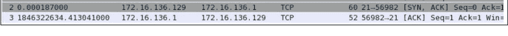

- 现在，客户端将看到欢迎横幅，并被要求输入分配的凭据：

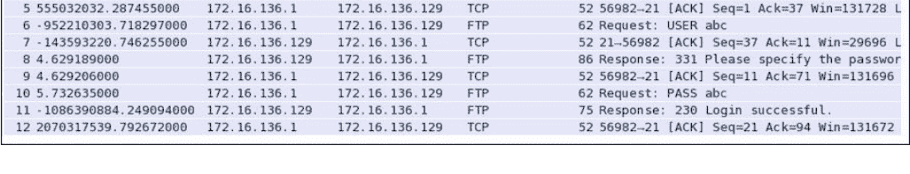

图 4.5：服务器显示欢迎横幅并要求输入凭据

- 通常，被动模式默认必须开启。执行目录列表会告诉你**扩展被动（EPSV）**模式正在使用中。在此模式下，客户端请求服务器在数据端口上监听并等待连接。作为回报，服务器告知客户端用于连接的 TCP 端口号。请参阅以下截图。

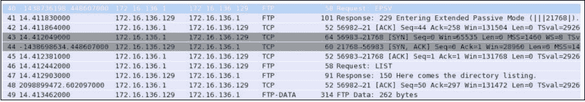

图 4.6：客户端向服务器发送 ACK

在帧 42 中，服务器告知客户端在创建到服务器的任何数据连接时必须使用的 IP 地址和端口号。

- 在帧 42 中，服务器告知我们客户端在创建到服务器的任何数据连接时必须使用的 IP 地址和端口号。随后是一系列 `SYN`、`SYN/ACK` 和 `ACK` 数据包，这些数据包是在两个设备之间创建数据通道所必需的。之后，如帧 46 所示，执行 `LIST` 命令。然后使用客户端和服务器双方使用的临时端口传输数据。

- 数据传输一完成，发送主机就通过传输 `FIN` 数据包来关闭连接，接收方使用 `ACK` 数据包进行确认。接收方也会发送一个 `FIN` 数据包，该数据包也会被确认。如果两个设备想要共享更多数据，则将使用随机端口号创建新的数据通道。

### 主动模式

- 客户端向运行在端口 21 的服务器发送 `SYN` 请求。
- 客户端通过客户端使用的临时端口从服务器接收 `SYN/ACK`。
- 客户端向服务器发送 `ACK`，以确认该通道将用于发送命令。请参阅以下截图：

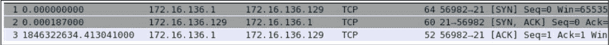

- 现在，客户端将看到欢迎横幅，并被要求输入分配的凭据：


| 序号 | 时间 | 源地址 | 目的地址 | 协议 | 长度 | 信息 |
|---|---|---|---|---|---|---|
| 4 | 0.018723000 | 172.16.136.129 | 172.16.136.1 | FTP | 88 | 响应：220 欢迎使用 Charit 的 FTP |
| 5 | 555032032.287455000 | 172.16.136.1 | 172.16.136.129 | TCP | 52 | 56982-21 [ACK] Seq=1 Ack=37 Win=131728 |
| 6 | -952210303.718297000 | 172.16.136.1 | 172.16.136.129 | FTP | 62 | 请求：USER abc |
| 7 | -143593220.746255000 | 172.16.136.129 | 172.16.136.1 | TCP | 52 | 21-56982 [ACK] Seq=37 Ack=11 Win=29696 |
| 8 | 4.629189000 | 172.16.136.129 | 172.16.136.1 | FTP | 86 | 响应：331 请指定密码 |
| 9 | 4.629206000 | 172.16.136.1 | 172.16.136.129 | TCP | 52 | 56982-21 [ACK] Seq=11 Ack=71 Win=13169 |
| 10 | 5.732635000 | 172.16.136.1 | 172.16.136.129 | FTP | 62 | 请求：PASS abc |
| 11 | -1086390884.249094000 | 172.16.136.129 | 172.16.136.1 | FTP | 75 | 响应：230 登录成功。 |
| 12 | 2070317539.792672000 | 172.16.136.1 | 172.16.136.129 | TCP | 52 | 56982-21 [ACK] Seq=21 Ack=94 Win=13167 |

**图 4.7：客户端收到欢迎横幅并被要求输入凭据**

- 现在，我们必须关闭被动模式，因为通常情况下它默认是开启的。完成后，我们可以创建一个用于传输的数据通道，请参考以下截图：

| 序号 | 时间 | 源地址 | 目的地址 | 协议 | 长度 | 信息 |
|---|---|---|---|---|---|---|
| 40 | 894485615.991284000 | 172.16.136.1 | 172.16.136.129 | FTP | 81 | 请求：EPRT \|1\|172.16.136.1\|57197\| |
| 41 | 894485615.991670000 | 172.16.136.129 | 172.16.136.1 | FTP | 103 | 响应：200 EPRT 命令成功。 |
| 42 | 290386415.628665000 | 172.16.136.1 | 172.16.136.129 | TCP | 52 | 57196-21 [ACK] Seq=67 Ack=260 Win=13156 |
| 43 | -544276953.032968000 | 172.16.136.1 | 172.16.136.129 | FTP | 58 | 请求：LIST |
| 44 | 894485615.992341000 | 172.16.136.129 | 172.16.136.1 | TCP | 60 | 20-57197 [SYN] Seq=0 Win=29200 Len=0 M |
| 45 | 894485615.992407000 | 172.16.136.1 | 172.16.136.129 | TCP | 64 | 57197-20 [SYN, ACK] Seq=0 Ack=1 Win=65 |
| 46 | 894485615.992662000 | 172.16.136.129 | 172.16.136.1 | TCP | 52 | 20-57197 [ACK] Seq=1 Ack=1 Win=29696 Le |
| 47 | 894485615.992690000 | 172.16.136.1 | 172.16.136.129 | TCP | 52 | [TCP 窗口更新] 57197-20 [ACK] Seq: |
| 48 | -540049189.689031000 | 172.16.136.129 | 172.16.136.1 | FTP | 91 | 响应：150 这里是目录列表 |
| 49 | 894485615.993039000 | 172.16.136.1 | 172.16.136.129 | TCP | 52 | 57196-21 [ACK] Seq=73 Ack=299 Win=1314 |
| 50 | 894485615.993489000 | 172.16.136.129 | 172.16.136.1 | FTP-DATA | 314 | FTP 数据：262 字节 |
| 51 | 349348548.220939000 | 172.16.136.1 | 172.16.136.129 | TCP | 52 | 57197-20 [ACK] Seq=1 Ack=263 Win=13150 |
| 52 | 323940847.628665000 | 172.16.136.129 | 172.16.136.1 | TCP | 52 | 20-57197 [FIN, ACK] Seq=263 Ack=1 Win= |
| 53 | 366125747.443723000 | 172.16.136.1 | 172.16.136.129 | TCP | 52 | 57197-20 [ACK] Seq=1 Ack=264 Win=13150 |
| 54 | 894485615.994235000 | 172.16.136.129 | 172.16.136.1 | FTP | 76 | 响应：226 目录发送完成。 |

**图 4.8 创建用于传输目的的数据通道**

帧 40 显示客户端正在请求使用 EPRT |1|172.16.136.1|57197| 命令关闭被动模式。扩展端口（EPRT）用于指定可用于数据连接的扩展地址。该命令接受三个参数：网络协议、网络地址和端口号。

- 现在，每当客户端尝试发起连接时，它必须发送到 EPRT 命令指定的特定地址。在此之前，每次数据连接服务器都会告知客户端要使用的临时端口。

你已经了解了 FTP 服务器支持的主动和被动通信模式，也了解了它们的行为方式。在对任何 FTP 连接进行故障排查时，检查模式将会很有用，并且可以节省时间。

## 剖析 FTP 数据包

通常，客户端发送的每个请求都是一个特定的命令集，服务器会以数字值后跟文本消息的方式进行响应。请参见以下截图：

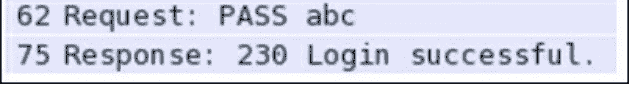

如你所见，服务器要求输入密码，客户端提供了密码。在列表窗格中就可以看到它以明文形式在网络上传输。一旦服务器收到并验证密码正确，就会显示相应的消息。在我们的例子中，密码是正确的，因此客户端收到 `230` 作为响应代码，后跟 `Login Successful`（登录成功）消息。

客户端发出的命令可以带参数，也可以不带参数，设备之间流动的数据可以简单地通过数据包的 TCP 头部看到。请参见下面的图 4.9：

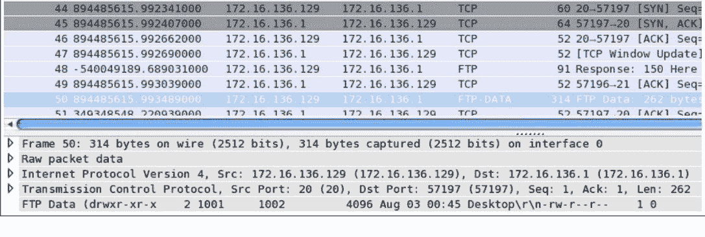

图 4.9：返回的 FTP-DATA

帧 43 显示客户端发出了 LIST 命令，该命令由服务器处理，并且有 262 字节的数据返回给我们。选择帧 50 以进一步查看 TCP 头部的內容。使用 FTP 的最大缺点之一是所有数据都以明文传输，包括用户名和密码。

重新组装 FTP 数据流很容易，因为除了数据本身，没有其他内容在传输。没有附加到传输数据包上的代码或命令，这使得 Wireshark 和用户都能轻松理解。要重新组装 FTP 数据包的 TCP 流，只需右键单击选中的数据包，选择 **Follow TCP Stream**（跟踪 TCP 流）选项，然后以原始形式查看。请参见下面的图 4.10：

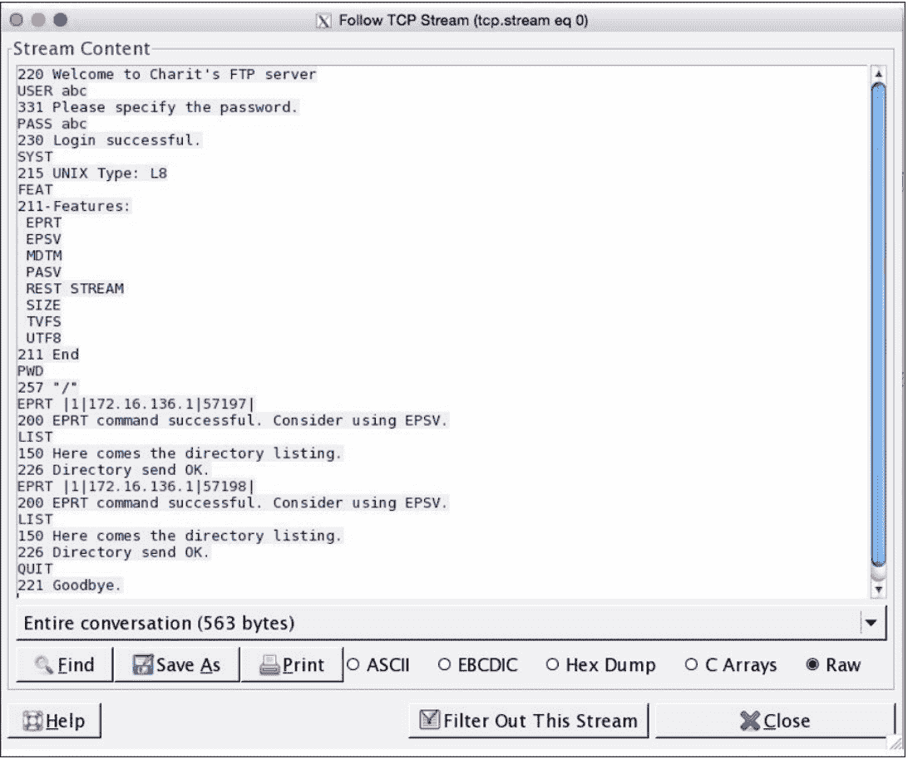

图 4.10：FTP 流

客户端与服务器之间通过数据通道和命令通道进行的整个通信都被转换为人类可读的格式。红色文本是客户端发送的内容，蓝色文本是客户端接收的内容。如今，我们有一些高级协议可以创建加密通道。其中之一是**安全文件传输协议（SFTP）**。

下载或上传某些内容。让我举一个例子来说明。我在 192.168.1.105 运行一台 Kali Linux 机器，在 192.168.1.104 运行一台 Windows 机器。通过 Kali，我创建了一个小恶意软件，受害者（Windows）下载并安装了它。一旦执行，我们就会获得该设备的 shell。然后，我们可以在 shell 中启动 FTP，连接我们的 Kali 机器以进行权限提升。

请参见以下捕获攻击者与受害者之间 FTP 流量的截图：

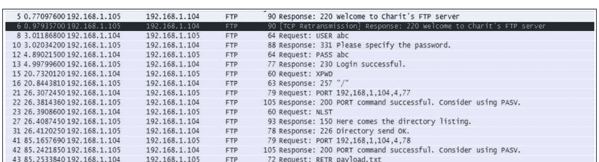

图 4.12：受害者的 FTP 捕获

如你清晰所见，攻击者连接到 FTP 服务器并下载了 payload.txt 文件，该文件可能被用来获取该机器的 root 权限。

如果此类性质的东西能够绕过你的防火墙和其他安全设备，那么请考虑改进你创建的配置，并尽量避免将来出现这些情况。有时，这类活动也可能是合法的，但这不应该阻止你进一步调查。一个几 KB 的小文件就足以危及你的整个网络。

## 超文本传输协议

网络上的数据使用 HTTP 应用层协议进行传输。HTTP 中的正常通信是一种请求/响应模型，其中客户端和服务器之间的通信由一组规则协调。客户端向服务器请求某个资源，然后收到一个状态码，该状态码指定了所请求资源的当前状态。如果资源可用，那么资源也会随状态码一起发送。HTTP 是最流行、使用最广泛的协议之一，用于将浏览器请求的数据从相应的服务器传输过来。互联网世界主要由运行在传输层之上的 HTTP 支配。

### 工作原理——请求/响应

每次你访问一个网站时，这个智能协议都会负责你的网页浏览体验。Web 服务器利用 HTTP 协议将其包含的网页提供给请求的客户端。在每次 HTTP 会话开始时，都会进行 TCP 三次握手。它在通信主机之间创建一个专用通道，随后是 HTTP 和数据包，它们在会话活动期间被发送和接收。例如，你正在访问位于 http://172.16.136.129 的 Web 服务器，客户端位于 172.16.136.1。使用我们的客户端-服务器基础设施，我们将尝试捕获发送的请求和接收的响应。

我将尝试访问前面提到的服务器上的主页，并捕获整个会话期间生成的流量，即发送的请求和接收的响应。请按照此处提到的操作来复现该场景。


这三个数据包是TCP三次握手的数据包，其中我们的客户端请求服务器创建一个专用通道。在我们的例子中，连接成功了。但是，如果服务器守护进程没有运行，或者由于任何原因服务器没有接受我们的请求，那么我们可能会看到类似下面这样的RST ACK数据包：

| 1 0.000000000 | 172.16.136.1 | 172.16.136.129 | TCP | 64 59783-80 [SYN] Seq=0 |
| 2 0.000315000 | 172.16.136.129 | 172.16.136.1 | TCP | 40 80-59783 [RST, ACK] |

图4.14：RST和ACK数据包，因为服务器未接受请求

这个错误表明服务器已停止服务，或者服务器本不应响应我们的请求。

- 在TCP数据包之后，你可以看到我们的客户端发送的第一个HTTP请求。每个请求都包含发送到服务器的几个元素：

```
GET / HTTP/1.1\r\n
Host: 172.16.136.129\r\n
If-None-Match: "12625d-bc-51c6ab45063d1"\r\n
Accept: text/html,application/xhtml+xml,application/xml;q=0.9,*/*;q=0.8\r\n
If-Modified-Since: Mon, 03 Aug 2015 16:31:40 GMT\r\n
User-Agent: Mozilla/5.0 (Macintosh; Intel Mac OS X 10_10_3) AppleWebKit/600.6.3
Accept-Language: en-us\r\n
Accept-Encoding: gzip, deflate\r\n
Connection: keep-alive\r\n
```

图4.15：HTTP请求

- 这就是请求的样子。在第一行中，有三个东西作为参数传递给服务器，分别是HTTP方法和请求的资源位置“/”（根目录）。
- 第二行指定了HTTP/1.1协议请求所必需的Host参数。该字段的值是你在浏览器地址栏中输入的Web服务器地址。
- 第四行是ACCEPT参数，它说明请求方客户端在响应中可以接受哪些类型的内容。
- `If-modified-since`参数从客户端发送到服务器，其中包含你上次向服务器发出请求的日期和时间。如果自上次请求以来服务器内容已更改，你将收到新的更新页面。否则，你的系统将显示本地缓存的页面，从而节省一些资源。
- 下一个字段是`User-Agent`，它指定你用来访问网页的浏览器相关信息。服务器将使用此信息向你呈现与浏览器兼容的内容。
- 诸如`Accept-Language`和`Accept-Encoding`之类的参数被传递给服务器，以告知客户端可接受的内容类型。因此，当服务器准备响应内容时，应考虑这些因素。
- `Connection-Alive`参数指定客户端希望在此特定请求处理完毕之后保持连接有效。

所有HTTP数据包通常发送到Web服务器的80端口（其他常见的Web服务器端口包括8080、3132、8088等，Wireshark会根据HTTP协议首选项对这些端口进行解析）。

## 响应

- 正如你所看到的，在第四个数据包之后，服务器确认了客户端访问服务器Web根目录的请求。服务器开始传输客户端请求的资源。列表窗格中的第六个数据包是客户端收到的内容，它包含一个状态码和一条简短消息，以及所请求资源的内容。请参见下面图4.16中的HTTP响应：

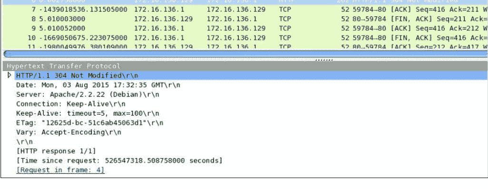

图4.16：HTTP响应

- 作为TCP通信的一部分，客户端将确认服务器发送的每个数据包。在第七个数据包中可以看到，客户端试图为它收到的资源发送一个ACK。
- 让我们解析第六个数据包的响应元素。第一行包含响应中发送的三个参数。它们表示所用的HTTP协议版本、状态码（在我们的例子中是304，它表示所请求的资源自Date参数中指定的时间以来没有变化），最后是状态码的简要说明（在我们的例子中是“Not Modified”（未修改））。
- 在第三行中，Server参数指明了正在运行的Web服务器的名称和版本。我们可以看到Apache/2.2.22是位于172.16.136.129的服务器。
- 第四行和第五行表示服务器希望保持连接存活。服务器希望保持该连接的时间长度也体现在响应给我们的下一行参数中。其余内容在接下来的几行中，是一些配置参数。

这是一个非常基础的例子，用于检查客户端和服务器之间交换的请求与响应。然而，这种基础操作实际上就是你每次访问网站时都会发生的事情。如前所述，我们会收到一个状态码以及一段简短的描述作为响应。你在浏览器中每打开一个标签页，就会在通过IP地址和Web服务器运行的端口号连接的客户端与服务器之间创建一个新的套接字。

## 不寻常的HTTP流量

前面提到的所有细节都属于正常流量模式的一部分。接下来我们即将看到的是在处理HTTP时可能遇到的一些不寻常的流量模式。我会尝试提及一些注意事项，这些内容在故障排除和分析HTTP时可能对你有所帮助。大多数HTTP问题都围绕诸如404、某种重定向、DNS解析问题和服务器相关错误等。让我逐一详细说明每种情况。

例如，你在访问一个Web服务器，正在寻找当前不可用的内容，或者所请求资源的地址已更改。在这种情况下，你会收到一个404状态码，表示服务器上找不到所请求的资源。请参见下面的截图，我尝试在一个Web服务器上请求一个名为abc.txt的文件，但该文件不存在：

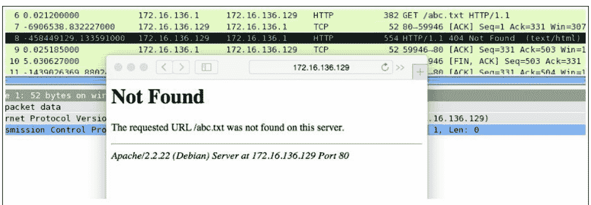

图4.17：HTTP 404

在列表窗格中，你可以看到所请求的资源不可用。因此，我们得到404 Not Found错误。如果有人试图对你的Web服务器执行目录列表操作，这类错误也可能是恶意的。将此类404数据包的着色规则更改为不同于普通HTTP数据包规则的样式，可以让我们迅速注意到。正如你所看到的，第八个数据包是一个HTTP数据包，应用了不同的着色方案。

用户请求的重定向通常在某个所请求资源的地址已更改到另一个地址或资源不可用时进行。现在，为了让你理解重定向，我对我们的基础设施做了一些修改，可以很容易地在下面所示的图中看到：

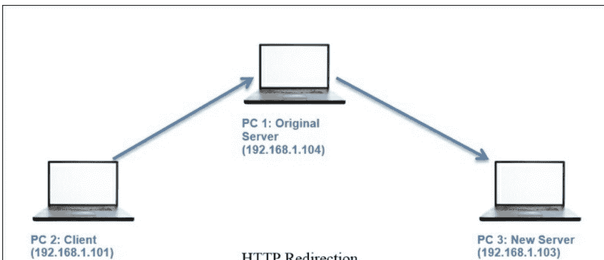

现在，从客户端发送到位于192.168.1.104的原始服务器的请求将被重定向到位于192.168.1.103的新服务器，客户端无需再做任何操作。要配置重定向，你必须修改服务器的配置文件。以下捕获的数据包描述了发生的重定向。请参见图4.18中的下一个列表窗格：

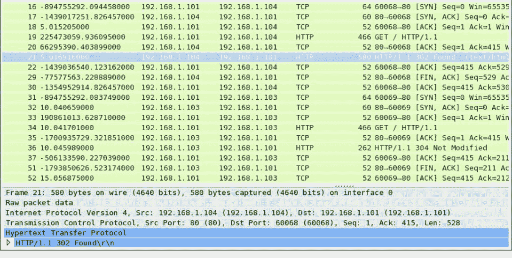

图4.18：HTTP重定向

正如你所看到的，首先与104处的旧服务器发起了一次TCP握手，随后发送了一个HTTP GET请求。104处的服务器在第21个数据包中以302 Found响应，这是重定向的提示。我们的请求被发送到位于103的新服务器，我们再次与它发起TCP三次握手（第31个数据包）。在第31个数据包之后，目标字段已改为新服务器的地址。

进一步调查第21个数据包，我们可以看到将我们的请求重定向到新服务器的内容。展开详细信息窗格中HTTP部分下的“Line-based text data”部分。请参见下面的截图：

```
Line-based text data: text/html
<!DOCTYPE HTML PUBLIC "-//IETF//DTD HTML 2.0//EN">\n
<html><head>\n
<title>302 Found</title>\n
</head><body>\n
<h1>Found</h1>\n
<p>The document has moved <a href="http://192.168.1.103">here</a>.</p>\n
<hr>\n
<address>Apache/2.2.22 (Debian) Server at 192.168.1.104 Port 80</address>\n
</body></html>\n
```


我们已在DNS协议部分讨论了DNS解析问题。例如，如果请求的Web服务器无法使用内部DNS服务器以及其他外部服务器解析你的请求，那么你将无法访问网站。即使DNS服务器工作正常而你无法访问网站，那么问题可能是拥塞，即服务器无法同时处理多个请求。这将导致诸如`408 Request Timeout`、`429 Too Many Requests`甚至`404 Not Found`等错误。HTTP的世界极为庞大，日常遇到的情况因人而异。你应该牢记的最重要事实是，如果所有基础概念都清晰，那么完成分配给你的任务才会容易。没有什么能胜过常识加上开箱即用的参数。为了理解协议的真实运作方式，我将使用以下架构。

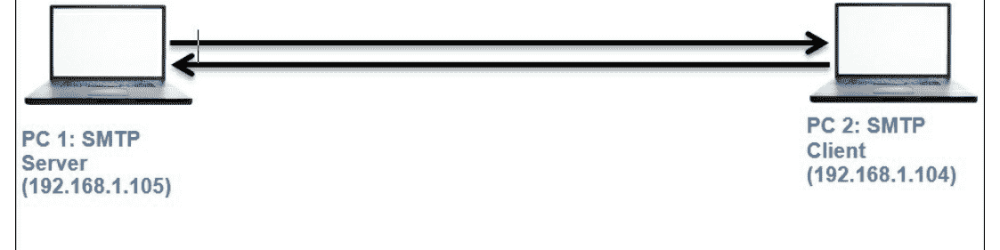

## 常见的与不常见的SMTP流量

使用来自Kali Linux的netcat客户端，我将尝试连接运行在Windows机器上的SMTP邮件服务。一旦在服务器和客户端之间创建了专用通道，服务器就会表明它已准备好接受任何传入的命令。同时，服务器会以带简短摘要的数字代码进行响应。我按照以下步骤连接并发送了一封电子邮件：

- 1. 使用netcat打开连接 `nc -nv 192.168.1.105 25`。
- 2. 使用 `HELO testmail` 命令初始化SMTP会话。
- 3. 使用 `MAIL FROM:<abc@charit.com>` 命令指定发件人地址。
- 4. 使用 `RCPT TO:<efg@charit.com>` 命令指定收件人地址。
- 5. 要在邮件正文中输入数据，请键入 `DATA` 并按回车。现在，输入你希望发送的消息。完成邮件编写后，键入一个 `.` 表示结束并按回车。
- 6. 现在，你的消息将被发送。如果你想发送更多邮件，请遵循相同流程；否则，你可以关闭与邮件服务器的连接。键入 `QUIT` 即可。

我执行的这些命令生成了若干数据包，这些数据包以非常细粒度的形式包含了会话细节。我还创建了一个捕获过滤器，只捕获与客户端和服务器相关的数据包，这有助于我仔细分析与会话相关的数据包；并阻止其他数据包进入列表窗格。只有在服务器配置为允许明文消息通信且无需任何身份验证时，上述所有命令才会生效，请参考以下截图描述以了解类似行为。

|  |  |  |  |  |
|---|---|---|---|---|
| 1 0.00000000 | 192.168.1.104 | 192.168.1.105 | TCP | 60 57073-25 [SYN] Seq=0 Win=29200 Len=0 MSS |
| 2 1439081651.426767000 | 192.168.1.105 | 192.168.1.104 | TCP | 60 25-57073 [SYN, ACK] Seq=0 Ack=1 Win=1638 |
| 3 -41448.227586000 | 192.168.1.104 | 192.168.1.105 | TCP | 52 57073-25 [ACK] Seq=1 Ack=1 Win=29696 Len |
| 4 4205130.997054000 | 192.168.1.105 | 192.168.1.104 | SMTP | 90 S: 220 Charit’s.com ESMTP 服务器就绪。 |
| 5 1439081652.1437351000 | 192.168.1.104 | 192.168.1.105 | TCP | 52 57073-25 [ACK] Seq=1 Ack=39 Win=29696 Le |
| 6 -287363963.384218000 | 192.168.1.104 | 192.168.1.105 | SMTP | 61 C: helo abc |
| 7 1744899513.488830000 | 192.168.1.105 | 192.168.1.104 | SMTP | 82 S: 250 Charit’s.com 你好，abc。 |
| 8 1439081657.529807000 | 192.168.1.104 | 192.168.1.105 | TCP | 52 57073-25 [ACK] Seq=10 Ack=69 Win=29696 L |
| 9 1744901809.636862000 | 192.168.1.104 | 192.168.1.105 | SMTP | 79 C: mail from:<abc@charit.com> |
| 10 1744899513.488830000 | 192.168.1.105 | 192.168.1.104 | SMTP | 81 S: 250 发件人正常 - 请发送RCPT。 |
| 11 1439081671.468558000 | 192.168.1.104 | 192.168.1.105 | TCP | 52 57073-25 [ACK] Seq=37 Ack=98 Win=29696 L |
| 12 1439081686.949708000 | 192.168.1.104 | 192.168.1.105 | SMTP | 78 C: rcpt to:<efg@charit.com> |
| 13 4206566.333758000 | 192.168.1.105 | 192.168.1.104 | SMTP | 91 S: 250 收件人正常 - 请发送RCPT或DATA。 |
| 14 1439081687.064346000 | 192.168.1.104 | 192.168.1.105 | TCP | 52 57073-25 [ACK] Seq=63 Ack=137 Win=29696 |
| 15 1439081688.805525000 | 192.168.1.104 | 192.168.1.105 | SMTP | 57 C: data |
| 16 4207044.779326000 | 192.168.1.105 | 192.168.1.104 | SMTP | 91 S: 354 好的，发送数据，以CRLF.CRLF结束。 |
| 17 2122359292.356797000 | 192.168.1.104 | 192.168.1.105 | TCP | 52 57073-25 [ACK] Seq=68 Ack=176 Win=29696 |
| 18 1439081690.221834000 | 192.168.1.104 | 192.168.1.105 | SMTP | 55 C: DATA片段，3字节 |
| 19 1439081690.447964000 | 192.168.1.104 | 192.168.1.105 | SMTP | 55 TCP 重传DATA片段，3 |
| 20 1439081690.454208000 | 192.168.1.105 | 192.168.1.104 | TCP | 52 25-57073 [ACK] Seq=176 Ack=71 Win=16314 |
| 21 1439081690.455528000 | 192.168.1.105 | 192.168.1.104 | TCP | 64 [TCP Dup ACK 20#1] 25-57073 [ACK] Seq=17 |
| 22 168258645.511998000 | 192.168.1.104 | 192.168.1.105 | SMTP | 54 C: DATA片段，2字节 |
| 23 419451065.438925000 | 192.168.1.105 | 192.168.1.104 | SMTP | 75 S: 250 数据接收成功。 |
| 24 1439081690.858935000 | 192.168.1.104 | 192.168.1.105 | TCP | 52 57073-25 [ACK] Seq=73 Ack=199 Win=29696 |
| 25 168257924.091710000 | 192.168.1.104 | 192.168.1.105 | SMTP | 57 C: DATA片段，5字节 |
| 26 1439081694.129351000 | 192.168.1.105 | 192.168.1.104 | SMTP | 95 S: 221 Charit’s.com 服务正在关闭通道 |
| 27 850006670.085950000 | 192.168.1.105 | 192.168.1.104 | TCP | 52 25-57073 [FIN, ACK] Seq=242 Ack=78 Win=1 |
| 28 850006670.085950000 | 192.168.1.104 | 192.168.1.105 | TCP | 52 57073-25 [ACK] Seq=78 Ack=242 Win=29696 |

### 图4.19：SMTP会话

数据包1-3是TCP握手包。握手发生在客户端和服务器之间。在第四个数包中，客户端收到一条消息，响应代码为220。这意味着服务器已准备好并能够响应客户端的请求。在第六个数包中，客户端使用HELO命令初始化标准SMTP会话（你可能在想为什么列表窗格中列出的大多数数据包以C或S开头。从客户端发送的请求以字符C标记，服务器响应以字符S标记。）。然后，输入发件人和收件人的电子邮件地址，服务器确认这些地址正确，并在数据包10和13中返回响应代码250。之后，使用DATA命令输入电子邮件正文，服务器在数据包23中成功接收。最后，用户通过发出QUIT命令优雅地关闭连接，服务器在数据包26中确认，从而发送FIN、ACK。

现在，我将向你们介绍SMTP的阴暗面，你可能已经亲眼见过，或者总有一天会遇到。所谓阴暗面，我指的是那些通常不应该出现在列表窗格中的数据包。然而，如果它们出现了，那么你必须检查你的协议配置。为此，我想向你们介绍一些你应该了解的相当常见的场景。


我首先想到的最重要的情况是服务器和客户端无法建立专用的通信通道；简而言之，TCP握手不成功。这可能有多种原因，例如邮件服务器守护进程未运行，邮件服务器未运行在默认端口上，邮件服务器守护进程已达到允许的最大同时客户端连接数，或者不允许来自特定子网的连接，还可能存在多种相关场景。下面的列表窗格描述了两种流量异常：

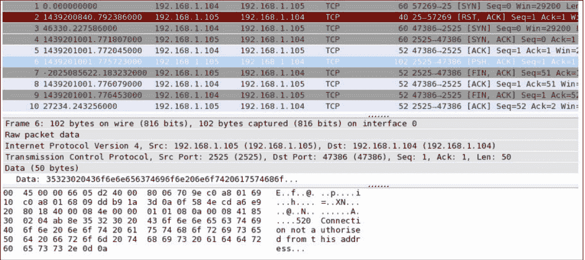

图4.20：SMTP异常流量

前两个数据包是由于错误而生成的，该错误阻止了TCP握手的发生。此错误可能由多种因素引起，下面列出了一些因素：

- 邮件服务器守护进程未运行
- 邮件服务器守护进程的默认端口已更改
- 邮件服务器守护进程已达到最大同时连接数限制（DDoS攻击）。
- 邮件服务器的配置已被篡改

现在假设客户端已经知道了连接应发起的正确端口号，但会话仍未成功建立。观察从数据包3到数据包10（最后一个数据包）的流量。TCP三次握手已发生，但随后客户端突然被踢出会话。服务器做出这种响应的可能原因是什么？也许是因为存在某些限制（如IP或MAC过滤）而不允许客户端连接。

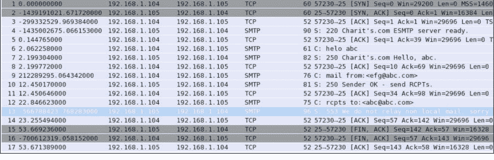

图4.21：客户端因某些限制而无法连接

如今广泛可见的另一种异常流量是垃圾邮件发送者和在野外游荡的垃圾邮件僵尸网络收集电子邮件。垃圾邮件发送者试图从可公开访问的邮件服务器中收集电子邮件，以验证哪些电子邮件地址有效，哪些无效。例如，看下面的截图（图4.15），其中恶意用户试图使用**邮件发件人**字段验证电子邮件ID是否存在，也可以使用VRFY命令验证电子邮件地址。根据响应，用户将知道电子邮件是否有效。观察数据包13的服务器响应。这类攻击使用自制字典文件进行，该文件匹配当前域名的要求。一旦电子邮件被验证，垃圾邮件发送者就可以执行各种形式的社会工程攻击。SMTP协议中大于350的响应代码可能表示某种错误，这会降低网络性能，从而增加延迟。

## 会话发起协议与IP语音

SIP是VOIP协议族的一部分，它只是一种信令协议，用于在网络环境中创建、管理和终止IP语音会话。SIP的示例可以是双向电话呼叫或会议呼叫，包括多个主机在场的多媒体会话。该协议通常讨论远程双方（即打算通信的主机/节点）之间会话的发起。发起完成后，数据通过专用信道传输，实时传输协议（RTP）在其中提供帮助。基本上，RTP协议族管理所有多媒体项目的传输和流量控制（RTCP控制流）。

在使用此协议时，最常用的两个工具是“统计”菜单，我们将在其中介绍“协议分层”、“数据包长度”和“流量图”，这些将让您了解两个主机之间来回传输的数据。在“电话”菜单下，您将看到“RTP”和“VOIP呼叫”选项，它们可以帮助我们组装VOIP呼叫流。然后我们可以回放这些呼叫流来收听对话，这正是让我对Wireshark感到兴奋的地方。

SIP运行在UDP协议之上，通常使用端口5060。所有这些在基于IP的环境中结合起来，使我们能够通过支持VoIP的设备即时拨打电话给朋友。SIP使VOIP电话服务器能够轻松确定用户位置。它为我们提供了不同的呼叫管理功能，例如发起呼叫、断开呼叫、将某人加入会议呼叫、转接呼叫等。SIP不会帮助您维持通话质量，但SIP是各种服务使用的最重要标准之一。在我们直接查看和收听流量之前，让我们先熟悉一下流量在IP语音呼叫中是如何流动的。

我们将考虑三个参与方：其中两个是客户端，一个是IP电话服务器，它负责在两个通信主机之间来回传输所需和必要的数据包。下图描绘了一个小型基础电话架构，并列出了所采取的各种步骤：

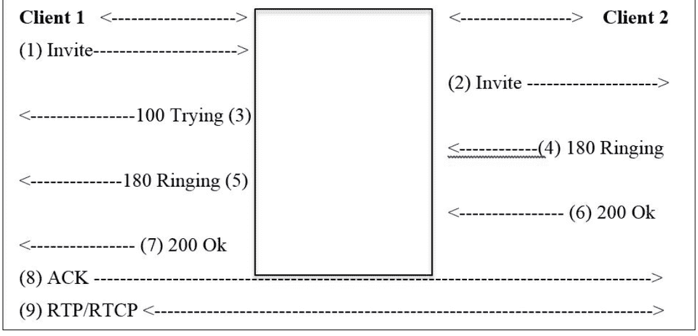

- **客户端1** 使用SIP发送**Invite**请求以发起会话。
- 中间的电话服务器将请求转发给**客户端2**。
- 电话服务器通过**100 TRYING**数据包向**客户端1**确认。
- 当**客户端2**开始振铃时，**客户端1**会收到**180 RINGING**数据包。当另一端的**客户端2**收到呼叫时，它发送**200 OK**数据包，该数据包被转发给**客户端1**。
- 现在，客户端发送**ACK**数据包以确认收到**200 OK**数据包。
- 现在，双方通过专用信道连接，RTP/RTCP数据包开始在信道上双向流动。
- 一旦双方通话完成，通信主机将发送**BYE**数据包，并由另一端确认。
- 如果您观察，大多数数据包都通过电话服务器传递。因为电话服务器只知道所连接主机的确切位置。
- 一旦连接成功建立，所有数据包均由客户端直接发送和接收，无需服务器干预。

我使用Asterisk PBX配置了一个小型VoIP电话基础设施，您可以从供应商网站免费下载。VOIP服务器位于192.168.1.107，客户端1位于192.168.1.104，客户端2位于192.168.1.107。然后，我下载了X-Lite

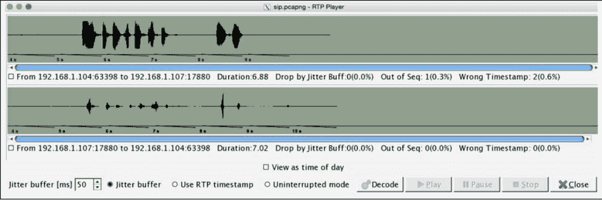

图4.27：RTP播放器

如果要播放消息，请选中滚动条下方的复选框，然后点击**播放**。这里列出了与组装后的VOIP流相关的各种有用的详细信息。

## 异常流量模式

Wireshark拥有众多工具，可帮助用户维护特定网络基础设施的服务质量（QoS），还有一个工具可帮助识别各种日常流量异常。处理SIP服务器时，一种常见的流量类型是`INVITE`请求，该请求由一个客户端发送，用于发起与另一个客户端的连接。您可能已经知道，此过程是一个三次握手，发起请求的客户端应在会话创建完成后进行确认。如果请求的客户端不响应`ACK`，而是发送另一个`INVITE`请求，会发生什么？通常，服务器会尝试将客户端连接到所请求的客户端机器，同时等待前一个请求的`ACK`响应。现在，假设客户端通过网络上的不同客户端发送了100个`INVITE`请求，并且甚至懒得为所创建的任何会话发送`ACK`。这可能导致DoS攻击（`INVITE`洪水攻击），其中SIP服务器将无法处理任何进一步的请求（`INVITE`的缓冲区大小为100）。要解决此问题，您可以应用显示过滤器查看从客户端发送的`INVITE`请求，或应用状态码为`200:OK`的过滤器。

除了DoS攻击之外，您的网络还可能因数据包拥塞而变慢，或者您可能无法连接到网络上的另一个客户端。换句话说，如果呼叫建立出现延迟（平均呼叫建立时间较长），您的呼叫将无法接通。一旦您在生产环境中工作，您将遇到多种情况。因此，Wireshark及其包含的各种强大工具可以为我们提供帮助。

例如，如果某个客户端尝试拨打无效的分机号，他们将收到错误，并且呼叫无法接通。这种情况将生成如下所示的数据包：

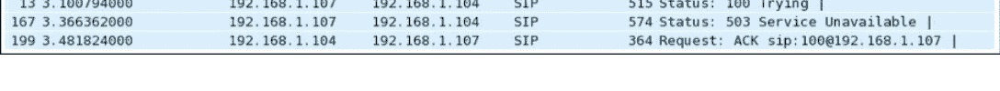

我建议您过滤包含错误代码大于399的SIP数据包，并使用`sip.Status-Code > 399`创建显示过滤器。请参见以下截图，其中列出了客户端1尝试呼叫时生成的多个错误：


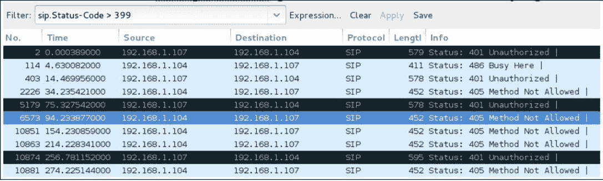

图 4.28：SIP 错误

## 解密加密流量（SSL/TLS）

是的，你可以使用 Wireshark 将在线 TLS 流量解密为纯文本 SSL 流。Google Chrome 和 Firefox 会查找一个存储 TLS 会话密钥的日志文件。按照以下步骤解密加密流量：

- **1.** 创建一个名为 `SSLKEYLOGFILE` 的环境变量，指向一个文本文件。你的浏览器每次启动时都会查找该文件。要创建环境变量，右键单击“我的电脑”| 进入“高级设置”| “环境变量”| “新建”| 指定名称：`SSLKEYLOGFILE`，值：`C:/Users/username/sslkeylog.txt`，然后点击“确定”。

- **2.** 我已创建一个空白文本文件 `C:/Users/username/sslkeylog.txt`（让你的新环境变量指向该文件）。

- **3.** 现在，打开浏览器并访问一个启用了 TLS/SSL 的网站。为了演示，我在 192.168.1.105 运行了自己的 SSL Web 服务器，客户端也位于 192.168.1.105。

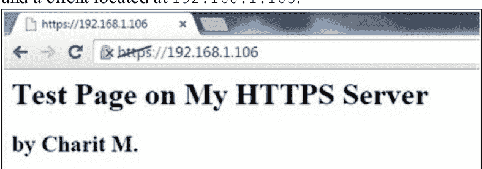

我创建的证书是自签名的；这就是为什么你会在地址栏中看到 https 上有一条红色斜线。访问任何启用 SSL 的安全网站后，你的 `sslkeylog.txt` 将填入一些随机数，如下面的屏幕截图所示。如果没有，请在继续之前仔细检查你的设置：

```
CLIENT_RANDOM 17999a56ea29e69bcb242b441b1b519e0b3b16e79b9a46bfdcb280fd4eb027e1786e3766c7313f1117b14
```

- **4.** 我在 Wireshark 中捕获了客户端和服务器之间的全部流量。现在，转到“编辑”|“首选项”|“协议”|“SSL”|“（预）主密钥日志文件名”| /path/to/sslkeylog.txt |“确定”。然后，右键单击 SSL 数据包（确保选择“解密数据包数据”，该选项应出现在字节窗格中）并跟踪 SSL 流。现在，你将看到类似图 4.29 的内容：

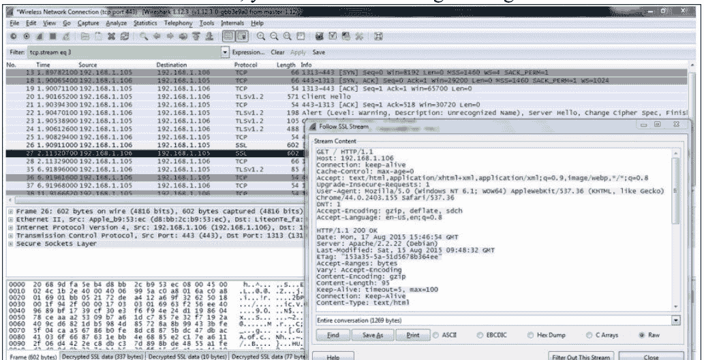

图 4.29：解密 SSL 流量

这是最简单的方法之一，只需点击几下即可解密 SSL 流量。另一种方法是将服务器的 RSA 私钥输入 Wireshark 的 SSL 首选项中，结果也是一样的。

## 总结

域名系统/服务（Domain Name System/Service）是一种用于将网站名称解析为 IP 地址的协议。借助这一域名服务，你的机器可以在基于 IP 的网络中进行通信。如果启用了区域传输（zone transfer），未经身份验证的恶意用户可以向名称服务器请求区域数据，这被认为是极具恶意且危险的。

自互联网诞生以来，文件传输协议（FTP）一直用于在机器之间传输文件，并且在当今的现代网络中仍在使用。FTP 最不安全的地方在于数据以纯文本形式传输，除非你使用某种加密形式的 FTP 客户端-服务器基础设施，否则很容易被协议分析器捕获。

Web 浏览器用于通过超文本传输协议（HTTP）呈现和来回传输基于 Web 的内容。它通常也被称为请求/响应模型，即主机请求某个资源，服务器以状态码以及资源（如果可用）作为响应。应密切关注大于 399 的状态码；我建议应用不同的着色方案。

SMTP 协议用于发送电子邮件。它是一种未加密的协议，通常不采用认证机制。每条 SMTP 命令及其对应的参数都以纯文本形式在线路上传输，使用 Wireshark 可以轻松嗅探到。

VoIP 流量由两部分组成：用于数据传输的 RTP 和用于创建会话的 SIP 协议。信令协议创建并管理会话，而实时传输协议（RTP）则用于承载语音本身。使用 Wireshark，任何人都可以捕获并重组数据包，从而收听通信会话。在处理这些协议时，应注意拥塞、抖动、延迟和回声问题，以保持服务质量。

## 练习题

- Q.1 当你在互联网上浏览时，DNS 协议有什么重要性？
- Q.2 你如何定义区域传输和递归 DNS 查询？
- Q.3 在 DNS 查询中，“期望递归”（recursion desired）和“可用递归”（recursion available）之间有什么区别？
- Q.4 存在多少种 DNS 记录类型？解释 AAAA 记录类型的用途，以及“非权威回答”（non-authoritative answer）是什么意思？
- Q.5 区分 FTP 的主动模式和被动模式。解释哪种模式更好。
- Q.6 如果要求你加密 FTP 会话，你能提出什么解决方案？解释它会带来什么不同。
- Q.7 使用虚拟基础设施或物理基础设施，在其中任意一台机器上安装 FTP 服务器，然后在 Wireshark 中捕获实时数据包的同时尝试与它通信。
- Q.8 找出如何限制最大登录尝试次数。这种限制如何影响 FTP 服务器的整体安全性？
- Q.9 为什么我们将 HTTP 通信称为请求/响应方式？在发起连接时，三次握手的目的是什么？
- Q.10 我们目前使用哪个 HTTP 版本？旧版本和新版本之间有什么区别？
- Q.11 当你的浏览器发出 HTTP 请求时，请求中还会发送各种其他参数。为什么会这样？随请求发送的 Accept-Encoding 和 Accept-Language 参数有什么用途？
- Q.12 访问你选择的网站并浏览几个页面，同时在 Wireshark 中捕获所有数据包。然后创建一个显示过滤器，检查整个会话中是否存在任何重定向。
- Q.13 客户端上的 SMTP 用于什么目的？是发送电子邮件还是接收电子邮件？通常使用哪些协议来接收电子邮件？
- Q.14 是否可以对 SMTP 服务器执行暴力破解攻击？如果可以，如何执行？你又如何识别这种流量模式？
- Q.15 你如何理解电子邮件收集（e-mail harvesting）？如何对 SMTP 服务器执行电子邮件收集攻击？你会寻找某种特定的响应吗？
- Q.16 阅读有关各种电子邮件协议与 SMTP 之间差异的内容？
- Q.17 SIP 在 VOIP 会话中有什么重要性？你认为 SIP 在整个 VOIP 会话中会占多大比例的流量？
- Q.18 RTP 和 RTCP 协议之间有什么区别？
- Q.19 从 Wireshark 网站下载一个 SIP 流量捕获文件（`sippcap`），并使用流程图分析该会话。你能看到我们讨论过的流程吗？
- Q.20 使用针对此类响应的特定代码过滤掉所有错误密码尝试，并应用不同的着色方案（使用 `aaa.pcap` 捕获文件）。
