## 第 5 章 分析传输层协议

本章将帮助你理解 TCP 和 UDP 协议、它们如何通信、使用这些协议时可能遇到的问题，以及如何借助 Wireshark 来协助处理这些问题。你还将学习如何分析 TCP 和 UDP 协议，并查找可能随之而来的任何异常。本章将涵盖以下主题：

- 理解 TCP 头部及其通信方式
- 理解 TCP 分析标志
- 动手实验——TCP
- 如何在 Wireshark 中检查不同的分析标志
- 理解 UDP 流量
- 动手实验——UDP
- 练习题

我们将通过各种实际示例讨论 TCP 和 UDP 协议，让你深入了解低层协议数据包如何在网络中通信和传输，以便成功传输数据。我们还将探讨一些你在日常运维中可能遇到的常见异常。

### 理解 TCP 头部及其各种标志

TCP 头部通常为 20 字节长，但有时由于存在选项字段，TCP 头部的大小最多可变化到 60 字节。请参考下面的简化 TCP 头部示意图：

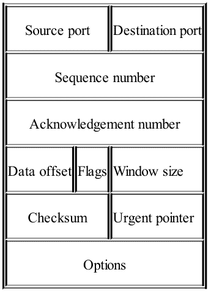

现在，让我们熟悉一下头部字段，以便更牢固地掌握 TCP 的基础知识：

- **源端口**：这是与通信发送方关联的端口号，也可以说是负责在发送方侦听的端口。
- **目的端口**：这是与通信接收方关联的端口号，也可以说是负责接收所传输数据包的端口。
- **序列号**：这些是用于确保数据可靠交付的唯一值。TCP 使用序列号跟踪每个分段。
- **确认号**：这些值由接收方作为确认过程的一部分发送，用于确认数据包已成功接收。
- **数据偏移**：这表示数据包从哪里开始，以及 TCP 头部的长度。由于选项字段的存在，大小可能会变化。
- **标志**：存在多种类型的标志位；每个标志位都有其自身的意义。它们用于发起连接、承载数据以及拆除连接，我们根据其被分配的目的将其命名如下：
  - **SYN（同步）**：这些是用于发起...


通常被称为握手过程的连接。

- **ACK（确认）：** 这些数据包用于确认数据包已被接收，同时也确认连接建立和拆除。
- **RST（重置）：** 这些数据包表示您尝试创建的连接已被关闭，或者我们尝试通信的应用程序不接受连接。
- **FIN（结束）：** 这些数据包表示在数据包成功传输后正在拆除连接。发送方和接收方都会发送FIN数据包以优雅地终止连接。如果它们想要再次通信，则从头开始，即从三次握手过程开始。
- **PSH（推送）：** 这些数据包表示传入的数据应直接传递给应用程序，而不是被缓冲。简单来说，即对方主机应无需等待即可接收数据。
- **URG（紧急）：** 标记的数据包表示TCP协议栈应立即处理数据包携带的数据；如果设置了紧急指针字段，则应检查该字段。
- **CWR（拥塞窗口减小）：** 发送方使用这些数据包告知接收方，由于传输，缓冲区即将溢出，而且由于拥塞，双方都应放慢传输速度，以避免可能发生的任何数据包丢失。

- **窗口大小：** 头部中的该字段表示发送方可以发送的数据量。该数量在握手过程中决定，通信双方在握手期间匹配适合传输的缓冲区大小。通过此字段可以实现流量控制。
- **校验和：** 此字段用于交叉检查所接收数据的完整性，验证TCP段的内容。
- **紧急指针：** 此字段告诉我们紧急指针所包含的值。它具体指示位于数据之前的八位字节的序列号。
- **选项：** 由于存在各种选项，此字段长度可以变化。该字段包含三个部分：第一部分指定选项字段的长度，第二部分表示所使用的选项，第三部分实际包含正在使用的选项。重要选项之一**最大段大小（MSS）**也是该字段的一部分。
- **数据：** TCP头部中的最后一部分是传输的实际数据。

前面的信息使我们对TCP头部以及头部各组成部分的重要性有了总体了解。在分析TCP会话时，了解这些细节变得非常重要。

## TCP如何通信

为了实时理解和分析数据包，我配置了一个运行在172.16.136.129的服务器和一个运行在172.16.136.1的客户端，如下图所示。我将尝试使用Wireshark来说明三次握手过程（在实际数据传输之前发生）以及拆除过程（优雅终止）。三次握手确保服务器和客户端开放建立连接，并准备好资源以在彼此之间创建专用通道，从而可靠地传输数据包。

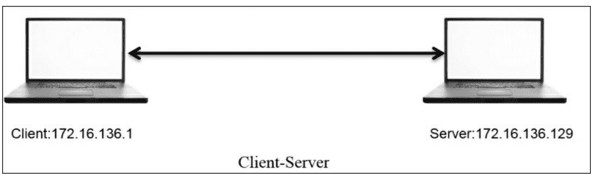

### 工作原理

服务器在80端口运行HTTP服务器守护进程。在客户端，我将访问http://172.16.136.129上的默认网页，并捕获通信过程中参与的所有数据包。

```
ip.addr==172.16.136.129 and ip.addr==172.16.136.1
```

### 注意

为了清晰和方便，我创建了一个显示过滤器，专门显示这两个主机之间的流量。

| 序号 | 时间 | 源 | 目的 | 协议 | 长度 | 信息 |
|---|---|---|---|---|---|---|
| 282 | -895706969.756684000 | 172.16.136.1 | 172.16.136.129 | TCP | 64 | 52138 → 80 [SYN] Seq=0 Win=65535 Len=0 |
| 283 | -1439969339.488273000 | 172.16.136.129 | 172.16.136.1 | TCP | 60 | 80 → 52138 [SYN, ACK] Seq=0 Ack=1 Win= |
| 284 | 15.671376000 | 172.16.136.1 | 172.16.136.129 | TCP | 52 | 52138 → 80 [ACK] Seq=1 Ack=1 Win=13174 |
| 285 | 15.672063000 | 172.16.136.1 | 172.16.136.129 | HTTP | 375 | GET / HTTP/1.1 |
| 286 | 1228372207.391617000 | 172.16.136.129 | 172.16.136.1 | TCP | 52 | 80 → 52138 [ACK] Seq=1 Ack=324 Win=307 |
| 287 | 15.672711000 | 172.16.136.129 | 172.16.136.1 | HTTP | 503 | HTTP/1.1 200 OK (text/html) |
| 288 | 15.672725000 | 172.16.136.1 | 172.16.136.129 | TCP | 52 | 52138 → 80 [ACK] Seq=324 Ack=452 Win=1 |
| 289 | -895706969.777480000 | 172.16.136.1 | 172.16.136.129 | TCP | 64 | 52139 → 80 [SYN] Seq=0 Win=65535 Len=0 |
| 290 | 15.747286000 | 172.16.136.129 | 172.16.136.1 | TCP | 60 | 80 → 52139 [SYN, ACK] Seq=0 Ack=1 Win= |
| 291 | 714245694.355758000 | 172.16.136.1 | 172.16.136.129 | TCP | 52 | 52139 → 80 [ACK] Seq=1 Ack=1 Win=13174 |
| 292 | 378319958.968279000 | 172.16.136.1 | 172.16.136.129 | HTTP | 359 | GET /favicon.ico HTTP/1.1 |
| 293 | 1580695018.460033000 | 172.16.136.129 | 172.16.136.1 | TCP | 52 | 80 → 52139 [ACK] Seq=1 Ack=308 Win=307 |
| 294 | -459410977.038322000 | 172.16.136.129 | 172.16.136.1 | HTTP | 556 | HTTP/1.1 404 Not Found (text/html) |
| 295 | 15.754902000 | 172.16.136.1 | 172.16.136.129 | TCP | 52 | 52139 → 80 [ACK] Seq=308 Ack=505 Win=1 |
| 299 | 20.679013000 | 172.16.136.129 | 172.16.136.1 | TCP | 52 | 80 → 52138 [FIN, ACK] Seq=452 Ack=324 |
| 300 | 609634608.344347000 | 172.16.136.1 | 172.16.136.129 | TCP | 52 | 52138 → 80 [ACK] Seq=324 Ack=453 Win=1 |
| 301 | 20.761722000 | 172.16.136.129 | 172.16.136.1 | TCP | 52 | 80 → 52139 [FIN, ACK] Seq=505 Ack=308 |
| 302 | -1931345972.395708000 | 172.16.136.1 | 172.16.136.129 | TCP | 52 | 52139 → 80 [ACK] Seq=308 Ack=506 Win=1 |

*图5.1 连接过程：三次握手、数据传输和拆除过程*

在数据包282、283和284中，可以清楚地看到客户端和服务器正在尝试创建专用通道。客户端在数据包282中发送一个SYN数据包，SEQ设置为0，从而发起创建。由于服务器开放通信，服务器以SYN/ACK数据包回应，ACK设置为1，SEQ设置为0。随后，客户端在数据包284中发送确认，SEQ=1，ACK=1。这就是三次握手过程的样子。这可以在任何遵循TCP方法的实际数据传输之前看到。

通道创建成功后，客户端发送GET请求以访问web根目录的内容。服务器在数据包287中确认了这一点，并将请求的内容以200 OK状态消息发送到客户端的机器，客户端在下一个数据包中确认了该消息。再次在列表面板中看到，客户端正在请求一个新的资源，但服务器无法找到该资源，因此发送了404 Not Found状态消息，客户端在数据包295中确认了该消息。

在所有数据传输完成后，当客户端没有内容可请求，或服务器没有内容可发送时，客户端发送FIN/ACK数据包以正确终止连接。服务器确认这一点，并发送自己的FIN/ACK数据包，客户端在数据包302中也确认了这些数据包。这种终止方式通常被称为拆除过程。看看

实际上，Wireshark使用了相对引用技术来简化编号系统，以方便用户。首先，您应该知道这些数字用于跟踪两个主机之间传输了多少数据。

从数据包1开始，其中SEQ=0（实际序列号为704809601），服务器收到该数据包后，以自己的SEQ=0和ACK=1回应客户端的SEQ=0。在三次握手结束时，客户端以SEQ=1和ACK=1回复，由于此过程中没有数据传输，因此没有进一步增加。

然后，到第四个数据包时，客户端发送一个GET请求，SEQ=1，ACK=1，数据有效负载长度等于323（参见下图），服务器接收该请求并以SEQ=1和ACK=324确认。您看到刚才发生了什么吗？服务器通过将总数据有效负载长度添加到ACK中来回复，表示数据已成功接收。因此，它将请求的资源发送给客户端，数据有效负载长度等于451，客户端以ACK=452和SEQ=324确认。同样，传输继续进行，直到最后使用FIN/ACK数据包进行拆除。

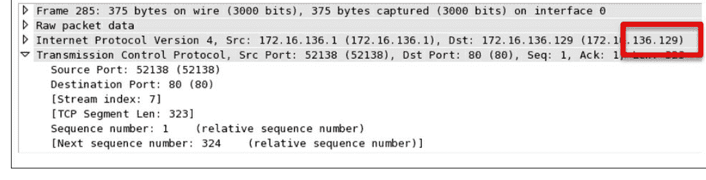

## 优雅终止

我们使用捕获的数据包和流图详细了解了TCP三次握手的过程，这使我们对过程有了深入了解。同样，我们也应该熟悉拆除过程，它表示两个主机之间会话的正确终止。

考虑到我们在此讨论的相同场景，让我向您展示为以标准格式终止连接而生成的数据包。请参阅以下截图：

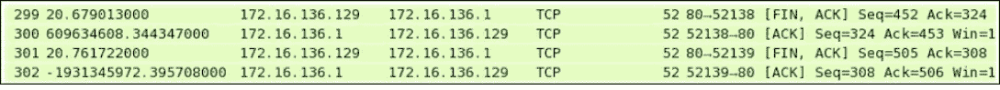

在所有必需的数据包成功交付后，服务器发起了拆除过程（因为已没有内容可发送，或者客户端只是闲置着什么都不做）。一开始，服务器向客户端发送了自己的 `FIN` 和 `ACK` 数据包，其中 `SEQ=452`（客户端用 `ACK` 确认了该包）和 `ACK=324`（这是数据传输完成时客户端的 `SEQ` 编号）。这些在下一个数据包中被客户端确认。按照同样的方式，客户端使用第二轮通信中使用的 `SEQ` 和 `ACK` 编号（当时客户端请求了某项不可用的内容；请参阅前面的流程图了解详情）发出自己的 `FIN` 和 `ACK` 数据包，以从自身一侧结束连接（因为连接是双向的），服务器接收并确认了这些数据包。客户端一收到服务器的 `ACK`，两台主机之间的连接就完全关闭，通信期间涉及的套接字和其他资源也随之释放。

## RST（重置）数据包

很多时候，会出现以下情况：服务器守护进程不可用、服务器因过载而无法处理你的请求、你被限制与服务器交互，或者你尝试连接的端口未开放（未关联任何服务）。你看到 `RST` 数据包的原因可能有很多。让我复现这个场景，并捕获我这里的客户端与服务器之间的流量，这肯定能让你更容易理解。`RST` 数据包基本上表示你试图发起的连接被突然关闭。

在这种情况下，服务器守护进程未运行，而客户端正在尝试通信；因此，客户端每发送一个 `SYN` 请求，都会收到返回的 `RST` 数据包。我只尝试访问了一次 Web 服务器，但你会注意到不止一个 `SYN` 和 `RST` 数据包，因为每个浏览器都会在特定时间间隔内针对无响应或已关闭的套接字进行不同次数的尝试。因此，在我们的案例中，我使用的是 Apple Safari 浏览器，它在最长 3-4 分钟内至少进行了三次重连尝试。我还尝试请求了 Google Chrome，它在短短 10 分钟内大约进行了 7 次重连尝试（浏览器会按特定时间间隔继续发送请求）。请参考下面的截图，其中展示了在此过程中捕获到的数据包：

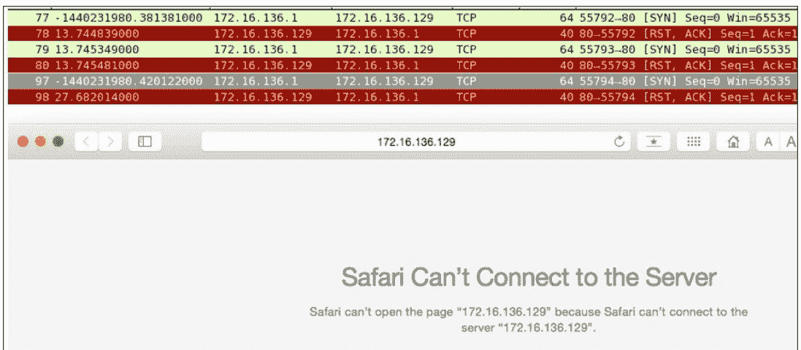

图5.2：捕获到的 RST 数据包

## 相对序列号与绝对序列号

Wireshark 特意将真实的 `SEQ/ACK` 标志编号转换为更简单的格式，这使我们更容易跟踪通过网络发送的数据。例如，我有一个位于 `172.16.136.129` 的 Web 服务器和一个位于 `172.16.136.1` 的客户端。我将尝试使用 Web 浏览器访问该服务器，这将生成几个数据包，Wireshark 会捕获这些数据包。请参考下面的截图，其中展示了为该会话生成的相应数据包。

我在列表窗格中选择了为该会话生成的第一个数据包，并在其中查看了对应的详细信息。可以看到详细信息窗格和字节窗格如下高亮显示：

- **1**：在列表窗格中，可以看到为开始通信而分配给 `SYN` 数据包的 `SEQ` 编号是 `zero`。
- **2**：在详细信息窗格中，可以看到数字 `0` 是一个相对序列号，并非真实的 `SEQ` 编号，而是 Wireshark 为方便我们查看而修改后的值。
- **3**：在字节窗格中，可以看到 `SEQ=0` 对应的十六进制值为 `0x2a028a81`，相当于十进制的 `704809601`。

因此，真实的 `SEQ` 编号是 `704809601`，为了便于分析，它被转换成了 `0`。

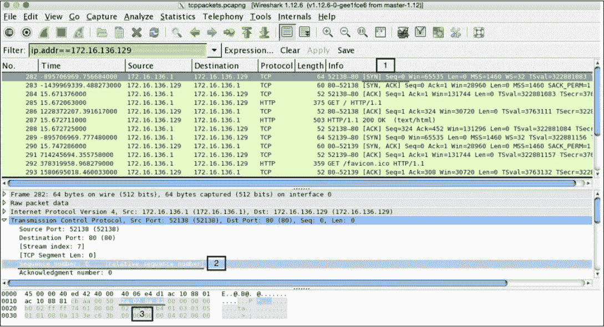

根据我们的分析，我们应该收到的 ACK 值应为 704809602（SEQ 值加 1）。让我们使用下一个数据包及其对应的相关信息，通过详细信息窗格和字节窗格来验证这一点。请参考下面的截图：

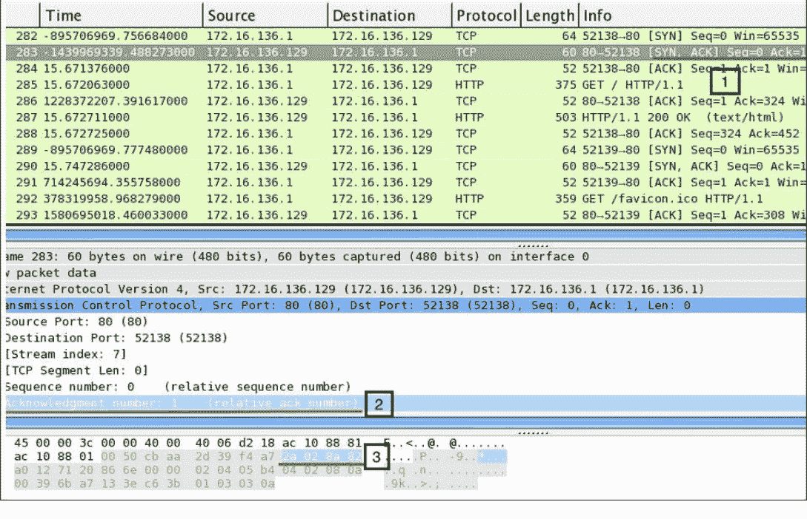

请参考以下列表，了解每个标注所指的含义：

- 我选择的第二个数据包是客户端从服务器收到的 `SYN, ACK` 数据包。它包含服务器的 `SEQ=0` 和 `ACK=1`（相对编号）。
- 通信中第 2 个数据包的相关信息显示在详细信息窗格和字节窗格中。如果观察详细信息窗格，服务器针对客户端请求发送的 `ACK` 是 `1`。
- 收到的 `ACK` 的十六进制值为 `0x2a028a82`，相当于十进制的 `704809602`。这正是我们预期的值。

现在，你可以根据给定的十六进制值轻松查验绝对编号。还有一种更有趣的方式来定制编号系统，即可以直接在列表窗格和详细信息窗格中查看真实的绝对编号。按照以下步骤启用或禁用它：

1. 在菜单栏中导航到 **编辑 | 首选项**。
2. 展开 **协议** 树并查找 TCP。
3. 取消勾选 **相对序列号** 选项，如下图所示：

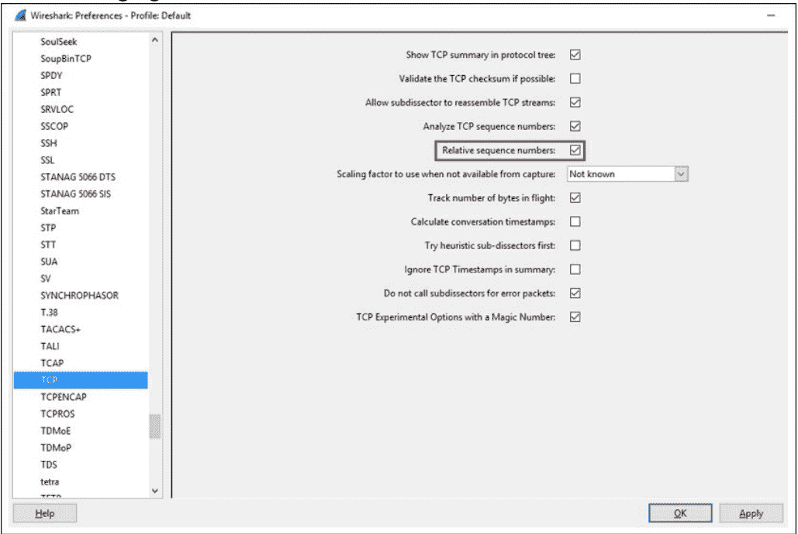

4. 导航到 应用 | 确定。就这样。参考下面的截图：

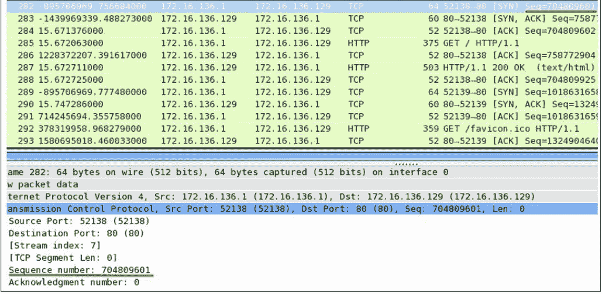

正如我们分析的，TCP 握手过程中的第一个数据包的 `SEQ` 编号为 `704809601`（十进制等效值）。现在，在停用 **相对序列号** 选项后，我们可以在列表窗格和详细信息窗格中观察到相同的结果。

TCP **协议首选项** 窗口中还有一些默认启用的选项，它们使分析更有条理、更高级。例如，尽可能验证校验和以及分析 TCP 序列号。

校验和通常在传输过程中用于确保收发数据的完整性。如前所述，TCP 头部中有一个额外字段。实际上，当发送方准备好需要传输的数据包时，它会计算包含数据的数据包的校验和，并与数据包一起发送。接收方收到数据包后，会使用发送方所用的相同算法重新计算校验和。如果数据包附带的校验和值与接收方计算的值一致，则接受该数据包；否则，包含错误（校验和不匹配）的数据包会被丢弃，而且甚至不会将发生的错误通知发送方。发送方应当自己知晓这一点。校验和的验证并非 100% 可靠，而且这也会降低性能，因为 TCP 数据包的重组现在不会发生。

校验和卸载（Checksum offloading）是只有新式网络驱动程序才支持的功能，它即将准备传输的数据包交给网络硬件处理，而这些数据包被 Wireshark 捕获时带有空的校验和字段，从而产生 `checksum offloading` 错误。原因是，即使在实际数据包传输之前，Wireshark 也会捕获数据包（一旦实际传输发生，数据包将包含有效校验和）。这可能会导致一些困惑。因此，最佳做法是，如可用，在你的接口上关闭卸载功能，或者在 TCP 协议首选项中禁用 **验证校验和** 功能。请参考下面的图：

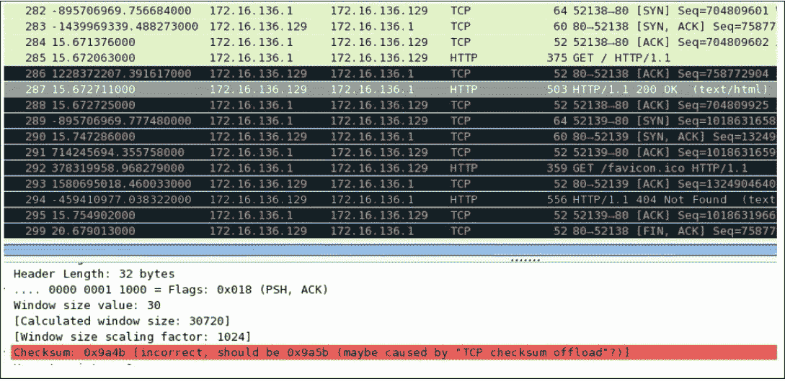

校验和无效的数据包以黑色背景和红色前景显示。查看详细信息窗格中红色高亮显示的错误；这说明校验和不正确，这可能是由于启用了校验和卸载功能。校验和无效的数据包无法重组，而且看起来也不美观（屏幕上出现大量无效错误），因此如果不需要，最好禁用此功能。

另一个你应该了解的选项是 **分析 TCP 序列号** 功能，它会跟踪 `SEQ` 和 `ACK` 编号，并让你了解传输过程中可能发生的各种类型错误，例如丢失帧、重复 `ACK`、重传、窗口缩放等。关闭此功能还会影响 **专家信息** 对话框，其中与传输错误相关的任何警告和其他有用信息都不会被填充。


另一端端口扫描器显示统计信息。如果端口开放，恶意用户会收到 SYN 和 ACK 通知（参见以下截图），这表示我们的机器在端口 21 上开放连接，这可能成为恶意攻击的入口。

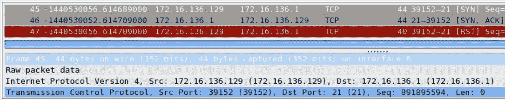

图 5.3：端口 21 开放，恶意攻击的入口点

我们来看第 45 帧，客户端向服务器 172.16.136.1 发送了一个 SYN 请求。此时端口是开放的，因此我们的服务器发送了 SYN 和 ACK 数据包（第 46 帧），以积极确认连接尝试，表明服务器在端口 21 上开放连接。

除了这种半开扫描之外，还可能有各种其他情况（前面截图中的扫描之所以称为半开扫描，是因为发起连接尝试的客户端永远不会通过发送服务器期望的 ACK 来完成连接）。如果你对数据包行为、连接建立与完成过程、TCP 头部、数据包中的标志以及 SEQ-ACK 序号等基础知识了解清楚，那么你就很容易发现周围流动的任何异常流量。除非你定制环境来应对或提醒此类流量异常，否则没有任何自动化工具能够指出这些异常。以下是一些你可能经常遇到的流量模式。

## 如何在 Wireshark 中检查不同的分析标志

使用 Wireshark 分析 TCP 数据包中的标志非常简单。在每个 TCP 数据包的详细信息窗格中都有一个单独的区域。让我们从之前捕获的握手过程中选取一个 TCP 数据包，看看标志是如何在详细信息窗格中呈现的。然后，我们将尝试创建相应的显示过滤器。请参考以下截图说明：

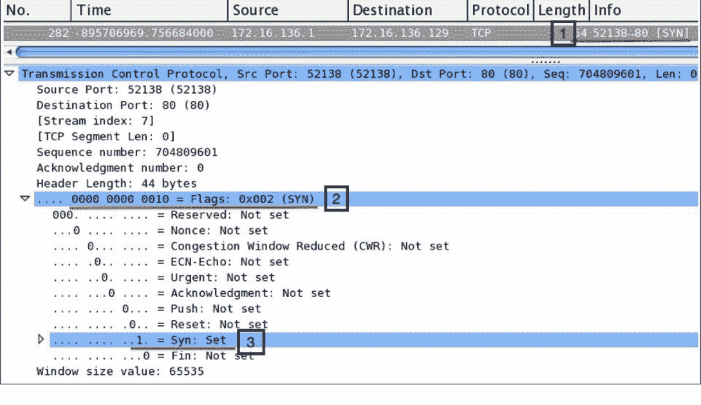

现在，我们来看每个指针的含义：

- 这里，在列表窗格中可以看到客户端发送给服务器以发起三次握手的 `SYN` 数据包。
- 这里，与此数据包相关的标志已设置，`000000000010` 的十六进制等效值为 `0x002`。
- 对于相应的 TCP 数据包，`SYN` 标志位设置为 1；这可以在详细信息窗格中看到。其余标志位仍为 0。

现在，如果你希望创建一个显示过滤器，仅查看你已有的 `SYN` 数据包，

## 用户数据报协议

根据 RFC 768 的定义，UDP 是一种无连接协议，非常适合在主机之间传输实时数据，通常被认为是一种不可靠的通信形式。原因是 UDP 不关心数据包的交付，任何丢失的数据包都不会被恢复，因为发送方在传输过程中永远不会被告知数据包被丢弃或丢弃。然而，许多协议如 DHCP、DNS、TFTP、SIP 等仅依赖于此。使用 UDP 作为传输机制的协议必须依赖其他技术来确保数据交付和错误检查能力。这些协议内置了此类功能，可以在传输过程中提供一定程度的可靠性。我们不应忘记的一点是，UDP 提供更快的分组传输，因为它不关心 TCP 中看到的连接建立或正常终止。这就是为什么 UDP 也被称为面向事务的协议，而不是像 TCP 那样的面向消息的协议。

## UDP 头部

通常一个 UDP 头部的大小是 8 字节；加上头部的数据理论上可以长达 65,535 字节（实际为 65,507 字节）。与 TCP 头部相比，UDP 头部非常小；它只有四个常见字段：源端口、目的端口、数据包长度和校验和。请参考如下所示的 UDP 头部：

| 源端口 | 目的端口 |
| 数据包长度 | 校验和 |
| 应用程序数据 | |

8 字节

- **源端口**：这是发送方使用的端口号，用于在需要时接收任何回复。大多数情况下，在 TCP 和 UDP 中，被选为套接字一部分的端口号是临时的。在通信的另一端，端口号属于知名端口号类别。
- **目的端口**：头部此字段标识服务器或接收方使用的端口号，所有数据将传输到此端口。IANA 将此端口号分配给特定服务，并且肯定永久分配给同一个服务。例如，端口 53 用于 DNS，不能分配给任何其他服务（不建议）。
- **数据包长度**：此字段指定从头部到数据末尾的数据包长度；你每次看到的最小长度将是 8 字节，即 UDP 头部的长度。
- **校验和**：如前所述，校验和对数据（即数据包的数据部分）进行计算以确保数据完整性，即发送方发送的内容与接收方接收到的内容相同；为了验证这一点，有几种校验和算法可以提供帮助。有时，在使用 UDP 时，你会看到我们收到的数据包中的校验和值为 0。这意味着不需要验证校验和。

## 工作原理

为了理解 UDP 的工作方式，让我们继续分析一些使用 UDP 作为交付协议的协议。首先，我想讨论 DHCP，然后我们也会看到 DNS 流量。实际上，我们在进行 VoIP 和 SIP 分析时也见过 UDP 流量。

出于分析目的，我将默认网关配置为 `192.168.1.1`，客户端配置为 `192.168.1.106`。我将使用客户端尝试生成 DHCP 和 DNS 流量，这些流量将被 Wireshark 捕获，然后我将尝试剖析每个协议的通信过程以及整个会话期间使用的不同组件。请参考我的以下网络架构：

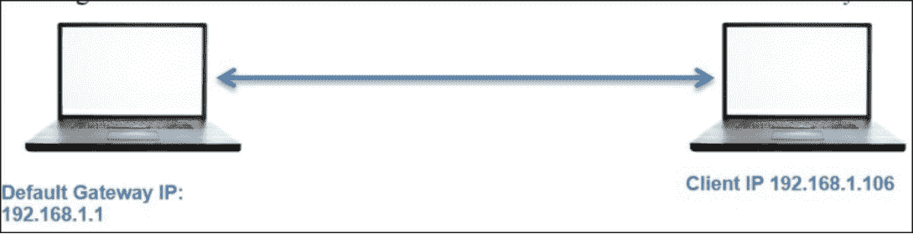

### DHCP

最常见的也是最重要的协议，它给设备分配 IP 地址并使其具备网络兼容性，这便是**动态主机配置协议（DHCP）**。现在，我将尝试从客户端释放客户端已持有的 IP 地址，这将生成一个 DHCP 数据包，并且该数据包将被我们的嗅探器捕获。请看下图来理解这一点：

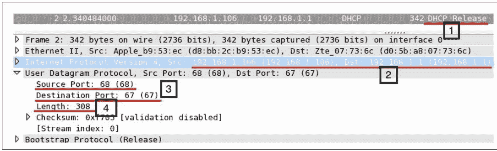

在列表窗格中，我们可以看到客户端隐式生成的一个 DHCP 释放数据包，目的是释放当前 IP 地址（我在 Linux 终端上使用了 `dhclient -v -r` 命令来释放 IP 地址，但使用此命令时要小心，因为它可能会将机器与网络断开，从而使其无法进行网络通信）。客户端从 IP 地址 192.168.1.106 向服务器 192.168.1.1 发起请求。在 DHCP 中，客户端和服务器使用的端口号是固定的，除非手动配置，否则在你的情况下也不会更改。

DHCP 服务器端口号默认为 67，DHCP 客户端端口号默认为 68；你可以在上图中看到（突出显示为 3）。我还突出显示了第四个字段，即数据包长度字段，它指定从第一个字节到数据包中数据末尾的数据包长度。然而，在 308 字节中，有 8 字节是 UDP 头部的长度，其余 300 字节表示附加的应用程序数据。有趣的是，如果机器重新通电，它会请求 DHCP 服务器分配一个 IP 地址。结果，这将生成一些与 DHCP 请求、释放和提供相关的数据包，以及其他各种也使用 UDP 作为传输机制的数据包。


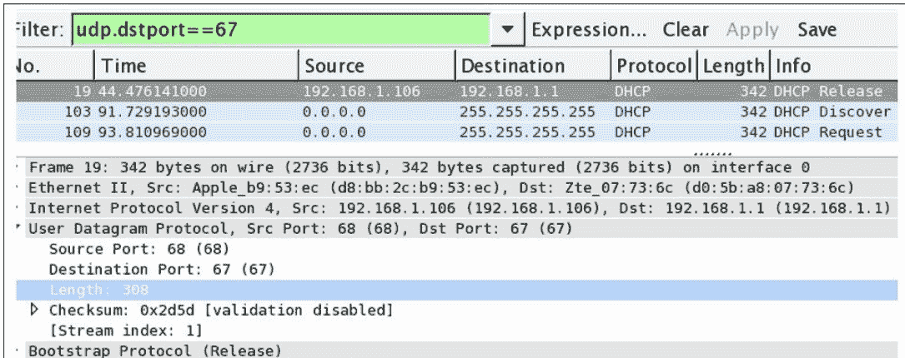

我使用 `udp.port==67` 过滤器过滤了列出的数据包，以仅显示 DHCP 数据包；因此，列表窗格中将只列出 DHCP 数据包。

## TFTP

简单文件传输协议（TFTP）是 FTP 的一个轻量级版本，用于在主机之间进行传输。与 FTP 协议不同，TFTP 不需要用户提供任何凭据。TFTP 使用 UDP 作为传输机制。通常，TFTP 用于局域网环境；在处理可管理设备（如交换机和路由器）时，网络管理员会使用 TFTP 服务器来备份配置文件以及更新这些设备中运行的固件。安全专业人员也会使用 TFTP 将文件从其系统传输到你的系统，以提升权限（在被入侵的系统上获得更多权限）。

我在 `192.168.1.106` 上运行了一个 TFTP 服务器，在 `192.168.1.104` 上运行了一个客户端。我在服务器上创建了一个文本文件 `abc.txt`，客户端将尝试下载该文件。我们部署好的嗅探器将捕获由此产生的流量。

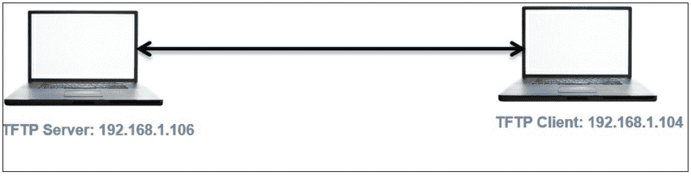

两个主机之间进行事务处理所产生的流量已被成功捕获，与其对应的数据包如下图所示：

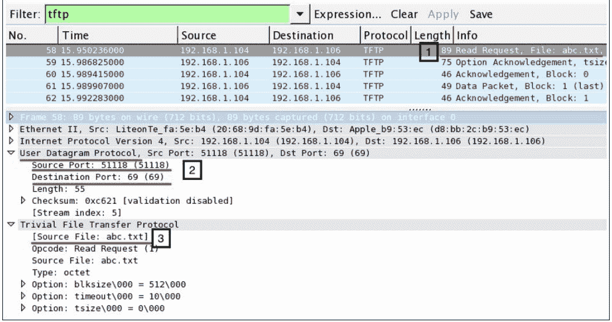

现在，让我们看看每个指针代表什么：

+   - 这表示当客户端请求 `abc.txt` 文件时，数据包的传输随即开始。在列表窗格中可以看到该请求帧。
+   - 如前所述，TFTP 使用 UDP 作为传输机制。请求的相关详细信息显示在详细信息窗格中，其中说明该请求是从客户端的临时端口号发起的，目的端口是服务器上的 `69` 端口（`69` 是 TFTP 协议的知名端口）。
+   - 该请求特定于 `abc.txt` 文件，该文件也显示在详细信息窗格的 TFTP 协议部分中。

你一定很好奇两个主机之间传递的确认数据包。如前所述，UDP 是一种不可靠的通信方式，那么为什么我们会在 UDP 中看到 ACK 呢？原因是我使用的 TFTP 服务器具有某种内置的可靠性特性。即使在客户端，通过标准控制台，在发起请求后，我收到了服务器返回的相当交互式的消息，例如“大小为 3 字节的文件已成功传输”，并且消息中还列出了各种其他详细信息。这里值得注意的有趣之处在于，`69` 端口只参与第一个数据包，其余数据包都是由服务器内置的确认功能发送和接收的。因此，我们刚刚已经见证了一个事实：有些协议使用 UDP 作为传输协议，并有自己的内置功能来确保传输送达，这句话是正确的。

## 不常见的 UDP 流量

假设我们正在寻找的资源在服务器上不可用，那么此时的流量会是什么样子？请参考下面的截图来理解这一点：

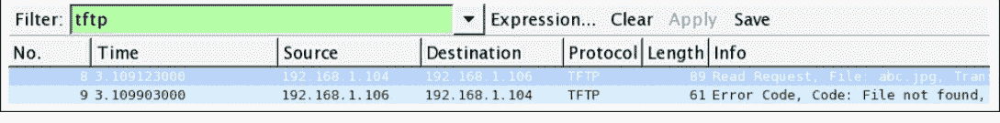

如上面的截图所示，客户端请求了一个无效资源，服务器无法找到该资源，因此返回了一个错误代码和摘要消息 `File not found`。相同的消息也通过标准控制台显示给了客户端。

有时，服务器守护进程可能未运行，而客户端可能请求某个资源。在这种情况下，客户端会收到 `ICMP destination unreachable` 错误，错误代码为 `3`。请参考下面的图：

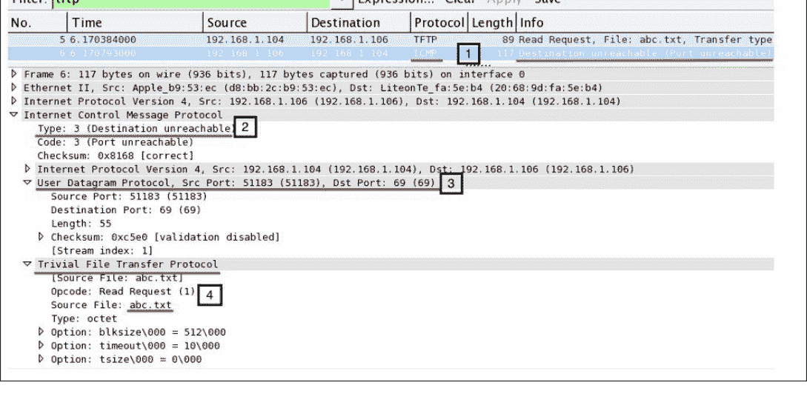

现在，我们来看看每个指针代表什么：

+   - 当 TFTP 服务器守护进程不可用时，服务器返回了 `ICMP destination unreachable` 消息。
+   - 客户端收到了类型为 `3` 的错误代码。
+   - 关于请求的详细信息在回复中的 UDP 协议部分提到，其中说明请求被发送到了当前不可用的 `69` 端口。
+   - 请求的资源显示在 TFTP 协议部分下。

当客户端发起请求以查找与某个地址关联的名称服务器时，也经常会出现不常见的 DNS 请求。其形式类似于下图所示：

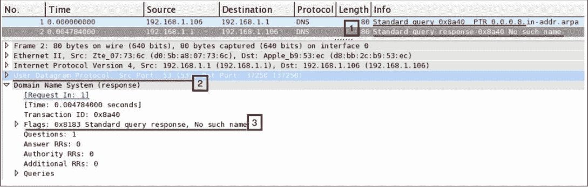

现在，我们来看看每个指针代表什么：

+   - **1：** 如列表窗格所示，位于 `192.168.1.106` 的客户端发起了一个查找地址 `8.0.0.0` 的请求，并在 `Frame 2` 中收到了响应。
+   - **2：** 该请求被发送到保存 DNS 缓存的默认网关。
+   - **3：** 网关响应了一个 `No such name` 错误。

在多种场景下，你可能会看到与 UDP 相关的不常见流量。最重要的是关注 TFTP 流量，这可能是由于网络中的 TFTP 客户端产生的。这可能是你需要留意的恶意流量。

## 总结

TCP 是一种可靠的通信方式，具有三次握手和拆除（tear down）过程等特性，可确保连接可靠且交互。

TCP 报头长度为 20 字节，包含各种字段，如源端口和目的端口、`SEQ` 和 `ACK` 序号、偏移量、窗口大小、标志位、校验和以及选项。各种标志位和报头字段的存在使发送方和接收方能够确保数据的交付以及所发送数据的完整性。

基于 TCP 的通信使用 `SEQ` 和 `ACK` 序号来跟踪参与主机之间发送了多少数据。

UDP 是一种无连接协议，是 IP 之上的一种不可靠通信方式，丢失和丢弃的数据包永远不会被恢复。UDP 确实为我们提供了更快的传输速度和更易于建立的会话。UDP 报头长度为 8 字节，字段很少，例如源端口和目的端口、数据包长度和校验和。在报头末尾，数据被附加。

常见的协议，如 DHCP、TFTP、DNS 和 RTP，大多使用 UDP 作为传输机制，这些服务是我们日常生活中处理的一些主要服务。为了使连接可靠，其中一些协议支持自带的内置确认功能。

在下一章中，你将学习无线流量的基础知识、如何解密无线流量，以及可能随之而来的异常情况。

## 练习题

+   1. **Q.1** 列出 TCP 和 UDP 协议之间的至少五个区别。
+   2. **Q.2** 使用你自己的 FTP 服务器捕获三次握手和拆除连接的数据包。
+   3. **Q.3** 解释窗口缩放（window scaling）和校验和卸载（checksum offloading）的目的，并说明它们在 TCP 通信中的相应重要性。
+   4. **Q.4** TCP 通信如何从数据包丢失或意外终止中恢复？模仿任何可能生成此类流量的场景。
+   5. **Q.5** 创建一个显示过滤器，使得在列表窗格中只显示从你的默认网关发送到你的机器的 TCP FIN 和 ACK 数据包。
+   6. **Q.6** Wireshark 用于跟踪数据包的绝对编号和相对编号系统有什么区别？
+   7. **Q.7** TCP 报头末尾的选项字段的用途是什么？它包含哪些类型的参数？
+   8. **Q.8** 还有另一种方法可以创建过滤器，以查看设置了特定标志的数据包。在不提供相应的 HEX 值的前提下，找出该方法是什么，以及如何使用相同技术过滤设置了 PSH 标志的数据包。
+   9. **Q.9** 找出为什么在使用 UDP 时数据长度只能是 65507 字节。
+   10. **Q.10** 如果 TFTP 的服务器守护进程没有运行，你会在列表窗格中看到哪些种类的数据包？
+   11. **Q.11** 尝试在你本地配置的 DNS 上执行区域传送（zone transfer），并捕获流量进行分析。你注意到这些数据包有哪些有趣的事实？请简要解释。


