## 理解 IEEE 802.11

在**电气与电子工程师协会（IEEE）**中，有多个委员会共同推进多个项目，其中一个是802委员会，负责制定局域网（LAN）标准。基于802标准，可以从IEEE网站下载一份免费白皮书。具体而言，802.11包含了无线局域网（WLAN）标准。如果你想分析正常流量的特征，就应该了解802.11中的标准和现有的工作技术。

802.11标准有多个，但我们应该重点了解的是802.11b、802.11a、802.11g和802.11n，以下列表将对它们进行说明：

- **802.11：**该标准仅支持1-2 Mbps的网络带宽。这也是许多802.11兼容设备被淘汰的原因。因此，开发其他802.11标准变得十分必要。

- **802.11b：**该规格使用与802.11标准类似的2.4 GHz信令频率。使用b规格可在2.4 GHz频段上实现最高11 Mbit的传输速率。由于大多数家用电器（微波炉、无绳电话等）都在2.4 GHz频谱上工作，这会导致WLAN数据包传输过程中出现相当密集的干扰和拥塞。为避免干扰，无线接入点（AP）可以安装在合理距离的位置。802.11b频段被划分为14个重叠信道，其中每个信道宽度为22 MHz。在同一场景中，最多只能同时运行三个不重叠的信道。这种空间隔离对于让各信道独立工作是必要且必需的。一个设备一次只能属于一个信道；当你监听数据包时也是如此。实际上，现在可以同时嗅探多个信道，这得益于现在可用的各种工具；其中之一是Kismet，它可以每隔很短的时间间隔嗅探多达10个信道。

- **802.11a：**该标准基于**正交频分复用（OFDM）**，于1999年发布，支持最高54 Mbps的传输速率，这也使我们相对于802.11b拥挤频段具有优势。该规格是继802.11标准之后开发的第二个标准。它通常用于商业环境，但由于成本较高，b规格并不最适合家庭环境。虽然它支持比802.11b更高的速率（在5 GHz频谱附近），但如果配置了某规格，设备的覆盖范围会有所不足。其绕过途中障碍物的能力不如802.11b。802.11a中不会发生信道重叠。更高的受监管频率有助于防止工作在2.4 GHz频谱上的设备造成的干扰。

- **802.11g：**大约在2002年年中，该规格问世，并尝试融合802.11a和802.11b的最佳特性。此处使用的信令频率为2.4 GHz，支持的带宽高达54 Mbps。由于使用2.4 GHz频率，此前受影响的范围参数得到了改善。802.11g还支持向后兼容，这意味着所有802.11g接入点都将支持使用802.11b的网络适配器，反之亦然。该规格的一个优点是：不容易被轻易阻挡。

- **802.11n：**为了进一步改进，引入了无线N。改进的关键领域是覆盖范围和传输速率。实现这一切的基础技术是**多输入多输出（MIMO）**通信。接入点内装有多个天线，用于发送、接收和反射信号。这使得信道频率可达40 MHz。该规格的最终版本于2007年发布，声称传输速率最高可达600 Mbps。它可以配置为2.4或5 GHz（如果接入点同时兼容两者）；它可以同时使用两种频率，从而实现对网络适配器的向后兼容。MIMO技术最多可以使用四个天线。一旦所有这些协同工作，用户就能体验到最快的速度和最大的信令范围，而且受其他工作在同一频段的设备影响不大。如果这种网络类型受到干扰，那么它也会影响到802.11b/g等其他规格。

## 无线通信中的各种模式

WLAN使用**载波侦听多路访问/冲突避免（CSMA/CA）**协议来管理各站点发送数据，所有希望发送数据的主机都必须首先侦听信道，也就是说，如果信道空闲，则主机可以继续发送数据包；如果信道繁忙，则主机必须等待轮到自己。这是因为同一媒介被所有主机共享，从而避免了两台主机同时开始传输时可能发生的冲突，这种冲突会使网络性能变慢且更容易出错。802.11架构由多个组件组成，例如**站点（STA）**、无线**接入点（AP）**、**基本服务集（BSS）**、**扩展服务集（ESS）**、**独立基本服务集（IBSS）**和**分布式系统（DS）**。

STA与AP之间存在四种常见的关联模式，如下所示：

- **基础设施/管理模式：**一种无线网络环境，其中两个设备希望连接STA和AP以共享数据和网络资源，被称为基础设施模式。AP被定义了一个**服务集标识符（SSID）**，实际上就是给接入点起的一个名称，用于识别目的（出于安全原因，有时可以禁用SSID广播，这将防止你的无线网络被非预期用户发现）。例如，当你开始扫描周围可连接的Wi-Fi网络时，你会看到多个网络名称，你需要从中选择一个你认识的网络。所有这些网络名称都称为SSID。另一个有用的术语是**基本服务集标识符（BSSID）**，即接入点的MAC地址。默认情况下，每个接入点都应广播SSID并每秒发送10次信标帧，以让设备知道它们已准备好接受连接。请参阅下面的示意图，该图说明了此示例：

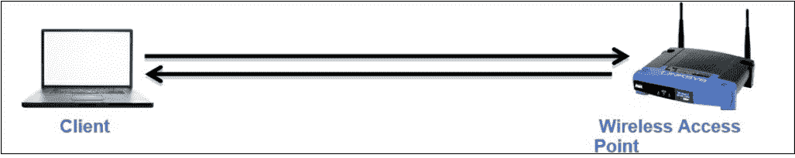

- **Ad Hoc模式：**在这种网络中，形成一种点对点网络，其中两个客户端直接相互连接。无线客户端发送和接收的数据包不会中继到接入点。参与通信的客户端此时负责处理发送信标和认证的过程，而在正常场景下这些工作由无线接入点（WAP）处理。

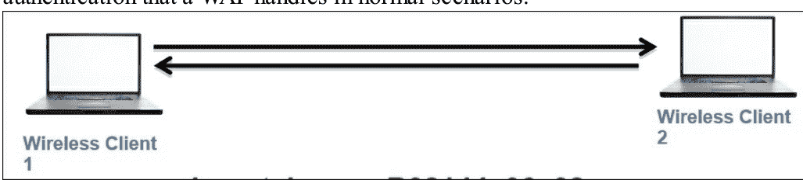

- **主模式：**当你的机器中的网卡（NIC）让你成为一个接入点时，这就是主模式的概念。高端设备具有充当接入点的能力，当NIC卡与特殊驱动程序协同工作时，这种能力就得以实现。


- **监听模式：**就本章而言，这种模式非常重要。此模式用于监听在周围空中传输的数据包；当激活监听模式时，你的设备将停止发送和接收任何数据包，而只会静默地嗅探实时流量。如果你想从无线网络中捕获与802.11协议相关的数据包，那么你的NIC和所使用的驱动程序必须支持监听模式。在诸如Linux和MAC等操作系统上，激活监听模式相当容易；但在Windows上，激活监听模式则相当麻烦。此模式通常被称为**射频监听模式（RFMON）**。


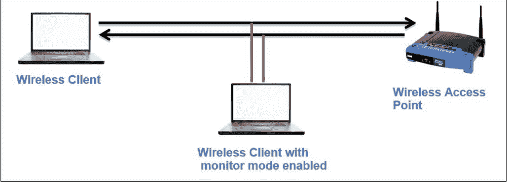

在学习了你可能会在生产环境中随意注意到的不同形式的无线网络基础设施的基础知识之后，根据你的需求在各种可用模式之间进行选择肯定会变得更容易一些。

## 无线干扰与信号强度

为了更好地理解正常流量模式，我们应该了解影响无线网络性能的各种常见因素。例如，数据包、关联和解除关联、有无干扰时的信号强度。我们在分析上述参数时的目标是形成一个基线，在将流量模式与异常模式进行比较时，这个基线可以证明是有价值的。影响网络性能的最主要因素是不同形式的干扰，这些干扰由多种因素造成，例如厚墙、屋顶等物理障碍；以及微波炉、无绳电话等电子设备。

在处理无线网络时，数据的完整性变得更加重要，因为数据包只是在空中传输，任何拥有基本硬件和了解无线网络工作原理的人都可以轻松嗅探并捕获这些数据包。无线网络没有任何挽救措施来保护完整性，因此使用它们，你无法100%确保数据的安全。

例如，假设你在监听频谱中的某个特定信道。通常，你一次只能嗅探一个信道，但如果信道开始相互重叠，那么你很可能会在列表窗格中看到其他信道的数据包。根据无线频谱的正常运作，彼此靠近运行的网络应该选择不重叠的信道，如1、6、11、14，以避免任何问题。请参考下图，该图很好地说明了信道重叠（我使用了维基百科上的同一张图）：

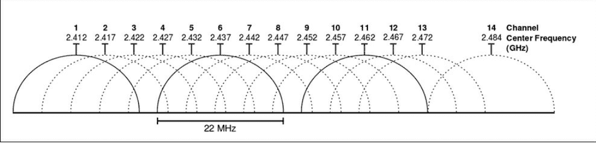

无线网络的强度完全取决于承载流量的**射频（RF）**信号。一旦无线信号开始传播，随着传播距离的增加以及中间障碍物的影响，信号强度最终会减弱。在同一RF能量上工作的设备也会导致无线信号强度降低。如果你也遇到此类问题，那么仅使用Wireshark在监控模式下监听接口并不能解决问题。你需要一个频谱分析仪，例如Wi-Spy-Channelyzer，它与USB适配器配对（参考[http://metageek.com](http://metageek.com)），可以让你额外看到RF能量的形态；否则，你将无法看到它们。大多数情况下，发射高RF能量的设备可能是网络性能不佳的原因。

为了检查环境中的RF能量，你需要自带笔记本电脑并在办公室内走动，运行频谱分析仪，这样能够检测到可能影响无线网络性能的RF异常。这些分析仪的放置位置对于解决问题起着重要作用。如果你办公室中的某个主机无法连接，那么最佳选择是将分析仪尽可能靠近该主机，以便从主机的角度感知情况。如果你办公室中的多个主机遇到类似问题，那么最佳选择是将分析仪放在它们尝试连接的接入点附近。根据你处理的具体场景，你可以动态决定，甚至可以手动扫描办公室场所，以了解是否存在任何RF能量干扰。

我没有任何特殊硬件来向你展示RF能量，但我将使用Kali Linux操作系统中的一个内置工具，它将帮助我们获取关于我周围可用的不同WLAN以及所有连接到Wi-Fi的设备的各种精细细节（如果与用于频谱分析的硬件配对，这将非常有用）。该工具名为Kismet，它非常擅长以图形和各种可用的统计格式呈现细节，从而使我们能够更多地了解周边环境（请将其用于道德目的）。请按照以下步骤在Kali Linux上使用Kismet工具：

- 1. 首先，我使用`airmon-ng start wlan0`命令启用监控模式（`wlan0`是我的无线接口）。
- 2. 打开终端并输入`Kismet`。系统会要求你设置各种自定义选项——不要更改任何默认设置。
- 3. 当系统要求你指定Kismet服务器捕获数据包的源（接口名称）时，请指定你在监控模式下运行的接口（在我的情况下是`mon0`。你可以使用`iwconfig`命令检查你的接口）。
- 4. 现在，让工具自动运行几分钟；渐渐地，你会开始注意到实时捕获的流量正在绘制成图。你会看到周围的各种无线网络以及大多数关联的设备。
- 5. 在网络部分，你会看到无线网络的特定详细信息，例如BSSID、SSID、使用的加密算法等。
- 6. 客户端部分将显示与网络关联的各种设备。请参见下图中列出我的网络及连接到它的各种客户端的工具界面：

| MAC地址 | 类型 | 频率 | 数据包数 | 大小 | 制造商 |
|---|---|---|---|---|---|
| D0:5B:A8:07:73:6C | 有线/AP | 2437 | 47 | 4K | 未知 |
| E8:4E:84:86:4A:21 | 无线 | ---- | 35 | 1K | SamsungE |
| 64:6C:B2:ED:E6:A6 | 无线 | ---- | 11 | 1K | 未知 |
| ! 48:74:6E:AB:34:91 | 无线 | 2437 | 178 | 22K | 未知 |
| D8:BB:2C:B9:53:EC | 无线 | ---- | 35 | 8K | 未知 |

- - 在第三部分，有一个图表显示数据包在周围传输的当前速率，以及用红色条显示的数据包总数。
- - 在第四部分，我们可以看到列出的许多详细信息，例如主机名（Kali）、我的NIC能看到的总网络数、Kismet运行了多长时间、捕获的数据包总数，以及每秒看到的平均数据包速率。使用如此简单的工具，无需任何特殊配置，我们就能够收集到大量具体细节。

在窗口的右下角，显示了用于捕获详细信息的接口：mon0（一个已激活监控模式的接口）。通过此工具，我们无法捕获任何可能扭曲流量形态的RF能量，这会降低我们的网络性能。但同一工具在与Wi-Spy或Ubertooth硬件配对时，将显示RF能量频谱。如果你是需要日常处理Wi-Fi故障排除的专业人士之一，那么你应该使用它——如果不是现在，总有一天你会用到。

设备发出的RF能量并非每次都是问题所在；有时，你需要查看数据包级别，例如检查认证和关联数据包，也就是说，你可以将正常流量模式与你可能面临的异常进行匹配。

## IEEE 802.11 数据包结构

数据包从一个主机传输到另一个主机所使用的介质目前已经改变，但在前面各层工作的基本协议仍然相同。正如我们已经讨论过的，第2层（数据链路层）在这里至关重要。详细了解传输中的数据包显然是一件好事；我们将讨论802.11数据包包含的各种帧类型、头部结构和信息。

在分析无线数据包时，你基本上会看到三种类型的帧。列出的所有数据包与我们之前看到的几乎相似；唯一的区别是由于802.11头部而附加的额外信息。以下是你将看到的头部类型：

- - **管理帧（Management）**：这些帧用于在数据链路层的主机之间建立连接。这些帧用于加入或离开网络、关联/解除关联/重新关联，以及广播信标帧和一些管理任务。管理帧负责主机之间建立连接期间发生的许多活动。
  - **信标帧（The beacon frame）**：AP每十分之一秒发送一次信标帧，让STA知道AP可用于连接。
  - **认证帧（The authentication frame）**：这种类型的帧由STA发送给AP，包含其身份。如果AP采用开放系统认证，则STA只需发送一个认证帧，AP确认以了解连接是被接受还是拒绝。如果AP采用共享密钥认证，则STA向AP发送连接请求。然后，AP向STA发送一个质询文本。之后，STA完成质询，并使用与AP相同的算法对请求的质询文本进行加密，然后将其发送给AP。AP使用自己的密钥值接收并解密文本，无论结果如何，它都会决定连接请求的状态。
  - **关联请求帧（The association request frame）**：该帧由STA发送到AP，用于提供资源分配的细节并用于同步。
  - **关联响应帧（The associate response frame）**：该帧由AP发送，作为对STA所发请求的响应。
  - **解除认证帧（The deauthentication frame）**：由STA发送，用于终止与AP/STA的连接。
  - **解除关联帧（The disassociation frame）**：该帧是一种优雅地终止连接的方式，以便AP可以释放为STA分配的资源。
  - **探测请求帧（The probe request frame）**：该帧由STA发送到另一个STA/AP。


用于请求其详细信息；这主要用于发现附近的 AP。

- **探测响应帧**：此帧用于响应 AP/STS 可能从网络中另一台设备收到的请求。
- **重关联（请求/响应）帧**：当 STA 与当前 AP 的关联被断开时，此帧被发送到新的 AP。作为响应，AP 确认接受或拒绝重关联请求。

在应对高延迟时，监控主机发送的每个信标帧之间的时间间隔很有用。由于 AP 广播了这些信标数据包，设备便知道它们可供连接。

- **控制帧**：用于确保主机之间数据包交付能管理信道中的拥塞级别，并使用清除发送（clear-to-send）和请求发送（request-to-send）等数据包。简而言之，这些帧用于维护任务。这些控制数据包确保了所传输数据包的完整性。同样，管理帧有好几种，而控制帧只有三种：
  - **请求发送（RTS）**：此帧由 STA 发送，用于请求在特定时间内获得对介质的控制权。
  - **清除发送（CTS）**：此帧由收到 RTS 的 AP 发送，用于指定何时将介质分配给 STA 进行传输。此帧通常用于防止较旧的工作站再次尝试接入介质。
  - **确认（ACK）**：此帧由接收 STA 发送，用于告知发送站点数据包已成功接收。如果发送站点未收到此包，则在特定时间后，发送站点将向同一接收方重新发送数据包以确保其交付。
- **数据帧**：这些帧包含主机之间实际发送的数据。它们是唯一在无线域和有线域之间传输的帧。

802.11 数据包与我们之前看到的有线网络数据包类似；术语上略有不同，但基本概念是相同的。让我们来看一个信标帧，参见以下截图：

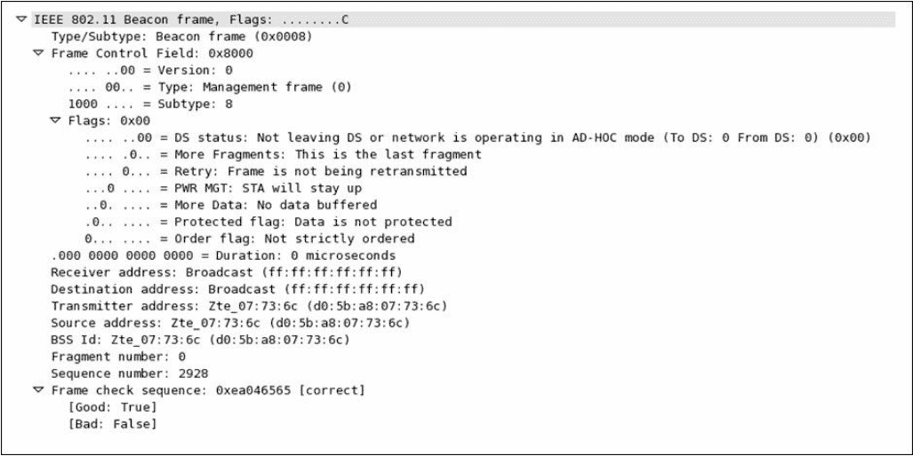

让我们详细查看帧中的各个字段：

这是帧头中的第一部分，其中列出了大量信息。

- **帧控制**
- `Protocol Version`：这是一个 2 位值，用于验证当前所用协议的版本；撰写本文时当前版本为 0。
- `Type`：用于标识帧的类型；在我们的案例中，我们处理的是管理帧（信标）。
- `Subtype`：表示帧头的子类型；对我们来说，这是一个信标帧，其数值代码为 8。
- `DS Status`：表示数据帧是发往**分布式系统（DS）**还是工作在哪种模式。如果该位设置为 1，则这一定是数据帧；如果设置为 0，则此帧可能是管理/控制帧。
- `More Fragments`：如果该位设置为 1，表示帧已被分成若干部分并逐个发送。
- `Retry`：当需要重传帧时，该位设置为 1。
- `PWR Management`：如果设置为 1，表示 STA 当前的电源管理状态，即处于 `active: 0` 或 `power-save: 1` 模式。
- `More Data`：如果 AP 试图告诉处于省电模式的 STA 它还有更多帧要发送，则该位设置为 1。对于控制帧，此位始终为 0。
- `Order`：如果该位设置为 1，表示帧被强制排队并按顺序发送。通常该位不会被设置，因为它可能影响传输性能。
- `Duration ID`：表示发送方进行帧交换可能需要的时间；这通常出现在**请求发送（RTS）**帧中，用于请求占用介质一定时间。
- `Address 1/2/3`：这是通信设备的物理地址（接收方、发送方和目的地址）。
- `Sequence Control`：由两个子字段组成：一个 12 位的序列号和一个 4 位的片段号。序列号字段用于标识到达帧的顺序，以便正确重组（范围在 0-4,095 之间）。片段号字段用于表示每个帧的片段数量（范围在 0-15 之间）。
- `Address 4`：表示发送方的物理地址，仅在无线分布式模式下存在。
- `Data/Payload`：此字段不属于帧头，但当数据被发送时会附加在帧的末尾。该字段的大小最大可达 2,324 字节。
- `FCS`：帧校验序列字段用于执行数据完整性测试；你一定听说过**循环冗余校验（CRC）**，它有助于计算与接收数据相关的值。如果 FCS 值与计算出的值一致，则说明数据包无差错接收。

## RTS/CTS

它们是 WLAN 数据传输中避免冲突并确保发送数据完整性的关键组件之一。下图展示了实现 100% 无差错交付的四步过程：

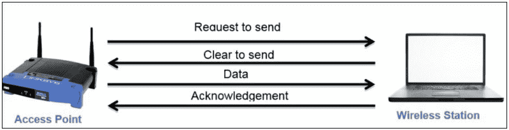

首先，AP 向 STA 发送请求以获得介质访问权；一旦 STA 批准 AP 的请求，AP 就开始发送数据。数据传输完成后，STA 立即发送 ACK 包以确认无差错交付。如果未发送 ACK，则 AP 会在一定时间后开始重传。

## 常见与不常见的 WEP——开放/共享密钥通信

在这里，我们将讨论两种类型的**有线等效保密（WEP）**认证过程：开放密钥和共享密钥。事实上，讨论 WEP 确实没有必要，但我们应该了解它的工作原理，因为你永远不知道何时会被要求排查一台固件尚未升级、仅支持 WEP 作为认证机制的旧路由器。

WEP-open 比 WEP-shared 好得多，因为即使你提供的密码是错误的，你仍然可以连接到网络；这样一来，它降低了路由器被暴力破解的风险。如果你使用 WEP-shared 通信，那么一个有经验的黑客破解你最强密钥所需的时间不会超过 2 分钟，而且由于 WEP 支持的密钥池很小，你的密码坚持不了多久。

那么，首先，我们需要搭建能够捕获 WEP-open 所需数据包的基础设施。这里需要注意的一个关键点是，我使用的基础设施由三台不同的机器组成：IP 为 192.168.1.1 的接入点、IP 为 192.168.1.105 的工作站，以及 IP 为 192.168.1.104 上运行 Wireshark 的 Kali Linux。请参考下图理解这一点：

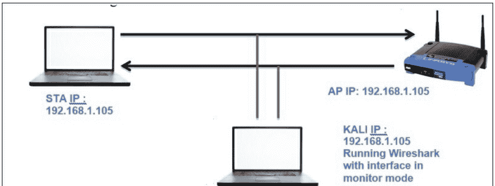

1. 首先，让我在接口上启用监控模式：

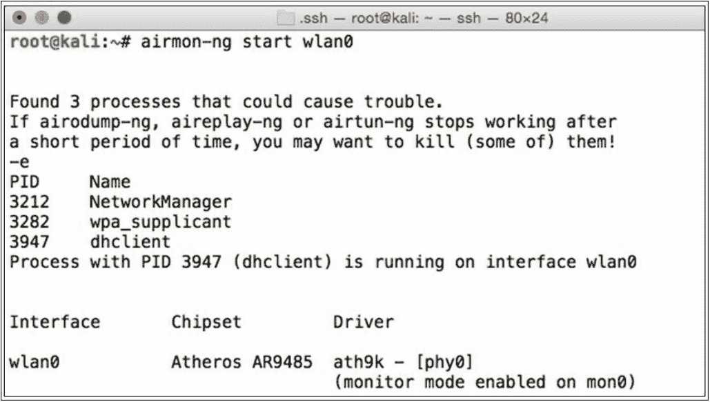

在上一个截图的右下角，你可以看到消息显示监控模式已在 `mon0` 接口上启用。我们将使用这个接口从我们的 AP 和 STA 捕获 `802.11` 数据包。

2. 接下来，为了确认我的信道工作在哪个频道上，我使用了 `airodump-ng mon0` 命令。

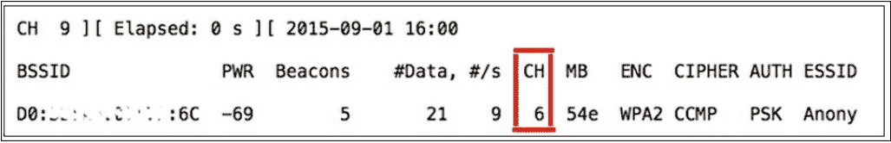

3. 现在，一旦我们确定信道是 6，我们就可以继续让接口专门监听这个信道，从而避免来自其他信道的干扰。为此，我使用了 `iwconfig mon0 channel 6` 命令。

```
root@kali:~# iwconfig mon0 channel 6
```

图 1：将 mon0 接口配置到信道 6


- 4. 完成所有这些步骤后，继续启动 Wireshark。如果您执行的命令输出出现任何错误，请在继续之前先纠正它。

**关联请求/响应** 是由 STA/AP 发送和接收的，用于重新关联之前客户端已参与的断开连接，并为 STA 在该信道上通信可能需要的资源进行分配。

**QoS 数据** 数据包是控制帧类型的一种子类型，它描述了服务质量和整体性能。

**空函数** 数据包用于通知 AP STA 即将进入省电模式。此数据包不携带任何数据，仅包含一些标志信息。

对于主机之间共享的每一种信息，都会发送 **ACK** 数据包以确定通信中每个数据包的交付情况。

## 共享密钥

在我们开始配置之前，我想让你了解 WEP 共享密钥认证的过程，即整个会话中涉及的步骤。请参考以下插图来理解这一点：

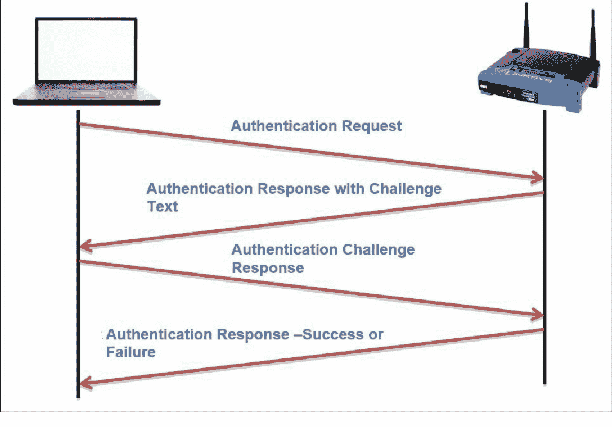

简而言之，STA 通过发送认证请求尝试连接到 AP，AP 通过发送一段文本挑战来确认，STA 需完成该挑战并在发送前使用 AP 所知的密钥算法对其进行加密。一旦 STA 在其端完成了挑战过程，STA 就会发送挑战响应，由 AP 评估并确定连接的成功或失败。同样，AP 会在另一个认证帧中向 STA 确认。

因此，对于一次正常的 WEP 认证会话，您至少会观察到四个认证帧。如果认证成功，则认证帧后面会跟随关联请求/响应以及一些数据传输。而如果认证不成功，则在四个认证帧之后，STA 与 AP 之间的会话将结束。请按照下一步捕获您 WLAN 中的 WEP 管理、控制和数据帧。

如前所述，您会注意到捕获到的数据包模式相同。请参考以下屏幕截图，展示了由 Wireshark 捕获的成功 WEP 认证会话：

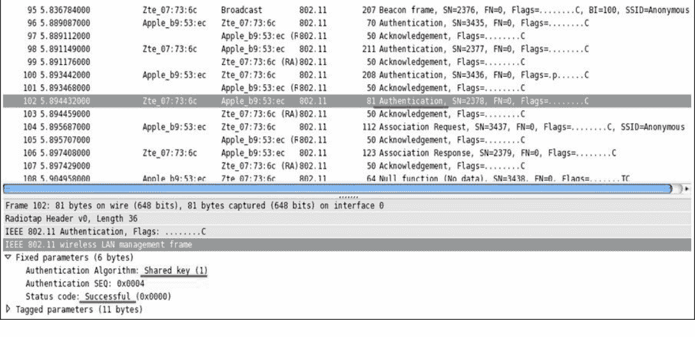

- 对于第四个认证帧，我已展开详细信息部分以确认连接尝试是否成功。从前面的屏幕截图中，我们可以验证它已成功。用于通信的认证类型也可以在此处看到。
- 如我们所知，现在如果 STA 与 AP 之间的连接尝试失败，整个会话将在第四个认证帧后终止，我们将看到失败消息。为了验证这一点，我在 Wireshark 通过监控模式监听单个系统上的接口时尝试复制了该场景。
- 请参考以下图示说明一次失败的 WEP 连接尝试。在列表窗格中，我们可以看到相同的认证帧模式（仅四个认证帧），但 STA 从 AP 接收到的最后一个帧确认了连接状态。正如详细信息窗格中清楚可见的那样，由于 STA 发送的挑战响应文本不正确，连接尝试失败了。

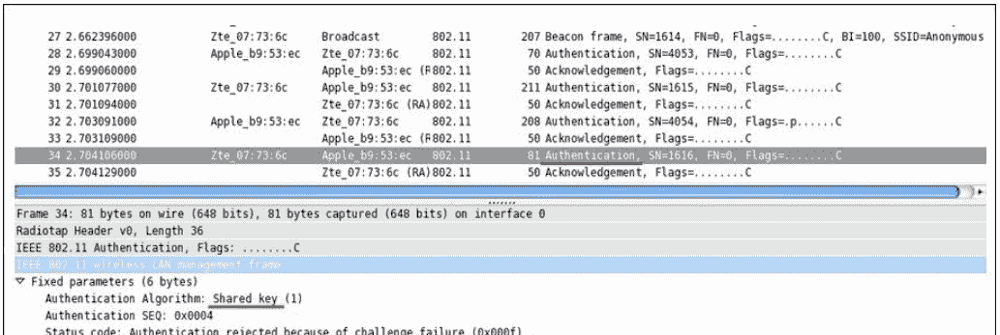

我们见证了 WEP 支持的两种认证程序，但真正重要的是要知道 WEP 现在已过时，因此我绝不会推荐你们任何人将其用作认证协议。如果您有仅支持 WEP 的旧设备，请升级到最新硬件。

## WPA-Personal

我们谈到了自无线网络诞生以来就一直使用的糟糕认证算法，但既然我们有更好的选择，为什么不用呢。我说的是 **Wi-Fi Protected Access (WPA)** 安全算法，当我们添加所需的纠正措施时，它比 WEP 更强。2003 年，Wi-Fi 联盟推出了 WPA，旨在使 WLAN 通信比之前的协议 WEP 更强。如今，几乎每个 WNIC 都支持 WPA 认证机制，从而使您能够利用更好的安全协议。**Temporal Key Integrity Protocol (TKIP)** 使现有旧硬件能够轻松升级以实现 WPA。WEP 使用的密钥大小为 40/104 位，而 WPA 使用 256 位的密钥大小，有趣的是，在 AP 与 STA 之间传输的每个数据包都使用 256 位密钥进行加密，这使得恶意用户的情况相当困难。WPA 还做出了另一项改进，让设备在消息完整性方面更有保障地通信。

在 WEP 中，实现了传统的 CRC，但在 WPA 中，引入了流行的 Michael 64 位 **Message Integrity Check (MIC)** 来解决该问题。WPA 也使用 RC4 算法基于动态加密密钥构建会话（您永远不会在两个主机之间使用相同的密钥对）。与 WEP 相比，其 IV 大小更大，为 48 位。请参考以下插图，了解传输介质上形成的密文是如何形成的：

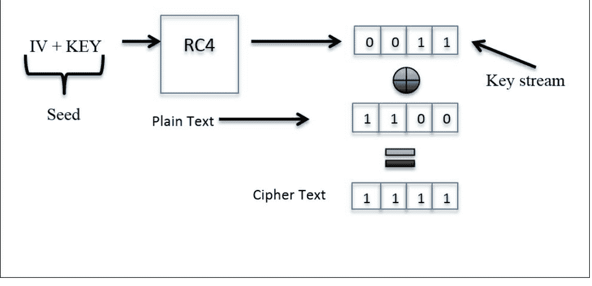

前面的插图描述了整个过程如何开始，先附加 IV 和动态生成的 256 位密钥。然后将其传递给 RC4 算法，该算法使用密钥加密数据包，然后将 resulting 加密密钥流附加到数据上，瞧！我们得到了密文。现在，我将向您介绍 AP 与 STA 之间正常的认证会话。请参考以下图示：

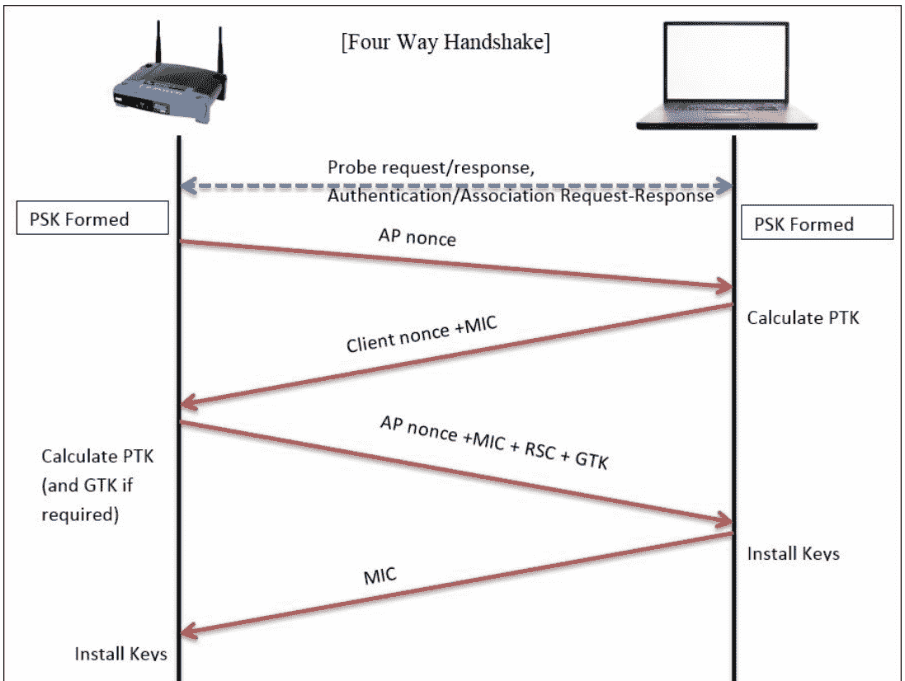

在企业 WPA 配置的情况下，首先进行主密钥交换。我稍后会简要介绍它。目前，我们有一个 AP 向 STA 发送其 nonce（随机值）以启动连接，STA 将使用 AP 的 nonce 值和自己的 nonce，结合在初始连接过程中建立的 **Pre Shared Key (PSK)** 计算出成对瞬态密钥 Pairwise Transient Key (PTK)。计算出的值将被发送到 AP。然后，AP 将在其端计算 PTK 并附加 MIC 和 **接收序列计数器 receive sequence counter (RSC)**，有助于识别重放消息。结果值将传递给 STA。现在，STA 将首先验证消息中的 MIC 以确保完整性并安装密钥。然后，将状态响应发送给 AP。如果状态显示成功，AP 然后安装相同的密钥（动态密钥），这些密钥将在主机之间的进一步通信中使用。

在我的 AP 上配置 WPA-Personal 后，我从客户端发送了认证请求，对应的通信被 Wireshark 捕获，如以下屏幕截图所示：

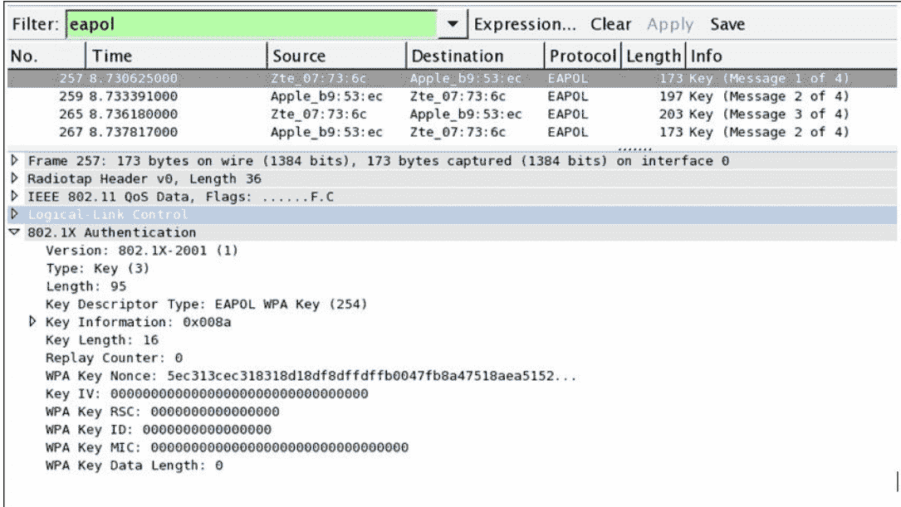

### Note

您需要与捕获 WEP 通信时使用的相同基础设施，即在单独机器上监听的监控模式接口。

这就是正常的 WPA 成功握手（认证）过程的样子，即四个 EAPOL 数据包。为了具体分析 AP 与

是随机选择的。

- **Packet 2:** 成对主密钥和 MIC 标志已设置，STA 将其发送给 AP 以确认收到的请求，并附带其自己的 nonce 值附加到 AP 的 nonce 以及用于完整性检查的 MIC。
- **Packet 3:** 成对主密钥、安装、密钥 ACK 和 MIC 标志已设置，AP 尝试将其发送给 STA。STA 将完成收到的挑战文本值，并连同加密的挑战文本向 AP 确认，AP 将对其进行交叉检查。
- **Packet 4:** 在这里，成对主密钥和 MIC 标志已设置，STA 将其发送给 AP 以完成连接。现在，AP 已相互准备好与 STA 进行数据传输。

我希望这些标志能以简单而现实的方式帮助您理解四次握手过程。

接下来，我们将看看当 AP 从 STA 收到错误的挑战文本时会发生什么，列表窗格中的数据包看起来如何，以及捕获的数据包模式是否会有任何差异。

STA 将尝试连接到 AP，AP 将请求挑战文本。这次 STA 不了解网络中其他客户端使用的密钥，因此最终得到一个错误的密码，AP 不会接受它，或请检查是否被 STA 确认。STA 将再次尝试发送挑战文本，同样过程继续进行。之后，您会在列表窗格中注意到几个相似的数据包。请参考以下图示：


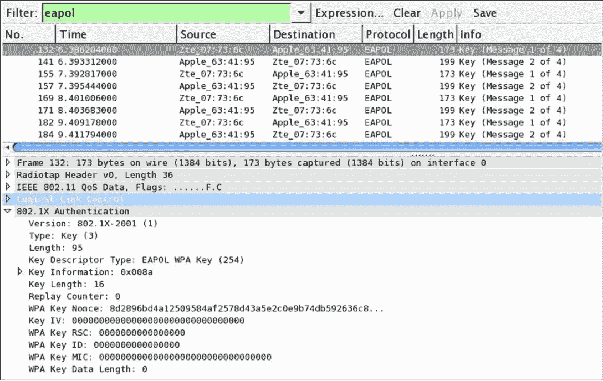

图 2：WPA 认证失败

正如你在上面的截图中所见，只能看到 **EAPOL 消息 1 和 2**，因为当 STA 提供质询文本响应时，AP 拒绝了它，然后该过程又重新开始。这种情况会持续几次，但这种报文模式表示连接尝试失败（可能是暴力破解攻击）。列出的数据包可以通过我们之前在密钥随机数（Key Nonce）详细信息部分中看到的重放计数器字段相互关联。

## WPA-企业模式

我承诺过要简要讨论一下企业模式，所以现在就来介绍。在企业基础设施中，密钥和密码不保存在 AP 上，甚至 AP 也不负责与 **STA** 的认证。这里有一个额外的实体——**RADIUS** 服务器，负责处理认证。在四次握手发生之前，**RADIUS** 服务器和接入点应该进行**主密钥交换**，这向两个通信设备保证对方是合法的。让我们看看下面的图：

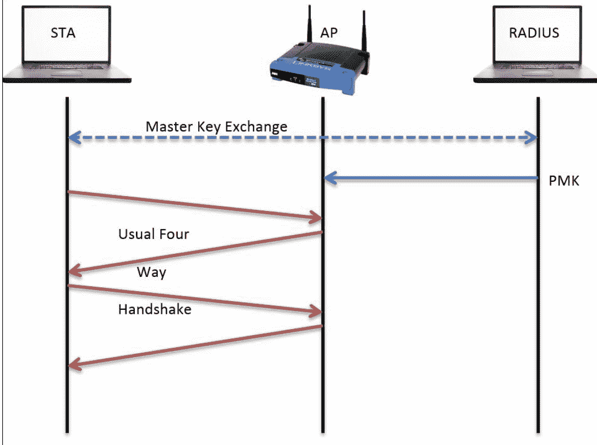

之后，成对主密钥被创建并传递给 AP，这将引导并完成四次握手过程，从而完成认证会话。

我向下滚动数据包列表，看看我为你发现了什么：我们的嗅探器捕获到了 **解除关联** 和 **解除认证** 数据包。所以，在结束之前，你应该看一下它们。

无线站点/接入点使用解除关联数据包来通知接入点客户端即将下线，并且 AP 分配给无线客户端的资源现在可以被释放。请参考下图，该图说明了这一点：

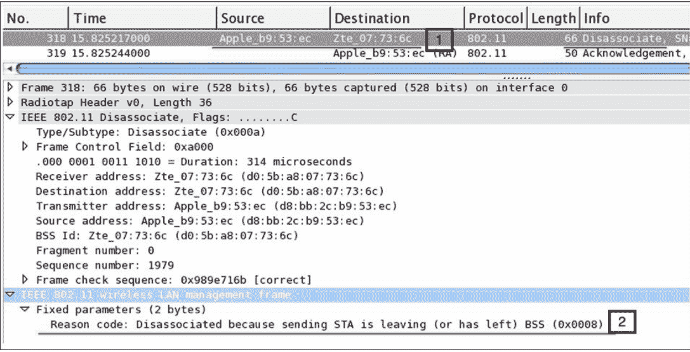

正如你可以观察到的，首先，STA 发送一个 `disassociation` 帧，并收到针对该帧的 ACK（318,319）。现在，为了更好地理解这些数据包，我们可以查看详细信息窗格（先选中解除关联数据包），其中 `Reason Code` 参数表明 STA 正在离开或已经离开。这为我们提供了一个功能，可以高效地查看和理解数据包行为。

无线站点或接入点使用 `deauthentication` 帧来通知通信的另一端，另一个设备正在离开。这可能有多种原因。请参考下图来理解这一点：

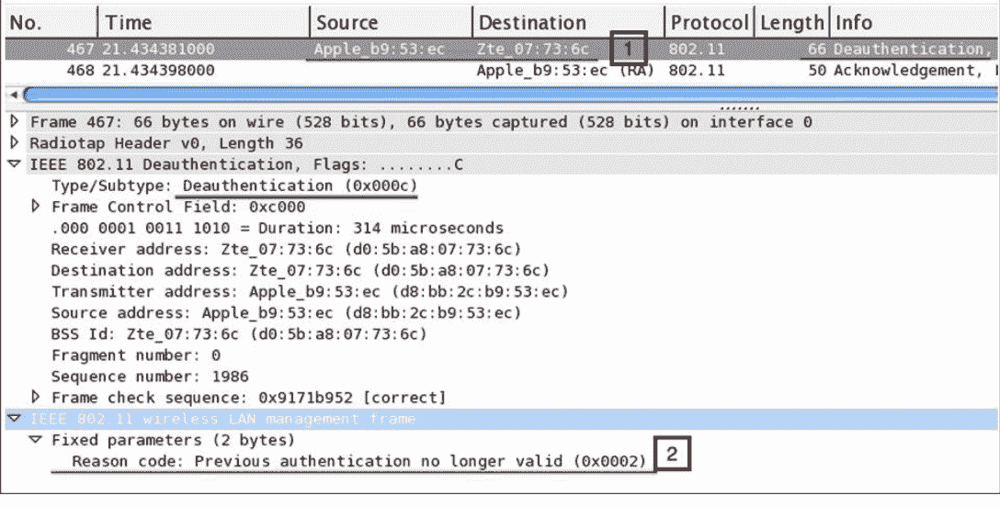

首先，STA 向接入点发送一个解除认证帧，在接下来的数据包（467,468）中得到确认。展开解除认证数据包的详细信息部分后，我们可以很容易地注意到类型/子类型字段正在验证这一点。在底部，我们了解到解除认证数据包产生的原因。在我们的例子中，原因是“先前的认证不再有效”，STA 试图将此通知 AP，如果他们将来希望再次通信，那么认证过程必须重新开始，从探测帧和关联帧开始，然后进行四次握手。

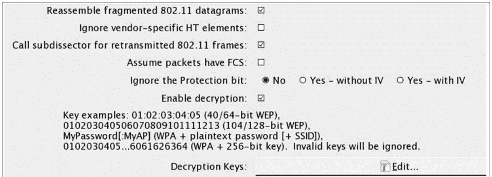

按照上面的截图设置好配置后，单击“解密密钥”旁边的“编辑”按钮（以添加 WEP/WPA 密钥）。请参考下面的截图：

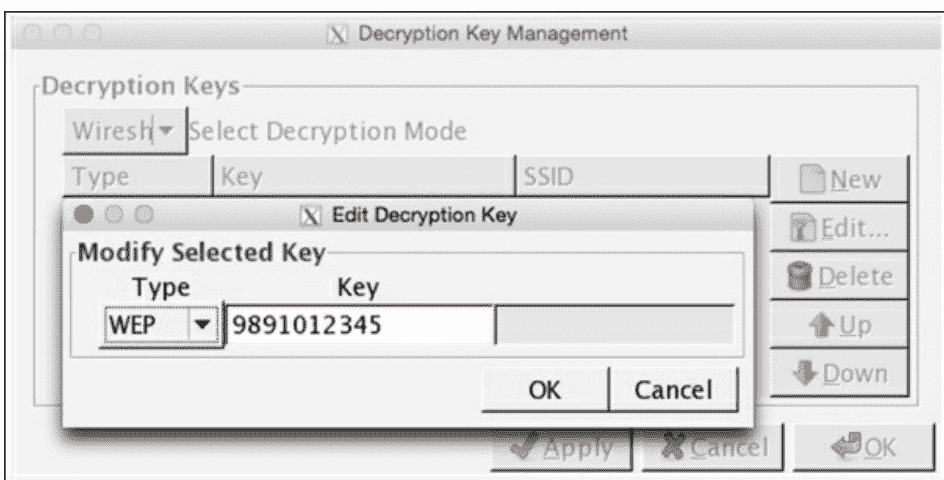

单击“新建”，你将看到一个类似的对话框，可以在其中添加 WEP/WPA 密钥，以便解密我们之前看到的通信。完成所有更改后，在“应用”下单击“确定”。现在，你将看到解密后的流量，类似于下图所示：

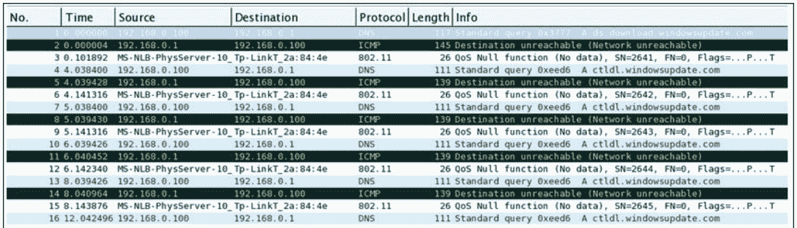

图 6：解密后的 WLAN 流量

我们在此节开头为此捕获文件看到的同一个列表窗格，现在以解密格式显示。在这里，我们能够看到 ICMP 和 DNS 数据包（正常网络流量）；这就是我之前谈到的正常流量。为了管理密钥，有一种更有效的方法，不需要从 IEEE 802.11 下的“首选项”部分打开“解密密钥”对话框。只需导航到“视图 | 无线工具栏”；这将在显示过滤器区域下方添加一个新的工具栏。


添加后，你可以轻松管理 WEP/WPA 密钥。显示 Wireshark 的下拉菜单非常有用，可以让你切换加密的开/关。如果你从列表中选择“无”，解密将被禁用，你的流量将恢复为仅 802.11 无线流量。如果你像上面的截图那样选择 Wireshark，则将应用解密。

## 总结

我们在这里讨论的内容不会让你熟悉无线通信中可能出现的每一种场景，但绝对能让你快速上手。

IEEE 802.11 标准通过无线电频率进行通信。在 WLAN 背后运行的协议是 CSMA/CA，它提供无线基础设施所需的无冲突环境。在 802.11 下，已经开发了多种标准，这为不同的基于基础设施的需求提供了强大的解决方案。

有时，你还需要关注射频（RF）能量水平，它确实可以在性能提升中发挥重要作用。由于各种设备工作在相同的 2.4 GHz 频段上，你的 WLAN 信号可能会失真。在这种情况下，你需要的是频谱分析仪，它可以让你分析和监控周围流动的射频能量。为此，你需要特殊的硬件，可以从在线科技商店购买，并且需要将该硬件与相应的软件配对使用，例如，Metageek 的 Wi-SPY 硬件与 Chanalyzer 搭配使用。

Kismet 是 Kali Linux 中提供的一个图形化工具，可以让你收集周围可用无线网络以及连接到这些网络的设备的各种高级详细信息。Kismet 带有各种自定义选项，在你查找特定信息时会非常有帮助。Kismet 还为用户提供了多种图形功能，可以在特定时间段内绘制实时流量图。

在传统的 WLAN 环境中，有一个 AP 和一个 STA 相互通信。在实际数据传输之前，两个设备需要通过密钥（密码和加密算法）协商会话，通信双方将使用该密钥来维护发送数据的完整性。

在使用 Wireshark 时，你通常会看到三种类型的帧：管理帧、控制帧和数据帧。这些是选中某个数据包后，你可以在详细信息窗格中看到的数据包。管理帧控制连接的建立，控制帧控制管理帧的传输，而数据帧仅包含发送的实际数据。

WEP 和 WPA 等认证协议负责 AP 和 STA 之间如何协商以开始通信。

EAP 用于实现主密钥的交换。如 RFC 3748 中所定义，EAP 是一个支持多种认证方法的认证框架，执行 EAP 不需要 IP，因为它运行在数据链路层之上。

EAP 与 LAN 结合就变成了 EAPOL，用于 802.11 基础设施（RADIUS/AAA）中的主密钥交换。按照正常模式，AP 广播 STA 监听的信标帧。否则，STA 会自行发送探测请求以建立连接。然后，AP 和 STA 进行认证会话并进行协商，直到双方主机相互确认。一旦完成，AP 将向 STA 发送成功消息。

使用 Wireshark，只需添加所用协议的无线网络密钥，并修改 IEEE 802.11 协议的首选项，就可以解密 WEP 通信。

用于捕获相关数据包的监听模式可以在基于 Linux 的系统上轻松配置，并且对于 Wireshark 802.11 分析至关重要。

在 802.11 中，RTS/CTS 与 CSMA/CA 相对使用，这保持了介质无冲突且易于操作。

使用哈希函数 **基于密码的密钥派生函数（PBKDF2）**，通过密码短语计算出 256 位预共享密钥。


# 练习题

- Q.1 阅读完本章中关于IEEE 802.11的部分后，就这一协议以及你所理解的内容做一份详尽的笔记——如果需要，可以参考相应的RFC。
- Q.2 在一台独立机器上安装任意基于Linux的live系统，并尝试使用本章中提到的命令启用监控模式。
- Q.3 首先在关闭监控模式并开启混杂模式的情况下捕获数据包，然后在开启监控模式和混杂模式下捕获。分析差异。
- Q.4 在你的Windows机器上安装Aircrack工具，并尝试捕获周围的802.11流量。
- Q.5 802.11（b/a/g/n/i）中可用标准之间的区别是什么？
- Q.6 假设你有一台路由器，路由器的一端连接着一台交换机，交换机进一步连接多个有线客户端。路由器的另一端连接着一个无线接入点，该接入点充当介质，使各种无线设备能够连接到公司网络。现在，从无线域向有线域发送一个数据包，并在数据包在域间传输时分析它们。802.11报头会有什么不同？
- Q.7 当你的无线网卡不支持监控模式或混杂模式时，会发生什么？解释每种模式的重要性。
- Q.8 要查看你的设备发送给接入点的探查请求的可用性，你会使用哪个显示过滤器？
- Q.9 将你的接入点配置为WEP-Open认证，然后在捕获流量的同时尝试使用该AP连接到它，并使用WEP-Shared执行相同操作，分析出现的数据包模式的差异。
- Q.10 哪个更好：WEP-Open还是WEP-Shared密钥，为什么？
- Q.11 使用捕获过滤器仅捕获来自你的主机、接入点和广播地址的流量。这是否有助于减少噪声？
- Q.12 将无线接口的监控模式配置到特定信道，然后捕获WLAN流量。
- Q.13 WPA-Shared密钥和WPA-Enterprise认证协议之间有什么区别？请详细说明。
- Q.14 复制一个配置了WEP-Shared密钥接入点的场景，捕获相当大量的流量，并尝试使用WEP密钥解密你捕获的流量。
- Q.15 为什么WEP-Open比WEP-Shared密钥认证机制更好？
- Q.16 你能想出一种方法，可以强制无线客户端与它当前连接的网络解除关联吗？
- Q.17 对于取消认证数据包，你认为存在多少种类型？修改其着色规则以唯一地查看这些数据包。它们与解除关联数据包有何不同？
- Q.18 在分析WPA握手时，你是否在实际握手之前观察到任何基于开放系统的认证？如果存在，则分析流量并解释其作用？
- Q.19 将你的接入点配置为WEP协议加密，捕获正常的802.11无线帧。然后，使用我们讨论过的相同方法，尝试使用你的网络密钥解密流量。
- Q.20 是否可以使用ASCII格式密钥解密流量，或者你也可以用HEX格式提及密钥？如果可以，在哪种情况下以HEX格式编写密钥会被证明有价值？
