# 第7章 网络安全分析

本章将教你如何使用Wireshark分析网络安全问题，例如分析恶意软件流量和足迹探测尝试。你将学习如何使用Wireshark进行网络安全分析。本章将涵盖以下主题：

- 分析端口扫描、足迹探测和攻击活动
- 实验——使用Nmap进行端口扫描
- 分析暴力破解攻击
- 实验——分析暴力破解攻击
- 检查恶意流量
- 实验——检查恶意流量
- 解决现实世界中的CTF挑战
- 练习题

到本章为止，我一直试图让你了解如何使用Wireshark分析周围流动的数据包。我们只关注了如何使用这款嗅探工具进行基本分析。然而，我要告诉你的是，在大多数情况下，Wireshark被用于安全分析目的，从基本的足迹探测攻击到高级的基于木马的攻击。

在我的虚拟实验室中，我将通过几个场景尝试复现最常见的攻击，同时捕获攻击者与受害者之间的实时流量。之后，我们将剖析跟踪文件，以了解恶意流量的样子。我们将利用这些知识库来创建IDS/IPS或防火墙签名，尝试通过分析Wireshark中显示的流量来保护我们内部的关键基础设施。

要实现这一切，你需要稍微改变一下视角。换句话说，你需要像负责公司网络的安全专业人员那样行动和思考，不断加固边界，使恶意用户的攻击过程变得更加复杂。我们可以通过分析日常流量中捕获的数据包以及复现某些场景来开始这一切。

## 信息收集

利用过程的首要步骤是尽可能多地收集信息。在当今世界，收集关于个人或组织的具体且相关的信息并不那么困难（使用搜索引擎），而一切正是从这里开始的。许多安全专业人员会直接对目标发起攻击，这在开始时并不合适。例如，假设有一家ABC有限公司位于相邻街区，一个XYZ攻击者正计划在物理安全方面利用它（进入服务器机房或内部任何高价值目标）。要做到这一点，攻击者首先应该知道工作时间与非工作时间。然后，他们应该了解目标公司的工作日。攻击者还应了解公司所在建筑的物理布局，并且对安保政策有一些基本了解。有了所有这些信息，攻击者应该能够识别场所内部可能容易攻击的薄弱点，并可以访问到他们正在寻找的东西。你注意到前面的场景中发生了什么吗？我们假设攻击者正在收集有用的信息，然后计划并找出容易攻击的目标，因为遵循这种方法会提高成功的机会。足迹探测和侦察是术语“信息收集”的同义词。如果你遵循计划好的方法，成功的机会会更高。

让我们使用同样的方法来攻击使用网络的组织。第一步是识别组织的公共IP地址、它所属的子网以及分配给组织的IP地址范围。这些基本信息可以通过在线DNS查找服务被动收集（无需直接与公司网络交互）。我们可以尝试检查是否提供区域传输，这可以给出关于我们目标组织基础设施的一些有价值且详细的细节。在你收集了基本信息并绘制出基本布局之后，就可以进行**端口扫描**了。我更倾向于你先做一次**ping扫描**，它会告诉你网络上的活动主机，并从中了解更多网络信息（在执行ping扫描时，你可以修改TTL值以推测内部局域网架构）。

在我们继续尝试复现最常见的场景之前，我希望你先想象一下我为练习目的而创建的本地虚拟计算机基础设施。请参考下图：


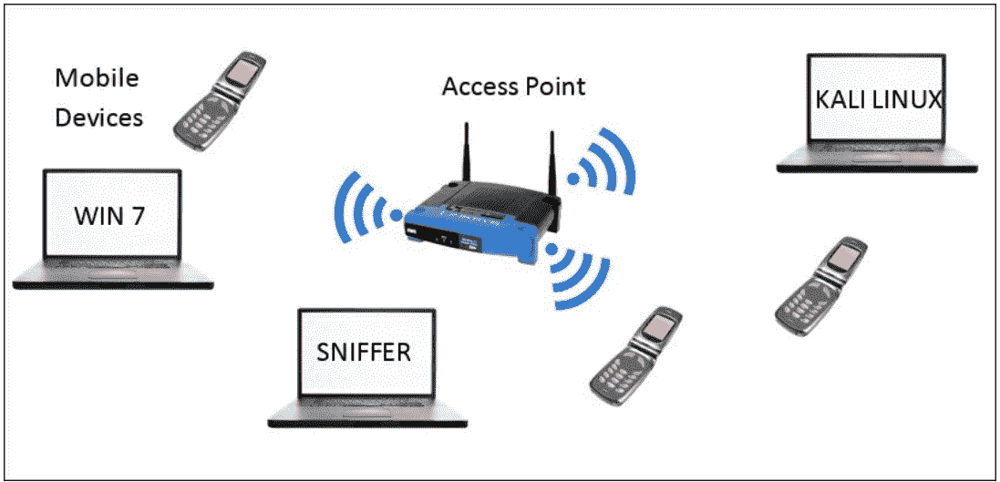

希望现在你对我将要使用的内部网络有了一个大致的了解。位于 192.168.1.1 的接入点通过 DHCP 为所有这些设备分配 IP 地址（DHCP 范围从 192.168.1.100 开始，一直到 192.168.1.110；这意味着我在同一时刻最多只能有 10 个 DHCP 客户端）。在本章中，我们攻击机的 IP 地址被静态分配为 192.168.1.106。

## PING 扫描

让我们从第一个场景开始，攻击者试图对子网执行 PING 扫描攻击，而我们的嗅探器通过其接口以混杂模式监听并捕获了所产生的流量。请参阅下图，该图展示了运行 bash 脚本后生成的流量模式（该脚本从 100 到 110 逐个 ping 每个 IP）：

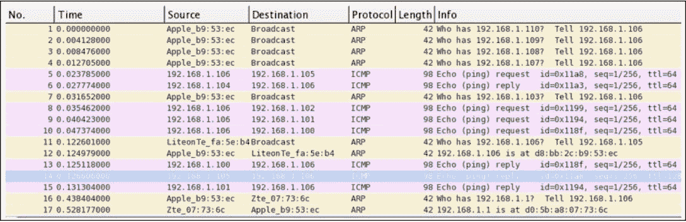

图 7.1：PING 扫描

从数据包 1–4 开始，Kali 主机因发出 ICMP `ping` 命令而开始生成 ARP 请求，但这些 IP 均未分配。因此，我们没有收到任何回复。在数据包 5 中，Kali 主机向 105 发送了 `ping` 请求，并在数据包 14 中收到了回复，这意味着该设备处于开机状态。然后，在数据包 7 中，一个 ARP 请求被发送到 103，但此 IP 在当前实例中可能也是未分配的，因此再次没有收到回复。在数据包 8–10 中，Kali 主机向 IP 102、101 和 100 发送了 ICMP 请求数据包。相应的回复可以在数据包 13 和 15 中看到，分别来自 IP 101 和 100。对于 102，我们没有收到任何回复。可能是某个设备阻止了我们的 ping 探测，或者某些移动设备不响应 ping 探测。最后，在数据包 17 中，我们可以看到接入点正在将其物理地址告知 Kali 主机。如果你向下滚动跟踪文件，你会看到来自在线设备的各种回复，它们描述了各自的物理地址。

## 半开扫描（SYN）

该过程的下一步是扫描你想要攻击的任何特定设备。假设我想攻击运行在 IP 192.168.1.105 的 Win7 机器。我的下一步应该是检查该主机上运行的可用的服务。所谓服务，我指的是 HTTP 守护进程、邮件服务器守护进程、FTP 服务器等等。你可能想知道什么是半开扫描？看看我们讨论过的 TCP 三次握手过程：如果服务器可用，客户端通过发送 SYN 数据包来发起连接；然后客户端收到 SYN, ACK 数据包，作为回应，客户端向服务器发送 ACK 数据包以完成握手过程。

现在，如果 TCP 握手最后一步中的 ACK 数据包从未发送到服务器，会发生什么？服务器会等待一段时间，然后终止客户端发起的握手过程，并且与特定 TCP 服务的连接将永远不会完成。这就是为什么这种扫描被称为半开扫描。这是一种非常常见的扫描技术，被大多数从事恶意活动的用户所使用，了解这种流量模式有助于我们识别未来的风险。我从 Kali 主机发起了针对 Win7 主机的半开扫描。我使用的是 Nmap，它是一个适用于所有平台的开源工具，可以从 http://nmap.org 免费下载（要使用该工具，你可以参考网上提供的各种教程）。由于 SYN 扫描而产生的流量被捕获并显示在以下截图中：

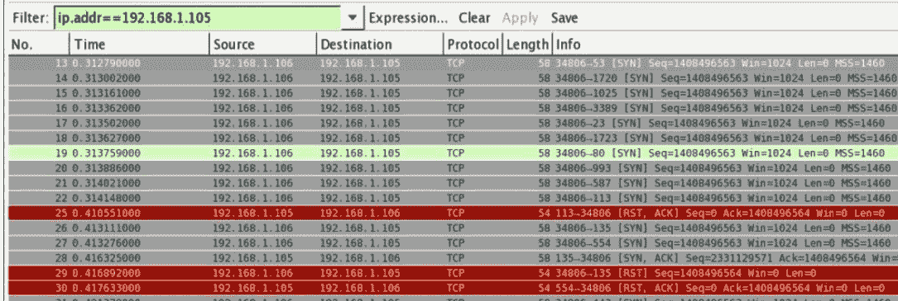

图 7.2：半开扫描

扫描完成后，你可以看到三种类型的回复：开放、关闭和被过滤。现在要讨论的重点是这些状态的含义，以及这些状态与前面截图中显示的数据包有什么关系。让我们更详细地了解这些状态：

- **开放（Open）：** 如果服务是开放的，那么一个 `SYN, ACK` 数据包会被发送回你的机器，从而将 TCP 握手过程推进到下一步。在数据包 26 中，Kali 向端口 135 发送了 `SYN` 请求，并在数据包 28 中收到了 `SYN, ACK` 回复。
- **关闭（Closed）：** 如果服务无法响应，那么你会收到一个 RST 数据包，它确认服务/守护进程当前未运行。在数据包 22 中，一个 `SYN` 请求被发送到端口 113。在数据包 25 中，收到了对应的 RST 数据包。它表明该服务此刻不可用。
- **被过滤（Filtered）：** 有时，在你和目标之间可能配置了防火墙，它会拦截你的请求并将其丢弃，而不会转发给目标。在这种情况下，你可能会看到端口状态，如 `open|filtered`、`closed|filtered`，或者仅仅是 `filtered`。
- 假设你正试图扫描一个位于你的 VLAN 之外、并且被防火墙限制访问的 HTTP Web 服务器。那么握手过程永远不会进入第二步，也就是说，你永远不会收到任何形式的回复。你不会收到任何 `SYN, ACK` 或 `RST` 数据包。

使用这种扫描类型，你可以识别正在运行的服务的状态。然而，使用这种扫描类型也会产生大量的流量。我发起的扫描在 1.76 秒内完成，而在如此短的时间内，它在两台机器之间生成了 2024 个数据包。这恰恰证明其不利之处。任何配置良好的 IDS/IPS 都能非常容易地发现此类活动，进而触发警报以通知安全管理员。Nmap 也有可配置的选项，在这些情况下也能帮助你。

## 操作系统指纹识别

了解目标上运行的操作系统，会将扫描过程推进到方法论的下一个步骤。如果攻击者知道你所运行的操作系统、操作系统的补丁级别以及操作系统的版本，那么构建攻击过程就会相当简单，并且会提高成功的几率。

Kali 中有一些工具可以让你识别目标的操作系统。这些工具并非 100% 准确，但在大多数时候是正确的。现在，你认为一个简单的工具是如何能够识别远程机器的操作系统的？我来告诉你其中的秘密。每个操作系统都有不同的方式来实现 TCP 协议栈。因此，从远程机器收到的数据包中会包含某些字段，例如 TTL、分片偏移量，以及最重要的窗口大小。通过将数据包中的值与我们所拥有的数据库进行比较，它就能告诉你操作系统类型。例如，如果你尝试 ping 一台 Windows 机器，返回的 TTL 值通常是 128；如果你 ping 一台 Linux 机器，大多数时候 TTL 值会是 64。很简单，不是吗？

指纹识别有两种类型：主动识别和被动识别。它们描述如下：

- **主动指纹识别：** 当你直接与系统交互时，请求和响应会直接在你和目标之间进行。这种扫描可能非常危险，而且不具备隐蔽性。捕获的数据包会提供一些值，这些值可以与我们所拥有的签名进行匹配，从而识别远程机器上运行的操作系统。
- **被动指纹识别：** 当你只是监听发往目标或源自目标的数据包时，可以检查数据包中的值来识别运行的操作系统。被动扫描的一个缺点是它不如主动指纹识别准确。但该过程比主动扫描更具隐蔽性。

使用 `nmap` 扫描，我将尝试对 IP `192.168.1.109` 和 `192.168.1.104` 的机器进行指纹识别，并查看此类请求会产生什么样的流量。我们将看到的扫描类型是主动扫描，我们将直接与系统交互。我们不会仅仅依赖 Nmap 的输出来确认操作系统。返回给我们攻击机的数据包是所有必要信息的基础，为了让你更好地理解，我将尝试对其进行分析。

我将使用 `nmap -O 192.168.1.109,192.168.1.104` 命令进行主动操作系统指纹识别，其中 -O 选项用于检查操作系统及其版本。请参阅以下两个截图，比较它们呈现给我们的输出结果：


## ARP 欺骗

众所周知，ARP 协议的功能是将 IP 地址翻译成对应的 MAC 地址。通过这样做，设备能够在基于 LAN 的网络中有效通信。任何希望与同一网络上其他设备连接的设备都需要其他主机的 MAC 地址。每个操作系统都维护一个通信设备列表，可以通过 `arp -a` 命令在终端窗口中填充。同一命令在每个平台上都使用。我们也见过 ARP 请求和回复数据包，它们被连接到本地网络的设备用来获取其他设备的 MAC 地址。

例如，我也有一个本地网络，它由位于 `192.168.1.1` 的路由器（网关）管理，并且有 3 台设备连接到它。下表列出了连接到该网络的设备所特有的所有必要信息，我们稍后会用到：

| 设备 | IP 地址 | MAC 地址 |
|---|---|---|
| 路由器（默认网关） | 192.168.1.1 | D0:5B:A8:07:73:6C |
| Apple（受害者） | 192.168.1.103 | D8:BB:2C:B9:53:EC |
| Windows 服务器（受害者） | 192.168.1.109 | 00:0C:29:B3:CB:B6 |
| Kali Linux（攻击者） | 192.168.1.106 | 00:0C:29:5D:A7:F7 |

上述信息列在连接到本地网络的每个主机的 ARP 缓存中。你一定在想这是如何在本地缓存中填充的。每当任何设备打算与另一台设备通信时，请求设备会向整个子网发送广播。然后，拥有该 IP 地址的设备会使用单播数据包回复其 MAC 地址。

例如，如果 Apple 机器希望与位于 `192.168.1.109` 的 Windows 机器通信，Apple 将发送广播请求 Windows 的 MAC 地址，声明 `Who has 192.168.1.109? Tell 192.168.1.103`。然后，一旦 Windows 机器得知请求，ARP 回复单播数据包声明 `192.168.1.109 is at 00:0C:29:B3:CB:B6` 将被发送。这就是过程的工作方式。

上述数据包传输只有在 Apple 机器在其本地缓存中拥有 Windows MAC 地址时才会发生。搜索本地缓存后，请求将被发送到默认网关。如果默认网关知道它，网关本身将发送 ARP 回复数据包。如果不知道，则请求将被转发到子网，目的地 PC 将使用单播数据包回复物理地址。之后，可以使用 TCP/IP 进行对话。

ARP 欺骗用于污染受害者的本地缓存，从而使攻击者能够嗅探在两个受害者之间传输的数据。攻击者拦截流量然后将其转发到另一侧。参考以下插图：

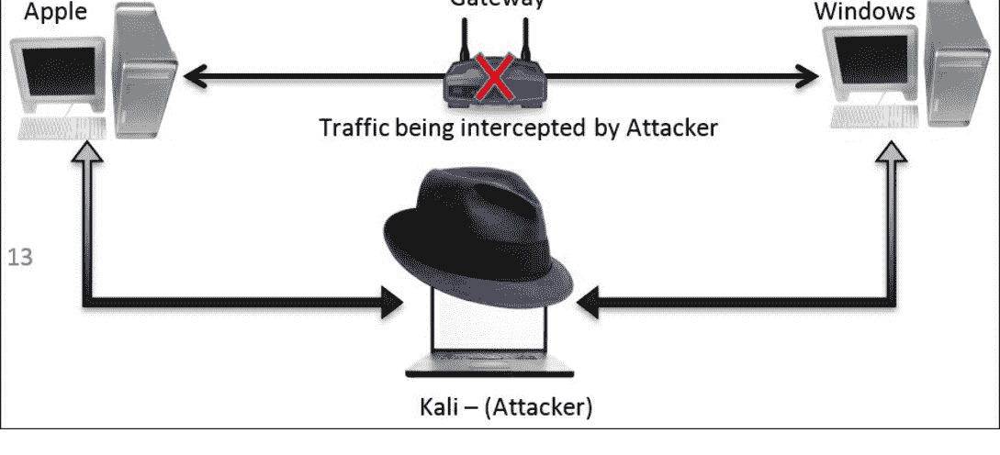

我们可以污染两个受害者的本地 ARP 缓存并实现同样的效果。还有一件事你需要配置：在 Kali 上启用 IP 转发，这样你的攻击机器就能在不丢失的情况下来回传输流量，而不会让受害者产生怀疑。按照以下步骤实现 ARP 欺骗：

- 首先，使用 `echo '1' > /proc/sys/net/ipv4/ip_forward` 命令配置 IP 转发。

- 一旦配置完成，你就可以开始向两个受害者发送未经请求的 ARP 回复数据包以污染缓存。在我们污染它之前，让我们先看看它们在正常形式下是什么样的，对两个受害者机器而言：

  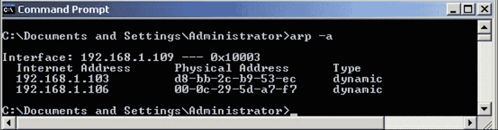

  图 7.4：Windows 服务器缓存

  要在 Linux ARP 缓存中填充条目，请使用类似命令；参考以下屏幕截图以供参考。

  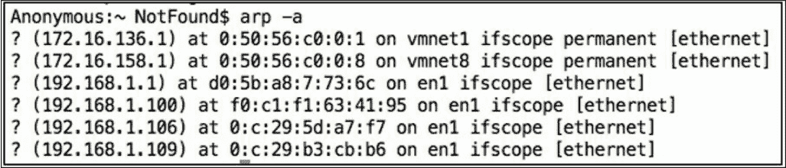

  图 7.5：Apple 缓存

- 现在，让我们开始向 Windows 服务器机器发送未经请求的 ARP 回复数据包，声称 Apple 机器位于 00:0C:29:5D:A7:F7。相同的包将发送给 Apple 机器，声称 Windows 服务器机器位于 00:0C:29:5D:A7:F7。如果你注意一下，发送给 Windows 和 Apple 机器的数据包中指定的 MAC 地址属于 Kali（攻击者）。参考以下屏幕截图查看我用于欺骗虚假 MAC 地址的命令：

  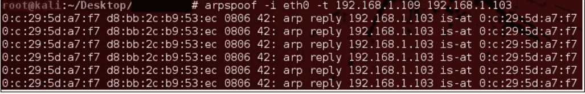

  图 7.6：代表 Apple 设备发送给 Windows 服务器的 ARP 回复数据包

  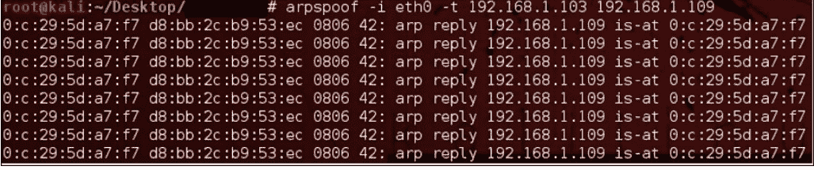

  图 7.7：代表 Windows 服务器发送给 Apple 设备的 ARP 回复数据包

  使用带少量参数的一行命令，我们通过发送大量 ARP 回复数据包成功污染了受害者的缓存。

- 由于上述命令产生的流量也在同时被捕获。让我们看看它是什么样子的。参考以下屏幕截图：

  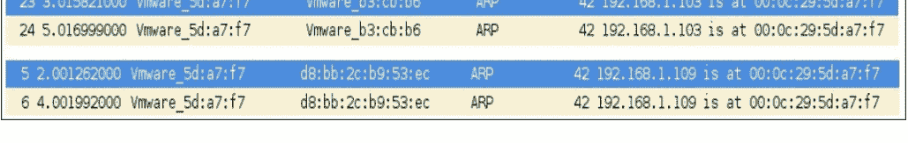

- 一旦两个受害者都收到了多个此类数据包，它们就会开始相信它并相应地更新缓存。让我们查看两台机器的缓存以验证这一点。参考以下屏幕截图：

  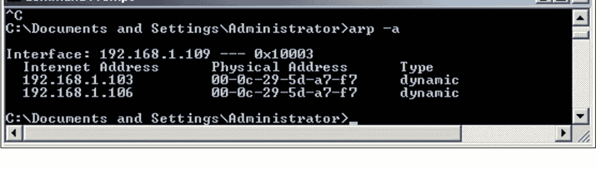

  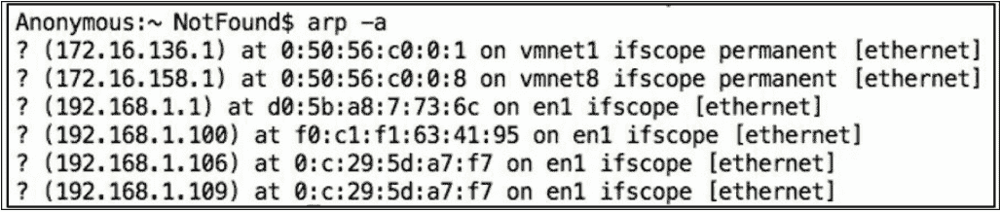

- 现在，这两台设备之间发送的任何流量都将通过攻击盒转发。为了验证，我关闭了 Windows 服务器机器并尝试从 Apple 机器发送 ICMP 数据包。参考以下来自 192.168.1.106（Kali）的 ICMP 目标主机不可达回复的输出所示：

  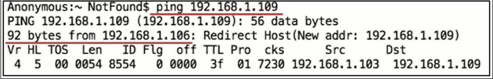

  上述输出确保数据包正在通过 192.168.1.106 转发，从而使我们的 ARP 欺骗攻击成功。

- 现在，问题是如何保护自己免受此类攻击。我建议最好的方法是为通信客户端的本地缓存中的设备 MAC 地址手动添加条目。这肯定会在修改本地缓存时忽略未经请求的 ARP 回复数据包。参考以下屏幕截图：

  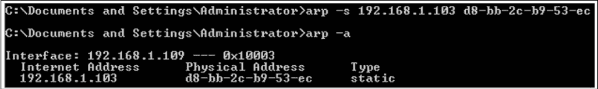

一旦你在网络中的每个可能主机中添加静态条目，就不可能再使用 `arp` 欺骗工具修改本地缓存。同样，对于 HTTPS 流量，你可以使用在线可用的 SSL strip 工具来嗅探安全流量。

### 分析暴力攻击

你们大多数人都应该知道暴力攻击的流行程度。成功率并不高。然而，许多安全专业人员和恶意用户借助现代工具实施其密码猜测能力。暴力攻击只是一种方式，你尝试使用可能基于目标个人资料创建的密码字典登录到特定服务/应用程序。诸如 CeWL、Crunch 和 John 等工具可让你创建字典文件。甚至你可以对密码加盐。讨论如何为自己创建字典超出了本书的范围，但我建议你查看这些工具（它们都预装在 Kali Linux 中）。

为了分析这些常见且恶意的攻击，我将尝试暴力破解两个重要服务：Telnet 和 FTP。你可能知道这两个服务以及它们在企业网络基础设施中被使用的程度。Telnet 用于远程管理诸如路由器、交换机和不同类型的 Web 服务器等设备。FTP 用于高效传输文件，并确保数据完整性和确认交付。

首先，看看最广泛用于远程管理的协议，它通常在安全方面被忽视。使用简单的暴力技术，任何脚本小子都可以获得对你网络的访问权限，其后果在金钱和服务可用性方面可能非常具有破坏性。如果涉及消费者，那么他们的记录可能价值数百万，导致管理系统的完全远程代码执行。

对于此说明，我有一台运行在 `192.168.1.109` 的 Windows 服务器机器，以及一台位于 `192.168.1.106` 的攻击者。攻击者首先准备其字典文件，然后将使用自动化工具攻击在 Windows 服务器机器上运行的 Telnet 管理服务。此类活动产生的流量将通过我们的出色嗅探器记录以供分析。我尝试像普通用户一样通过以下步骤连接到 Telnet 服务：

- 使用 Telnet 命令后跟 IP 地址，我能够连接到服务。作为回报，它为我打印了一个横幅：`Welcome to Microsoft Telnet service.`

- 然后，我提供了错误的用户名凭据，服务器未接受。因此，它显示了登录错误，显示 `bad username or password.`

- 然后，我提供了合法的凭据集，它被识别并


被服务接受。

- 用户授权后，会出现带有相应授权的 Windows 命令提示符，并伴随着一条横幅：`Welcome to Microsoft Telnet Server.`
- 连接成功后，我就可以直接从我的机器上发出（Windows）远程命令。
- 最后，为了优雅地终止连接并释放为平稳运行而分配的所有资源，我发出了 `exit` 命令，系统返回消息 `connection closed by foreign host.`

以下截图展示了 Microsoft Telnet 服务器的正常运行：

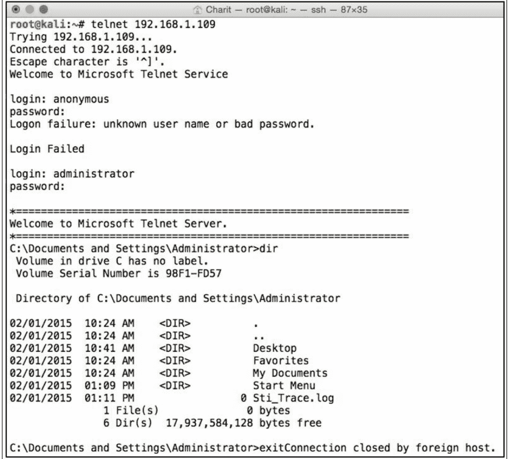

## 图 7.11：Telnet 正常会话

产生的流量也已被 Wireshark 捕获。我没有直接展示这些流量，而是决定以纯文本格式向你展示完整通信内容。只需右键单击列表窗格并选择显示 TCP 流（show TCP stream），即可整合 TCP 流并得到该文本（Telnet 服务器配置了回显选项，因此我们也许会看到一些从服务器回显到客户端的字符）。请参见以下截图：

```
%.......W.#..........'.....'...Welcome to Microsoft Telnet Service

login: aannoonnyymmouuss

password: abc123

Logon failure: unknown user name or bad password.

Login Failed

login: aaddmmiinniitt rr.....ssttrraattoorr ...

password: chris
........xterm-256color...........xterm-256color..

*==============================================================================
Welcome to Microsoft Telnet Server.
*==============================================================================
C:\Documents and Settings\Administrator>ddiirr

Volume in drive C has no label.
Volume Serial Number is 98F1-FD57

Directory of C:\Documents and Settings\Administrator

02/01/2015  10:24 AM    <DIR>          .
02/01/2015  10:24 AM    <DIR>          ..
02/01/2015  10:41 AM    <DIR>          Desktop
02/01/2015  10:24 AM    <DIR>          Favorites
```

## 图 7.12：Telnet 跟踪 TCP 流

只需跟踪 TCP 流，我们所输入的所有内容以及服务器返回的响应都会以简单可读的纯文本形式显示出来。

现在，看完正常会话的样子后，如果你想学习如何执行暴力破解攻击，请按照以下步骤操作：

- 创建一个至少包含两台机器的虚拟渗透测试实验室：其中一台是攻击机（Kali），另一台可以选择你喜欢的机器（请确保该机器上能安装 Telnet）。
- 尝试 ping 目标主机以测试连通性。执行 Telnet 命令来创建一个正常会话，并测试一切是否正常。
- 现在，打开 Kali，执行 `medusa -h <target ip> -U <usernames file> -P <password file> -M telnet` 命令。请参见以下截图：

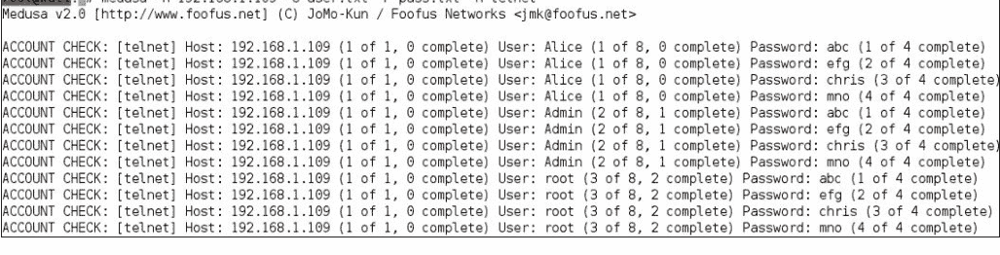

图 7.13：暴力破解——Telnet

最后，通过使用不同的组合，我们成功对服务器进行了暴力破解。这些接连不断的尝试所产生的流量，对我们来说有着特殊的研究价值。

- 文件中产生了大量 TCP 和 TELNET 流量，其中包括三次握手以及通过 Telnet 在服务器和客户端之间传输数据等流量模式。然而，所有内容并不都是我们感兴趣的。请参见以下截图：

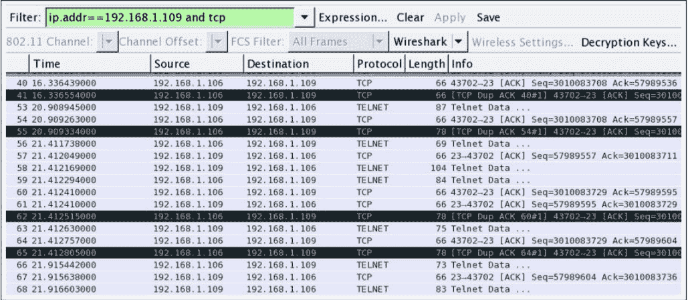

图 7.14：服务器与我们的客户端之间的 Telnet 和 TCP 流量

- 为了只看恶意流量，我应用了另一个显示过滤器，它只显示两台主机之间的各种连接尝试。请参见以下截图：

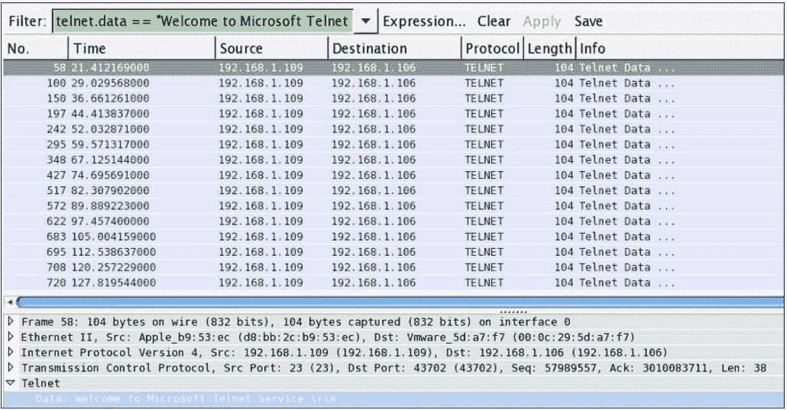

- 现在，结合 Time 列观察显示过滤器 `telnet.data==Welcome to Microsoft Telnet Service`。我在过滤器中使用的字符串，与我们连接服务时收到的横幅相同。该横幅在大约 100 秒（不到一分钟）的时间内打印了约 15 次。

- 现在，这是否让你觉得可疑？如果是，你可以为相同的流量模式创建有效的特征签名，从而采取预防措施来保护你的基础设施，并帮助你及时获得警报。

接下来，我们来看看另一种流行的服务——FTP，前面的章节中已详细讨论过。让我们看看针对 FTP 服务的暴力破解攻击会是什么样。FTP 是一项非常关键的服务。如果受到任何形式的攻击，服务可能会崩溃或对合法用户不可用。这可能会给网络管理员带来严重的停机问题。为了应对日常运营中发生的此类活动，你需要做好准备，识别恶意流量模式，并与我们之前创建的基线流量模式进行比较。

出于测试和分析目的，我在一台 Windows 7 机器上配置了一个 FTP 服务器，地址为 192.168.1.108，攻击机在同一位置，IP 为 192.168.1.106。我使用 Kali Linux 操作系统来复现攻击和正常流量模式场景。如果你仅出于教育目的想复现此过程，请遵循以下步骤：

- 使用最适合你需要的任何平台配置客户端和服务器，并确保 FTP 服务器与客户端之间的连接畅通无阻。
- 现在，首先我们将使用一个合法用户访问服务器，并记录流量。之后，我们将使用 Wireshark 中的“Follow TCP stream”选项，以易于理解的纯文本格式查看流量详情。
- 请参见以下截图，我使用 Kali 平台上可用的 netcat 客户端发起了服务器和客户端之间的连接。然后我第一次尝试使用了错误的凭据登录，第二次使用了正确的凭据：

```
root@kali:~# nc -nv 192.168.1.108 21
(UNKNOWN) [192.168.1.108] 21 (ftp) open
220-FileZilla Server version 0.9.32 beta
220-written by Tim Kosse (Tim.Kosse@gmx.de)
220 Please visit http://sourceforge.net/projects/filezilla/
user charit
331 Password required for charit
pass abc
530 Login or password incorrect!
user charit
331 Password required for charit
pass charit
230 Logged on
help
214-The following commands are recognized:
    USER    PASS    QUIT    CWD     PWD     PORT    PASV    TYPE
    LIST    REST    CDUP    RETR    STOR    SIZE    DELE    RMD
    MKD     RNFR    RNTO    ABOR    SYST    NOOP    APPE    NLST
    MDTM    XPWD    XCUP    XMKD    XRMD    NOP     EPSV    EPRT
    AUTH    ADAT    PBSZ    PROT    FEAT    MODE    OPTS    HELP
    ALLO    MLST    MLSD    SITE    P@SW    STRU    CLNT    MFMT
214 Have a nice day.
quit
221 Goodbye
```

- 成功登录后，我发出 `help` 命令来查看可执行的命令。然后，我发出 `quit` 命令以优雅地终止连接。请参见前一张截图。
- 我们的嗅探器捕获了整个会话。我们没有在列表窗格中查看流量，而是再次查看整合后的 TCP 流。请参见以下截图：

## 流内容

```
220-FileZilla Server version 0.9.32 beta
220-written by Tim Kosse (Tim.Kosse@gmx.de)
220 Please visit http://sourceforge.net/projects/filezilla/
user charit
331 Password required for charit
pass abc
530 Login or password incorrect!
user charit
331 Password required for charit
pass charit
230 Logged on
help
214-The following commands are recognized:
  USER  PASS  QUIT  CWD   PWD   PORT  PASV  TYPE
  LIST  REST  CDUP  RETR  STOR  SIZE  DELE  RMD
  MKD   RNFR  RNTO  ABOR  SYST  NOOP  APPE  NLST
  MDTM  XPWD  XCUP  XMKD  XRMD  NOP   EPSV  EPRT
  AUTH  ADAT  PBSZ  PROT  FEAT  MODE  OPTS  HELP
  ALLO  MLST  MLSD  SITE  P@SW  STRU  CLNT  MFMT
214 Have a nice day.
quit
221 Goodbye
```

图 7.15：FTP 整合流

- 现在，我们已经看到了日常操作中会遇到的正常流量模式，是时候来看一些恶意的东西了，比如针对你的 FTP 服务器执行的暴力破解攻击尝试。我使用了另一个在同类工具中同样流行的暴力破解工具——THC-hydra。
- 在发出命令之前，请确保你拥有适合自己的目标的自制定字典文件（请参考 openwall 网站 http://www.openwall.com/wordlists/ 获取可用的最佳字典文件）。
- 一旦你准备好了字典文件并让目标主机正常运行，请发出 hydra -l <username> -P <password file> ftp://<you target's IP address> 命令。请参见以下截图：

```
root@kali:~# hydra -l charit -P pass.txt ftp://192.168.1.103
Hydra v7.6 (c)2013 by van Hauser/THC & David Maciejak - for legal purposes only

Hydra (http://www.thc.org/thc-hydra) starting at 2015-09-12 18:16:00
[DATA] 11 tasks, 1 server, 11 login tries (l:1/p:11), ~1 try per task
[DATA] attacking service ftp on port 21
[21][ftp] host: 192.168.1.103   login: charit   password: charit
1 of 1 target successfully completed, 1 valid password found
Hydra (http://www.thc.org/thc-hydra) finished at 2015-09-12 18:16:04
```


- 我们的嗅探器也捕获了所产生的流量。为了不显示所有流量，我使用了显示过滤器 `ftp.request.command==PAS`，以便只查看可能恶意的流量。下面的截图展示了我用来查询恶意重复数据包的显示过滤器。

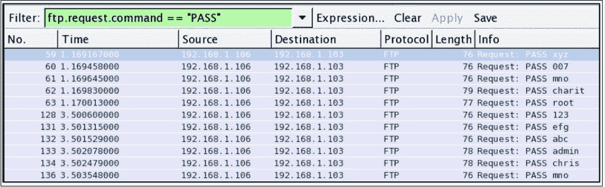

图 7.16：FTP 暴力破解攻击流量模式

- 很容易识别出该流量是恶意的，因为在最多 85 秒的时间跨度内（根据时间列计算），大约有 10 次密码尝试。这看起来确实很危险，应密切监控此类活动，以保护面向互联网的资源。

还有另一种方法可以指出此类流量模式。使用 Wireshark 时，最值得推荐的方法是使用我们之前用来指出恶意流量的相同显示过滤器表达式，创建不同的着色方案，从而更快地发现恶意流量。请参考下面的截图，我为 TELNET 和 FTP 流量分别创建了不同的着色方案：

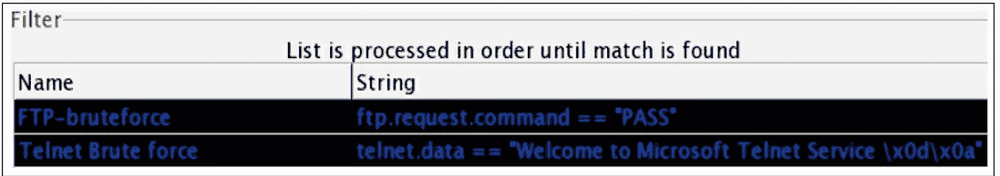

图 7.17：恶意流量的着色方案

还有其他各种应用层协议（HTTP、SSH、SMTP 等）也容易受到这些暴力破解技术的影响，并可能给企业基础设施造成重大损失。为了使这些服务更安全，您可以对正在配置的服务强制启用加密，并使用强密码策略，例如最小长度的字母数字密码。您还可以定期强制实施密码更改策略，例如每 30 天或其他周期。最后但同样重要的是，您可以让员工了解此类活动。针对员工实施的任何形式的社会工程攻击，都可能使攻击者更容易获得对基础设施的访问权限。

## 检查恶意流量

在前面提到的一些主题中，我们目睹了一些生成恶意流量的场景。在列表窗格中看到的一些常见协议，如 HTTP、DNS、ARP、IRC，都可能携带恶意流量。因此，了解恶意流量分析无疑是每位网络和安全专业人员都应该熟练掌握的重要技能。在当今数字世界中，已经取得了各种进步。然而，包括恶意软件感染在内的威胁仍然存在。每个组织都应将这些性质的威胁视为关键问题。为了说明由各种恶意流量引起的威胁，我在虚拟实验室中配置了一些内容。由于客户端和服务器之间的活动而产生的流量将被并行捕获，我们稍后将使用这些流量进行分析。请参考下面的截图：

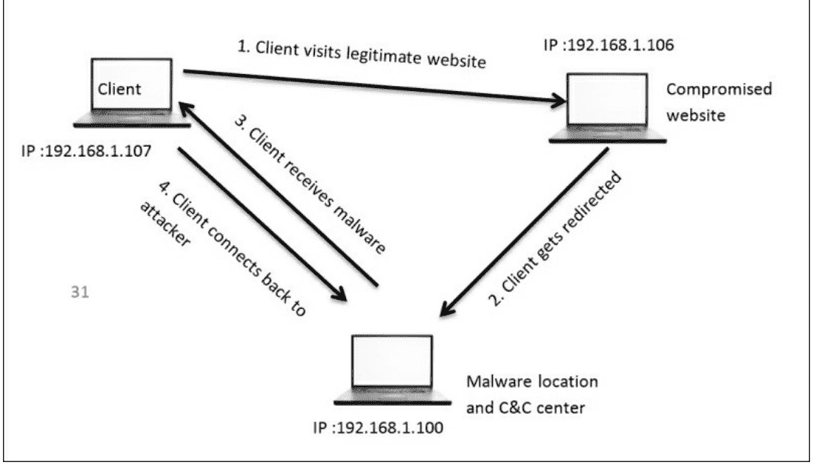

恶意软件一旦安装在受害者的机器上，就会执行多项任务，例如将机密内容传递给指挥者、接收来自服务器的命令，以及感染和破坏系统。即使您的基础设施中安装了最好的安全解决方案，您仍然面临广泛的攻击向量，包括恶意软件感染。

现在，我们已经了解了恶意流量是如何生成的基础知识，并且对将要使用的基础设施也有了清晰的认识。所以，不要再浪费一秒钟，让我们开始这个过程吧。如果您想在您自己的虚拟实验室中重现此场景，请按照以下步骤操作：

- 您需要三台连接到同一 LAN 的机器。确保它们能够相互通信，即验证连通性。
- 在 IP 地址 `192.168.1.106` 上有一个合法网站，客户端习惯访问它。然而，这一次，客户端并不知道会导致重定向到另一个 Web 服务器的感染。请参考合法服务器的以下截图：

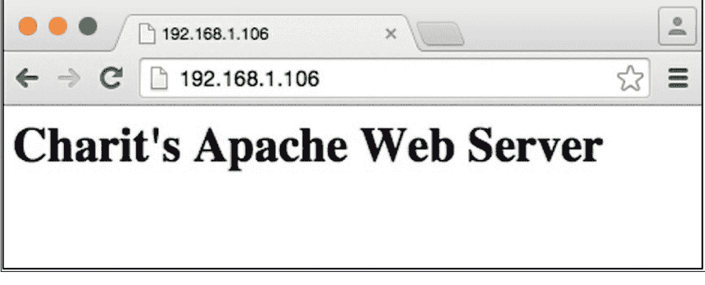

图 7.18：合法网站

- 为了模拟重定向，我在 106 上配置了 Apache 服务器，将发送到 IP `192.168.1.100` 的所有请求重定向，并从那里下载恶意软件 `efg.exe`。
- 因此，下次客户端访问运行在 `192.168.1.106` 的网站时，它会被重定向到一个新的 Web 服务器地址，该地址直接要求客户端运行名为 `efg.exe` 的文件。请参考下面的截图：

图 7.19：客户端被重定向到 IP 192.168.1.100，并被要求运行该应用程序。

- 如果客户端点击**运行**，他们可能不会意识到恶意软件可能对客户端机器以及客户端所属网络造成的危险影响。该应用程序的发布者未经验证，因此浏览器无法验证它。这会导致出现未知发布者错误。如果客户端仍然继续并点击**运行**，恶意软件将被安装。请参考下面的截图：

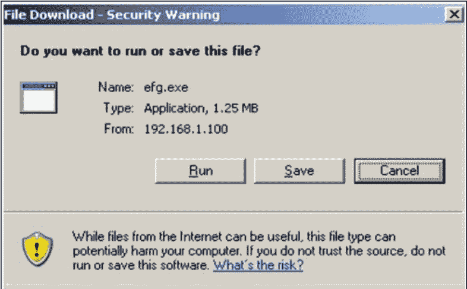

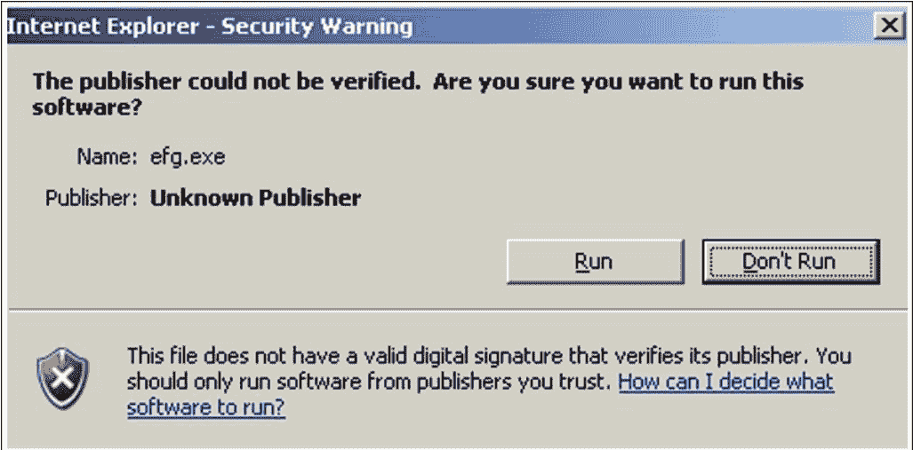

# 图 7.20：未知发布者错误

- 现在，让我们假设，如果客户端点击运行，那么恶意软件将下载到客户端的机器上。它将在以后执行，从而创建回到命令和控制中心的连接。
- 如果与攻击者的连接建立成功，那么在客户端不知情的情况下，攻击者可以复制文件、删除文件、截屏、拍摄摄像头照片、通过麦克风录制语音、破坏系统文件等等。您可能听说过各种恶意软件，如勒索软件、间谍软件和广告软件。
- 由于所有这些活动而产生的所有流量都被捕获。让我们来看一看。我没有直接向您展示流量，而是首先组装了客户端和合法服务器之间的 TCP 流。
- 要了解我们的恶意软件的工作方式，我们需要查看更多详细信息，这些信息可以由 Wireshark 呈现给我们。请参考下面的截图，其中显示了组装的 TCP 流：

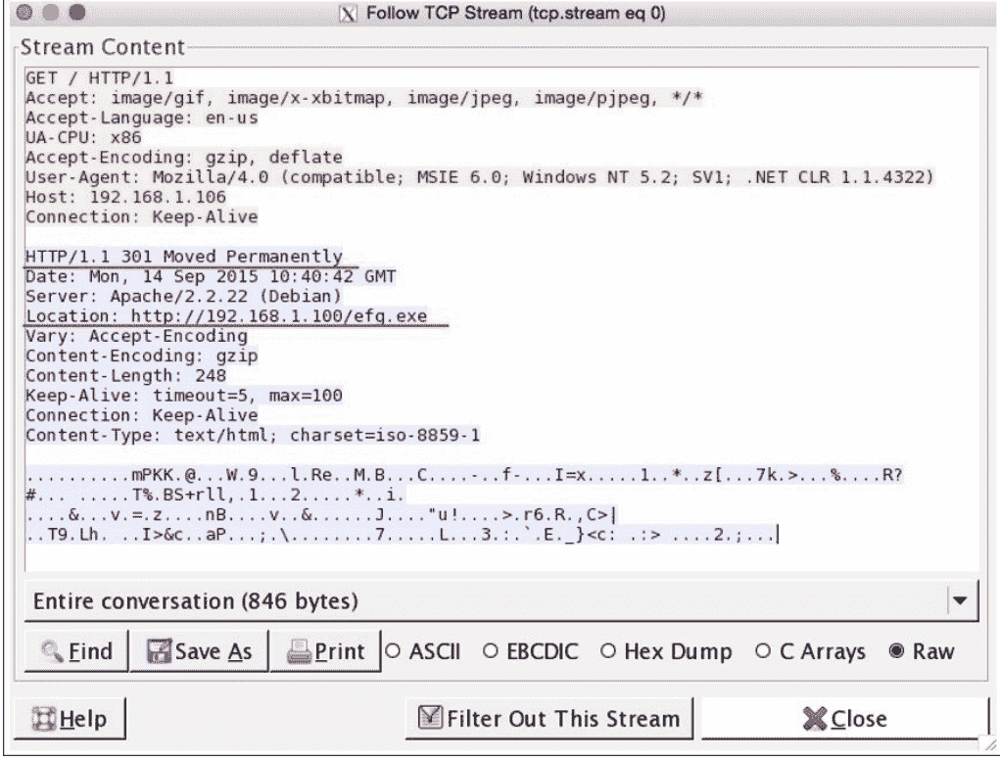

# 图 7.21：客户端与真实（受损）服务器之间的 TCP 流

正如您清晰所见，客户端正在尝试访问 Web 服务器，请求通过 HTTP 重定向被转发到新地址 `192.168.1.100`，并尝试下载恶意文件。

- 一旦客户端收到重定向响应，客户端就会再次与新的服务器发起三次握手，并尝试下载文件。在后续帧中主机之间交换了少量数据包之后，客户端收到了 `200 OK` 状态消息，表明恶意软件下载成功。


在下面的截图中，您可以看到任何部署的 `IDS/IPS` 都可以轻松识别恶意软件签名：

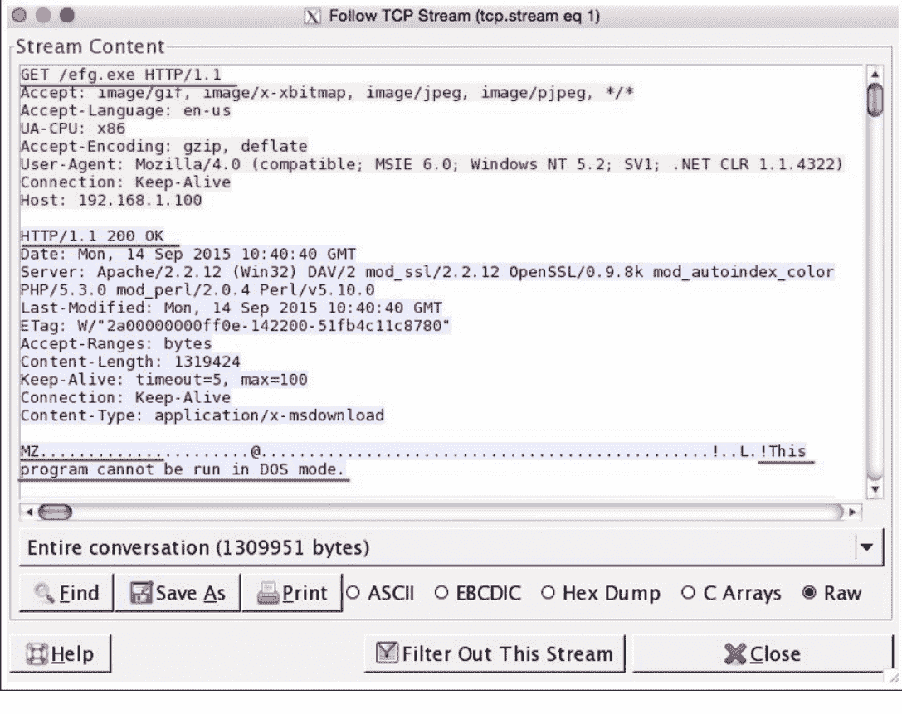

图 7.22：恶意软件签名

客户端发起了 `GET` 请求以搜索 cfg.exe，服务器以 `200 OK` 状态消息响应。随后，您可以看到已知的恶意软件签名以字符 `MZ` 开头，后面跟着一些随机字符。快速用谷歌搜索一下，就会揭示其行为和模式。我们的搜索还显示，它是一个可执行文件，正如维基百科所述，16/32 位 DOS 可执行文件可以通过文件开头 ASCII 中的字母 `MZ` 来识别。请参考下面的截图：

到目前为止，很明显这是一个 Windows 可执行文件，可能具有恶意性。

继续我们对恶意文件的调查，我想使用 Wireshark 导出 `efg.exe` 文件。

1. 转到**文件 | 导出对象 | HTTP**。您将看到一个类似于此处显示的对话框：

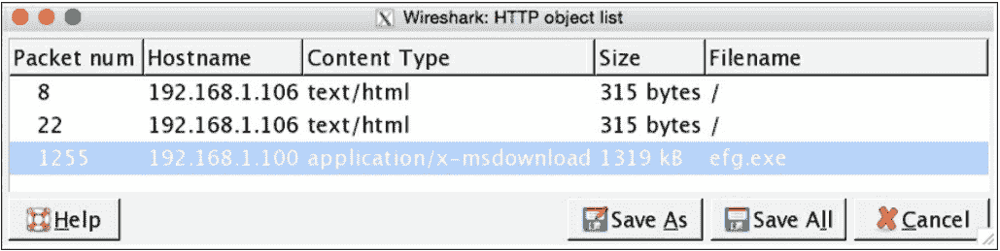

图 7.23：导出 HTTP 对象

2. 现在，要导出文件，您需要选择带有文件名的对话。然后点击**另存为**，将文件保存到您选择的位置。

3. 最好的选择是将此文件上传到诸如此类的网站：[http://www.virustotal.com](http://www.virustotal.com)，它会在线使用众多防病毒软件交叉检查 PE 可执行文件，并向您展示详细的分析报告。请参考下面的截图：


图 7.24：将 efg.exe 上传到 virustotal.com

4. 现在，点击“Scan it!”让网站检查该文件，并等待结果：

图 7.25：efg.exe 检查完成

56 款杀毒软件中有 31 款将该可执行文件检测为恶意文件，这相当令人警惕。

5. 接下来，我通过查看以下 TCP 流窗口中的十六进制转储，手动检查受感染机器与命令与控制中心之间的通信。我观察到了一些情况。请参见以下截图：

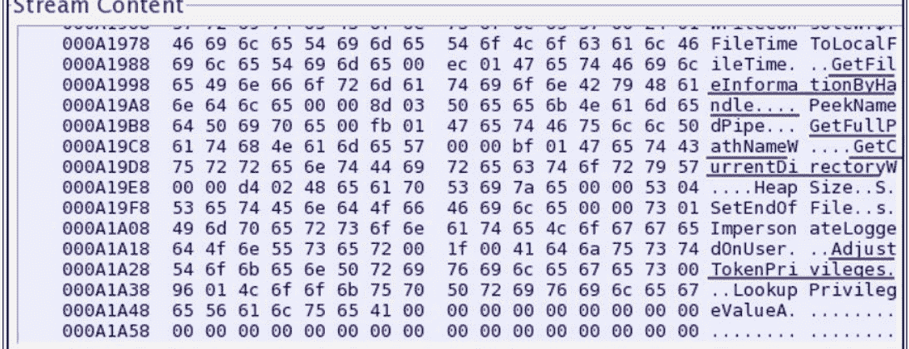

图 7.26：TCP 流对话框中的十六进制转储

似乎已控制受害机器的服务端机器发出了一些命令，以快速收集关于该机器的信息。窗口右侧突出显示的内容包含一些字符串，如 Get File Information（获取文件信息）、Get full PC name（获取完整 PC 名称）、Get Current directory（获取当前目录）、Adjust token Privileges（调整令牌权限）等。

根据我的分析，安装到 Windows 机器上的文件绝对是恶意的。它可能对单台机器以及网络造成了严重破坏。最明智的建议是，除非使用专门的工具对其进行消毒处理，否则将该机器与网络隔离。

在结束本节之前，我还有一个内容要借助 Wireshark 中的列表窗格来展示。请参见以下截图：

| 序号 | 时间 | 源 | 目的 | 协议 | 长度 | 信息 |
|---|---|---|---|---|---|---|
| 1 | 0.0000000 | Apple_b9:53:ec | Broadcast | ARP | 42 | Who has 192.168.1.106? Tell 192.168.1.107 |
| 2 | 0.0002370 | Apple_b9:53:ec | Vmware_b3:cb:b6 | ARP | 42 | 192.168.1.106 is at d8:bb:2c:b9:53:ec (dupl |
| 3 | 0.0004100 | 192.168.1.107 | 192.168.1.106 | TCP | 62 | 1339->80 [SYN] Seq=2857922741 Win=64240 Len= |
| 4 | 0.0005120 | 192.168.1.106 | 192.168.1.107 | TCP | 62 | 80->1339 [SYN, ACK] Seq=2114108500 Ack=28579 |
| 5 | 0.0006600 | 192.168.1.107 | 192.168.1.106 | TCP | 54 | 1339->80 [ACK] Seq=2857922742 Ack=2114108501 |
| 6 | 0.0011450 | 192.168.1.107 | 192.168.1.106 | HTTP | 340 | GET / HTTP/1.1 |
| 7 | 0.0013460 | 192.168.1.106 | 192.168.1.107 | TCP | 54 | 80->1339 [ACK] Seq=2114108501 Ack=2857923028 |
| 8 | 0.0020890 | 192.168.1.106 | 192.168.1.107 | HTTP | 614 | HTTP/1.1 301 Moved Permanently (text/html) |
| 9 | 0.0034590 | 192.168.1.107 | 192.168.1.100 | TCP | 62 | 1340->80 [SYN] Seq=30660050875 Win=64240 Len= |
| 10 | 0.1404520 | LiteonTe_fa:5e:b4 | Broadcast | ARP | 42 | Who has 192.168.1.107? Tell 192.168.1.100 |
| 11 | 0.1409980 | Apple_b9:53:ec | LiteonTe_fa:5e:b4 | ARP | 42 | 192.168.1.107 is at d8:bb:2c:b9:53:ec |
| 12 | 0.1620010 | 192.168.1.100 | 192.168.1.107 | TCP | 62 | 80->1340 [SYN, ACK] Seq=2258050522 Ack=30600 |
| 13 | 0.1622670 | 192.168.1.107 | 192.168.1.100 | TCP | 54 | 1340->80 [ACK] Seq=30660050876 Ack=2258050523 |
| 14 | 0.1627790 | 192.168.1.107 | 192.168.1.100 | HTTP | 347 | GET /efg.exe HTTP/1.1 |

图 7.27：在列表窗格中注意到的异常行为

从数据包一开始的行为进行观察，首先是由 Windows 机器发送的 ARP 请求，因为它试图查找本地配置的合法 Web 服务器。随后是三次握手，客户端在第 6 帧发起 GET 请求，服务器在下一个数据包中进行确认。然后，服务器表明客户端寻找的资源已被移动到另一个位置，客户端需要前往该位置。此后，客户端在第 9 帧生成一个 SYN 请求。接着，命令与控制中心生成 ARP 数据包，询问客户端的物理地址，以便与它取得联系并传输文件。最后，在第 12 和第 13 帧中，三次握手完成，最终由受害机器生成 GET 请求，从而开始传输攻击利用代码，如第 14 帧所示。此类流量模式的后果可能是极具破坏性的。优秀的网络/安全管理员应该意识到此类流量模式，并可以利用这种流量行为来创建防火墙/IDS-IPS 签名，从而快速产生警报。这些签名有助于避免攻击，并使他们的基础设施准备好对抗这些恶意流量。

## 解决真实世界的 CTF 挑战

夺旗（Capture The Flag）赛事是安全会议上最常见的事情。其目标是学习和参与基于真实场景的挑战，这能很好地帮助你学习相关方法论。如果你有兴趣破解旗标（flag），可以搜索 DEF Con、PlaidCTF、CSAW、Codegate 等知名会议。参加这些挑战需要具备基本的编程、网络、取证知识和常识。

我为你准备了一些挑战，我们将以逐步的方式一起解决它们。为了让你们了解 CTF 的运作方式以及应该遵循的方法，我已将它们设计得相当简单。那么，让我们开始吧，去捕获一些旗标。

### 第一个 CTF：利用远程管理服务中的弱点

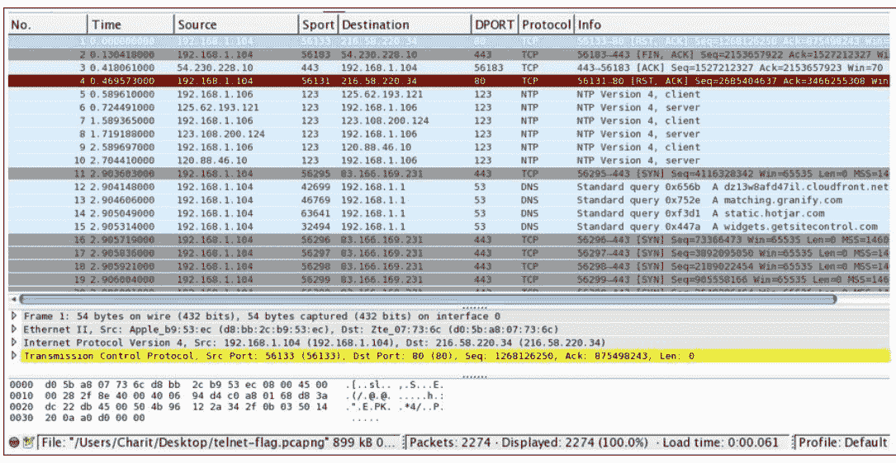

图 7.28：CTF1 跟踪文件

**解决方案：** 我们有一个 telnet-flag.pcap 文件，其中在列表窗格中列出了多个数据包。题目要求我们利用远程管理服务。我们知道有哪些服务用于远程管理？RDP、Telnet 和 SSH。为了更好地理解该场景，让我们先在 Wireshark 中打开跟踪文件。请参见以下截图：

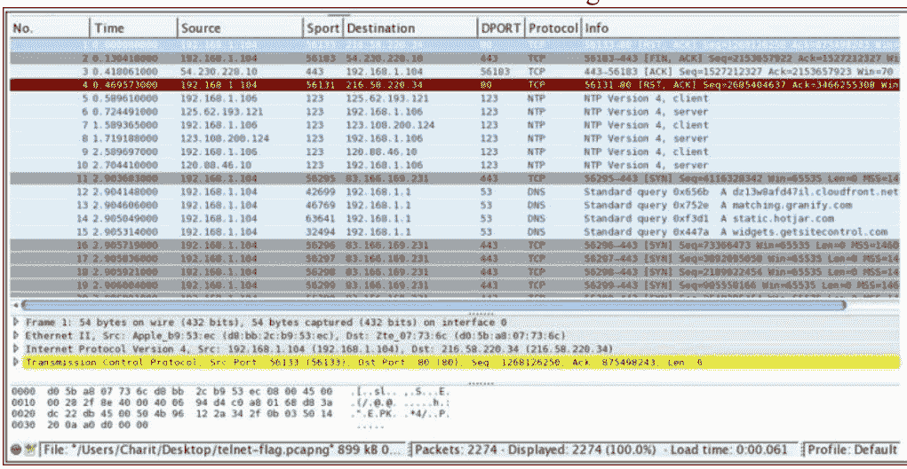

如你所见，我们的跟踪文件中有两千多个数据包。要滚动到底部逐个查看每个数据包实际上是不可能的。最好的做法是查看协议层次结构窗口，它会简要列出整个跟踪文件中涉及的所有协议。这样，我们就可以很容易地识别出远程管理服务。协议层次结构窗口可以从“统计”菜单访问。请参见以下截图：

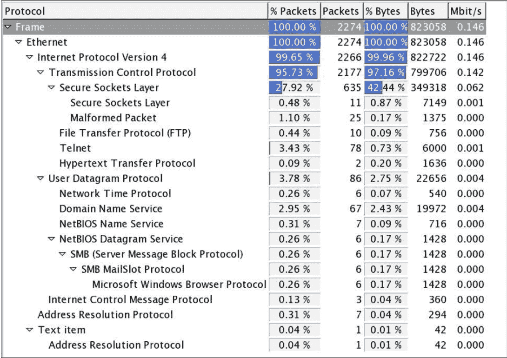

在列出的所有协议中，我只看到一个用于远程管理的协议，我们可以利用它继续推进 CTF 流程。因此，我应用了显示过滤器 `telnet`，以便只查看相关流量。请参见以下截图：

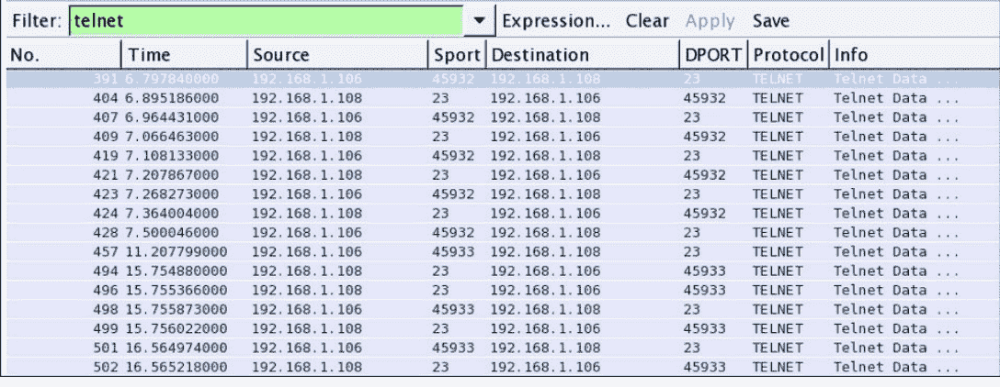

图 7.30：Telnet 流量 CTF1

下一步是跟踪这些数据包的 TCP 流，这将揭示有关 Telnet 会话的更多信息。

这就是这道题目的核心：利用远程管理服务中的弱点。Telnet 会话可以以纯文本格式查看，而我们最终正是利用了这一弱点，得以查看纯文本格式的会话信息。旗标（flag）就是用户登录 Windows 机器执行维护活动时使用的密码。

FLAG : Sup3rs3cr3t

下面的截图展示了数据包组装完成后 TCP 流窗口的外观。此外，Telnet 会话的密码也可以清楚地看到。

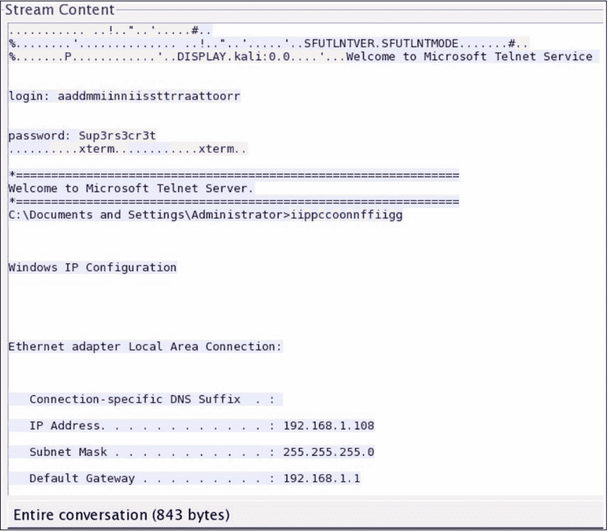

希望你已理解了 CTF 解题的基本方法。在解决后续的 CTF 挑战时，我们也会采用类似的方法。

这一次，我设计了一个使用另一种常见协议的 CTF，让你学习 CTF 挑战方法的基础知识。

### 第二个 CTF：图像魔法

**解决方案**就藏在这个 CTF 的标题中，它非常简短且引人注目；虽然我们不知道要寻找什么，但可以肯定与图像有关。Wireshark 每次都像在施展魔法；这就是我对这个挑战的看法。

采用与第一个挑战类似的方法，我们将打开跟踪文件，了解与流量捕获相关的基本统计信息，从而大致了解会话期间使用的协议。请参见以下截图：

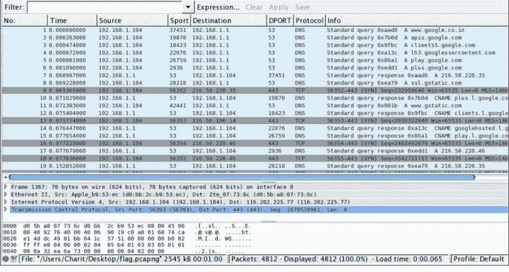

图 7.32：CTF2 跟踪文件

跟踪文件以大量 DNS 数据包开头，这些数据包看起来对分析不太有用。查看 Wireshark 中以下状态栏，我们可以确定捕获了大约 4,800 帧。这个文件不可能逐元素检查，所以我们需要借助我们的最佳助手：协议层次结构对话框（现在我希望，不需要任何具体说明，你就能打开这个对话框）：


**图 7.33：CTF2 协议分层**

在各类协议列表中，我发现了 JPEG——这是一种图片扩展名，并且它在对话框里被列在 HTTP 部分之下。由此我们可以推断，这两者之间存在某种关联，因此我们的显示过滤器可以设为 HTTP，这样我们就能沿着正确的方向继续前进。

当我在显示过滤器框中输入 HTTP 并按回车后，只看到了四个数据包。其中有一个名为 flag 的 .jpg 文件。请参考以下截图：

**图 7.34：显示过滤器 HTTP——CTF2**

帧编号 4696 显示了一个针对 flag.jpg 文件的 GET 请求。通过查看该数据包的 TCP 流进一步调查，可以确认客户端 192.168.1.108 请求了一个 .jpg 文件。请参考以下截图：

```
Stream Content
GET /flag.jpg HTTP/1.1
Accept: image/gif, image/x-xbitmap, image/jpeg, image/pjpeg, */*
Accept-Language: en-us
UA-CPU: x86
Accept-Encoding: gzip, deflate
User-Agent: Mozilla/4.0 (compatible; MSIE 6.0; Windows NT 5.2; SV1; .NET CLR 1.1.432
Host: 192.168.1.106
Connection: Keep-Alive

HTTP/1.1 200 OK
Date: Thu, 17 Sep 2015 09:05:24 GMT
Server: Apache/2.2.22 (Debian)
Last-Modified: Thu, 17 Sep 2015 08:10:02 GMT
ETag: "154002-12ef5-51fecf132d262"
Accept-Ranges: bytes
Content-Length: 77557
Keep-Alive: timeout=5, max=100
Connection: Keep-Alive
Content-Type: image/jpeg

......JFIF......` `......
C..........................................................................
C........................................................................9....
"........................................................................
Entire conversation (78148 bytes)
```

**图 7.35：TCP 流——CTF2**

客户端发起的请求现已得到确认和验证。下一步是从该流中导出此对象。转到 **文件 | 导出对象 | HTTP**。

| 数据包编号 | 主机名 | 内容类型 | 大小 | 文件名 |
|------------|----------|--------------|------|----------|
| 4761 | 192.168.1.106 | image/jpeg | 77 kB | flag.jpg |

Wireshark：HTTP 对象列表
帮助   另存为   全部保存   取消

该窗口仅列出了一个 `flag.jpg` 文件。按照上述步骤导出该图片对象。首先选中显示该对象的那一行，然后点击 **另存为**，将文件保存到你想要的位置。完成后，打开该文件即可查看 flag 内容。请参考以下截图查看导出对象的内容。


**图 7.36：CTF2**

这个挑战相当有趣，因为你了解了 CTF 挑战背后的另一种思路。

我们的最后一项挑战也会让我们接触到 CTF 背后的一种新思路。

## 第三项 CTF：你够专业吗！！

这项挑战的标题本身就颇具挑战性。不过，我们会一起解决它。那么，先打开跟踪文件吧。

乍一看，它和我们见过的其他跟踪文件一样，里面充斥着大量无用的数据包。为了不被这些海量信息干扰，我们继续沿用此前一直采用的方法。请参考以下截图：

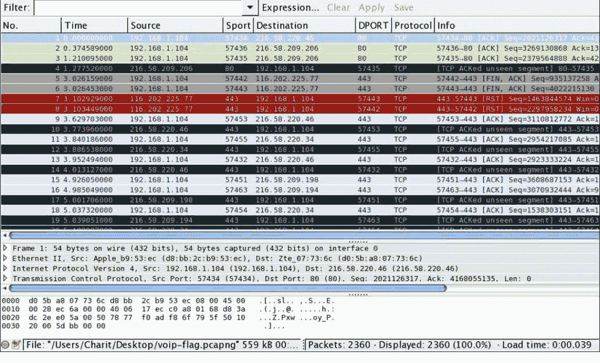

**图 7.37：数据包列表窗格——CTF3**

查看协议分层窗口，它可以帮助我们进一步了解当前面对的 CTF 挑战。请参考以下截图：

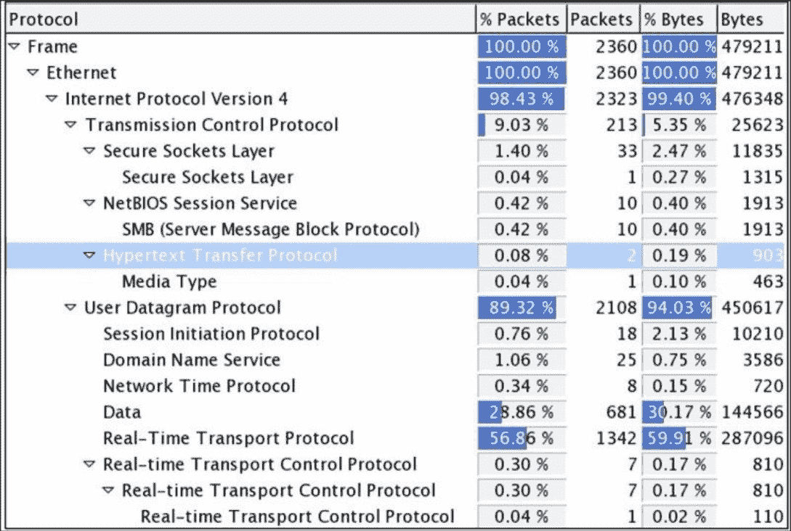

**图 7.38：协议分层——CTF3**

不出所料，我们对跟踪文件有了新的认识：可以发现 UDP 流量占比约为 89%，这是一个相当高的比例。在它下列出了实时传输协议。因此，我们继续为 RTP 流量创建一个显示过滤器，这将帮助我们进入解决谜题的下一步。请参考以下截图：

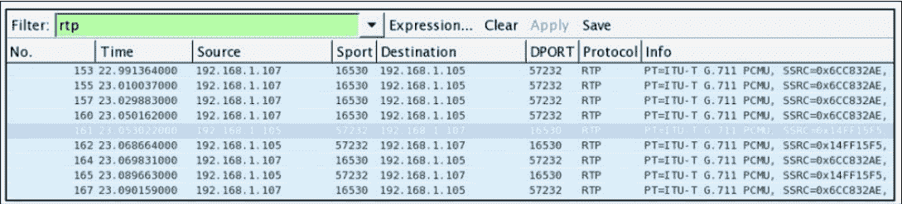

**图 7.39：RTP 显示过滤器——CTF3**

看起来 `192.168.1.107` 和 `192.168.1.105` 这两个主机之间正在进行一次通话会话。接下来，我将使用 Wireshark 的回放功能重新组装该流，并尝试播放。转到 **电话菜单 | VoIP 通话**，选择第 1 行中的 SIP 通话，然后点击 **播放器**。请参考以下截图：

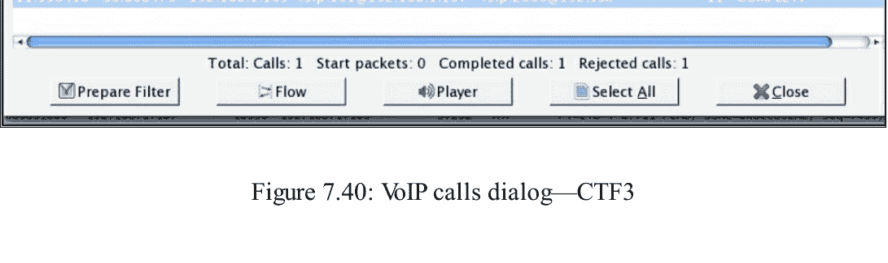

**图 7.40：VoIP 通话对话框——CTF3**

通话会话可见后，选中它并点击播放器，此时系统会要求你输入抖动值。将值指定为 `200`，然后点击 **解码**：

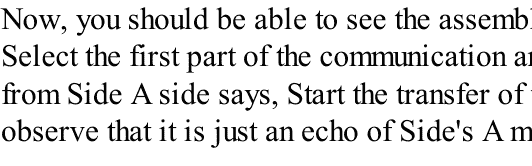

现在，你应该可以看到已组装好的 VoIP 流可供回放。选择通信的第一部分并点击播放。A 方通信者说：“开始传输兔子”，而播放 B 方的部分时，我们可以观察到它只是对 A 方消息的回声。请参考以下截图：

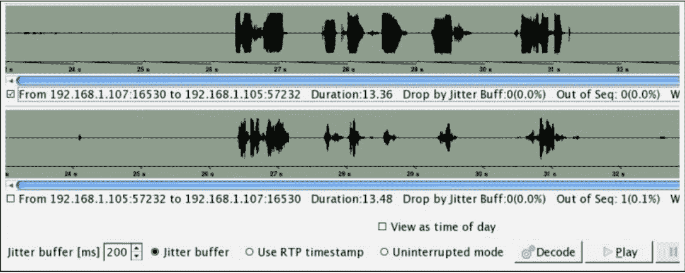

**图 7.41：用于回放的重新组装 VoIP 通话——CTF3**

我们并没有从这条消息中获得多少线索。让我们再次查看协议分层对话框，看看 TCP 部分有什么信息。除了 HTTP 协议之外，没有太多有用的信息。在 HTTP 树下有一个媒体类型，这意味着网络上主机之间传输了某些内容（正如 VoIP 通话中的人所说“开始传输”）。我们应用 HTTP 作为显示过滤器，得到以下截图：

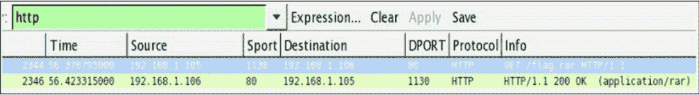

可以清楚地看到，一个 `flag.rar` 文件被传输了。让我们将其导出为 `.rar` 文件以便解压。转到 **文件 | 导出对象 | HTTP**，选择第一行，然后点击 **另存为** 保存该 `.rar` 文件。文件已成功保存，但当我们尝试打开该文件时，它要求输入密码，而我们的没有。

## 总结

使用 Wireshark 抵御最常见的入侵尝试，以保持网络安全。从安全角度分析数据包，你将获得处理恶意用户的新见解。

端口扫描、足迹收集和各种主动信息收集等活动是攻击方法的基础，攻击者可能利用这些方法来绕过你的安全基础设施。

猜测合法服务的密码称为暴力破解攻击。如果将同样的攻击方式与包含数百万密码的字典结合起来，破解成功的机会就会更高。通过 Wireshark，你可以查看针对网络中某项服务发起的此类尝试。

恶意用户可以利用看起来合法的软件进入你的网络。如今，恶意软件传播最常见的途径是电子邮件。另一种攻击形式，如网络钓鱼，与恶意软件结合后会变得极其危险。

Wireshark 可以帮助你分析恶意软件行为，并利用分析出的行为，为现有的 IDS/IPS 防火墙创建必要的特征签名。

夺旗（CTF）活动通常在安全会议上举办。参与者会获得多种教育性练习，以体验真实世界的场景。真正的 CTF 是 A 队尝试渗透 B 队的网络，同时 B 队也尝试渗透 A 队的网络。双方都要负责抵御对方发来的恶意攻击。CTF 活动有多种类别，例如逆向工程、协议分析、编程、密码分析等。掌握 Wireshark 可以让你在处理与协议分析相关的 CTF 时更加轻松。

以安全专业人士的视角观察周围散落的事物，你会看到不同的景象。从企业基础设施内部的人来看，一切可能感觉良好；然而从外部来看，你可能非常脆弱。安全专业人士就像是 IT 行业的免疫系统，而使用 Wireshark 分析数据包正是他们武器库中的一件利器。


## 练习题

- 问题1：主动和被动信息收集技术之间有什么区别？
- 问题2：哪种信息收集技术更隐蔽？为什么？
- 问题3：你对术语“横幅抓取”有什么理解？
- 问题4：使用Linux中的netcat工具连接到一个正在运行的HTTP服务。
- 问题5：在nmap扫描中使用的`-sT`和`-sS`开关有什么区别？你能同时使用两者吗？
- 问题6：使用nmap对机器执行操作系统指纹识别，然后将扫描输出重定向到文件以供以后使用。
- 问题7：不使用nmap，你能使用Wireshark对操作系统进行指纹识别吗？
- 问题8：针对你的操作系统指纹识别尝试如何导致严重损害？
- 问题9：找出使用nmap绕过公司环境中部署的防火墙的技术。
- 问题9：是否有可能将两种攻击方法——ARP欺骗和DNS投毒——结合起来，以获得更大更好的效果？
- 问题10：尝试在实验室环境中对某个服务进行暴力破解，并使用自己定制的字典文件分析流量模式。
- 问题11：尝试了解Kali Linux中已安装的暴力破解工具，并找出哪种工具更适合RDP暴力破解攻击。
- 问题12：在分析恶意FTP流量模式时，还有哪些过滤表达式可能有用？
- 问题13：是否有可能在FTP会话上强制加密，以便后续的TCP流不会以普通文本形式显示流量？
- 问题14：为什么将与发出异常流量的受感染PC隔离出网络很重要？与之相关的哪些流量模式使其具有恶意性？
- 问题15：访问各种在线CTF挑战网站，并尝试解决其中几个。你是否仍然觉得理解这些挑战很困难，还是现在看起来更容易一些了？
