## 第8章 故障排除

本章将教你如何配置和使用Wireshark进行网络故障排除。你还将掌握使用Wireshark排查网络问题的技巧。以下是本章将涉及的主题：

- 使用Wireshark排查互联网缓慢问题
- 实验环境搭建
- 排查网络延迟
- 实验环境搭建
- 排查瓶颈问题
- 实验环境搭建
- 排查基于应用程序的问题
- 实验环境搭建
- 练习题

传输过程中数据包的丢失是所有网络管理员在日常工作中遇到的最常见问题之一。不过，幸运的是，传输协议中有各种内置的错误恢复功能可以帮我们应对这些问题。然而，理解这些错误恢复功能的工作原理至关重要，这样在需要人工判断时，只需查看列表窗格中的数据包流就能排查问题。对网络中的延迟或任何基于应用的问题进行故障排除，需要你了解流量流向以及数据包之间的交互方式。在我们着手处理一个棘手的网络之前，我们需要了解一些恢复功能的基础知识，这些知识将帮助你诊断并找出此类问题的根源。你应该感到庆幸，你有幸使用Wireshark——最流行且精通网络数据包分析的开源工具。它不会直接告诉你问题是什么，但排查网络相关问题所需的时间会大大减少。

现在，你可能会想问：“它看起来是什么样子，或者你如何识别这些情况？”正如每个硬币都有两面，网络通信也有两端：发送方和接收方。在发送方，恢复功能由**重传超时（RTO）**值处理，该值是**往返时间（RTT）**与标准偏差平均值之和。在接收方，恢复机制通过跟踪通信主机之间共享的SEQ和ACK值来处理。

你一定听说过流量控制功能，我们在前几章剖析基于TCP的通信时已经讨论过。流量控制功能通过利用滑动窗口和零窗口通知等动态功能，使传输更加可靠。既然你已经有了基本的了解，我想让你详细了解细节。请注意，本章中我们将主要讨论基于TCP的通信。

### 恢复功能

TCP重传和重复ACK是用于从数据包发送失败或数据包乱序发送场景中恢复的策略。通常，会观察到网络延迟（数据包发送以及收到其ACK所需的总时间），这会显著影响网络性能。当列表窗格中频繁出现重传和重复ACK数据包时，很可能你的网络正面临高延迟；如果没有，那就放松休息吧。我的观点是，你应该关注此类活动，并在可能的情况下，将一些网络管理技术与协议分析相结合，以便随时了解网络内部发生的状况。

设备使用TCP重传以可靠地发送数据。发送方维护RTT和RTO等值，以促进可靠的通信。一旦数据包发出，发送方就启动重传计时器；当收到ACK时，发送方停止重传计时器。这里的计时器值决定了超时值。现在，如果发送方在特定时间后未收到ACK，发送方将重传相同的数据包。如果发送方仍未收到任何ACK，超时值将加倍，发送方将再次重传相同的数据包。重复此循环，直到收到ACK或发送方达到最大重传尝试次数。发送方根据操作系统维护多次重传尝试，当达到某个超时值时会触发这些尝试。

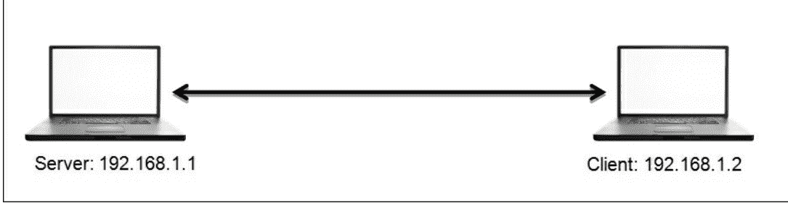

图8.1：TCP重复ACK和重传

例如，在上图中，客户端位于192.168.1.2，服务器位于192.168.1.1。这里，客户端正在请求服务器持有的某个资源，随后两个主机之间的传输在三次握手成功完成后开始。对于收到的每个数据包，客户端都会发送一个ACK。现在，假设对于流中的某个随机数据包，即使数据包的超时值已过期，服务器仍未收到ACK。服务器会再次重传相同的数据包。重复相同的过程，直到服务器收到每个数据包的ACK，或位于192.168.1.1的服务器达到默认最大尝试次数（连续五次）。请参阅下图，其中显示了此重传过程：

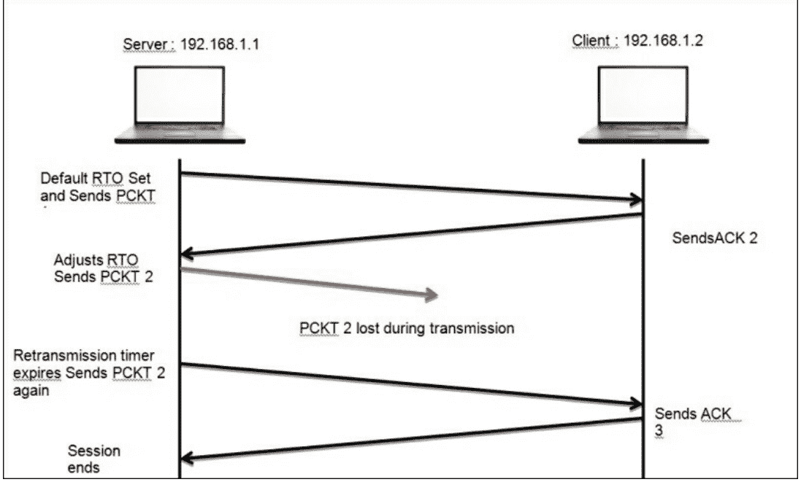

图8.2：TCP重传

基于上述简化场景，我想现在你已经理解了重传过程的要点。

现在，我们将讨论重复ACK和快速重传，这是客户端处理的另一个恢复功能。在上一章中，我们讨论过这个问题。我想让你看看我网络中与我们所讨论的两种错误恢复情况相关的真实数据包。请参阅下面的图8.3和图8.4：

| 编号 | RTO | 源 | 目的 | 协议 | 信息 |
|---|---|---|---|---|---|
| 18036 |  | 192.168.1.103 | 216.58.220.36 | TCP | 58915→80 [FIN, ACK] |
| 18038 | 0.472696 | 192.168.1.103 | 216.58.220.36 | TCP | [TCP重传] |
| 18044 | 1.220221 | 192.168.1.103 | 216.58.220.36 | TCP | [TCP重传] |
| 18056 | 2.515162 | 192.168.1.103 | 216.58.220.36 | TCP | [TCP重传] |
| 18067 | 4.904210 | 192.168.1.103 | 216.58.220.36 | TCP | [TCP重传] |
| 18075 | 9.476266 | 192.168.1.103 | 216.58.220.36 | TCP | [TCP重传] |
| 18082 | 16.20657 | 192.168.1.103 | 216.58.220.36 | TCP | [TCP重传] |

图8.3：TCP重传数据包

在上面的截图中，位于192.168.1.103的客户端向位于216.58.220.36的服务器发送FIN和ACK。之后，客户端期望接下来收到一个ACK数据包。然而，客户端没有收到服务器的任何回复。现在，在RTO时间到期后，客户端在加倍的时间后开始发送相同的数据包，并且每隔一定时间发送TCP重传数据包的过程持续进行，直到客户端收到ACK数据包或达到最大重传尝试次数。观察RTO列，看看值如何开始加倍，直到达到最大限制。

在图8.4的下一个场景中，我想让你观察因位于216.58.220.46的服务器向位于192.168.1.103的客户端发送畸形数据包而产生的重复ACK数据包。客户端一收到它，就会发送一个重复ACK数据包，以响应被视为乱序的畸形数据包。

观察6027帧，其SEQ = 1920，数据载荷大小为46，正从一个主机发送到另一个主机。接下来，在响应帧6070中，一个具有随机SEQ值的畸形数据包被发送作为响应。因此，位于192.168.1.103的主机生成一个重复ACK数据包，并将其发送给另一侧的主机，其SEQ和ACK值与帧6027相似。这一次，在响应中，位于216.58.220.46的主机发送一个有效的ACK帧6115，ACK递增到1966（1920+46），如预期那样，然后通信继续进行。

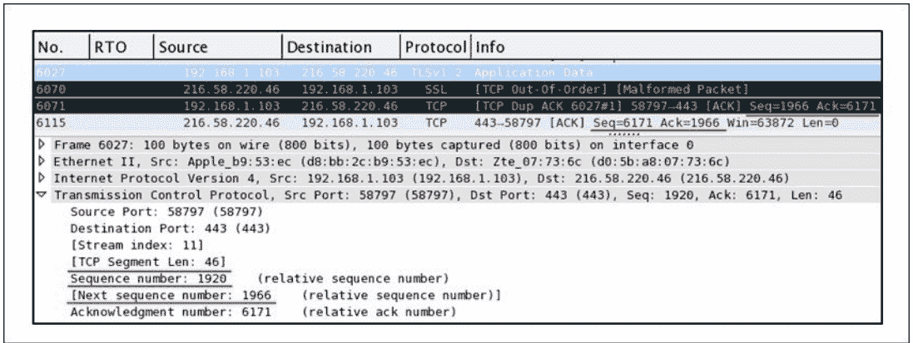

图 8.4：重复 ACK

通过这些现实生活中的示例，我希望你已经更准确地理解了 TCP 错误恢复特性的行为。

## 流量控制机制

这是 TCP 协议使用的另一个特性，用于避免传输过程中的任何数据丢失。通过流量控制，发送方将传输速率与接收方的缓冲区空间同步，以避免将来的任何数据丢失。考虑这样一种场景：接收方在某时刻有 1,000 字节的缓冲区空间，而发送方每帧最多能发送 5,000 字节。现在，利用这些信息，两个主机都必须将窗口大小同步为 1,000 字节，以避免任何数据丢失。请参考下图，该图展示了这一特性：

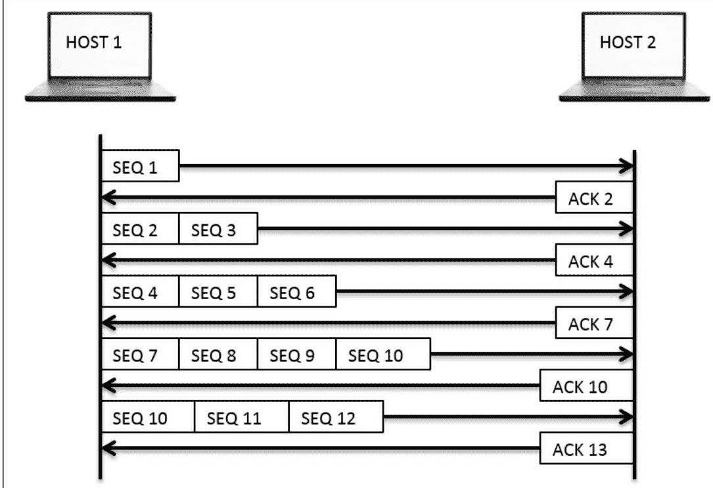

上图描绘了通信双方为传输目的协商窗口大小的方式。观察从 SEQ 1 帧开始的行为，主机 2 以 ACK 2 响应，表示该帧已成功接收。

接下来，**主机 1** 尝试将传输速率提高到两个帧，并以 **SEQ 2** 和 **3** 发送它们。**主机 2** 以 **ACK 4** 响应，表示两个帧都已成功接收。同样，我们成功地将速率提高到了三个帧。

接下来，**主机 1** 将速率提高到 4，并尝试发送带有 **SEQ 7、8、9** 和 **10** 的数据包。这一次，**主机 2** 以 **ACK 10** 响应，这意味着**主机 2** 的接收窗口大小一次最多只能容纳 3 个帧，发送方应据此进行调整。

下一次，当**主机 1** 发送时，窗口大小将设置为 3 个帧，这是接收方能够处理的数量。窗口大小并不是一个固定值；它可以一直变化，直到整个传输完成，整个过程称为 **TCP 滑动窗口**机制，用于避免传输过程中的数据丢失。

想一想，如果接收方没有缓冲区空间（即 0 字节）会发生什么？在传输过程中的某个时刻，它可能无法处理。TCP 在这种情况下会怎么做呢？通信信道会断开，还是 TCP 会提出更可靠的方案？

是的，TCP 有另一个数据丢失恢复特性，称为**零窗口**通知。此时，接收方发送一个设置为 0 字节的窗口更新数据包，要求发送方暂停发送帧。作为响应，发送方会理解这种情况，并以**保活**数据包回应，该数据包在等待客户端的下一个窗口更新数据包期间按特定时间间隔发送。请参考图 8.6，其中说明了这一点。

**主机 1** 在三次握手过程完成后开始通信。在成功传输几个数据包后，接收方的缓冲区空间被其他资源占满，因此**主机 2** 以零窗口数据包响应，告诉**主机 1** 暂停发送数据包，直到另行通知。**主机 1** 接受**主机 2** 的零窗口数据包后，开始发送**保活**数据包以保持连接活跃，并等待进一步通知。一旦**主机 1** 收到新窗口大小以及已发送帧的 ACK，它将根据接收方的缓冲区空间重新开始发送数据包。

## 排查网络速度慢和网络延迟问题

我们在列表窗格中观察到的延迟可以归为两类：正常/可接受的延迟和不可接受的延迟。是的，你没听错，有些延迟是可以接受的，你不需要浪费宝贵的时间去排查这些情况。

根据你从客户端站点获得的测试结果（尝试从投诉客户端的角度捕获嗅探数据包），将当前场景归入以下类别之一：线路延迟、客户端延迟和服务器延迟。从其中一个案例的角度看待你的场景，将有助于你以更面向流程的方法解决问题，从而使任务不那么复杂，最终以更少的时间和更少的资源解决。

在你开始排查此类场景之前，我强烈建议你通过自定义现有的时间列来更改默认的列表窗格视图（将时间值自定义为 `seconds since Previous Displayed Packet`），该列可用于找出延迟问题，也就是说，它会显示序列中两个相关数据包之间的总时间。请参考下图来自定义时间列。

为了进一步阐述所遵循的最佳实践，我将讨论一种逐步排查的方法，你可以将其用作检查清单的一部分。请确保你清楚理解一件事：在服务器端跟踪问题可能非常关键，因为你每秒可能会看到成千上万个数据包飞入飞出。这会非常混乱，只会让整个问题变得更复杂。查看数千个数据包来找出网络连接缓慢的原因听起来并不可行。因此，最好的做法是过滤出重点、确定优先级，并首先从客户端角度查看问题。

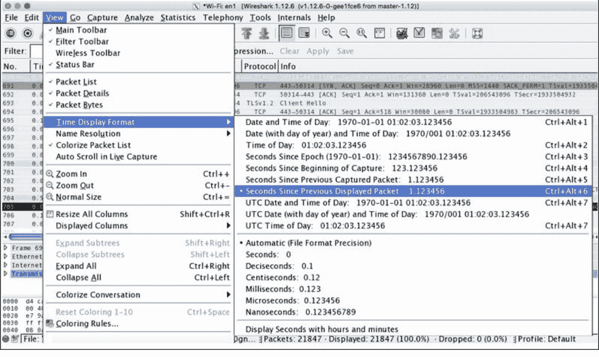

图 8.7：自定义时间列

- 从客户端开始调查会使事情简单得多，因为你不会处理多个可能与你的场景无关的数据包。另一方面，如果即使是极小的概率导致你无法看到与问题相关的数据包，这可能会使故障排除体验更具挑战性。
- 除了你在客户端可能面临的所有挑战之外，你应该做的第一件事是让客户端尽可能重现问题；如果问题是按时间发生的，那么你应该在客户端等待，以便亲眼观察并理解场景。最终目标应该是捕获相关的数据包，并从客户端的角度清晰理解其所面临的问题。
- 现在，当你拿到跟踪文件后，你可以查看客户端尝试连接服务器的过程：客户端发出 DNS 查询以获取服务器在网络上的逻辑位置的整个过程。如果本地 DNS 缓存中已经保存了服务器的 IP 地址，那么你可能看不到任何 DNS 数据包；相反，你会在列表窗格中看到一个直接发送到服务器的 SYN 数据包，用于发起独立连接。你需要确保的是，如果在列表窗格中看到了 DNS 查询，那么往返时间应该如预期一样低（大约小于等于 150 ms）。

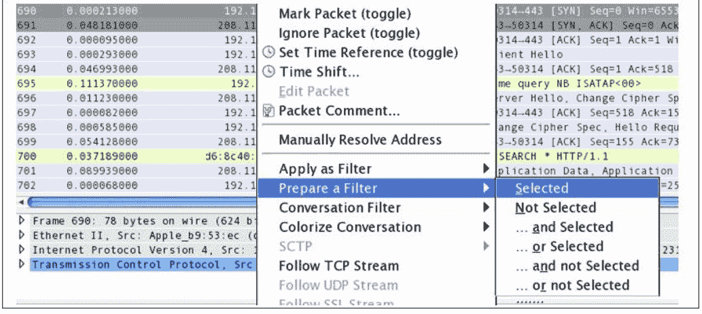

接下来是你在列表窗格中会观察到的三次握手数据包。最好的做法是隔离通信主机，这可以帮助你排除进一步的通信干扰。你可以右键单击通信并创建一个过滤器，如图 8.8 所示。

- 一旦你过滤掉了主机之间有问题的连接，下一个任务就是观察总时间。即从发送 SYN 数据包到收到相应的 SYN/ACK 数据包之间的时间。你可以将其与已有的基线进行比较，得出一个方差，这可以帮助你判断连接是缓慢还是运行正常。请参考下面的截图，其中说明了这一点：

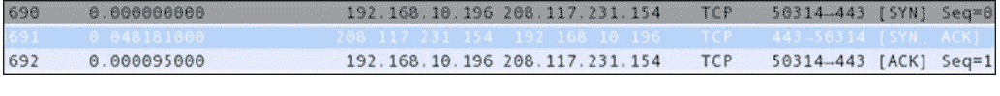

图 8.8：SYN 与 SYN/ACK 数据包之间的时间

- 如你所见，SYN 和 SYN/ACK 数据包之间的时间相对较短，这似乎是一个运行良好的连接。这种连接在为你网络设计基线时会很有帮助。在以后的时间点，同样的基线可用于与有问题的场景进行比较。请参阅

理解通信双方都不会主动引入任何形式的延迟。

现在，为了更好理解，我想用实际例子向你展示这一点。请参考下面的截图，其中列出了两台主机之间共享的几个数据包，从三次握手开始：

| 33 | 0.000000000 | 192.168.10.196 | 128.173.97.169 | TCP | 50885-80 [SYN] Seq= |
| 36 | 0.204182000 | 192.168.10.196 | 128.173.97.169 | TCP | 50886-80 [SYN] Seq= |
| 39 | 0.363438000 | 128.173.97.169 | 192.168.10.196 | TCP | 80-50886 [SYN, ACK] |
| 40 | 0.000107000 | 192.168.10.196 | 128.173.97.169 | TCP | 50886-80 [ACK] Seq= |
| 41 | 0.000271000 | 192.168.10.196 | 128.173.97.169 | HTTP | GET /linux/opensuse |
| 44 | 0.292131000 | 128.173.97.169 | 192.168.10.196 | TCP | 80-50886 [ACK] Seq= |

图8.10：线路延迟

首先，位于192.168.10.196的客户端和位于128.173.97.169的服务器开始通信。一开始，我们看到客户端和服务器之间进行了三次握手，但你注意到SYN/ACK数据包回来所花的时间了吗（超过0.36秒）？看看第39帧，这是你需要注意的地方。继续，我们在发出GET请求后看到了另一个类似事件，ACK数据包大约花了0.30秒才返回。如前所述，观察到的延迟并非由客户端或服务器造成。这里的延迟是由线路上的设备引起的。在这种情况下，最佳的故障排查方法是在排除源端和目的端问题上浪费更多时间，而是直接检查路由器、交换机或任何已实施的防火墙。

正在运行的应用程序。我忘记关闭三个正在运行的虚拟机，它们占用了所有内存。我相信这是我在客户端（我的机器）遇到延迟的最重要原因之一。我希望通过这个实际示例，你能理解客户端延迟如何成为网络和互联网性能低下的原因之一。

继续这个简单示例，让我们来了解服务器端延迟问题。我采用了同样的方法，一边用Wireshark抓包几分钟，一边浏览随机网站，然后分析列表窗格中可见的任何延迟原因。这次，我遇到了我的机器和一个网站之间的一个有趣会话。首先，我想让你看一下。请参考下面的截图：

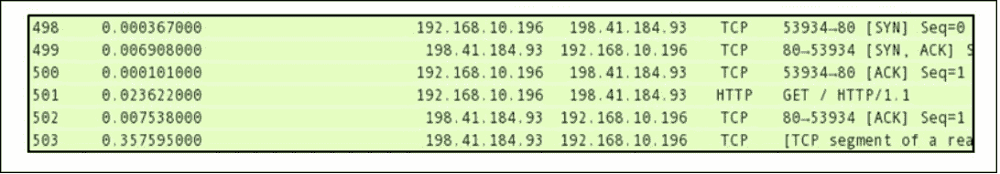

正如你所看到的，我的机器（`192.168.10.96`）与服务器（`198.41.184.93`）之间的会话以平滑的三次握手开始，没有任何延迟迹象。接着，客户端发出一个网络请求，随后服务器发送了一个确认。到目前为止，一切都很顺利，没有延迟痕迹。然而，当服务器即将开始数据传输时，它停顿了一会儿，如你在第503帧看到的那样。服务器花了大约0.35秒才开始数据传输。这清楚地表明服务器可能经历了繁重的网络流量，或者服务器正在运行多个导致高CPU和内存消耗的应用程序。我们刚刚看到的延迟也可能有其他原因。观察这一切，我们可以得出结论：服务器是延迟的原因；在这种情况下，服务器无法在合理的时间内处理客户端的请求，最终形成了一个小延迟问题。

你已经了解了在浏览互联网甚至内部局域网时，线路上的设备、客户端和服务端如何引起高延迟，你的内部局域网也可能成为同样的受害者。我们讨论了在收到服务器的SYN/ACK数据包之前出现的延迟。这些延迟可能由中间的设备（线路上）引起，也可能因为服务器响应时间长而出现。让我们通过一个关于识别高HTTP响应时间的小实际示例来让事情变得更有趣。这将帮助你识别高响应时间。请按照以下步骤操作，即可同步复现：

- 1. 打开浏览器，访问一些网站，同时让Wireshark在后台运行并监听你的数据包。
- 2. 一旦你访问了至少3-4个网站，就可以停止捕获过程。
- 3. 现在，切换到Wireshark并做一些必要的更改。首先，禁用“允许子解析器重新组装TCP流”。在列表窗格中选择任意一个TCP数据包，然后在详细信息窗格中右键单击TCP部分，再点击“允许子解析器重新组装TCP流”选项以禁用它。请参考下面的截图：

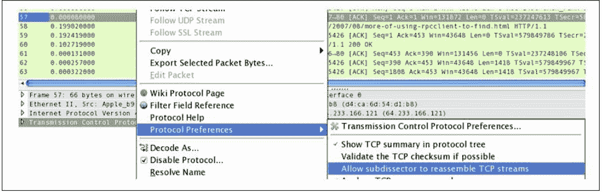

图8.13：禁用“允许子解析器重新组装”设置

- 4. 接下来，我们需要将http.time增量列添加到列表窗格中，以便更清楚地查看问题并轻松识别任何延迟痕迹。
- 5. 从列表窗格中选择任意一个HTTP数据包，然后在详细信息窗格中展开HTTP协议部分。接着，右键点击“自请求以来的时间”参数，并点击“应用为列”选项。请参考下面的截图：

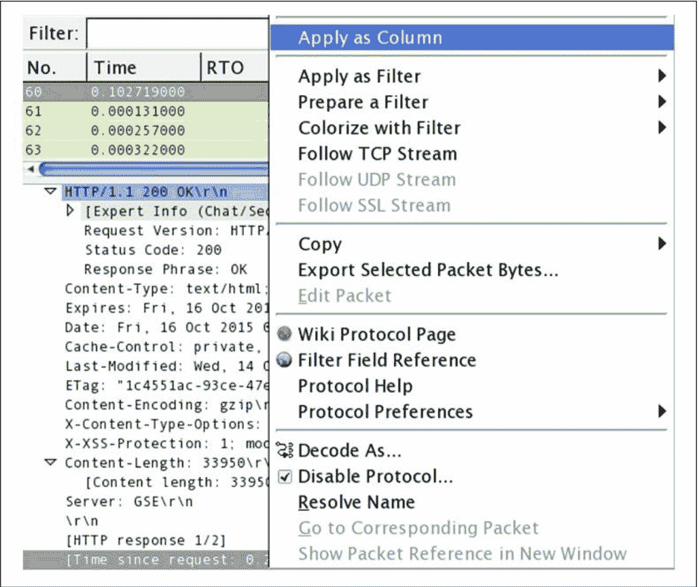

图8.14：将“自请求以来的时间”应用为列

- 6. 完成此操作后，你应该能在列表窗格中看到位于信息列之前的**自请求以来的时间**列。
- 7. 现在只剩下一个步骤：识别你所访问的web服务器中最高的响应时间。只需将新添加的列按降序排序，即可获得最高的响应时间。请参考下面的截图：

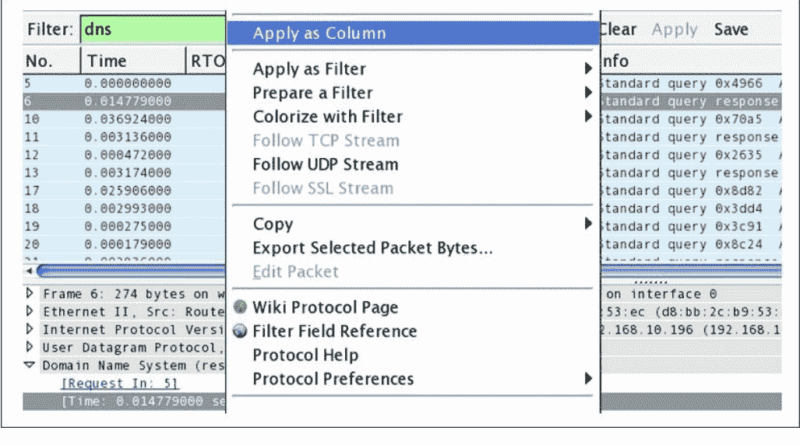

图8.18：将DNS时间参数应用为列

- 4. 完成此操作后，你会在列表窗格中看到信息列旁边出现一个时间列。
- 5. 我们的下一个目标是将该列按降序排序，以找出最高的DNS响应时间。请参考下面的截图以复现相同操作：

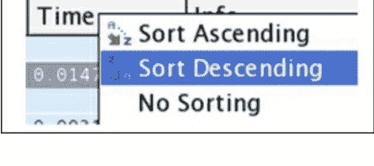

图8.19：按降序排列DNS时间列

- 6. 排序完成后，你就能在列表窗格中看到具有最高DNS响应时间的会话详情，可用于进一步调查。如果该服务器属于你的网络环境，那么只有你需要对它负责。请参考下面的截图：

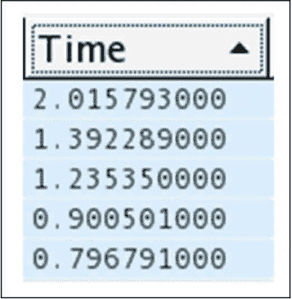

图8.20：高DNS响应时间

- 7. 看起来有些服务器响应确实很慢，这严重影响了你的整体网页浏览/网络体验。
- 8. 类似地，你可以创建一张IO图来从图形形式查看整个场景，这样更容易可视化和理解问题。请参考下面的截图：

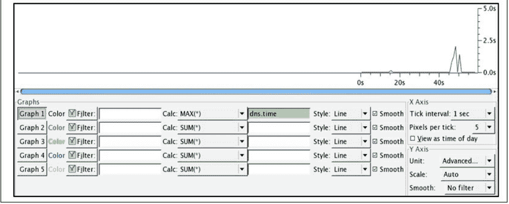

图8.21：借助IO图展示DNS高响应时间

在前面的图中，你可以很容易地观察到DNS响应时间非常高，达到了大约2.5秒，这是需要引起注意的事情。

通过前面的实际示例，我希望你理解了一种方法，它可以让你在未来的企业基础设施中快速上手排查此类场景，也许有一天你可能会被要求进行这样的排查。

## 排查瓶颈问题

接下来，我们来看一个企业网络中常见的问题。你可能已经经历过使用各种硬件和软件工具排查这些问题的痛苦。首先要做的是理解这些问题是什么，以及我们可能面临哪些类型的问题。

当数据包排队或主机之间的传输过程中出现不应有的延迟时，你可能会想“为什么会发生这样的延迟？”答案取决于许多因素，例如当你的系统或服务器端无法以正在处理的速度发送/接收信息时。这类问题会降低TCP/IP数据包的传输速率，从而严重影响网络性能，导致主机之间的数据开始以相对较慢的速度来回移动。

利用我的小型局域网，我决定创建一个练习，你也可以轻松地在你的环境中复现。对于基础设施，我有一个位于`192.168.10.1`的网关和一个位于`192.168.10.209`的客户端。请参考下面的示意图：

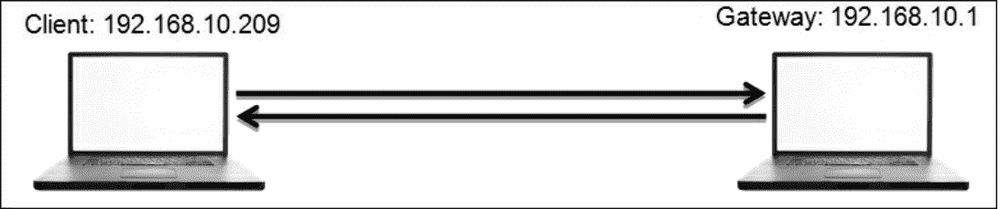

接下来你需要一个网络流量生成器。稍作研究，试着用一个你觉得顺手的工具。最后，你需要一个ping实用程序，它已经预装在所有已知的操作系统上。

那么，场景如下。我将从客户端向服务器发起一个不间断的ping。当客户端正在ping时，我会启动流量生成器应用程序，该应用程序会试图通过消耗网关资源来中断ping过程，从而为客户端制造一个瓶颈场景。

我们将首先在IO图中看到一个正常的流量模式，以便在需要与瓶颈问题进行比较时作为我们的基线。这里是

以 IO 图形式显示的正常流量模式截图：

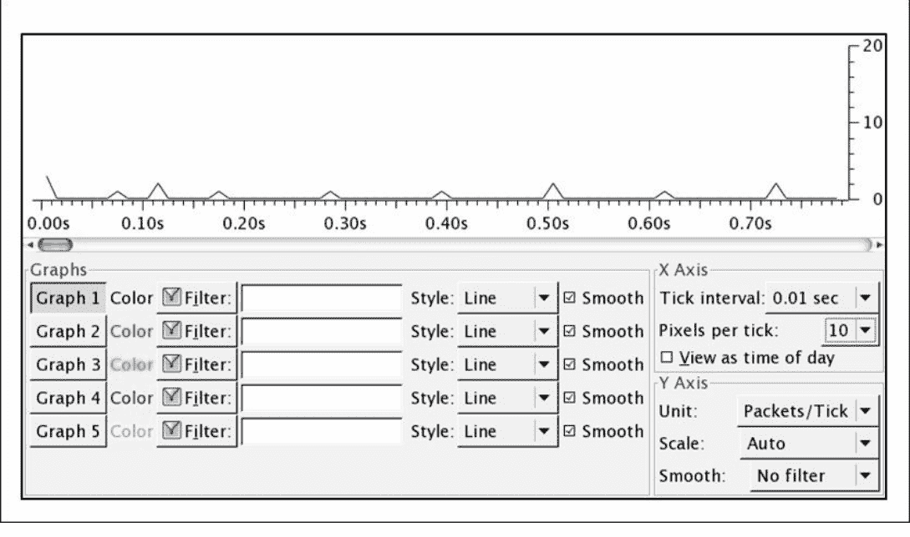

图 8.22：IO 图中的正常流量

在上图中，没有观察到明显的偏差；因此，我们可以在创建网络基线时纳入这样的流量模式。客户端向服务器发送的只是 ICMP 数据包，没有太多问题。

接下来，我想让你观察我们之前看到的流量模式与下方 IO 图中显示的流量模式之间的差异，后者是针对同一网络基础设施捕获的。然而，在复现该事件时还涉及了另一个应用程序，它产生了不必要的流量。这导致了网络拥堵，也就是通常所说的瓶颈。

我使用的应用程序是网络流量生成器，它可以用来改变正常的流量模式。这会导致网络瓶颈场景，甚至可能导致拒绝服务。请参考下面的截图：

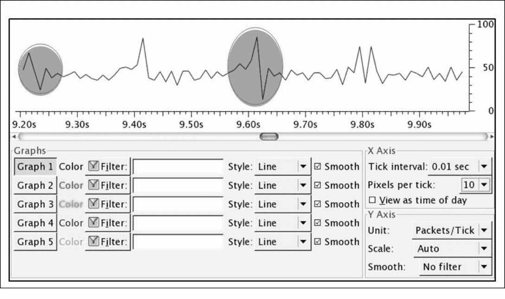

如上图所示，瓶颈问题表现为上下波动。吞吐量下降的速率与上升的速率相同，这种对正常流量的偏离模式表明正在形成瓶颈。

当你所知道的所有故障排查技术都失败时，最后你还可以使用网络基线，在处理网络缓慢问题时它会被证明很有价值。如前所述，网络基线只是你通过网络中各点收集的关键信息。你拥有的网络基线的唯一目的是与异常流量进行比较，以了解偏差程度。

我们已经讨论了影响网页浏览体验的 DNS 和 HTTP 响应缓慢问题。如果你已经拥有网络的基线，那么故障排查起来会容易一千倍。你将能够找到当前所面临问题的根本原因，而且这肯定会为其他分析节省大量时间。

请记住一件事：为两个不同网络创建的基线可能在很多方面差异巨大，因此你不应该将它们相互比较。一种有趣且富有创意的基线创建方式是分别创建独立的基线：一个用于网络，一个用于网络中的主机（考察它们如何协调工作而不产生太多噪声），另一个用于通过网络通信的应用程序。

创建基线时，你还可以将每个正在处理的站点单独考虑。在我看来，最好的方法是将每个站点按相似类别进行划分。在处理 WAN 时，故障排查站点基线会很有用。在处理 WAN 站点时，可以考虑多个组件，例如数据传输速率、使用的多个应用程序、广播流量模式，以及你可能想到的其他各种类别，这些在为特定站点制定标准化基线时都会派上用场。

排查网络缓慢问题绝对是一门艺术。我想说，除非你亲自动手实践，否则无法领会它的真正精髓。随着经验的积累，你将逐渐获得解决从互联网缓慢到复杂基础设施相关等各种问题所需的洞察力。

## 排查基于应用程序的问题

在某些场景下，网络中运行的应用程序可能是客户端所面临问题的主要来源之一。你不能每次在网络无法正常工作时都责怪网络；异常情况也可能有其他原因。在排查任何基于应用程序的问题时，仅从一端捕获数据包是不够的。你应该尝试在各处使用分析器，并尽可能多地捕获应用程序流量的踪迹。从多个点捕获流量将让你更深入地了解基于网络的应用程序。

如前所述，你可以按照某些不同的参数来创建基线。类似地，对于基于网络的应用程序，可以有一组既定的规则，使用这些规则可以为你的网络形成最佳基线，例如，应用程序对其他协调应用程序的依赖、分析启动和关闭过程、应用程序传输数据包的速率、为使应用程序无故障运行而协同工作的各种协议，以及在新安装过程中应用程序与网络交互的方式等。

在为基于应用程序的性能问题创建基线时，并不总是能够直接从有问题的主机捕获流量，因为这可能导致主机承受高流量负载，甚至使其无法使用。你的跟踪文件中可能会捕获到异常数量的丢弃数据包，这会使你的应用程序基线不太准确。

只要 Wireshark 中的解析器能够将基于应用程序的请求和响应转换为纯文本格式，你就可以继续进行。在下一节中，我将使用两种流行的应用协议 HTTP 和 DNS 来演示几个基本场景，你可以复现这些场景以遵循该方法。

首先，我们来看基于 HTTP 的应用程序异常。请记住，如果你了解响应代码，就应该能够识别来自易出错应用程序的响应。如你所知，HTTP 基于请求/响应模型，客户端向服务器请求某个资源，服务器在资源可用时返回有效资源；如果不可用，则返回某个错误代码，你的浏览器能够解读这些代码。

HTTP 错误代码分为五类错误，每类错误基于特定的逻辑参数。要了解更多关于错误代码的信息，请访问 [http://www.w3.org/Protocols/rfc2616/rfc2616-sec10.html](http://www.w3.org/Protocols/rfc2616/rfc2616-sec10.html)。为了便于说明，我将解释该过程，以便你能够找出最常见的错误代码，即客户端错误。

我将使用的基础设施非常简单、易于操作，并且与我们之前使用的相似。客户端位于 192.168.10.196，网关位于 192.168.10.1。我将尝试向网关发出一些请求，并向互联网上的任意 Web 服务器发出一些请求（请注意，我的目的只是复现你可以在 Wireshark 列表窗格中看到的错误代码，而不是入侵任何 Web 服务器）。

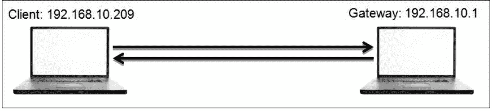

首先，我们将尝试生成一些客户端错误代码。按照以下步骤逐步进行操作；或者，你也可以先阅读一遍，然后复现整个场景：

- 1. 打开浏览器并访问网关的默认主页。希望它会像下图所示那样显示一个登录屏幕：

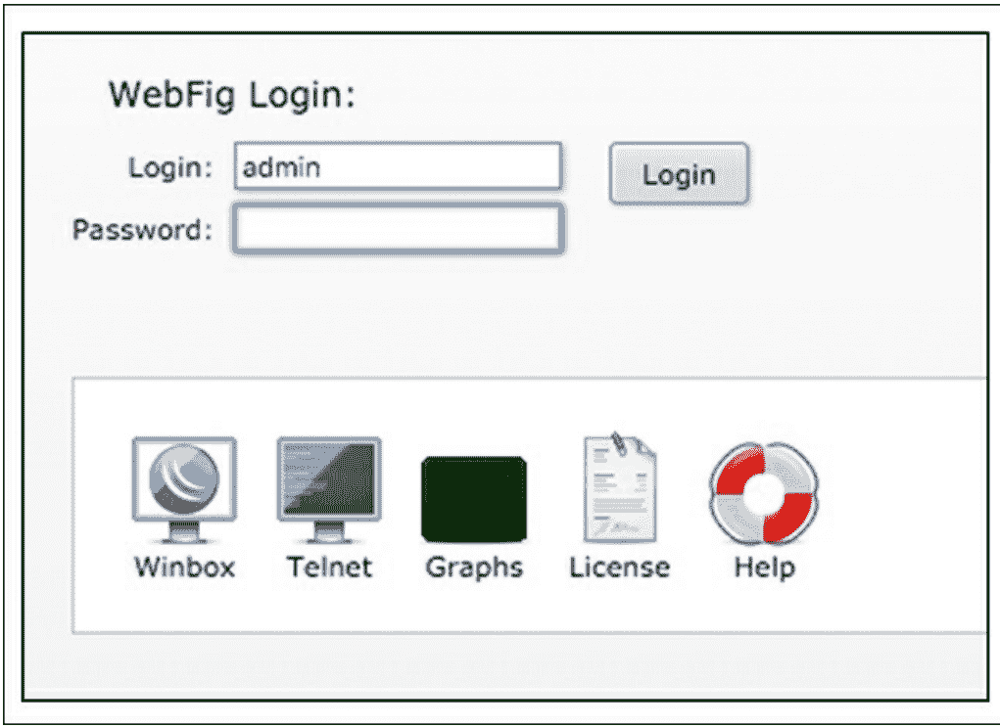

图 8.24：网关的登录面板

- 2. 打开 Wireshark，让它在后台运行，同时捕获你的所有活动。
- 3. 在密码字段中输入错误的密码，然后点击**登录**。这将在屏幕上显示**错误的登录名和密码**消息或类似信息。
- 4. 接下来，访问任意随机网站并点击任意链接。链接成功打开后，将地址栏中可见网页的扩展名更改为任意内容，例如 `.foo`、`.abc` 等。这样做会在网页上产生一个错误，例如**页面未找到**。暂时忽略它。
- 5. 现在，回到 Wireshark 并停止我们之前开始的数据包捕获过程。
- 6. 你应该能够在列表窗格中看到大量数据包，但在本节中，我们关注的是错误代码消息，仅此而已。
- 7. 现在，单击显示过滤器框并应用 `http.response.code >= 400`

过滤器。然后，单击**应用**。请参考下面的截图，它说明了这一点：

图 8.25：显示过滤器

8. 应用过滤器后，你将只能看到符合标准的那些数据包。请参考下面的截图，它说明了这一点：

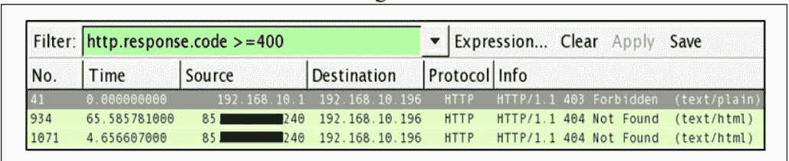

图 8.26：HTTP 响应码 >= 400

9. 看，你能多么轻松地从庞大的跟踪文件中识别出错误码。

10. 你也可以为此创建一个按钮。点击该按钮后，你将只能看到相关数据包。你可以为它们着色，以获得更好的查看体验。

11. 我们在前一章学习了着色选项。这次我想让你学习如何为特定的显示过滤器创建按钮。

12. 不要清除当前过滤器；只需单击显示过滤器区域中**应用**按钮旁边的**保存**按钮。

图 8.27：显示过滤器工具栏

13. 单击**保存**后，将出现一个对话框。要为按钮命名，请指定你选择的任意名称，并单击**确定**。请参考下面的截图，它说明了这一点：

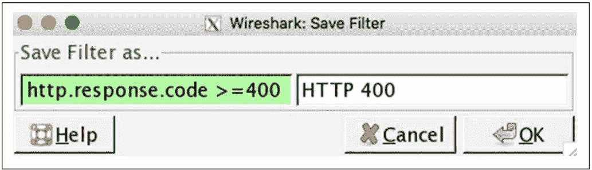

图 8.28：创建按钮

14. 单击“确定”后，你将能在显示过滤器工具栏区域中“保存”按钮旁边看到该按钮。

15. 现在，只要你愿意，就可以在不在显示过滤器框中输入的情况下创建类似的显示过滤器。你只需单击你最近创建的按钮即可。

图 8.29：新添加的按钮

为了让这件事更有趣，我建议你为 HTTP 404 错误创建一个着色规则。这肯定能帮助你更方便地识别特定错误类型。

接下来，我们将看到另一种应用协议，各种应用程序通常使用它将域名转换为其 IP 地址。是的，我指的是 DNS。如我们所知，DNS 协议运行在 UDP 或 TCP 之上。与 DNS 错误相关的各种响应码范围从 0 到 21。Wireshark 中的解析器确实了解响应码。利用这一点，Wireshark 能够向你显示与错误码相关的消息。为了复现一个错误，我将访问一个在互联网上不存在的网站；因此，我会收到一个错误。但我的网关并不知道这一点，所以它会尝试解析与该名称关联的 IP 地址。作为回应，我们会看到一个包含错误的 DNS 响应。基础设施与我们前面示例中使用的一样。客户端位于 192.168.10.209，网关位于 192.168.10.1。

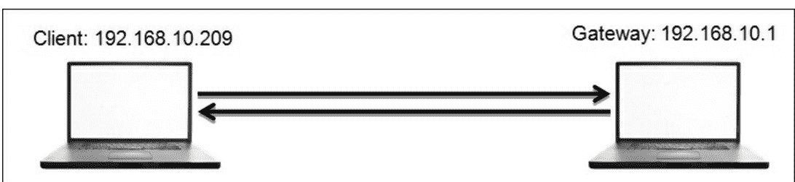

你可以一步一步地跟我复现该场景，也可以稍后读完再操作。请按以下步骤复现该场景：

- 1. 打开 Wireshark，开始捕获。让它在后台运行。
- 2. 打开你所使用操作系统的终端（命令提示符），在其中输入 nslookup，然后按回车。
- 3. 现在，你将进入 nslookup 工具的交互模式。如果你还不了解该工具，请先阅读相关资料再继续。该工具可用的文档很多。请参考下面的截图：

图 8.30：NSLOOKUP 工具

- 4. 要生成 DNS 错误响应码，只需输入任意域名并按回车。在指定域名之前，请使用 set type=a 命令将查询类型更改为 A，然后输入你想要的域名。

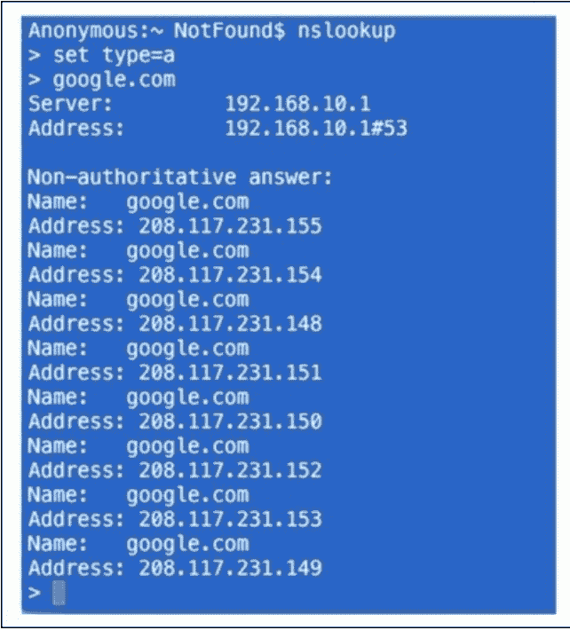

- 5. 首先，我们可以对存在的域名（如 [google.com](google.com)）尝试同样的操作。然后，你可以对不存在的域名尝试。请参阅这里展示的图 8.31。
- 6. 上面的截图显示了与 [google.com](google.com) 域名关联的各种 IP 地址。该域名已存在，所以我们能看到应答。如果你尝试一个不存在的域会怎样？请参考下面的截图，它说明了这一点：

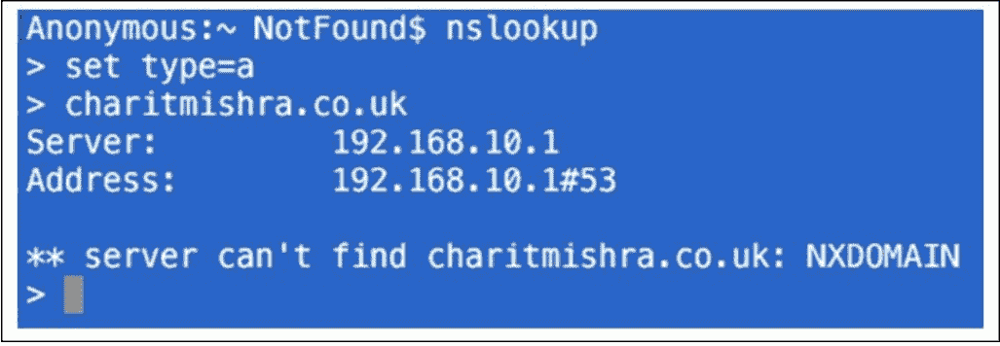

## 小结

故障排除是一门源于经验的艺术，要成为这方面的大师，你需要自己动手实践。

TCP 协议提供了多种错误恢复功能，帮助我们从生产环境中常见的数据包丢失中恢复过来。

TCP 重传和重复 ACK 就是 TCP 协议使用的部分技术，它们让网络管理员的工作稍微轻松一些。

网络缓慢是你每天必须面对的常见问题之一。在开始解决这些延迟问题之前，你应该了解可以遵循的基本方法，即将你的场景归入延迟类别之一：线路、客户端或服务器。

解决瓶颈问题（例如数据包在发送方缓冲区中排队并引发麻烦）非常重要。解决瓶颈问题的最佳方法是借助你在前一章学到的 IO 图来可视化情况并加以掌握。

应用程序使用 HTTP 和 DNS 等协议。这很常见，但你必须了解这些协议可能呈现的错误码；即使不使用 Wireshark，你也应该能够识别出相应情况。我不知道所有错误码，连我也做不到。但你可能会遇到最常见的一些。

创建基线是解决网络中问题的最便捷方法之一。当你拥有包含优化流量模式的跟踪文件时，通过将正常模式与异常模式进行比较，你可以用更少的资源在更短的时间内解决问题。请至少 2-3 次从网络中的不同位置收集用于基线的网络跟踪。

## 练习问题

Q.1 从网络中不同位置针对通信中使用的各种常见协议创建一个基线。

Q.2 说明 TCP 错误恢复功能所具有的各种特征。

Q.3 除 DNS 和 HTTP 之外，还有哪些协议会给你带来麻烦？你会采用什么方法来排除它们？

Q.4 你如何理解“瓶颈问题”这一术语？它们可以被忽略吗？如果能/不能，为什么？

Q.5 为你自己的主机创建一个跟踪文件，至少捕获 10,000 个数据包。然后分析你能够看到多少种 HTTP 协议错误，以及其中有多少种可以复现。

Q.6 使用你之前创建的基线，尝试匹配一种异常流量模式，并通过比较过程观察你能发现哪些异常。

Q.7 对于 DNS 协议，复现一个除 3 以外的错误码，并捕获相应流量。

Q.8 为我们讨论过的延迟类型准备一份清单，并尽可能多地列举每个类别中的场景。准备好后，尝试在同一故障排除场景中使用它。这会不会加快你的整体流程？

Q.9 为你想要的各种应用协议创建错误响应的着色规则，并分析它对故障排除问题有什么不同影响。
