# 第 9 章 Wireshark v2 简介

本章将向你介绍 Wireshark 最新版本带来的惊人特性。以下是用户将会注意到的部分显著变化，本章所有示例均使用版本 2：

- - Wireshark v2（QT）与旧版框架（GTK）之间的比较
- - 智能滚动条
- - 翻译功能
- - 图形改进
- - 更新的 TCP 流
- - USBPcap
- - 小结
- - 练习问题

Wireshark 已经陪伴我们大约二十年了；在其生命周期中我们并没有看到任何重大更新。然而，在这段漫长的时间里，引入了一些小更新，使应用程序更加方便和健壮。但这一次，我们有了一个全新打造的 Wireshark v2，功能令人惊叹。是的，我们真的很幸运，能够见证协议分析行业中最受欢迎和令人惊叹的工具进行这次重大更新。

我真的很兴奋地讨论最新版本中引入的不同工具集，但在此之前，你需要熟悉 QT 和 GTK 框架的背景。你肯定得现在或在读完本章后去谷歌搜索一下。不过，请确保记下它们。

为了方便你，我将简要介绍这些框架及其背景；我之所以强调两者之间的区别，是因为我们协议分析器新开发的版本 2 是使用 QT 框架开发的。QT 和 GTK 是用于开发诸如 Wireshark 等跨平台 GUI 工具的框架。一般来说，从最终用户的角度来看，差异将纯粹基于图形变化；但在性能方面，GTK 比 QT 更经济。为了更好地理解，这些不仅仅是工具包和框架；相反，它们是开发人员用来为最终用户创建更好 GUI 的库集合。基本上，它是在复用其他人已经做出的设计。复用设计的主要优势是，它能让新安装的程序看起来与你机器上其他已安装的程序更相似。例如，让我们并排查看该应用程序的新旧版本；请参阅以下截图：


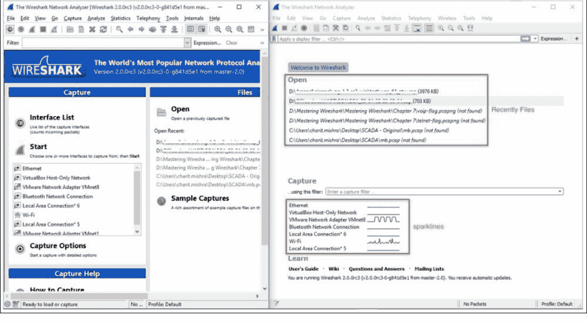

图 9.1：GTK 与 QT 框架

你肯定想知道如何让机器安装最新版本的 Wireshark。其实非常简单；只需访问 [http://wireshark.org](http://wireshark.org)，然后进入下载页面。在那里，你会找到最新版本。下载适合你操作系统的那一个。在安装过程中，有一个重要问题会询问你：是想要将旧版本与新版一同安装，还是只安装新版本（请注意，只有 Windows 用户拥有这个选项；Mac 和 Linux 用户只能安装应用程序的最新版本）。

你还会看到机器上安装另一个组件：USBpcap。我在本章中为这个特定主题专门安排了一节。就基本介绍而言，USBpcap 帮助用户捕获从机器 USB 端口进出的数据。该工具在 Linux 用户中已经可用相当长一段时间了，但幸运的是，现在 Windows 用户也可以使用它了。

对于初学者，我们先来看一下主屏幕，它与旧版本给人的感觉完全不同。请参考以下截图：

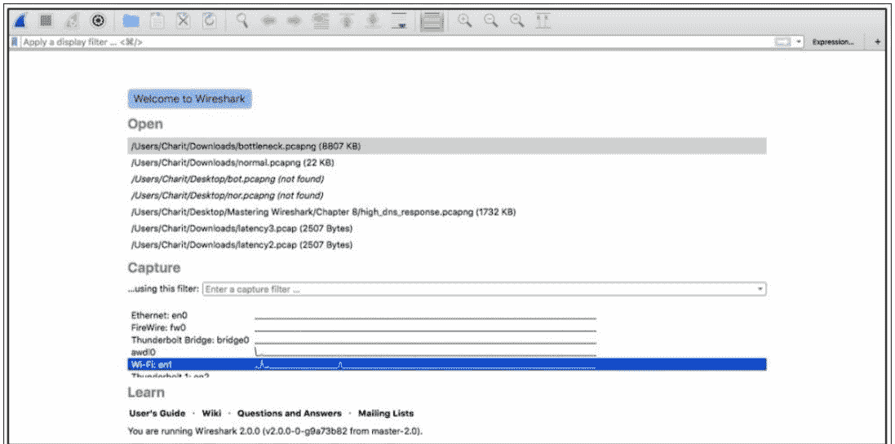

图 9.2：Wireshark v2 的主屏幕

我希望你和我一样，对这种崭新而令人兴奋的外观感同身受。这个版本中的一切都排列得如此恰当、更简洁。即使是完全没有协议分析经验的新手用户，也能获得一个很好的起点，只因为现在的界面已经变得简单且富有吸引力。

例如，只要观察工具栏区域即可。在这个版本中，开发人员似乎过滤掉了不需要的、不太常用的工具，最终使界面看起来相当舒适。在这个新版本中，我们可以快速访问基本工具集，比如开始和停止捕获按钮、接口自定义按钮、保存/打开/关闭当前捕获文件的按钮、一些导航工具，以及自动滚动和颜色标记启用/停用按钮。

就在工具栏区域下方，有我们的老朋友——“显示过滤器”工具集，它经过精心重新设计。在显示过滤器文本框的最左侧，你会看到一个类似书签的图标（蓝色，位于左上角），它会显示默认和手动创建的过滤表达式。请参考下面的截图：

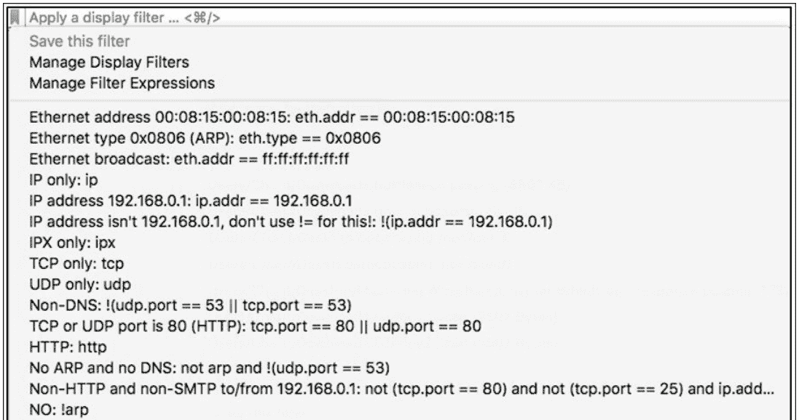

图 9.3：显示过滤器工具栏

如你所见，所有过滤器都被列出，它们可能是你创建的，也可能是默认的。因此，现在只需单击一下即可激活其中任何一个，而不必像旧版本那样弹出一个窗口，再从其中选择和套用过滤器。这无疑加快了分析过程，也让 IT 专业人员的工作更轻松。

在显示过滤器工具栏的另一端，有一些经过重新设计、焕然一新的旧工具，同时功能也有所改进；请参考以下截图：


图 9.4：显示过滤器工具集

现在要应用任何显示过滤器，只需点击箭头，旁边的下拉菜单就会让你访问常用过滤表达式（最近使用过的表达式历史记录）。然后是 **Expression**（表达式）按钮，它帮助你进入对话框，在那里你可以访问所有按协议分类的可能过滤表达式。接下来，在显示过滤器文本框的最右侧，有一个 + 号；点击它，就可以创建过滤器按钮。让我帮你在新版本中创建一个属于自己的过滤器按钮，以便入门。

例如，我想创建一个按钮，只查看 ARP 数据包，所以我将在显示过滤器区域输入 `arp`，并点击工具栏末端的 + 号。然后，你需要指定按钮的名称：


图 9.5：添加自定义显示过滤器表达式按钮

这将在 + 号旁边添加一个实体按钮。当你经常需要较长的显示过滤器表达式时，这种技巧会非常有用和高效。因此，不必再次输入整个表达式，只需单击一下就能启用它们。结果，你会看到类似下图的内容。现在，只需单击一次，即可应用 **arp** 作为显示过滤器：


图 9.6：创建的显示过滤器按钮

接下来，在显示过滤器工具栏下方，你可以看到最近使用的文件；双击任何你想打开的文件即可。

在 **Open**（打开）文件部分之后，是捕获过滤器工具栏，我想你不需要任何解释也能明白它是做什么的，以及如何使用它。

现在到了主屏幕上你会看到的最大变化：接口名称后面跟着一个交互式图形。你看到的图形实际上是实时的，也就是说，你会看到波动，即线条上下起伏。接口名称后面的迷你图形代表该接口进出流量的多少。这些迷你图形的专业术语是“迷你走势图”（sparklines）。在较旧的旧版本中，我们是以数字形式查看实时统计信息。

现在，如果你决定从某个特定接口捕获流量，只需双击图形区域，剩下的交给 Wireshark 就可以了。

## 智能滚动条

这是最新版本发布的功能之一，你可能已经注意到滚动条区域有一些彩色部分/线条。如果没有，那就回到任意一个捕获文件，慢慢上下滚动，观察滚动条区域的颜色模式。猜猜这在分析过程中会带来什么不同？让我们通过一个例子来理解。

我将使用一个之前捕获的文件进行演示，其中包含 HTTP 和 HTTPS 数据包，以及一些重传和重复帧。第一眼你看不出有什么不同，但一旦你开始滚动，滚动条区域就会显示颜色模式。这种模式基于你在应用程序中设置的着色规则。例如，根据默认的着色规则，重复和重传数据包通常以黑色背景、红色前景显示，HTTP 数据包以绿色背景、黑色前景显示。现在，让我们在应用程序本身中验证这一点。请参考下图：

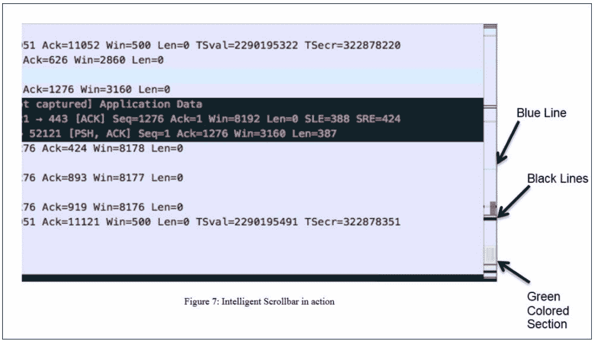

图 9.7：智能滚动条在工作

列表窗格中数据包以不同颜色显示的方式，与滚动条表示列表窗格不同区域的方式类似。

同样，蓝色线条表示选中的数据包，黑色线条表示重复 ACK 和重传，绿色部分表示在捕获文件底部有一些 HTTP 数据包被列出。通过观察滚动条区域的颜色模式，我们就能知道前面有什么类型的数据包，最重要的是，导航到你正在寻找的某个数据包区域现在更加容易和快速了。

我们之前已经讨论过自定义着色规则；让我们再以同一个捕获文件为例，这次我要自定义 HTTP 数据包的着色规则。我们将把绿色背景改成黄色。让我们看看在滚动条区域会有什么不同，如下图所示：

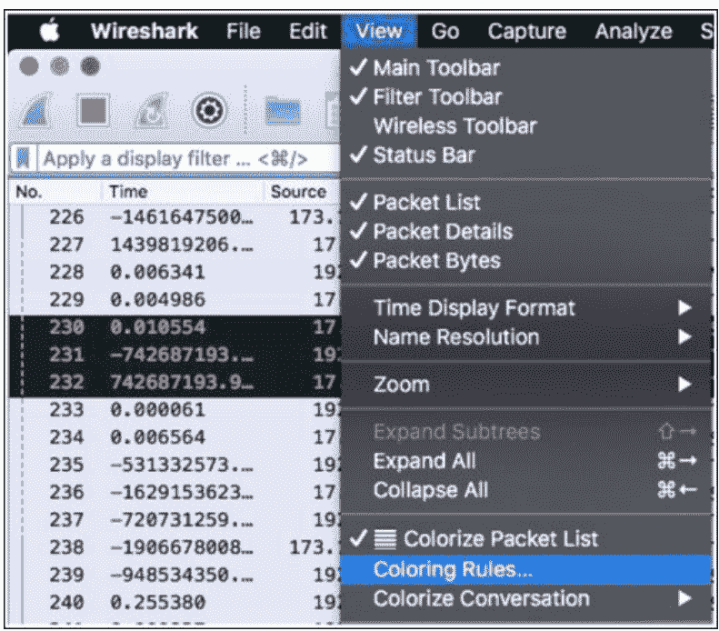

图 9.8：访问着色规则对话框


要访问着色规则，您需要从菜单栏中点击**视图**，然后在最底部角落选择**着色规则**，这将显示一个对话框，其中会列出所有着色规则。尝试将 HTTP 着色规则改为黄色。完成后，关闭对话框并重新打开捕获文件，以便看到变化。

现在，尝试滚动同一文件，我希望您会看到滚动条和列表窗格中的着色模式有所差异，所有 HTTP 数据包都以黄色背景显示。请参考以下截图：

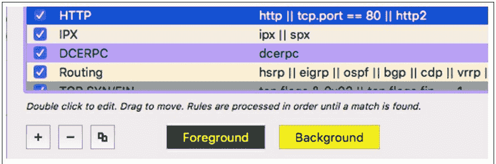

图 9.9：HTTP 着色规则

现在，让我们比较应用新着色规则后，在列表窗格中上下滚动时产生的差异。请参考以下截图查看图示：

## 翻译

我认为这一令人惊叹且相当酷的功能并未得到应有的关注，所以我想让您知道，Wireshark 允许您将语言更改为您选择的任何其他语言，例如西班牙语、日语、中文（实际上是普通话）、波兰语、法语等等，而且此功能从 1.99 版本开始就已存在。

赋予用户将应用的默认语言更改为其母语的权利，完全是为了在使用应用时个性化用户体验。如果用户感觉与应用更贴近、更舒适，那么他们一定会变得更高效。

让我们通过一个示例来看看如何将系统的默认语言更改为日语（该功能随 2.0 版本推出）。请按照以下步骤操作：

- 1. 导航到 **Wireshark | 首选项**（Windows 用户需要导航到 **视图 | 编辑 | 首选项**）：

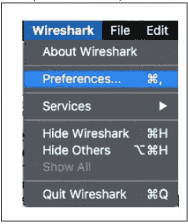

- 2. 现在，从底部的下拉列表中选择**日语**，然后点击**确定**：

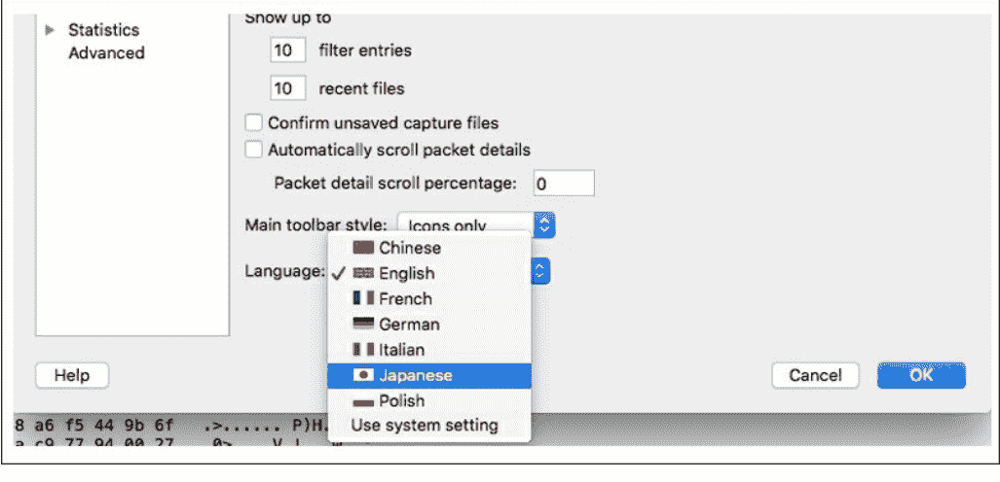

3. 现在，您可能会看到所有内容都显示为日语，如下面的截图所示：

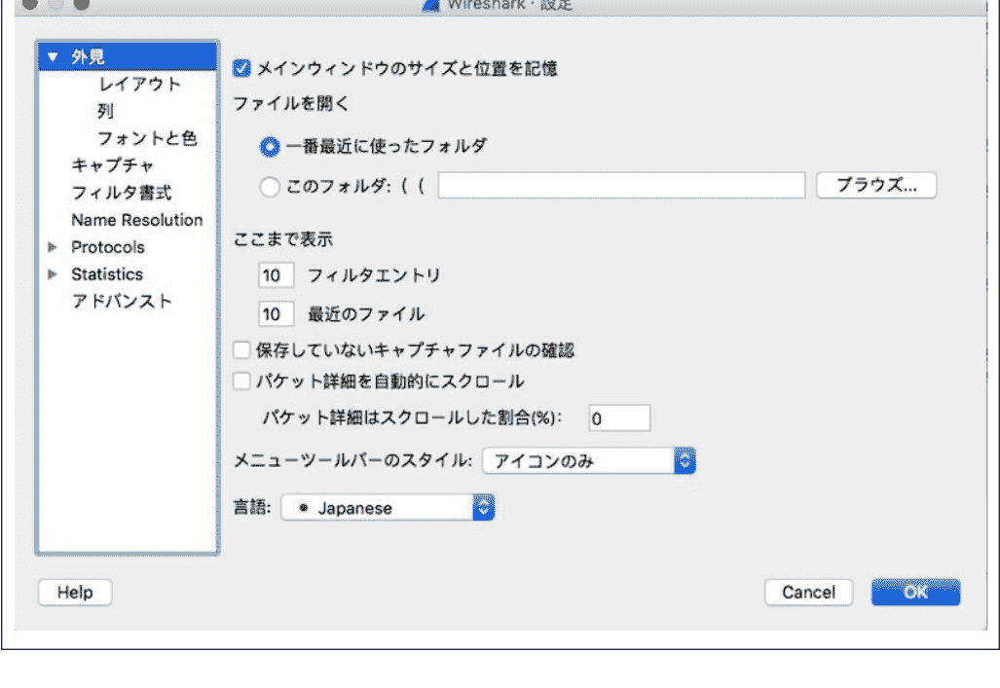

4. 要将其恢复为系统默认，请执行相同的步骤。

最令人惊叹的是，您也可以参与这一变化；这意味着如果您想帮助 Wireshark 团队添加您的母语，那么您可以与他们联系。

在帮助菜单中，您可以列出所有键盘快捷键，这些快捷键可以用于让操作比平时更快。即使是制作图表，现在也有可用的快捷键。

### 图 9.11：IO 图

3. 现在，如果您想要修改和配置图表，则可以使用对话框底部提供的各种可配置选项。

4. 例如，如果我想向图表添加任何过滤器，我可以点击底部的 + 符号，然后会出现新的一行，如下面的截图所示：

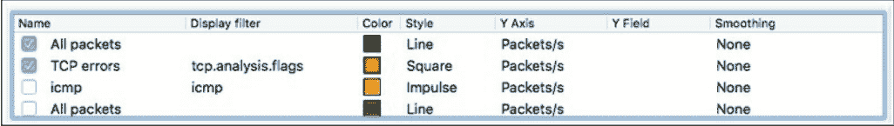

### 图 9.12：向图表添加过滤器

5. 现在，我想查看 ARP 数据包的流量模式以及其他与流量相关的详细信息。因此，我会在显示过滤器列中写入 arp 作为过滤表达式，并在名称列中写入 ARP 数据包。如果您也想自定义外观和感觉，非常欢迎您这样做。

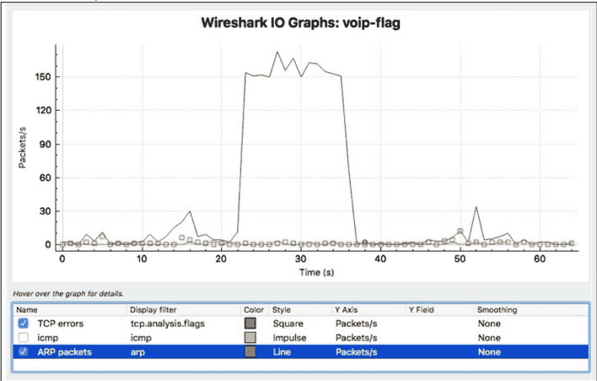

图 9.13：在 IO 图中添加的 ARP 过滤器

6. 正如您所看到的，我们新创建的过滤器已经生效，我们也可以观察到图中出现的 ARP 数据包的频率。

现在使用图表方便多了，因为您不再需要向图表传递任何统计信息。只需选择您想要的任何图表，然后图表的默认版本就会直接呈现给您，无需任何询问。现在，如果您想根据需要更改图表，只需使用图表末尾提供的工具集进行自定义配置即可。

现在，当我们制作了一个 IO 图后，您会看到它看起来多么整洁；其中引入了许多功能。使用默认图表，大多数情况下您都能找出跟踪文件中的起伏。图例显示在底部的单独区域中，同时还有其他可配置选项，如更改颜色、隐藏或启用过滤器等等。

可以在图表中列出和探索更多功能；您只需右键单击图表区域即可。现在，只需单击并拖动，就可以沿 x 轴和 y 轴移动图表。向图表添加新参数再简单不过了。正如您所看到的，许多令人惊叹的新功能正等着您去发现。

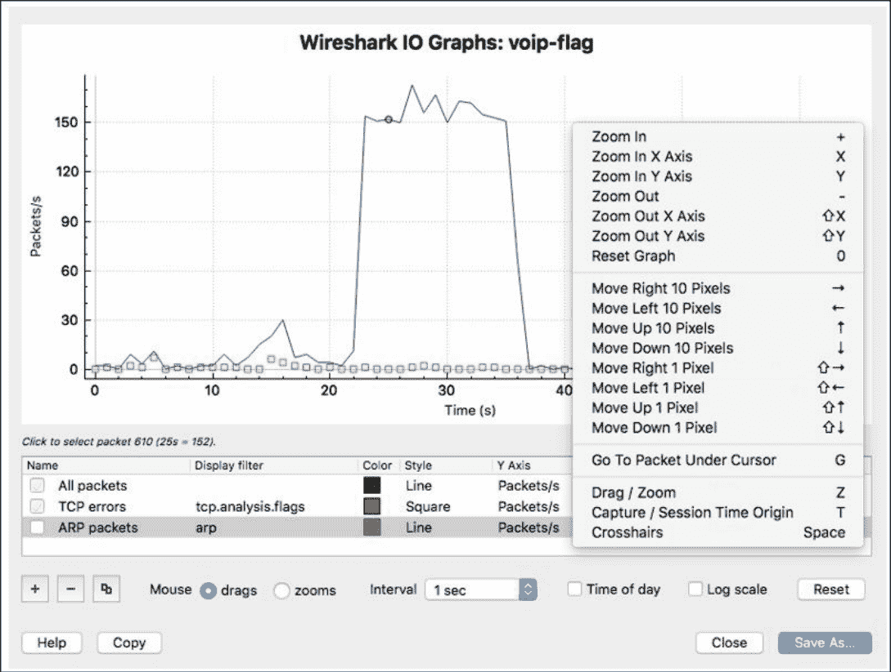

图 9.14：右键单击选项列表

现在可以同时打开两个图表；也许有一天，您会想要比较两个跟踪文件中的流量模式。例如，我想比较正常的 VoIP 流量模式和恶意流量模式。然后，我们可以使用两个图表以图形方式找出差异，这确实非常有效。请参考以下截图：

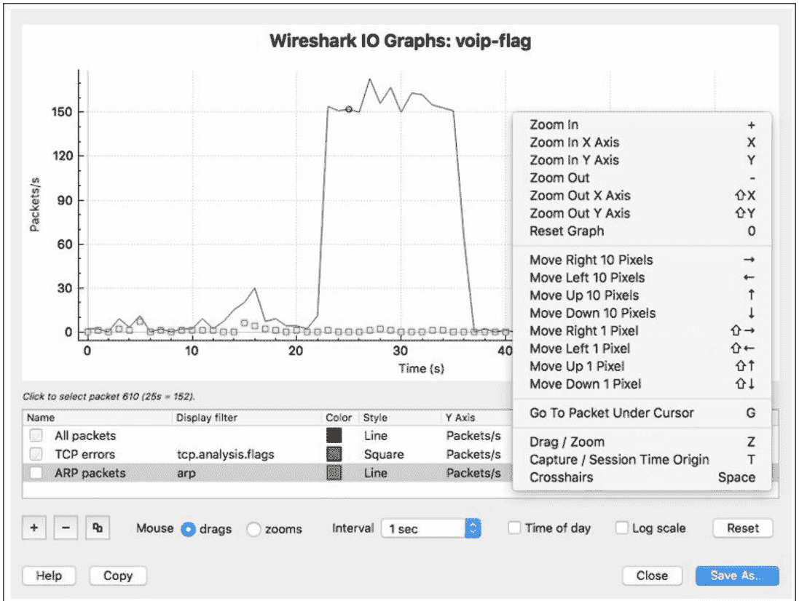

### 图 9.15：同时比较两个图表

类似地，您可以创建一个流图，它在分析 TCP 流向以及了解 SYN 和 ACK 如何相互协调时会非常有帮助。我强烈建议您在较新版本的 Wireshark 中创建流图。

要在图表之间切换，您可以使用位于图表窗口左下角的下拉列表，它可以帮助您进行切换，不再需要转到后台窗口来切换图表。

另一个有用的功能是，当您尝试为客户创建报告或出于自身参考目的时，可以将图表导出为 PDF 格式。您以前可能做过；如果没有，那么让我们一起在这里操作。

请按照以下步骤操作：

- 1. 您需要点击图表对话框窗口右下角的**另存为**图标。然后，选择要保存 PDF 的位置并点击**保存**。
- 2. 完成此操作后，您可以按需将 PDF 导出到任何位置。请参考以下截图：

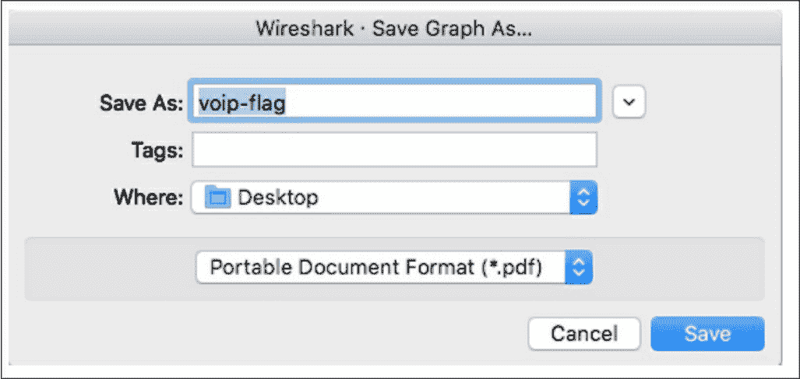

图 9.16：将图表导出为 PDF 格式

现在，无论何时您想将其导入到报告中，只需像添加图像一样添加它，您导出的 PDF 中的图表就会添加到您的文档中。操作就是这么简单：

## Wireshark IO 图：voip-flag

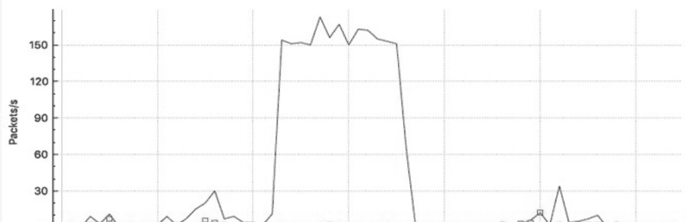

图 9.17：以 PDF 格式导出的图表

## TCP 流

这是您到目前为止可能经常使用的功能之一，我想对于所有将 Wireshark 作为实用工具的 IT 专业人员来说也是如此。该工具的精髓在未来的下一版本中肯定保持不变；然而，有一些新东西我想强调一下。要查看 TCP 流窗口，过程与往常相同。右键单击列表窗格区域，将鼠标悬停在“追踪”上并选择它，它将显示可用的不同流。然后，点击 TCP 流选项。请参考以下截图查看这些步骤：

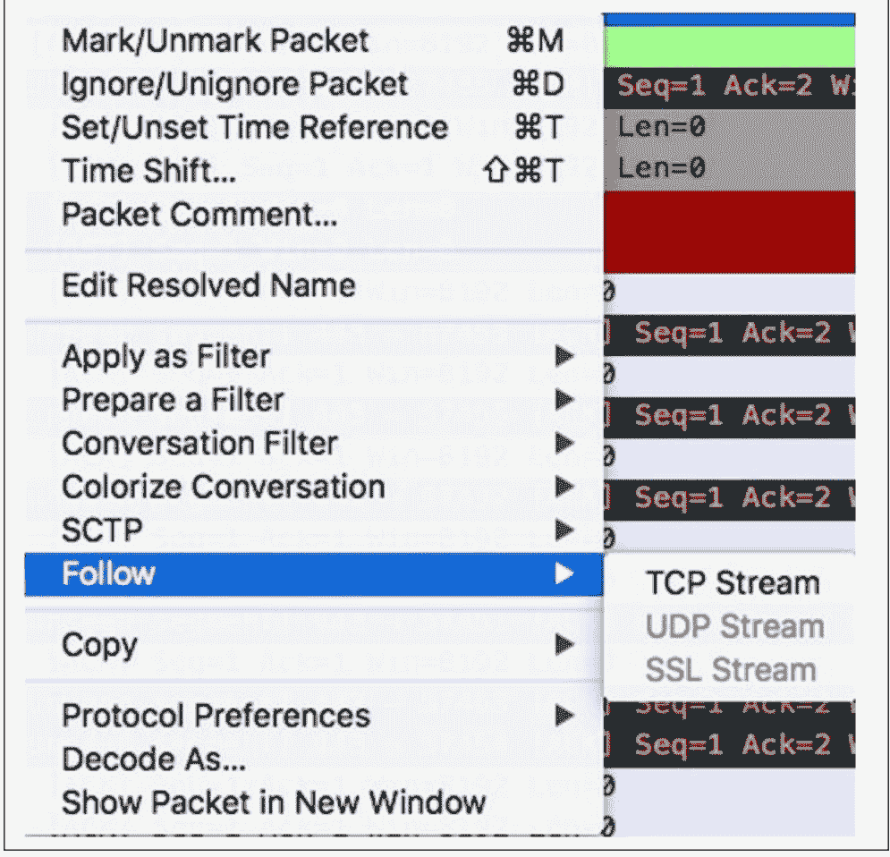

这里有两个选择：您可以指定要查看的流的编号，或者通过点击文本框后面的上/下箭头进行上下切换。所以现在，如果您想查找不同的流，不必像在使用早期版本的应用时那样关闭并重新打开对话框。请参考以下截图：


图 20：流选项

标记为 (2) 的部分为您提供了在“追踪流”对话框中查找任何 ASCII 文本的功能，这无疑为每个积极使用这款优秀应用的人提供了额外优势。大多数时候，我们使用流对话框是为了分析目的，有了这些新功能，我们的工作变得更加轻松和有趣。请参考以下截图，了解这两个新引入的选项：


图 9.21：“追踪 TCP 流”对话框中的查找工具

例如，如果您想在当前流中搜索文本 `abc`，只需在查找文本框中输入搜索字符串，然后按 Enter 键或点击**查找下一个**。


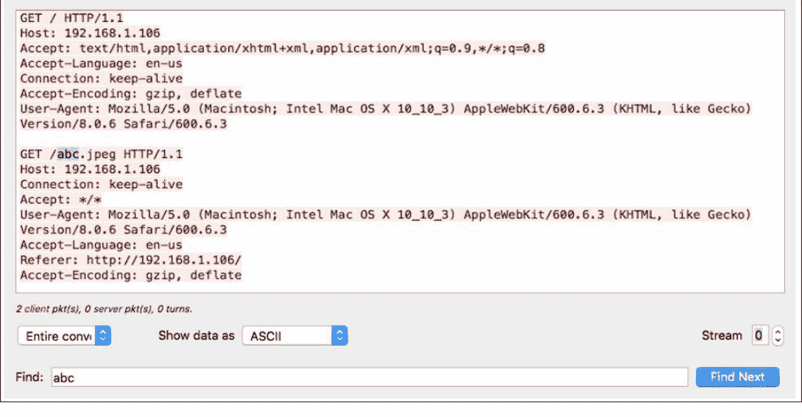

图 9.22：“跟踪 TCP 流”对话框中的查找工具

## USBPcap

USBPcap 在 Linux 和 Mac 用户中已经存在很长时间了，但对于 Windows 用户来说，这是他们第一次能够嗅探 USB 接口上的活动。那么，让我们快速了解这一最新功能，并尝试通过一个示例来理解如何使用它。按照以下步骤重现该场景：

- 1. 在 Windows 机器上成功安装 Wireshark 后，强烈建议你重启机器，因为 USBPcap 可能会带来一些麻烦。
- 2. 电脑重启后，打开命令提示符，将当前目录切换到 USBPcap 安装目录，该目录通常位于 C:\Program Files\USBPcap\。
- 3. 现在，使用 dir 命令列出目录内容，检查目录中是否存在 USBPcapCMD.exe。请参考下面的截图，该截图展示了这一步：
- 4. 在命令提示符中输入 USBPcapCMD.exe 以启动嗅探应用程序。

```
C:\Program Files\USBPcap\
```

```
dir
```

```
USBPcapCMD.exe
```

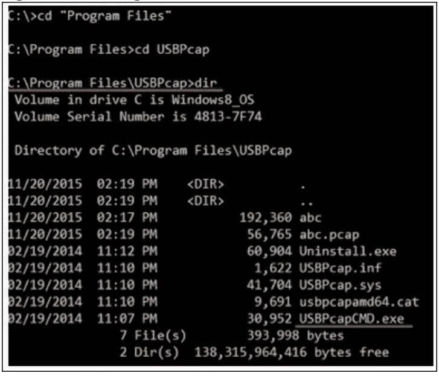

图 9.23：USBPcap 安装目录

```
USBPcapCMD.exe
```

- 5. 成功启动后，系统会要求你选择要在哪个根集线器上嗅探流量，以及要将输出重定向到的跟踪文件的名称。请参考下面的截图：

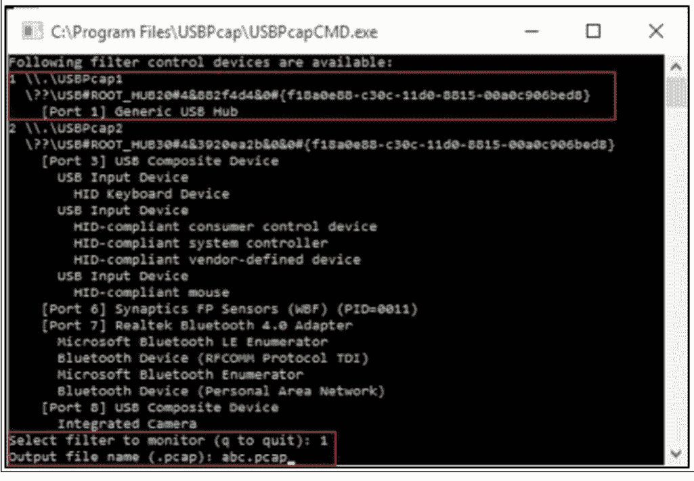

- 6. 按照提示，应用程序将开始在根集线器 1 上执行嗅探过程，并将捕获到的 USB 接口上的所有活动转储到 `abc.pcap` 文件中。
- 7. 现在，尝试将一些内容从电脑复制到 USB 驱动器，或者反过来。你很可能无法在命令提示符中看到任何实时活动，但实际上它在后台运行。
- 8. 无论何时想停止嗅探过程，都可以按 Ctrl + C。
- 9. 现在，是时候用 Wireshark 打开 `abc.pcap` 文件，看看跟踪文件中有什么了。请参考下面的截图：

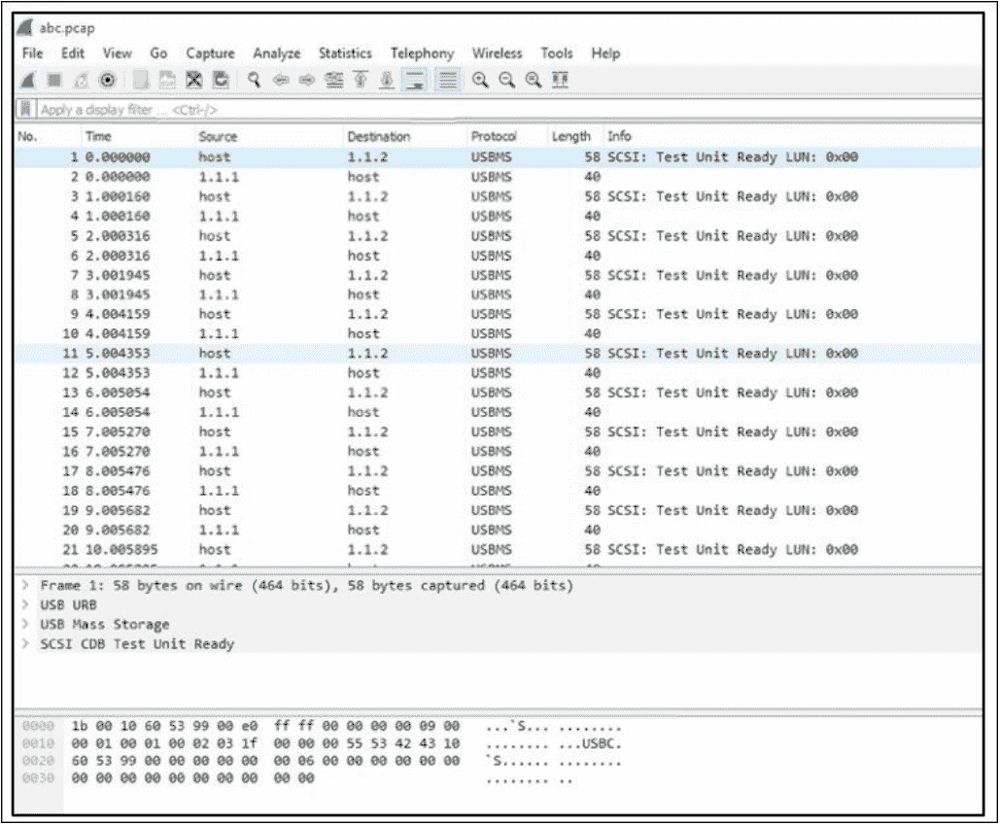

图 9.24：`abc.pcap` 跟踪文件

如你所见，我们捕获到了一个活动；它看起来与我们在网络数据包中看到的很相似。我们拥有所有熟悉的列，列出了各种详细信息，如时间、源、目标等。因此，我们成功地将可用 USB 接口上的活动转储出来，没有遇到任何技术麻烦。希望你能进一步研究，以更好地理解 USBPcap。

## 总结

新版 Wireshark 采用了新框架，为我们带来了全新且非常惊艳的图形用户界面。旧版基于 GTK 框架构建，而现在我们使用了 QT 框架，从普通用户的角度来看，差异主要体现在其外观和体验上。

滚动功能无疑是我们在所有主流应用程序中都见过的功能之一，但我们要向开发者致敬，他们提出了这样一个创意：当你试图查找特定内容时，在滚动条内显示跟踪文件的着色模式。这确实带来额外优势。

翻译功能使 Wireshark 更加国际化，并在个性化方面更贴近每位用户。由于许多 Wireshark 用户可能不习惯英语，现在他们可以将语言更改为自己的母语，这将使专业人员的分析过程更加高效。

图表是能够让人分辨正常与异常情况差异的功能之一，并且非常常用。现在，创建和自定义图表比以往任何时候都更容易，外观和体验也得到了极大改善。

“跟踪 TCP 流”对话框引入了一些新功能，让你可以查找 ASCII 字符串，并且还能轻松地在可用流之间切换；你无需关闭并重新打开对话框即可切换到不同的流。

USBPcap 陪伴我们已有相当长的时间，大多数 Linux 和 Mac 用户可能都知道这一点。你的网卡让你能够监听有线/无线信道的方式，类似于 USBPcap 选项让你能够监听你所拥有的 USB 端口的方式。这意味着现在 Wireshark 也可以跟踪 USB 接口上发生的活动。

## 练习题

- Q.1 试着找出 GTK 和 QT 框架之间的主要区别。你认为哪一个更好？
- Q.2 尝试使用翻译功能，将 Wireshark 中的系统默认语言更改为你选择的任何其他语言。
- Q.3 使用新版本和旧版本创建流图，观察你能找出两个图表之间的多少差异。
- Q.4 打开你之前拥有的任意捕获文件，并尝试确定其中有多少条 TCP 流。
- Q.5 找出一种方法来移除我们在本章前面创建的 ARP 协议的显示过滤器按钮。
- Q.6 尝试更改 ARP 数据包的着色规则，并检查你是否能在智能滚动条区域观察到差异。
- Q.7 在 Windows 机器上安装新版 Wireshark 后，尝试启动 USBPcap。然后，将内容从电脑复制并粘贴到 USB 设备，或反过来（将所有活动转储到 test.pcap 文件中）。
- Q.8 在 Wireshark 中打开最近捕获的 USB 接口活动跟踪文件 test.pcap，并尝试弄清楚列表窗格中列出的数据包说明了什么。具体来说，尝试分析源和目标列中显示的值。
