## 前言

- 本书内容
- 本书所需
- 适读人群
- 约定
- 读者反馈
- 客户支持
- 下载示例代码
- 下载本书的彩色图片
- 勘误表
- 反盗版
- 问题

## 致谢

| 作者 | 文案编辑 |
| :--- | :--- |
| Pierre-Jean TEXIER<br>Petter Mabacker | Madhusudan Uchil |
| 评审人 | 项目协调员 |
| Burt Ganz<br>Dave (Jing) Tian<br>Helmi ROMDHANI<br>Pierre FICHEUX | Judie Jose |
| 委托编辑 | 校对员 |
| Amarabha Banerjee | Safis Editing |
| 获取编辑 | 索引编制人 |
| Meeta Rajani | Hemangini Bari |
| 内容开发编辑 | 制作协调员 |
| Rashmi Suvarna | Shantanu N. Zagade |
| 技术编辑 | 封面制作 |
| Mohit Hassija | Shantanu N. Zagade |


## 关于作者

**皮埃尔-让·泰西埃** 自 2014 年起一直是 Amplitude Systèmes（一家销售镱飞秒激光器的先驱公司）的嵌入式 Linux 工程师，在那里他使用 Yocto Project（meta-fsl-arm）维护一个名为 i.MX6 的定制 SoC，该 SoC 由法国公司 EUKREA 制造。

他毕业于波尔多的 ESTEI 学校，在那里学习了 3 年，成为一名嵌入式 Linux 工程师。

他是自由软件世界和嵌入式世界的大力支持者。他的知识包括 C/C++、Yocto、Linux、Bash 和内核开发，但他也乐于尝试新事物并测试新技术。

*首先，我想感谢我耐心的妻子在我的写作期间给予的支持。我也要感谢我的父母和我的兄弟；没有他们，这本书可能就不会问世。我也要感谢多年来我所有的导师——例如 西里尔·萨戈内罗、西尔万·勒埃纳夫、皮埃尔·博尔德莱、文森特·普埃约、法布里斯·博内、让-克洛德·佩雷西诺托 和 皮埃尔·奥布里。如果不向这些老师学习，我绝无可能做今天的工作。最后，我想感谢 Amplitude Systèmes 的首席执行官 埃里克·莫泰；Amplitude Systèmes 的电子团队负责人 卢卡·泰斯塔，感谢他的信任；以及 希特沙姆·乌德胡、亚历山大·加莫内、凯文·平托 和 纪尧姆·马希内，感谢他们在咖啡休息期间关于 Raspberry Pi 的所有讨论。*

**佩特尔·马贝克** 是一名专注于嵌入式 Linux 系统的高级软件开发人员。过去 8 年来，他一直专业从事嵌入式 Linux 工作。目前，佩特尔在 爱立信 AB 担任 Scrum Master 和高级软件开发人员。此外，他的知识包括 C/C++、shell 脚本、Yocto Project（包括 BitBake 和 OpenEmbedded）、Scrum 和 Git。

2013 年，佩特尔创办了小型企业 Technux，他将其作为爱立信工作之外的副项目运营。该企业的一些关注领域是开源嵌入式 Linux 项目，例如 Yocto Project，以及涉及 Raspberry Pi 的不同项目。作为 Technux 工作的一部分，佩特尔担任 Yocto Project 的贡献者（包括 Raspberry Pi BSP 层，即 meta-raspberrypi）。

*我要特别感谢我亲爱的家人，让我能在其他所有职责之外，花出所需时间来完成这本书。*

## 关于评审者

**伯特·扬兹** 自 1975 年在美国海军组装第一台微型计算机以来，一直与计算机系统打交道。从 20 世纪 80 年代初在 *nix 系统上开发设备驱动程序和低级接口开始，扬兹先生已编写复杂软件产品超过 30 年。他的专业知识涵盖从低级操作系统内部机制和设备驱动程序的设计与实现，到嵌入式和手持设备以及政府和企业级系统的复杂应用。

他于 1988 年以优异成绩获得 弗兰克林皮尔斯学院 的 BSCS 学位，在 丹尼尔韦伯斯特学院 担任兼职教授 11 年，负责其基于晚间的继续教育项目，白天开发嵌入式和企业级软件。他的教学课程包括从计算机基础介绍到编程语言（C/C++/Java）、网络理论与网络编程、数据库理论与架构设计、人工智能系统等课程。在此期间，扬兹先生还撰写了杂志文章和其他技术评论，并参与了最早的几种 Linux 发行版之一（Yggdrasil，1994 年）。

扬兹先生曾作为首席架构师设计完整的嵌入式和企业级软件系统架构，并带领团队从新产品的需求和设计阶段一直到完成和交付给客户。他有 x86、68xxx、PPC、ARM 和 SPARC 处理器的经验，并继续编写内核线程和 kmods、开放固件设备树、针对新硬件和专有硬件的驱动程序、FPGA I/P 核心接口、应用程序、库和引导管理器代码。您可以直接通过电子邮件 bhjanz@ccsneinc.com 或 burt.janz@gmail.com，或通过 LinkedIn 联系他。

**戴夫（Jing）田** 是佛罗里达大学计算机与信息科学与工程（CISE）系的博士生和安全研究员。他是 SENSEI 中心和佛罗里达网络安全研究所的创始成员。他的研究涉及系统安全、嵌入式系统、可信计算和编译器。他对 Linux 内核黑客、编译器黑客和机器学习感兴趣。他还在人工智能和机器学习方向花了一年时间，并在俄勒冈大学讲授 Python 和操作系统课程。在此之前，他在 阿尔卡特-朗讯（原朗讯科技）研发部门的 Linux 控制平台（LCP）小组担任软件开发人员约 4 年。他拥有 中国的电子工程学士和硕士学位。您可以通过他的博客（http://davejingtian.org）和电子邮件（root@davejingtian.org）联系他。

感谢作者们出色的工作，以及编辑们使本书臻美并给予我审阅这本优秀书籍的机会。

**埃尔米·罗姆丹尼** 是一名嵌入式 HW/SW 工程师。他毕业于 突尼斯苏斯国家工程学校。他的主要工作是在 Tunisian Embedded Systems，该公司专门从事嵌入式系统的研究、开发、原型设计和安装。他专注于嵌入式电信领域，特别是开发住宅网关的嵌入式软件。他经常使用嵌入式平台（Raspberry Pi 和 Arduino）、Linux、shell、Yocto、Python、C#（.Net）、Android、数据库（MySQL）、Web 服务和 Proteus Isis（PCB 设计）。

欢迎通过 helmiromdhany@gmail.com 与他联系。

我想感谢我的家人给予的支持、鼓励和爱，尤其是我的母亲 Salha 和父亲 Mokhtar。

**皮埃尔·菲略** 目前是 Open Wide Ingénierie 的首席技术官，这是一家专注于开源技术的软件服务公司。

皮埃尔也是 EPITA（著名的法国计算机学校）GISTRE（实时和嵌入式系统计算机工程）专业的教师和经理。

他还是四版《Linux Embarqué》的作者，这是由 Eyrolles 出版的关于构建嵌入式 Linux 系统的法国参考书。

## 电子书、折扣优惠及其他

您是否知道 Packt 提供每本书出版的电子书版本，并提供 PDF 和 ePub 文件？您可以在 [www.PacktPub.com](http://www.packtpub.com) 升级到电子书版本，作为印刷书客户，您有权获得电子书副本的折扣。如需更多详情，请通过 customercare@packtpub.com 与我们联系。

在 [www.PacktPub.com](http://www.packtpub.com)，您还可以阅读一系列免费技术文章，注册多种免费通讯，并获取 Packt 书籍和电子书的独家折扣和优惠。


[https://www2.packtpub.com/books/subscription/packtlib](https://www2.packtpub.com/books/subscription/packtlib)

您是否需要 IT 问题的即时解决方案？PacktLib 是 Packt 的在线数字图书馆。在这里，您可以搜索、访问和阅读 Packt 的整个图书库。

## 为何订阅？

- 可在 Packt 出版的每本书中全文搜索
- 复制粘贴、打印和收藏内容
- 按需访问，可通过 Web 浏览器使用

## 前言

本书将从为 Raspberry Pi 创建定制镜像，到使用 Yocto Project 和 Raspberry Pi 作为基础实施小型家庭自动化项目，涵盖方方面面。

本书将首先向您介绍 Yocto Project 并展示 Raspberry Pi 平台。掌握这些信息后，您将学习如何将 Yocto Project 与 Raspberry Pi 集成。在整本书中，您将学习从开发自定义应用程序到使用 Wii nunchuck 以及使用 Yocto Project 为 Raspberry Pi 配置 LCD 触摸屏的所有内容。本书将以一章实践内容结束，该章将通过创建家庭自动化项目来总结您在整本书中学到的所有内容。


## 本书内容概要

第 1 章，认识 Yocto Project，介绍了 Yocto Project 的基本概念。将讨论 Yocto Project、OpenEmbedded Core、Poky 和 BitBake 的历史。

第 2 章，为 Raspberry Pi 构建第一个 Poky 镜像，教你如何使用 Yocto Project 为 Raspberry Pi 创建第一个镜像以及如何运行它。

第 3 章，使用 Hob 和 Toaster 进行构建，教你如何使用用户友好的界面 Hob 和 Toaster。

第 4 章，理解 BitBake，为你提供对 BitBake 的更深入理解。

第 5 章，在 Raspberry Pi 上创建、开发和部署，教你如何将自定义应用程序与 Raspberry Pi 集成。这将包括学习如何生成用于交叉编译应用程序的 SDK。

第 6 章，使用外部层，带你了解层的工作原理以及如何将外部层与 Raspberry Pi 项目集成。

第 7 章，在 Raspberry Pi 上部署自定义层，探讨如何使用 Yocto Project 提供的不同工具生成自定义层。

第 8 章，深入探讨 Raspberry Pi 的外设和 Yocto 配方，教你如何通过 Yocto Project 处理 Raspberry Pi 的 SPI 和 I2C 总线。你还将学习如何为自定义应用程序创建自己的配方。

第 9 章，在 Raspberry Pi 上制作媒体中心，介绍如何部署自定义应用程序以构建嵌入式媒体中心，例如可用于监控 CPU 温度。该解决方案将需要 HTML5 和 Node.js 来设置远程监控温度所需的 Web 界面。

第 10 章，玩转 LCD 触摸屏和 Linux 内核，介绍了 Linux 内核的一些基础知识以及如何配置它以支持各种 LCD 触摸屏。随后，本章解释了如何设置 Yocto Project，在 Raspberry Pi 上使用 LCD 触摸屏运行图形应用程序或窗口系统。

第 11 章，为 Raspberry Pi BSP 层做出贡献，教你如何为 meta-raspberrypi 层做出贡献。

第 12 章，家庭自动化项目 – 启动自定义镜像，是本书的最后一章，我们将在其中总结本书中所学的所有内容。这是通过创建一个家庭自动化项目来完成的。

## 本书所需内容

- 一台配备受支持主机系统的 Linux 工作站（请参阅 http://www.yoctoproject.org/docs/current/ref-manual/ref-manual.html#detailed-supported-distros）
- 主机系统所需的软件包（请参阅 http://www.yoctoproject.org/docs/current/ref-manual/ref-manual.html#required-packages-for-the-host-development-system）
- Git、tar 和 Python 的必需版本（请参阅 http://www.yoctoproject.org/docs/current/ref-manual/ref-manual.html#required-git-tar-and-python-versions）

## 本书适用人群

本书面向希望了解 Yocto Project 的嵌入式软件学生、嵌入式 Linux 工程师以及精通 Raspberry Pi（或其他 ARM 平台）的嵌入式系统爱好者。

本书是熟练掌握并拓宽知识以便将其应用于嵌入式开发的理想方式。

如果你在寻找一本能帮助你在 Raspberry Pi 和 Yocto Project 上进行开发的书籍，那么这本书就是你需要的那一本。

## 约定

在本书中，你会发现多种文本样式，用于区分不同种类的信息。以下是这些样式的一些示例及其含义解释。

文本中的代码词、数据库表名、文件夹名、文件名、文件扩展名、路径名、虚拟 URL、用户输入和 Twitter 账号将显示为：“要运行任务，BitBake 将首先查找名为 do_ <task name> 的环境变量，该变量将包含要执行的任务代码（使用 Python 或 shell）。”

代码块设置如下：

```
# LAYER_CONF_VERSION is increased each time build/conf/bblayers.conf
# changes incompatibly
LCONF_VERSION = "6" BBPATH = "${TOPDIR}" BBFILES ?= "" BBLayers ?= " \
/home/packet/RASPBERRYPI/poky/meta \
/home/packet/RASPBERRYPI/poky/meta-yocto \
/home/packet/RASPBERRYPI/poky/meta-yocto-bsp \
/BBLAYERS_NON_REMOVABLE ?= " \
/home/packet/RASPBERRYPI/poky/meta \
/home/packet/RASPBERRYPI/poky/meta-yocto \
"
```

任何命令行输入或输出都写为：

```
$ modprobe spidev
```

**新术语**和**重要单词**以粗体显示。你看到屏幕上的单词，例如，在菜单或对话框中，会出现在文本中，如：“添加一个层非常简单。我们只需单击 **图层** 按钮。”

### 注意

警告或重要说明会以类似这样的框出现。

### 技巧

技巧和窍门会以这样的形式出现。

## 读者反馈

我们始终欢迎来自读者的反馈。请告诉我们你对本书的看法——你喜欢或不喜欢什么。读者反馈对我们很重要，因为这有助于我们开发你能真正受益的书籍。如需发送一般反馈，只需发送电子邮件至 feedback@packtpub.com，并在消息主题中注明书名。如果你在某个主题方面有专长，并且有兴趣编写或参与编写书籍，请参阅我们的作者指南 www.packtpub.com/authors。

## 客户支持

既然你是 Packt 图书的自豪拥有者，我们有许多资源可以帮助你充分利用你的购买。

## 下载示例代码

你可以从你在 http://www.packtpub.com 上的账户下载本书的示例代码文件。如果你在其他地方购买了此书，可以访问 http://www.packtpub.com/support 并注册，以便文件直接发送到你的邮箱。

你可以按照以下步骤下载代码文件：

1. 使用你的电子邮件地址和密码登录或注册我们的网站。
2. 将鼠标指针悬停在顶部的 SUPPORT 选项卡上。
3. 单击代码下载与勘误。
4. 在搜索框中输入书名。
5. 选择你要下载代码文件的书籍。
6. 从下拉菜单中选择你购买此书的地方。
7. 单击代码下载。

文件下载完成后，请确保使用最新版本的以下工具解压或提取文件夹：

- WinRAR / 7-Zip for Windows
- Zipeg / iZip / UnRarX for Mac
- 7-Zip / PeaZip for Linux

本书的代码包也托管在 GitHub 上，地址为 https://github.com/PacktPublishing/Yocto-for-Raspberry-Pi。我们还在丰富的图书和视频目录中提供了其他代码包，地址为 https://github.com/PacktPublishing/。去看看吧！

## 下载本书的彩色图片

我们还为你提供了一个包含本书中使用的屏幕截图/图表彩色图片的 PDF 文件。彩色图片将帮助你更好地理解输出中的变化。你可以从 https://www.packtpub.com/sites/default/files/downloads/YoctoforRaspberryPi_ColorImages.pdf 下载此文件。

## 勘误

虽然我们已尽一切努力确保内容的准确性，但错误仍难免发生。如果你在我们的某本书中发现错误——无论是文本中的错误还是代码中的错误——我们将不胜感激，如果你能将其报告给我们。这样做，你可以避免其他读者感到沮丧，并帮助我们改进本书的后续版本。如果你发现任何勘误，请访问 http://www.packtpub.com/submit-errata，选择你的书籍，单击 **勘误提交表单** 链接，并输入你的勘误详细信息。一旦你的勘误得到验证，你的提交将被接受，勘误将上传到我们的网站，或添加到该书名下勘误部分的任何现有勘误列表中。

要查看之前提交的勘误，请访问 https://www.packtpub.com/books/content/support 并在搜索字段中输入书名。所需信息将出现在 **勘误** 部分下。


## 盗版

互联网上的受版权保护材料盗版是所有媒体领域持续存在的问题。在 Packt，我们非常重视对我们的版权和许可的保护。如果您在互联网上以任何形式发现我们作品的非法副本，请立即向我们提供位置地址或网站名称，以便我们可以采取补救措施。

请通过 copyright@packtpub.com 联系我们，并提供涉嫌盗版材料的链接。

感谢您帮助保护我们的作者，以及我们为您提供有价值内容的能力。

## 问题

如果您对本书的任何方面有问题，可以通过 questions@packtpub.com 联系我们，我们将竭尽力解决问题。

# 第 1 章 认识 Yocto 项目

在本章中，我们将了解 Yocto 项目及其主要原则。本书中使用的所有概念都将在这里介绍。我们将讨论 Yocto 项目的历史、构建系统、Poky、OpenEmbedded-Core、BitBake、元数据以及 Yocto 项目工作流程。

## Yocto 项目

Yocto 项目是一个涵盖相当广泛的嵌入式 Linux 技术的伞形项目。它不是一个 Linux 发行版，如 Yocto 项目网站所述：

> "Yocto 项目是一个开源协作项目，提供模板、工具和方法，帮助您为嵌入式产品创建基于 Linux 的定制系统，无论硬件架构如何。"

由 Linux 基金会赞助，Yocto 项目不仅仅是一个构建系统。它提供工具、流程、模板和方法，以便开发人员可以快速为嵌入式设备（树莓派、Beagleboard、Nitrogen6x、SAMA5D3、Olinuxino 等）或 QEMU 创建和部署产品。构成 Yocto 项目的两个主要组件是：

- Poky：这是构建系统（参考发行版）。
- BitBake：这是调度程序。它是一个基于 Gentoo 发行版的工具。

在 2010 年 11 月左右，Linux 基金会宣布这项工作将继续作为由 Linux 基金会赞助的项目，隶属于 Yocto 项目（由 Linux 基金会 Fellow Richard Purdie 担任架构师）。随后确立，Yocto 项目和 OpenEmbedded 将针对名为 OE-Core 的核心元数据包集进行协调，结合 Poky 和 OpenEmbedded 的优点，并增加对其他组件的分层使用。

## 了解构建系统

如前所述，我们正处于 Yocto 项目的构建系统世界中。构建系统使您能够：

- 编译或交叉编译应用程序
- 打包应用程序
- 测试输出二进制文件和生态系统兼容性
- 部署生成的镜像

要执行这些步骤，存在多种工具。其中一些如下：

- Buildroot (http://buildroot.uclibc.org/)
- LTIB (http://ltib.org/)
- OpenWRT (https://openwrt.org/)
- Yocto/OpenEmbedded (https://www.yoctoproject.org/)

例如，Buildroot 是一组用于嵌入式系统自动生成的 makefile。它支持编译引导加载程序（例如 U-Boot）、内核（zImage 或 bzImage），以及通过 BusyBox 和第三方应用程序进行的基本控制。Buildroot 可在各种架构上运行，例如 ARM、x86 和 MIPS。欲了解更多信息，请参阅 https://buildroot.org/docs.html 上的英文完整文档。

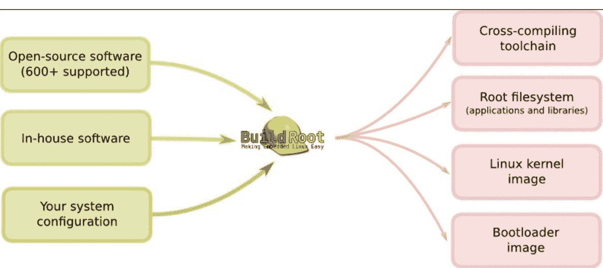

> "Buildroot 是由一家名为 Free Electrons 的法国公司部分维护的工具，该公司专注于嵌入式 Linux 开发。"

与本书中将探索的 Yocto 项目相比，Buildroot 是一种更为简单的方法。Buildroot 更多致力于固件生成，而 Yocto/OpenEmbedded 则面向发行版。Buildroot 提供 700 个配方，而 Yocto 项目则提供超过 8000 个。

## 核心组件

Yocto 项目的核心组件（其他可用工具为可选）如下：

- BitBake
- OpenEmbedded-Core
- Poky
- BSP 层（meta-raspberry、meta-fsl-arm、meta-ti、meta-intel、meta-sunxi 等）

下图显示了本书中将发现的所有层。我们将通过各种示例学习所有工具，以便更好地理解。

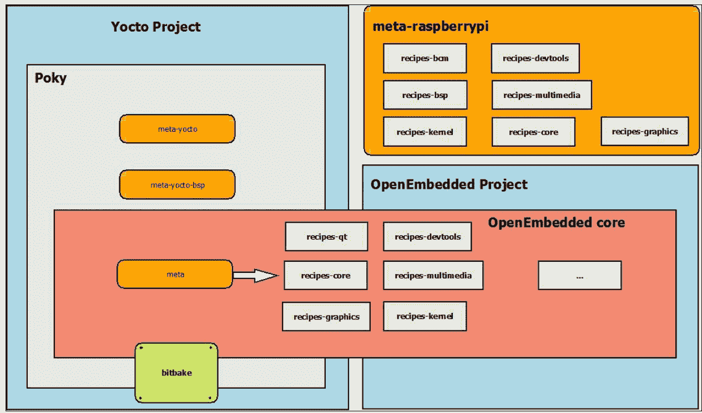

## 什么是 Poky？

Poky 是 *参考* Yocto 项目发行版。它包含 OpenEmbedded 的一些基本组件（称为构建系统）以及一组用于为多个目标创建嵌入式发行版的元数据。它与平台无关，并使用 BitBake 工具（任务调度器）、OpenEmbedded-Core 和一组默认元数据进行交叉编译，如下图所示。它提供构建和组合成千上万个分布式开源项目的机制。

Poky 构建系统有望在工业界成为参考，正如 Wind River、Intel、Montavista 和 Mentor Graphics 等行业领导者所证明的那样。

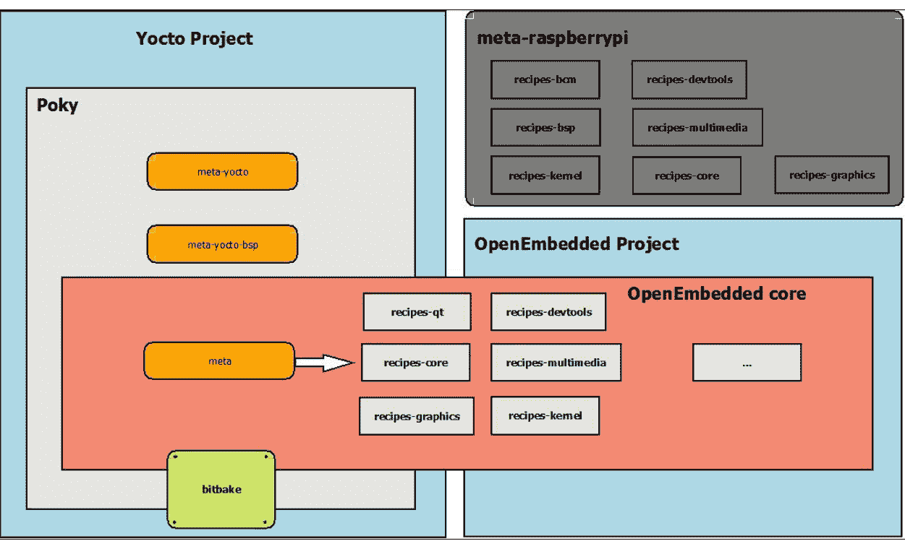

### 注意

Angstrom (http://www.angstrom-distribution.org/) 是另一种基于 OpenEmbedded-Core 的发行版。您可以将 Angstrom 和 Poky 视为近亲，因为 Poky 也是基于 OpenEmbedded-Core。

## 头号人物 - BitBake

BitBake，构建引擎，是一个任务调度器（类似于 GNU Make），用于解析多个脚本（例如 shell 和 Python）。

一旦环境构建完成，BitBake 将执行请求的任务。如果未提供任务，BitBake 将运行名为 build 的默认任务。

要运行任务，BitBake 首先会查找名为 do_<task_name> 的环境变量，该变量将包含要执行的任务代码（Python 或 shell）。因此，要编译 Yocto 配方，请使用 do_compile 变量中包含的代码。

简而言之，根据配方（或元数据）中包含的信息，它会从互联网、本地目录或版本控制系统（例如 Git）下载项目源代码，然后按动态生成的依赖图确定的顺序进行构建。最后，它安装二进制文件，生成相应的软件包，并构建最终镜像，该镜像可以安装在目标设备上（对我们来说是树莓派）。

下图显示了 BitBake 的工作原理：

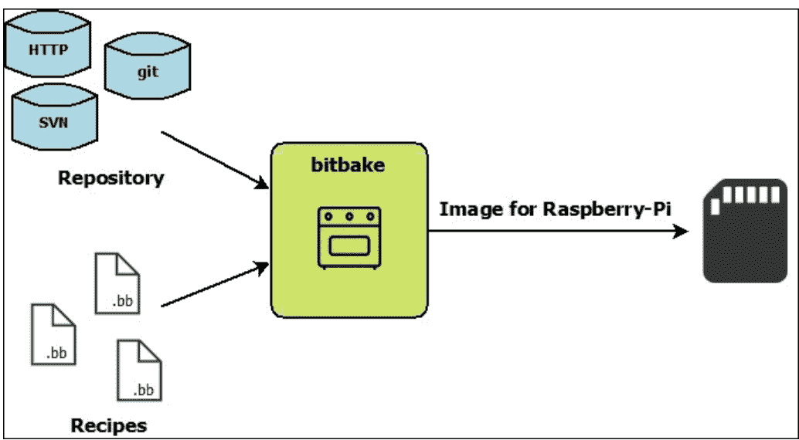

## OpenEmbedded-Core

OpenEmbedded-Core 元数据集合（下图中的 meta）提供了 Poky 构建工具的引擎。它旨在提供核心功能（多个配方）。它支持六种不同的处理器架构（ARM、x86、x86-64、PowerPC、MIPS 和 MIPS64），仅支持 QEMU 模拟的机器。

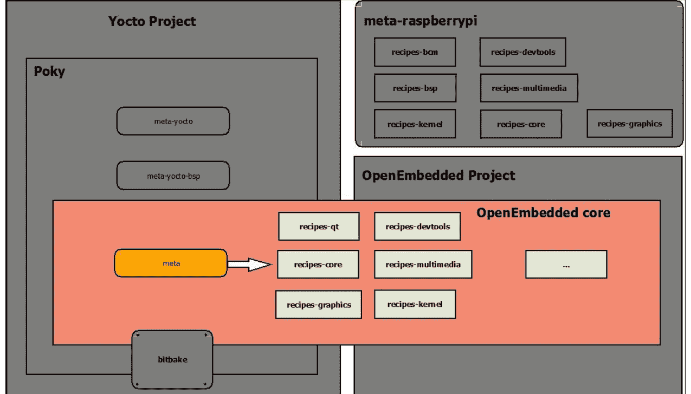

OpenEmbedded-Core 的组织结构如下：

- classes
- conf
- files
- lib
- recipes-bsp
- recipes-connectivity
- recipes-core
- recipes-devtools
- recipes-extended
- recipes-gnome
- recipes-graphics
- recipes-kernel
- recipes-lsb4
- recipes-multimedia
- recipes-qt
- recipes-rt
- recipes-sato
- recipes-support
- site
- COPYING.GPLv2
- COPYING.MIT
- recipes.txt

该层包含不同的配方，描述如何获取、配置、编译和打包应用程序及镜像。

### 注意

在本书的其余部分，我们将把此层与树莓派的 BSP 层 **meta-raspberrypi** 混合使用。

## 探索元数据

**元数据**由 Python 和 shell 脚本文本文件（.conf、.bb、.bbclass 和 .inc）混合组成，提供了一个极其灵活的系统。元数据既指构建指令本身，也指用于控制构建哪些内容以及影响如何构建的数据。元数据还包括用于指示使用哪些软件版本及其获取来源的命令和数据。Poky 使用它来扩展 OpenEmbedded-Core，并包含两个不同的层，它们是另一个元数据子集。详情如下：

- **meta-yocto**：此层提供默认和受支持的发行版、可视化品牌以及元数据跟踪信息（维护者、上游状态等）
- **meta-yocto-bsp**：此层在此基础上提供硬件参考板支持（BSP），用于 Poky

我们将在第 4 章 _了解 BitBake 工具。_ 中深入探讨元数据。


## Yocto Project - 工作流

以下图表从高层次展示了 Yocto Project 开发环境，以呈现交叉编译框架：

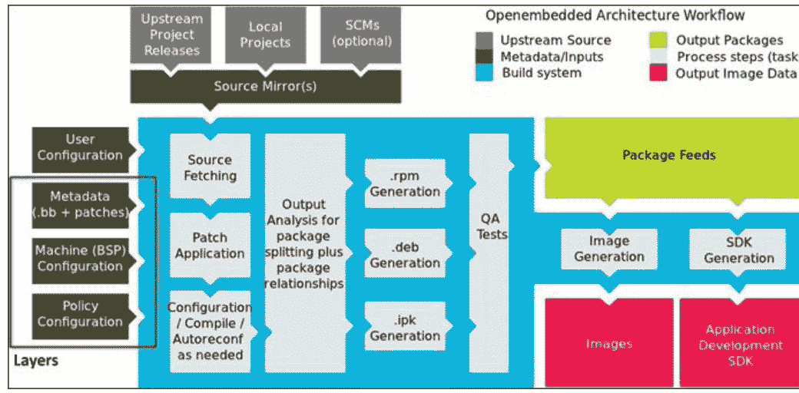

让我们来看看图中各组件代表的含义：

- 用户配置：这是你可以用来控制构建过程的元数据。
- 元数据层：这些是提供软件、机器和发行版元数据的各种层。
- 源文件：这些包含上游版本、本地项目以及源代码管理（Git、SVN 等）。
- 构建系统：这些是在 BitBake 控制下的进程。此模块详细说明了 BitBake 如何获取源文件、应用补丁、完成编译、分析输出以生成软件包、创建和测试软件包、生成镜像以及生成交叉开发工具。
- 软件包馈送：这些是包含输出软件包（RPM、DEB 或 IPK）的目录，随后用于构建系统生成的镜像或 SDK。这些馈送还可以使用 Web 服务器或其他方式复制和共享，以便在运行时扩展或更新设备上的现有镜像（前提是启用了运行时软件包管理）。
- 镜像：这些是开发过程生成的镜像（构成操作系统的各个部分，例如内核镜像、引导加载程序和根文件系统）。
- 应用程序开发 SDK：这些是与镜像一起生成或单独由 BitBake 生成的交叉开发工具。

## 摘要

本章介绍了 Yocto Project 的工作原理、构成其核心的组件（如 Poky、OpenEmbedded-Core 和 BitBake）以及它们在 Yocto Project 中的协作方式。

在下一章中，我们将通过不同的步骤来练习 Yocto Project 的工作流程，以下载、配置和准备 Poky 构建环境，以便为树莓派生成我们的第一个 Poky 镜像。

# 第 2 章 为树莓派构建我们的第一个 Poky 镜像

在本章中，我们将尝试理解 Poky 工作流程的基本概念。使用 Linux 命令行，我们将执行下载、配置和准备 Poky 树莓派环境以及生成可由目标设备使用的镜像所需的不同步骤。

## 为主机系统安装所需软件包

主机系统配置所需的步骤取决于所使用的 Linux 发行版。事实上，建议使用由 Poky 维护和支持的 Linux 发行版之一。这样可以避免在设置主机系统时浪费时间和精力。目前，Yocto Project 支持以下发行版：

- Ubuntu 12.04 (LTS)
- Ubuntu 13.10
- Ubuntu 14.04 (LTS)
- Fedora release 19 (Schrödinger's Cat)
- Fedora release 21
- CentOS release 6.4
- CentOS release 7.0
- Debian GNU/Linux 7.0 (Wheezy)
- Debian GNU/Linux 7.1 (Wheezy)
- Debian GNU/Linux 7.2 (Wheezy)
- Debian GNU/Linux 7.3 (Wheezy)
- Debian GNU/Linux 7.4 (Wheezy)
- Debian GNU/Linux 7.5 (Wheezy)
- Debian GNU/Linux 7.6 (Wheezy)
- openSUSE 12.2
- openSUSE 12.3
- openSUSE 13.1

### 注意

即使你的发行版未在此列出，也不意味着 Poky 无法工作，但结果不作保证。在本书中，你将看到关于在 Ubuntu 发行版上使用 Poky 的说明。如果你想了解支持的 Linux 发行版的更多信息，可以访问此链接：http://www.yoctoproject.org/docs/current/ref-manual/ref-manual.html。

## Poky on Ubuntu

以下列表按功能显示了在受支持的 Ubuntu 或 Debian Linux 发行版上 Poky 所需的软件包：

- 下载工具：wget 和 git-core
- 解压缩工具：unzip 和 tar
- 编译工具：gcc-multilib、build-essential 和 chrpath
- 字符串操作工具：sed 和 gawk
- 文档管理工具：texinfo、xsltproc、docbook-utils、fop、dblatex 和 xmlto
- 补丁管理工具：patch 和 diffstat

总结一下，以下是在无头系统上输入的命令：

```
$ sudo apt-get install gawk wget git-core diffstat unzip
texinfo gcc-multilib build-essential chrpath
```

## Poky on Fedora

如果你想在 Fedora 上使用 Poky，只需键入以下命令行：

```
$ sudo yum install gawk make wget tar bzip2 gzip python unzip
perl patch diffutils diffstat git cpp gcc gcc-c++ glibc-devel
texinfo chrpath ccache perl-Data-Dumper perl-Text-ParseWords
perl-Thread-Queue socat
```

## 下载 Poky 元数据

安装完所有必要软件包后，现在可以下载 Poky 的源代码了。这是通过 Git 工具完成的：

```
$ git clone git://git.yoctoproject.org/poky (branch master)
```

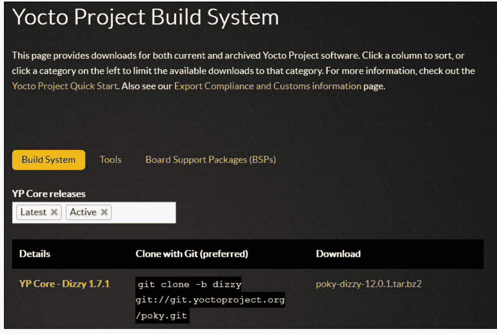

### 注意

另一种方法是直接从此仓库下载 tar.bz2 文件：https://www.yoctoproject.org/downloads

为避免所有危险和有问题的操作，强烈建议创建并切换到特定的本地分支：

```
$ cd poky
$ git checkout daisy -b work_branch
```

## 下载树莓派 BSP 元数据

此时，我们只有参考系统（Poky）的基础，而没有对 Broadcom BCM SoC 的支持。基本上，Poky 提出的 BSP 仅提供以下目标：

```
$ ls meta/conf/machine/*.conf
beaglebone.conf
edgerouter.conf
genericipx86-64.conf
genericipx86.conf
mpc8315e-rdb.conf
```

此外，还有 OE-Core 提供的：

```
$ ls meta/conf/machine/*.conf
qemuarm64.conf
qemuarm.conf
qemumips64.conf
qemumips.conf
qemuppc.conf
qemux86-64.conf
qemux86.conf
```

### 提示

下载代码包的详细步骤在本书的前言中有说明。请查看。本书的代码包也托管在 GitHub 上：https://github.com/PacktPublishing/Yocto-for-Raspberry-Pi。我们还从丰富的图书和视频目录中提供其他代码包，可在 https://github.com/PacktPublishing/ 上查看。去看看吧！

为了为我们的目标生成兼容系统，我们将在这个阶段花费更多时间，并下载特定的层（BSP Layer）到树莓派：

```
$ git clone git://git.yoctoproject.org/meta-raspberrypi
```

### 提示

如果你想了解更多关于 git scm 的信息，可以访问官方网站：http://git-scm.com/

- bitbake
- documentation
- meta
- meta-oe
- meta-raspberrypi
- meta-selftest
- meta-skeleton
- meta-yocto
- meta-yocto-bsp
- rpi-build
- scripts
- LICENSE
- oe-init-build-env
- oe-init-build-env-memres
- README
- README.hardware

现在，我们可以验证我们是否拥有平台的配置 **元数据**（raspberrypi.conf 文件）：

```
$ ls meta-raspberrypi/conf/machine/*.conf
raspberrypi.conf
```

以下截图显示了 meta-raspberrypi 文件夹：

- classes
- conf
- files
- recipes-bcm
- recipes-bsp
- recipes-core
- recipes-devtools
- recipes-graphics
- recipes-kernel
- recipes-multimedia
- COPYING.MIT
- README
- rpi.patch

本章和以下章节中展示的示例和代码使用的是 Yocto Project 版本 1.7 和 Poky 版本 12.0。作为参考，代号是 Dizzy。

既然我们已经全新下载了环境，现在可以继续初始化环境，并通过各种配置文件配置我们的镜像。

## oe-init-build-env 脚本

如倒数第二张截图所示，Poky 目录包含一个名为 oe-init-build-env 的脚本。这是一个用于构建环境配置/初始化的脚本。它不是为了直接执行，而必须通过 source 加载。它的工作（其中之一）是初始化若干环境变量，并将自身置于参数中指定的构建目录中。脚本必须按以下方式运行：

```
$ source oe-init-build-env [build-directory]
```

在这里，build-directory 是设置环境的目录名称的可选参数（例如，我们可以在单个 Poky 源代码树中使用多个构建目录）。如果未指定，则默认为 build。build-directory 文件夹是我们执行构建的地方。但是，为了标准化步骤，我们将在整本书中使用以下命令来初始化环境：

```
$ source oe-init-build-env rpi-build
### Shell environment set up for builds. ###
You can now run 'bitbake <target>'
Common targets are:
core-image-minimal
core-image-sato
meta-toolchain
adt-installer
meta-ide-support
You can also run generated qemu images with a command like
'runqemu qemux86'
```

当我们初始化构建环境时，它会在 rpi-build 内创建一个目录（conf 目录）。该文件夹包含两个重要文件：

- local.conf：这包含用于配置 Bitbake 行为的参数。
- bblayers.conf：这列出了 Bitbake 在其实现中考虑的不同层。
- 列表分配给 BBLayers 变量。


## 编辑 local.conf 文件

rpi-build/conf/local.conf 文件是一个可以配置构建过程各个方面的文件。正是通过此文件，我们可以选择目标机器（MACHINE 变量）、发行版（DISTRO 变量）、包类型（PACKAGE_CLASSES 变量）以及主机配置（例如 PARALLEL_MAKE）。我们需要从默认值中更改的最小变量集如下：

```
BB_NUMBER_THREADS ?= "${@oe.utils.cpu_count()}"
PARALLEL_MAKE ?= "-j ${@oe.utils.cpu_count()}"
MACHINE ?= "raspberrypi"
```

BB_NUMBER_THREADS 变量决定 BitBake 将并行执行的任务数量（这些是在 Yocto 下的任务；我们不一定在谈论编译）。默认情况下，在 build/conf/local.conf 中，该变量初始化为 ${@oe.utils.cpu_count()}，对应于主机系统上检测到的核心数量（/proc/cpuinfo）。

PARALLEL_MAKE 变量对应于 make 的 -j 选项，用于指定 GNU Make 在编译任务中可以并行运行的进程数量。同样，可用核心数量定义了所使用的默认值。

MACHINE 变量是我们确定要为 Raspberry Pi 构建的目标机器的地方（在 .conf 文件中定义；在我们的案例中，它是 raspberrypi.conf）。

## 编辑 bblayers.conf 文件

现在我们仍然需要将特定层添加到我们的目标中。这将使来自该层的配方可用于我们的构建。因此，我们应该编辑 build/conf/bblayers.conf 文件：

```
# LAYER_CONF_VERSION is increased each time build/conf
#bblayers.conf
# changes incompatibly
LCONF_VERSION = "6" BBPATH = "${TOPDIR}" BBFILES ?= ""
BBLAYERS ?= " \
/home/packt/RASPBERRYPI/poky/meta \
/home/packt/RASPBERRYPI/poky/meta-yocto \
/home/packt/RASPBERRYPI/poky/meta-yocto-bsp \
"BBLAYERS_NON_REMOVABLE ?= " \
/home/packt/RASPBERRYPI/poky/meta \
/home/packt/RASPBERRYPI/poky/meta-yocto \
"
```

添加以下行：

```
# LAYER_CONF_VERSION is increased each time build/conf
#bblayers.conf
# changes incompatibly
LCONF_VERSION = "6" BBPATH = "${TOPDIR}" BBFILES ?= ""
BBLAYERS ?= " \
/home/packt/RASPBERRYPI/poky/meta \
/home/packt/RASPBERRYPI/poky/meta-yocto \
/home/packt/RASPBERRYPI/poky/meta-yocto-bsp \
/home/packt/RASPBERRYPI/poky/meta-raspberrypi \
"BBLAYERS_NON_REMOVABLE ?= " \
/home/packt/RASPBERRYPI/poky/meta \
/home/packt/RASPBERRYPI/poky/meta-yocto \
"
```

当然，您需要根据自己的安装情况调整绝对路径（此处为 /home/packt/RASPBERRYPI）。

## 构建 Poky 镜像

在开发的这个阶段，让我们来看看可用且经过认证适用于我们平台的镜像（.bb 文件）。

## 镜像选择

Poky 提供了几种预先设计的镜像配方，我们可以使用它们来构建自己的二进制镜像。我们可以通过从 poky 目录运行以下命令来查看可用镜像的列表：

```
$ ls meta*/recipes*/images/*.bb
```

所有配方提供的镜像本质上是已解包和配置的包集合，生成可用于实际硬件的文件系统（有关不同镜像的更多信息，您可以访问 ( http://www.yoctoproject.org/docs/latest/mega-manual/mega-manual.html#ref-images ) ）。

接下来，这是可用镜像的简要表示：

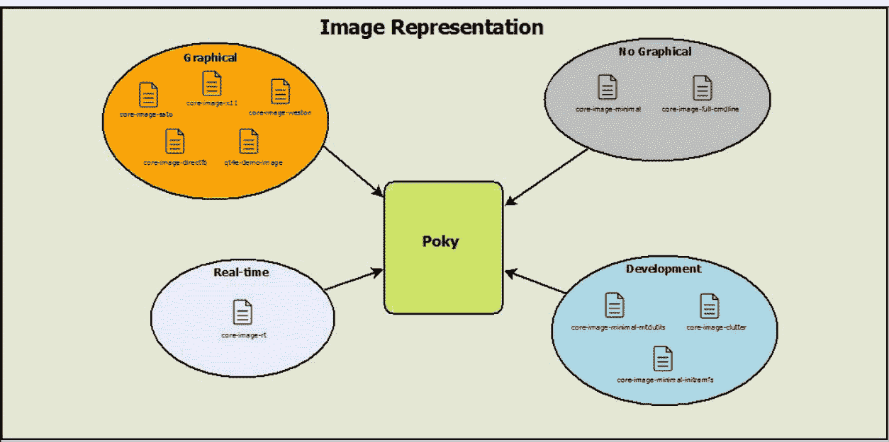

我们可以将 meta-raspberrypi 提议的层添加到所有这些层中：

```
$ ls meta-raspberrypi/recipes-core/images/*.bb
rpi-basic-image.bb
rpi-hwup-image.bb
rpi-test-image.bb
```

- rpi-hwup-image.bb：这是一个基于 core-image-minimal 的镜像。
- rpi-basic-image.bb：这是一个基于 rpi-hwup-image.bb 并添加了一些功能（启动画面）的镜像。
- rpi-test-image.bb：这是一个基于 rpi-basic-image.bb 并包含 meta-raspberrypi 中的一些包的镜像。

在本章的其余部分，我们将从这三个配方中选择一个。请注意，这些文件（.bb）像所有其他文件一样描述配方。它们逻辑地组织，在这里，我们拥有用于为 Raspberry Pi 创建镜像的配方。

## 运行 BitBake

此时，我们需要启动 **BitBake**，即构建引擎，它将解析包含您作为参数传递的镜像的所有配方（在我们的第一个示例中，我们可以使用 `rpi-basic-image`）：

```
$ bitbake rpi-basic-image
```

```
Loading cache: 100%
|###############################################################################|
#################################################################################
###| ETA:  00:00:00
########################################
Loaded 1352 entries from dependency cache.
NOTE: Resolving any missing task queue dependencies
Build Configuration:
BB_VERSION = "1.25.0"
BUILD_SYS = "x86_64-linux"
NATIVELSBSTRING = "Ubuntu-14.04"
TARGET_SYS = "arm-poky-linux-gnueabi"
MACHINE = "raspberrypi"
DISTRO = "poky"
DISTRO_VERSION = "1.7"
TUNE_FEATURES = "arm armv6 vfp"
TARGET_FPU = "vfp"
meta
meta-yocto
meta-yocto-bsp =
"master:08d3f44d784e06f461b7d83ae9262566f1cf09e4"
meta-raspberrypi =
"master:6c6f44136f7e1c97bc45be118a48bd9b1fef1072"
NOTE: Preparing RunQueue
NOTE: Executing SetScene Tasks
NOTE: Executing RunQueue Tasks
```

启动后，Bitbake 首先浏览环境提供的所有文件（`.bb`, `.bbclass`）并将信息存储在缓存中。

虽然 Bitbake 的解析器是并行化的，但第一次执行总是会更长一些（只多几秒钟），因为它需要构建缓存。然而，后续执行将几乎是瞬间完成的，因为 Bitbake 加载缓存。从前面的命令可以看到，在执行任务列表之前，Bitbake 显示了详细的版本跟踪（目标、版本、操作系统等等）。最后，Bitbake 开始执行任务并显示进度。

根据您的设置，您可以去喝杯咖啡，甚至吃些披萨。通常，在此之后，如果一切顺利，您会很高兴地发现 `tmp/` 子目录的目录结构（`rpi-build`）通常已被填充。构建目录（`rpi-build`）在镜像创建后包含大约 20 GB 的数据。

经过几个小时的构建后，我们可以为结果和我们目标的系统镜像的创建而欢欣鼓舞：

```
$ ls rpi-build/tmp/deploy/images/raspberrypi/*sdimg
rpi-basic-image-raspberrypi.rpi-sdimg
```

正是这个文件将用于创建我们的可启动 SD 卡。

## 创建 SD 卡

现在您的环境已准备就绪，您可以使用以下命令创建 SD 卡（请记住将 /dev/sdX 改为正确的设备名称，并小心不要选择错误的设备名称而损坏硬盘）：

```
$ sudo dd if=rpi-basic-image-raspberrypi.rpi-sdimg of=/dev/sdX
bs=1M
```

复制完成后，您可以使用以下命令检查操作是否成功（参见 mmcblk0）：

```
$ lsblk
NAME        MAJ:MIN RM   SIZE RO TYPE MOUNTPOINT
mmcblk0     179:0    0   3,7G  0 disk
├─mmcblk0p1 179:1    0    20M  0 part
/media/packt/raspberrypi
└─mmcblk0p2 179:2    0   108M  0 part /media/packt/f075d6df-d8b8-4e85-a2e4-36f3d40035c3c
```

您还可以查看界面左侧：


## 在 Raspberry Pi 上启动镜像

我们现在来到了本章无疑最令人期待的时刻：使用全新的 Poky 镜像启动我们的 Raspberry Pi 的时刻。

您只需将 SD 卡插入插槽，将 HDMI 电缆连接到显示器，并连接电源（还建议使用鼠标和键盘来关闭设备，除非您计划直接拔掉电源并可能损坏引导分区）。

连接电源后，您应该会看到 Raspberry Pi 启动画面：

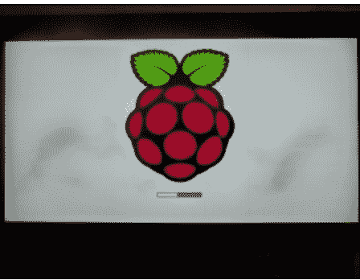

### 注意

Yocto/Poky 发行版的登录用户是 root。


## 摘要

在本章中，我们学习了设置 Poky 并构建第一个镜像所需的步骤。我们在 Raspberry Pi 上运行了该镜像，从而很好地了解了可用功能。

在下一章中，您将了解 Hob，它为 BitBake 提供了人性化的界面。我们将使用它来构建镜像并进一步自定义。之后，您将了解另一种工具 Toaster，它是 BitBake 的 Web 界面。

# 第 3 章 掌握使用 Hob 和 Toaster 的构建

在本章中，我们将探讨 Yocto Project 中包含的两个强大工具。在本章的第一部分，我们将讨论 Hob，它是 BitBake 的图形界面。在第二部分，我们将使用 Toaster，这是一个 Web 界面，使您可以使用简单的浏览器（例如 Firefox）跟进构建的高级部分。

## Hob

为了探索 Hob，我们将在本节中梳理其正常运行所需的不同基本步骤。

## 为 Hob 准备环境

与第 2 章《为 Raspberry Pi 构建我们的第一个 Poky 镜像》一样，第一步是初始化环境。回忆此命令：

```
$ source oe-init-build-env rpi-build
```

启动命令后，终端将重定向到 rpi-build 目录。

## 运行 Hob

现在我们已初始化构建所需的所有变量，可以使用以下命令启动 Hob 界面：

```
$ hob
```

运行此命令后，Hob 将尝试解析配置文件（local.conf 和 bblayers.conf），以查找可用于创建镜像的元数据。完成此步骤后，您将看到界面启动屏幕，如下所示：

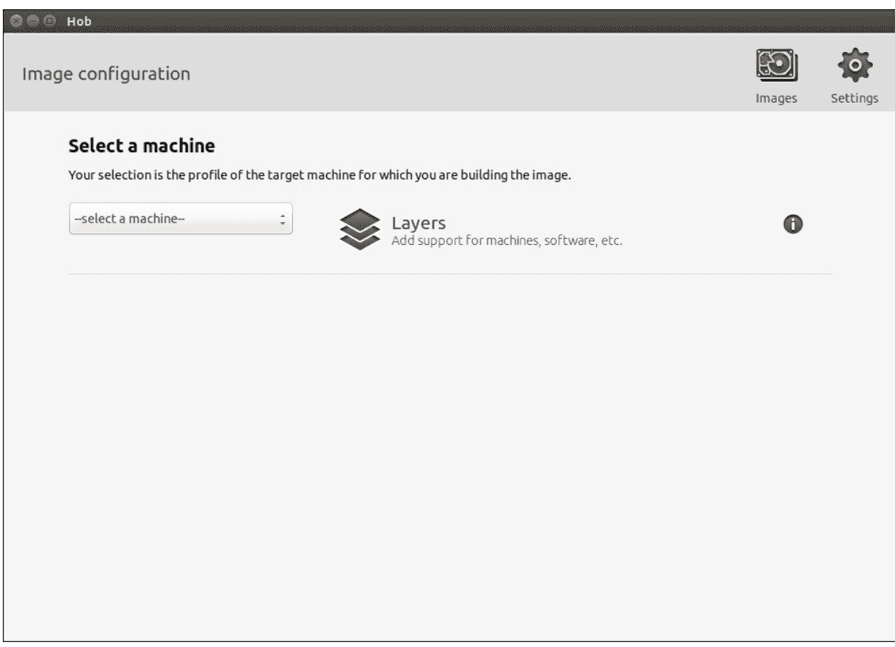

现在，我们可以从 Hob 提供的列表中选择所需的机器。选择 **raspberrypi** 机器。

> **注意**
> 您选择的机器选项对应于 `local.conf` 文件中的 `MACHINE` 变量。

您将看到以下进度屏幕：

### 选择机器

您的选择是您正在为其构建镜像的目标机器的配置文件。

raspberrypi

图层 为机器、软件等添加支持。

填充配方 停止

添加层非常简单。我们只需单击 Layers 按钮，如本屏幕截图所示：

### 镜像配置

#### 选择机器

您的选择是您正在为其构建镜像的目标机器的配置文件。

raspberrypi

图层 为机器、软件等添加支持。

#### 选择镜像配方

镜像配方是您想要的镜像类型的起点。您可以按原样构建它们，也可以编辑它们以满足您的需求。

--选择一个镜像配方--

+   # 图层
+   不可移除 /home/pjtexier/Documents/RASPBERRYPI/BSP/poky/meta
+   不可移除 /home/pjtexier/Documents/RASPBERRYPI/BSP/poky/meta-yocto
+   /home/pjtexier/Documents/RASPBERRYPI/BSP/poky/meta-yocto-bsp [X]
+   /home/pjtexier/Documents/RASPBERRYPI/BSP/poky/meta-oe/meta-multimedia [X]
+   /home/pjtexier/Documents/RASPBERRYPI/BSP/poky/meta-raspberrypi [X]
+   + 添加图层
+   [取消] [OK]

选择目标机器后，我们需要选择要创建的镜像。

像在 <u>第 2 章</u>、《为 Raspberry Pi 构建我们的第一个 Poky 镜像》中一样，我们将为示例选择 **rpi-basic-image**：

一个小镜像，仅足以允许设备启动。

下一步（如果您想修改默认配置）是通过单击 Advanced configuration 选择高级配置选项，如以下两个屏幕截图所示。这些选项可能是镜像类型（例如 cpio.gz、ext2.bz2 和 ext3.gz）或软件包格式（IPK、DEB 或 RPM）。

#### 选择机器

+   - raspberrypi


#### 选择镜像配方

+   - rpi-basic-image

一个小镜像，仅足以允许设备启动。


#### 高级配置

+   - btrfs
+   - cpio
+   - cpio.gz
+   - cpio.lz4
+   - cpio.lzma
+   - cpio.xz
+   - cramfs
+   - elf
+   - ext2
+   - ext2.bz2
+   - ext2.gz
+   - ext2.lzma
+   - ext3
+   - ext3.gz
+   - hddimg
+   - iso
+   - jffs2
+   - jffs2.sum
+   - squashfs
+   - squashfs-lzo
+   - squashfs-xz
+   - tar
+   - tar.bz2
+   - tar.gz
+   - tar.lz4
+   - tar.xz
+   - ubi
+   - ubifs
+   - vmdk

+   - 镜像类型
+   - 输出

##### 软件包格式

根文件系统软件包格式

+   - ipk

##### 其他软件包格式

+   - deb
+   - rpm

##### 镜像大小

镜像基本大小（MB）

+   - 64

其他可用空间（MB）

+   - 0

##### 许可

+   - 排除 GPLv3 软件包

##### SDK

+   - 填充 SDK
+   - x86_64

+   - 取消
+   - 保存

+   - 编辑镜像配方
+   - 构建镜像

此时，我们可以通过单击 **构建镜像** 按钮构建最终镜像。如果要修改镜像的配方，只需单击 **编辑镜像配方** 按钮。

### 配置配方和软件包

您可以在以下屏幕截图中查看 Hob 中包含的配方列表：

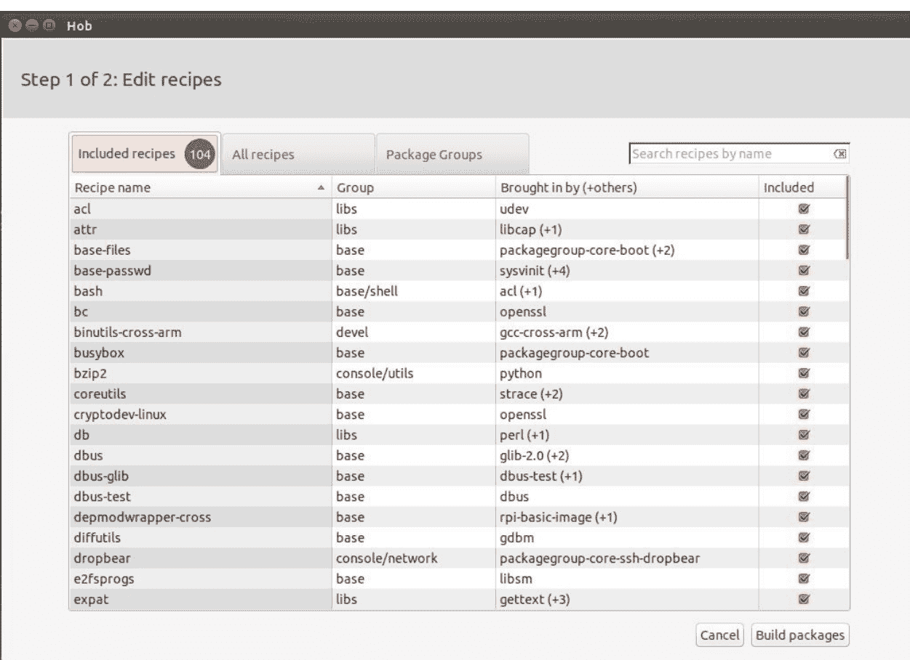

如您所见，通过选择或取消选择它们，可以轻松添加或删除用于配置镜像的配方。如果单击配方名称，可以查看其版本和许可证等详细信息。下一步是单击 **构建软件包** 按钮。完成此操作后，您将看到以下屏幕：

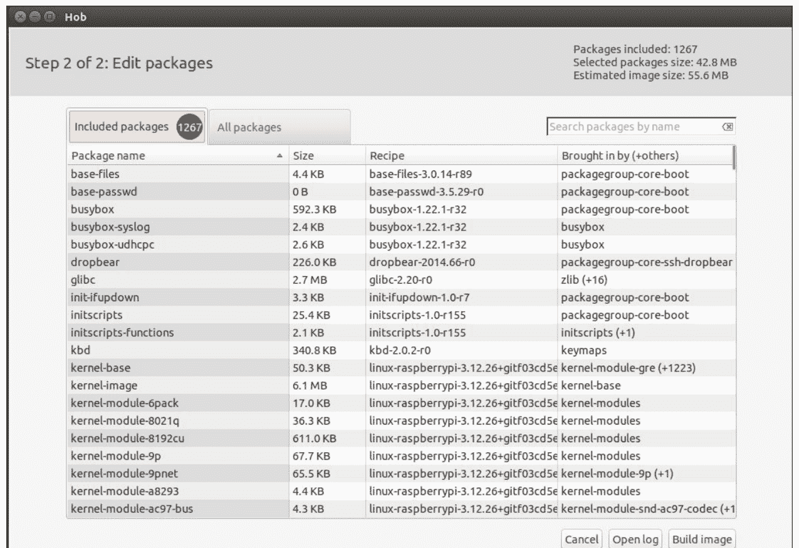

在这里，您将看到所选软件包的列表，并可以了解预计镜像大小的值（在右上角），并决定删除一些应用程序以生成更小的镜像。您还可以查看所选软件包的数量和大小。

> **注意**
> BitBake 将解析所选软件包的所有依赖项，包括任何所需的其他软件包。

### 构建镜像

正如您所想象的，最后一步是构建我们的镜像（通过单击 **构建镜像**）。Hob 会跟踪构建进度，如本屏幕截图所示：

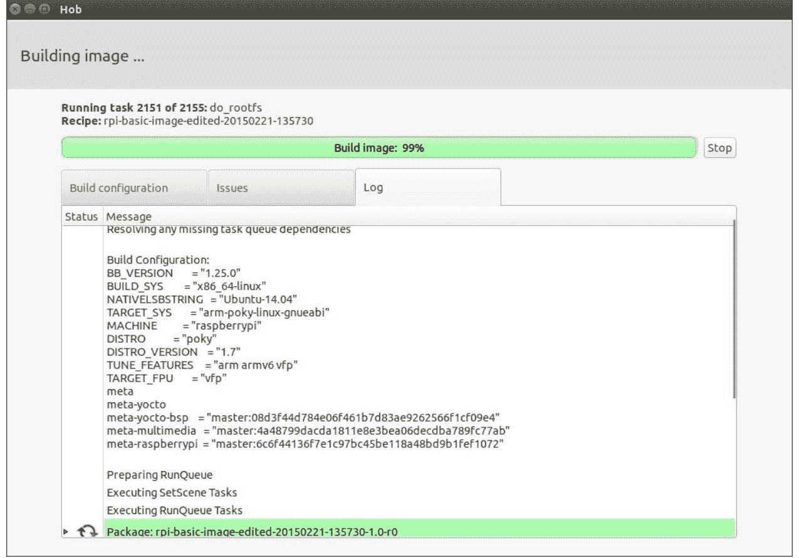

构建完成后，您将看到此屏幕：

### 镜像详细信息

您的镜像已就绪

+   名称: rpi-basic-image-edited-20150221-135730-raspberrypi-20150221125730
+   创建的文件: ext3, tar.bz2
+   目录: /home/pjtexier/Documents/RASPBERRYPI/BSP/poky/rpi-build/tmp/deploy/images/raspberrypi
+   机器: raspberrypi
+   镜像配方: rpi-basic-image (edited)
+   层:
+   - /home/pjtexier/Documents/RASPBERRYPI/BSP/poky/meta
+   - /home/pjtexier/Documents/RASPBERRYPI/BSP/poky/meta-yocto
+   - /home/pjtexier/Documents/RASPBERRYPI/BSP/poky/meta-yocto-bsp
+   - /home/pjtexier/Documents/RASPBERRYPI/BSP/poky/meta-oe/meta-multimedia
+   - /home/pjtexier/Documents/RASPBERRYPI/BSP/poky/meta-raspberrypi
+   包含的软件包: 1267
+   总镜像大小: 16.1 MB

在此屏幕上，Hob 显示构建摘要。可以转到生成文件的目录（rpi-build/tmp/deploy/images/raspberrypi/），您也可以查看构建过程的日志。

之后，我们可以使用 Hob 镜像为 Raspberry Pi 创建可启动的 SD 卡：

```
$ sudo dd if=rpi-basic-image-edited-20150221-135730-raspberrypi.rpi-sdimg of=/dev/sdX bs=1M
```

此时，我们只需将 SD 卡插入 Raspberry Pi，开启开发板，然后开始使用它。


## 探索 Toaster

Toaster 是 BitBake 的 Web 界面。Yocto 项目网站对此的描述如下：

> "Toaster 是 OpenEmbedded 构建系统的应用程序编程接口 (API) 和基于 Web 的界面，该系统使用 BitBake。目前，Toaster 收集并展示有关您构建的信息，您可以使用 Web 浏览器进行导航和查询"

## 在主机系统上安装所需的软件包

为了在首选的 Linux 发行版上正确使用 Toaster，您需要安装 Django 和 South：

```
$ sudo pip install django==1.6
$ sudo pip install South==0.8.4
```

### 注意

pip 命令使安装 Python 模块变得容易，就像在 Linux 发行版中安装软件包一样。

## 运行 Toaster

既然我们的系统已准备好使用 Toaster，我们只需使用以下命令来启动服务：

```
$ source toaster start
```

这将产生以下输出：

```
The system will start. Syncing... Creating tables ... Installing custom SQL ... Installing indexes ... Installed 0 object(s) from 0 fixture(s) Synced: > django.contrib.staticfiles > django.contrib.humanize > south Not synced (use migrations): - orm - bldcontrol (use ./manage.py migrate to migrate these) Running migrations for orm: - Nothing to migrate. - Loading initial data for orm. Installed 0 object(s) from 0 fixture(s) Starting webserver Webserver address: http://0.0.0.0:8000/ Bitbake server address: 0.0.0.0, server port: 54693 Successful start.
```

我们现在可以通过 http://0.0.0.0:8000/ 访问我们的 Web 界面。

## 运行 BitBake

目前，Toaster 不支持通过界面进行配置（未来版本的 Toaster 将添加构建运行和构建自定义功能）。Toaster 收集并展示有关您构建的信息，您可以使用 Web 浏览器进行导航和查询。因此，我们必须手动启动 BitBake 来监控构建进度。如 [第 2 章，为树莓派构建我们的第一个 Poky 镜像] 中所示，我们可以使用以下命令启动构建过程：

```
$ bitbake rpi-basic-image
```

构建过程将按以下方式进行：

```
Loading cache: 100%
|###############################################################################
###############################################################################
###############################################################################
| ETA:  00:00:00 Loaded 1352 entries from dependency cache. NOTE: Resolving any missing task queue dependencies Build Configuration: BB_VERSION        = "1.25.0"
BUILD_SYS           = "x86_64-linux" NATIVELSBSTRING         = "Ubuntu-14.04" TARGET_SYS = "arm-poky-linux-gnueabi" MACHINE                       = "raspberrypi" DISTRO        = "poky" DISTRO_VERSION      = "1.7" TUNE_FEATURES         = "arm armv6 vfp" TARGET_FPU        = "vfp" meta                = meta-yocto         meta-yocto-bsp        = "master:08d3f44d784e06f461b7d83ae9262566f1cf09e4" meta-raspberrypi     = "master:6c6f44136f7e1c97bc45be118a48bd9b1fef1072" NOTE: Preparing RunQueue NOTE: Executing SetScene Tasks NOTE: Executing RunQueue Tasks
```

## 运行 Web 界面

既然我们已启动 BitBake，可以监控该过程（构建过程）的进度，如以下屏幕截图所示。请注意，打开 Toaster 界面的最佳方法是导航至该界面（使用超链接）。

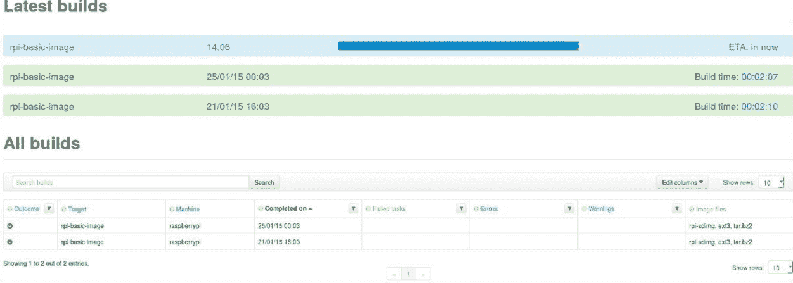

Toaster 仍处于开发阶段；它很可能成为 Hob 的一个可靠替代品。的确，开发团队希望通过 Web 界面使 BitBake 完全可配置。

## 摘要

在本章中，我们了解了如何使用 Hob 和 Toaster 等用户友好的界面。我们了解了这些工具的不同功能（配置和功能）。值得注意的是，这些工具为开发团队提供了更好的灵活性。

在下一章中，我们将了解 BitBake 在 Yocto 项目中发挥的主要作用。我们将发现使我们能够为镜像生成软件包的不同任务。

# 第 4 章 了解 BitBake

在本章中，我们将首先探索 Poky 使用的元数据（基本概念）和配方（它们之间的依赖关系）。然后，我们将了解 BitBake 下载源代码的不同方式。我们将通过介绍 BitBake 用于创建根文件系统镜像的任务来结束本章。

## BitBake

如前所述，在第 1 章 *了解 Yocto 项目* 中，**BitBake** 是一个任务调度程序（类似于 GNU Make），用于解析 shell 和 Python 脚本。解析的代码生成并运行任务（配置、编译等），这些任务本质上是根据代码依赖关系排序的步骤集合。

以下是直接摘自 BitBake 用户手册的要点：

- BitBake 根据提供的元数据执行任务，这些元数据构建了任务。元数据存储在配方（.bb）、配置（.conf）和类（.bbclass）文件中，并为 BitBake 提供关于要运行哪些任务以及这些任务之间依赖关系的说明。
- BitBake 包含一个获取库，用于从各种地方获取源代码，例如源代码控制系统或网站。
- 要构建的每个单元（例如一段软件）的说明称为配方文件，并包含有关该单元的所有信息（依赖关系、源文件位置、校验和、描述等）。
- BitBake 包含一个客户端/服务器抽象，可以从命令行使用或作为 XMLRPC 服务使用，并且具有多种不同的用户界面。

### 元数据

BitBake 使用的元数据可以有几种不同的形式，如下所示：

- 配置（.conf）文件
- 配方（.bb 和 .bbappend 文件）
- 类（.bbclass 文件）
- 包含（.inc）文件

### 配置

以 .conf 扩展名表示的配置文件定义了管理项目构建过程的各种配置变量。这些文件分为几个区域，分别定义机器配置选项、发行版配置选项、编译器调优选项、常规通用配置选项和用户配置选项。

### 类

以 .bbclass 扩展名表示的类文件包含在元数据文件之间共享很有用的信息。BitBake 源代码树目前附带一个名为 base.bbclass 的类元数据文件。您可以在 classes 目录中找到此文件。base.bbclass 文件很特殊，因为它始终自动包含于所有配方和类中。此类包含标准基本任务的定义，例如获取、解包、配置（默认为空）、编译（运行任何现有 makefile）、安装（默认为空）和打包（默认为空）。这些任务在项目开发过程中通常由其他类重写或扩展。

### 配方

BitBake 配方（以 .bb 文件扩展名表示，例如 bcm2835_1.38.bb）是最基本的元数据文件。这些配方文件为 BitBake 提供以下信息：

- 关于软件包的描述性信息
- 配方的版本
- 现有依赖项
- 源代码所在位置
- 源代码是否需要任何补丁
- 如何编译源代码
- 在目标机器上安装正在编译的软件包的位置

## 解析元数据

BitBake 做的第一件事是解析基础配置元数据（.conf 文件）。基础配置元数据包括 `bblayers.conf` 文件（用于确定 BitBake 需要识别哪些层）、所有必要的 `layer.conf` 文件（每个层一个）以及 `bitbake.conf`。数据本身具有多种类型：

- 配方：包含有关特定软件片段的详细信息。
- 类数据：提供常见构建信息的抽象（例如，如何构建 Linux 内核）。
- 配置数据：提供特定于机器的设置、策略决策等。配置数据充当将一切联系在一起的粘合剂。

`layer.conf` 文件用于构建 BBPATH 和 BBFILES 等关键变量。BBPATH 用于分别在 `conf/` 和 `class/` 目录下搜索配置文件和类文件。BBFILES 用于查找配方文件（.bb 和 .bbappend）。如果没有 `bblayers.conf` 文件，则假设用户已直接在环境中设置 BBPATH 和 BBFILES 变量。

接下来，将使用刚刚构建的 BBPATH 变量搜索 `bitbake.conf` 文件。`bitbake.conf` 文件还可以使用 `include` 或 `require` 指令包含其他配置文件。


## Preferences and providers

## 首选项和提供者

Once BitBake has realized the "parsing" step (analyzing all the recipes), it must know how to build the target. It starts by looking through the PROVIDES variable set in the recipe files. The default PROVIDES value for a recipe is its name (PN).

一旦 BitBake 完成“解析”步骤（分析所有配方），就必须知道如何构建目标。它首先会查看配方文件中设置的 PROVIDES 变量。配方的默认 PROVIDES 值为其名称（PN）。

### Note

### 注意

PN represents the name of the recipe; PR, the revision of the recipe; and PV, the version of the recipe. For example, when using the recipe rpi-gpio_0.5.9.bb, here is what the values will be:

PN 表示配方名称；PR 表示配方的修订版本；PV 表示配方的版本。例如，使用配方 rpi-gpio_0.5.9.bb 时，值如下：

```
${PN} = rpi-gpio
${PV} = 0.5.9
```

Sometimes, a target might have multiple providers. A common example is virtual/kernel, which is provided by each kernel recipe (check out meta-raspberrypi/tree/master/recipes-kernel/linux for further information). Each machine often selects the best kernel provider by using a line similar to the following in the machine configuration file. If we look into this following file (meta-raspberrypi/conf/machine/include/rpi-default-providers.inc), we can see some variables:

有时，目标可能有多个提供者。常见示例是 virtual/kernel，由每个内核配方 提供（有关更多信息，请查看 meta-raspberrypi/tree/master/recipes-kernel/linux）。每台机器通常在机器配置文件中使用类似于以下的一行来选择最佳内核提供者。如果我们查看以下文件（meta-raspberrypi/conf/machine/include/rpi-default-providers.inc），可以看到一些变量：

```
# RaspberryPi BSP default providers
PREFERRED_PROVIDER_virtual/kernel = "linux-raspberrypi"
PREFERRED_PROVIDER_u-boot = "u-boot-rpi"
```

In this case, we have selected the required U-Boot version and kernel for our Raspberry Pi.

在此示例中，我们为 Raspberry Pi 选择了所需的 U-Boot 版本和内核。

## Dependencies

## 依赖项

In order to satisfy dependencies, the recipes must declare what they need to have available during the build process.

为满足依赖项，配方必须声明在构建过程中需要可用的内容。

BitBake uses a special mechanism that allows us to list the build-time dependencies and then checks whether all of the rules are satisfied before the build step. For example, if you work with canutils (http://pengutronix.de/software/socket-can/download/canutils/), you have to set this following variable:

BitBake 使用一种特殊机制，允许我们列出构建时依赖项，然后在构建步骤前检查所有规则是否满足。例如，如果您使用 canutils（http://pengutronix.de/software/socket-can/download/canutils/），则必须设置以下变量：

```
DEPENDS = "libsocketcan"
```

In this example, **CANUTILS** needs libsocketcan; therefore, BitBake will start by building the libsocketcan package (and installing the headers into rootfs) before building canutils and linking.

在此示例中，**CANUTILS** 需要 libsocketcan；因此，BitBake 将在构建 canutils 并进行链接之前，先构建 libsocketcan 包（并将头文件安装到 rootfs）。

When an application depends on something to run, it is called a runtime dependency (these are packages necessary on the target in order to guarantee proper functioning). In this case, we don't need to set the DEPENDS variable but the RDEPENDS variable in a recipe in order to inform BitBake.

当应用程序运行时依赖于某物时，这称为运行时依赖项（这些是目标上保证正常运行所必需的包）。在这种情况下，我们不需要在配方中设置 DEPENDS 变量，而是需要设置 RDEPENDS 变量，以告知 BitBake。

## Fetching

## 获取

The mechanism used by BitBake to fetch source code is internally called the **fetcher backend**. There are several fetcher backends supported, which can be configured to align user requirements and optimize source code fetching.

BitBake 用于获取源代码的机制在内部称为 **fetcher 后端**。支持多个 fetcher 后端，可配置以满足用户要求并优化源代码获取。

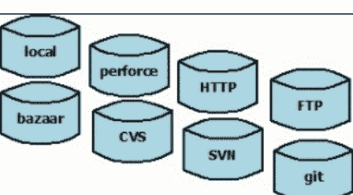

BitBake supports several protocols for remote file downloads. The most commonly used are http://, https://, and git://. When BitBake executes the do_fetch task in a recipe, it checks the contents of SRC_URI. We will discover, through the various fetchers, how to proceed based on our need.

BitBake 支持多种用于远程文件下载的协议。最常用的是 http://、https:// 和 git://。当 BitBake 在配方中执行 do_fetch 任务时，它会检查 SRC_URI 的内容。我们将通过各种 fetcher 了解如何根据需求进行操作。

### The local file fetcher

### 本地文件 fetcher

The local file fetcher submodule handles URLs that begin with `file://`. The filename you specify within the URL can either be an absolute or relative path to a file. For example, with a file called `my_source_file.c`, we must write the `SRC_URI` attribute's content like this:

本地文件 fetcher 子模块处理以 `file://` 开头的 URL。URL 中指定的文件名可以是文件的绝对路径或相对路径。例如，对于名为 `my_source_file.c` 的文件，必须将 `SRC_URI` 属性的内容写成如下形式：

```
SRC_URI = "file://my_source_file.c"
```

### The HTTP fetcher

### HTTP fetcher

The HTTP fetcher obtains files from web servers. Internally, the fetcher uses the wget utility.

HTTP fetcher 从 Web 服务器获取文件。在内部，fetcher 使用 wget 实用程序。

In this example, we will use the bcm2835 library. With this submodule, we will retrieve the tar.gz file of this library:

在此示例中，我们将使用 bcm2835 库。使用此子模块，我们将检索该库的 tar.gz 文件：

```
SRC_URI = "http://www.open.com.au/mikem/bcm2835/bcm2835-${PV}.tar.gz"
```

### The Git fetcher

### Git fetcher

One of the most commonly used source control management systems in use is Git. BitBake has solid support for it, and the Git backend is used when the do_fetch task is run and finds a git:// URL at the SRC_URI variable. Here is an example featuring a utility developed by Christophe Blaess. It is a simple command-line tool to help with the use of Linux spidev devices.

Git 是当前最常用的源代码管理系统之一。BitBake 对其提供强大支持，当运行 do_fetch 任务并在 SRC_URI 变量中找到 git:// URL 时，将使用 Git 后端。以下示例展示了 Christophe Blaess 开发的一个实用程序。它是一个简单的命令行工具，可帮助使用 Linux spidev 设备。

```
SRCREV = "cc6a41fdcec60610703ba6db488c621c64952898"
```

This variable contains the reference to the commit that the version control system will use as a basis. In the case of Git, it is the commit hash.

该变量包含版本控制系统将用作基础的提交引用。对于 Git，它是提交哈希。

```
SRC_URI = "git://github.com/cpb-/spi-tools.git;protocol=git"
```

### Note

### 注意

When the SRCREV variable points to a hash not available in the master branch, we need to use the branch=<branch name> parameter, as follows: SRC_URI = "git://myserver/myrepo.git;branch=mybranch". In the cases when the hash used points to a tag that is not available in a branch, we need to use the nobranch=1 option, as follows: SRC_URI = "git://myserver/myrepo.git;nobranch=1".

当 SRCREV 变量指向 master 分支上不可用的哈希时，需要使用 branch=<branch name> 参数，如下所示：SRC_URI = "git://myserver/myrepo.git;branch=mybranch"。当所使用的哈希指向分支上不可用的标记时，需要使用 nobranch=1 选项，如下所示：SRC_URI = "git://myserver/myrepo.git;nobranch=1"。

For further information about the SRC_URI parameter's values, go to http://www.yoctoproject.org/docs/1.6/bitbake-user-manual/bitbake-user-manual.html#var-SRC_URI for some examples.

有关 SRC_URI 参数值的更多信息，请访问 http://www.yoctoproject.org/docs/1.6/bitbake-user-manual/bitbake-user-manual.html#var-SRC_URI 查看示例。

## Understanding BitBake's tasks

## 了解 BitBake 任务

The bitbake command is the primary interface to the BitBake tool. This chapter presents the bitbake command syntax and provides several execution examples.

bitbake 命令是 BitBake 工具的主要接口。本章介绍了 bitbake 命令语法，并提供了几个执行示例。

For example, if you want to build a specific recipe, run the following command:

例如，如果要构建特定的配方，请运行以下命令：

```
$ bitbake <recipe>
```

BitBake runs a set of scheduled tasks. When we wish to run a specific task, we can use the following command:

BitBake 运行一组计划任务。当我们希望运行特定任务时，可以使用以下命令：

```
$ bitbake <recipe> -c <task>
```

If you want to clean a specific package (spi-tools, for example), you just have to run this:

如果要清理特定包（例如 spi-tools），只需运行：

```
$ bitbake spi-tools -c clean
```

To list the tasks defined for a recipe, we can use the following command:

要列出配方定义的任务，可以使用以下命令：

```
$ bitbake <recipe> -c listtasks
```

Here is a description of BitBake tasks:

以下是 BitBake 任务的描述：

- **do_fetch**: The first step when building a recipe is fetching the required source. This is done using the fetching backend feature we discussed previously. It is important to point out that fetching source or a file does not mean it is a remote source. In fact, every file required during the recipe build must be fetched so that it is made available in the WORKDIR directory.

- **do_fetch**: 构建配方的第一步是获取所需的源代码。这是使用我们之前讨论过的获取后端功能完成的。需要指出的是，获取源代码或文件并不意味着它是远程源。事实上，配方构建期间所需的每个文件都必须被获取，以便在 WORKDIR 目录中可用。

    All downloaded content is stored in the download folder (the DL_DIR variable), so all external source code is cached to avoid redownloading it every time we need the same source.

    所有下载的内容都存储在下载文件夹（DL_DIR 变量）中，因此会缓存所有外部源代码，以避免每次需要相同源代码时重新下载。

- **do_unpack**: The natural subsequent task after the do_fetch task is do_unpack. It is responsible for unpacking source code or checking the requested revision or branch in case the referenced source uses an SCM system.

- **do_unpack**: do_fetch 任务后的自然后续任务是 do_unpack。它负责解包源代码，或者在引用的源代码使用 SCM 系统时检查请求的修订版本或分支。

- **do_patch**: Once the source code has been properly unpacked, BitBake initiates the process of adapting it. This is done by the do_patch task. Every file fetched by do_fetch that has the .patch extension is assumed to be a patch to be applied. This task applies the list of required patches.

- **do_patch**: 正确解包源代码后，BitBake 会启动适配过程。这是由 do_patch 任务完成的。do_fetch 获取的每个具有 .patch 扩展名的文件都被假定为要应用的补丁。此任务应用所需补丁列表。

    The process of applying a patch uses the S variable, which points to the source code. The default value used for S is ${WORKDIR}/${PN}-${PV}, and it is used for the do_patch, do_configure, do_compile, and do_install tasks.

    应用补丁的过程使用 S 变量，该变量指向源代码。S 的默认值为 ${WORKDIR}/${PN}-${PV}，并用于 do_patch、do_configure、do_compile 和 do_install 任务。

- **do_configure, do_compile, and do_install**: The do_configure, do_compile, and do_install tasks are performed in this order. Some recipes may omit one task or another. It is important to note that the environment variables defined in the tasks are different from one task to another.

- **do_configure、do_compile 和 do_install**: 按此顺序执行 do_configure、do_compile 和 do_install 任务。某些配方可能会省略某个任务。需要注意的是，任务中定义的环境变量在不同任务之间有所不同。

Tasks vary a lot from one recipe to another. Poky provides a rich collection of predefined tasks in the classes, which ought to be used when possible. For example, when the Autotools class is inherited by a recipe, it provides a known implementation for the do_configure, do_compile, and do_install tasks.

不同配方之间的任务差异很大。Poky 在类中提供了丰富的预定义任务集合，应尽可能使用。例如，当配方继承 Autotools 类时，它为 do_configure、do_compile 和 do_install 任务提供已知实现。

- do_package: The do_package task splits the files installed by the recipe into logical components, such as debugging symbols, documentation, and libraries. The do_package task ensures that files are split up and packaged correctly.

- do_package: do_package 任务将配方安装的文件拆分为逻辑组件，例如调试符号、文档和库。do_package 任务确保文件被正确拆分和打包。

One of the most common uses of Poky is the generation of the root filesystem. The rootfs image should be seen as a ready-to-use root filesystem for a target. The rootfs is basically a directory with the desired packages installed. The list of packages to be installed into rootfs is defined by a union of packages listed by IMAGE_INSTALL and the packages included by IMAGE_FEATURES.

Poky 最常见的用途之一是生成根文件系统。rootfs 映像应被视为目标的可直接使用的根文件系统。rootfs 基本上是一个安装了所需包的目录。要安装到 rootfs 的包列表由 IMAGE_INSTALL 列出的包与 IMAGE_FEATURES 包含的包的并集定义。

### Note

### 注意

After do_rootfs has finished, the generated image file is placed in <build-dir>/tmp/deploy/image/raspberrypi/.

do_rootfs 完成后，生成的映像文件将放置在 <build-dir>/tmp/deploy/image/raspberrypi/ 中。

We will learn more about the process and its contents in Chapter 5, Creating, Developing, and Deploying on the Raspberry Pi.

我们将在第 5 章“在 Raspberry Pi 上创建、开发和部署”中详细了解此过程及其内容。


## 摘要

在本章中，我们发现了 BitBake 的大部分功能。我们还学习了 BitBake 的工作原理，以便为我们的 Raspberry Pi 生成一些软件包。

在下一章中，我们将学习如何在 Yocto Project 中进行开发。我们将编写配方、创建 SDK 等。

# 第 5 章 在 Raspberry Pi 上创建、开发和部署

在本章中，我们将介绍 Yocto/OE 的基本概念，以便将自定义应用程序与 Raspberry Pi 集成。我们将学习如何为交叉编译应用程序生成 SDK。我们还将讨论软件包管理。

之后，我们将创建自己的应用程序和配方，以便通过 Yocto Project 将其部署到 Raspberry Pi 上。

## 软件开发工具包（SDK）

SDK 是一组我们可以在 **Yocto/OE** 之外使用的工具。这些工具通常包括编译器、链接器、调试器、库和外部头文件。这一组编译工具称为 **工具链**。对于 Raspberry Pi（或其他嵌入式平台），工具链通常由交叉工具组成，这些工具在一种架构上执行，生成用于另一种架构的二进制文件。

以下图示描绘了交叉编译过程：

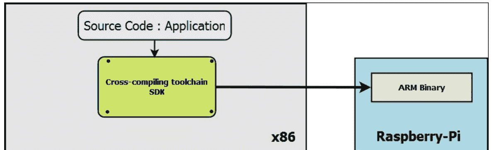

**Yocto/OE** 构建系统可用于为目标系统生成交叉编译工具链和匹配的 sysroot 文件夹。

### 注意

**sysroot** 文件夹包含在构建配方过程中使用的共享库、头文件和实用程序。

使用此构建系统，有几种方法可以生成符合我们 Raspberry Pi 平台的 SDK。

## 通用 SDK - meta-toolchain

meta-toolchain 配方将构建与 Raspberry Pi 平台匹配的工具链和一个基本 sysroot（通用 SDK，与我们的目标根文件系统不匹配）。但是，此工具链可用于构建 U-Boot 引导加载程序、Linux 内核或不需要 sysroot 文件夹的简单应用程序等软件。我们可以使用以下命令生成此工具链：

```
$ source oe-init-build-env rpi-build
$ bitbake meta-toolchain
```

构建完成后，我们可以这样安装它：

```
$ cd poky/rpi-build/tmp/deploy/sdk
$ ./poky-eglibc-x86_64-meta-toolchain-qt5-armv6-vfp-toolchain-1.7.1.sh
```

## image.bb -c populate_sdk

populate 任务是构建与 Raspberry Pi 平台匹配且带有与我们目标根文件系统匹配的 sysroot 文件夹的工具链的最佳且推荐的方法。我们可以使用以下命令生成此工具链：

```
$ bitbake rpi-basic-image.bb -c populate_sdk
```

我们可以使用这些命令安装它：

```
$ cd tmp/deploy/sdk
$ ./poky-eglibc-x86_64-meta-toolchain-qt-armv6-vfp-toolchain-1.7.1.sh
```

以下图示是 populate 任务的摘要，直接摘自 Yocto Project 手册（http://www.yoctoproject.org/docs/current/ref-manual/ref-manual.html#sdk-dev-environment）：

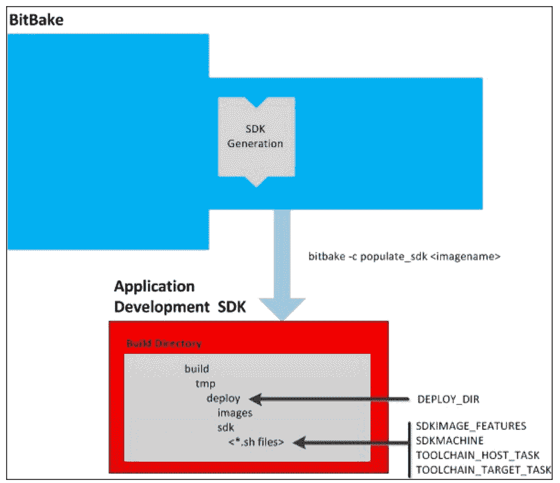

## Qt SDK - meta-toolchain-qt

meta-toolchain-qt 工具链只是 meta-toolchain 的扩展，包括对编译 Qt 应用程序（图形或非图形）的支持。我们可以使用以下命令生成此工具链：

```
$ bitbake meta-toolchain-qt
```

构建完成后，我们可以使用这些命令安装它：

```
$ cd tmp/deploy/sdk
$ ./poky-eglibc-x86_64-meta-toolchain-qt-armv6-vfp-toolchain-1.7.1.sh
```

## Qt5 SDK - meta-toolchain-qt5

此工具链只是 meta-toolchain-qt 的扩展，包括对编译 Qt5 应用程序的支持。我们可以使用以下命令生成它：

```
$ bitbake meta-toolchain-qt5
```

构建完成后，我们可以使用这些命令安装它：

```
$ cd tmp/deploy/sdk
$ ./poky-eglibc-x86_64-meta-toolchain-qt5-armv6-vfp-toolchain-1.7.1.sh
```

SDK 可设计为在 32 位或 64 位 Linux 发行版上使用，这取决于生成 SDK 的主机架构。可以通过设置 SDKMACHINE 变量（在 conf/local.conf 中）来选择，该变量可以采用 i686 或 x86_64 作为值，例如：

```
SDKMACHINE? = "X86_64"
```

## 交叉编译 - 示例

为了验证我们工具链的正常运行，我们可以尝试编译一个应用程序。

### SDK 环境配置

首先要做的是为我们的工具链 source 环境变量。使用以下任一命令：

```
$ source /opt/poky/1.7.1/environment-setup-armv6-vfp poky-linux-gnueabi
$ . ./opt/poky/1.7.1/environment-setup-armv6-vfp poky-linux-gnueabi
```

### 工具列表

之后，我们的工具链位于系统 PATH 变量中，我们可以查看工具链中的所有工具：

```
$ arm-poky-linux-gnueabi-addr2line arm-poky-linux-gnueabi-elfedit arm-poky-linux-gnueabi-gcc-ranlib arm-poky-linux-gnueabi-ld.bfd arm-poky-linux-gnueabi-readelf
arm-poky-linux-gnueabi-ar arm-poky-linux-gnueabi-g++ arm-poky-linux-gnueabi-gcov
arm-poky-linux-gnueabi-nm arm-poky-linux-gnueabi-size
arm-poky-linux-gnueabi-as arm-poky-linux-gnueabi-gcc arm-poky-linux-gnueabi-gdb
arm-poky-linux-gnueabi-objcopy arm-poky-linux-gnueabi-strings
arm-poky-linux-gnueabi-c++filt arm-poky-linux-gnueabi-gcc-ar arm-poky-linux-gnueabi-gprof arm-poky-linux-gnueabi-objdump arm-poky-linux-gnueabi-strip
arm-poky-linux-gnueabi-cpp arm-poky-linux-gnueabi-gcc-nm arm-poky-linux-gnueabi-ld arm-poky-linux-gnueabi-ranlib
```

我们可以找到我们的编译器（用于 C++ 应用程序的 arm-poky-linux-gnueabi-gcc 或 arm-poky-linux-gnueabi-g++）、我们的调试器（arm-poky-linux-gnueabi-gdb）、一些二进制工具（GNU 二进制实用程序）等等。

### 编译

现在，我们可以使用外部工具链编译第一个应用程序：

```
$ ${CC} -o hello_world_pckt hello_world_pckt.c
$ file hello_world_pckt: ELF 32-bit LSB executable, ARM, EABI5
version 1 (SYSV), dynamically linked (uses shared libs), for GNU/Linux 2.6.32,
BuildID[sha1]=1c2b88895d89b1868884295756214d609748f2c2, not stripped
```

## Raspberry Pi 和软件包管理器

Yocto Project 的基本构建块是软件包的生成；因此，可以将软件包管理器包含在我们的 Yocto 发行版中（例如，类似于 Linux 发行版）。实际上，在生成映像后（参见第 2 章），它不包含软件包管理器，这意味着我们的映像不可更新（例如，类似于固件）。

可以通过在 conf/local.conf 中添加以下变量，在我们的发行版中包含软件包管理器：

```
EXTRA_IMAGE_FEATURES += "package-management"
```

如果添加到配方文件（例如 rpi-basic-image.bb），请改用以下内容：

```
IMAGE_FEATURES += "package-management"
```

添加此内容后，我们现在有了一个带有软件包管理器的映像，它更灵活、可更新，更工业化。以下是如何使用 opkg 软件包管理器安装软件包：

```
$ opkg install package_name.ipk
```

## 软件包格式可用性

BitBake（任务调度程序）支持以下软件包格式：

RPM：最初由 Red Hat 使用，因其名称 Red Hat Package Manager（红帽软件包管理器）而得名，现在也被其他发行版使用（例如 openSUSE）。

DEB：Debian 软件包格式由 Debian 及其衍生发行版（如 Ubuntu）使用。

IPK：代表 Itsy Package Management System（最初来自 handhelds.org 项目）。它是一种为嵌入式系统（例如 Gumstix 平台：http://gumstix.org/add-software-packages.html）设计的轻量级软件包管理系统。OpenEmbedded-Core 以及因此的 Poky，使用 opkg 软件包管理器来支持 IPK 格式。

### 注意

如果您是 Android 爱好者，可以将其与 APK 软件包格式进行类比。

## 选择软件包格式

格式支持通过一组类（package_rpm、package_deb 和 package_ipk）提供。软件包格式的选择很大程度上取决于项目需求。需要考虑的因素包括：

- 内存占用
- 资源使用
- 安装速度

### 注意

默认情况下，Poky 使用 RPM（Red Hat Package Manager）软件包格式。

软件包格式的选择通过 conf/local.conf 文件中的 PACKAGE_CLASSES 变量完成。

输入以下内容以包含 RPM 软件包格式：

```
PACKAGE_CLASSES ?= "package_rpm"
```

输入以下内容以包含 DEB 软件包格式：

```
PACKAGE_CLASSES ?= "package_deb"
```

输入以下内容以包含 IPK 软件包格式：

```
PACKAGE_CLASSES ?= "package_ipk"
```

### 注意

可以指定多个软件包格式，但是，在构建映像时，BitBake 会根据 PACKAGE_CLASSES 变量中的第一个软件包格式进行搜索：PACKAGE_CLASSES ?= "package_rpm package_deb package_ipk"


## 在目标设备上安装和更新软件包

现在我们已经介绍了软件包格式，将了解如何将它们与树莓派集成。

### RPM 软件包

使用 RPM 软件包，可以在将其复制到目标设备后，使用 RPM 或 SMART 实用工具在树莓派上安装软件包。

### 手动安装

要手动安装 RPM 软件包，请使用以下命令之一：

```
$ rpm -ivh package_name.rpm
$ smart install package_name.rpm
```

### 自动安装

在开发和调试阶段，开发者无需处理许多 Linux 命令即可更新目标设备（树莓派）上的软件包（二进制文件），这可能很有价值。

第一步是在我们的仓库中创建软件包索引（以便使用软件包馈送）：

```
$ source oe-init-build-env rpi-build
$ bitbake package-index
```

之后，我们可以安装一个 Web 服务器（例如 lighttpd）：

```
$ sudo apt-get install lighttpd
```

默认情况下，/etc/lighttpd/lighttpd.conf 配置文件中指定的文档根目录是 /var/www/：

```
$ tree /var/www/
/var/www/
html
amod.png
formulaire.html
index.html
logo.png
play_48.png
index.lighttpd.html
1 directory, 6 files
```

因此，我们只需要一个指向我们的软件包馈送的符号链接：

```
$ mkdir /var/www/rpi-deploy
$ ln -s rpi-build/tmp/deploy/rpm /var/www/rpi-deploy/rpm
```

此时，您需要重新启动 lighttpd 服务器：

```
$ sudo /etc/init.d/lighttpd restart
```

在树莓派上，我们需要告知 smart 我们想要使用的每个软件包数据库。例如，对于 rpi-deploy/rpm 中的 all 目录，我们需要执行此命令：

```
$ smart channel --add all type=rpm-md baseurl=http://<server-ip>/rpi-deploy/rpm/all
```

现在我们的环境已准备就绪，可以使用以下命令从树莓派的根文件系统中查询和更新软件包：

```
$ smart update
$ smart query <package_name>
$ smart install <package_name>
$ smart query -installed
```

以下是从树莓派中删除软件包的示例（Monkey Web 服务器）：

```
$ smart remove monkey
Updating cache..
########################################### [100%]
Computing transaction...
Removing packages (1):
monkey-1.5.4-r0@armv6-vfp
479.4kB will be freed. Confirm changes? (Y/n): Y
Committing transaction...
Preparing...
########################################### [ 0%]
Stopping Monkey HTTP Server: stopped /usr/bin/monkey (pid 1448)
monkey
Output from monkey:( 0%)
warning: /etc/monkey/sites/default saved as /etc/monkey/sites/default.rpmsave
warning: /etc/monkey/plugins/logger/logger.conf saved as
/etc/monkey/plugins/logger/logger.conf.rpmsave
warning: /etc/monkey/plugins.load saved as /etc/monkey/plugins.load.rpmsave
1:Removing monkey
########################################### [100%]
Removing any system startup links for monkey ...
/etc/rc0.d/K70monkey /etc/rc1.d/K70monkey /etc/rc2.d/S70monkey /etc/rc3.d/S70monkey
/etc/rc4.d/S70monkey /etc/rc5.d/S70monkey /etc/rc6.d/K70monkey Saving cache...
```

### 注意

有关 smart 实用工具的更多信息和用户手册，请访问 https://labix.org/smart/。

### IPK 软件包

使用 IPK 软件包，可以在将软件包复制到目标设备后，使用 OPKG 实用工具在树莓派上安装软件包。

### 手动安装

要手动安装 IPK 软件包，请使用此命令：

```
$ opkg install package_name.ipk
```

### 自动安装

对于 IPK 软件包的管理，在我们的开发工作站上创建软件包仓库很容易。

第一步是将以下变量添加到 conf/local.conf：

```
FEED_DEPLOYDIR_BASE_URI = http://<server-ip>:9999/ http://<server-ip>:9999/
```

因此，我们的镜像将包含指向基于 busybox（httpd）且监听端口 9999 的 Web 服务器上我们软件包仓库的所有引用。

第二步是在我们的仓库上创建软件包索引：

```
$ source oe-init-build-env rpi-build
$ bitbake package-index
```

除此之外，只需创建一个监听端口 9999 的 Web 服务器。基目录将是构建 IPK 软件包的目录。为了更方便地使用实用工具连接 busybox，请使用 [HTTP 守护进程](http://wiki.openwrt.org/doc/howto/http.httpd)。也可以使用 Apache、Nginx 或 lighttpd。我们可以使用以下命令启动 httpd 服务器：

```
$ cd rpi-build/tmp/deploy/ipk
$ busybox httpd -p 9999
```

要验证我们的软件包仓库服务器是否正常运行，只需在树莓派上输入 opkg update：

```
$ opkg update
Downloading http://192.168.132.1:9999/....
```

### 注意

如需更多信息，请随时访问 [http://www.yoctoproject.org/docs/current/dev-manual/dev-manual.html#using-runtime-package-management](http://www.yoctoproject.org/docs/current/dev-manual/dev-manual.html#using-runtime-package-management)。

## 我们的应用程序 - 简介

现在我们已经了解了如何为平台生成 SDK 以及如何将软件包集成到 Yocto 镜像中，将通过一个示例，使用树莓派的通用输入输出（GPIO）引脚开发一个应用程序，然后创建一个配方以将我们的应用程序集成到最终镜像中。

其思想是开发一个应用程序，通过 GPIO 引脚点亮一个 LED 并监控一个按钮。

以下是使用 Fritzing (http://fritzing.org/home/) 制作的原理图：

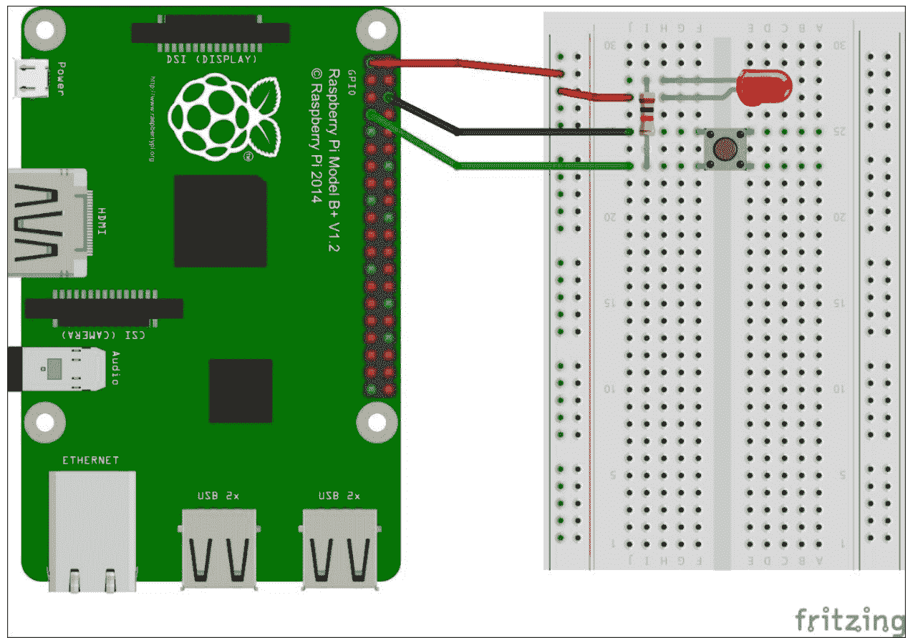

因此，我们可以从 Linux 用户空间，通过树莓派的 GPIO 4（主连接器的引脚 7）点亮 LED 或监控按钮。

我们可以测试以下 C 应用程序：

```
static int parse_opts(int argc, char *argv[])
int long_index = 0;
int opt;
static struct option option[]
{"led", required_argument, NULL, 'l'
{"help", no_argument, NULL, 'h'
{"button", no_argument, NULL, 'b'
{"version", no_argument, NULL, 'v'
{0, 0, 0, 0}
while ((opt = getopt_long(argc, argv, "lzbhv", option, &long_index)) >= 0)
switch(opt)
case 'h':
display_help(argv[0]);
exit(EXIT_SUCCESS);
case 'v':
fprintf(stderr, "\n%s - %s\n\n", project, VERSION);
exit(EXIT_SUCCESS);
case 'l':
printf("Led Mode\n");
printf("Set gpio%d to %d\n",GPIO_PIN,atoi(optarg));
// Set gpio4 to out mode
set_out(GPIO_PIN,atoi(optarg));
break;
case 'b':
printf("Button Mode\n");
// Set gpio4 to in mode
set_in(GPIO_PIN);
wait_bp_state();
break;
default:
fprintf(stderr,"[ERROR] %s: Bad option. -h for help\n", argv[0]);
exit(EXIT_FAILURE);
return 0;
```

您可以从此书的代码包中下载它。

我们可以尝试使用 SDK 编译我们的应用程序，并使用以下命令将其发送到树莓派：

```
$ source /opt/poky/1.7.1/environment-setup-armv6-vfp poky-linux-gnueabi
$ ${CC} gpio_example.c -o gpio_example
```

### 我们的应用程序 - 创建配方

既然我们的应用程序功能正常，我们可以创建配方。

第一步是创建文件；例如，我们可以选择 gpio-packet_0.1.bb。

- gpio-packet 表示软件包的名称（PN 变量）。
- 0.1 表示配方的版本号（PV 变量）。
- .bb 表示文件扩展名（Bitbake）。

第二步是将源代码放置在本地仓库中，如下所示：

```
$ mkdir gpio-packet
$ cp /home/packet/gpio-example.c files/
$ ls gpio-packet
gpio-example.c
```

配方必须放在 gpio-packet 目录旁边，如下所示：

```
$ ls
gpio-packet/ gpio-packet.bb
```

之后，我们可以按如下内容填写配方：

```
DESCRIPTION = "gpio example"
LICENSE="GPLv2"
LIC_FILES_CHKSUM = "file://${COMMON_LICENSE_DIR}/GPL-2.0;md5=801f80980d171dd6425610833a22dbe6"

PR = "r0"

SRC_URI = "file://gpio_example.c"

do_compile() {
	${CC} ${CFLAGS} ${LDFLAGS} ${WORKDIR}/gpio_example.c -o
	gpio_example
}

do_install() {
	install -m 0755 -d ${D}${bindir}
	install -m 0755 ${S}/gpio_example ${D}${bindir}
}
```

### 配方说明

让我们来看看前面配方的各个部分。

DESCRIPTION 包含应用程序的描述。生成软件包时会使用此信息，以便用户可以通过包管理器获取此信息。

LICENSE 包含程序许可证（本示例中为 GPLv2）。

LIC_FILES_CHKSUM 变量包含配方源代码中许可证文本的校验和。Poky 使用它来跟踪源代码文件中许可证文本的更改。

PR 包含用于构建软件包的配方修订版。

SRC_URI 确定所需的文件和源代码以及应从哪里获取这些源代码（在此例中，从 gpio-packet 文件夹获取）。

do_compile() 方法将生成我们将部署到树莓派的二进制文件。

do_install() 方法将以与在树莓派上安装相同的方式在树中安装我们的二进制文件（在此例中，二进制文件将放置在 /usr/bin）。

以下表格列出了 Bitbake 使用的一些路径：

| base_bindir | /bin |
| base_sbindir | /sbin |
| base_libdir | /lib |
| datadir | /usr/share |
| sysconfdir | /etc |
| servicedir | /srv |
| bindir | /usr/bin |
| sbindir | /usr/sbin |
| libdir | /usr/lib |
| includedir | /usr/include |

现在我们已有配方，可以将其包含在镜像中。为此，我们必须将所有文件放入主树。我们将在 meta-raspberrypi/recipes-devtools 中创建一个文件夹，如下所示：


$ cd meta-raspberrypi/recipes-devtools
$ mkdir gpio-packt-book

为了让 BitBake 找到我们的配方，我们可以将不同的文件放入此文件夹，如下所示：

```
$ cd gpio-packt-book
$ mv /home/packet/gpio-packt.bb
$ mv /home/packet/gpio-packt
```

最后一步是将我们的配方与镜像集成。为此，我们可以将以下变量添加到 conf/local.conf 文件中：

```
IMAGE_INSTALL_append += " gpio-packt"
```

现在，我们可以启动 BitBake，然后在 Raspberry Pi 上测试我们的程序：

```
$ bitbake rpi-basic-image
```

以下命令将在 Raspberry Pi 上执行。

你可以使用这些命令测试 LED：

```
$ gpio_example led=1 (set gpio4 to 1)
$ gpio_example led=0 (set gpio4 to 0)
```

你可以使用这个命令测试按钮：

```
$ gpio_example --button
Button was pressed!
```

## 摘要

在本章中，我们学习了如何为 Raspberry Pi 生成 SDK 以及如何管理软件包，并了解了如何在 Raspberry Pi 上部署自定义应用程序。

在下一章中，你将了解层的概念，并发现如何在 Yocto 和 Raspberry Pi 的环境中集成另一个层。

# 第 6 章 使用外部层

在本章中，我们将了解外部层的基本概念，并理解层的类型及其构建方式（按优先级、名称等）。我们还将讨论 Qt5 和 Web 服务器层。

之后，我们将把外部层集成到构建中，并在 Raspberry Pi 上进行测试。

## 引入层

层只是一组可用于 Yocto/OE-Core 之上的配方和/或配置。

使用 Yocto/OE（Poky 参考系统）等环境的优势在于，该项目处理大量元数据（机器（Raspberry Pi）的定义文件 (.conf)、类和配方 (.bb）），涵盖了从简单应用程序（gpio-packt）到 OpenGLES、EFL 或 Qt 等图形应用程序的所有内容。

使用层的主要动机是更好地组织提供程序的长列表，同时确保用户只能选择所需或想要的提供程序。这也是提供可自定义源代码的一种方式，这些源代码可用于任何架构，或按用户需要的方式进行修改。

另一个优势是，我们可以为每个项目选择所需的所有层（从最基本到最复杂）。我们可以修改它们以与我们的架构（Raspberry Pi 的 ARM）保持一致，但一个层可以在另一个架构（PowerPC）上重用，这在工业界是一个巨大的优势（更改架构时所需的精力很小）。

此外，与其重新开发层，不如始终检查工作是否已由他人完成。下载提供我们需要的软件包的层并添加追加文件 (.bbappend) 花费的时间更少；如果需要进行一些修改，则必须从头开始制作。总之，层是在需要时添加的。

你可以在以下链接中找到不同的可用层：

http://layers.openembedded.org/layerindex/branch/master/layers/

## 层的基本概念

让我们深入了解层的基本概念：

## 理论

从技术角度来看，层具有一些属性。如下所示：

- **名称**：这通常以字符串 meta- 开头（为了更好地理解，这是强制性的）。
- **优先级**：这是 BitBake 用来决定使用哪个配方以及 .bbappend 文件应合并顺序的值。这意味着，如果两个层包含相同的配方 (.bb) 文件，则使用优先级较高的那个。

### 注意

例如，优先级值设置为 6 的层比优先级值设置为 5 的层更有可能使用其配方。

此外，每个层都按其功能列在此页面上：

http://layers.openembedded.org/layerindex/branch/master/layers/

| meta-parallelia | 支持 Adapteva 的 Parallelia 开发板 | 机器 (BSP) | https://github.com/nathanrossi/meta-parallelia.git |
| --- | --- | --- | --- |
| meta-picosam9 | Picosam9 开发板支持 | 机器 (BSP) | https://gitorious.org/picopc-tools/meta-picosam9.git |
| meta-qemu-bsps | 用于其他 QEMU 机器的层 | 机器 (BSP) | https://github.com/akuster/meta-qemu-bsps |
| meta-raspberrypi | Raspberry Pi 开发板支持 | 机器 (BSP) | git://git.yoctoproject.org/meta-raspberrypi |
| meta-renesas-rza1 | Renesas RZ/A1 平台的官方 BSP 层 | 机器 (BSP) | git://github.com/renesas-rz/meta-renesas-rza1 |
| meta-rockchip | Rockchip ARM 硬件支持 | 机器 (BSP) | git://github.com/linux-rockchip/meta-rockchip |
| meta-romley | Intel Romley 平台 BSP | 机器 (BSP) | git://git.yoctoproject.org/meta-intel |
| meta-samsung | 三星智能手机支持 | 机器 (BSP) | https://github.com/shr-distribution/meta-smartphone.git |
| meta-sugarbay | Intel Sugar Bay 平台 BSP | 机器 (BSP) | git://git.yoctoproject.org/meta-intel |

- **软件层**：此层提供可用于任何架构（x86_64、ARM、PPC、MIPS 等）的软件系列。例如，我们有 meta-java（用于 Java 支持）、meta-efl（用于 Enlightenment 环境）、meta-qt5（Qt 支持）、meta-webserver（提供构建 Web 服务器的支持）、meta-browser 等等。
- **其他**：如果你的层不属于任何其他类别，可以选择此类型；但是，不应有太多其他类型的层——这可能表明目的不明确，或者你应该考虑拆分该层。
- **机器 (BSP)**：这些是特定于机器的层（例如 meta-raspberrypi、meta-fsl-arm 和 meta-ti）。它们包含用于为机器配置软件包的机器配置文件和配方。
- **发行版**：这些是向环境添加发行版的层（例如 meta-ivi 用于添加车载信息娱乐 (IVI) 支持、meta-angstrom 等等）。

此时，我们知道层在 Yocto 项目中是如何分布的。现在，我们将看到这些层是如何组成的。

## 软件层

以本示例为例，我们将以 meta-qt5 层为例。该层的目录树如下：

```
pjtexier@amplitude:~ $ ls -l meta-qt5/
total 28
drwxrwxr-x 2 pjtexier pjtexier 4096 avril 22 19:20 classes
drwxrwxr-x 3 pjtexier pjtexier 4096 avril 22 19:20 conf
-rw-rw-r-- 1 pjtexier pjtexier 1035 avril 22 19:20 COPYING.MIT
drwxrwxr-x 2 pjtexier pjtexier 4096 avril 22 19:20 licenses
-rw-rw-r-- 1 pjtexier pjtexier 1189 avril 22 19:20 README
-rwxrwxr-x 4 pjtexier pjtexier 4096 avril 22 19:20 recipes-devtools
drwxrwxr-x 10 pjtexier pjtexier 4096 avril 22 19:20 recipes-qt
```

## README 和 COPYING

此目录中有两个重要文件，如下所示：

- **README**：此文件主要指定依赖于目标层的外部层、任何配置说明、发送补丁的地址以及维护者的联系方式。
  - 此层依赖于以下内容：

```
URI: git://github.com/openembedded/oe-core.git
branch: master
revision: HEAD
```

```
URI: git://github.com/openembedded/meta-oe.git
layers: meta-ruby
branch: master
revision: HEAD
```

构建 qtdeclarative、qtquick、qtwebkit 等内容时，请确保在 qtbase 构建中启用所需的 PACKAGECONFIG 选项，详情请参见 qtbase.inc。将拉取请求发送到 openembedded-devel@lists.openembedded.org，主题中包含 '[meta-qt5]'。

发送单个补丁时，请使用类似：'git send-email -M -1 --to openembedded-devel@lists.openembedded.org --subject-prefix=meta-qt5][PATCH' 我们鼓励你在 GitHub 上 fork 镜像以共享补丁。这更适合由多个补丁组成的补丁集。当然，也接受 gitorious、repo.or.cz 或自托管等其他服务，'git fetch <remote>' 在所有服务上都同样适用。我们推荐 GitHub，因为它免费、易于使用、已被证明可靠且拥有非常出色的 Web 界面。https://github.com/meta-qt5/meta-qt5/

主要层维护者：
Martin 'JaMa' Jansa <martin.jansa@gmail.com>
Otavio Salvador <otavio@ossystems.com.br>

- **COPYING**：此文件包含许可信息（在此情况下为 MIT 许可证）。

## classes 文件夹

classes 文件夹存放 .bbclass 文件。以下是示例 classes 文件夹：


pjtexier@amplitude:~ $ ls -l classes/
total 24
-rw-rw-r-- 1 pjtexier pjtexier 1721 avril 22 19:20 cmake_qt5.bbclass
-rw-rw-r-- 1 pjtexier pjtexier 2001 avril 22 19:20 populate_sdk_qt5.bbclass
-rw-rw-r-- 1 pjtexier pjtexier 7633 avril 22 19:20 qmake5_base.bbclass
-rw-rw-r-- 1 pjtexier pjtexier 219 avril 22 19:20 qmake5.bbclass
-rw-rw-r-- 1 pjtexier pjtexier 1935 avril 22 19:20 qmake5_paths.bbclass
```

## conf 文件夹

conf 文件夹应提供配置（.conf）文件。此文件夹中的 layer.conf 文件包含一些重要变量，例如，关于优先级（BBFILE_PRIORITY）的变量：

```
# Define the priority for recipes (.bb files) from this layer,
# choosing carefully how this layer interacts with all of the
# other layers.
BBFILE_PRIORITY_qt5-layer = "7"
```

要验证优先级值，我们可以使用以下命令：

```
$: bitbake-layers show-layers
```

## recipes-* 目录

recipes-* 目录包含一些配方。例如，在 meta-qt5 层中，我们有 recipes-qt，其中包含一些元数据（例如 Qt5）。

## 机器（BSP）层

在本演示中，我们将以特定于我们硬件的 BSP 层为例：meta-raspberrypi BSP 层。此目录（文件夹）应包含类似于以下的文件列表：

```
pjtexier@amplitude:~ $ ls -l meta-raspberrypi/
classes
conf
custom-licenses
recipes-bsp
recipes-core
recipes-devtools
recipes-graphics
recipes-kernel
recipes-multimedia
COPYING.MIT
README
```

使用 BSP 层时，有一些区别。首先是在 conf 文件夹中。现在，此目录中有一个新文件夹，名为 machine。

此文件夹包含一些用于处理我们特定硬件（例如树莓派和树莓派 2）的配置文件。例如，有一个重要文件（rpi-base.inc）位于：

- machine
  - * raspberry.conf (树莓派的配置文件)
  - * raspberry2.conf (树莓派 2 的配置文件)
- Include
  - * rpi-base.inc

rpi-base.inc 文件如下所示：

```
include conf/machine/include/rpi-default-settings.inc
include conf/machine/include/rpi-default-versions.inc
include conf/machine/include/rpi-default-providers.inc

SOC_FAMILY = "rpi"
include conf/machine/include/soc-family.inc

IMAGE_FSTYPES ?= "tar.bz2 ext3 rpi-sdimg"

SERIAL_CONSOLE = "115200 ttyAMA0"

XSERVER = " \\
xserver-xorg \\
xf86-input-evdev \\
xf86-input-mouse \\
xf86-input-keyboard \\
xf86-video-fbdev \\
"
# Really supported starting from linux-raspberrypi 3.18.y only
KERNEL_DEVICETREE ?= " \\
    bcm2708-rpi-b.dtb \\
    bcm2708-rpi-b-plus.dtb \\
    bcm2709-rpi-2-b.dtb \\
    \\
    ds1307-rtc-overlay.dtb \\
    hifiberry-amp-overlay.dtb \\
    hifiberry-dac-overlay.dtb \\
    hifiberry-dacplus-overlay.dtb \\
    hifiberry-digi-overlay.dtb \\
    iqaudio-dac-overlay.dtb \\
    iqaudio-dacplus-overlay.dtb \\
    lirc-rpi-overlay.dtb \\
    pcf8523-rtc-overlay.dtb \\
    pps-gpio-overlay.dtb \\
    w1-gpio-overlay.dtb \\
    w1-gpio-pullup-overlay.dtb \\
    "
KERNEL_IMAGETYPE ?= "Image"
MACHINE_FEATURES = "kernel26 apm usbhost keyboard vfat ext2 screen touchscreen alsa bluetooth wifi sdio"
# Raspberry Pi has no hardware clock
MACHINE_FEATURES_BACKFILL_CONSIDERED = "rtc"
MACHINE_EXTRA_RRECOMMENDS += " kernel-modules"
# Set Raspberrypi splash image
SPLASH = "psplash-raspberrypi"
IMAGE_BOOT_FILES ?= "bcm2835-bootfiles/* ${KERNEL_IMAGETYPE};${SDIMG_KERNELIMAGE}"
```

正是在此文件中，我们设置了一些基本变量，包括以下内容：

- SERIAL_CONSOLE 指定串行控制台要连接的速度和设备。它作为控制台参数传递给内核，例如 115200 ttyAMA0。
- IMAGE_FSTYPES 指定要创建的根文件系统镜像的格式。
- KERNEL_IMAGETYPE 指定要构建的内核镜像类型（uImage 或 zImage）。

### 注意

如果要了解有关 BSP 层的更多信息，可以访问 [http://www.yoctoproject.org/docs/1.8/bsp-guide/bsp-guide.html](http://www.yoctoproject.org/docs/1.8/bsp-guide/bsp-guide.html)。

## 将外部层添加到树莓派

现在我们知道层的工作原理，可以将现有的外部层添加到我们的环境中。为此，我们将使用 meta-webserver (http://layers.openembedded.org/layerindex/branch/master/layer/meta-webserver/) 来包含著名的 Web 服务器 Monkey (http://monkey-project.com/)。

众所周知，第一步是修改我们的 conf/bblayers.conf 文件以添加层的路径，如下所示：

```
# LAYER_CONF_VERSION is increased each time
build/conf/bblayers.conf
# changes incompatibly
LCONF_VERSION = "6"
BBPATH = "${TOPDIR}"
BBFILES ?= ""
BBLAYERS ?= " \
/home/packt/RASPBERRYPI/poky/meta \
/home/packt/RASPBERRYPI/poky/meta-yocto \
/home/packt/RASPBERRYPI/poky/meta-yocto-bsp \
/home/packt/RASPBERRYPI/poky/meta-raspberrypi \
/home/packt/RASPBERRYPI/poky/meta-openembedded/meta-webserver \
"
BBLAYERS_NON_REMOVABLE ?= " \
/home/packt/RASPBERRYPI/poky/meta \
/home/packt/RASPBERRYPI/poky/meta-yocto \
"
```

现在我们已包含该层以便 BitBake 可以解析它，可以使用以下命令创建镜像：

```
$ bitbake rpi-basic-image
```

编译/生成过程结束后，我们可以启动树莓派并验证其正常运行。这非常简单，因为我们只需启动喜爱的浏览器，并在地址栏中输入以下内容：

http://ip_address_of_rpi/2001

现在，我们在树莓派上有一个嵌入式 Web 服务器。可以使用简单的 Web 服务器（通过升级固件来提高速度）创建许多项目，包括 CGI、HTML5/JavaScript 应用程序、带有 mpeg-streamer 的应用程序等等）。

## 总结

在本章中，我们了解了 Poky 发行版中层的主要原理。我们学习了层的工作原理，如何将外部层集成到我们的树莓派项目中，以及如何生成自定义镜像。

在下一章中，我们还将讨论层，但我们将创建自定义层以将其集成到树莓派的镜像中。

# 第 7 章 在树莓派上部署自定义层

在本章中，你将学习如何使用 Yocto Project 提供的不同工具生成自定义层。首先，你将了解如何生成层；然后，你将向层集成配方。此外，为完成本章，我们将生成自定义镜像。阅读本章将使你能够更好地在 Yocto Project 中组织源代码。

## 使用 yocto-layer 脚本创建 meta-packt_rpi 层

要创建我们的自定义层，可以使用两种不同的方法：

- 手动：创建目录 (meta-*) 并创建层配置文件 (conf/layer.conf)
- * 使用 Poky 环境提供的 yocto-layer 脚本

为了获得灵活性并避免操作失误，我们将使用第二种方法。要使用它，我们最初必须 source 所有变量，以便通过我们的 shell 在 yocto-layer 脚本中获得访问权限，如以下命令所示：

```
$ source oe-init-build-env rpi-build
```

现在我们的环境已设置好，可以访问 yocto-layer 脚本，因此可以开始创建层的过程。

请注意，此脚本 (yocto-layer) 默认在当前目录中创建层。这就是为什么我们必须将其放在环境的根目录下：

```
$ cd /where/you/want/to/stored/your/layer
```

现在可以使用以下命令启动脚本：

```
$ yocto-layer create <layer_name> -o <dest_dir>
```

### 注意

**meta- 字符串**会自动添加到层名称前面。

在我们的示例中，我们将把层命名为 **meta-packt_rpi**。以下是命令：

```
$ yocto-layer create packt_rpi
Please enter the layer priority you'd like to use for the layer: [default: 6]
Would you like to have an example recipe created? (y/n) [default: n] y
Please enter the name you'd like to use for your example recipe: [default: example]
example-packt
Would you like to have an example bbappend file created? (y/n) [default: n] y
Please enter the name you'd like to use for your bbappend file: [default: example]
example-packt
Please enter the version number you'd like to use for your bbappend file (this should match the recipe you're appending to): [default: 0.1]
New layer created in meta-packt_rpi.
Don't forget to add it to your BBLAYERS (for details see meta-packt_rpi/README).
```

通过此脚本，我们生成了自己的层 meta-packt_rpi，该层中包含一个示例配方、一个 bbappend 文件示例等等。我们生成的层示例如下命令所示：

```
$ tree meta-packt_rpi/
```


## I. 将 packt_rpi 层添加到构建中

如果我们想安装该层，只需将绝对路径集成到 bblayers.conf 文件中，就像 README 文件中所说的：

要使用此层，需要让构建系统知道它。

假设 packt_rpi 层位于 yocto 构建树的顶级目录，可以通过将 packt_rpi 层的位置添加到 bblayers.conf 中（以及其他所需的层）来将其添加到构建系统，例如：

```
BBLAYERS ?= " \
    /path/to/yocto/meta \
    /path/to/yocto/meta-yocto \
    /path/to/yocto/meta-yocto-bsp \
    /path/to/yocto/meta-packt_rpi \
"
```

我们可以将层添加到 bblayers.conf 文件中：

```
# LAYER_CONF_VERSION is increased each time  build/conf/bblayers.conf
# changes incompatibly
LCONF_VERSION = "6"

BBPATH = "${TOPDIR}"
BBFILES ?= ""

BBLAYERS ?= " \
/home/packet/RASPBERRYPI/poky/meta \
/home/packet/RASPBERRYPI/poky/meta-yocto \
/home/packet/RASPBERRYPI/poky/meta-yocto-bsp \
/home/packet/RASPBERRYPI/poky/meta-raspberrypi \
/home/packet/RASPBERRYPI/poky/meta-openembedded/meta-webserver \
/home/packet/RASPBERRYPI/poky/meta-packt_rpi "
BBLAYERS_NON_REMOVABLE ?= " \
/home/packet/RASPBERRYPI/poky/meta \
/home/packet/RASPBERRYPI/poky/meta-yocto \
```

在此之后，我们的层已完全集成到 Yocto Project 中，因此可以被 BitBake（元调度程序）解析。

## 注

如需更多信息，可阅读官方文档 http://www.yoctoproject.org/docs/1.8/dev-manual/dev-manual.html#yocto-project-layers 。

## 将 gpio-packt 添加到 meta-packt_rpi

为测试此层，我们将集成在 [第 5 章：在树莓派上创建、开发和部署](https://www.packtpub.com/) 中开发的应用程序（gpio-packt）。这样可以让我们逐步实现层，使其完全可重复用于各种项目。包含此配方后，您的层结构应如下所示：

```
$ tree meta-packt_rpi/
meta-packt_rpi/
├── conf
│   └── layer.conf
├── COPYING.MIT
├── README
├── recipes-custom
│   └── gpio-packt
│       ├── gpio-packt
│       │   ├── gpio-example.c
│       │   └── gpio-packt.bb
├── recipes-example
│   └── example
│       ├── example-packt-0.1
│       │   ├── example.patch
│       │   └── helloworld.c
│       └── example-packt_0.1.bb
├── recipes-example-bbappend
│   ├── example-bbappend
│   ├── example-packt-0.1
│   │   └── example.patch
│   └── example-packt_0.1.bbappend
```

与任何其他额外软件包一样，构建系统需要知道您希望包含 gpio-packt。为此，请编辑 /conf/local.conf 配置文件并在底部添加以下行：

```
IMAGE_INSTALL_append = " gpio-packt"
```

此行告诉构建系统在创建最终镜像时包含 gpio-packt 软件包。如果出于某种原因该变量已存在，只需在末尾追加 gpio-packt 软件包名称，如下所示：

```
IMAGE_INSTALL_append = " app1 app2 gpio-packt"
```

现在，如果我们想测试它，可以使用以下命令启动 BitBake，然后在树莓派上测试我们的程序：

```
$ bitbake rpi-basic-image
```

## 修补 gpio-packt

现在我们已经了解如何将配方（gpio-packt）集成到先前创建的层（meta-packt_rpi）中，将了解如何为 gpio-packt 配方创建补丁。

## 生成补丁

第一步是创建 .patch 文件。使用以下命令创建原始文件的备份：

```
$ cd meta-packt_rpi/recipes-custom/gpio-packt
$ cp gpio-packt/gpio-example.c gpio-packt/gpio-example.orig
```

现在，可以修改我们的主源代码（gpio-example.c）：

```
$ sed -i 's/Button Mode/Button Mode!/' gpio-packt/gpio-example.c
```

我们已按需更改源文件；下一步是使用 diff 命令创建补丁文件：

```
$ diff -u gpio-packt/gpio-example.orig gpio-packt/gpio-example.c > gpio-packt/fix.patch
```

现在我们有了 .patch 文件，需要更新主源文件：

```
$ mv gpio-packt/gpio-example.orig gpio-packt/gpio-example.c
```

## 将补丁添加到配方文件

请注意，即使我们已生成 .patch 文件，目前它仍然不可见，因为它已输入到 SRC_URI 变量中。以下是考虑补丁的完整配方，已更新：

```
DESCRIPTION = "gpio example"
LICENSE="GPLv2"
LIC_FILES_CHKSUM = "file://${COMMON_LICENSE_DIR}/GPL-2.0;md5=801f80980d171dd6425610833a22dbe6"
PR = "r0"
SRC_URI = "file://gpio_example.c \
           file://fix.patch"
do_compile() {
	${CC} ${CFLAGS} ${LDFLAGS} ${WORKDIR}/gpio_example.c -o gpio_example
}
do_install() {
	install -m 0755 -d ${D}${bindir}
	install -m 0755 ${S}/gpio_example ${D}${bindir}
}
```

如果我们查看层的结构，将看到以下内容：

```
$ tree meta-packt_rpi/
meta-packt_rpi/
├── conf
│   └── layer.conf
├── COPYING.MIT
├── README
├── recipes-custom
│   └── gpio-packt
│       ├── gpio-packt
│       │   ├── fix.patch
│       │   ├── gpio-example.c
│       └── gpio-packt.bb
├── recipes-example
│   └── example
│       └── example-packt-0.1
│           ├── example.patch
│           ├── helloworld.c
│           └── example-packt_0.1.bb
├── recipes-example-bbappend
│   └── example-bbappend
│       ├── example-packt-0.1
│       │   └── example.patch
│       └── example-packt_0.1.bbappend
```

现在，可以使用以下命令启动 BitBake 来测试我们的新配方：

```
$ bitbake rpi-basic-image
```

## 创建 raspberry-packt-image.bb 镜像

在本章中，我们的目标是创建一个可在任何环境中重复使用的层。我们将了解如何创建自己的镜像，以更多地依赖 meta-raspberrypi BSP 层所提供的镜像。无需担心，因为要创建镜像，只需制作一个配方文件。

## 创建环境

为分离我们层的配方，我们将镜像配方放置在名为 recipe-core 的层中，在那里将创建 raspberry-packt-image.bb 配方文件。创建后，我们的层结构如下：

```
$ tree meta-packt_rpi/
meta-packt_rpi/
├── conf
│   └── layer.conf
├── COPYING.MIT
├── README
├── recipes-core
│   └── images
│       └── raspberry-packt-image.bb
├── recipes-custom
│   └── gpio-packt
│       ├── gpio-packt
│       │   ├── fix.patch
│       │   ├── gpio-example.c
│       │   └── gpio-packt.bb
├── recipes-example
│   └── example
│       └── example-packt-0.1
│           ├── example.patch
│           ├── helloworld.c
│           └── example-packt_0.1.bb
├── recipes-example-bbappend
│   ├── example-bbappend
│   │   └── example-packt-0.1
│   │       └── example.patch
│   └── example-packt_0.1.bbappend
```

## 修改配方文件

为更好地管理我们的镜像，最好的方法就是从 meta-raspberrypi 层中包含的基本镜像学习。

## 注

您可以访问主 GitHub 仓库 https://github.com/agherzan/meta-raspberrypi/blob/master/recipes-core/images/rpi-hwup-image.bb 。

以下是一个基本示例——我们自己的镜像，符合树莓派标准，并包含我们自己的配方：

```
# Base this image on core-image-minimal
include recipes-core/images/core-image-minimal.bb
DESCRIPTION = "Image for raspberry-pi"
IMAGE_FEATURES += "ssh-server-dropbear splash"
# Include modules in rootfs
IMAGE_INSTALL += " \\
 kernel-modules \\
 gpio-packt
"
```

IMAGE_INSTALL 变量将生成根文件系统的相关软件包分组。如需更多信息，可参阅官方文档 http://www.yoctoproject.org/docs/1.8/ref-manual/ref-manual.html#var-IMAGE_INSTALL。

- 另一个可能有趣的变量是 IMAGE_FEATURES，它允许您处理预定义软件包（dev、debug 等）。您可以通过阅读官方文档了解更多信息：

- `allow-empty-password`：允许 Dropbear 和 OpenSSH 接受 root 登录以及密码字符串为空的账户的登录。

- `dbg-pkgs`：为给定镜像中安装的所有软件包安装调试符号软件包。

- `debug-tweaks`：使镜像适合开发（例如，允许无需密码的 root 登录并启用安装后日志记录）。有关更多信息，请参见本列表中的 'allow-empty-password'、'empty-root-password' 和 'post-install-logging' 功能。

- `dev-pkgs`：为给定镜像中安装的所有软件包安装开发软件包（头文件和额外的库链接）。

- `doc-pkgs`：为给定镜像中安装的所有软件包安装文档软件包。

- `empty-root-password`：将 root 密码设置为空字符串，从而允许使用空密码登录。

- `package-management`：安装包管理工具并保留包管理器数据库。

- `post-install-logging`：在目标系统上首次启动镜像时，将安装后脚本运行记录到 `/var/log/postinstall.log` 文件中。

- `ptest-pkgs`：为所有启用 ptest 的配方安装 ptest 软件包。

- `read-only-rootfs`：创建根文件系统为只读的镜像。有关更多信息，请参阅 Yocto Project 开发手册中的“创建只读根文件系统”部分。

- `splash`：在启动期间启用显示启动画面。默认情况下，此画面由 `psplash` 提供，允许自定义。如果您希望使用替代启动画面软件包，可以在镜像配方或分发配置级别中将 `SPLASH` 变量设置为不同的软件包名称（或名称）。

- `staticdev-pkgs`：为给定镜像中安装的所有软件包安装静态开发软件包，即静态库（即 `*.a` 文件）。


- 例如，在我们的示例（raspberry-pack-image.bb）中，我们通过 IMAGE_FEATURES 使用了多个软件包，例如 splash 和 ssh-server-dropbear。

我们还在 conf/local.conf 中使用了该变量（在第 5 章“在树莓派上创建、开发和部署”中），目的是添加 package-management 软件包（使用 EXTRA_IMAGE_FEATURES）。

IMAGE_FEATURES 的另一个示例是，如果我们要使用 Eclipse IDE 的集成，则需要将以下软件包添加到 conf/local.conf 文件中：

```
IMAGE_FEATURES += "eclipse-debug"
```

## 部署 raspberry-pack-image.bb 镜像

现在是时候测试我们的镜像并检查其运行情况了。为此，我们需要启动通常的 bitbake 命令，但这次要带一个参数：我们的镜像名称，raspberry-pack-image：

```
$ bitbake raspberry-pack-image
Loading cache: 100%
|###############################################################################|
|###############################################################################|
|###############################################################################|
####| ETA:  00:00:00
```

现在，我们拥有一个 100% 自定义的环境（层、配方和镜像）。

### 注意

请记住，要了解如何最好地处理 meta-pack_rpi 层目录，可以访问 http://www.yoctoproject.org/docs/1.4.2/dev-manual/dev-manual.html#managing-layers 。

## 摘要

在本章中，我们学习了如何使用 yocto-layer 脚本生成自定义层。我们还学习了如何将配方集成到其中，最后，我们创建了一个自定义镜像并在树莓派上部署了它。

在下一章中，我们将探索树莓派的所有外设。

# 第 8 章 深入探讨树莓派的外设和 Yocto 配方

在本章中，我们将学习如何通过 Yocto Project 处理树莓派的 SPI 和 i2c 总线。我们将了解如何为自定义应用程序编写自己的配方。

## SPI 总线

**串行外设接口 (SPI)** 协议在主设备和从设备之间实现同步串行链路。当仅使用一个从设备时，只需要三个信号（以及地线）。

主设备生成一个 **SCLK**（串行时钟）时钟信号，并将其发送到从设备。在此时钟的某些沿上，从设备将使用指定信号 **MOSI**（主输出，从输入的缩写）读取数据，或使用名为 **MISO**（主输入，从输出）的信号写入数据。根据硬件制造商的不同，用于描述这些信号有多种名称。建议使用 MISO/MOSI 表示法（最常见的一种），因为它消除了任何歧义：主设备的 MOSI 引脚必须始终连接到从设备的 MOSI 引脚，MISO 引脚也是如此。

如果要将多个从设备连接到同一主机，它们可以并联连接（所有 MISO 引脚连接在一起，所有 MOSI 引脚亦然），但每个从设备都需要一个额外信号（**CS**，即片选信号），以选择在给定时间与哪个引脚建立通信。以下图中给出了一个示例：

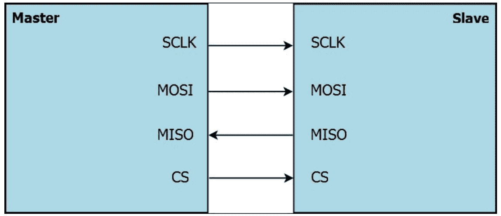

在树莓派上尽情享受 SPI 协议的乐趣；我们将通过为我们的平台开发的一个实用程序进一步探索它。

### 注意

有关 SPI 协议的更多信息，您可以访问以下网站：https://en.wikipedia.org/wiki/Serial_Peripheral_Interface_Bus

## spi-tools 项目

例如，要从 shell 脚本快速与 SPI 设备建立连接，我们建议使用一位法国工程师（Christophe Blaess）最近开发的一个小型软件包，它简化了配置和双向通信。这是一个名为 **spi-tools** 的免费项目。

该项目分为两个工具：

- **spi-config**：这允许您查看或编辑 SPI 端口的通信设置。以下是命令：

```
$ spi-config
```

- **spi-pipe**：这允许通过将标准输入和标准输出重定向到指定的 SPI 端口与设备进行全双工通信。命令如下：

```
$ spi-pipe
```

### 注意

如果您想要更多信息，请查阅 GitHub 仓库中的 readme 文件：[https://github.com/cpb-/spi-tools](https://github.com/cpb-/spi-tools)

## 在 meta-oe 层中包含

spi-tools 的优势在于它自 2015 年 4 月起已完全集成到 Yocto/OE 环境中。事实上，它是 meta-oe 层的一部分。

### 注意

您可以在此处查看初始提交：[https://github.com/openembedded/meta-oe/commit/90b13eded76f7f7fa1a6715e67c32504e7788e96](https://github.com/openembedded/meta-oe/commit/90b13eded76f7f7fa1a6715e67c32504e7788e96)

将此层引入我们的环境以使用这些实用程序很容易。在这里，我们看到了 Yocto Project 的另一个优势：灵活性。

如果您想访问此配方的元数据索引，可以访问 [http://layers.openembedded.org/layerindex/recipe/33576/](http://layers.openembedded.org/layerindex/recipe/33576/)。

如您所料，集成 spi-tools 配方的第一步是修改我们的 conf/bblayers.conf 文件，以添加层的路径：

```
# changes incompatibly
LCONF_VERSION = "6"
BBPATH = "${TOPDIR}"
BBFILES ?= ""
BBLAYERS ?= " \\
/home/packt/RASPBERRYPI/poky/meta \\
/home/packt/RASPBERRYPI/poky/meta-yocto \\
/home/packt/RASPBERRYPI/poky/meta-yocto-bsp \\
/home/packt/RASPBERRYPI/poky/meta-raspberrypi \\
/home/packt/RASPBERRYPI/poky/meta-pack_rpi \\
/home/packt/RASPBERRYPI/poky/meta-openembedded/meta-oe \ " 
BBLAYERS_NON_REMOVABLE ?= " \\
/home/packt/RASPBERRYPI/poky/meta \\
/home/packt/RASPBERRYPI/poky/meta-yocto \
```

### 注意

您可以使用以下命令下载 meta-oe 层：

```
$ git clone https://github.com/openembedded/meta-openembedded.git
```

现在我们层的路径已设置，BitBake 可以看到它，并且 spi-tools 可以与我们的根文件系统集成。为此，我们需要运行命令来创建二进制文件。

## 构建 spi-tools

为了生成软件包（ipk、rpm 或 dpkg），我们可以运行以下命令：

```
$ bitbake spitools
Loading cache: 100%
|###############################################################################|
#################################################################################|
###| ETA:  00:00:00
Loaded 2006 entries from dependency cache.
NOTE: Resolving any missing task queue dependencies
Build Configuration:
BB_VERSION        = "1.27.1"
BUILD_SYS         = "x86_64-linux"
NATIVELSBSTRING   = "Ubuntu-14.04"
TARGET_SYS        = "arm-poky-linux-gnueabi"
MACHINE           = "raspberrypi"
DISTRO            = "poky"
DISTRO_VERSION    = "1.8+snapshot-20150729"
TUNE_FEATURES     = "arm armv6 vfp arm1176jzfs callconvention-hard"
TARGET_FPU        = "vfp"
meta
meta-yocto
meta-yocto-bsp    = "master:19f77cf586fbee9e67d3698263402b717303c5ec"
meta-raspberrypi  = "master:7457bf182c8fd550ec877ecd786a3edd16e65495"
meta-pack_rpi   = "master:19f77cf586fbee9e67d3698263402b717303c5ec"
meta-oe           = "master:f637fadb106a09a6f3dfba4181d06dc9b5e82ff5"
NOTE: Executing SetScene Tasks
NOTE: Executing RunQueue Tasks
Currently 1 running tasks (373 of 381):
0: spitools-git-r0 do_configure (pid 3535)
```

或者，如果我们想将 spi-tools 集成到我们的镜像中，只需在镜像中添加以下行并运行 BitBake raspberry-pack-image：

```
# Base this image on core-image-minimal
include recipes-core/images/core-image-minimal.bb
DESCRIPTION = "Image for raspberry-pi"
IMAGE_FEATURES += "ssh-server-dropbear splash"
# Include modules in rootfs
IMAGE_INSTALL += " \
    kernel-modules \
    gpio-pact \
    spitools \
    "
```

## 在树莓派上测试

有了我们的镜像，我们现在可以运行 spi-tools 提供的实用程序。

### spi-config

要从用户空间访问 SPI 接口，内核为我们提供了 /dev 中的特殊文件作为入口点。这需要加载以下模块：

```
$ modprobe spidev
```

集成此模块后，我们可以尝试启动 spi-config 实用程序：

```
$ spi-config
spi-config: no device specified (use option -h for help)
$ spi-config -h
usage: ./spi-config options...
options:
-d --device= use the given spi-dev character device.
-q --query print the current configuration.
-m --mode=[0-3] use the selected spi mode.
0: low idle level, sample on leading edge
1: low idle level, sample on trailing edge
2: high idle level, sample on leading edge
3: high idle level, sample on trailing edge
-l --lsb={0,1} LSB first (1) or MSB first (0)
-b --bits=[7...] bits per word
-s --speed= set the speed in Hz
-h --help this screen
-v --version display the version number
```

例如，如果我们想要查询 /dev/spidev0.0 接口，可以运行：

```
$ spi-config -d /dev/spidev0.0 -q
/dev/spidev0.0: mode=0, lsb=0, bits=8, speed=500000
```

### 注意

如果您想了解有关 spi-config 的更多详细信息，可以访问 https://github.com/cpb-/spi-tools/blob/master/src/spi-config.c。

### spi-pipe

spi-pipe 程序可以将其从标准输入接收到的数据发送到 SPI MOSI 线，同时将从 MISO SPI 线接收到的数据显示在其标准输出上。

其通用操作原理如下：

```
$ <command-1> | spi-pipe [options] | <command-2>
```

例如，如果我们想将一些数据发送到另一个 SPI 外设，可以使用以下命令：

```
$ printf "HELLO from R-pi" | spi-pipe -d /dev/spidev0.0 | hexdump -C
```


## 注意

请注意，管道中的三个成员并行运行，每个运行在单独的进程中，通过同步它们之间流动的数据来实现。

## 结论

最后，以下是这些工具可用于的各种应用的示例：

- 与微控制器通信以从 ADC 检索数据
- 与 SPI flash 通信
- 与延迟线通信

我们留给你思考其他类型的应用。

## i2c 总线

i2c 协议使我们可以连接一个主组件（通常是微处理器）和多个从设备。多个主设备可以共享同一总线，同一组件可以向主设备发送从设备状态，或者反之。但是，通信仅在主设备和一个从设备之间进行。还要注意，主设备可以同时向所有从设备发送命令（例如休眠或重置请求）。

在电气层面，该协议使用在高电平和低电平之间交替的信号；最常见的值对是 (0, 5V) 和 (0, 3.3V)。SCL 时钟信号由主设备生成。串行数据 (SDA) 数据信号由主设备或从设置为高电平或低电平，具体取决于通信阶段。在 SCL 时钟高电平段的整个持续时间内，SDA 数据信号必须保持高电平或低电平，具体取决于它传输的是 1 还是 0。

最后，如下图所示，由主设备产生的特定信号配置可以指示交换的开始或结束，称为 START 和 STOP 条件。这是针对时隙时钟的 SDA 信号的一种变体。

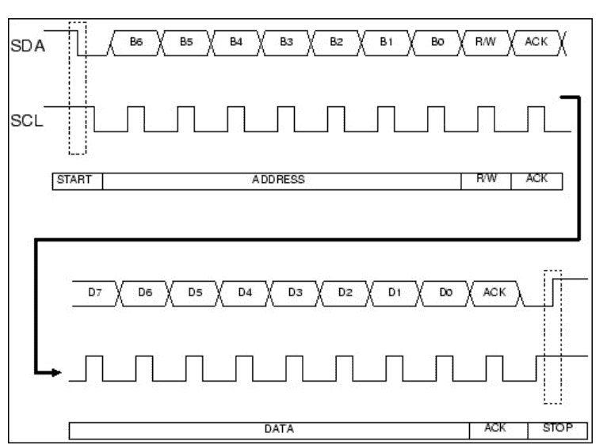

为了在我们的树莓派上测试 i2c 接口，我们将开发一个应用程序，通过 i2c 总线从 Wii Nunchuck 检索数据。

### Wii Nunchuck


Nunchuck 具有一个 X/Y 摇杆、一个 X/Y/Z 加速度计和两个按钮（Z 和 C）。

传感器数据通过 i2c 总线进行通信。

### Nunchuck 连接器

连接器包含四根线，其中两根是电源和地线。其他线用于 i2c 通信（SDA 和 SCL）。下图演示了原理：

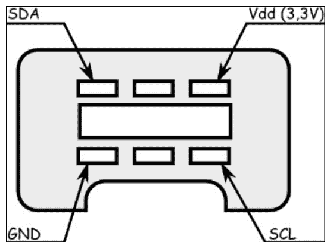

### 注意

如果您担心连接问题，可以在 https://www.sparkfun.com/products/9281 找到此控制器的适配器。

#### 树莓派连接

对于与我们的树莓派的连接，我们只需将其连接到主连接器 I2C1_SDA 和 I2C1_SCL，如该引脚图所示：

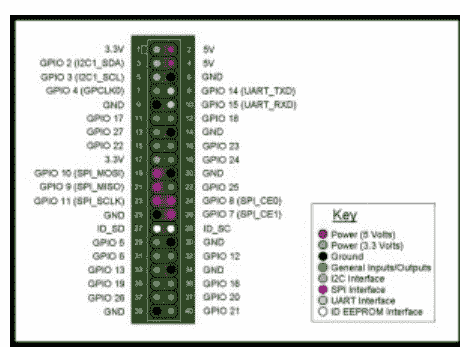

### Nunchuck 的协议

Wii Nunchuck 包含一个通过 i2c 总线通信的控制器。为了知道存储写入字节的位置，第一个字节必须是 8 位寄存器地址。换句话说，向 Nunchuck 进行的每个 write() 操作都需要一个寄存器地址字节，后跟数据字节。

对于写操作，发送到 Nunchuck 的第一个字节告诉它从哪里开始（START 条件）。

### 加密

Nunchuck 设计用于提供特定的加密链路。但是，可以通过以下过程禁用它：

- 将 0x55 写入 Nunchuck 的 0xF0 寄存器
- 暂停
- 将 0x00 写入 Nunchuck 的 0xFB 寄存器

| Write | Pause | Write | | |
|---|---|---|---|---|
| 0xF0 | 0x55 | - | 0xFB | 0x00 |

请注意，如果您拥有一个白色 Nunchuck，则过程会有所不同：

- 将 0x00 写入 Nunchuck 的 0x40 寄存器

| Write | |
|---|---|
| 0x40 | 0x00 |

### 注意

成功执行此操作后，所有数据均以未加密形式返回。

### 请求传感器数据

我们使用 Nunchuck 的全部目的是读取其传感器数据。当请求时，它应返回六个字节的数据，格式如下：

| Data byte receive | Address |
|---|---|
| Joystick X | 0x00 |
| Joystick Y | 0x01 |
| Accelerometer X (bit 9 to bit 2 for 10-bit resolution) | 0x02 |
| Accelerometer Y (bit 9 to bit 2 for 10-bit resolution) | 0x03 |
| Accelerometer Z (bit 9 to bit 2 for 10-bit resolution) | 0x04 |
| Accel. Z bit 1, Accel. Z bit 0, Accel. Y bit 1, Accel. Y bit 0, Accel. X bit 1, Accel. X bit 0, C-button, Z-button | 0x05 |

下表说明了消息序列：

| Write | Pause | Read | | | | | |
|---|---|---|---|---|---|---|---|
| 0x00 | - | 1 | 2 | 3 | 4 | 5 | 6 |

## 测试 i2c 连接

您可以使用 i2cdetect 自动检测连接的设备。树莓派上未安装 i2cdetect；使用它的最简单方法是通过我们的 raspberry-packt-image Yocto 镜像安装 i2c-tools 包，具体方法是添加 i2c-tools，如下所示：

```
# Base this image on core-image-minimal
include recipes-core/images/core-image-minimal.bb
DESCRIPTION = "Image for raspberry-pi"
IMAGE_FEATURES += "ssh-server-dropbear splash"
# Include modules in rootfs
IMAGE_INSTALL += " \\
    kernel-modules \\
    gpio-packt \\
    spitools \\
    i2c-tools \\
    "
```

之后，我们可以启动 BitBake raspberry-packt-image 命令在树莓派上对其进行测试。

为了检测 i2c 设备，我们只需在树莓派上启动以下命令：

```
$ modprobe i2c-dev
$ i2cdetect 0
WARNING! This program can confuse your I2C bus, cause data loss and worse!
I will probe file /dev/i2c-0.
I will probe address range 0x03-0x77.
Continue? [Y/n] Y
     0  1  2  3  4  5  6  7  8  9  a  b  c  d  e  f
00:          03 04 05 06 07 - - - - - - - - - - - -
10: - - - - - - - - - - - - - - - - - - - - - - - -
20: - - - - - - - - - - - - - - - - - - - - - - - -
30: - - - - - - - - - - - - - - - - - - - - - - - -
40: - - - - - - - - - - - - - - - - - - - - - - - -
50: - - - 52 - - - - - - - - - - - - - - - - - - -
60: - - - - - - - - - - - - - - - - - - - - - - - -
70: - - - - - - - -
```

如果 Nunchuck 正常工作，它将在地址 0x52 处显示在显示中。

### 注意

Nunchuck 使用 i2c 地址 0x52。如果您想了解有关树莓派上 i2c 接口的更多信息，可以访问 https://learn.adafruit.com/adafruits-raspberry-pi-lesson-4-gpio-setup/configuring-i2c。

## 创建 Nunchuck 应用程序

我们现在可以测试我们的 Nunchuck 应用程序（使用 C 语言开发）。您可以在随本书附带的代码包中找到它。

我们可以使用以下命令测试使用 SDK 编译我们的应用程序，并将其发送到树莓派：

```
$ source /opt/poky/1.7.1/environment-setup-armv6-vfp poky-linux-gnueabi
$ ${CC} nunchuck.c -o nunchuck_packt
```

## 与 meta-packt_rpi 集成

现在，我们将准备环境，以便我们的所有开发都符合 Yocto 标准。

这是我们为 Nunchuck 配方准备的自定义集成层：

```
$ tree meta-packt_rpi/
meta-packt_rpi/
├── conf
│   └── layer.conf
├── COPYING.MIT
├── README
├── recipes-core
│   └── images
│       └── raspberry-packt-image.bb
├── recipes-custom
│   ├── gpio-packt
│   │   ├── fix.patch
│   │   ├── gpio_example.c
│   │   └── gpio-packt_0.1.bb
│   ├── nunchuck
│   │   ├── nunchuck
│   │   │   └── nunchuck.c
│   └── nunchuck_0.1.bb
├── recipes-example
│   └── example
│       └── example-packt-0.1
│           ├── example.patch
│           ├── helloworld.c
│           └── example-packt_0.1.bb
├── recipes-example-bbappend
└── example-bbappend
    └── example-packt-0.1
        └── example.patch
        example-packt_0.1.bbappend
```

nunchuck_0.1.bb 文件将包含在我们的 rootfs 中实现 Nunchuck 二进制文件的配方。

## 创建 Nunchuck 配方

既然我们的应用程序功能正常，我们就可以创建配方，以便 BitBake 可以找到它。

以下是使我们能够将 Nunchuck 应用程序集成到树莓派中的配方：

```
DESCRIPTION = "nunchuck i2c example"
LICENSE="GPLv2"
LIC_FILES_CHKSUM = "file://${COMMON_LICENSE_DIR}/GPL-2.0;md5=801f808980d171dd6425610833a22dbe6"
PR = "r0"
SRC_URI = "file://nunchuck.c"
S = "${WORKDIR}"
do_compile() {
	${CC} ${CFLAGS} ${LDFLAGS} ${WORKDIR}/nunchuck.c -o    nunchuck_packt
}
do_install() {
	install -m 0755 -d ${D}${bindir}
	install -m 0755 ${S}/nunchuck_packt ${D}${bindir}
}
```

要将软件包集成到树莓派环境中，我们需要在 raspberry-packt-image 中添加以下行：

```
# Base this image on core-image-minimal
include recipes-core/images/core-image-minimal.bb
DESCRIPTION = "Image for raspberry-pi"
IMAGE_FEATURES += "ssh-server-dropbear splash"
# Include modules in rootfs
IMAGE_INSTALL += " \\
    kernel-modules \\
    gpio-packt \\
    i2c-tools \\
    spitools \\
    nunchuck \\
    "
```


## 测试 Nunchuck 应用程序

现在，我们可以启动 BitBake 并在树莓派上测试我们的程序。使用此命令：

```
$ bitbake raspberry-packt-image
```

在树莓派上，启动以下命令：

```
$ nunchuck
```

现在你可以与 Nunchuck 和 Video4Linux (V4L) 一起玩耍了。

接下来，我们将了解如何将视频支持集成到我们的环境中。

## V4L 介绍

V4L 是 Linux 的视频 API。它已集成到 Linux 内核中。它是视频软件和视频设备之间的抽象层。它允许从数码摄像机、视频采集卡、TV 和广播调谐器、网络摄像头等设备捕获视频流和图片。

例如，可以使用 OpenCV（通过 /dev/video 检索视频流）和 Qt 显示内容（使用帧缓冲区或 X11）。

## 视频支持

要添加视频支持，我们只需查看 BSP 层（meta-raspberry-pi）的 readme 文件。很明显，我们可以轻松添加视频支持：

### 2.F. 可选 - 使用 V4L2 驱动程序的视频摄像头支持

将此变量设置为启用视频摄像头支持（需要 Linux 3.12.4+）

```
VIDEO_CAMERA = "1"
```

VIDEO_CAMERA 变量必须在 conf/local.conf 中设置。

### v4l-utils 集成

要控制连接到 /dev/videoX 的设备，有一组名为 v4l-utils 的实用工具。集成这些工具很容易，像往常一样，通过我们的构建系统（Yocto/OpenEmbedded）。

要将 v4l-utils 包集成到树莓派环境中，我们必须将以下行添加到 raspberry-packt-image：

```
# Base this image on core-image-minimal
include recipes-core/images/core-image-minimal.bb
DESCRIPTION = "Image for raspberry-pi"
IMAGE_FEATURES += "ssh-server-dropbear splash"
# Include modules in rootfs
IMAGE_INSTALL += " \
	kernel-modules \
	gpio-packt \
	i2c-tools \
	spitools \
	nunchuck \
	v4l-utils \
"
```

之后，我们只需启动以下命令：

```
$ bitbake raspberry-packt-image
Loading cache: 100%
|############################################################################|
###| ETA: 00:00:00
Loaded 2057 entries from dependency cache.
NOTE: Resolving any missing task queue dependencies
Build Configuration:
BB_VERSION = "1.27.1"
BUILD_SYS = "x86_64-linux"
NATVELSBSTRING = "Ubuntu-14.04"
TARGET_SYS = "arm-poky-linux-gnueabi"
MACHINE = "raspberrypi"
DISTRO = "poky"
DISTRO_VERSION = "1.8+snapshot-20150804"
TUNE_FEATURES = "arm armv6 vfp arm1176jzfs callconvention-hard"
TARGET_FPU = "vfp"
meta
meta-yocto
meta-yocto-bsp = "master:19f77cf586fbee9e67d3698263402b717303c5ec"
meta-raspberrypi = "master:7457bf182c8fd550ec877ecd786a3edd16e65495"
meta-packt_rpi = "master:19f77cf586fbee9e67d3698263402b717303c5ec"
meta-oe
meta-multimedia = "master:f637fadb106a09a6f3dfba4181d06dc9b5e82ff5"
NOTE: Preparing RunQueue
NOTE: Executing SetScene Tasks
NOTE: Executing RunQueue Tasks
Currently 1 running tasks (558 of 566):
0: v4l-utils-1.6.2-r0 do_configure (pid 20717)
```

进程完成后，即可使用 v4l-utils。

### 注意

如果你想了解 v4l-utils 的更多信息，可以访问 http://www.linux-projects.org/modules/sections/index.php?op=viewarticle&artid=16 。

## 总结

在本章中，我们学习了如何集成一个包来测试树莓派的 SPI 接口。我们还学习了如何创建 Wii Nunchuck 应用程序，并将其部署到 Yocto Project 中。

在下一章中，我们将了解如何将媒体中心与树莓派集成。
