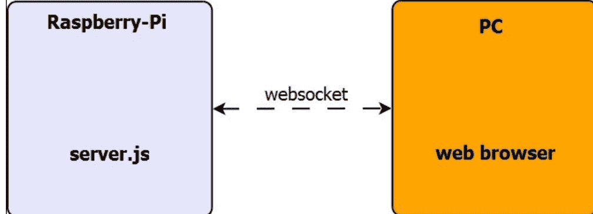
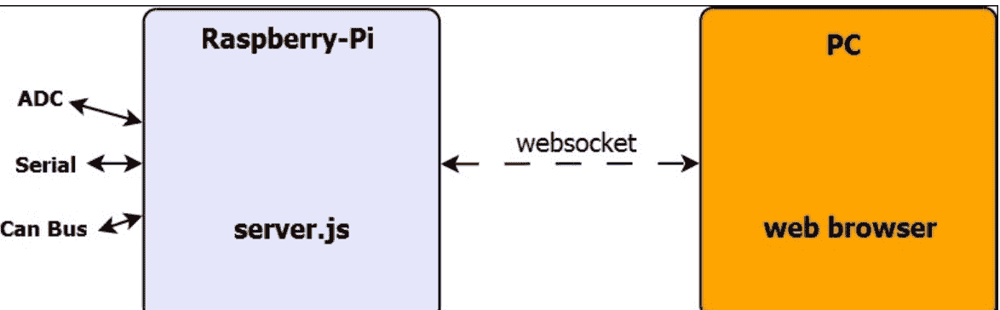

# 第 9 章 在树莓派上构建媒体中心

在本章中，我们将学习如何部署自定义应用程序，以构建嵌入式媒体中心（面板控制温度、ADC、串行等）。

我们将使用 rpm 包、init 脚本、配方和 Web 开发等方面的内容。

## 项目描述 – CPU 温度监控

此项目的想法是创建一个 Web 界面，允许例如监控 CPU 温度。

为此，我们将使用 **HTML5** 和 **nodejs** 等技术。我们还将拥有树莓派上可用的实用工具，例如 **vcgencmd**。

在此项目中，我们将使用诸如以下的技术方面：

- Websocket
- Justgage
- Nodejs

这里的想法不是解释这些技术，而是了解它们可以在 Yocto Project 中使用。

## 概述

以下图表表示项目的结构：



## 硬件/软件要求

此项目需要以下硬件和软件：

- 一台树莓派
- 一台宿主 PC
- 一张 SD 卡
- SSH/SCP

## 创建主应用程序

主项目包含多个文件。为了更好地展示，我们将只专注于两个文件：

- server.js：这是将创建我们的 Web 服务器并将数据发送到 HTML 网页的文件
- index.html：这是将在 Web 浏览器中打开以显示接收到的数据的页面

### server.js

server.js 文件在监听端口 3344 上创建一个服务器，并将负责创建一个包含树莓派 CPU 温度的套接字（rpi_temperature）。套接字函数使用（包括）vcgencmd 命令（[https://github.com/raspberrypi/firmware/blob/master/opt/vc/bin/vcgencmd](https://github.com/raspberrypi/firmware/blob/master/opt/vc/bin/vcgencmd)），允许我们监控 CPU 温度，如下所示：

```
setInterval(function()
{
    child = exec("vcgencmd measure_temp | awk -F:", function
    (error, stdout,
    stderr)
    {
    if (error != null)
    {
    console.log('exec error: ' + error);
    }
    else
    {
    var date = new Date().getTime();
    var temp = parseFloat(stdout);
    socket.emit('rpi_temperature', date, temp);
    }
    }
    }); 1000);
```

### 注意

有关 vcgencmd 的更多信息，可以访问以下页面：[http://elinux.org/RPI_vcgencmd_usage](http://elinux.org/RPI_vcgencmd_usage)

### index.html

以下是接收包含我们树莓派 CPU 温度的套接字（rpi_temperature）的函数示例：

```
$(document).ready(function(){
    socket.on('rpi_temperature', function (time, data) {
        gg1.refresh($.trim(data));
        return false;
    });
});
```

## 创建 Yocto/OE 环境

现在我们已经开发了主应用程序，剩下的就是将其与我们的 Yocto RPI 环境集成。

## 修改镜像

第一步是将 nodejs 包（位于 meta-openembedded/meta-oe/recipes-devtools/nodejs）与树莓派环境集成。为此，我们必须将以下行添加到 raspberry-packt-image：

```
# Base this image on core-image-minimal
include recipes-core/images/core-image-minimal.bb
DESCRIPTION = "Image for raspberry-pi"
IMAGE_FEATURES += "ssh-server-dropbear splash"
# Include modules in rootfs
IMAGE_INSTALL += " \\
 kernel-modules \\
 gpio-packt \\
 i2c-tools \\
 spitools \\
 nunchuck \\
 v4l-utils \\
 nodejs \\
"

```

我们现在已将 nodejs 与我们的 Poky 发行版集成。

## 创建配方文件

第二步是创建配方文件；让我们将此配方命名为 webserver-packt_01.bb。

其想法是在 recipes-custom 文件夹内具有以下架构：

```
$ tree webserver-packt/
webserver-packt/
├── webserver-packt
│   └── server.tar.gz
└── webserver-packt_01.bb
```

### 注意

server.tar.gz 压缩包包含主应用程序（nodejs + HTML5）。

要创建此配方，我们将使用 recipetool 命令，如下所示：

```
$ source oe-init-build-env rpi-build
$ recipetool create -d -o webserver-packt_0.1.bb ../meta-packt_rpi/recipes-custom/webserver-packt/webserver-packt/
$ cp webserver-packt_0.1.bb ../meta-packt_rpi/recipes-custom/webserver-packt/
```

### 注意

recipetool 命令的完整文档在线位于 http://www.yoctoproject.org/docs/1.8/mega-manual/mega-manual.html#new-recipe-creating-the-base-recipe-using-recipetool 。

现在我们只需将包含源代码的完整存档（server.tar.gz）复制到 ${datadir}（/usr/share/）；此步骤在 do_install() 块中执行，如下所示：

```
DESCRIPTION = "Panel to monitor rpi temperature"
LICENSE = "GPLv2"
LIC_FILES_CHKSUM =
"file://${COREBASE}/meta/COPYING.GPLv2;md5=751419260aa954499f7abaabaa882bbe"

# Package Release
PR = "r0"

# Use local tarball
SRC_URI = " \\
file://server.tar.gz \\
"

RDEPENDS_${PN} += "bash"

# Make sure our source directory (for the build) matches the directory structure in
the tarball
S = "${WORKDIR}"

do_install() {
install -d ${D}${datadir}/server-packt
```


cp -a ${S}/server ${D}${datadir}/server-packet
}

## 包文件
FILES_${PN} += "${datadir}/server-packet"

## 说明

让我们来看看这些变量的作用：

- RDEPENDS_{PN} 变量列出了构建包正常运行所需的运行时依赖项，这些依赖项必须安装。在我们的例子中，bash 对 nodejs 是必需的。
- FILES_{PN} 变量包含放置到包中的目录或文件列表。在我们的例子中，server-packet 是必需的。

我们现在已准备好可用的环境。如果我们要将应用程序部署到 Raspberry Pi 上，可以使用以下命令。

主机命令如下：

```
$ bitbake webserver-packet
$ scp tmp/deploy/rpm/arm1176jzfshf_vfp/webserver-packet-0.1-r0.arm1176jzfshf_vfp.rpm root@ip_address_of_rpi:/home/
```

以下是 Raspberry Pi 命令：

```
$ rpm -ivh webserver-packet-0.1-r0.arm1176jzfshf_vfp.rpm
$ rm webserver-packet-0.1-r0.arm1176jzfshf_vfp.rpm
$ node /usr/share/server-packet/server/server.js
```

## 自动启动 - init 文件

如果我们想要一个独立的应用程序，那么在 Raspberry Pi 启动序列期间自动启动我们的应用程序将很有趣。为此，我们将使用直接继承自 System V 的 init 脚本。

第一步是在我们的结构中创建一个 .init 文件。我们将此文件命名为 server.init。目录结构如下：

```
$ tree webserver-packt/
webserver-packt/
├── webserver-packt
│   ├── server.init
│   └── server.tar.gz
└── webserver-packt_0.1.bb
```

因此，该脚本将在安装后以及每次 Raspberry Pi 启动时自动启动应用程序。以下是来自 System V 的 init 脚本：

```bash
#!/bin/bash
### BEGIN INIT INFO
# Provides:          server.init
# Required-Start:    $remote_fs $syslog
# Required-Stop:     $remote_fs $syslog
# Default-Start:     2 3 4 5
# Default-Stop:      0 1 6
# Short-Description: Start daemon at boot time
# Description:       Enable service provided by daemon.
### END INIT INFO
DAEMON=node
NAME=server.init
DESC="Nodejs app"
ARGS="/usr/share/server-packt/server/server.js"
set -e
usage()
{
    echo "---------------------------------------"
    echo "Usage: $0 (stop|start|restart)"
    echo "---------------------------------------"
}
service_start()
{
    echo -n "starting $DESC: $NAME... "
    start-stop-daemon -S -x $DAEMON -- $ARGS &
    echo "done."
}
echo ""

service_stop()
{
    echo -n "stopping $DESC: $NAME... "
    start-stop-daemon -K -x $DAEMON
    echo "done."
}

case $1 in
    stop)
        service_stop
        echo ""
        ;;
    start)
        service_start
        echo ""
        ;;
    restart)
        service_stop
        service_start
        echo ""
        ;;
    *)
        usage
        ;;
esac
exit 0
```

## 说明

让我们来看看代码的工作原理：

- DAEMON 变量指定要启动的二进制文件 (/usr/bin/node)
- NAME 变量指定脚本名称
- DESC 变量包含关于 DAEMON (node) 的一些信息
- ARGS 变量包含要传递给 DAEMON (node) 的参数

如果要在 Raspberry Pi 上测试此脚本，请使用以下命令：

```
$ scp server.init root@ip_address_of_rpi:/etc/init.d
$ cd /etc/init.d
$ update-rc.d server.init defaults
```

此命令停止应用程序：

```
/etc/init.d/server.init stop
```

此命令重启应用程序：

```
/etc/init.d/server.init restart
```

## 自动启动 - 配方文件

将我们的 init 文件添加到 webserver-packt.bb 配方中包括：

- 将 server.init 文件添加到 SRC_URI。
- 为我们的 init 脚本添加 do_install() 步骤。
- 包含 update-rc.d。在 Yocto 中添加此功能，需要在配方中添加 inherit update-rc.d。

以下是更新后的 webserver-packt.bb：

```
DESCRIPTION = "Panel to monitor rpi temperature"
LICENSE = "GPLv2"
LIC_FILES_CHKSUM =
"file://${COREBASE}/meta/COPYING.GPLv2;md5=751419260aa954499f7abaabaa882bbe"

# Package Release
PR = "r0"

# Use local tarball
SRC_URI = " \\
 file://server.tar.gz \\
 file://server.init \\
 "

RDEPENDS_${PN} += "bash"

# Make sure our source directory (for the build) matches the directory structure in
the tarball
S = "${WORKDIR}"

do_install() {
   install -d ${D}${datadir}/server-packt
   cp -a ${S}/server ${D}${datadir}/server-packt

   install -d ${D}${sysconfdir}/init.d/
   install -m 0755 ${WORKDIR}/server.init ${D}${sysconfdir}/init.d/server-packt-init
}

# Package files
FILES_${PN} += "${datadir}/server-packt"

inherit update-rc.d

INITSCRIPT_NAME = "server-packt-init"
INITSCRIPT_PARAMS = "start 99 5 2 . stop 19 0 1 6 ."
```

## 说明

以下是对更新后的 webserver-packet.bb 文件的说明：

- `INITSCRIPT_NAME` 变量表示初始化脚本的文件名，安装后位于 `/etc/init.d`。
- `INITSCRIPT_PARAMS` 变量指定传递给 `update-rc.d` 的选项。在我们的例子中，脚本的运行级别为 99，在 init 级别 2 和 5 启动，在级别 0、1 和 6 停止。

## 注意

如果要了解 update-rc.d 的更多信息，可以访问 Yocto Project 的官方文档：http://www.yoctoproject.org/docs/1.8/mega-manual/mega-manual.html#ref-classes-update-rc.d

## 部署 raspberry-pckt-image

现在我们有了一个功能应用程序 (webserver-pckt)，可以将其添加到自定义镜像 raspberry-pack-image 中：

```
# Base this image on core-image-minimal
include recipes-core/images/core-image-minimal.bb
DESCRIPTION = "Image for raspberry-pi"
IMAGE_FEATURES += "ssh-server-dropbear splash"
# Include modules in rootfs
IMAGE_INSTALL += " \\
 kernel-modules \\
 gpio-pckt \\
 i2c-tools \\
 spitools \\
 nunchuck \\
 v4l-utils \\
 nodejs \\
 webserver-pckt \\
 "
```

做完之后，我们可以开始创建镜像，然后将其挂载到 SD 卡上：

```
$ bitbake raspberry-pckt-image
```

## 测试应用程序

要在 Raspberry Pi 上测试应用程序，只需在您喜欢的浏览器中访问以下地址：

http://raspberry-pi-ip-address:3344

如果整个环境已正确配置，您应该看到以下页面：


## 本项目的未来

我们探讨了服务器的基本思路，您应该能够对其进行改进，使其尽可能具备工业级水平。可以轻松想象以下应用：

- 监控主板上存在的 ADC
- 通过 HTML 页面向设备发送串行命令 (node-serial)
- 监控 CAN-bus 设备 ( https://github.com/sebi2k1/node-can )

最终项目可能类似于这样：



## 摘要

在本章中，我们学习了如何创建 Web 界面、如何将其集成到现有环境中，以及如何将其部署到 Raspberry Pi 上。

在下一章中，我们将学习 Linux 内核的一些基础知识，以及如何配置内核以支持各种 LCD 触摸屏。本章还将介绍如何设置 Yocto 项目，以在使用 LCD 触摸屏的 Raspberry Pi 上运行图形应用程序或窗口系统。
