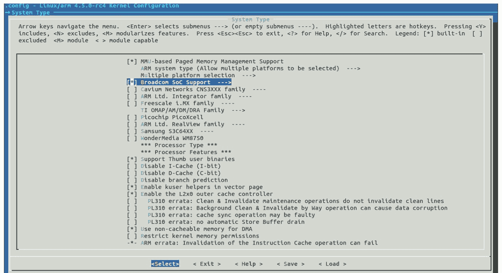
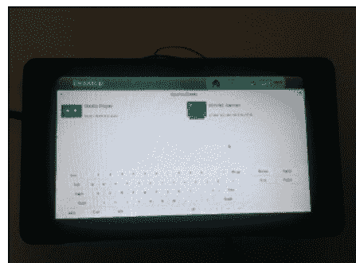
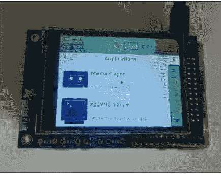
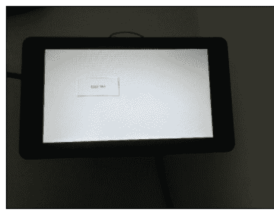

# 第 10 章 使用 LCD 触摸屏和 Linux 内核

在使用嵌入式 Linux 系统设置 LCD 触摸屏时，建议具备 Linux 内核及其配置的基础知识。在本章中，我们将学习 Linux 内核的一些基础知识，以及如何使用交叉编译器下载、配置和编译它。在 Raspberry Pi 上运行基于 Linux 的系统时，目前的建议是使用 Raspberry Pi Linux 内核而非主线 Linux 内核；我们将在本章中了解原因。

在本章后面，我们将了解如何使用 Raspberry Pi 7 触摸屏和 PiTFT 2.8 触摸屏，启动基于 Yocto Project 并带有窗口系统的镜像。本章将以使用 Qt 应用程序框架为 Raspberry Pi 开发可通过触摸屏操作的图形应用程序的演示结束。


## Linux 内核

Linux 内核是 Linus Torvalds 在 1991 年创建的类 Unix 操作系统内核。它最初是为 32 位 x86 个人电脑开发的，但如今，Linux 还支持 ARM、PowerPC、MIPS 和 SPARC 等多种架构。Linux 内核是 Linux 发行版（如 Ubuntu、Debian 和 Fedora）的基本组成部分。

在决定为项目选择哪个内核时，了解内核发布的工作方式很有帮助。根据您的需求，可以在 **主线**、**开发中** 或 **稳定** 内核之间进行选择。如果您不从事内核开发，建议避免使用主线内核，因为它仍在开发中，被视为不稳定。内核在从主线树发布后立即被视为稳定版本。之后，内核将一直维护，直到下一个主线内核可用（通常需要 2-3 个月）。然而，内核可以被选为长期支持内核，这意味着它将维护较长一段时间（几年）。长期支持内核通常用于商业项目，因为这些项目需要稳定且受支持的基础，并且可以长时间移植重要的错误修复和安全修复。

### 注意

访问 [关于内核发布](https://www.kernel.org/releases.html) 了解更多详情。

## Linux 内核与 Raspberry Pi Linux 内核

目前推荐用于 Raspberry Pi 的内核是官方的 Raspberry Pi Linux 内核（https://github.com/raspberrypi/linux.git）。之所以需要为 Raspberry Pi 使用特定的内核（而不是使用主线 Linux 内核），主要是因为 Raspberry Pi 需要专有固件/GPU 二进制 Blob。不过，2014 年，Broadcom 在三条款 BSD 许可下发布了 VideoCore IV 图形核心的完整文档，连同图形堆栈的完整源代码。这导致主线对 bcm2835（Raspberry Pi 使用的 SoC）的支持与 Raspberry Pi Linux 内核的支持之间的差距显著缩小。尽管如此，主线内核中仍有一些艰巨的工作要做，例如视频解码和摄像头支持。此外，一些重要的驱动程序，如 rpi-ft5406（用于官方 Raspberry Pi 触摸屏），仍然不存在于主线 Linux 内核中。

### 注意

在 http://elinux.org/RPi_Upstreaming 上了解 Raspberry Pi 内核向主线内核合并的当前状态的更多信息。

## 开始使用 Linux 内核

在本章的这一部分中，我们将介绍如何下载、配置和编译自定义 Linux 内核。

可以从 kernel.org 下载不同主线版本的内核，可以是归档文件，也可以通过 GitHub。在示例中，我们将使用内核版本 4.1，因为它目前是 meta-raspberrypi 的默认版本。您可以通过搜索 PREFERRED_VERSION_linux-raspberrypi 轻松找到 meta-raspberrypi 的默认版本，如下所示：

```
$ cd meta-raspberrypi
$ git grep PREFERRED_VERSION_linux-raspberrypi
conf/machine/include/rpi-default-versions.inc:PREFERRED_VERSION_linux-raspberrypi
?= "4.1.1%"
```

首先下载内核，然后切换到 4.1 分支：

```
$ cd /path/to/workdir
$ git clone https://git.kernel.org/cgit/linux/kernel/git/stable/linux-stable.git/
$ git checkout -b linux-4.1.y -t remotes/origin/linux-4.1.y
```

请记住，在为 Raspberry Pi 构建时，https://github.com/raspberrypi/linux.git 是受支持的内核仓库。使用方法如下：

### 注意

```
$ git clone https://github.com/raspberrypi/linux.git
$ git checkout -b rpi-4.1.y -t remotes/origin/rpi-4.1.y
```

接下来，我们可以开始使用内核了。首先，我们需要决定使用什么配置；所有现有配置都位于内核源代码树的 arch/*/configs/ 下。稍后，我们将了解如何对内核进行自定义，但目前，我们将先使用 ARM 平台的预定义配置。在主机上构建时，需要为 ARM 架构设置交叉编译器，在这里是 bcm2835（正好是 Raspberry Pi 的 CPU 系列）。使用此命令：

```
$ make O=/path/to/output_dir CROSS_COMPILE=/path/to/arm-linux-gnueabi- ARCH=arm bcm2835_defconfig
make[1]: Entering directory '/path/to/output_dir'
    HOSTCC  scripts/basic/fixdep
    GEN     ./Makefile
    HOSTCC  scripts/kconfig/conf.o
    SHIPPED scripts/kconfig/zconf.tab.c
    SHIPPED scripts/kconfig/zconf.lex.c
    SHIPPED scripts/kconfig/zconf.hash.c
    HOSTCC  scripts/kconfig/zconf.tab.o
    HOSTLD  scripts/kconfig/conf
#
# configuration written to .config
#
```

```
make[1]: Leaving directory '/path/to/output_dir'
```

该命令将确保所选配置、Makefile 以及指向原始源代码树的符号链接存储在输出目录中。使用输出目录不是强制性的；您可以直接在内核源代码树中构建。但是，强烈建议指定输出目录，以避免主内核树出现问题，并使其保持不受构建结果的影响。接下来，我们可以开始构建内核。如果在多核机器上构建，建议使用 -j 标志以加快构建速度。

```
$ make O=/path/to/output_dir CROSS_COMPILE=/path/to/arm-linux-gnueabi- ARCH=arm -j4
make[1]: Entering directory '/path/to/output_dir'
  GEN     ./Makefile
  scripts/kconfig/conf --silentoldconfig Kconfig
make[1]: Leaving directory '/path/to/output_dir'
make[1]: Entering directory '/path/to/output_dir'
  CHK     include/config/kernel.release
  GEN     ./Makefile
  WRAP    arch/arm/include/generated/asm/bitsperlong.h
  WRAP    arch/arm/include/generated/asm/cputime.h
  WRAP    arch/arm/include/generated/asm/current.h
  ...
  OBJCOPY arch/arm/boot/zImage
  Kernel: arch/arm/boot/zImage is ready
make[1]: Leaving directory '/path/to/output_dir'
```

如果要更改内核的配置，可以使用名为 menuconfig 的预定义目标。它将为您提供一个菜单，其中包含内核所有可配置部分的条目。可以在菜单中搜索关键字以查找请求的配置选项；方法是键入 / 后跟关键字。在菜单中键入 ? 将显示所选配置选项的简短说明。

```
make O=/path/to/output_dir CROSS_COMPILE=/path/to/arm-linux-gnueabi- ARCH=arm menuconfig
```

以下是使用 menuconfig 的示例。M 符号表示驱动程序将作为单独的模块构建，可以按需由内核加载/卸载。



保存新配置后，可以按照本章前面描述的同样方式构建内核。

## 在 Yocto 中配置内核

使用 Yocto 时，可以使用 BitBake 来配置和编译内核。以下示例将向您展示如何在 Yocto 项目中执行这些步骤，以 Raspberry Pi 内核为例：

```
$ cd /path/to/project
$ bitbake linux-raspberrypi -c menuconfig
```

进行修改并保存新的 defconfig，然后运行此命令：

```
$ bitbake linux-raspberrypi
```

如前几章所述，这些命令会在后台为您设置交叉编译器。在 Yocto 项目中，可以获取自定义的内核配置文件（.config）并将其放入内核配方中。然后，需要将其命名为 defconfig，并在配方的 SRC_URI 变量中指向它。这将导致内核使用 defconfig 文件作为默认配置进行构建。还可以使用称为 fragments 的功能，可以在名为 <somename>.cfg 的文件中添加内核配置选项片段。添加到 SRC_URI 变量后，它将使用片段中的信息更新内核配置。对于 linux-raspberrypi（meta-raspberrypi 中的内核配方），不能使用 defconfig or


片段，因为它直接从内核仓库（bcmrpi_defconfig 或 bcm2709_defconfig）获取内核配置并覆盖 defconfig 文件。要更改 meta-raspberrypi 的内核配置选项，有几种可能性。第一个选项是为内核创建一个集成补丁，用于修改内核树中所选的 defconfig 文件，然后通过内核配方应用该补丁，如下所示：

```
diff --git a/recipes-kernel/linux/linux-raspberrypi_4.1.bb b/recipes-kernel/linux/linux-raspberrypi_4.1.bb
index 3a3cf40..bddf79b 100644
--- a/recipes-kernel/linux/linux-raspberrypi_4.1.bb
+++ b/recipes-kernel/linux/linux-raspberrypi_4.1.bb
@@ -1,6 +1,8 @@
LINUX_VERSION ?= "4.1.10"

SRCREV = "b74df9228c27f55361c065bc5dbfba88861cc771"
-SRC_URI = "git://github.com/raspberrypi/linux.git;protocol=git;branch=rpi-4.1.y"
+SRC_URI = "git://github.com/raspberrypi/linux.git;protocol=git;branch=rpi-4.1.y \
+    file://0001-bcmrpi_defconfig-add-debug.patch \
+    "
```

另一个选项是使用 meta-raspberrypi 中 linux.inc 的 kernel_configure_variable 函数，然后使用该函数前置内核配方的配置：

```
diff --git a/recipes-kernel/linux/linux.inc b/recipes-kernel/linux/linux.inc
index fae78b7..12eec7e 100644
--- a/recipes-kernel/linux/linux.inc
+++ b/recipes-kernel/linux/linux.inc
@@ -107,6 +107,8 @@ do_configure_prepend() {
       # Activate CONFIG_LEGACY_PTYS
       kernel_configure_variable LEGACY_PTYS y

+      kernel_configure_variable TOUCHSCREEN_STMPE y
+
       # Keep this the last line
       # Remove all modified configs and add the rest to .config
       sed -e "${CONF_SED_SCRIPT}" < '${WORKDIR}/defconfig' > '${B}/.config'
```

## 使用 LCD 支持配置内核

在将 LCD 显示器与树莓派一起使用时，您的内核必须满足某些要求，以确保显示器功能齐全。首先，您需要知道要使用的内核是否支持您的显示器。将旧内核版本与全新显示器配合使用通常会出现问题，因为为您的显示器所需的驱动程序在开发旧内核时尚不存在，而新驱动程序很少会被回移植到旧内核版本。这为您提供了两种选择。第一个是亲自尝试回移植所需驱动程序的艰苦工作。即使是经验丰富的内核开发人员，这也非常困难且往往难以实现，具体取决于需要回移植的内核有多旧。另一种更合适的解决方案是使用包含您的显示器驱动程序的较新内核版本。

即使您的内核包含了运行显示器所需的所有组件，您也必须确保所有驱动程序都已启用。从内核版本 3.18 开始，树莓派官方支持一种称为设备树的机制，可用于简化内核的配置。

在本小节中，我们将讨论以下主题：

- 设备树：它是什么以及如何在树莓派上使用
- 从内核角度配置触摸屏：如何在树莓派上配置内核以处理不同的触摸屏

### 树莓派设备树

一个 **设备树 (DT)** 是包含设备硬件描述的树形数据结构。DT 可以管理资源分配和处理模块加载，从而缓解驱动程序争夺系统资源的问题。对于 ARM 架构，**设备树源 (DTS)** 文件存储在内核树的 `/arch/arm/boot/dts` 下。当内核构建时，DTS 文件会被编译成 **设备树二进制文件 (DTBs)**。要使用 DT，固件和内核都必须支持它，因为引导加载程序将负责与内核一起加载 DTB（第三阶段引导加载程序 `start.elf` 将把设备树二进制文件传递给树莓派）。

### 注意

树莓派使用其 GPU (VideoCore IV) 来启动系统。它首先加载其一级引导加载程序。这样可以访问并运行二级引导加载程序 `bootcode.bin`（位于 SD 卡上）。二级引导加载程序在 GPU 上执行，并将加载名为 `start.elf` 的三级引导加载程序。三级引导加载程序的主要职责是读取和解析配置，并将其传递给 GPU 和内核，同时加载内核映像。`bootcode.bin` 和 `start.elf` 引导加载程序以及配置（例如 `cmdline.txt` 和 `config.txt`）位于 SD 卡上。

将 DTB 传递给不支持设备树的内核将阻止映像启动。为了以通用方式处理此问题，引导加载程序使用 `mkknlimg` 工具添加的尾块来检查内核是否支持 DT。

树莓派的设备树管理使用 `config.txt` 文件来完成。基础设备树位于 /boot 分区中，与 start.elf 并存，命名为 bcm*-rpi-b[-plus].dtb（A 和 A+ 型号兼容，应该使用 B 和 B+ 设备树）。以下示例展示了如何在 config.txt 中启用 i2c 接口、添加 HiFiBerry 支持，并确保加载树莓派 B+ 的基础 DT：

```
dtparam=i2c=on
dtoverlay=bcm2708-rpi-b-plus
dtoverlay=hifiberry-dacplus
```

使用最新固件时，加载程序会根据您的硬件尝试默认加载其中一个基础设备树，无需您在 config.txt 中指定。

## 从内核角度配置触摸屏

在本小节中，我们将介绍 PiTFT 2.8 触摸屏和树莓派 7 触摸屏所需的基本内核配置。

首先，我们需要为基础配置选择应使用的配置。使用 meta-raspberrypi 时，在 local.conf 中将 MACHINE 变量指定为 raspberrypi 或 raspberrypi2 后，构建系统将自动处理此事。使用自定义内核时，我们需要知道哪个现有配置适合我们的树莓派型号。目前有三种选择：bcmrpi_defconfig（第一代树莓派）、bcm2709_defconfig（第二代树莓派）或 bcm2835_defconfig（仅在较新内核版本中完全支持）。在我们的示例中，我们将使用树莓派 2。配置决定后，我们可以开始执行内核的基本配置，如下所示：

```
$ cd /path/to/rpi_kernel_repo
$ mkdir -p /path/to/output_dir
$ O=/path/to/output_dir CROSS_COMPILE=/path/to/arm-linux-gnueabi- ARCH=bcm2709_defconfig
```

使用 BitBake 和 meta-raspberrypi，您需要执行以下操作：

```
$ bitbake linux-raspberrypi -c configure
```

### 注意

对于自定义内核，config 将存储在 /path/to/kernel_output/.config。使用 Yocto 和 meta-raspberrypi 时，它将存储在 . /tmp/work/raspberrypi*-poky-linux-gnueabi/linux-raspberrypi/<kernel_version_and_revision>/linux-raspberrypi*-standard-build/.config。

一旦基本配置就绪，我们可以检查它是否包含启动显示器所需的最基本配置。请注意，以下配置目前在树莓派配置中默认启用。

对于 PiTFT 2.8，必须启用这些选项：

```
CONFIG_INPUT_TOUCHSCREEN=y
CONFIG_OF_TOUCHSCREEN=y
CONFIG_TOUCHSCREEN_STMPE=m
CONFIG_FB_TFT_FBTFT_DEVICE=m
```

除了通用触摸屏支持配置外，我们还需要确保构建 stmpe 和 fbtft 设备。stmpe_ts 设备用于为 PiTFT 提供可用的触摸功能。fbtft 设备是一种用于小型 TFT LCD 显示器（例如 PiTFT）的帧缓冲区驱动程序。该设备支持 SPI 和 GPIO 的使用（PiTFT 显示器使用它们），并确保显示器已注册并被内核识别。除了这些选项外，还需要进行 SPI 和 i2c 的基本设置才能让一切运行起来。

在本书中，我们将假设使用具有树莓派设备树支持的内核版本（内核 3.18+）。这意味着我们需要修改 config.txt 以确保所需部分通过设备树自动加载，如下所示：

```
dtparam=spi=on
dtparam=i2c1=on
dtparam=i2c_arm=on
dtoverlay=pitft28r, rotate=90, speed=32000000, fps=20
```

对于官方树莓派 7，只需启用以下内容：

```
CONFIG_INPUT_TOUCHSCREEN=y
CONFIG_OF_TOUCHSCREEN=y
CONFIG_TOUCHSCREEN_RPI_FT5406=m
```

然后，在 config.txt 中启用 ft5406 overlay：

```
dtoverlay=rpi-ft5406
```

我们已了解内核与树莓派上某些常见触摸屏型号正常工作所需的基本配置。在下一节中，我们将学习如何使用 Yocto Project 设置这些部分以及所需的用户空间设置。


## 使用 Yocto Project 为 Raspberry Pi 配置 LCD 显示器

Raspberry Pi 有多种不同的 LCD 显示屏可供选择。其中最流行的包括官方的 Raspberry Pi 7 触摸屏和 PiTFT 显示屏（通常称为 PiTFT HAT，因为它们适合安装在 Raspberry Pi 上方）。目前，我们将重点介绍 Raspberry Pi 7 触摸屏和 PiTFT 型号。

在本节中，我们将介绍如何启动标准的 Yocto Project 镜像，该镜像包含窗口系统和可用的触摸屏。

### Raspberry Pi 7 触摸屏

使用基于 Yocto Project 的镜像入门 Raspberry Pi 7 触摸屏需要进行多项配置。首先，我们需要确保使用的是 4.1+ 内核。从 meta-raspberrypi 的 **jethro** 版本开始，4.1 是默认版本。目前，meta-raspberrypi 对 Raspberry Pi 7 触摸屏的支持尚不完整，因此在启动镜像之前，我们需要进行一些小的修改。

### 注意

Raspberry Pi 7 触摸屏的构建说明可在 https://www.adafruit.com/images/product-files/2718/2718build.jpg 上找到。该显示屏适用于 Raspberry Pi A/B 板；但是，显示屏背面的安装孔仅与 A+、B+ 以及 Raspberry Pi 2/3 对齐。

```
$ source /path/to/poky/oe-init-build-env my_project
```

如果使用 meta-raspberrypi 的默认设置，我们将拥有一个受支持的内核，其中所有必需的配置选项默认处于启用状态。为保险起见，您可以浏览本章的前面部分，以确保内核已正确配置以适用于您的显示屏。考虑到这一点，我们可以从创建新项目开始：

```
$ cat local/bblayers.conf
# LAYER_CONF_VERSION is increased each time build/conf/bblayers.conf
# changes incompatibly
LCONF_VERSION = "6"
BBPATH = "${TOPDIR}"
BBFILES ?= ""
BBLAYERS ?= " \
/path/to/poky/meta \
/path/to/poky/meta-yocto \
/path/to/poky/meta-yocto-bsp \
/path/to/meta-raspberrypi \
/path/to/meta-openembedded/meta-oe \
/path/to/meta-openembedded/meta-multimedia \
"
BBLAYERS_NON_REMOVABLE ?= " \
/path/to/poky/meta \
/path/to/poky/meta-yocto \
"
```

### 注意

如果您尚未为本书中的早期示例克隆 OpenEmbedded 层，可以使用以下命令完成：$ git clone git://git.openembedded.org/meta-openembedded

我们还需要对 local.conf 进行一些修改：

```
$ echo "MACHINE = \"raspberrypi\"" >> conf/local.conf (Or MACHINE=raspberrypi2)
$ echo "LICENSE_FLAGS_WHITELIST = \"commercial\"" >> conf/local.conf
```

完成此操作后，我们即可开始新构建。默认情况下，meta-raspberrypi 将确保例如为触摸屏设置输入设备以及相应的 udev 规则。这些设置将在构建期间无缝应用：

```
$ bitbake core-image-sato
```

将新镜像写入 SD 卡后，我们还需要确保已加载触摸屏所需的所有驱动程序。这可以通过将此行添加到 SD 卡启动分区中 config.txt 文件的末尾来完成：

```
$ echo "dtoverlay=rpi-ft5406" >> /path/to/sdcard/boot/config.txt
```

现在，您已经准备就绪，可以使用 Raspberry Pi 7 触摸屏启动带有触摸支持的窗口系统了。



*运行 core-image-sato 的 Raspberry Pi 7 触摸屏*

### PiTFT 2.8 电阻式触摸屏

meta-raspberrypi 中对 PiTFT 显示屏的原生支持是较新的功能。请查看 meta-raspberrypi 的 readme 文件中的“启用 PiTFT 支持”部分，以确认您的 PiTFT 型号是否受支持。

使用 Yocto Project，可以为任何现有（或自定义）Raspberry Pi 镜像配置 PiTFT 支持。该支持已作为 `MACHINE_FEATURES` 添加到 meta-raspberrypi 中。`MACHINE_FEATURES` 变量是 Yocto Project 的标准功能，可用于为您要构建的目标添加硬件功能。Yocto Project 中存在一组预定义的 `MACHINE_FEATURES` 功能，其中包括 Wi-Fi、键盘、Alsa 和 Bluetooth 等。在 Raspberry Pi BSP 层中，其中一些功能默认处于启用状态：

```
$ grep "MACHINE_FEATURES " conf/machine/include/rpi-base.inc
MACHINE_FEATURES += "kernel26 apm usbhost keyboard vfat ext2 screen touchscreen
alsa bluetooth wifi sdio"
```

PiTFT 支持需要两个新的 `MACHINE_FEATURES` 功能：一个名为 `pitft` 的通用功能和一个特定于型号的版本。在本示例中，我们将使用 `pitft28r`，它对应于 PiTFT 2.8 电阻式触摸屏。添加新 `MACHINE_FEATURES` 功能的最简单方法是将其添加到项目中的本地配置文件：

```
$ cd /path/to/my/rpi/project
$ echo "MACHINE_FEATURES += "pitft pitft28r"" >> conf/local.conf
```

这将添加对运行控制台镜像或窗口系统镜像的支持。pitft 功能将在内部确保启用 SPI 和 i2c。它还将配置帧缓冲区以处理 PiTFT 显示屏（从 /dev/fb0 更改为 /dev/fb1）。特定于型号的计算机功能（本示例中的 pitft28r）会将特定于型号的设备树叠加层添加到 config.txt，为屏幕设置适当的配置（例如方向和速度），并确保加载触摸功能所需的 stmpe 模块。它还会为触摸屏添加一些默认校准数据。在设置好 `MACHINE_FEATURES` 功能后，我们可以构建镜像，将其加载到 SD 卡，然后启动：

```
$ bitbake core-image-sato
```



*运行 core-image-sato 的 PiTFT 2.8 电阻式触摸屏*

启动 Raspberry Pi 时，LCD 最初会变为白色。过一段时间，它应该会再次变为黑色，这意味着内核已识别屏幕。不久之后，您应该可以使用窗口系统了。“2.8”屏幕相当小，但可以使用虚拟键盘在终端中输入例如简单命令。触摸屏已为您使用默认值进行了校准，这些值适合您的屏幕和旋转方向。如果您认为默认校准不足，例如，如果您想更改显示方向（默认 90 度），可以使用例如 ts_calibrate 重新校准它。

### 注意

```
ts_calibrate is part of the tslib recipe in Poky. It's included by default when building core-image-sato, and it can easily be added to a custom image by specifying MACHINE_FEATURES += "touchscreen"
```

### 在 LCD 显示器上开发应用程序并使用它们

此时，我们已在 Raspberry Pi 上运行基于 Yocto Project 且支持 PiTFT 显示屏的镜像。在本节中，我们将开发一个可用于我们花哨触摸屏的图形应用程序。在开发图形应用程序时，存在几种不同的框架。Qt 是嵌入式设备最著名的图形框架之一，并提供免费软件版本。在本节中，我们将介绍如何使用 Qt 和 EGLFS 为嵌入式 Linux 环境设置和开发图形应用程序。Qt 是一种跨平台应用程序框架，因此除了可以在各种类型的硬件上运行外，还可以在许多不同的软件平台（例如 X11、OS X、Windows 和 EGLFS）上使用。我们在示例中将使用的 EGLFS，基本上是一种平台插件，用于在 EGL 和 OpenGL ES 之上运行 Qt 应用程序。事实上，它甚至不需要窗口系统（例如 X11）即可工作，这使其非常适合嵌入式 Linux。

### 使用 Qt 开发自定义应用程序

使用 Yocto Project 开发基于 Qt 的应用程序时，我们需要在自己的层中设置 Qt。开发图形应用程序有两种标准方法：针对导出的 SDK 构建应用程序，或为应用程序创建新的配方。在本示例中，我们将针对导出的 SDK 开发我们的应用程序。为了成功让新应用程序在目标上构建和运行，我们需要执行以下步骤。

- 添加 Qt 所需的外部层
- 导出包含 Qt 支持的 SDK
- 创建 Qt 应用程序并针对导出的 SDK 构建它
- 为目标设置带有 Qt 支持的镜像
- 在官方 Raspberry Pi 7" 触摸屏上运行 Qt 应用程序

存在多种不同的 Qt 版本，其中 Qt5 是最新版本。在开发我们的新应用程序时，我们将使用 meta-qt5 外部层。首先，我们需要下载 meta-qt5 并在项目中启用其使用：

```
$ git clone https://github.com/meta-qt5/meta-qt5.git
```

将 meta-qt5 添加到 local/bblayers.conf：

```
$ cat local/bblayers.conf
# LAYER_CONF_VERSION is increased each time build/conf/bblayers.conf
# changes incompatibly
LCONF_VERSION = "6"

BBPATH = "${TOPDIR}"
BBFILES ?= ""

BBLAYERS ?= " \
/path/to/poky/meta \
/path/to/poky/meta-yocto \
/path/to/poky/meta-yocto-bsp \
/path/to/meta-raspberrypi \
/path/to/meta-openembedded/meta-multimedia \
/path/to/meta-qt5 \
"
BBLAYERS_NON_REMOVABLE ?= " \
/path/to/poky/meta \
/path/to/poky/meta-yocto \
"
```

接下来，我们需要导出 SDK 并将其解压到首选位置：

```
$ bitbake meta-toolchain-qt5
$ .tmp/deploy/sdk/poky-glibc-x86_64-meta-toolchain-qt5-cortexa7hf-vfp-vfpv4-neon-toolchain-2.0.1.sh
```

路径可能会有所不同，具体取决于您使用的 Raspberry Pi 型号和 Yocto Project 版本。

### 注意


如果构建 meta-toolchain-qt5 失败，你可以尝试在不包含 X11 和 Wayland 包的情况下构建它。在使用 meta-raspberrypi 时，将 X11 和 Wayland 与 qt5 一起使用有时会出现问题。使用此命令：$ echo "DISTRO_FEATURES_remove = \"x11 wayland\"" >> conf/local.conf.

如果构建仍有问题，请添加 meta-packt-qt5 层并重试。该层包含一些针对 Raspberry Pi 上 qt5 的变通方案。有关更多信息，请参阅层中的 readme 文件。

设置交叉编译器的环境：

```
$ cd /path/to/extracted_sdk
$ source environment-setup-cortexa7hf-vfp-vfvp4-neon-poky-linux-gnueabi
$ which qmake
/path/to/extracted_sdk/sysroots/x86_64-pokysdk-linux/usr/bin/qt5/qmake
```

SDK 就绪且交叉编译器设置完成后，我们就可以开始为 Raspberry Pi 构建第一个 Qt 应用程序了。第一个示例是一个基于 C++ 的简单 Qt 应用程序，包含一些可点击的小部件。从命令行构建 Qt 应用程序时，可以使用 qmake 创建项目并生成 makefile，如下所示：

```
$ tar -zxf qt_packtpub_app.tar.gz
$ cd qt_packtpub_app
$ ls
qt_packtpub_app.cpp window.cpp window.h
$ qmake -project "QT += widgets"
$ qmake
$ make
```

```
$ file qt_packtpub_app
qt_packtpub_app: ELF 32-bit LSB executable, ARM, EABI5 version 1 (SYSV), dynamically linked, interpreter /lib/ld-linux-armhf.so.3, for GNU/Linux 2.6.32, BuildID[sha1]=4fa5ba7143d8e7fd240da45a9143e9d285371d80, not stripped
```

应用程序准备就绪后，我们需要生成一个带有 Qt 支持的目标镜像，以便在测试新应用程序时使用。我们将以 rpi-basic-image 为基础，在其之上进行一些添加。为了在目标上运行 Qt 应用程序，我们需要添加一组软件包。为此，可以使用名为 packagegroup-qt5-toolchain-target 的预定义软件包组。当然，也可以手动指定所需的 Qt5 软件包以减少占用空间，例如。但在此示例中，我们将保持简单，并确保包含所需的所有内容。如前一章所述，EGLFS 无需任何窗口系统即可工作，因此我们可以删除 X11 和 Wayland 支持以减小镜像占用空间。所有这些操作都可以在 local.conf 中指定：

```
$ echo "IMAGE_INSTALL_append_pn-rpi-basic-image = " packagegroup-qt5-toolchain-target qt5-opengles2-test"" >> conf/local.conf
$ echo "DISTRO_FEATURES_remove = \"x11 wayland\"" >> conf/local.conf
```

配置项目后，我们可以构建基本镜像：

```
$ bitbake rpi-basic-image
```

别忘了添加 Raspberry Pi 7 触摸屏所需的设备树，如前一章所述：

```
$ echo "dtoverlay=rpi-ft5406" >> /path/to/sdcard/boot/config.txt
```

将新构建的应用程序传输到目标设备并运行它：

```
$ /path/to/qt_packtpub_app -platform eglfs
```



> *在 Raspberry Pi 7 触摸屏上运行的 qt_packtpub_app 应用程序*

如果在之前的步骤中仔细观察，你还会发现我们向镜像中添加了一个名为 qt5-opengles2-test 的软件包。该软件包将生成一个基于 OpenGL 的 Qt 应用程序，我们可以使用它来演示触摸屏上的多触控操作：

```
$ qt5-opengles2-test -platform eglfs
```

## 摘要

在本章中，我们了解了 Linux 内核及其发布策略的基本知识，以及主线内核与官方 Raspberry Pi Linux 内核之间的差异。我们还学习了如何使用交叉编译器配置和编译 Linux 内核。在更改 meta-raspberrypi 中的 defconfig 文件时，内核配方需要一些特殊处理，这与正常的 Yocto Project 流程不同。本章演示了如何做到这一点的两个示例。随后，我们还介绍了设置两个不同触摸屏所需的一些基本内核配置；这还包括关于设备树及其如何用于配置 Raspberry Pi 的一些基本理解。

本章还介绍了如何在 Raspberry Pi 上运行带有窗口系统的 Yocto 镜像的示例，使用了两种不同的触摸屏：Raspberry Pi 7 触摸屏和 PiTFT 2.8 电阻触摸屏。在本章的最后一节中，我们学习了如何使用 Raspberry Pi 和 Raspberry Pi 7 触摸屏运行使用 Yocto Project 生成的 SDK 构建的 Qt 应用程序。

在下一章中，我们将学习如何为 meta-raspberrypi 项目做贡献。
