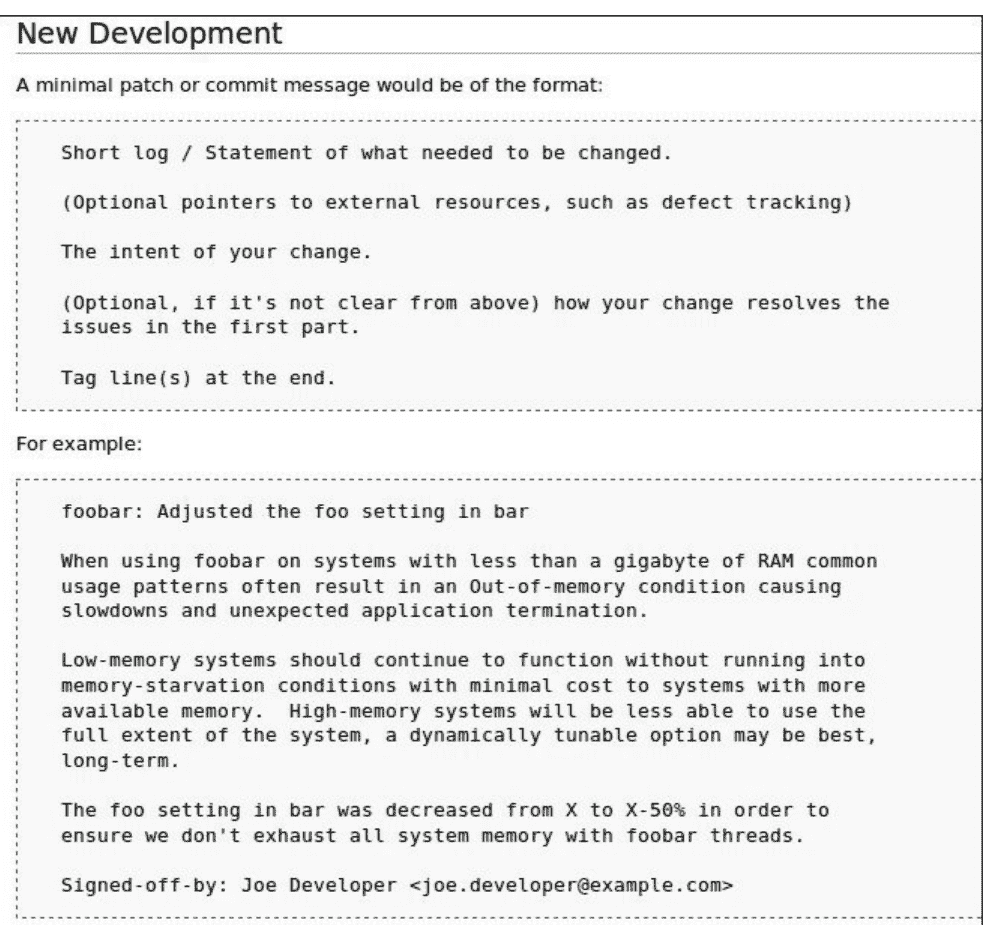
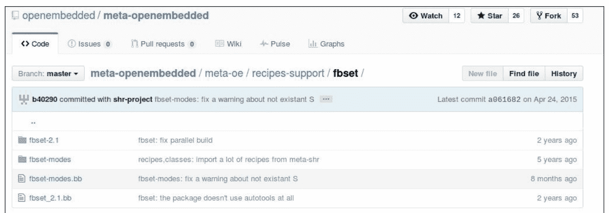

# 第 11 章 为 Raspberry Pi BSP 层做贡献

在本章中，我们将学习如何向 meta-raspberrypi 层贡献自定义工具。将解释与该领域相关的常见术语，例如“开源”、“社区”和“上游”。我们还将学习 Git 的基础知识，以及一些可与 sendmail 工具一起使用的更高级 Git 命令。

## 开源

**开源**可以描述为对普通公众开放的源代码。开源软件可以被任何人阅读、修改和重新分发。这意味着开发者可以在自己的项目中使用原始代码，而无需向代码所有者支付任何许可费。成功的开源项目通常由开发者社区构建而成，该社区协作并确保开源项目朝着预定的方向发展。

### 提示

Linux 内核和 OpenStack 是两个最著名的开源项目。Yocto Project 及其子项目是大型开源项目的其他示例，尤其是在嵌入式领域。

开源社区通常至少包含一名 **维护者**。维护者是负责将补丁集成到项目并构建源代码的人。在集成部分，维护者通常扮演着重要角色，要么审查社区开发者提交的补丁，要么确保由其他有相应知识的人来完成。在 Linux 内核等大型开源项目中，内核的不同部分有大量维护者。他们还为每个软件发布版本指定一名维护者，负责维护该版本，例如确保重要的 bug 修复被回移植。

## 为开源项目做贡献

开源项目在很大程度上取决于人们为项目回馈了什么，例如，如果他们在软件中发现故障，则提交错误报告，或帮助项目解决 bug 或开发新功能。开源项目背后的社区通常有限，没有资源独立完成所有工作。Linux 内核、OpenStack 和 Yocto Project 等大型项目背后都有大公司，分配资源来协助这些项目。原因显而易见：这些公司在商业产品中使用该项目，并且有必要确保产品取得良好进展。许多公司还使用该项目的自己的版本，并希望贡献功能和 bug 修复，以降低集成成本。

### 提示

使用开源时，偶尔会使用上游这一术语。上游基本上可以概括为原始来源。“合并上游”这一短语意味着相关补丁应集成到项目的原始源代码中。

## 探索 Git

Git 是 Yocto Project 中使用的版本控制系统，包括 Raspberry Pi BSP 层（meta-raspberrypi）。因此，在考虑为 Yocto Project 及其子项目做贡献之前，Git 是你需要掌握的核心部分。

### 什么是 Git？

Git 是一个分布式版本控制系统，自 2005 年以来一直存在，旨在以速度和效率处理项目，无论规模大小。它最初是为处理 Linux 内核的源代码而创建的。Git 是免费开源的，任何人都可以使用，无需支付任何许可费。Git 的设计高度适合开源项目中的工作方式。除了支持分布式开发之外，它还拥有易于使用的日志记录机制来记录谁做了什么、历史的加密身份验证以及创建分支的简便方法等功能。

许多其他分布式版本控制系统（VCS，如 subversion、Bazaar 等）与 Git 之间的根本区别之一在于 Git 存储信息的方式。在 Git 中，数据可以被视为微型文件系统的快照。保存项目状态时，会对该状态拍摄快照并保存引用。

### 提示

基本的 Git 工作流程大致如下：

- 你修改工作目录中的文件
- 你暂存文件，将它们的快照添加到暂存区
- 你执行提交，该操作将暂存区中的文件按当前状态永久存储到你的 Git 目录中

有关更多信息，请访问 https://git-scm.com/book/en/v2/Getting-Started-Git-Basics。


## 使用 Git

Git 中的项目称为仓库。大部分工作可以通过将主仓库克隆到你首选的工作目录中在本地完成。这就是 Git 通常被认为非常快速的原因之一，尤其是与许多操作都需要网络访问的其他版本控制系统相比。

让我们来了解一些基本示例，这些示例将教你如何：

- 将现有项目导入 Git 仓库
- 创建你的第一个提交
- 转换为共享仓库
- 克隆共享仓库的本地版本
- 创建工作分支
- 将提交推送到你的共享仓库
- 使用最新更改更新克隆的仓库

当将现有项目导入新的 Git 仓库时，我们必须首先初始化一个空的 Git 仓库。这可以在我们项目的现有源代码树中轻松完成：

```
$ tar -zxf my_packt_project_ch_11_01.tar.gz
$ cd my_packt_project
$ git init
Initialized empty Git repository in  /path/to/repo/my_packt_project/.git/
```

初始化新 Git 仓库时，会创建一个名为 .git 的新目录。该目录包含有关新仓库的所有 Git 相关信息。其中，它包含主 Git 配置文件 config，该文件包含项目的 Git 设置。该目录中另一个常用文件是 HEAD，它包含对当前分支的引用。

创建空 Git 仓库后，我们可以继续将项目的所有内容添加到新仓库中。获取分支和仓库当前状态的有用命令是 git status。当 Git 不了解某个文件时，它会显示在“未跟踪的文件”下，如下所示：

```
$ git status
On branch master
Initial commit
Untracked files:
  (use "git add <file>..." to include in what will be committed)
Makefile
README
my_packt_project.c
nothing added to commit but untracked files present (use "git add" to track)
```

我们可以使用单个命令添加所有文件和/或更改，但请注意，它也会添加构建输出。因此，使用 git add --all 时，请确保先删除不需要的文件。然后，我们可以再次使用 git status 来检查是否列出了所有预期的文件：

```
$ git add --all
$ git status
```

```
On branch master
Initial commit
Changes to be committed:
(use "git rm --cached <file>..." to unstage)
new file:   Makefile
new file:   README
new file:   my_packt_project.c
```

在提交更改并创建第一个提交之前，我们需要设置一些基本的 Git 配置。最起码，Git 要求你设置姓名和电子邮件：

```
$ git config user.email "your_email@packtpub.com"
$ git config user.name "Forename Surname"
```

如果要为所有 Git 仓库设置全局电子邮件和姓名，可以指定 --global 选项，如下所示：

```
$ git config --global user.email "your_email@packtpub.com"
$ git config --global user.name "Forename Surname"
```

要验证设置，请键入：

```
$ git config user.email
your_email@packtpub.com
$ git config user.name
Forename Surname
```

### 提示

全局 Git 配置存储在 /home/$USER/.gitconfig 中，本地配置存储在 /path/to/git/repository/.git/config 中。默认情况下，本地仓库 Git 配置的更改将覆盖全局 Git 配置的更改。

在 Git 中提交更改时，使用 git commit 命令。它记录对仓库的更改，从而可以使用为提交生成的唯一 SHA-1 哈希来跟踪该提交。输入 git log [branch] 可以查看分支的历史概览。

```
$ git commit -m "My initial commit"
[master (root-commit) f01bdf2] My initial commit
3 files changed, 11 insertions(+)
create mode 100644 Makefile
create mode 100644 README
create mode 100644 my_packt_project.c
$ git log
commit f01bdf29a2c9df1c2417542c5531f90e04c973a
Author: Forename Surname <your_email@packtpub.com>
Date:   Sun Jan 1 00:00:00 2016 +0100
My initial commit
```

当多个开发人员在同一个项目上工作时，每个用户使用自己的仓库本地克隆。默认情况下，Git 会拒绝推送到非裸仓库的更改。我们将逐步了解一个简单的示例，该示例将：

- 将我们的仓库转换为共享仓库
- 克隆共享仓库

共享仓库通常存储在服务器上，并且仓库必须创建为裸 Git 仓库。这可以通过在初始化 Git 仓库或克隆时使用 `--bare` 标志来完成。由于我们在之前的示例中使用了非共享仓库，我们将使用 `git clone --bare` 将其转换为共享仓库，然后可以删除旧仓库，改为使用裸仓库的克隆继续工作。

```
$ cd /path/to/my/workdir
$ git clone --bare /path/to/my_packt_project my_packt_project.git
$ rm -rf /path/to/my_packt_project
```

### 提示

裸仓库基本上是不包含工作目录的仓库。这将防止开发人员对仓库进行更改。根据命名约定，裸 Git 仓库应命名为 `name_of_my_repo.git`。

我们现在有了一个可供开发人员协作使用的裸仓库。接下来，我们继续克隆裸仓库的本地副本，可在开发新功能时使用。默认情况下，克隆仓库时你会处于名为 `master` 的分支上。可以在 master 分支上完成所有工作；由于这只是本地克隆，不会破坏其他开发人员的任何内容。但强烈建议创建一个 **工作分支** 并在该分支中进行所有更改。这样，master 分支始终处于稳定且已知的状态。当你是高级 Git 用户时，可能会并行处理多个功能，并且可能希望通过 master 分支集成其他开发人员处理的新功能。换句话说，为所有功能创建单独的分支是一个好习惯。

```
$ git clone /path/to/my_packt_project.git
Cloning into 'my_packt_project'
$ cd my_packt_project
```

接下来，我们将创建一个名为 `my_new_feature` 的新分支，切换到它，并为项目开发一个微小的新功能。可以使用 `git branch` 列出所有可用的本地分支；如果在列出分支时添加 `-a` 标志，还会列出所有远程分支。

### 提示

远程分支是存在于已从中克隆的共享仓库中的分支。星号 (*) 帮助用户定位当前分支。

```
$ git branch
* master
$ git branch my_new_feature
$ git checkout my_new_feature
Switched to branch 'my_new_feature'
```

```
$ git branch
master
* my_new_feature
$ git branch -a
master
* my_new_feature
remotes/origin/HEAD -> origin/master
remotes/origin/master
```

我们现在处于新分支，是时候进行一些修改了。在此示例中，我们将向 makefile 添加一个名为 clean 的新目标。请记住在提交更改之前使用 git add 将更改添加到索引中。如果要列出更改，请在添加文件之前使用 git diff。

### 注意

如果已经使用 git add 添加了文件，可以在提交更改之前使用 git diff --cached 检查更改。

```
$ vim Makefile
$ git diff
diff --git a/Makefile b/Makefile
index c6466e0..d986116 100644
--- a/Makefile
+++ b/Makefile
@@ -1,2 +1,5 @@
all:
$(CC) my_packt_project.c -o my_packt_project
+
+clean:
+rm -f my_packt_project
$ git add Makefile
$ git commit -m "Makefile: Add a new target"
[my_new_feature 7c3d896] Makefile: Add a new target
1 file changed, 3 insertions(+)
```

我们的最后一步是将新更改发送到共享仓库，使用新更改更新本地 master，然后删除功能分支，因为它不再需要。当向共享仓库推送更改时，可以使用预定义的远程 origin；默认情况下，origin 指向我们克隆的仓库。推送更改时，需要指定要发送的修订版本以及目标分支。在大多数情况下，我们希望发送整个分支；如果是这样，可以使用 HEAD 获取当前分支的所有更改，如下所示：

```
$ git push origin HEAD:master
Counting objects: 5, done.
Delta compression using up to 4 threads.
Compressing objects: 100% (3/3), done.
Writing objects: 100% (3/3), 383 bytes | 0 bytes/s, done.
Total 3 (delta 0), reused 0 (delta 0)
To /path/to/my_packt_project.git
f01bdf2..7c3d896  HEAD -> master
$ git checkout master
Switched to branch 'master'
Your branch is behind 'origin/master' by 1 commit, and can be fast-forwarded.
(use "git pull" to update your local branch)


```
$ git pull
Updating f01bdf2..7c3d896
Fast-forward
Makefile | 3 +++
1 file changed, 3 insertions(+)
$ git branch -d my_new_feature
Deleted branch my_new_feature (was 7c3d896).
```

### 注意

如果您想了解 Git 基础知识的更多信息，请访问 [Git 文档](https://git-scm.com/doc)。

## 为 Yocto 项目做出贡献

许多开源项目（包括 Yocto 项目）都使用邮件列表。这些列表主要用于讨论项目以及公开审查为项目做出贡献的人员发送的补丁。

由于 Yocto 项目是一个大型项目集的伞形项目，一个邮件列表不够用。例如，BitBake、OpenEmbedded-Core 和 Yocto 各有独立的列表，其中 Yocto 包含不同的外部层，例如 meta-raspberrypi 和 meta-qt5。向多个项目共用的列表发送电子邮件时，如果邮件是针对特定子项目的，则需要添加前缀（前缀的语法为 `[layername] subject`）。以下屏幕截图展示了向 meta-raspberrypi 发送一系列补丁的示例：

- [yocto] [meta-raspberrypi] PATCH 0/5] Various upgrade/fixes from Technux Petter Mabäckner
  - [yocto] [meta-raspberrypi] PATCH 1/5] gitignore: Ignore .swp files Petter Mabäckner
  - [yocto] [meta-raspberrypi] PATCH 2/5] linux-raspberrypi: Update 4.1 recipe to 4.1.15 Petter Mabäckner
  - [yocto] [meta-raspberrypi] PATCH 3/5] rpi-config: I2C support Petter Mabäckner
  - [yocto] [meta-raspberrypi] PATCH 4/5] pitft: Add basic support for PiTFT Petter Mabäckner
    - [yocto] [meta-raspberrypi] PATCH 4/5] pitft: Add basic support for PiTFT Khem Raj
      - [yocto] [meta-raspberrypi] PATCH 4/5] pitft: Add basic support for PiTFT Andrei Gherzan
      - [yocto] [meta-raspberrypi] PATCH 4/5] pitft: Add basic support for PiTFT Petter Mabäckner
      - [yocto] [meta-raspberrypi] PATCH 4/5] pitft: Add basic support for PiTFT Khem Raj
      - [yocto] [meta-raspberrypi] PATCH 4/5] pitft: Add basic support for PiTFT Petter Mabäckner
  - [yocto] [meta-raspberrypi] PATCH 5/5] pitft: Add PiTFT22 support Petter Mabäckner
- [yocto] [meta-raspberrypi] PATCH 0/5] Various upgrade/fixes from Technux Petter Mabäckner

可以通过订阅特定的邮件列表或阅读存档来轻松跟踪邮件列表。

### 注意

所有 Yocto 项目邮件列表均可在 https://www.yoctoproject.org/tools-resources/community/mailing-lists 上找到。

### 为 meta-raspberrypi 做出贡献

如果您已为 meta-raspberrypi 准备了想要与社区分享的修复程序或功能，则需要了解多个事项。

meta-raspberrypi 的当前维护者是 Andrei Gherzan。他对补丁有最终决定权，并会将补丁集成到 meta-raspberrypi 主层中。由于维护者非常忙碌，在将补丁发送到上游之前仔细测试补丁非常重要。对于贡献者来说，无论项目如何，最重要的是通过发送遵循请求指南的经过充分测试的补丁来建立声誉。这将显著增加补丁被项目集成的机会。

为 meta-raspberrypi 做出贡献存在一些总体“规则”：

- 与 meta-raspberrypi 相关的补丁应始终发送至 yocto@yoctoproject.org。
- 使用 "[meta-raspberrypi]" 作为电子邮件的前缀
- 遵循 OpenEmbedded 补丁指南
- 遵循 meta-raspberrypi readme 说明

本章后面将结合示例详细解释这一套规则。

### 设置您的 Git 仓库

在向上游发送任何内容之前，您需要设置一些基本内容。首先，应如前一章部分所述，为您的 meta-raspberrypi Git 仓库设置姓名和电子邮件：

```
$ cd meta-raspberrypi
$ git config user.email "your_email@packtpub.com"
$ git config user.name "Forename Surname"
```

接下来，您应设置 git send-email 以便通过 SMTP 服务器使用 Git 发送补丁。维护者通常要求这样做，以确保补丁格式正确且易于集成。您需要手动配置服务器参数 - 请参阅电子邮件提供商的文档或联系支持以找到正确参数。

除了 Git，您还需要安装 send-email，这是 Git 在后台用于 git send-email 的软件。send-email 软件包在大多数发行版中都可用，但名称可能不同。以下是 Ubuntu 和 Fedora 上的设置方法：

- Ubuntu: $ sudo apt-get install sendemail
- Fedora: $ sudo yum install sendmail

以下是配置 sendemail 的示例：

```
$ cd meta-raspberrypi
$ git config sendemail.smtpencryption tls
$ git config sendemail.smtpserver smtp.packtpub.com
$ git config sendemail.smtpuser your_email@packtpub.com
$ git config sendemail.smtpserverport 587
```

### 创建您的提交

现在，您准备好进行修改。在本小节中，我们将逐步介绍从实现更改到创建符合 meta-raspberrypi 补丁指南的提交的每个步骤。

在工作分支（而非 master 分支）中创建更改是常识。在我们的示例中，我们将设置一个跟踪 master 分支的分支：

```
$ cd meta-raspberrypi
$ git checkout -b my_work_branch -t origin/master
```

现在，使用您喜欢的编辑器编辑要更改的文件。修改完成后，需要将更改的文件添加到 Git 暂存区；否则，Git 不会将您的更改添加到即将进行的提交中：

```
$ git add <files changed>
```

现在是时候按照 meta-raspberrypi 的 readme 和 OpenEmbedded 指南创建提交消息了。以下是指南中最重要的部分：



### 注意

完整的 OpenEmbedded 指南可在 http://www.openembedded.org/wiki/Commit_Patch_Message_Guidelines 上找到。

创建提交时，请记得对其签名（使用 -s）。签名是默认添加到提交消息末尾的一行文本。根据 Linux 内核文档，签名的原始用途如下：

> "为改进对谁做了什么的追踪（尤其是补丁可通过多个维护者层最终进入内核的情况），我们为在邮件中传递的补丁引入了“签名”程序。签名是在补丁说明末尾添加的一行简单文本，用于证明您编写了该补丁，或有权将其作为开源补丁传递。"

以下是使用方法：

```
$ git commit -s
Write your commit message
```

### 向社区发送更改

项目的维护者希望专注于补丁的设计，并且通常假设发送到列表的补丁是功能正常的。因此，重要的是要确保您已验证补丁已针对 meta-raspberrypi 支持的相关映像进行构建和测试。

当您的补丁符合预期并通过所有测试时，就可以将其发送到社区了。首先，我们需要生成补丁。生成补丁时，应遵循 meta-raspberrypi readme 中的建议。如果您有多个提交，将为每个提交生成一个补丁。还会生成一封求职信，并且始终命名为 0000-cover-letter.patch。求职信是可选的，但在同一系列中创建多个补丁时强烈建议创建。

```
$ git format-patch --cover-letter --subject-prefix='meta-raspberrypi][PATCH' origin
```

### 注意

如果您只有一个补丁或不需要求职信，请删除 "--cover-letter"。

如果您决定生成求职信，可以使用首选编辑器打开它。查找 *** SUBJECT HERE *** 和 *** BLURB HERE *** 行，并将其替换为有关补丁的适当信息。

是最后一步了：将补丁发送到邮件列表！

```
$ git send-email --to yocto@yoctoproject.org <generated patches>
```


### 后续工作

到此刻，你的补丁应该已经发送到邮件列表，你可以稍作休息，等待反馈。如果你从邮件列表收到反馈，应当回复表示你会执行所请求的更改；如果你不同意，则回复说明不同意的“适当理由”。

如果收到反馈，不要担心；这很正常。事实上，许多发送到邮件列表的更改在准备好集成到主层之前都需要更新。

在向邮件列表发送补丁更新时，重要的是要指定补丁系列的版本号。这可以通过稍微修改最初生成补丁时使用的那一行来轻松完成（注意新的主题前缀）：

```
$ git format-patch --cover-letter --subject-prefix='meta-raspberrypi][PATCH v2' origin
```

### 注意

如果你只有一个补丁或者不觉得需要，请删除 "--cover-letter"。

如果你的补丁还需要再次更新，只需递增版本号并重试即可。当你的补丁到达 meta-raspberrypi 层后，你就完成了，可以继续研究其他感兴趣的功能。

### 实际示例 - 将自定义工具上游

在本节中，我们将通过一个实际示例，讲解如何将自定义工具集成到 meta-raspberrypi 中。我们选择的工具是 **con2fbmap**，这是一个用于设置和显示帧缓冲 TFT 设备（例如 PiTFT 显示屏）与控制台之间映射的命令行工具。

首先，我们需要确定在层结构的哪个位置放置新的配方。在某些情况下，我们可以通过读取包的名称来猜测位置。omxplayer 配方就是一个例子。很容易看出它应该放在多媒体配方（recipes-multimedia）中。如果无法通过包名找到位置，可以检查是否存在类似的工具。在我们的示例中，meta-oe（OpenEmbedded 基础层）包含一个名为 **fbset** 的类似工具。它是一个用于修改帧缓冲设备的工具。如果我们找到 **fbset** 配方，可以看到它位于 recipes-support 目录中，我们可能也应该将自己的包放在该目录下。

你可以在 https://github.com/openembedded/meta-openembedded/tree/master/meta-oe/recipes-support/fbset 处找到 fbset 工具，如下图所示：



在创建新配方时，你可以使用第 7 章“在树莓派上部署自定义层”中描述的工具，也可以从头开始创建。在本示例中，我们将从头开始创建。首先需要知道该工具使用哪种源（例如 .tar.gz 或 Git）。在这种情况下，原始源是 Git，我们可以为 con2fbmap 创建一个基本配方，如下所示：

```
$ cd meta-raspberrypi
$ mkdir -p recipes-support/con2fbmap
$ cd recipes-support/con2fbmap
$ touch con2fbmap_git.bb
```

使用你喜欢的编辑器创建 BitBake 文件（.bb）的内容。在本书中，我们选择使用“已知状态”，并将 SRCREV 设置为 **f57bf6d28910ba665efab8a65085ba6d4c6162a5**。BitBake 文件中的其他信息（例如 LIC_FILES_CHKSUM）将基于此特定的 SRCREV 值。完整的 con2fbmap_git.bb 文件如下：

```
SUMMARY = "Utility for swapping an fbft-based device"
DESCRIPTION = "Simple utility for swapping an fbft-based device as \
the console"
LICENSE = "GPLv3"
LIC_FILES_CHKSUM = "file://COPYING;md5=d32239bcb673463ab874e80d47fae504"
SECTION = "console/utils"
inherit autotools
SRC_URI = "git://gitlab.com/pibox/con2fbmap.git;branch=master;protocol=https"
SRCREV = "f57bf6d28910ba665efab8a65085ba6d4c6162a5"
S = "${WORKDIR}/git"
```

请记住构建并验证新配方。当你对自己的更改满意时，可以继续创建新的 Git 提交。编写提交消息时，请务必遵循指南。

```
$ git add con2fbmap_git.bb
$ git commit -s
con2fbmap: Add new recipe
Currently there is no easy way to manually switch between
framebuffer devices and console during run-time.
This tool can be used when the system is up and running, to
set and show mapping between framebuffer tft devices
(such as PiTFT displays) and the consoles.
Signed-off-by: Petter Mattson <petter@technux.se>
# Please enter the commit message for your changes. Lines starting
# with '#' will be ignored, and an empty message aborts the commit.
```

当你对提交消息满意后，就可以生成补丁了。由于本示例中所有更改都适合放在一个 Git 提交中，我们可以跳过 --cover-letter 标志。

```
$ git format-patch --subject-prefix='meta-raspberrypi][PATCH' origin
0001-con2fbmap-Add-new-recipe.patch
```

当工具在目标上构建并经过仔细测试后，我们可以将其发送到邮件列表：

```
git send-email --to yocto@yoctoproject.org 0001-con2fbmap-Add-new-recipe.patch
```

你现在已经学习了如何为主层做出贡献。在使用开源社区协作时，一个很好的建议是保持耐心。取决于项目所处的阶段，维护者和其他负责集成更改的人可能很忙，有时他们回复你的补丁需要时间。如果你长时间没有收到任何消息，不要害怕向列表中的人发送友好的提醒，请他们查看你的补丁。

## 摘要

在本章中，我们概述了开源软件以及如何参与开源项目。我们重点介绍了为开源做贡献的一些主要好处，例如降低产品的集成成本。我们还学习了 Git 的基础知识以及一些更高级的 Git 命令，这些命令可以与 sendmail 二进制文件配合使用，以便向开源社区发送补丁。最后，通过学习如何将自定义工具 con2fbmap 集成到 meta-raspberrypi 并将其提交给 Yocto Project 社区审查，我们完成了一个真实世界的演练。

在下一章中，我们将通过创建一个家庭自动化项目来总结本书中所学的所有内容。
