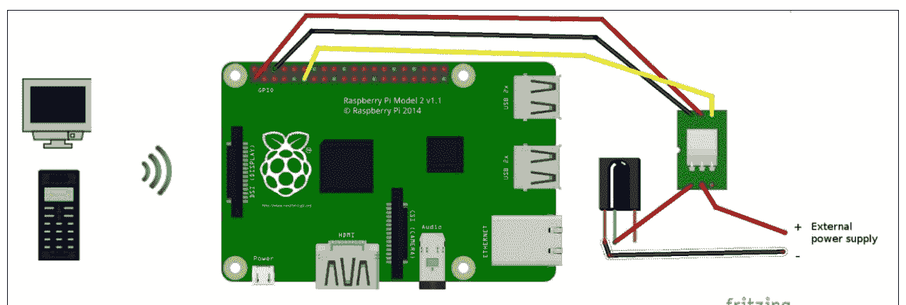
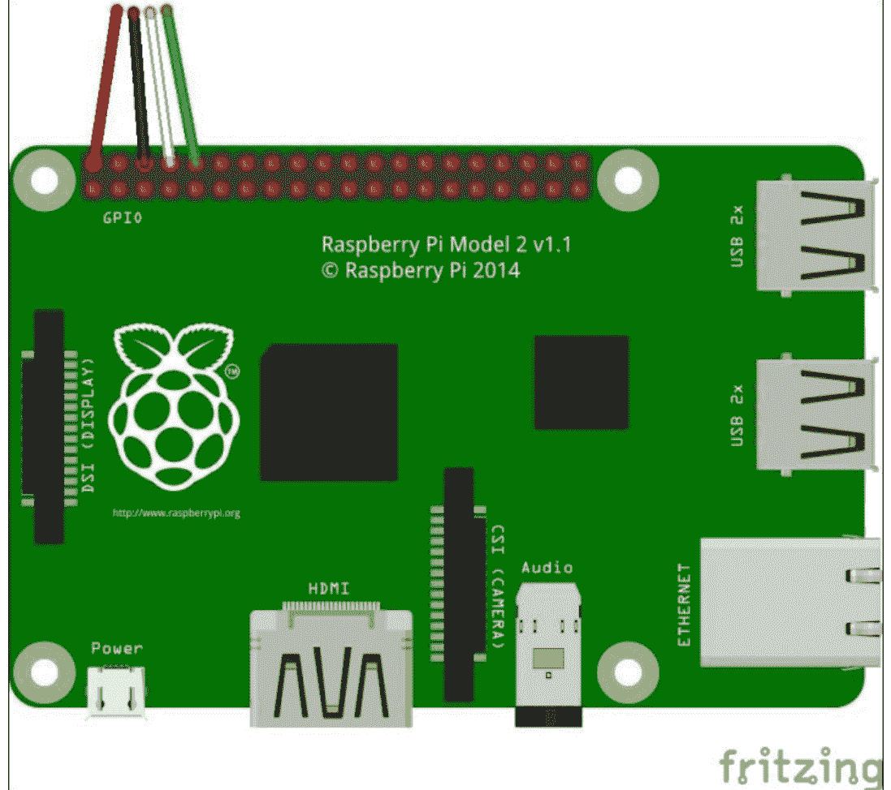
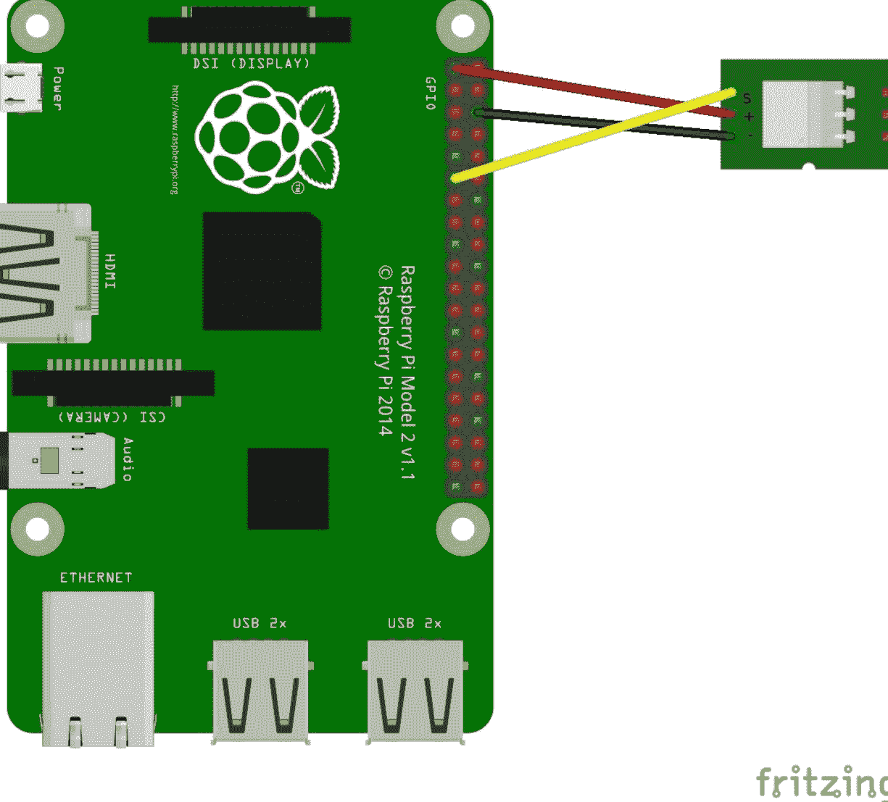
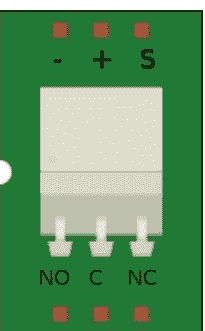
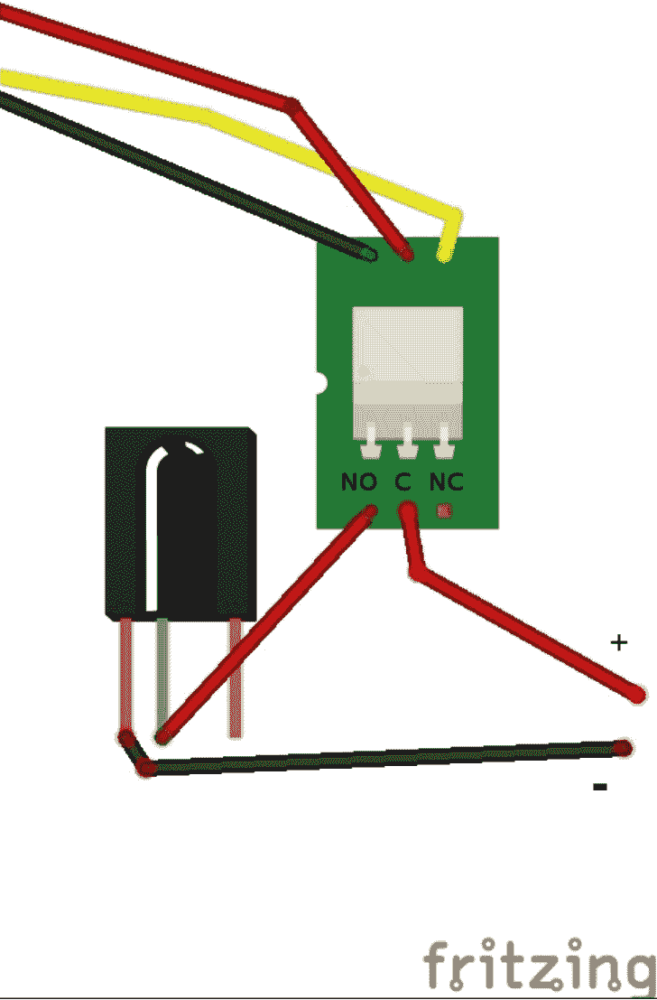
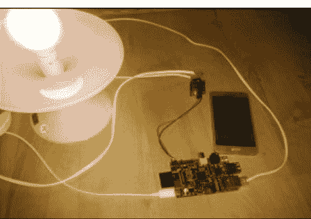

# 第 12 章 家庭自动化项目 - 启动自定义镜像

物联网是当今非常热门的话题。在家中使用自动化来简化日常任务的重要性前所未有。树莓派由于体积小、价格低，且易于连接其他电子设备，是制作小型家庭自动化项目的绝佳选择。本章将引导你完成一个小型家庭自动化项目，该项目让你使用树莓派设置远程照明控制系统，并借助智能手机远程控制它。该项目需要使用前面章节所学的技能，因此本章也将充当你在本书中所学知识的总结。

本章将首先介绍我们的家庭自动化项目以及所需材料。然后，它将深入讲解 Yocto 与我们项目的集成。本章的这一部分将解释如何设置树莓派使用的镜像：它将涵盖创建包含新镜像配方的新层以及添加/修改项目所需的包等内容。本章将以一个将所有内容整合在一起的章节结束。它将解释所有物理部件应如何连接，以及如何使用不同设备（例如智能手机或带有触摸屏的另一台树莓派）远程控制该设备。

## 使用树莓派进行家庭自动化

我们的家庭自动化项目将大致延续第 5 章“在树莓派上创建、开发和部署”中的“点亮 LED”示例。它将改进并发展该项目，创建一个最终用户可以使用智能手机（或其他带有 Web 浏览器的设备）无线点亮灯具的项目。

如下图所示，思路是使用 GPIO 引脚将单通道继电器模块连接到树莓派。然后，将灯具和外部电源连接到继电器模块，构建一个电路。连接完成后，就可以使用树莓派的 GPIO 连接控制继电器模块（开/关）了。



一个支持远程照明的家庭自动化项目


## 项目所需材料

项目需要以下材料：

- 一块 Raspberry Pi（任意型号均可）

  Raspberry Pi Zero 要求您焊接 GPIO 引脚排，或将导线直接焊接到 GPIO 焊盘上

- 跳线（需要三根）
- 一个单通道 5V 继电器模块
- 一盏灯（最好是您不介意剪开并切断其电缆的灯）
- 一个外部电源（最好是 12V）

### 注意

警告：本项目需要具备基本的电路知识。如果您没有相关知识或经验，我们强烈建议不要使用高压电源。

## 为项目搭建基础

首先，我们应该为 Yocto Project 实现搭建基础。本节中使用的大部分技术在本书前面已有介绍，因此不再详细说明。在本章的这一部分中，我们将执行 Yocto Project 实现的基本设置，该设置将用于家庭自动化项目。

## 创建新图层

我们将先创建一个新图层。新图层将作为我们家庭自动化项目的基础。目前，它只包含我们的镜像配方，但我们将在整个章节中向图层添加更多内容，直到拥有服务器所需的所有部分。如第 7 章《在 Raspberry Pi 上部署自定义图层》中所述，我们将使用 yocto-layer 来帮助设置图层结构。我们需要设置高优先级，以确保该图层中的内容优先于（例如）meta-raspberrypi 中的内容，如下所示：

```
$ /path/to/poky/scripts/yocto-layer create pkt-iot
Please enter the layer priority you'd like to use for the layer: [default: 6] 10
Would you like to have an example recipe created? (y/n) [default: n]
Would you like to have an example bbappend file created? (y/n) [default: n]
New layer created in meta-pkt-iot.
Don't forget to add it to your BBLAYERS (for details see meta-pkt-iot/README).
```

## 自定义镜像配方

在本小节中，我们将改进自定义镜像配方的用法，这是我们在第 7 章《在 Raspberry Pi 上部署自定义图层》中学到的内容。

首先创建您的镜像配方文件：

```
$ cd meta-pkt-iot
$ mkdir -p recipes-core/images/
$ touch recipes-core/images/pkt-iot-image.bb
```

接下来，我们将设置镜像的基本内容；请查看以下代码片段。在整个章节中，此镜像配方将不断扩展，直到我们最终获得符合我们目的的完整镜像。该镜像将基于 rpi-basic-image。

```
$ cat recipes-core/images/pkt-iot-image.bb
# Base this image on rpi-basic-image
include recipes-core/images/rpi-basic-image.bb
SPLASH = "psplash-raspberrypi"
IMAGE_FEATURES += "ssh-server-dropbear splash"
IMAGE_INSTALL_append = " rpi-gpio"
```

使用镜像配方时，存在名为 ROOTFS_PREPROCESS_COMMAND 和 ROOTFS_POSTPROCESS_COMMAND 的两个命令。它们可以作为最后手段，例如用于添加、删除或修改根文件系统中的内容。这两种方法可以在创建根文件系统之前（使用 PREPROCESS 变体）或在根文件系统创建之后（使用 POSTPROCESS 方法）使用。使用方法是向变量指定一个函数列表。这些函数可以使用 ${IMAGE_ROOTFS} 以通用方式找到文件系统的路径。对于本项目，我们将使用此方法向 ROOTFS_POSTPROCESS_COMMAND 添加一个函数，以便为我们的镜像创建一个发布文件。将以下内容添加到 pkt-iot-image.bb 的末尾：

```
ROOTFS_POSTPROCESS_COMMAND += " create_release_file ; "
create_release_file() {
IMAGE_REL_FILE="${IMAGE_ROOTFS}${sysconfdir}/pkt-iot-release"
    echo "pkt-iot release version 1.0" > ${IMAGE_REL_FILE}
    echo "Image: ${IMAGE_NAME}" >> ${IMAGE_REL_FILE}
    echo "Build date: ${DATETIME}" >> ${IMAGE_REL_FILE}
    chmod 0444 ${IMAGE_REL_FILE}
}
```

请仔细注意 create_release_file 部分中 ROOTFS_POSTPROCESS_COMMAND 声明里的空白字符。

## 构建和启动镜像

我们现在有了一个包含基本镜像配方的新外部图层。到目前为止，我们尚未对图层进行任何测试。在开发过程中，定期测试您的更改始终是个好主意。我们将对我们的图层进行早期测试。为此，我们将创建一个新项目，在 local.conf 中设置一些强制性和推荐的配置，并将外部图层添加到 bblayers.conf。这个项目将在整个章节中使用。

```
$ source /path/to/poky/oe-init-build-env pkt_project_chapter12
```

将 meta-raspberrypi 和 meta-oe 外部图层，连同我们新的 meta-pkt-iot 图层，添加到 bblayers.conf：

```
BBLAYERS ?= " \
/path/to/poky/meta \
/path/to/poky/meta-poky \
/path/to/poky/meta-yocto-bsp \
/path/to/meta-raspberrypi \
/path/to/meta-openembedded/meta-oe \
/path/to/meta-pkt-iot \
"
```

决定使用哪台机器并将其添加到 local.conf。在本示例中，我们将使用 raspberrypi2：

```
$ echo "MACHINE = \"raspberrypi2\"" >> conf/local.conf
```

接下来，我们将在项目中启用本地包修订（PR）服务器。如果检测到更改，PR 服务器会自动增加包的 PR 版本号。这将无需最终用户手动更新配方文件中的 PR 编号。在开发新配方时，此功能非常实用：

```
$ echo "PRSERV_HOST = \"localhost:0\"" >> conf/local.conf
```

BitBake 项目可能会占用大量磁盘空间。存在多种方法，可用于减少项目占用的磁盘空间总量及其总体构建时间。

第一种方法是使用 rm_work。此功能将确保 BitBake 对已构建的包进行完全清理。默认情况下，所有已构建的包都会将源代码和工件保存在项目 ./tmp/work 下的包特定位置中。当为项目继承以下类时，这些内容将被擦除：

```
$ echo "INHERIT += \"rm_work\"" >> conf/local.conf
```

但是，排除开发期间频繁使用的包可能是个好主意，特别是如果解包它们需要很长时间。要实现此目的，可以使用 RM_WORK_EXCLUDE。

项目的构建时间通常相当长，尤其是第一次，因为 BitBake 需要从头开始获取所有源代码并构建包。但在第一次构建完成后，您可以使用多种方法加速后续构建。这些方法也可用于设置类似的其他 Yocto 项目，以减少构建时间和所需磁盘空间。

第一种方法是使用共享状态（sstate）。默认情况下，sstate 缓存位于项目内。但是，通过在 local.conf 中使用 SSTATE_DIR 变量，共享状态可以位于项目外部，并被其他项目使用。下一种方法也如此，即指定 BitBake 在构建期间获取的所有包的下载位置。同样可以通过 local.conf 中的 DL_DIR 变量进行配置。在本示例中，我们不会在项目外部使用共享状态或下载目录。原因是，在使用本地 PR 服务器时不推荐这样做。

此时，您的 local.conf 文件应该类似于这样：

```
$ tail conf/local.conf
PACKAGECONFIG_append_pn-nativesdk-qemu = " sdl"
#ASSUME_PROVIDED += "libsdl-native"
# CONF_VERSION is increased each time build/conf/ changes incompatibly and is used to
# track the version of this file when it was generated. This can safely be ignored if
# this doesn't mean anything to you.
CONF_VERSION = "1"
MACHINE = "raspberrypi2"
PRSERV_HOST = "localhost:0"
INHERIT += "rm_work"
```

当项目的初始配置就绪后，我们可以构建本章早先创建的镜像：

```
$ bitbake pkt-iot-image
Parsing recipes: 100%
###############################################################################
###############################################################################| Time: 00:00:31
Parsing of 895 .bb files complete (0 cached, 895 parsed). 1325 targets, 68 skipped,
0 masked, 0 errors.
NOTE: Resolving any missing task queue dependencies
```

让我们在目标设备上试用我们的新镜像。此时，镜像的行为应与普通 rpi-basic-image 镜像类似。不仅要构建我们的更改，还要在目标设备上测试它们，以确保万无一失。使用第 2 章《为 Raspberry Pi 构建我们的第一个 Poky 镜像》中描述的方法将镜像复制到 SD 卡（请记住将 /dev/sdX 改为正确的设备名称）：

```
$ sudo dd if=/path/to/pkt_project_chapter12/tmp/deploy/images/raspberrypi2/pkt-iot-image-raspberrypi2.rpi-sdimg of=/dev/sdX bs=1M
```

接下来，将 SD 卡插入 Raspberry Pi 并通电。该镜像与 rpi-basic-image 没有重大变化；不过，我们仍然可以轻松看到我们运行的是正确的镜像。如您所记得，我们在镜像配方中添加了一个后处理函数，用于添加一个发布文件。让我们检查它是否存在并查看其内容（使用 root 登录，密码为空）：

```
Poky (Yocto Project Reference Distro) 2.0+snapshot-20160229 raspberrypi2
/dev/ttyAMA0
raspberrypi2 login: root
root@raspberrypi2:~# ls /etc/*release*
```


```
/etc/packt-iot-release
root@raspberrypi2:~# cat /etc/packt-iot-release
packt-iot release version 1.0
Image: packt-iot-image-raspberrypi2-20160304085812
Build date: 20160304085812
root@raspberrypi2:~#
```

## 创建服务器端

我们现在已准备好基础，可以继续实现项目特定部分。连接了电路和灯的树莓派将充当服务器。它将运行一个微型Web服务器，可以通过使用Web浏览器的任意客户端访问。

对于服务器端，我们将调整并改进第9章“在树莓派上构建媒体中心”中使用的服务器示例，并将其与第5章“在树莓派上创建、开发和部署”中的gpio-packet配方的更新版本相结合。首先，我们需要添加本书前几章中使用的meta-packet_rpi层。我们已经确保我们新创建的层优先级高于meta-packet_rpi，但我们也将按依赖顺序在bblayers.conf中添加它。以下是本项目中将使用的完整bblayers.conf文件：

```
# LAYER_CONF_VERSION is increased each time build/conf/bblayers.conf
# changes incompatibly
POKY_BBLAYERS_CONF_VERSION = "1"
BBPATH = "${TOPDIR}"
BBFILES ?= ""
BBLAYERS ?= " \
/path/to/poky/meta \
/path/to/poky/meta-poky \
/path/to/poky/meta-yocto-bsp \
/path/to/meta-raspberrypi \
/path/to/meta-openembedded/meta-oe \
/path/to/meta-packet_rpi \
/path/to/meta-packet-iot \
"
BBLAYERS_NON_REMOVABLE ?= " \
/home/path/to/git/poky/meta \
/home/path/to/git/poky/meta-yocto \
"
```

接下来，我们应对gpio-packet进行一些小修改，使其更适合我们的项目。这些更改将作为集成补丁进行。原始代码使用GPIO4，这是默认设置为高电平的引脚之一。我们将改用GPIO17，这是默认设置为低电平的引脚之一。

要更改gpio_example代码以改用GPIO17，我们可以创建一个新的集成补丁，仅在应用meta-packet-iot层时更改行为。所需的小更改如下：

```
--- gpio_example.c.orig 2016-03-10 16:55:04.334832221 +0100
+++ gpio_example.c 2016-03-10 16:54:13.400537071 +0100
@@ -39,7 +39,7 @@
/*****************************************************************************/
#define LENGTH 128
#define SYSFS_GPIO_DIR "/sys/class/gpio/"
-#define GPIO_PIN 4
+#define GPIO_PIN 17
#define BUFFER_SIZE 255
#define DEBUG 1
```

```
#define 		VERSION 		1.00
```

可以使用diff命令生成补丁。这将产生gpio_example.c原始版本与更新版本之间的差异。

```
$ diff -Naur gpio_example.c.orig gpio_example.c > use_gpio17.patch
```

接下来，我们必须将补丁添加到meta-packt-iot。首先在meta-packt-iot中创建用于追加gpio_example的结构：

```
./recipes-custom
./recipes-custom/gpio-packt
./recipes-custom/gpio-packt/gpio-packt
./recipes-custom/gpio-packt/gpio-packt/use_gpio17.patch
./recipes-custom/gpio-packt/gpio-packt_0.1.bbappend
```

bbappend的内容将非常小，仅用于应用补丁：

```
FILESEXTRAPATHS_prepend := "${THISDIR}/${PN}:"
SRC_URI += " \\
file://use_gpio17.patch;striplevel=0 \\
"
```

是时候开始使用Web服务器了。我们还需要对服务器部分进行一些项目修改。webserver-packt配方的大部分基本设置可以保持不变。但是，服务器JavaScript（server.js）和主网页（index.html）需要新的逻辑和内容。由于新内容不太适合添加到现有代码中，我们将为Web服务器创建一个新的bbappend文件，然后用适合此特定项目的新版本的index.html和server.js文件覆盖该包。首先在meta-packt-iot中创建如下所示的新结构（目前index.html、server.js和webserver-packt_0.1.bbappend可以为空）：

```
./recipes-custom
./recipes-custom/webserver-packt
./recipes-custom/webserver-packt/webserver-packt_0.1.bbappend
./recipes-custom/webserver-packt/webserver-packt
./recipes-custom/webserver-packt/webserver-packt/index.html
./recipes-custom/webserver-packt/webserver-packt/server.js
```

新结构到位后，我们可以开始向bbappend文件添加内容：

```
DESCRIPTION = "Remote lighting control"
FILESEXTRAPATHS_prepend := "${THISDIR}/${PN}:"
SRC_URI += " \\
file://server.js \\
file://index.html \\
"
do_install_append() {
	install -d ${D}${datadir}/server-packt/server
	install -m 0755 ${WORKDIR}/index.html ${D}${datadir}/server-packt/server/public/index.html
	install -m 0755 ${WORKDIR}/server.js ${D}${datadir}/server-packt/server/server.js
}
```

webserver-packt_0.1.bbappend中的逻辑非常简单。它将我们新版本的index.html和server.js追加到SRC_URI变量，然后在安装阶段覆盖旧文件。

让我们更深入地查看项目所需的代码修改。就像在第9章“在树莓派上构建媒体中心”的媒体中心示例中一样，我们将继续提供一个充当客户端的HTML文件。我们还将继续监听同一端口（3344）以避免混淆。服务器代码中的功能逻辑位于io.on() {...}函数内。在这里，我们将从客户端（index.html）接收消息并在服务器上执行它。在我们的示例中，要执行的命令是gpio_example --led=1或gpio_example --led=0，分别会使灯亮起和熄灭。server.js的完整代码如下：

```
var express = require('express')
  , app = express()
  , server = require('http').createServer(app)
  , path = require('path'),
  fs = require('fs'),
  sys = require('util'),
  exec = require('child_process').exec,
  child, child1;
http://192.168.1.13:3344/light.html
io = require('socket.io').listen(server),
io.set('log level', 1); /* DEBUG MODE */
app.use(express.static(path.join(__dirname, 'public')));
app.get('/', function(req, res) {
  res.sendFile(__dirname + '/public/index.html');
});
io.on('connection', function(socket) {
  socket.on('light', function(msg) {
    child = exec(msg, function (error, stdout, stderr) {
      if (error !== null) {
        console.log('exec error: ' + error);
      }
    });
  });
});
server.listen(3344, function() {
  console.log('listening on *:3344');
});
```

要了解解决方案的整体情况，我们还需要查看客户端index.html。来自第9章“在树莓派上构建媒体中心”的网页的外观和感觉被保留，但CPU监控已被替换为一个绿色/红色按钮，用于打开或关闭灯。取决于按下哪个按钮，将使用socket.emit发送套接字消息。该消息包含打开或关闭灯所需的确切Unix命令：

```
<body>
<nav class="navbar navbar-inverse navbar-fixed-top" role="navigation">
<div class="container-fluid">
<div class="navbar-header">
<button type="button" class="navbar-toggle collapsed" data-toggle="collapse" data-target="#bs-example-navbar-collapse-1">
<span class="sr-only">Toggle navigation</span>
<span class="icon-bar"></span>
<span class="icon-bar"></span>
<span class="icon-bar"></span>
</button>
<ul class="nav navbar-nav">
    <li class="active"> <a href="index.html">HOME</a> </li>
</ul>
</div>
</div>
</nav>
<hr>
<div class="container-fluid">
<div class="well well-lg text-center">
<h1><b>Raspberry-Pi</b></h1>
<p><b>Remote lighting</b> control</p>
<h4><span class="label label-info"></span></h4>
</div>
<button class="button buttonON" onclick="lighton()">ON </button>
<button class="button buttonOFF" onclick="lightoff()">OFF</button>
<script src="//socket.io/socket.io.js"></script>
<script>
var socket = io.connect('http://' + location.host);
function lighton()
{
    socket.emit('light', 'gpio_example --led=1');
    return false;
}
function lightoff()
{
    socket.emit('light', 'gpio_example --led=0');
    return false;
}
</script>
</body>
```

如果在Web浏览器中查看index.html，它应该如下所示：


## Raspberry-Pi 远程灯光控制

### 在网页浏览器中显示的客户端（index.html）外观

最后，我们绝不能忘记向我们的镜像添加 gpio-packt 和 webserver-packt：

```
$ cat recipes-core/images/packt-iot-image.bb
# Base this image on rpi-basic-image
include recipes-core/images/rpi-basic-image.bb
SPLASH = "psplash-raspberrypi"
IMAGE_FEATURES += "ssh-server-dropbear splash"
IMAGE_INSTALL_append = " rpi-gpio gpio-packt webserver-packt"
```

## 为您的镜像创建包列表

您希望创建自定义镜像的原因之一是，您通常需要一组不同于现有镜像中使用的软件包。在使用 Yocto Project 时，可以使用一种包列表，以便最终用户更轻松地添加新软件包，并尽可能保持镜像配方的简单。本节将指导您如何在 Yocto Project 中使用自定义包列表。

## 设置自定义包列表

首先，您需要添加一个名为 packagegroup-packt-iot.bb 的新 BitBake 文件 (.bb)：

```
$ mkdir recipes-core/images/packagegroups
$ touch packagegroup-packt-iot.bb
```

典型的包列表如下所示：

```
$ cat packagegroup-packt-iot.bb
DESCRIPTION = "Package list for packt-iot-image"
LICENSE = "MIT"
inherit packagegroup
RDEPENDS_${PN} += " \\
pkg1 \\
pkg2 \\
pkg3 \\
"
```

## 在 meta-packt-iot 中开始使用自定义包列表

当我们的自定义包列表就位后，我们可以转移通过 IMAGE_INSTALL 添加的软件包。这将使包组看起来如下：

```
$ cat packagegroup-packt-iot.bb
DESCRIPTION = "Package list for packt-iot-image"
LICENSE = "MIT"
inherit packagegroup
RDEPENDS_${PN} += " \\
rpi-gpio \\
nodejs \\
gpio-packt \\
webserver-packt \\
"
```

最后，我们需要确保使用我们的新包列表；在本示例中，这将通过用包组配方替换 IMAGE_INSTALL 中的内容来完成，如下所示：

```
# Base this image on rpi-basic-image
include recipes-core/images/rpi-basic-image.bb
SPLASH = "psplash-raspberrypi"
IMAGE_FEATURES += "ssh-server-dropbear splash"
IMAGE_INSTALL_append = " packagegroup-packt-iot"
```

### 注意

Yocto Project 文档包含有关 IMAGE_INSTALL 的以下信息："不建议从 /conf/local.conf 文件或从镜像配方中将 += 运算符与 IMAGE_INSTALL 一起使用，因为这可能会导致顺序问题。由于 core-image.bbclass 使用 ?= 运算符为 IMAGE_INSTALL 设置默认值，因此在 conf/local.conf 中对 IMAGE_INSTALL 使用 += 操作会导致意外行为。此外，从镜像配方中进行相同的操作可能成功也可能不成功，具体取决于具体情况。在这两种情况下，该行为都与大多数用户预期 += 运算符的工作方式相反。" 有关更多详细信息，请访问 http://www.yoctoproject.org/docs/current/ref-manual/ref-manual.html#var-IMAGE_INSTALL。

## 把所有内容整合起来

到此，我们已经基本了解如何构建我们的项目，并且我们也拥有项目所需的所有软件。在本节中，我们将进行若干次迭代，直到达到使用远程设备控制台灯的最终目标。

我们将分三步完成：

- 1. 使用 Raspberry Pi 控制继电器。
- 2. 使用 Raspberry Pi 控制台灯。
- 3. 从智能手机开启/关闭台灯。

在开发过程中，始终使用例如连接到电视的 HDMI 连接来启动 Raspberry Pi 是低效的，而且还需要单独的鼠标和键盘来控制 Pi。使用 HDMI 时，我们也无法跟踪早期引导过程。对于本项目，我们还希望无需将 Raspberry Pi 放在电视附近即可对其进行故障排除。对于我们的项目，我们将使用 SSH 或串行连接，以缩短开发过程中的周转时间。

## Raspberry Pi 的串行和 SSH 连接

第一种方法是使用串行连接连接到 Raspberry Pi。实现此目的的最简单方法是使用 USB 转串行电缆。将 USB 连接到主机计算机。然后，如下图所示，将四根线缆连接到 Raspberry Pi 上的正确 GPIO 引脚：



连接到 Raspberry Pi GPIO 标头的 USB 转串行电缆

下表将更详细地说明 GPIO 线应如何连接。另外，请查看第 8 章《深入了解 Raspberry Pi 的外设和 Yocto 配方》中的 GPIO 标头图，以回顾 GPIO 标头中所有引脚的用途。

| 线缆 | GPIO/引脚 |
|---|---|
| 红色 | 5V |
| 黑色 | GND |
| 白色 | GPIO 14 (TXD) |
| 绿色 | GPIO 15 (RXD) |

一旦物理连接设置完成，我们就可以继续准备主机环境。在此示例中，我们将使用 screen 包来设置控制台连接。

在 Ubuntu 上设置 screen，请使用此命令：

```
$ sudo apt-get install screen
```

在 Fedora 上设置 screen，请使用此命令：

```
$ sudo yum install screen
```

接下来，我们必须确保已将 USB 电缆插入 Raspberry Pi（请记住不需要额外电源）。之后，我们可以打开一个终端窗口并键入以下命令，该命令将连接到 Raspberry Pi 控制台：

```
$ sudo screen /dev/ttyUSB0 115200

<snip>
[   2.017380] [vc_sm_connected_init]: end - returning 0
[   2.023899] uart-pl011 3f201000.uart: no DMA platform data
[   2.034527] EXT4-fs (mmcblk0p2): INFO: recovery required on readonly filesystem
[   2.041844] EXT4-fs (mmcblk0p2): write access will be enabled during recovery
[   2.093584] EXT4-fs (mmcblk0p2): recovery complete
[   2.103945] EXT4-fs (mmcblk0p2): mounted filesystem with ordered data mode.
Opts: (null)
[   2.112154] VFS: Mounted root (ext4 filesystem) readonly on device 179:2.
[   2.122995] devtmpfs: mounted
.
.
.
Starting syslogd/klogd: done
Poky (Yocto Project Reference Distro) 2.0+snapshot-20160229 raspberrypi2
/dev/ttyAMA0
raspberrypi2 login: [   17.906610] random: nonblocking pool is initialized
Poky (Yocto Project Reference Distro) 2.0+snapshot-20160229 raspberrypi2
/dev/ttyAMA0
raspberrypi2 login:
```

如果已将网线连接到 Raspberry Pi，我们可以使用此方法获取开发板的 IP 地址：

```
root@raspberrypi2:~# ifconfig eth0 | grep "inet addr"
```

```
inet addr:192.168.1.13  Bcast:192.168.1.255  Mask:255.255.255.0
```

无需使用任何外部设备（例如鼠标、键盘或电视）即可快速访问 Raspberry Pi 的另一种方法是使用 SSH。如果您的 Raspberry Pi 上运行了 SSH 守护进程且已连接到网络，则可以使用主机计算机通过 SSH 访问它，命令类似于：

```
$ ssh root@192.168.1.13
root@raspberrypi:~#
```

现在，我们准备好将继电器和台灯连接到 Raspberry Pi 了。

## 使用 Raspberry Pi 控制继电器

首先，我们将仅控制连接到 Raspberry Pi 的继电器。这将使用 GPIO 引脚完成。首先，我们需要以正确的方式将继电器连接到 Raspberry Pi。下表显示了连接方案：

| 电线（颜色） | GPIO 引脚 | 继电器引脚 |
| :--- | :--- | :--- |
| 红色 | 3.3V（引脚 1） | 电源/VCC（+） |
| 黑色 | GND（引脚 6） | GND（-） |
| 黄色 | GPIO 17（引脚 11） | IN（信号/S） |

当此方案在物理上应用后，将如下图所示。请记住，不同型号之间的继电器引脚确切顺序可能有所不同。



使用 GPIO 17 进行信号传输的连接到单通道继电器模块的 Raspberry Pi 2

继电器连接完成后，我们可以继续下一步：打开或关闭连接到继电器的小 LED。大多数继电器都附带一个小 LED。如果您的继电器没有 LED 指示灯，请勿担心；我们将研究一些从命令行检查 GPIO 引脚是否活动的方法。存在多种不同的方法来控制 Raspberry Pi 上的 GPIO 引脚；在本书中，我们将学习如何使用 sysfs 和 RPi.GPIO 来控制 GPIO 引脚。

我们将首先学习如何使用 sysfs 打开和关闭 LED。首先，我们需要导出 GPIO 引脚，从而使其从用户空间可见：

```
$ echo 17 > /sys/class/gpio/export
```


接下来，我们可以看到 /sys/class/gpio 下出现了一个包含一些文件的 gpio17 目录：

```
$ ls /sys/class/gpio17/
```

之后，我们需要为 GPIO 引脚设置方向（输入/输出）；在我们的示例中，我们希望 GPIO 作为输出引脚工作：

```
$ echo "out" > /sys/class/gpio/gpio17/direction
```

最后，我们可以通过向 value 文件写入 1 来启用 GPIO 引脚，这将使 LED 亮起：

```
$ echo 1 > /sys/class/gpio/gpio17/value
```

要关闭灯光，我们可以向 value 文件写入 0：

```
$ echo 0 > /sys/class/gpio/gpio17/value
```

完成后，您需要取出口 GPIO 引脚：

```
$ echo 17 > /sys/class/gpio/unexport
```

现在，sysfs 中的 gpio17 目录已不存在。在我们的项目中，我们不会手动操作 sysfs 结构。相反，我们将使用本章前面添加到镜像中的 gpio-packet 配方，但在底层，它以类似刚才描述的方式使用 sysfs 结构。gpio-packet 配方生成一个名为 gpio_example 的二进制文件；它可以使用以下语法控制 GPIO17：

```
$ gpio_example --led=1
$ gpio_example --led=0
```

控制 GPIO 引脚的另一种方法是使用 RPi.GPIO，这是一个 Python 模块，它在后台使用直接寄存器访问来访问 GPIO。使用 RPi.GPIO 控制 GPIO17 要求您将以下内容添加到例如名为 ledon.py 的文件中：

```
import RPi.GPIO as GPIO
GPIO.setmode(GPIO.BCM)
GPIO.setup(17, GPIO.OUT)
GPIO.output(17, 1)
```

然后，我们可以运行脚本。关闭引脚可以通过在 GPIO.output() 函数中将 1 替换为 0 来轻松完成：

```
$ python ledon.py
```

RPi.GPIO 还可以使用物理 GPIO 标头引脚编号。在这种情况下，GPIO17 将位于引脚 11 上。要使用此模式，脚本必须按以下方式修改：

```
import RPi.GPIO as GPIO
GPIO.setmode(GPIO.BOARD)
GPIO.setup(12, GPIO.OUT)
GPIO.output(11, 1)
```

### 注意

第 8 章《深入探索树莓派外设与 Yocto 配方》中的 GPIO 标头图可用作理解和摆弄 GPIO 引脚的参考。

## 使用树莓派控制台灯

此时，我们可以从板子上本地控制继电器。接下来，是时候将台灯连接到我们的继电器模块了。

### 注意

警告：本项目需要基本的电气知识。如果您没有相关知识或经验，我们强烈建议不要使用高压电源。建议使用低压 12 伏电源。



一个单通道继电器模块

在连接台灯之前，我们需要了解使用继电器模块的一些基础知识。仔细观察以下继电器；它在与插入 GPIO 跳线电缆相对的一侧包含 C、NC 和 NO 开口。这些插槽将用于将台灯连接到继电器。

继电器上的 C 代表公共连接，我们将把外部电源的电源连接到这个端口。接下来，我们有 NC 和 NO，分别代表**常闭**和**常开**。在我们的项目中，我们将使用 NO。这样做的原因是它将像开关一样工作。默认情况下，C 和 NO 之间没有接触，但当我们使用 GPIO 引脚的信号触发继电器时，我们将关闭继电器，这将打开电路。使用 NC 而不是 NO 将会给你相反的行为。

台灯和外部电源（出于安全考虑，强烈建议使用 12V）将按下图所示连接。请注意，如果台灯没有使用适配器，您可能需要打开电缆外壳以获取正负电线。黑色负电线可以直接从外部电源连接到台灯。正极必须从电源插入继电器上的 C 插槽。最后，我们需要将台灯上的红色正极电缆连接到继电器上的 NO 插槽，以获得前面描述所需的行为。



当所有物理连接就绪后，我们可以再次使用 gpio_example 二进制文件来检查一切是否正常。此时，我们的树莓派可能难以移动，因此我们将使用 SSH 访问板子并打开和关闭灯光。

```
$ ssh root@192.168.x.x
root@raspberrypi2:~#
root@raspberrypi2:~# gpio_example --led=1
root@raspberrypi2:~# gpio_example --led=0
```

如果一切都按正确方式设置，您应该看到灯光亮起和熄灭。在下一小节中，我们将继续介绍如何使用智能手机远程控制灯光。

## 从智能手机打开/关闭台灯

我们的家居自动化项目已接近完成，但还有一件重要的事情：我们需要确保可以使用远程设备（例如智能手机）控制灯光。首先，我们需要检查板子上是否存在 Web 服务器：

```
$ ps | grep server
295 root 2732 server.init
```

如果服务器由于某种原因没有自动启动，我们可以尝试使用此命令手动启动它：

```
$ /etc/init.d/server-packt-init start
starting Nodejs app: server.init... done.
root@raspberrypi2:~#  info - socket.io started
listening on *:3344
```

如果我们直接在树莓派上对 Web 服务器进行了一些手动更改，可以使用此命令重启 Web 服务器：

```
$ /etc/init.d/packt-server restart
stopping Nodejs app: server.init... stopped node (pid 295)
done.
starting Nodejs app: server.init... done.
```

现在，我们可以在智能手机上启动 Web 浏览器并访问 http://my_rpi_ipaddress:3344。您将看到本章前面打开 index.html 时看到的同一页面。格式在智能手机上可能看起来略有不同，但红色和绿色按钮会在那里！尝试点击它们，您将看到灯光亮起和熄灭。



家居自动化项目最终结果的真实示例。

此时，您的家居自动化项目已运行起来，您已经更接近无线连接的家庭了一步。希望本项目能为您提供许多使用树莓派设置其他有趣和富有创意的家居自动化项目的想法。

## 额外 - 将带有 LCD 的树莓派用作客户端

我们可以轻松使用另一个树莓派作为客户端，它将负责打开和关闭台灯。在本示例中，我们将使用小巧的 PiTFT 2.8 触摸屏来控制灯光。请注意，其他触摸屏当然也同样有效；重要的是镜像中包含 Web 浏览器：

```
$ source /path/to/poky/oe-init-build-env pitft28r_client_proj
```

像这样更新 bblayers.conf：

```
$ cat local/bblayers.conf
# LAYER_CONF_VERSION is increased each time build/conf/bblayers.conf
# changes incompatibly
LCONF_VERSION = "6"
BBPATH = "${TOPDIR}"
BBFILES ?= ""
BBLAYERS ?= " \
  /path/to/poky/meta \
  /path/to/poky/meta-yocto \
  /path/to/poky/meta-yocto-bsp \
  /path/to/meta-raspberrypi \
  /path/to/meta-openembedded/meta-oe \
  /path/to/meta-openembedded/meta-multimedia \
  "
BBLAYERS_NON_REMOVABLE ?= " \
  /path/to/poky/meta \
  /path/to/poky/meta-yocto \"
```

然后，更新 local.conf：

```
$ echo "MACHINE = \"raspberrypi2\"" >> conf/local.conf
$ echo "MACHINE_FEATURES += \"pitft pitft28r\"" >> conf/local.conf
$ echo "LICENSE_FLAGS_WHITELIST = \"commercial\"" >> conf/local.conf
```

### 注意

注意：本示例使用 raspberrypi2 镜像；如果您使用不同型号，请记住将其更改为正确的机器名称。

使用以下命令构建镜像，启动它，然后访问 http://my_rpi_ipaddress:3344：

```
$ bitbake core-image-sato
```

## 总结

在这本书的最后一章中，我们重复了贯穿全书学到的技术。这是通过创建一个家居自动化项目来完成的，该项目可以借助树莓派和 Web 浏览器无线打开和关闭家中的台灯，例如，使用智能手机作为遥控器。

对于我们的家居自动化项目，我们改进了本书前面使用的一些示例，例如 GPIO 控制二进制文件和 Node.js 示例。通过对它们进行演进，我们复习了如何通过追加新文件或修补旧文件来修改现有配方。该项目还要求您复习如何创建和集成外部层。此外，本章更深入地探讨了一些技术，并向您介绍了如何在项目中使用特定软件包列表，以及如何使用串行连接和 SSH 轻松访问和调试树莓派。为了完成该项目，您需要更深入地了解树莓派型号的 GPIO 标头和引脚是如何设置的。

希望本章学到的技能能激励您为树莓派平台开发新的、酷炫而疯狂的家居自动化项目。

