## 1 Zabbix 入门

周五晚上，你在城外和一群老朋友参加派对。几杯啤酒下肚，看起来这将是一场很棒的派对，这时你的手机突然响了。一位客户无法访问某台关键服务器，而该服务器必须尽快恢复可用。你尝试通过 SSH 连接到服务器，却发现客户是对的——确实无法访问。

由于喝完这几杯啤酒后开车很可能会导致服务器长时间瘫痪，你打了一辆出租车——因为路程远而花费不菲（虽然许多现代系统都安装了带外管理卡，在这种情形下可能有所帮助，但我们这位假设中的管理员并没有）。到达服务器机房后，你发现过去几周一些日志文件的增长比平时更加迅猛，已经占满了硬盘。

虽然上述场景非常简单，但类似的事情可能已经在大多数 IT 从业者职业生涯中的某个时刻发生过。大多数人很快就会为此实施一个简单的系统监控和报告解决方案。

我们将学习如何设置和配置这样一个监控系统——Zabbix。在第一章中，我们将：

- 决定使用哪个 Zabbix 版本
- 从软件包或源码安装 Zabbix
- 配置 Zabbix 前端

### 监控的第一步

类似于刚才描述的情况实际上比人们期望的更常见。一个之前没有任何症状的系统故障相对少见。《Unix 管理恐怖故事》（http://www-uxsup.csx.cam.ac.uk/misc/horror.txt）中仅仅收录那些未被及时发现故障的故事，就足以轻松汇编成册。

经验表明，问题往往发生在我们最不具备解决问题条件的时候。为了按我们自己的方式处理这些问题，我们转向一类通常被称为**网络监控软件**的软件。这类软件通常允许我们使用一种或多种方法持续监控计算机网络中发生的事情，并在某个指标超过定义阈值时通知相关人员。

大多数管理员实施的第一个监控解决方案是一个简单的 shell 脚本，由`crontab`调用，用来检查磁盘使用率等基本参数或某个服务状态（例如 Apache 服务器）。随着服务器和被监控参数数量的增长，一个简洁的脚本系统会开始变成一个消耗性能的脚本乱团，维护它所花费的时间比节省的还多。虽然DIY一族声称大多数任务（包括监控）不需要专用软件，但大多数管理员一旦不得不将交换机、UPS、路由器、IP 摄像头以及其他众多设备添加到被监控对象中时，就会提出异议。

那么，一个监控解决方案应具备哪些基本功能呢？让我们来看看：

- **数据收集：** 这是一切的起点。通常，数据通过多种方法收集，包括**简单网络管理协议（SNMP）**、代理以及**智能平台管理接口（IPMI）**。
- **告警：** 可以将收集到的数据与阈值进行比较，并在需要时通过电子邮件或短信等不同渠道发送告警。
- **数据存储：** 一旦收集到数据，将其丢弃是不合理的，因此我们通常希望存储起来以备日后分析。
- **可视化：** 人类更擅长区分可视化数据，而不是原始数字，尤其是在数据量很大的时候。由于我们已经收集并存储了数据，因此很容易从中生成简单的图表。

听起来很简单？因为它本来就很简单。但接下来我们开始想要更多功能，例如简单高效的配置、升级和权限委派。如果我们坐下来开始列出想要关注的事项，可能会发现兴趣范围超出了网络本身，例如：一块记录有自我监测、分析和报告技术（SMART）错误的硬盘，一个线程过多的应用程序，或者一台某一相过载的 UPS。使用单一配置点来管理所有这些不同类型问题的监控要容易得多。

在寻找可管理监控系统的过程中，勇敢的探索者们偶然发现了脚本集合，就像他们自己实现的那些晦涩或不太晦涩的工作站级软件，以及来自大型供应商的重型、昂贵的监控系统一样。

许多人选择了另一类——自由软件。我们将研究一个自由软件监控解决方案：Zabbix。

### Zabbix 特性与架构

Zabbix 提供了多种方式来监控 IT 基础设施的不同方面，实际上也可以连接几乎所有你想要接入的内容。它可以被描述为一个具有集中管理的半分布式监控系统。虽然许多安装都是单一中央系统，但也可以使用带代理的分布式监控，而大多数安装会使用 Zabbix agent。

Zabbix 提供了哪些特性？让我们来看看：

- 一个集中的、易于使用的 Web 界面
- 一个可在大多数类 UNIX 操作系统上运行的服务器，包括 Linux、AIX、FreeBSD、OpenBSD 和 Solaris
- 适用于大多数类 UNIX 操作系统和 Microsoft Windows 版本的原生 agent
- 直接监控 SNMP（SNMPv1、SNMPv2c 和 SNMPv3）和 IPMI 设备的能力
- 使用 Java 管理扩展（JMX）直接监控 Java 应用程序的能力
- 使用 VMware API 直接监控 vCenter 或 vSphere 实例的能力
- 内置绘图和其他可视化能力


- 允许轻松与其他系统集成的通知
- 灵活配置，包括模板
- 还有许多其他功能，可用于实现复杂的监控解决方案

如果从 Zabbix 的角度来看简化网络，将 Zabbix 服务器置于中心位置，各监控方面的通信至关重要。下图展示了一个相对简单的 Zabbix 设置，其中使用了多种监控功能，并连接了不同的设备类别：

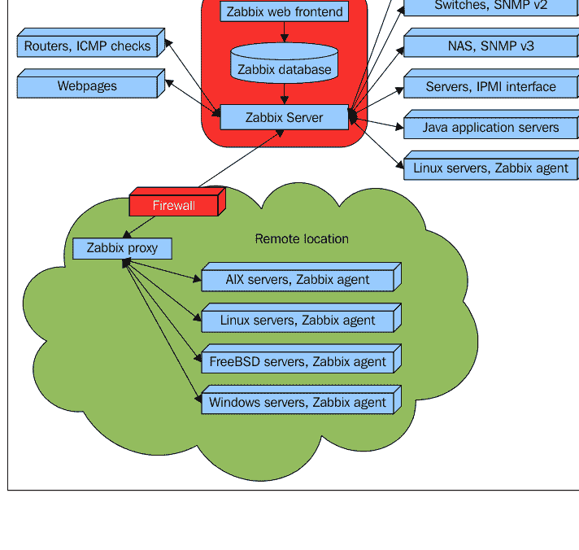

**Zabbix服务器**直接监控多台设备，但远程位置被防火墙隔离，因此通过 **Zabbix 代理**收集数据更为容易。**Zabbix 代理**和 **Zabbix 客户端**（agents）与服务器一样，都是用 C 语言编写的。

我们的核心对象是 **Zabbix 数据库**，它支持多种后端。**Zabbix 服务器**（用 C 语言编写）和 **Zabbix Web 前端**（用 PHP 编写）都可以在同一台机器上或在另一台服务器上运行。当在独立机器上分别运行各组件时，**Zabbix 服务器**和 **Zabbix Web 前端**都需要访问 **Zabbix 数据库**，而 **Zabbix Web 前端**需要访问 **Zabbix 服务器**以显示服务器状态，并实现一些其他功能。下图中箭头显示了所需的连接方向：

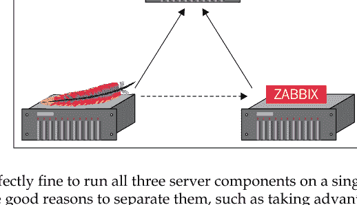

虽然在一台机器上运行全部三个服务器组件完全可行，但有时有充分的理由将它们分开，例如利用现有的高性能数据库或 Web 服务器。

总的来说，被监控设备几乎无法控制监控内容——大部分配置是集中式的。这种方法大大降低了单个配置错误的系统导致整个监控设置崩溃的可能性。

## 安装

好了，废话少说——这有什么用呢？让我们看看 Zabbix Web 前端的仪表盘界面，只显示了一个非常基础的配置：

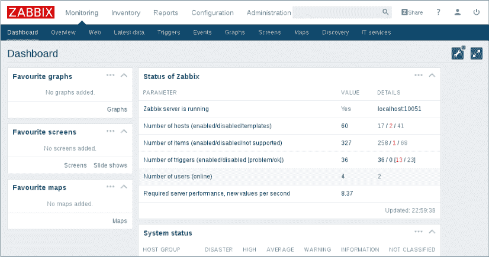

Zabbix 仪表盘向您展示被监控系统整体状态的高层概览、Zabbix 自身的状态、一些最近的问题以及更多信息。这个特定的仪表盘展示了一个非常小的 Zabbix 设置。最终，您的 Zabbix 安装会不断扩展，监控不同的设备，包括各种操作系统的服务器、不同的服务以及这些服务器上的硬件状态、网络设备、UPS、网页、IT 的其他组件以及其他基础设施。

前端将提供各种数据可视化选项，从问题列表和简单图表，到网络地图和报告，而后端将努力提供可视化所依据的信息，并发出警报。所有这些都需要一些配置，我们将在本书中学习如何操作。

在配置 Zabbix 之前，我们需要先安装它。通常，您有两种选择——从软件包安装或从源代码设置。Zabbix 软件包在许多 Linux 发行版仓库中都有，使用这些通常是一个安全的选择。此外，SIA Zabbix（开发该产品的公司）为某些发行版提供了 Zabbix 专属仓库。

与大多数软件一样，运行 Zabbix 组件需要一些先决条件。这些包括 Zabbix 服务器和客户端所依赖的硬件和其他软件的要求。为了完成安装，我们将在 Linux 上运行 Zabbix，使用 MySQL 数据库。具体的 Linux 发行版并不重要——最好选择您最熟悉的那一个。

## 硬件要求

硬件要求随配置不同而差异很大。不可能提供确切的要求，因此任何生产环境安装都应单独评估。不过，对于我们的测试环境，即使只有 128 MB 的内存也足够了。CPU 处理能力通常不会起到太大作用；Pentium II 级别的硬件应该完全能够应对，尽管生成包含许多元素的图表或其他复杂视图可能需要更强大的硬件才能以可接受的速度运行。在虚拟机上安装时，您也可以将这些作为起点。

当然，您给 Zabbix 的资源越多，它的响应就越快，运行得也越好。

## 从软件包安装

如果您决定从软件包安装 Zabbix，软件包的可用性和安装步骤将因发行版而异。这里将介绍几个发行版——其他发行版请阅读发行版特定的说明。

### RHEL/CentOS

RedHat Enterprise Linux 或 CentOS 用户有两个仓库可供选择：著名的企业 Linux 附加软件包（EPEL）和 Zabbix 仓库。EPEL 可能是更安全的选择，但它可能并不总是最新版本。

### EPEL

如果尚未设置 EPEL，则必须添加它。对于 RHEL/CentOS 7，命令类似于：

```
# rpm -Uvh http://ftp.colocall.net/pub/epel/7/x86_64/e/epel-release-7-5.noarch.rpm
```

> 在 http://download.fedoraproject.org/pub/epel/7/x86_64/repoview/epel-release.html 查看最新可用版本。

仓库设置完成后，您可以安装软件包：

```bash
# yum install zabbix22-agent zabbix22-dbfiles-mysql zabbix22-server-mysql
zabbix22-web-mysql
```

### Zabbix 仓库

首先，应安装定义 Zabbix 仓库的软件包：

```bash
# rpm -ivh http://repo.zabbix.com/zabbix/3.0/rhel/7/x86_64/zabbix-
release-3.0-1.el7.noarch.rpm
```

仓库设置完成后，您可以安装软件包：

```bash
# yum install zabbix-server-mysql zabbix-web-mysql zabbix-agent
```

### OpenSUSE

对于 OpenSUSE，Zabbix 可在 `server:monitoring` 仓库中获得。首先，应添加仓库并下载其软件包列表（您可能需要更改发行版版本）：

```bash
# zypper addrepo http://download.opensuse.org/repositories/
server:monitoring/openSUSE_Leap_42.1/server:monitoring.repo

# zypper refresh
```

仓库设置完成后，您可以安装软件包：

```bash
# zypper install zabbix-server-mysql zabbix-agent zabbix-phpfrontend
```

## 从源代码安装

如果您决定从源代码安装 Zabbix，则需要获取源代码、配置并进行编译。在守护进程就位后，前端也必须手动设置。

### 服务器和客户端

首先，我们将只设置 Zabbix 服务器和客户端，两者都运行在同一系统上。在本书后续过程中，我们将设置更多组件。

## 软件要求

现在，我们应该开始编译 Zabbix 的各组件，因此请确保安装最低要求的软件包，以使 Zabbix 能与 MySQL 配合工作。它们如下：

- **GCC**
- Automake
- MySQL (http://www.mysql.com/)

根据您的发行版和所需功能，您可能还需要以下部分或全部软件包：

- `zlib-devel`
- `mysql-devel`（用于 MySQL 支持）
- `glibc-devel`
- `curl-devel`（用于 Web 监控）
- `libidn-devel`（curl-devel 可能依赖它）
- `openssl-devel`（curl-devel 可能依赖它）
- `net-snmp-devel`（用于 SNMP 支持）
- `popt-devel`（net-snmp-devel 可能依赖它）
- `rpm-devel`（net-snmp-devel 可能依赖它）
- `OpenIPMI-devel`（用于 IPMI 支持）
- `libssh2-devel`（用于直接 SSH 检查）
- `libxml2-devel`（用于 VMware 监控）
- `unixODBC-devel`（用于数据库监控）
- Java SDK（用于 Java 网关/JMX 检查）

## 下载源代码

有几种方法可以下载 Zabbix 的源代码。您可以从 **Subversion (SVN)** 仓库获取，这将在*附录 A，故障排除*中讨论，但是，对于此安装步骤，我建议您从 Zabbix 主页 `http://www.zabbix.com/` 下载 3.0.0 版本。虽然应该可以使用最新的稳定版本，但使用 3.0.0 可以让您更严格地遵循说明。访问 **下载** 部分，获取压缩的源代码包。通常，下载页面上只有最新的稳定版本，因此您可能需要浏览源代码存档，但不要使用可能提供的开发版或测试版。


为了便于后续引用，我建议你选择一个工作目录，例如 `~/zabbix`（~ 为你的主目录）。将压缩包下载到此目录中。

## 编译

下载完成后，打开一个终端并解压它：

```
$ cd ~/zabbix; tar -zxvf zabbix-3.0.0.tar.gz
```

我建议你立即安装先决条件并编译 Zabbix 以支持外部功能，这样在后续过程中就无需重新编译了。

为本书的目的，我们将编译 Zabbix 以支持 server、agent、MySQL、curl、SNMP、SSH、ODBC、XML（VMware）和 IPMI。

继续操作，在终端中输入以下内容：

```
$ cd zabbix-3.0.0
$ ./configure --enable-server --with-mysql --with-net-snmp --with-libcurl --with-openipmi --enable-agent --with-libxml2 --with-unixodbc --with-ssh2 --with-openssl
```

最后，将打印出已编译组件的摘要。验证以下功能是否已启用：

```
Enable server: yes
Server details:
With database: MySQL
WEB Monitoring: cURL
SNMP: yes
IPMI: yes
SSH: yes
TLS: OpenSSL
ODBC: yes
Enable agent: yes
```

如果配置成功完成，一切正常。如果失败，请检查控制台中打印的错误信息并验证所有先决条件是否已安装。名为 config.log 的文件可能提供有关错误的更多详细信息。如果无法找出问题所在，请查看附录 A，故障排除，其中列出了一些常见的编译问题。

## 初始配置

编译后，我们需要为 server 和 agent 配置一些基本参数。Zabbix 提供了默认配置文件。这些文件的位置取决于你选择的安装方法：

-   源代码安装：`/usr/local/etc`
-   RHEL/CentOS/OpenSUSE 包安装：`/etc`

在其他发行版中，文件可能位于不同的目录。本书中，我们将使用相对名称引用二进制文件和配置文件，除非绝对路径被推荐或要求。

要配置 Zabbix agent，我们无需做任何操作。现在默认配置就足够了。这很容易，对吧？

对于 server，我们需要进行一些更改。用你喜欢的编辑器打开 `zabbix_server.conf` 文件（你需要以 root 用户身份编辑它），并在文件中找到以下条目：

-   DBName
-   DBUser
-   DBPassword

`DBName` 默认应为 `zabbix`；我们可以保持不变。`DBUser` 设置为 `root`，我们不喜欢这样，所以将其更改为 `zabbix`。对于 `DBPassword`，选择任意密码。你无需记住它，所以发挥创意。

> 在类 UNIX 解决方案中，行首的井号 `#` 通常表示该行被注释掉了。请确保不要以井号开头你希望生效的行。

## 创建并填充数据库

为了让 Zabbix server 存储数据，我们必须创建一个数据库。启动一个 MySQL 客户端：

```
$ mysql -u root -p
```

输入 MySQL root 用户的密码（你在安装 MySQL 时已设置此密码，或该密码可能是发行版的默认值）。如果你不知道密码，可以尝试省略 `-p`。此开关将指示客户端尝试在无密码（或空密码）情况下连接。


如果你使用的是来自软件包的 MySQL Community Edition 且版本为 5.7.6 或更高，它会生成一个随机密码并存储在日志文件中。有关更多详细信息，请查阅 MySQL 文档 http://dev.mysql.com/doc/refman/5.7/en/linux-installation-rpm.html。

现在，让我们创建数据库。添加 Zabbix 将以此身份连接到数据库的用户，并授予该用户必要的权限：

```text
mysql> create database zabbix character set utf8 collate utf8_bin;
Query OK, 1 row affected (0.01 sec)
mysql> grant all privileges on zabbix.* to 'zabbix'@'localhost'
identified by 'mycreativenpassword';
Query OK, 0 rows affected (0.12 sec)
```

使用你在 `zabbix_server.conf` 文件中设置的密码，而不是 `mycreativenpassword`。

通过输入以下命令退出 MySQL 客户端：

```text
mysql> quit
```

让我们用 Zabbix 架构和初始数据填充新创建的数据库。以下命令指的是 Zabbix 源代码中文件的位置。安装自软件包时，这些文件可能位于 `/usr/share/doc/zabbix-server-mysql-3.0.0/create/` 或 `/usr/share/zabbix-server-mysql` 等目录中：

```text
$ mysql -u zabbix -p zabbix < database/mysql/schema.sql
$ mysql -u zabbix -p zabbix < database/mysql/images.sql
$ mysql -u zabbix -p zabbix < database/mysql/data.sql
```

三个导入过程都应在没有任何消息的情况下完成。如果出现任何错误，请查看消息，修复问题并重试失败的操作。如果导入在过程中途被中断，你可能需要清除数据库——最简单的方法是删除数据库，输入以下命令：

```text
mysql> drop database zabbix;
Query OK, 0 rows affected (0.00 sec)
```


> 小心不要删除包含重要信息的数据！删除 Zabbix 数据库后，按我们之前的方式重新创建它。

到目前为止，我们应该已经安装了 Zabbix server 和 agent 并准备好启动。

## 启动

你绝不应以 root 身份启动 Zabbix server 或 agent，这对大多数守护进程来说是常识。如果你从发行版软件包安装 Zabbix，系统用户应该已经创建——如果没有，让我们创建一个新用户来运行这些进程。你可以使用发行版提供的工具或使用最广泛的命令——`useradd`，我们需要以 root 身份执行：

```
# useradd -m -s /bin/bash zabbix
```


> 对于生产系统，请考虑为 Zabbix server 和 agent 使用不同的用户账户。否则，具有配置权限的用户将能够通过指示 agent 读取 server 配置文件来发现 Zabbix 数据库凭据。一些发行版软件包，例如 EPEL 和 OpenSUSE，已经默认使用名为 `zabbixsrv` 或 `zabbix` 的单独用户账户。

这将创建一个名为 `zabbix` 的用户，其主目录位于默认位置，通常为 `/home/zabbix`，shell 为 `/bin/bash`。


> 虽然在测试系统上使用 bash 会使调试问题更容易，但在生产系统上请考虑使用 `/bin/nologin` 或 `/bin/false`。

如果你是从源代码安装，让我们尝试直接的方法——运行二进制文件。二进制文件的位置取决于所选择的安装方法。不带任何额外参数从源代码安装会将 agent 和 server 二进制文件放置在 `/usr/local/sbin`；发行版软件包很可能将它们放置在 `/usr/sbin`。假设它们在你的路径中，你可以通过运行以下命令确定二进制文件的位置：

```
# which zabbix_server
```


> 请注意可能使用连字符或减号代替下划线。

这将显示类似以下内容：

```
/usr/sbin/zabbix_server
```

或者，`whereis` 命令也可以列出配置文件和其他相关文件：

```
# whereis zabbix_server
```

这很可能会列出二进制文件、配置文件和 man 手册页：

```
zabbix_server: /usr/sbin/zabbix_server /usr/local/etc/zabbix_server.conf /usr/share/man/man3/zabbix_server
```

一旦你知道二进制文件的确切位置，以 root 用户身份执行以下操作：

```
# <path>/zabbix_agentd
```


> 我们使用 zabbix agentd，它作为守护进程运行。旧版本还具有 `zabbix_agent` 可执行文件，它提供了在互联网服务守护进程 inetd 中运行的选项；它不支持主动项，并且在大多数情况下性能不如 agent 守护进程。

这将启动 Zabbix agent 守护进程，它应静默启动并守护化。如果命令产生错误，请在继续之前解决它们。如果成功，请继续启动 Zabbix server：

```
# <path>/zabbix_server
```

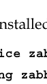

> 检查 Zabbix server 日志文件，可在 `zabbix_server.conf` 中配置。如果有数据库相关错误，请修复它们并重新启动 Zabbix server。

如果你是从软件包安装，执行以下操作：

```
# service zabbix-agentd start
Starting zabbix agent daemon
done
# service zabbix-server start
Starting zabbix server daemon
done
```

这样应该可以启动 agent 和 server。在 OpenSUSE 上，你也可以使用不同的、更短的语法：

```
# rczabbix-agentd start
# rczabbix-server start
```


Feel free to experiment with other parameters, such as stop and restart — it should be obvious what these two do.

You can verify whether services are running with the status parameter. For a service that is not running, you would get the following:

```
# service zabbix-server status
Checking for service Zabbix server daemon
unused
```

A running service would yield the following:

```
# service zabbix-agentd status
Checking for service Zabbix agent daemon
running
```

> On some distributions, this might return more verbose output, including all of the running processes.

Some distributions might have another parameter called probe. This will check whether the corresponding service has been restarted since the last configuration file changes.

If it has been restarted, no output will be produced. If the service has not been restarted (thus possibly missing some configuration changes), the reload string will be output.

While it's nice to have Zabbix processes running, it's hardly a process one expects to do manually upon each system boot, so the server and agent should be added to your system's startup sequence. This is fairly distribution specific, so all possible variations can't be discussed here. With RHEL or CentOS, a command like this should help:

```
# chkconfig --level 345 zabbix-agent on
# chkconfig --level 345 zabbix-server on
```

This will add both services to be started at runlevels 3, 4, and 5. For OpenSUSE, the following should work:

```
# chkconfig -s zabbix-server 35
# chkconfig -s zabbix-agentd 35
```

First, you have to decide where the frontend code has to go. Most distributions that package web servers use /srv/www/htdocs or /var/www. If you compiled the Apache web server from source, it would be /usr/local/apache2/htdocs (unless you manually changed the prefix or installed an older Apache version). We will place the frontend in a simple subdirectory, zabbix.

Assuming you have Apache distribution packages installed with the web root directory at /srv/www/htdocs, placing the frontend where it is needed is as simple as executing the following as the root user:

```
# cp -r frontends/php /srv/www/htdocs/zabbix
```

## Using the web frontend configuration wizard

The web frontend has a wizard that helps you to configure its basics. Let's go through the simple steps it offers.

Now, it's time to fire up a browser and navigate to Zabbix's address: http://<server_ip_or_name>/zabbix. It should work just fine in the latest versions of most browsers, including Firefox, Chrome, Safari, Opera, Konqueror, and Internet Explorer.

### Step 1 – welcome

If everything has been configured properly, you should be greeted by the installation wizard:

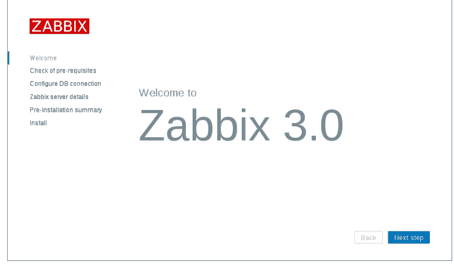

## Getting Started with Zabbix

If you are not, there are several things that could have gone wrong.

If the connection fails completely, make sure Apache is started up and there is no firewall blocking access. If you see a blank page or some PHP code, make sure that PHP is properly installed and configured to parse files ending with the .php extension through the AddType application/x-httpd-php directive. If you see a file and directory listing instead of the installation wizard, make sure you have added index.php to the DirectoryIndex directive. If these hints do not help, check the PHP documentation at http://www.php.net/manual/en/.

This screen doesn't offer us much to configure, so just click on **Next step**.

### Step 2 – PHP prerequisites

In this step, the installation wizard checks PHP-related prerequisites. If you are lucky, all will have been satisfied, and you will be greeted with all green entries:

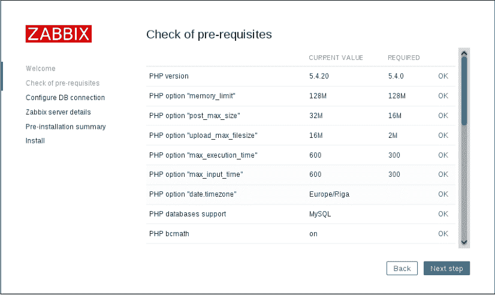

If so, just click on the **Next step** button to continue to *Step 3*.

However, more often than not, one or more entries will have a red **Fail** warning listed next to them. This is where things get more interesting. Problems at this point fall into two categories: **PHP installation** or **configuration**.

Entries such as **PHP version**, **PHP databases support**, **PHP bcmath**, **PHP mbstring**, **PHP gd**, **PHP gd PNG/JPEG/FreeType support**, and others that are not listed as an **option** are PHP installation problems. To solve these, either install the appropriate distribution packages (sometimes called **php5-bcmath**, **php5-gd**, **php5-mysql**, and so on), or recompile PHP with the corresponding options.

**PHP option "memory_limit"**, **PHP option "post_max_size"**, **PHP option "upload_max_filesize"**, **PHP option "max_execution_time"**, **PHP option "max_input_time"**, and **PHP time zone** are configuration issues that are all set in the php.ini configuration file. This file is usually located at `/etc/php5` or similar for distribution packages and `/usr/local/lib` for PHP source installations. Set the following options:

```
memory_limit = 128M
post_max_size = 16M
max_execution_time = 300
max_input_time = 300
upload_max_filesize = 2M
```

> 💡 The code bundle for the book is also hosted on GitHub at https://github.com/PacktPublishing/Zabbix-Network-Monitoring-Second-Edition. We also have other code bundles from our rich catalog of books and videos available at https://github.com/PacktPublishing/. Check them out!

For the time zone, set the `date.timezone` option to a time zone that best matches your environment. The default for Zabbix is Europe/Riga, and you can see valid options at `http://www.php.net/manual/en/timezones.php`.

Make sure you restart Apache after changing the PHP configuration file. If you can't find `php.ini`, or you make changes but the installation wizard does not pick them up, create a file named `test.php` in the `htdocs` directory with only this content:

```
<?php phpinfo() ?>
```

Navigate to this file using your browser and check the value for a **Configuration File (php.ini) Path** entry — this is where you should look for `php.ini`.

Once everything is fixed, click on the **Next step** button to continue.

### Step 3 – database access

Remember the database we created earlier? That's the information we'll supply here:

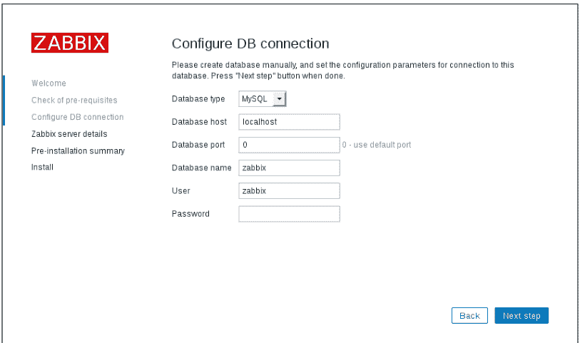

We already configured database credentials for the Zabbix server, but the Zabbix frontend uses a different configuration file. The default Database type, Database host, and Database port values should work for us. Set both Database name and User to zabbix. If you have forgotten the Password, just look it up or copy it from zabbix_server.conf. After entering the data, click on the Next step button. If all the information is correct, the wizard should proceed to the next step.

### Step 4 – Zabbix server details

The next screen lets you specify the Zabbix server's location:

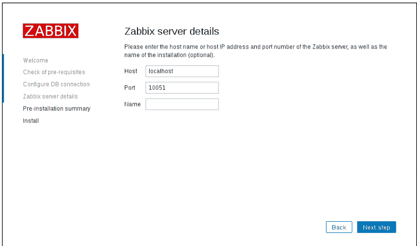

The defaults for the host and port are suitable for us, but we could benefit from filling in the Name field. The contents of this field will be used for page titles and a label in the upper-right corner of the Zabbix interface—this could be really handy if we had multiple Zabbix installations. Feel free to enter any name here, but for this book, we'll call the server Zabbix One. When you're done, it's over to the Next step again. The next screen is a summary of the choices made in the previous screens.

### Step 5 — summary

If you left the defaults where appropriate and your database connection test was successful, it should be safe to continue by clicking on **Next step**:

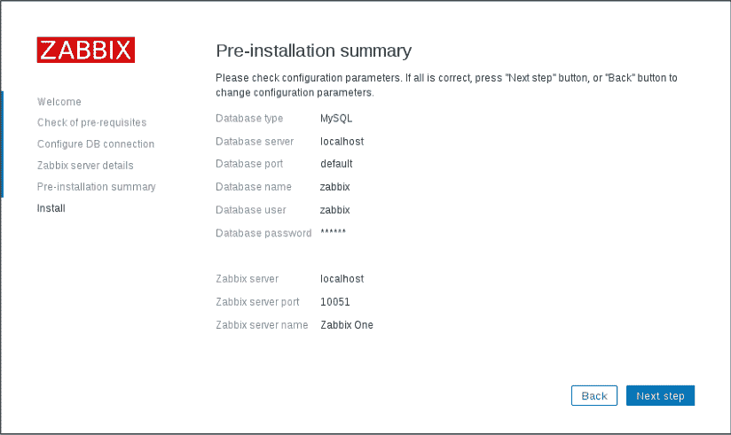

### Step 6 — writing the configuration file

It is quite likely that in the next screen, you will be greeted with failure:

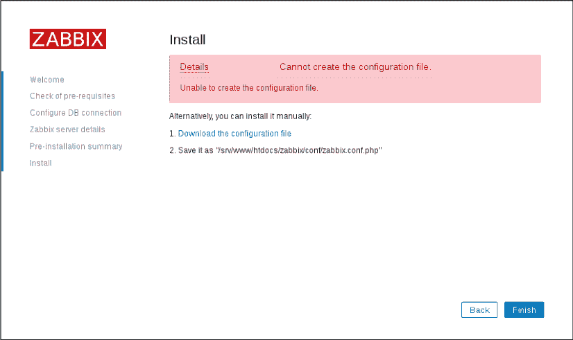

The installation wizard attempted to save the configuration file, but with the access rights that it has, it should not be possible. Previous versions of Zabbix explained two alternatives for proceeding. Unfortunately, Zabbix 3.0 has lost the explanation for one of those. The two possible solutions are as follows:

- 1. Click on **Download the configuration file** and manually place this file in the `htdocs/zabbix/conf` directory.
- 2. Make the `htdocs/zabbix/conf` directory writable by the web server user (execute as root). Use these commands:

```
```bash
# chown <username> /path/to/htdocs/zabbix/conf
# chmod 700 /path/to/htdocs/zabbix/conf
```
```

Obviously, we need to insert the correct username and directory in these commands. Remember, common locations are `/srv/www/htdocs` and `/usr/local/apache2/htdocs`—use the one you copied the Zabbix frontend code to. Common users are `wwwrun`, `www-data`, `nobody`, and `daemon`—you can find out which one the correct user is for your system by running this:

```
```bash
$ ps aux | grep http
```
```


你也可以运行以下命令：

```
```bash
$ ps aux | grep apache
```
```

大多数 `httpd` 进程运行所使用的用户名就是正确的那个。更改权限后，点击**完成**。这样就能成功保存配置文件。

> 你也可以跳过配置向导，将 `conf` 目录中的 `zabbix.conf.php.example` 复制为 `zabbix.conf.php` 并直接编辑。在这种情况下，你需要手动确认 PHP 的安装和配置需求已满足。

建议你之后限制该文件的权限，使其仅供 Web 服务器用户读取，可以以 root 身份运行以下命令：

```
```bash
# chmod 440 /path/to/htdocs/zabbix/conf/zabbix.conf.php
# chown root /path/to/htdocs/zabbix/conf/
```
```

该文件包含数据库密码，最好保密。

# 第7步 – 完成向导

恭喜，这是最后一个向导界面，只需对它友好一点，然后点击**完成**：

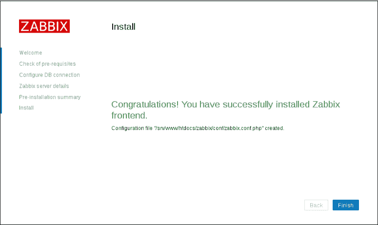

# 第8步 – 登录

点击“完成”后，应立即看到登录表单：

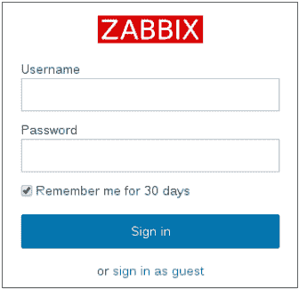

我们之前插入的 Zabbix 数据库数据也提供了默认用户名和密码。默认凭据如下：

- 用户名：Admin
- 密码：zabbix

这将带你进入初始前端界面，你会看到一个相当空白的仪表板：

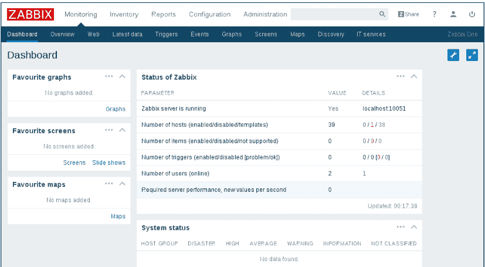

现在我们可以专注于这个小组件。前端成功检测到 Zabbix 服务器正在运行，并显示它尝试连接的主机和端口。它还知道 Zabbix 配置的一些基本信息——总共有 39 台主机已配置。等等，这是什么情况？我们只是刚刚搭建好，并没有配置任何东西；怎么已经有 39 台主机了？让我们仔细看一下“详细信息”列。这些值对应于“参数”列中括号内的描述。所以，有 0 台受监控的主机，1 台未受监控的主机，以及 38 个模板。这样就更合理了——这 39 个中只有 38 个是模板，并非实际主机。不过，还有一台主机未受监控，这是怎么回事？

点击“配置”，然后选择“主机”。你应该会看到：

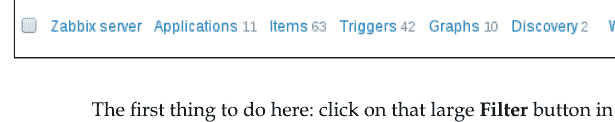

> 这里要做的第一件事是：点击页面中间那个大大的“筛选”按钮。在旧版 Zabbix 中，这个按钮非常小，很难发现。不幸的是，Zabbix 团队在解决这个问题时用力过猛——现在按钮变得巨大，而且所有筛选器默认都是展开的。我们稍后会讨论并使用筛选器。现在，只要在我们要找的信息前面看到巨大的筛选器，就把它关掉。

所以，就是它了。原来默认的 Zabbix 数据库已经配置了一台服务器：本地的 Zabbix 服务器。它默认是禁用的，这一点可以在 Zabbix 状态界面中看到，也可以在此处的“状态”列中看到“已禁用”字样。

> 在 https://www.zabbix.com/documentation/3.0/ 的 Zabbix 在线手册中包含大量技术细节。

# 总结

在本章中，我们搭建了一个全新的 Zabbix 环境，包含数据库、服务器和 agent 守护进程，并且全部运行在同一台机器上。我们还安装并配置了基于 PHP 的 Zabbix Web 前端，用于访问数据库。

我们将在后续所有章节中使用这一成果。为了了解如何从监控指标到告警电子邮件，我们将在下一章中通过一个简单的场景来演示——你可以将其视为一份快速入门指南。
