# 获得第一条通知

我们现在已经安装好了 Zabbix，但它并没有做太多事情——这是意料之中的。一个软件如果自己开始执行某些操作，可能有点不受欢迎，至少目前如此。Zabbix 的承诺是尽早通知你问题，最好是在用户和管理层发现之前。但我们要如何获取数据、将数据放在哪里、如何定义什么是问题？我们将尝试快速让 Zabbix 运行起来，并针对单个监控项向我们发送告警，这是最常见的场景。在告诉 Zabbix 将通知发送给谁之前，我们需要探索并使用一些基础的 Zabbix 概念。具体如下：

- 在前端中导航
- 创建主机和监控项（Zabbix 中对被监控指标的术语）
- 查看收集到的数据，并了解如何将其绘制成图表
- 使用触发器定义问题阈值
- 告诉 Zabbix 当超过此阈值时发送电子邮件
- 制造一个问题，以便真正收到通知

## 探索前端

虽然我们已经查看过前端提供的一些数据，但在尝试更多配置任务之前，我们应当对它更加熟悉。

配置步骤之后，我们将在**监控**部分验证结果。然后，我们将解释 Zabbix 中使用的一些通用**监控项**术语及其用途。监控项作为信息收集的基础，拥有大量的配置可能性。

# 获得第一条通知

在浏览器中打开 Zabbix 的根 URL (http://<server_ip_or_name>/zabbix)，如果已退出登录，请重新登录。现在你应该会看到一个相当空白的仪表板，信息很少：

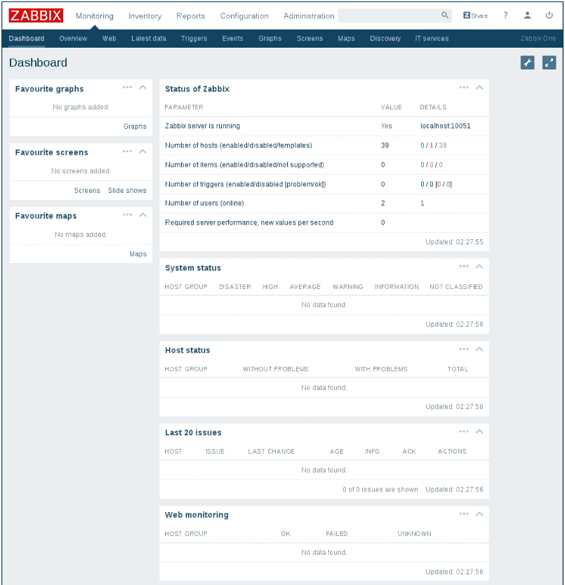

点击顶部菜单栏的条目，观察下方菜单栏如何显示所选类别的子条目。点击“配置”，然后在二级菜单中点击“主机组”——这里会显示所有已配置的主机组。你将经常使用这些菜单，因此以后我们会将刚才执行的操作称为“配置 | 主机组”。（每当你看到这样的表示法时，第一个是主类别，第二个是其下的条目。）

如以下截图所示，共有五个主要类别，具体如下：


- **监控**：此类别包含大部分与监控相关的页面。你可以在这里查看数据、问题和图表。
- **资产**：可以在这里查看被监控系统的资产数据。
- **报表**：此部分包含一些简单的报表。
- **配置**：在这里进行与系统监控、参数、通知发送等相关的所有设置。
- **管理**：此部分允许你设置更多 Zabbix 内部细节，包括认证方法、用户、权限以及全局 Zabbix 配置。

# 用户配置文件

在我们深入探索这些类别之前，不妨先访问一下个人资料部分——请查看右上角类似人物的图标：


点击它应该会打开你的个人资料：

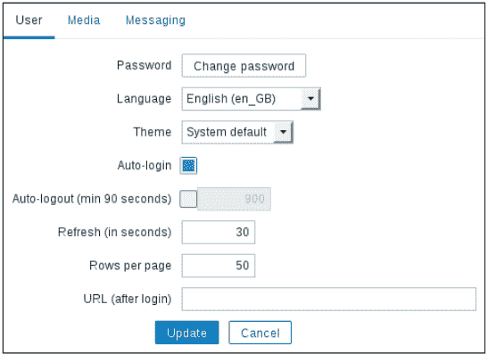

# 获得第一条通知

在这里，你可以设置与用户账户相关的一些选项，例如更改密码、前端语言或前端主题。由于我们将使用**英文（en_GB）**前端，我建议你将其保留为默认值。之前的 Zabbix 版本附带了四种不同的主题，但在 Zabbix 3.0 中有所减少；现在，只有*蓝色*和*深色*两种主题。我们将坚持使用默认主题，但 Zabbix 3.0 附带的两款主题在视觉上都相当不错。

请注意，将鼠标光标移到右上角的个人资料图标上，即可查看当前登录的用户账户。工具提示会显示你的用户名，以及用户个人资料中配置的名字和姓氏。当你未登录时，不会显示个人资料图标。

有两个与登录相关的选项：**自动登录**（将使用浏览器保存的 cookie 自动登录用户）和**自动注销**。默认情况下，**自动登录**应为启用状态，我们不会更改这些选项。

> 在撰写本文时，前端中的任何后台操作都会重置**自动注销**计时器，使其实际上形同虚设。你可以在 Zabbix 问题跟踪器中关注 ZBX-8051 问题，更详细的描述见*附录B，成为社区一员*。

我们目前不会更改**URL**选项，但稍后我们会讨论为特定用户设置自定义默认 URL 的好处。**刷新**选项设置以秒为单位的时间间隔，超过此间隔后，前端中的某些页面将自动刷新以显示新数据。对于大屏幕来说，增大此参数可能是有益的，不过我们还没有大屏幕。

**每页行数**选项将限制一次显示的实体数量。在较大的部署中，增加该值可能很有用，但设置过大可能会对前端的性能产生负面影响。


让我们在这里再做一个更改——切换到 Messaging 选项卡：

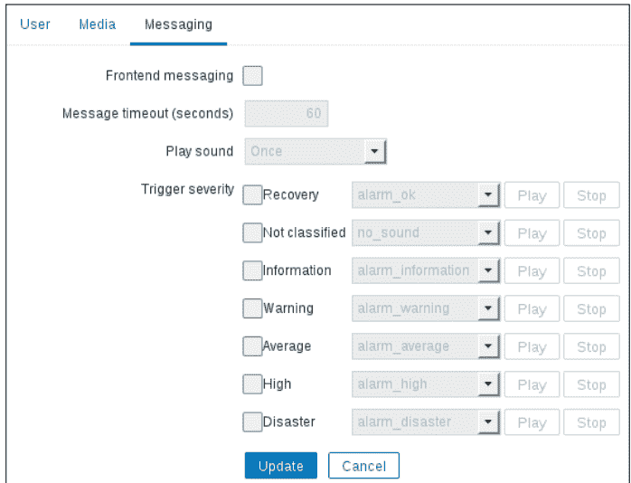

它允许你配置前端消息。现在，只需将 Frontend messaging 选项标记为启用，并将 Message timeout (seconds) 改为 180。我们将在本章后面讨论这些选项的作用，当消息开始出现时。

> 验证 Trigger severity 部分中的所有复选框是否都已标记：如果之前保存过用户配置文件，它们可能具有不同的默认状态。

更改主题并启用前端消息后，单击 Update 按钮。

注意我们用来到达特定主机项目列表的方法——我们使用了主机元素的便捷链接，这是一种相当简单的方式到达那里，也是我们将经常使用 **Configuration | Hosts** 的原因。

回到我们想要的内容，我们可以看到一个相当长的已存在项目的列表。但等等，Zabbix 状态屏幕在第一张截图中声称只有一个主机且没有项目？这显然是错误的！返回到 **Reports | Status of Zabbix**（或 **Monitoring | Dashboard**，显示相同的数据）。它确实显示项目数为零。现在将鼠标光标移到写着 **Number of items (enabled/disabled/not supported)** 的文字上，并查看工具提示：

| Status of Zabbix |
| PARAMETER | VALUE | DETAILS |
| Zabbix server is running | No | localhost:10051 |
| Number of hosts (enabled/disabled/templates) | 39 | 0 / 1 / 38 |
| Number of items (enabled/disabled/not supported) | 0 | 0 / 0 / 0 |
| Number of triggers (enabled/disabled [problem] | 0 | 0 / 0 [0 / 0] |
| Number of users (online) | 2 | 1 |
| Required server performance, new values per second | 0 |  |

*Tooltip: Only items assigned to enabled hosts are counted*

啊哈！所以它只计算分配给已启用主机的项目。由于此示例主机 Zabbix server 已被禁用，因此现在很清楚为什么 Zabbix 状态报告显示项目数为零。记住这一点很有帮助，以后当你尝试评估更复杂的配置时。

## Creating a host

与其使用此预定义的主机配置，我们想了解项目的工作原理。但项目不能存在于空旷的空间中——每个项目都必须附加到一个主机。

> 在 Zabbix 中，主机是一个逻辑实体，用于对项目进行分组。主机定义的定义可以自由地适应特定的环境和情况。Zabbix 绝不限制这种选择；因此，主机可以是网络交换机、物理服务器、虚拟机或网站。

如果需要主机来附加项目，那么我们必须创建一个。前往 Configuration | Hosts 并单击右上角的 Create host 按钮。你将看到一个主机创建屏幕。这次，我们不会关心细节，所以让我们只输入一些相关信息：

- Name: 输入 A test host。
- Groups: 从右侧列表框中选择 Linux servers，名为 Other groups；按 ◄ 按钮添加此组。然后，从 In groups 列表框中选择 Zabbix servers 并按 ► 按钮将我们新主机从此预定义组中移除。

> 为什么我们必须为此主机选择一个组？所有权限都是分配给主机组，而不是单个主机，因此主机必须属于至少一个组。我们将在第 5 章 Managing Hosts, Users and Permissions 中更详细地介绍权限。

我们为主机更改的字段应如下所示：

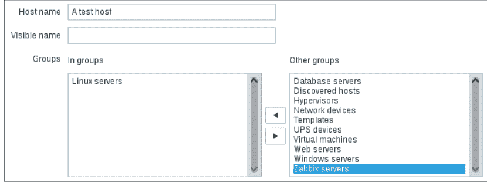

准备就绪后，单击底部的 Add 按钮。

## Creating an item

所以，我们创建了我们自己的第一个主机。但由于项目是所有数据的基础，现在可能用处不大。为了让它更有实质内容，我们应该创建项目，因此从 Groups 下拉菜单中选择 Linux servers，然后单击我们刚刚创建的主机 A test host 旁边的 Items。此主机没有要列出的项目——单击右上角的 Create item 按钮。

有一个表单，模糊地类似于主机创建表单，所以让我们填写一些值：

- **Name:** 在此字段中输入 `CPU load`。这就是项目的名称——基本上，你将在大多数地方用来引用项目的名称。
- **Key:** 此字段中的值为 `system.cpu.load`。这是项目的“技术名称”，标识它收集的信息。
- **Type of information:** 选择 `Numeric (float)`。这定义了传入数据的格式和类型。

填写所有必填信息后，你将看到以下屏幕：

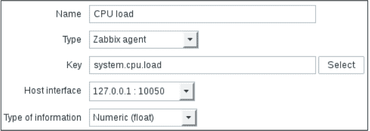

我们稍后会更详细地查看其他默认值，所以单击底部的 **Add** 按钮。

> 有关项目键的更多信息，请参阅 *Chapter 3, Monitoring with Zabbix Agents and Basic Protocols。*

你现在应该在列表中看到你的新项目。但我们对相关数据感兴趣，所以导航到 **Monitoring | Latest data**。注意到占据半页的过滤器吗？这次，我们希望立即使用它。

从 Zabbix 2.4 开始，出于性能原因，**Latest data** 页面默认不显示任何数据；因此，我们必须先设置过滤器：

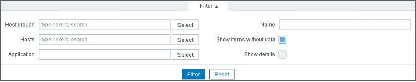

在 **Filter** 中，在 **Hosts** 字段中输入 `test`。我们新主机应该会出现。单击它，然后单击 **Filter** 按钮。在过滤器下方，如果已折叠，请展开 - other - 部分。你可能需要等待保存项目后最多一分钟，然后你应该会看到此新创建的项目已经收集了一些数据：

| NAME ▲ | LAST CHECK | LAST VALUE |
|---|---|---|
| - other - (1 item) | | |
| CPU load | 2016-02-16 20:44:55 | 0.05 |

如果完全看不到任何条目怎么办？这通常意味着数据未被收集，这可能有多种原因。如果是这种情况，请检查以下常见原因：

- 你是否完全按照屏幕截图输入了项目配置？检查项目键和信息类型。
- 代理和服务器是否都在运行？你可以通过以下方式作为 root 执行来检查：
  ```
  # netstat -ntpl | grep zabbix
  ```
  输出应列出服务器和代理守护进程在正确的端口上运行：
  ```
  tcp 0 0 0.0.0.0:10050 0.0.0.0:* LISTEN 23569/zabbix_agentd
  tcp 0 0 0.0.0.0:10051 0.0.0.0:* LISTEN 23539/zabbix_server
  ```
  如果其中任何一个缺失，请确保启动它。
- 服务器能否连接到代理？你可以从 Zabbix 服务器执行以下操作来验证：
  ```
  $ telnet localhost 10050
  ```
  如果连接失败，可能意味着代理未运行或某些限制性防火墙设置阻止了连接。在某些情况下，SELinux 也可能阻止该连接。
  如果连接成功但立即关闭，则代理接收到的连接 IP 地址与 `zabbix_agentd.conf` 配置文件中 `Server` 指令指定的地址不匹配。在某些发行版中，这可能是由于默认使用 IPv6，因此你应该尝试向该指令的同一行添加另一个以逗号分隔的值，用于 IPv6 localhost 表示形式 `::1`。

Zabbix 服务器默认每分钟将要监控的所有项目信息读入缓存一次。这意味着添加新项目等配置更改可能在收集的数据中在一分钟后才会显示效果。此间隔可以在 `zabbix_server.conf` 中通过更改 `CacheUpdateFrequency` 参数进行调整。

一旦数据开始到达，你可能会在 **Change** 列中看到没有值。这意味着你很快就转到此显示，并且项目只设法收集了一个值；因此，尚无变化。如果是这种情况，等待片刻应该会导致页面自动刷新（查看页面标题——还记得我们在用户配置文件中未更改的 30 秒刷新吗？），并且 **Change** 列将被填充。所以，我们现在正在监控一个单一值：UNIX 系统负载。数据会自动检索并存储在数据库中。如果你不熟悉这个概念，阅读 `https://en.wikipedia.org/wiki/Load_(computing)` 上的概述可能是一个好主意。

## Introducing simple graphs

如果你去阅读系统负载，几分钟应该已经过去了。现在是查看 Zabbix 中的另一个功能 **Graphs** 的好时机。图形可自由用于任何监控的数值项目，无需额外配置。

你应该仍在 **Latest data** 屏幕上，并且可以看到 **CPU load** 项目，因此单击名为 **Graph** 的链接。你会得到类似这样的内容：

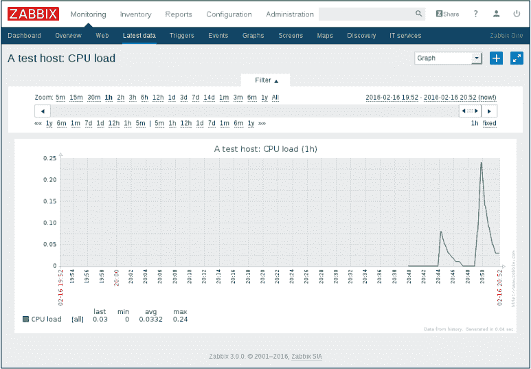


While you will probably get less data, unless reading about system load took you more than an hour, your screen should look very similar overall. Let's explore some basic graph controls.

> If you don't see any data even after several minutes have passed, try dragging the scrollbar above the graph to the rightmost position.

The Zoom controls in the upper-left corner allow you to quickly switch the displayed period. Clicking on any of the entries will make the graph show data for the chosen duration. At first, Zabbix is a bit confused about us having so little data; it thus shows all the available time periods here. As more data is gathered, only the relevant periods will be shown, and longer zoom periods will gradually become available.

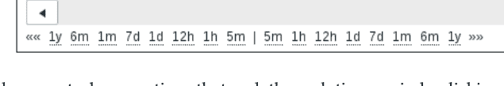

Below these controls are options that seek through time periods; clicking on them will move the displayed period by the exact time period that was clicked on.

The scrollbar at the top allows you to make small changes to the displayed period: drag it to the left (and notice the period at the top of the graph changing) and then release, and the graph is updated to reflect the period changes. Notice the arrows at both ends of the scrollbar: they allow you to change the duration displayed. Drag these with your mouse just like the scrollbar. You can also click on the buttons at both ends for exact adjustments. Using these buttons moves the period back and forth by the time period that we currently have displayed.

The date entries in the upper-right corner show the start and end times for the currently displayed data, and they also provide calendar widgets that allow a wider range of arbitrary period settings. Clicking on one of these time periods will open a calendar, where you can enter the time and date and have either the start or end time set to this choice:

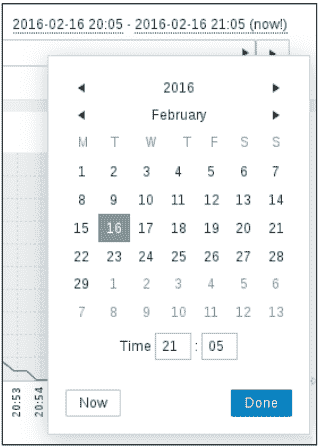

Try entering a time in the past for the starting (leftmost) calendar. This will move the displayed period without changing its length. This is great if we are interested in a time period of a specific length, but what if we want to look at a graph for the previous day, from 08:30 till 17:00? For this, the control (fixed) in the lower-right corner of the scrollbar will help. Click on it once—it changes to (dynamic). If you now use calendar widgets to enter the start or end time for the displayed period, only this edge of the period will be changed.

For example, if a 1-hour period from 10:00 to 11:00 is displayed, setting the first calendar to 09:00 while in (fixed) mode will display the period from 09:00 till 10:00. If the same is done while in (dynamic) mode, a two-hour period from 09:00 till 11:00 will be displayed. The end edge of the period is not moved in the second case.

> Depending on the time at which you are looking at the graphs, some areas of the graph might have a gray background. This is the time outside of working hours, as defined in Zabbix. We will explore this in more detail later.

Clicking and dragging over the graph area will zoom in to the selected period once the mouse button is released. This is handy for a quick drilldown to some problematic or interesting period:

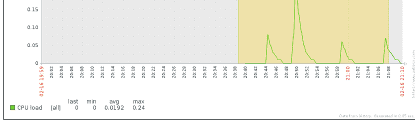

The yellow area denotes the time period we selected by clicking, holding down the mouse button, and dragging over the graph area. When we release the mouse button, the graph is zoomed to the selected period.

> The graph period can't be shorter than one minute in Zabbix. Attempting to set it to a smaller value will do nothing. Before version 3.0, the shortest possible time period was one hour.

## Creating triggers

Now that we have an item successfully gathering data, we can look at it and verify whether it is reporting as expected (in our case, that the system is not overloaded). Sitting and staring at a single parameter would make for a very boring job. Doing that with thousands of parameters doesn't sound too entertaining, so we are going to create a trigger. In Zabbix, a trigger is an entry containing an expression to automatically recognize problems with monitored items.

> An item alone does nothing more than collect the data. To define thresholds and things that are considered a problem, we have to use triggers.

Navigate to Configuration | Hosts, click on Triggers next to A test host, and click on Create trigger.

Here, only two fields need to be filled in:
- **Name:** Enter `CPU load too high on A test host for last 3 minutes`
- **Expression:** Enter `{A Test Host:system.cpu.load.avg(180)}>1`

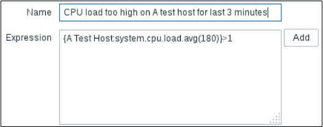

It is important to get the expression correct down to the last symbol. Once done, click on the **Add** button at the bottom. Don't worry about understanding the exact trigger syntax yet; we will get to that later.

Notice how our trigger expressions refer to the item key, not the name. Whenever you have to reference an item inside Zabbix, it will be done by the item key.

The trigger list should be now displayed, with a single trigger — the one we just created. Let's take a look at what we just added: open **Monitoring | Triggers**. You should see our freshly added trigger, hopefully already updated, with a green **OK** flashing in the **STATUS** column:

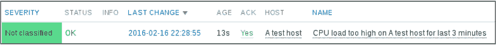

You might see **PROBLEM** in the **STATUS** field. This means exactly what the trigger name says — the `CPU load too high on A test host for last 3 minutes`.

Notice the big filter?

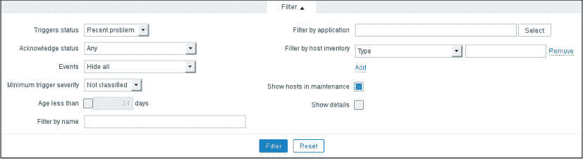

We have configured the server to send e-mail messages and set what the From address should be, but it still doesn't know the e-mail addresses that our defined users have, which is required to send alerts to them. To assign an e-mail address to a user, open Administration | Users. You should see only two users: Admin and Guest. Click on Admin in the ALIAS column and switch to the Media tab:


Click on the Add button:

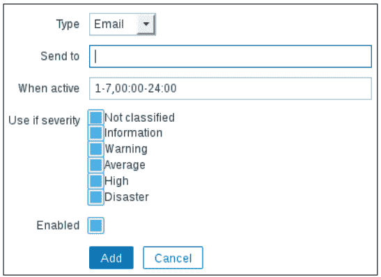

The only thing you have to enter here is a valid e-mail address in the Send to textbox—preferably yours. Once you are done, click on Add and then Update in the user properties screen.

That finishes the very basic configuration required to send out notifications through e-mail for this user.

## Creating an action

And now, it's time to tie all this together and tell Zabbix that we want to receive e-mail notifications when our test box is under heavy load.

## Getting Your First Notification

Things that tell the Zabbix server to do something upon certain conditions are called **actions**. An action has three main components:
- **Main configuration**: This allows us to set up general options, such as the e-mail subject and the message.
- **Action operations**: These specify what exactly has to be done, including who to send the message to and what message to send.
- **Action conditions**: These allow us to specify when this action is used and when operations are performed. Zabbix allows us to set many detailed conditions, including hosts, host groups, time, specific problems (triggers) and their severity, as well as others.

To configure actions, open **Configuration | Actions** and click on **Create action**. A form is presented that lets you configure preconditions and the action to take:

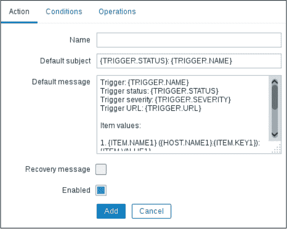

First, enter a **NAME** for our new action, such as `Test action`, and check the **Recovery message** checkbox. Next, we should define the operation to perform, so switch to the **Operations** tab. In the **Operation** tab, insert `3600` in **Default operation step duration**, as shown in the following screenshot:

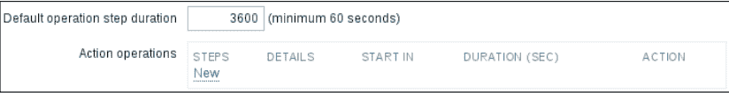

In here, click on **New** in the **Action operations** block. This will open the **Operation details** block:

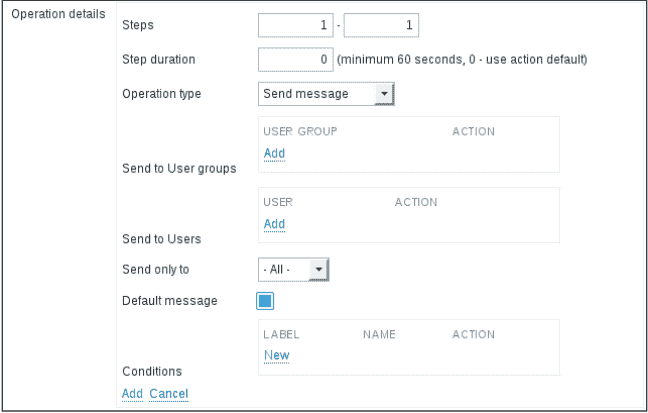

In the **Send to Users** section, click on the **Add** control. In the resulting popup, click on the **Admin** user. Now locate the **Add** control for the **Operation details** block. This can be a bit confusing as the page has four controls or buttons called **Add** right now. The correct one is highlighted here:

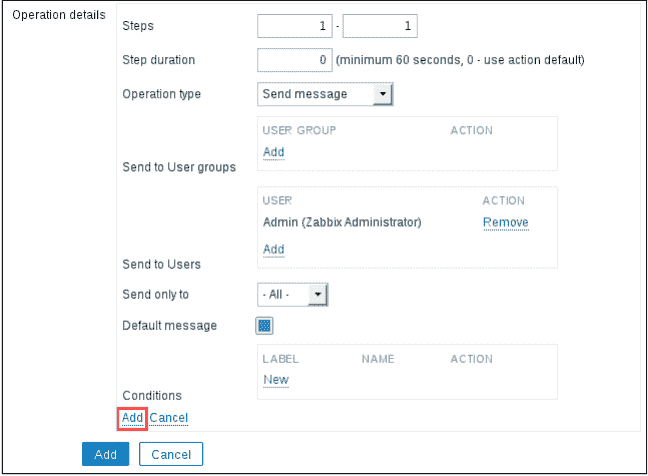


点击高亮显示的**Add**控件。恭喜！你刚刚配置了一个最简单的动作，所以点击**Action**块中的Add按钮。

## Zabbix中的信息流

我们已经在Zabbix前端配置了各种东西，包括数据收集（**Item**）、阈值定义（**Trigger**）以及超过阈值时该做什么的指令（**Action**）。但这些是如何协同工作的呢？Zabbix实体之间的信息流乍看起来可能并不明显。让我们看一个示意图，展示各个部分如何组合在一起：

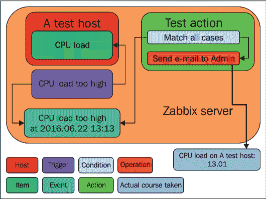

在我们的Zabbix服务器安装中，我们创建了一个主机（A test host），其中包含一个监控项（CPU load）。触发器引用此监控项。每当触发器表达式匹配当前监控项的值时，触发器切换到**PROBLEM**状态。当不再匹配时，它切换回**OK**状态。每次触发器改变状态时，都会生成一个事件。事件包含触发器状态更改的详细信息：发生时间以及新状态是什么。在配置动作时，我们可以添加各种条件，以便仅处理某些事件。在我们的案例中，我们没有添加任何条件，因此所有事件都会被匹配。每个动作还包含操作，这些操作定义了具体要做什么。最后，实际操作会被执行，这通常发生在Zabbix服务器外部，例如发送电子邮件。

触发器也可能处于**UNKNOWN**状态。如果没有足够的数据来确定当前状态，就会发生这种情况。例如，在过去10分钟没有数据的情况下计算过去5分钟的平均值，会使触发器进入**UNKNOWN**状态。导致进入或离开**UNKNOWN**状态的事件不会匹配正常的动作条件。

## 让我们产生一些负载

好的，我们配置了电子邮件发送。但除非我们实际收到一些通知，否则这并不有趣。让我们增加测试系统的负载。在控制台中运行以下命令：

```
$ cat /dev/urandom | md5sum
```

这会抓取一个伪随机、永不结束的字符流并计算其MD5校验和，因此系统负载应该会随之增加。你可以通过图表观察结果——导航到**监控 | 最新数据**，再次点击单个监控项的**图表**：

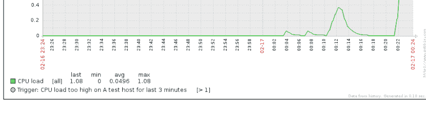

注意系统负载是如何攀升的。如果你的测试系统能够很好地应对这样的进程，可能还不够——在这种情况下，你可以尝试同时运行多个MD5校验和计算进程。

## 获取你的第一条通知

等待**3分钟**过去，右上角应该会出现一个弹出窗口，并伴有声音提示：


这是我们之前用户配置文件中启用的前端消息之一。让我们看看消息窗口中显示了什么：

- 小的灰色矩形代表触发器严重性。对于恢复消息，它是绿色的。我们将在*第6章，使用触发器检测问题*中讨论触发器。
- 第一个链接指向**监控 | 触发器**页面，显示导致消息的主机当前问题。
- 第二个链接指向**监控 | 事件**页面，显示相关触发器的历史问题。在这种情况下，它被分成两行显示。
- 第三个链接指向事件详情，显示有关此特定事件的更多信息。

窗口本身可以垂直重新定位，但不能水平移动——只需通过标题栏拖动它。窗口顶部有三个按钮：


这些按钮也有工具提示来提醒我们它们的作用，如下所示：

- 暂停按钮使当前正在播放的警报声音静音。
- 静音/取消静音按钮允许禁用/启用所有声音。
- 清除按钮清除当前可见的消息。以这种方式清除的问题不会再次出现，除非它已解决然后再次发生。

前端消息很有用，因为它提供了：

- 当你不明确查看当前问题列表时，及时通知新问题和已解决的问题
- 声音警报
- 快速访问问题详情

现在是一个好时机来重新审视这些前端消息的配置选项。再次点击右上角的链接打开个人资料，并切换到“消息”选项卡：

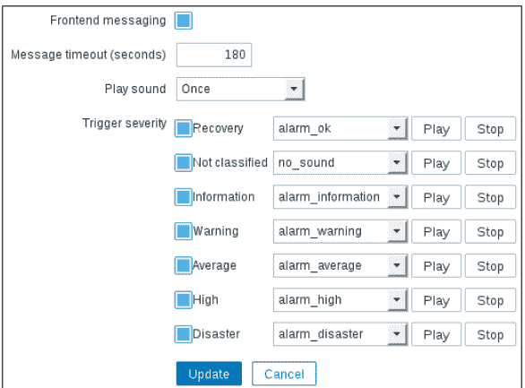

以下是这些参数的含义：

- **前端消息**：为此用户启用/禁用消息。
- **消息超时（秒）**：用于指定消息应显示多长时间。它影响消息本身，尽管它也可能影响声音警报。
- **播放声音**：此下拉选项有**一次**、**10秒**和**消息超时**。第一个将完整播放一次声音。第二个将播放10秒的声音，如有必要则循环。第三个将在消息显示期间循环播放声音。
- **触发器严重性**：允许根据触发器严重性限制消息（有关触发器的更多信息，请参阅*第6章，使用触发器检测问题*）。取消选中复选框将完全不会通知您该特定严重性。如果您想收到消息但不想收到声音警报，请从下拉菜单中选择`no_sound`。

> 可以通过将.wav文件复制到前端目录中的audio子目录来添加新声音。

之前，在配置前端消息时，我们将消息超时设置为180秒。唯一的原因是让我们在弹出窗口第一次出现时有足够的时间来探索它；这不是使用此功能的要求。

现在，让我们打开**监控 | 触发器**。我们应该看到`CPU load too high on A test host for last 3 minutes`触发器可见，在**状态**列中带有红色闪烁的**PROBLEM**文本：

| 严重性 | 状态 | 信息 | 最后变更 ▼ | 年龄 | 确认 | 主机 | 名称 |
|---|---|---|---|---|---|---|---|
| 未分类 | PROBLEM | | 2016-02-17 01:27:25 | 5m 54s | 否 3 | A test host | CPU load too high on A test host for last 3 minutes |

> 闪烁表示触发器最近改变了状态，这正是我们通过增加系统负载所实现的。

然而，如果你收到了新的电子邮件通知，你在打开**监控 | 触发器**之前应该已经知道这个状态变化。如果一切如预期，你应该收到一封通知你问题的电子邮件，所以如果还没有，请检查你的电子邮件客户端。应该有一封主题为**PROBLEM: CPU load too high on A test host for last 3 minutes**的消息。

邮件没有到达？这通常是由邮件传递链中的某些配置错误导致消息无法传递造成的。如果可能，请检查邮件服务器的日志文件以及网络连接和垃圾邮件过滤器。前往**报表 | 动作日志**可能会显示有用的错误消息。

你现在可以用简单的*Ctrl + C*停止所有MD5校验和计算进程。触发器随后应该将状态更改为**OK**，但你应该至少等待配置的监控项间隔30秒过去。

再次检查你的电子邮件：应该还有一条消息，这次通知你现在一切正常，主题为**OK: CPU load too high on A test host for last 3 minutes**。

恭喜，你已经设置了所有必需的配置，以便在任何事情出错以及恢复正常时接收警报。让我们回顾一下我们做了什么以及学到了什么：

- 我们创建了一个主机。主机是Zabbix中被监控设备的表示，可以附加监控项。
- 我们还创建了一个监控项，它是获取Zabbix系统信息的基本方式。记住：唯一的监控项标识符是key，它也是指定实际将收集哪些数据的字符串。需要一个主机来附加此监控项。
- 我们探索了监控项的简单图表，无需任何配置即可立即使用。易于使用的时间段选择控件允许我们查看任何时间段，并快速缩放以进行下钻分析。
- 已经拥有数据本身就是一项成就，但定义什么是问题使我们可以免于手动尝试理解大量数值。这就是触发器的用武之地。它们包含定义阈值的表达式。
- 拥有问题列表而不是原始数据向前迈进了一步，但仍然需要有人查看列表。我们更希望得到通知——这就是动作的作用。我们能够指定谁应该在何时收到通知。

## 基本监控项配置

我们匆匆完成了简单监控项的配置，所以你可能对我们未更改或未讨论的参数感到好奇。让我们快速看看可以监控什么以及我们可以为每个监控项配置什么。

Zabbix可以监控相当广泛的系统特性。从功能上，我们可以将它们分为类别，而从技术上讲，每种使用的方法对应一种监控项类型。

## 监控类别

让我们看看我们可以关注的通用类别。当然，这不是一个详尽的监控列表——将其视为一组有趣的参数示例。你很快就会发现在Zabbix配置中发现更多可以添加的领域。


## 可用性

我们一开始使用的简化示例（派对上那个倒霉的管理员——还记得他吗？）可能吓不到很多人，但可用的噩梦场景比我们愿意想到的要多得多。各种服务可能在没有征兆的情况下死亡，直到为时已晚，而一个内存泄漏就足以轻松拖垮系统。

我们将尝试探索可用的选项，以尽可能早地检测到此类情况，以便例如帮助我们的管理员在工作日处理磁盘空间问题，并在他推门而入时发现重要服务因数据库故障而死亡。

## 性能

性能是计算领域众多圣杯之一。系统永远不够快以满足所有需求，因此我们必须在期望的操作与可用资源之间取得平衡。Zabbix 既可以帮助您评估特定操作的性能，也能监控当前负载。

您可以从简单的事情开始，例如网络性能，由 ping 往返时间或网站返回内容所需的时间来表示，然后继续处理更复杂的场景，例如集群中服务的平均性能与磁盘阵列吞吐量相结合。

## 安全

计算领域的另一个圣杯是安全，这是一个永无止境的过程，您需要使用许多工具，其中之一可以是 Zabbix。

Zabbix 可以独立于其他验证系统，检查诸如开放端口、软件版本和文件校验和等简单事项。虽然这些作为唯一的<|message|>安全措施是可笑的，但它们可以成为现有流程的宝贵补充。

## 管理

系统管理涉及做很多事情，这意味着在所有这些步骤中遵循一套规则。优秀的系统管理员从未在这一点上失败，除非他们确实失败了。

您可以使用许多简单和高级的检查来了解需要执行的任务或在配置系统时出现的问题：跨平台通知关于可用的升级、检查 DNS 序列号是否已正确更新，以及无数其他系统管理陷阱。

## 效率

虽然通常被认为属于可用性或性能的子集，但效率的一些方面并不完全适合其中。效率可以被视为提高可用性和性能的第一步，这增加了了解系统效率重要性。

效率参数将比其他参数更特定于服务，但一些通用示例可能包括 Squid 命中率和 MySQL 查询缓存效率。其他应用程序，包括内部定制的应用程序，可能提供其他效率测量方法。

## 项目类型

如前所述，Zabbix 在项目中收集所有数据。但显然，我们希望以不仅仅是通过 Zabbix 代理的方式获取信息。我们的选择是什么？让我们看一下：

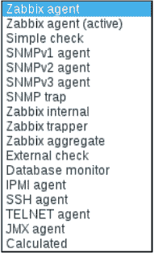

这是编辑项目时项目类型配置下拉菜单。我们在创建项目时基本上跳过了此选择，因为默认值适合我们。让我们快速看看现在可用的类型：

- **Zabbix agent**：这是默认类型。服务器连接到代理并收集数据。
- **Zabbix agent (active)**：这可以被认为是前面类型的相反。Zabbix 代理收集数据并在需要时连接到服务器。
- **Simple check**：顾名思义，此类型将服务器执行的简单检查分组。这包括检查开放的 TCP 端口、ICMP ping 等。我们将在 *Chapter 3, Monitoring with Zabbix Agents and Basic Protocols* 中讨论这两种 Zabbix 代理类型和简单检查。
- **SNMP agents**：这三种类型处理收集 SNMP 数据。版本显然表示在连接到被监控主机时使用的协议版本。
- **SNMP trap**：虽然仍然依赖 Net-SNMP 的 `snmptrapd` 从网络获取 traps，但 Zabbix 提供了轻松接收 SNMP traps 的功能。此项目类型允许您执行此操作，包括按主机自动排序。我们将在 *Chapter 4, Monitoring SNMP Devices* 中介绍 SNMP 轮询和 trapping。
- **Zabbix internal**：这组项目收集有关 Zabbix 内部状态的信息。我们将在 *Chapter 3, Monitoring with Zabbix Agents and Basic Protocols* 中讨论内部监控。
- **Zabbix trapper**：此项目类型接受传入数据而不是查询数据。它对于您可能想要通过其他工具、自定义脚本或任何其他方法获得并馈入 Zabbix 的任何数据都很有用。
- **Zabbix aggregate**：这些项目在主机组中聚合值。这对于集群或服务器场特别有用，在那里整体状态比单个机器的状态更重要。
- **External check**：外部检查允许 Zabbix 服务器执行外部命令并将返回的值存储在项目中。这允许它传递任何无法使用其他项目类型访问的信息。我们将在 *Chapter 11, Advanced Item Monitoring* 中使用 Zabbix trapper 项目、聚合项目和外部检查。
- **Database monitor**：此类型包括用于查询各种数据库参数的内置本机检查。
- **IPMI agent**：**Intelligent Platform Management Interface (IPMI)** 是管理和监控系统（我们主要关注这一点）的规范，特别是针对带外解决方案。IPMI 项目类型允许直接访问此数据。我们将在 *Chapter 16, Monitoring IPMI Devices* 中介绍 IPMI 监控。
- **SSH agent**：可以直接使用 SSH 查询主机并检索 shell 命令输出。此检查支持基于密码和基于密钥的身份验证。
- **TELNET agent**：对于某些无法使用 SSH 的系统，可以使用直接 Telnet 检查。虽然不安全，但它可能是访问某些设备（包括老一代交换机或 UPS）的唯一方法。我们将在 *Chapter 11, Advanced Item Monitoring* 中讨论 SSH 和 Telnet 项目。
- **JMX agent:** Zabbix 提供了一个名为 Zabbix Java gateway 的组件。它允许您直接监控 JMX 兼容应用程序。JMX 监控将在 *Chapter 17, Monitoring Java Applications.* 中讨论。
- **Calculated:** 这些是高级项目，允许您从其他预先存在的 Zabbix 项目创建新值，而无需重复数据检索。我们将在 *Chapter 11, Advanced Item Monitoring* 中使用这些项目。

虽然所有这些类型在此时可能看起来有点令人困惑，但要记住的重要一点是，它们可供您使用，但您不必使用它们。您可以拥有一个仅包含单个 ICMP ping 项目的主机，但如果您想监控更多内容，高级功能将始终存在。

正如您可能已经注意到的，项目类型是按单个项目设置的，而不是按主机设置。这在设置监控主机时提供了很大的灵活性。例如，您可以使用 ICMP 检查总体可用性，使用 Zabbix 代理检查某些服务的状态并对其他服务使用简单的 TCP 检查，使用 trapper 接收自定义数据，并使用 IPMI 通过管理适配器监控参数——所有这些都在同一主机上。项目类型的选择将取决于网络连接、被监控主机的功能集以及实现的难易程度。Zabbix 将允许您为每个项目选择最佳匹配。

## 如何监控项目

虽然这涵盖了类别和项目类型，但我们在创建项目时跳过了一些其他参数，因此了解大多数项目类型必须设置的基本值可能会有所帮助。让我们快速查看项目创建/编辑窗口中的字段：

- **Name:** 用户级项目名称。这是您在向用户显示数据的大多数地方看到的内容。
- **Type:** 这是主要属性，影响其他字段和项目数据收集方式，如前所述。
- **Key:** 这是明确指定此项目需要收集什么数据的属性。它有点像是项目的技术名称。每个主机的键值必须是唯一的。对于某些其他项目类型，实际标识收集数据的字段可能是 Simple Network Management Protocol Object Identifiers (SNMP OID) 或 IPMI 传感器，而键仅用于引用项目。


## 获取你的第一个通知

- **信息类型：** 允许你选择将随监控项收集的数据类型。你必须根据提供的值进行设置：整数、小数等。
- **数据类型：** 此属性提供了一种以十六进制或八进制格式查询数据并自动转换为十进制值的方法。一些支持 SNMP 的设备（主要是打印机）以这些格式发送信息。还有布尔数据类型，可将多个输入转换为 1 或 0。
- **单位：** 此属性允许你选择除数据之外要显示的单位，对于某些单位，Zabbix 将根据需要计算相应的转换（在许多工具中称为“人类可读”，因此你得到 32.5 GB 而不是相同值的字节数）。
- **使用自定义倍数：** 此属性将传入数据乘以此处指定的值并存储结果。如果数据以一种单位到达，但你想以另一种单位存储，这很有用（例如，如果传入数据以字节为单位，但你想以位为单位，则使用倍数 8）。
- **更新间隔：** 设置数据检索尝试之间的间隔。
- **自定义间隔：** 此设置允许你在特定时间修改更新间隔或使用类似 cron 的监控项调度——或者因为你在夜间不需要特定监控项，或者因为你了解某些特定服务将停机，例如在备份窗口期间。
- **历史存储周期：** 设置实际检索值存储在数据库中的时间段。
- **趋势存储周期：** 这与**历史存储周期**选项相同，但针对趋势。趋势是根据历史数据计算出来的数据，每小时平均一次，以减少长期存储需求。
- **存储值：** 此属性仅适用于数值数据，允许 Zabbix 服务器在将数据插入数据库之前对数据执行一些基本计算，例如计算计数器监控项两次检查之间的差值。
- **显示值：** 在此下拉菜单中，可以选择一个值映射。它允许你为数字代码显示人类可读的值，例如 SNMP 接口状态返回的值。有关值映射的更多信息，请参阅*第 3 章，使用 Zabbix Agent 和基本协议进行监控*。
- **应用：** 此属性使得可以对监控项进行逻辑分组，例如在**监控 | 最新数据**屏幕上。

- **填充主机清单字段：** 允许你将收集的监控项值放入清单字段（在*第 5 章，管理主机、用户和权限*中探讨）。
- **描述：** 此字段可用于 Zabbix 3.0 中的多个实体，允许你描述监控项。你可以说明数据收集、处理的方式或其含义。
- **启用：** 允许你启用或禁用监控项。

如果这些简短的描述没有回答你对每个选项的所有问题，请不要担心。我们稍后将更深入地探讨每个选项，而且其他监控项类型还有更多可用选项。

## 使用全局搜索

到目前为止，我们已经通过转到前端中的特定页面，然后查找组和主机，来导航到主机或其监控项及其他实体。在较小的安装中，这是一种足够方便的方法，也是我们在本书中主要使用的方法。在较大的安装中，像这样导航可能非常耗时；因此，称为**全局搜索**的功能变得非常有用。实际上，许多用户几乎完全跳过了经典的导航方法，而只使用搜索。

全局搜索字段位于 Zabbix 前端的右上角。在其中输入一个字母 a。此处输入的任何内容都将与主机名的开头匹配，结果显示在下拉列表中。在我们的案例中，**A test host** 匹配：


你可以使用键盘或鼠标选择下拉列表中的某个条目，或使用原始字符串进行搜索。让我们通过用鼠标单击或使用键盘突出显示然后按 *Enter* 来选择下拉列表中的唯一条目。在搜索结果中，我们可以看到三个块，对应于可以在 Zabbix 中搜索的三种实体类型：

- 主机
- 模板
- 主机组

## 获取你的第一个通知

这是条目的样子：

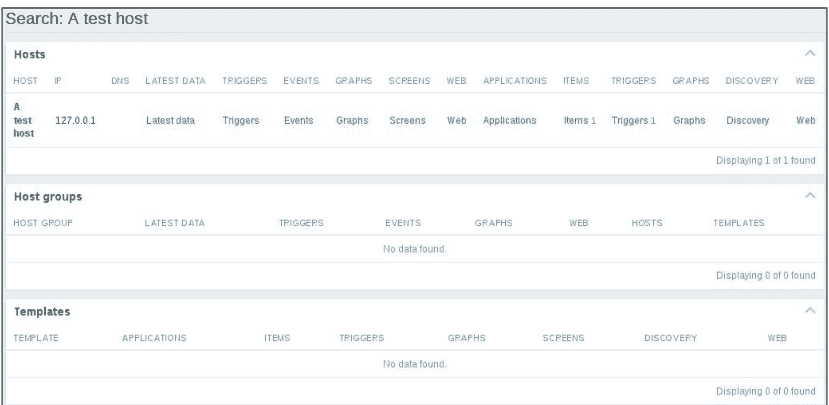

对于所有实体，都可以按名称进行搜索。此外，对于主机，还可以按 IP 地址和 DNS 进行搜索。

在搜索结果中，单击主机名将打开主机的属性。每个主机还有一些附加链接，但列标题可能会令人困惑：TRIGGERS、GRAPHS 和 WEB 是重复的。虽然这不是很直观，但区别在于链接旁边的数字使用：如果有数字，这是指向配置部分的链接。如果没有数字，则是指向监控部分的链接，或者可能没有配置该类型的实体。在这种情况下，你必须记住最右边同名的列用于配置。配置链接的数字（如果存在）是实体数量。

## 总结

这是我们在本章中终于进行了一些实际操作的一章：监控一个监控项，创建一个触发器，并在此触发器上获得通知。我们还稍微探索了 Zabbix 前端，并查看了基本监控项参数。让我们回顾一下获得第一个警报需要哪些基本步骤：

- 我们从创建主机开始。在 Zabbix 中，所有要监控的内容都附加到一个称为主机的逻辑实体上。
- 接下来，我们创建了一个监控项。作为信息收集的基础，监控项定义了有关受监控指标的参数，包括要收集哪些数据、收集频率、如何存储检索到的值以及其他内容。
- 在监控项之后，我们创建了一个触发器。每个触发器包含一个用于定义阈值的表达式。对于每个触发器，还可以配置严重性。为了让 Zabbix 知道如何联系我们，我们配置了电子邮件设置。这包括为媒介类型指定电子邮件服务器，以及向用户配置文件添加媒介。
- 作为最后的配置步骤，我们创建了一个操作。操作是定义要执行的实际操作的配置实体，并且可以具有条件，为如何处理各种事件创建灵活的规则。
- 嗯，我们实际上还做了一件事来确保一切正常——我们创建了一个问题。测试你的配置很有用，尤其是在刚开始使用 Zabbix 时。我们的配置是正确的，所以我们及时收到了有关该问题的通知。

虽然这些知识已经足以配置一个非常基本的监控系统，但在它被认为是一个功能完备的系统之前，我们还需要探索其他领域。在下一章中，我们将弄清楚被动监控项和主动监控项之间的区别，以及在设置它们时需要注意哪些重要事项。我们还将介绍基本的 ICMP 监控项和其他监控项属性，例如位置参数、值映射、单位和自定义间隔。

仅从源代码编译 agent 的方式与第 1 章“Zabbix 入门”中包含所有组件进行编译的方式类似。这次我们将使用一个简单的标志，而不是完整的 configure 命令行：

```
$ ./configure --enable-agent
```

配置应该成功完成，以下摘要行很重要：

```
Enable server:      no
Enable proxy:       no
Enable agent:       yes
```

如果你看到的输出与前面的输出匹配，请继续执行以下命令：

```
$ make install
```

编译应该没有任何错误地完成，并且应该相对较快。

如果你在不同于服务器的发行版上安装发行版软件包，则不必担心 agent 守护程序的版本比服务器旧。这是受支持的，并且应该工作得很好。事实上，1.0 版本的 Zabbix agent 守护程序与 3.0 版本的服务器的配合很好。反过来可能不起作用，并且不受支持。你应该避免将较旧的服务器与新的 agent 一起使用。

> 使用较旧的 agent 可能更方便，因为你已经安装了一个并且运行良好。在设置新的 agent 时，建议使用最新的，因为它可能修复了错误、提高了性能、支持特定平台的更多监控项以及其他好处。

agent 安装完成后，现在是启动它的时候了。具体如何操作取决于安装方法——如果你从软件包安装，还取决于发行版。有关如何启动 agent 的示例，请参阅第 1 章“Zabbix 入门”。快速提醒一下，如果你在基于 RHEL/SUSE 的系统上从软件包安装，则 agent 守护程序可能可以这样启动：

```
# service zabbix-agentd start
```

如果你从源代码安装，直接执行二进制文件：

```
# <path>/zabbix_agentd
```


启动 agent 后，我们还需要将这个新主机添加到配置中，请转到“配置 | 主机”。确保右上角的“组”下拉框显示“Linux 服务器”。点击“创建主机”按钮并填写此表单：

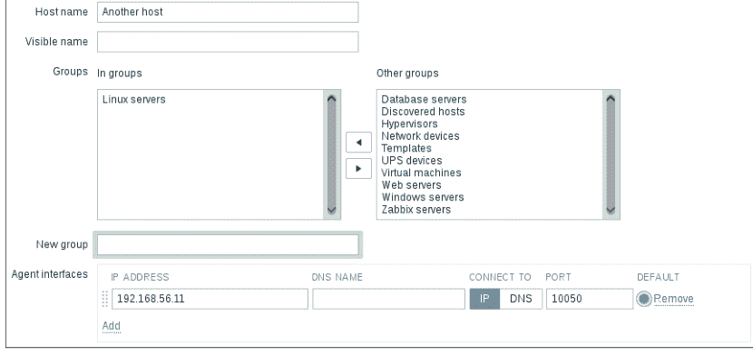

以下是填写表单的一些提示：

- **主机名称**：可以随意选择一个描述性名称，或直接输入“Another host”
- **Agent 接口**：根据你要使用的连接方式，填写 IP 地址或 DNS 名称
- **连接到**：如果你决定使用 DNS 名称，请切换到 DNS

完成后，点击底部的“添加”按钮。

## 被动监控项

我们之前创建的监控项是一种所谓的被动监控项，这意味着每次需要收集数值时，Zabbix 服务器都会主动连接到 agent。在大多数地方，它们被简称为 Zabbix agent 类型。

记住 Zabbix 中被动或主动的一个简单方法是从 agent 的视角来思考。如果 agent 连接到服务器，就是主动的；如果不是，就是被动的：

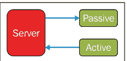

让我们再创建一个被动监控项来检查远程主机。请转到“配置 | 主机”，单击刚创建主机旁边的“监控项”，点击“创建监控项”按钮，并填写以下值：

- **名称**：输入“Web server status”
- **键值**：输入 `net.tcp.service[http,,80]`（即 80 前面有连续两个逗号）
- **更新间隔（秒）**：从默认值（30）改为 60——每分钟一次完全满足我们的需求
- **历史存储期限（天）**：从默认值（90）改为 7——这仍然可以保留一整周的精确到每分钟的服务状态记录

最终结果应如下所示：

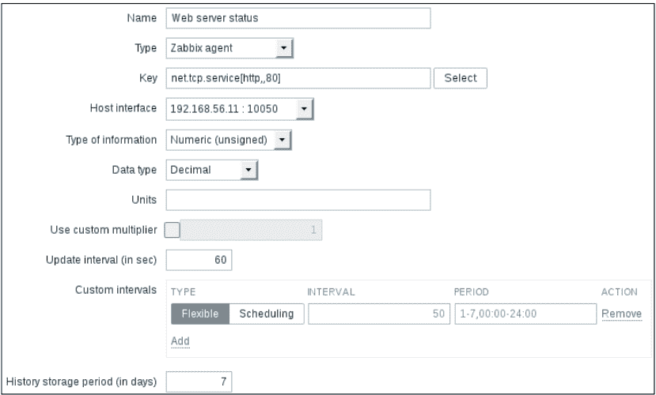

但是服务名称中添加的 `,80` 是怎么回事？请单击 **键值** 字段旁边的 **选择** 按钮。这会打开一个窗口，里面有一个很好用的键列表供你选择，并且附带每个键的简短描述：

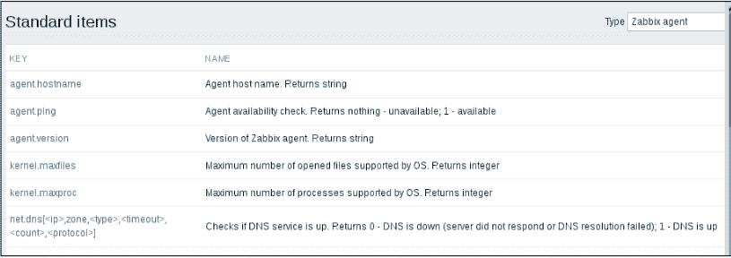

右上角的 **类型** 下拉框会让你在几种监控项类型之间切换——我们稍后会讨论其他类型。现在，请在列表中找到 `net.tcp.service` 并查看其描述。这里有两件事需要了解：首先，我们实际上不必添加 `80`——它是一个端口，既然默认值已经是 `80`，添加它是多余的。但是，如果你有服务运行在非标准端口上，它就很有用。其次，键列表只需点击一下即可打开，如果你忘记了某个特定的键或它的参数应该是什么样子，可以快速得到提示。

这个键 `net.tcp.service` 有点特殊：它会尝试验证对应服务是否确实以标准方式响应，这意味着该服务必须被显式支持。在撰写本文时，Zabbix 对 `net.tcp.service` 键支持以下服务：

- FTP
- HTTP
- HTTPS
- IMAP
- LDAP
- NNTP
- POP
- SMTP
- SSH
- TCP
- Telnet

TCP 服务本身也有点特殊。其他服务会执行特定于服务的检查，而 TCP 并不是真正的服务；它只检查 TCP 连接。它更接近你在监控项列表中上面几行可以看到的 `net.tcp.port` 键。正如描述所说，这个键只是尝试打开到任意端口的 TCP 连接，而不对返回的值执行任何特定于服务的检查。如果你尝试使用一个不支持的任意服务字符串，你只会收到一条错误消息，提示不支持这样的监控项键。

> 还有一个 `net.udp.service` 键，目前仅支持一种服务——网络时间协议（NTP）。

请随意查看其他可用的键——我们稍后也会用到其中几个——然后关闭此弹出窗口，并点击底部的“添加”按钮。

你可能已经注意到，当某个操作成功完成时，屏幕顶部会出现一个绿色条带。这次，还有一个名为“详细信息”的控件；点击它可以展开详细信息：


你可以再次点击“详细信息”来收起内容。当然，只要在某个操作完成后出现“详细信息”链接，就可以这样做。

现在，我们可以转到“监控 | 最新数据”并等待值出现在那里，但那样毫无意义。相反，几分钟后，你应该访问“配置 | 主机”。根据你的网络配置，你可能会看到此主机旁边出现一个红色的 ZBX 标记。此图标表示尝试从被动 Zabbix agent 收集数据时发生的错误。

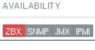

要查看实际的错误消息，请将鼠标光标移到图标上，会打开一个工具提示。点击错误图标将使工具提示保持显示，并允许你复制错误消息。


> 另外三个条目分别代表 SNMP、JMX 和 IPMI 数据收集状态。我们将在*第 4 章，监控 SNMP 设备*中监控 SNMP 设备，在*第 16 章，监控 IPMI 设备*中监控 IPMI 设备，并在*第 17 章，监控 Java 应用程序*中监控 JMX 应用程序。

如果你看到类似于 **Get value from agent failed: cannot connect to [[192.168.56.11:10050]: [111] Connection refused** 的错误消息（很可能 IP 地址不同），这意味着 Zabbix 服务器无法连接到 agent 守护进程的端口。这可能是由多种原因造成的，最常见的是防火墙——要么是 Zabbix 服务器与远程主机之间的网络防火墙，要么是远程主机上的本地防火墙。请确保允许从 Zabbix 服务器到被监控机器的 10050 端口连接。

如果你正确执行了上述操作（或者你没有防火墙阻止连接），你可以再次前往**监控 | 最新数据**——但这同样毫无意义。要了解原因，请刷新主机列表。很快，你应该会看到 Zabbix agent 状态图标再次变红，将鼠标光标移到它上面会显示另一条错误消息：**Received empty response from Zabbix Agent at [192.168.56.11]**，这表明 agent 因访问权限而断开了连接。这就不同了。它说的是什么访问权限？为什么它们对我们的第一台主机有效？

在 Zabbix 服务器上，执行以下命令：

```bash
$ telnet 192.168.56.11 10050
```

> 你应该始终从 Zabbix 服务器验证网络连接和访问权限。从另一台机器执行验证可能会得到截然不同且无用的结果。

将 IP 地址替换为你的远程主机的 IP 地址。你应该会看到以下输出，并且连接应立即关闭：

```
Trying 192.168.56.11...
Connected to 192.168.56.11.
Escape character is '^]'.
Connection closed by foreign host.
```

现在，用 localhost 尝试同样的操作：

```
$ telnet localhost 10050

Trying 127.0.0.1...
Connected to localhost.
Escape character is '^]'.
```

注意，这次连接没有立即关闭，因此配置中有所不同。连接很可能会稍后关闭——更准确地说，是 3 秒后。如果由于某种原因没有关闭，请按说明按 `Ctrl+]`，然后输入 `quit`——这应该会关闭连接：

```text
^]

telnet> quit
Connection closed.
```

事实证明，在另一台机器上配置 Zabbix agent 守护进程会比以前要稍难一些。

与在 Zabbix 服务器上的安装不同，我们必须编辑远程机器上的 agent 守护进程配置文件。用你喜欢的编辑器以 root 身份打开 `zabbix_agentd.conf`，并查看 **Server** 参数。它当前设置为 `127.0.0.1`，这就是我们在 Zabbix 服务器上无需修改它的原因。如注释所述，此参数应包含 Zabbix 服务器的 IP 地址，因此请在此处将 `127.0.0.1` 替换为正确的服务器地址。

> 如果你的环境中运行着较旧的 Zabbix agent 实例，请务必使用和编辑名称中带 d 的 `zabbix_agentd.conf`。另一个文件 `zabbix_agent.conf` 曾用于功能受限的 `zabbix_agent` 模块，该模块已在 Zabbix 3.0 中移除。

保存文件并重启 agent 守护进程。具体做法同样取决于安装方法。如果你是从发行版软件包安装的，以下命令很可能有效：

```shell
# service zabbix-agentd restart
```

如果你是从源代码安装的，并且没有创建或调整一些初始化脚本，则必须手动停止并启动 agent 进程：

```shell
# killall -15 zabbix_agentd; sleep 3; zabbix_agentd
```

上述命令将停止系统上所有名为 `zabbix_agentd` 的进程。如果系统上运行着多个 agent，则不应使用此命令。此外，3 秒的延迟在大多数情况下应该绰绰有余，但如果在执行后 agent 仍未启动，请检查其日志文件以查找潜在原因。


> 切勿对 Zabbix 守护进程使用 kill -9。千万不要。即使你认为可以，也不要这样做。信号 15 是 SIGTERM——它告诉守护进程终止运行，这意味着将所有未写入的数据写入数据库，写出并关闭日志文件，并可能执行其他操作来正常关闭。信号 9 是 SIGKILL——进程被粗暴地杀死，不允许它与心爱的数据库和文件告别。除非你真的知道自己在做什么，否则你不会想那样做——说真的，别这么做。

要验证这一更改，请再次尝试 telnet 到远程机器：

```
$ telnet 192.168.56.11 10050
```

这一次，结果应该与我们在 localhost 上看到的一样：连接应建立，然后大约 3 秒后关闭。

> 尽管所有主机都必须指定某个主机接口，即使对于那些仅使用主动监控项的主机也是如此，但该接口仅用于被动 Zabbix agent 检查。如果未配置此类监控项，则此接口将被直接忽略。

最后，值得打开 **监测 | 最新数据**。不过，我们只会看到之前创建的监控项；原因在于我们之前修改过的同一个过滤器。我们明确地过滤了一个主机；因此，我们创建的第二个主机根本不会显示。在过滤器（应该仍然处于展开状态）中，清空主机字段，在 **主机组** 字段中选择 **Linux servers**，然后点击 **筛选**：

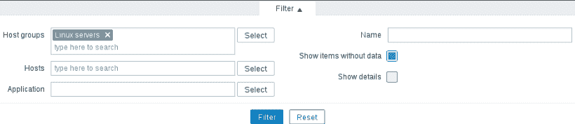

> 在 Zabbix 的许多过滤器字段中，我们可以开始输入并获取匹配条目列表，也可以点击 **选择** 按钮查看所有可用实体的列表。当我们至少知道名称的一部分时，输入是一种非常方便的方式。而在我们不太熟悉的环境中工作时，能够看到列表会很有帮助。

现在我们应该看到两台受监控的主机，每台都有一个监控项：

| 主机 | 名称 | 最后检查 | 最后值 | 变更 |
|---|---|---|---|---|
| Another host | - 其他 - (1 个监控项) |  |  |  |
|  | Web 服务器状态 | 2016-02-20 00:58:56 | 1 | 图形 |
| A test host | - 其他 - (1 个监控项) |  |  |  |
|  | CPU 负载 | 2016-02-20 00:58:55 | 0 | 图形 |

请注意，我们可以点击每个条目旁边或表头中的三角形图标来折叠和展开单个条目或所有条目。

## 克隆监控项

现在让我们尝试监控另一个服务，例如运行在 22 端口上的 SSH 服务。为了简单起见，这次我们不会从头创建一个监控项；而是回到 配置 | 主机，点击 Another host 旁边的 监控项，然后点击 名称 列中的 Web server status。这将打开监控项编辑界面，显示我们之前输入的所有值。这一次，底部有可用的不同按钮。在其他更改中，除了 添加 按钮之外，还有一个 更新 按钮。


> 请注意，之前看到的按钮中有一个不同了。之前标记为 添加 的按钮现在变成了 更新。这一变化标识了我们即将执行的操作：要么添加新实体，要么更新现有实体。有人可能打开配置表单打算克隆实体，浏览字段，更改一些值，但忘记点击 克隆 按钮。最终，现有监控项将被更改。添加 和 更新 按钮标签的差异可能有助于在犯这类错误之前发现它们。

还有一个 删除 按钮，显然会删除当前打开的监控项。我们现在不想这样做。而是点击 克隆：


请注意，打开的表单提议创建一个新监控项，但这一次，所有值都设置为我们克隆的原始监控项所具有的值。更新 按钮也变成了 添加。点击 添加 按钮——它应该会失败。记住，我们说过键对于每个主机是唯一的；错误消息也说明了这一点：

> 详细信息
> 无法添加监控项
> 键为 "net.tcp.service[http,80]" 的监控项已存在于 "Another host" 上。

监控项编辑表单仍然打开着，因此我们可以纠正错误。进行以下修改：

- **名称：** 将其更改为 `SSH 服务器状态`
- **键：** 将 `http,80` 更改为 `ssh`，使其看起来像这样——`net.tcp.service[ssh]`

我们现在只需要做这些，所以再次点击底部的 添加 按钮。这一次，监控项应该会成功添加。现在，导航到 监测 | 最新数据，Another host 应该会列出两个监控项：SSH 服务器状态 和 Web 服务器状态。它们的状态将取决于远程主机上运行了哪些服务。由于是远程主机，SSH 很可能正在运行（因此值为 1），但 Web 服务器是否正在运行将取决于你的具体情况。

| 主机 | 名称 ▲ | 最后检查 | 最后值 |
|---|---|---|---|
| Another host | - 其他 - (2 个监控项) |  |  |
|  | SSH 服务器状态 | 2016-02-20 01:17:57 | 1 |
|  | Web 服务器状态 | 2016-02-20 01:17:56 | 1 |

> 监控端口通常是为了确保其上的服务可用，但这并不是硬性要求。如果某个系统不应该通过互联网提供 SSH，我们可以使用这种检查来验证它是否因为意外启动 SSH 守护进程或防火墙发生不幸更改而被意外暴露。


## 手动查询监控项

在前端添加监控项并等待其更新是一种查看监控项键是否正确的方法。不过，这并不是很快的方法——你必须等待服务器检查该监控项。如果你不确定参数，或者想测试不同的组合，最简单的方法是使用名为 `zabbix_get` 的工具。从源码安装时，它会与 Zabbix agent 一起安装。从软件包安装时，它可能会与 Zabbix agent 一起安装，也可能在单独的软件包中。使用它非常简单，如果我们想查询 Zabbix 服务器上的 agent，我们将运行以下命令：

```
$ zabbix_get -s 127.0.0.1 -k system.cpu.load
```

这将与服务器执行方式完全相同地获取值。如果你想从 Another host 获取这样的值，可以在 Zabbix 服务器上运行 `zabbix_get`。在 agent 运行的同一台主机上尝试运行它会失败，因为我们更改了 Server 参数，只接受来自 Zabbix 服务器的连接。如果你想从 localhost 查询 agent 以进行调试，可以通过逗号将 `127.0.0.1` 添加到 Server 参数中——在部署 agent 时，有时会在所有系统上这样做。

这涵盖了常规（即被动）Zabbix 监控项的基础知识，即服务器查询 agent。让我们继续讨论其他监控项类型。

## 主动监控项

如果你可以从 Zabbix 服务器连接到所有受监控主机，被动 Zabbix 监控项是不错的，但如果你出于安全或网络拓扑原因不允许对受监控主机发起传入连接，那该怎么办？

这就是主动监控项的用武之地。与被动监控项相反，对于主动监控项，是 agent 连接到服务器；服务器从不连接到 agent。连接时，agent 会下载要检查的监控项列表，然后定期向服务器报告新数据。让我们创建一个主动监控项，但这一次，我们将尝试在选择监控项键时获得一些帮助。

转到 **配置 | 主机**，点击 **Another host** 旁边的 **监控项**，然后点击 **创建监控项**。目前，请使用以下值：

- **名称：** `接口 $1 上的传入流量`
- **类型：** `Zabbix agent (主动模式)`
- **更新间隔（秒）：** `60`
- **历史数据保留期限（天）：** `7`

- 名称：接口 $1 上的传入流量
- 类型：Zabbix agent (主动模式)
- 键：选择
- 信息类型：数字（无符号）
- 数据类型：十进制
- 单位：
- 使用自定义倍数：1
- 更新间隔（秒）：60
- 历史数据保留期限（天）：7

这次我们对键字段做点不同的操作。点击 选择 按钮，在即将出现的我们之前见过的对话框中，点击 net.if.in[if,<mode>]。这将填入所选字符串，如下所示：

net.if.in[if,<mode>] 网络接口上的传入流量统计。返回整数

> 将方括号中的内容替换为 eth0，使字段内容变为 net.if.in[eth0]。完成后，点击底部的 添加 按钮。绝不要留下诸如 <mode> 之类的占位符——它们会被解释为字面值，监控项将无法按预期工作。

如果你的系统有不同的网络接口名称，请在此处使用该名称而不是 eth0。你可以使用 ifconfig 或 ip addr show 命令查找接口名称。在许多现代发行版中，标准的 ethX 命名方案已更改为会导致各种不同接口名称的方案。此外，请将所有出现的 eth0 替换为正确的接口名称。

转到 监测 | 最新数据，检查是否有新值到达：

| 主机 | 名称 ▲ | 最后检查 | 最后值 |
|---|---|---|---|
| Another host | - 其他 - (3 个监控项) |  |  |
|  | 接口 eth0 上的传入流量 |  |  |


代理正在尝试请求活动检查列表，但连接失败。尝试似乎是错误的——我们的 Zabbix 服务器应该在与 localhost 不同的系统上。让我们看看如何修复这个问题。在远程机器上，打开 zabbix_agentd.conf 配置文件并检查 ServerActive 参数。默认配置文件中会有类似这样的行：

```
ServerActive=127.0.0.1
```

该参数告诉代理应连接到何处以获取活动项。在我们的情况下，localhost 不会起作用，因为 Zabbix 服务器位于远程机器上，因此我们应该修改它。将 127.0.0.1 替换为 Zabbix 服务器的 IP 地址或 DNS 名称，然后使用 init 脚本或手动方法 killall 重启代理。

在你打开配置文件时，看看其中的另一个参数——StartAgents。该参数控制有多少进程处理被动项的传入连接。如果设置为 0，它将阻止代理监听来自服务器的传入连接。这使你能够自定义代理以支持其中一种或两种方法。从安全角度来看，禁用被动项可能更好，但它们对于测试和调试各种问题非常方便。可以通过不指定（注释掉）ServerActive 来禁用活动项。禁用活动和被动项都不会起作用；代理守护进程会抱怨并拒绝启动，而且这是正确的——同时禁用两者启动将是毫无意义的事情。看一下：

```
zabbix-agentd [16208]: ERROR: either active or passive checks must be enabled
```

我们本可以等待值再次出现在前端，但同样，它们也不会出现。让我们返回代理守护进程日志文件，看看是否有关于出了什么问题的提示：

```
15938:20141230:154544.559 no active checks on server [10.1.1.100:10051]: host [Zabbix server] not monitored
```

如果我们仔细阅读该条目，就会注意到代理报告其主机名为 Zabbix server，但那是默认主机的主机名，我们决定不使用它并将其禁用。日志消息也同意这一点：它说该主机未被监控。

如果我们查看启动消息，甚至还有另一行提到这一点：

```
15931:20141230:154544.552 Starting Zabbix Agent [Zabbix server]. Zabbix 3.0.0 (revision 58567).
```

> 你可能看得到也可能看不到此消息中的 SVN 修订号，这取决于代理是如何编译的。如果缺少它，请不要担心，因为它不影响代理的操作能力。

由于那不是我们想要使用的主机名，让我们再次检查代理守护进程配置文件。其中有一个名为 Hostname 的参数，目前读取为 Zabbix server。鉴于该参数的注释说“活动检查必需，且必须与服务器上配置的主机名匹配。”，它必须是我们要找的。将它更改为 Another host，保存并关闭配置文件，然后重启 Zabbix 代理守护进程。检查 zabbix_agentd.log 文件中的新条目——不应该再有错误了。

顺便说一下，让我们也更新 A test host 上的代理配置。修改 zabbix_agentd.conf 并将 Hostname 设置为 A test host，然后重启代理守护进程。

如果服务器上仍然出现主机未找到的错误，请 double-check Zabbix 前端主机属性中的主机名和代理守护进程配置文件（我们刚刚更改的那个）是否匹配。

> 此主机名区分大小写。

现在是时候返回前端，看看数据是否已开始在 Monitoring | Latest data 部分流入：

| HOST | NAME ▲ | LAST CHECK | LAST VALUE | CHANGE |
|---|---|---|---|---|
| Another host | - other - (3 Items) |  |  |  |
|  | Incoming traffic on interface enp0s8 | 2016-02-20 01:45:20 | 173013 | +1296 |

> 请注意，此屏幕截图中的系统实际上有一个名为 enp0s8 的接口，而不是 eth0。我们将在第 12 章《自动化配置》中了解如何允许 Zabbix 关心接口名称并自动发现它们。

如果看不到数据并且该项在配置部分显示为 unsupported，请检查网络接口名称。

很好，数据确实在流动，但值看起来很奇怪。如果你等待一段时间，你会看到 LAST VALUE 列中的数字不断增加。那么这是什么呢？网络流量键从接口计数器收集数据，即网络接口累加所有流量，并且该总数据被输入到 Zabbix 数据库中。这有一个很大的优点：即使数据以大间隔轮询，流量峰值也不会被忽视，因为计数器数据存在，但这也使数据对我们来说几乎无法阅读，图表也会看起来像一条不断增长的线（如果你愿意，可以点击该项的 Graph 链接）。我们甚至可以称它们为“山丘图”。幸运的是，Zabbix 提供了内置功能来处理此类数据计数器。转到 Configuration | Hosts，然后点击 Another host 旁边的 Items，并点击 NAME 列中的 Incoming traffic on interface eth0。将 Store value 下拉菜单更改为 Delta (speed per second)，然后点击 Update。

我们必须等待一段时间才能使更改生效，所以现在是讨论我们为此项的 Type of information 选项选择的好时机。我们将其设置为 Numeric (unsigned)，它接受整数。该项最初接收的值确实是整数——它们是表示在此接口上接收了多少字节的计数器值。我们更改为 Delta (speed per second) 的 Store value 选项，几乎总是会产生小数部分——它根据两次值之间经过的秒数将流量除以两个值。在 Zabbix 具有小数数字并且必须将其存储在整数字段中的情况下，其行为将取决于它如何获得该小数值的不同，如下所示：

+   - 如果小数值来自 Zabbix 代理源，如 system.cpu.load 项，该项将变为 unsupported
+   - 如果 Zabbix 接收到整数但进一步计算导致出现小数，如我们的网络项，则小数部分将被丢弃

此行为在以下图中描述：

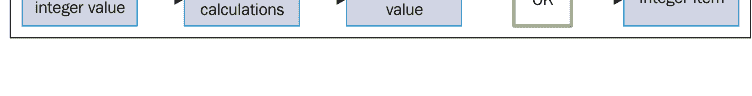

为什么会有这种差异，为什么我们在这样做会导致精度损失的情况下仍将该项保留为整数？Zabbix 数据库模式中十进制值的有效数字在小数点前的数量比整数值少。在负载高的高速接口上，我们可能会溢出该限制，并且会导致值完全丢失。通常最好损失一点精度——小数部分——而不是整个值。请注意，精度损失在最小单位上：字节或位。即使 Zabbix 在前端显示 5 Gbps，该值中的小数部分也会从位中截断；因此，这种精度损失应该非常、非常微不足道。建议对存在此类风险的项使用整数，至少在数据库模式限制增加之前。

再次查看 **Monitoring | Latest data**：

| HOST | NAME ▲ | LAST CHECK | LAST VALUE | CHANGE |
|---|---|---|---|---|
| Another host | - other - (3 Items) |  |  |  |
|  | Incoming traffic on interface enp0s8 | 2016-02-20 01:50:20 | 29 | -177700 |

> 请记住，在最坏的情况下，配置更改可能需要长达 3 分钟才能传播到 Zabbix 代理：1 分钟进入服务器配置缓存，以及 2 分钟直到代理刷新其自己的项列表。除此延迟外，此项与我们创建的其他项不同：它需要收集两个值来计算每秒，其中一个是我们感兴趣的；因此，我们还必须等待该项间隔才能在前端看到第一个值。

这样更好；Zabbix 现在会自动计算每次检查之间的变化（这就是 delta 的作用）并将其存储，但值仍然似乎不太用户友好。也许在图表中会更好——让我们点击 **Graph** 链接来了解一下：

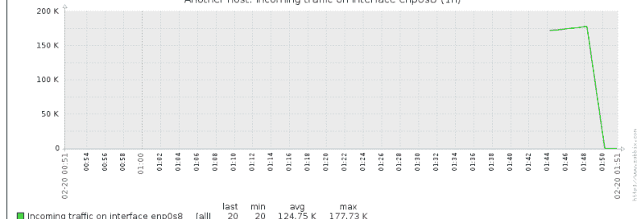


哎呀。虽然我们能清楚地看到更改带来的效果，但它也给我们留下了非常难看的历史数据。该图的 Y 轴代表总计数器值（因此显示自监控系统启动以来的总计），但 X 轴代表正确的（增量）数据。你也可以数值化地查看这些值——转到右上角的下拉菜单，目前显示为 Graph。从中选择 500 个最新值。你将得到以下屏幕：

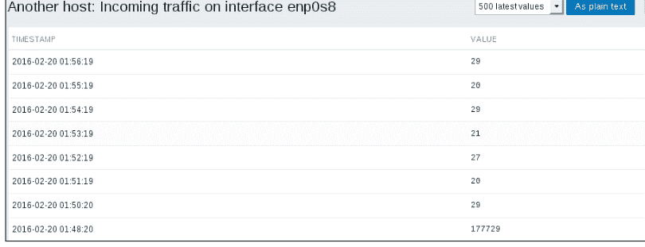

在这个列表中，我们可以很好地看到数据表示的变化以及更改执行的确切时间。但那些巨大的值来自计数器数据，它们因规模过大而污染了我们干净整洁的图表——我们必须摆脱它们。转到 Configuration | Hosts 并点击 Another host 旁边的 Items，然后选中 Incoming traffic on interface eth0 项目旁边的复选框，并查看项目列表底部位置的按钮：


从左数第三个按钮，名为 Clear history，很可能就是我们想要的。注意活动按钮左侧的 3 selected 文本——它显示了所选条目的数量，因此我们始终知道正在操作多少个元素。点击 Clear history 按钮。你应该会收到一个 JavaScript 弹出窗口，要求确认继续。虽然在大型数据集上清理历史记录可能需要很长时间，但在我们的情况下，应该几乎是即时的，因此点击 OK 按钮继续。这将删除该项目的全部历史值，包括巨大的那些。

不过，查看该图的 Y 轴，我们看到传入值以没有任何解释的数字形式表示，并且较大的值会应用 K、M 等乘数标识符。如果 Zabbix 知道如何以字节或其他类似单位计算它，那就好多了。好的，所以导航到 **Configuration | Hosts** 并点击 **Another host** 旁边的 **Items**，然后点击 **NAME** 列中的 **Incoming traffic on the eth0 interface**。编辑 **Units** 字段并输入 Bps，然后点击 **Update**。

让我们检查 **Monitoring | Latest data** 是否有任何改进：

Incoming traffic on interface enp0s8  2016-02-20 02:02:19  27 Bps

太棒了；数据仍在到达。更好的是，注意 Zabbix 现在会在适当的地方自动计算 KB、MB 等。在我们的示例主机上，如果有更多流量，它也会这样做。让我们查看网络流量；点击 **Graph**：

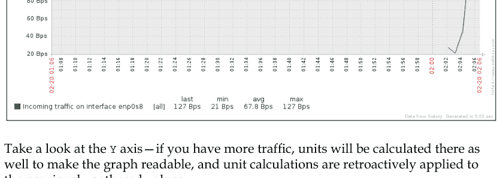

看看 Y 轴——如果有更多流量，单位也会在那里计算以使图表可读，并且单位计算会追溯应用于之前收集的值。

> 单位不会像 **Store value** 选项那样影响存储的数据，因此我们这次不需要清除之前的值。

我们设置的一个参数，更新间隔，本可以更小，从而得到更美观的图表。但重要的是要记住，你的项目间隔越小，Zabbix 就必须检索的数据越多，每秒钟必须向数据库插入更多数据，并且在显示这些数据时必须执行更多计算。虽然在我们的测试系统上不会有明显差异，但你应该尽量保持间隔尽可能大。

到目前为止，我们创建的项目收集的是数值数据——整数或十进制值。让我们再创建一个，这次有点不同。像往常一样，转到 **Configuration | Hosts** 并点击 **Another host** 旁边的 **Items**。在继续创建项目之前，让我们看看配置部分，特别是针对项目，有哪些有用的东西可用。如果我们查看项目列表上方，可以看到导航和信息栏：


此区域提供了有关当前所选主机的快速有用信息：主机名、主机是否被监控以及其可用性。更重要的是，在右侧，它提供了返回主机列表以及与当前主机关联的其他元素的快速快捷方式：应用程序、项目、触发器、图表、发现规则和 Web 场景。这是一种在无需每次都通过主机列表的情况下在单个主机的元素类别之间切换的便捷方式。但这还不是全部——点击 **Filter** 按钮打开我们之前被迫面对的过滤器。复杂的过滤器再次出现：

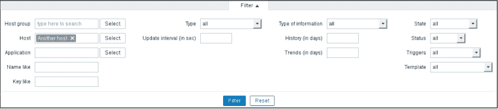

使用此过滤器，我们可以对要显示哪些项目制定复杂规则。查看过滤器左上角，我们可以看到我们不仅限于查看单个主机的项目；我们还可以选择 **Host group**。在需要时，我们可以做出过滤选择并点击过滤器下方的 **Filter** 链接。目前，它只有一个条件：**Host** 字段包含 **Another host**，因此我们从主机列表中使用的 **Items** 链接就是设置此过滤器的那个。清除 **Host** 字段，从 **Host group** 字段中选择 **Linux servers**，然后点击过滤器下方的 **Filter** 按钮。

> > 💡 仅当项目被过滤为单个主机时，才会出现主机信息和快速链接栏。

现在，查看主项目过滤器正下方——那是 Subfilter，其标题已说明，它仅影响主过滤器已过滤的数据。

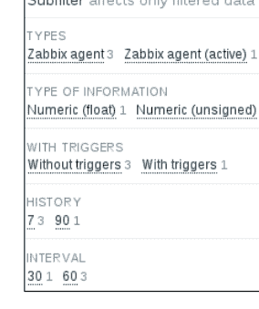

子过滤器中的条目像切换开关一样工作——如果我们打开其中一个，它就会作为对数据进行过滤的条件，再加上所有其他已切换的子过滤器控件。现在让我们点击 Zabbix agent (active)。注意项目列表现在只包含一个项目——这就是该 Subfilter 切换开关旁边的数字 1 所代表的含义。但子过滤器本身现在也看起来不同了：

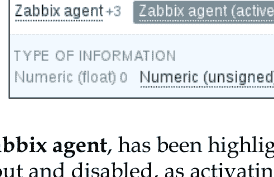

我们启用的选项 Zabbix agent 已被突出显示。Numeric (float) 另一方面是灰色且被禁用，因为在已激活的切换开关之外再激活此切换开关将导致完全没有项目显示。虽然 Numeric (unsigned) 切换开关旁边仍然列有 1，这表明启用它将显示这么多项目，但 Zabbix agent 切换开关旁边反而有 +3。 这种形式表示激活此切换开关将显示比当前显示多三个项目，并且用于同一类别的切换开关。目前，子过滤器有五个条目，因为它只显示现有值。一旦我们配置了更多不同类型的项目，此子过滤器将扩展。我们已经完成了对这些过滤器的探索，因此从 Host 字段中选择 Another host，点击过滤器下的 Filter 按钮，然后点击 Create item。

当你有许多不同的主机由 Zabbix 监控时，很容易忘记每个主机上的 Zabbix agent 守护进程的版本，即使你有自动化的软件部署，也很方便能够在一个地方看到每个主机的版本。

使用以下值：

- **Name**: 输入 **Zabbix agent version**
- **Type**: 选择 **Zabbix agent (active)**（我们仍在创建活动项目）
- **Key**: 点击 **Select** 然后从列表中选择第三个条目——`agent.version`
- **Type of information**: 选择 **Character**
- **Update interval (in sec)**: 输入 `86400`

完成后！点击 **Add** 按钮。我们做了两件值得注意的事情。首先，我们将信息类型设置为 **Character**，这重新加载了表单，略微改变了可用选项。最明显的是，与数值信息相关的字段被隐藏了，例如单位、乘数和趋势。

其次，我们输入了一个非常大的更新间隔，`86400`，相当于 24 小时。虽然这可能看起来过分，但请记住我们在这里监控的是什么——Zabbix agent 版本，所以它可能（希望）不会每天更改几次。根据你的需求，你甚至可以将其设置为更大的值，例如一周。

要查看我们工作的结果，请转到 **Monitoring | Latest data:**

```
Zabbix agent version          2016-02-24 20:59:45  3.0.0
```

如果看不到数据，请稍等片刻；最终它会显示出来。当它显示时，你应该会看到列出的远程机器上安装的 Zabbix agent 版本，并且它可能比此处显示的数字更高，因为已经发布了更新版本的 Zabbix。请注意一个细微差别：我们之前添加的所有项目在右侧都有名为 **Graph** 的链接，而最后一个项目则有一个名为 **History** 的链接。原因很简单：对于文本项目，无法绘制图表，因此 Zabbix 甚至不会尝试这样做。


现在，关于等待——为什么我们必须等待数据出现？好吧，记住活动项的工作方式？代理会查询服务器以获取其应报告的项目列表，然后定期发送数据，但对项目列表的检查也是定期进行的。要了解频率，请在远程机器上打开 zabbix_agentd.conf 配置文件并查找 RefreshActiveChecks 参数。默认值为 2 分钟，以秒为单位配置，因此列出 120 秒。因此，在最坏的情况下，你可能需要等待近 3 分钟才能看到任何数据，而对于普通或被动项，服务器会在配置更改在其缓存中可用后立即查询代理。在生产环境中，如果有许多代理使用活动项，增加此值可能是一个好主意。通常，项目参数不会经常更改。

## 具有多个服务器的活动代理

我们按代理守护进程配置文件中配置的 ServerActive 的方式，它连接到单个 Zabbix 服务器并向服务器发送项目数据。代理也可以同时与多个服务器一起工作；我们只需在此处指定额外的地址作为逗号分隔列表即可。在这种情况下，代理将在内部生成单独的进程来分别与每个服务器工作。这意味着一个服务器不会知道另一个服务器正在监控什么——值将独立发送给它们。另一方面，即使有多个服务器请求单个项目的数据，这些数据也会被收集多次，每台服务器一次。

> 始终检查配置文件中的注释；它们可能非常有用。在 ServerActive 的情况下，注释显示代理也可以通过使用如下语法连接到每个服务器上的非默认端口：server1:port, server2:port。

在活动模式下使用多个服务器在从一个 Zabbix 实例迁移到另一个实例时可能很有用。一段时间里，代理可以同时向旧服务器和新服务器报告。另一个有用的情况是客户环境，其中客户可能有一个本地 Zabbix 服务器执行全面监控，而外部公司可能希望监控与他们提供的应用程序相关的某些方面。

对于被动项，允许来自多个 Zabbix 服务器的传入连接也是以相同的方式完成的：通过将多个 IP 地址添加到 Server 参数。

## 支持的项目

我们创建了一些在两个方向上使用 Zabbix 代理并收集数据的项目。但这些远不是唯一可用的项目。你可以在再次创建项目时查看列表（转到 Configuration | Hosts，点击任意主机的 Items，然后点击 Create item 按钮，接着点击 Key 字段旁边的 Select 按钮），以便查看为 Zabbix 代理内置的项目，以及其中大多数的简短描述。

> 并非所有 Zabbix 代理项目都可用作被动和活动项目。例如，日志和事件日志项目（分别用于收集日志文件和 Windows 事件日志信息）仅作为活动项目可用。日志监控在第 11 章《高级项目监控》中介绍，Windows 特定项目在第 14 章《监控 Windows》中介绍。

查看列表，我们可以了解到 Zabbix 代理原生支持哪些项目类别：系统配置、网络流量、网络服务、系统负载和内存使用、文件系统监控等。但这并不意味着你在那里看到的一切都将在 Zabbix 代理守护进程运行的任何系统上工作。由于每个平台都有不同的信息公开方式，并且某些参数甚至可能是平台特定的，因此不能保证每个键在每个主机上都有效。

例如，当磁盘驱动器统计报告更改到用户空间时，Zabbix 代理必须专门为新方法实现支持；因此，较旧的代理版本在最近的 Linux 系统上支持的参数更少。如果你好奇某个特定参数是否在特定操作系统的特定版本上有效，最好的方法是查看 Zabbix 手册然后进行测试。一些最常见的代理项目键如下：

- agent.ping: 当代理可用时返回 1，代理不可用时则什么也不返回
- net.if.in/out: 提供传入/传出流量信息
- net.tcp.service: 尝试对 TCP 服务进行简化的连接
- proc.num: 统计进程数量，并可按各种参数过滤
- vfs.fs.size: 提供文件系统使用信息
- vm.memory.size: 提供内存使用信息
- `system.cpu.load`: 以标准十进制表示提供 CPU 负载信息
- `system.cpu.util`: 提供 CPU 利用率信息，例如 `iowait`

对于其中大多数，可以指定各种参数来过滤结果或选择特定信息。例如，`proc.num[,zabbix]` 将统计 Zabbix 用户运行的所有进程。

## 在活动和被动项目之间选择

尽管我们讨论了 Zabbix 代理是主动还是被动，但代理实际上既不是其中之一也不是另一个；连接的方向由项目级别决定。代理可以（并且默认情况下确实）同时在两种模式下工作。尽管如此，我们仍需要选择使用哪种项目类型——活动或被动。简短版本：推荐使用活动项目。

要理解原因，让我们比较一下连接是如何建立的。对于被动代理来说非常简单：


> 箭头方向表示连接是如何建立的。

一个值意味着一个连接。活动代理稍微复杂一些。记住：在活动模式下，代理连接到服务器；因此，代理首先连接到 Zabbix 服务器并请求要监控的项目列表。服务器随后以项目、其间隔以及任何其他相关信息进行响应：


此时，连接被关闭，代理开始收集信息。一旦收集到一些值，它就会将它们发送到服务器：

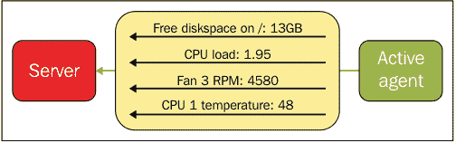

请注意，活动代理可以在一次连接中发送多个值。因此，活动代理通常会导致 Zabbix 服务器的负载更低，网络连接数量更少。

主机列表中的可用性图标仅代表被动项目；活动项目根本不影响它。如果主机只有活动项目，此图标将保持灰色。在之前的 Zabbix 版本中，如果你添加了失败的被动项目然后全部转换为活动项目，此图标仍会保持红色。Zabbix 3.0.0 是图标自动重置回灰色的第一个版本。

当然，活动项目也有一些缺点，而被动项目也有好处。让我们尝试总结每种项目类型提供的功能以及它们可能更适合的情况。

活动项目的优点如下：

- 它们具有更少的网络连接数
- 它们对 Zabbix 服务器造成的负载更低
- 如果网络拓扑或防火墙不允许从服务器连接到代理（例如，被监控的主机位于 NAT 后面），它们仍能工作
- 诸如日志或 Windows 事件日志监控之类的项目得到支持

以下是被动项目的优点：

- 它们对初学者来说更容易设置
- 支持自定义间隔（活动项目不支持）
- 对集群上的虚拟 IP 地址进行轮询可以让你始终查询活动的集群节点
- 默认模板使用被动项目；因此，使用它们无需修改或其他配置

添加新的活动项目后，它会再次保存到数据库中，而 Zabbix 服务器还不知道它。活动 Zabbix 代理会定期连接到服务器以收集其应监控的项目信息，但由于它尚未在配置缓存中，服务器不会告诉代理该项目。该项目随后被加载到配置缓存中。配置缓存默认每 60 秒刷新一次。服务器得知新项目后，项目对代理可用，但代理默认每 2 分钟连接到服务器一次。一旦代理得知新项目，它会立即尝试为其收集第一个值。

> 有关如何调整这些间隔的详细信息，请参阅第 22 章《Zabbix 维护》。

在两种情况下，如果项目设置为 delta，我们必须获取两个值，然后才能计算最终值并将其存储在数据库中并在前端显示——我们无法仅从一个值计算差异。

## 简单检查

之前创建的项目都需要安装、运行 Zabbix 代理守护进程，并且能够双向建立连接。但如果无法或不希望在远程主机上安装代理，并且只需要监控简单的事情怎么办？这时简单检查就可以帮上忙。这些检查不需要在远程端运行任何专用代理，只依赖于基本的网络协议，如互联网控制消息协议（ICMP）和 TCP 来查询被监控主机。

> 主机可用性图标仅涵盖 Zabbix 代理、SNMP、JMX 和 IPMI 状态，即我们期望响应的事物。对于简单检查，我们的期望可能是双向的——打开的端口可能是好事也可能是坏事。简单检查没有状态图标。


让我们现在创建一个非常基础的检查。前往 **Configuration | Hosts**，点击 **Another host** 旁边的 **Items**，然后点击 **Create item**。使用以下值：

- **Name:** 输入 `SMTP server status`
- **Type:** 选择 **Simple check**
- **Key:** 点击 **Select** 按钮

右上角的 **Type** 下拉菜单应该已经显示为 **Simple check**。如果不是，请将其更改为该选项。在 **Key** 列表中，点击 `net.tcp.service[service,<ip>,<port>]` 键，然后对其进行编辑。将 `service` 替换为 `smtp`，并删除方括号内的其余所有内容，使其变为 `net.tcp.service[smtp]`，如下所示：

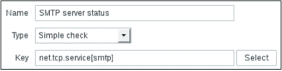

> 在 Zabbix 中配置简单检查时，请注意“偏执”的网络安全配置，如果你检查的服务太多、太频繁，可能会触发警报。

完成后，点击底部的 **Add** 按钮。要检查结果，请前往 **Monitoring | Latest data**——我们的新检查应该在那里，并且根据 SMTP 服务器是否正在运行且 Zabbix 服务器可以访问，应该列出 **1**（如果正在运行且可访问）或 **0**。

## 设置 ICMP 检查

如果我们只关心主机的基本可达性，例如我们无法控制的路由器或交换机，ICMP ping（回显请求和回复）将是合适的监控方法，Zabbix 也支持此类简单检查。通常，这些检查不会立即生效；要使用它们，我们必须设置一个单独的实用程序 `fping`，Zabbix 用于 ICMP 检查。它应该适用于大多数发行版，因此只需使用发行版的包管理工具安装即可。如果没有，你将不得不手动下载并编译 `fping`；它可在 `http://fping.sourceforge.net/` 获取。

> 在撰写本文时，Zabbix 3.0 仍未完全支持 fping 3。最值得注意的是，为服务器设置源 IP 将破坏 ICMP ping 项。此类支持目前计划在 3.0.2 版本中提供。对于任何更高版本，请在手册中检查兼容性信息。从发行版包安装 fping 很可能提供版本 3，它也可在 http://fping.org/ 获取。

一旦 fping 安装正确，Zabbix 服务器必须知道在哪里找到它并且能够执行它。在 Zabbix 服务器上，打开 `zabbix_server.conf` 并查找 `FpingLocation` 参数。它默认被注释掉，并且默认值为 `/usr/sbin/fping`。你可以使用以下命令快速找到 fping 二进制文件的位置：

```
$ which fping
```

如果其中一个结果是 `/usr/sbin/fping`，你就不必更改此参数。如果不是，请修改参数以指向正确的 fping 位置并重启 Zabbix 服务器，以便它了解配置更改。这还不算完。Zabbix 还需要能够以管理员权限运行 fping，因此以 root 身份执行以下操作：

```
# chgrp zabbix /usr/sbin/fping
# chmod 4710 /usr/sbin/fping
```

> 权限在基于 Fedora/RHEL 的发行版中通常已经正确。如果您使用的是发行版包，请不要执行之前的命令；它们甚至可能会禁止 Zabbix 服务器访问，因为它可能在不同的组下运行。

由于 fping 二进制文件之前应由 root 拥有，这应该足以允许 Zabbix 组按要求使用它；让我们验证一下。

像往常一样，导航到 **Configuration | Hosts**，点击 **Another host** 旁边的 **Items**，然后点击 **Create item**。设置以下详细信息：

- **Name:** `ICMP ping performance`
- **Type:** **Simple check**
- **Key:** 点击 **Select** 按钮；在列表中，点击 `icmppingsec` 键，然后删除方括号内的所有内容——以及括号本身
- **Type of information:** `Numeric (float)`
- **Units:** `ms`
- **Use custom multiplier:** 选择复选框并输入 1000

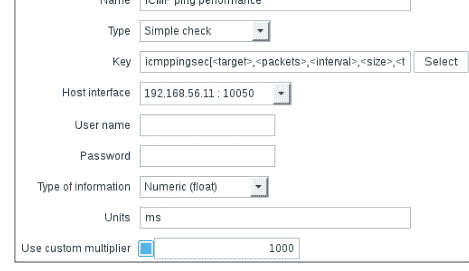

当所有字段都已正确设置后，点击底部的 Add 按钮。执行通常的往返操作到 Monitoring | Latest data — ICMP ping 应该已经开始记录数据。如果等待几分钟，你还可以查看一个相对有趣的图表以注意到网络性能的任何变化。


在这里，我们设置了以秒为单位测量网络延迟的 ICMP ping。如果您只想简单地测试主机连通性，您将选择 `icmpping` 键，它只记录 ping 是否成功。这是在大规模上测试连通性的简单方法，因为它对网络的负载很小（除非你使用极小的间隔）。当然，有一些需要注意的事情，例如测试 Internet 连通性时应做不同的事情——仅测试到路由器、防火墙甚至提供商路由器的连接是不够的。最好的方法是在已知具有非常好的连接和可用性的情况下选择多个远程目标进行监控。

对于 ICMP ping 项，可以指定多个参数。例如，完整的 `icmpping` 键语法如下：

```
icmpping[<target>,<packets>,<interval>,<size>,<timeout>]
```

默认情况下，target 取自分配此项的主机，但可以覆盖。packets 参数使您能够指定每次调用应发送多少个数据包——通常，fping 默认值为 3。interval 参数使您能够配置这些数据包之间的间隔——通常，fping 默认值是对同一目标每 1 秒一次，以毫秒为单位指定。至于 size，这里单个数据包的默认值可能因 fping 版本、架构以及可能的其他参数而异。最后，timeout 设置单个目标超时，常见默认值为 500 毫秒。

这些默认值不是 Zabbix 默认值——如果未指定，则使用 fping 默认值。

请注意，不应为 ICMP ping 项设置非常大的超时或数据包计数；这可能导致奇怪的结果。例如，将数据包计数设置为 60 并在项上使用 60 秒间隔，很可能会导致该项错过每个第二个值。

如果您针对同一主机设置了多个 ICMP ping 项，Zabbix 只会调用一次 fping 实用程序。如果多个主机具有 ICMP ping 项，Zabbix 将在所有需要在同一时间使用相同参数 ping 的主机上只调用一次 fping（例如数据包、大小和超时）。

## 将所有内容联系起来

因此，我们发现普通或被动代理等待服务器连接，而主动代理连接到服务器，获取要检查的项目列表，然后定期重新连接到服务器以发送数据。这意味着使用一种或另一种类型的 Zabbix 代理项会影响性能。一般来说，主动代理减少了 Zabbix 服务器的负载，因为服务器不必保留要检查的内容和时间的列表。相反，代理接管了该任务并向服务器报告。但您应该分别评估每种情况：如果您每个主机只有很少的项目，并且您很少监控它们（更新间隔设置为较大值），将所有代理转换为主动代理并比以前更频繁地检索项目列表不会改善 Zabbix 服务器性能。

重要的是要记住，您可以针对单个主机使用各种项目的混合。正如我们刚才看到的，单个主机可以分配有普通或被动 Zabbix 代理项、主动 Zabbix 代理项和简单检查。这使您可以为监控每个特征选择最佳匹配，以确保最佳的连接和性能，并对网络和被监控主机的影响最小。这还不是全部——我们将探索几种额外的项目类型，这些类型又可以与我们已知的项目混合用于单个配置的主机。


现在我们已经配置了更多监控项，有必要再看看另一个监控视图。虽然我们大部分时间都在 **监控 | 最新数据** 中，但这次我们导航到 **监控 | 概览**。右上角的 **类型** 下拉框当前列出的是 **触发器**，这对我们来说并不是一个令人兴奋的视图：我们只创建了一个触发器。但我们确实创建了几个监控项，所以将这个下拉框切换为 **数据**：

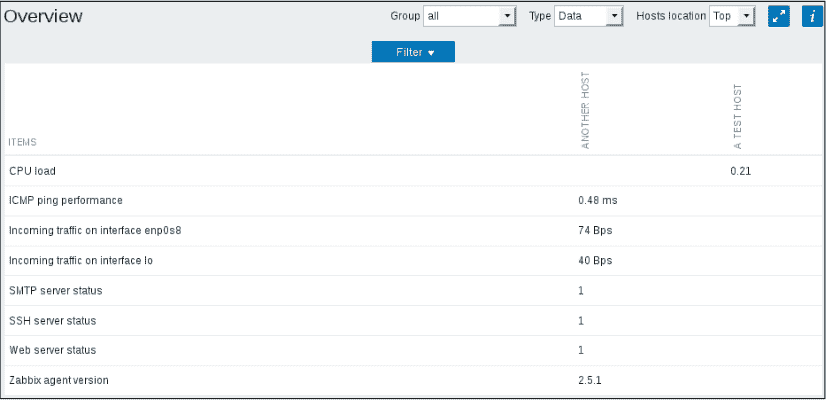

这次，概览页面就有趣一些了：我们可以看到哪些主机有哪些监控项以及监控项的值。

## 使用批量更新

现在看起来不错——我们可以用紧凑的形式看到所有监控数据。那些表示各种服务器状态的 `1` 结果是什么意思？`1` 是表示运行状态，还是像退出代码那样表示错误？它们肯定不够直观，所以让我们尝试改进一下。前往 **配置 | 主机**，点击 **另一台主机** 的 **监控项**。选中全部三个服务器状态监控项（SMTP、SSH 和 Web），然后查看监控项列表底部的按钮：


