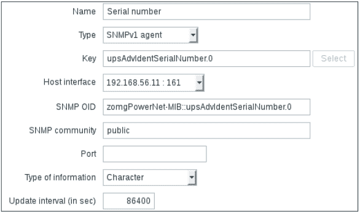
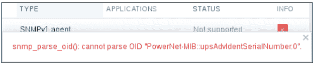
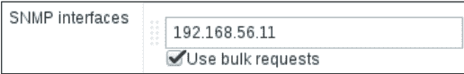
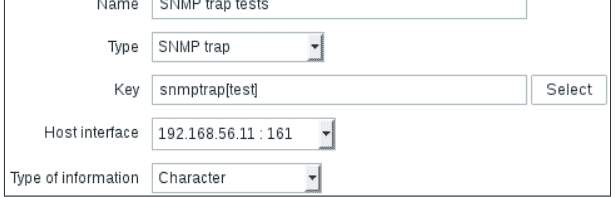
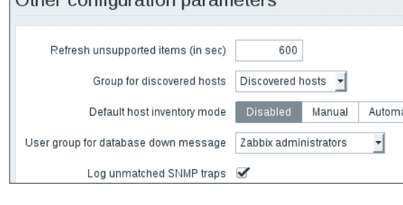
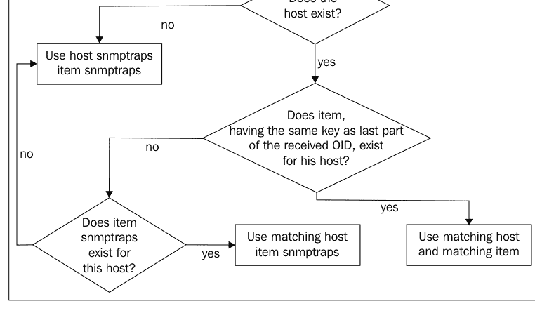

## 监控SNMP设备

既然我们已经熟悉了使用Zabbix代理和一种无代理方法进行监控，现在让我们探索另一种不需要安装Zabbix代理的方法，尽管它无论如何也需要某种代理。简单网络管理协议（通常称为SNMP）是一种成熟且流行的网络监控解决方案。我们将学习如何配置和使用Zabbix中的SNMP，包括SNMP轮询和陷阱接收。

SNMP已有二十多年的历史，已经有足够的时间在各种网络设备中广泛普及。尽管其名称暗示了管理功能，但它主要用于监控。由于早期版本存在安全缺陷，通过SNMP修改配置的能力不如其只读对应功能那么普及。

SNMP作为主要监控解决方案在嵌入式设备中尤其受欢迎，因为在嵌入式设备上运行完整的操作系统并安装单独的监控代理有些大材小用。最流行的两类开箱即用支持SNMP的设备是打印机和各种网络设备，如交换机、路由器和防火墙。SNMP使得对这些原本相当封闭的设备进行轻松监控成为可能。其他提供SNMP代理的设备包括UPS、**网络附加存储（NAS）**设备和机架温度/湿度传感器。当然，SNMP绝不局限于处理能力有限的设备——在标准服务器上运行通用SNMP代理而不是专门的监控代理也完全没问题。使用SNMP代理而不是Zabbix代理的原因可能包括：已经安装并设置好的SNMP代理、无法访问受监控主机来安装Zabbix代理，或者希望系统相对不依赖监控软件。

鉴于SNMP的普及，Zabbix原生支持它也就不足为奇了。Zabbix中的SNMP支持基于另一个优质开源产品——Net-SNMP（http://net-snmp.sourceforge.net/）。

在本章中，我们将：

- 了解基本的Net-SNMP工具
- 学习如何添加**管理信息库（MIB）**文件，以便Zabbix识别它们
- 配置SNMP轮询和陷阱接收

### 使用Net-SNMP

如果你从发行版软件包中安装了Zabbix，SNMP支持应该已经包含在内。如果你从源代码编译Zabbix，它仍然应该有SNMP支持，因为我们在配置标志中包含了它。剩下要做的就是设置SNMP监控配置。在此之前，我们需要一台安装了SNMP代理的设备。在这里你可以有多种选择——你可以使用任何有权访问的网络设备，例如可管理交换机、网络打印机或带有SNMP接口的UPS。由于SNMP代理通常监听161端口，你需要能够通过**用户数据报协议（UDP）**在该端口上连接到这样的设备。虽然也支持TCP，但UDP使用得更为广泛。

如果你无法访问这样的设备，你也可以在计算机上启动一个SNMP守护进程。例如，你可以轻松地使用**Another host**作为SNMP查询的测试平台。许多发行版都自带了Net-SNMP包中的SNMP守护进程，通常只需启动`snmpd`服务即可。如果你选择的发行版不是这种情况，你就得找一个已经带有可用SNMP代理的网络设备，或者手动配置`snmpd`。

为了测试，在`/etc/snmp/snmpd.conf`中有下面这样一行可能就足够了：

```
rocommunity public
```

这允许任何使用`public`团体字符串的人拥有完全读取权限。

> 请勿在生产环境中使用此类配置。

无论你选择哪种方式，你都必须了解设备实际提供哪些数据以及如何获取这些数据。这就是Net-SNMP发挥作用的地方，它提供了许多有用的工具来处理支持SNMP的设备。我们将使用其中的几个工具来发现配置Zabbix中SNMP监控项所需的信息。


让我们先验证我们的 SNMP 设备是否可达并响应我们的查询。

虽然 SNMPv3 自 2004 年以来一直是 SNMP 的当前版本，但它仍然不如 SNMPv1 和 SNMPv2 普及。仍在使用大量仅支持旧协议版本的旧设备，而且许多厂商在 SNMPv3 实现方面并不着急。

事情进一步复杂化的是，SNMPv2 也并不广泛使用。相反，使用的是其变种，即基于社区的 SNMPv2，或 SNMPv2c。虽然设备可以同时支持 v1 和 v2c，但有些设备仅支持其中一种。两者都使用所谓的 **社区认证**，其中用户认证是基于单个社区字符串进行的。因此，要查询设备，你必须知道它支持哪个协议版本以及要使用的社区字符串。听起来并不难。默认情况下，许多设备对访问使用一个通用字符串，**public**，Net-SNMP 守护进程也是如此。除非你明确更改此字符串，否则你可以假设这是查询任何主机的所需内容。


> 在某些发行版中，Net-SNMP 守护进程和工具可以拆分到单独的软件包中。在这种情况下，也请安装工具软件包。

如果你在 **另一台主机** 上安装并启动了 Net-SNMP 守护进程，你可以执行一个简单的查询来验证 SNMP 连接性：

```
$ snmpstatus -v 2c -c public <IP address>
```

如果守护进程已正确启动并且网络连接正常，你应该会得到一些输出，具体取决于你的系统：

```
[UDP: [<IP address>]:161->[0.0.0.0]:51887]=>[Linux another 3.11.10-29-default #1 SMP Thu Mar 5 16:24:00 UTC 2015 (338c513) x86_64]
Up: 10:10:46.20

Interfaces: 3, Recv/Trans packets: 300/281 | IP: 286/245
```

我们可以看到它工作了，并且默认情况下通信是通过 UDP 到端口 161 进行的。我们可以看到目标系统的操作系统、主机名、内核版本、何时编译以及编译的目标硬件架构，以及当前的运行时间。还有一些网络统计信息附加在后面。

如果你尝试查询网络设备，它可能对允许使用 SNMP 代理的主机有限制。有些设备允许自由访问 SNMP 数据，而有些设备默认会限制访问，并且每个连接的主机都必须明确允许。如果设备没有响应，请检查其配置——你可能必须将查询机器的 IP 地址添加到 SNMP 权限列表中。

## Monitoring SNMP Devices

查看 `snmpstatus` 命令本身，我们向它传递了两个参数：SNMP 版本（本例中为 2c）和社区（正如前面讨论的那样，是 `public`）。

如果你有其他启用 SNMP 的主机，你可以在它们上尝试相同的命令。让我们看看各种设备：

```
```text
$ snmpstatus -v 2c -c public <IP address>
[UDP: [<IP address>:161] => [IBM Infoprint 1532 version NS.NP.N118 kernel 2.6.6 All-N-1] Up: 5 days, 0:29:53.22
Interfaces: 0, Recv/Trans packets: 63/63 | IP: 1080193/103316
```
```

正如我们所见，这一定是一台 IBM 打印机。嘿，看起来它正在使用 Linux 内核。

虽然许多系统会响应版本 2c 的查询，但有时你可能会看到以下情况：

```
```text
$ snmpstatus -v 2c -c public <IP address>
Timeout: No Response from <IP address>
```
```

这当然可能意味着网络问题，但有时 SNMP 代理会忽略使用它们不支持的协议版本或错误的社区字符串发来的请求。如果社区字符串不正确，你就必须查明它被设置为什么；这通常很容易在设备或 SNMP 守护进程配置中找到（例如，Net-SNMP 通常将其设置在 `/etc/snmp/snmp.conf` 配置文件中）。如果你认为设备可能不支持特定协议版本，你可以尝试另一个命令：

```
```text
$ snmpstatus -v 1 -c public <IP address>
[UDP: [<IP address>:161] => [HP ETHERNET MULTI-ENVIRONMENT, SN: CNBW71B06G,FN:J2K27AB, SVCID:000000, PID: HP LaserJet P2015 Series] Up: 3:33:44.22
Interfaces: 2, Recv/Trans packets: 135108/70066 | IP: 78239/70054
```
```

因此，这台 HP LaserJet 打印机不支持 SNMPv2c，仅支持 v1。尽管如此，使用 SNMPv1 查询时，它还是透露了诸如序列号和系列名称等信息。

让我们再看看另一台仅支持 SNMPv1 的设备：

```
```text
$ snmpstatus -v 1 -c public <IP address>
[UDP: [<IP address>:161] => [APC Web/SNMP Management Card (MB:v3.6.8 PF:v2.6.4 PN:apc_hw02_aos_264.bin AF1:v2.6.1 AN1:apc_hw02_sumx_261.bin MN:AP9617 HR:A10 SN:ZA0542025896 MD:10/17/2005 (Embedded PowerNet SNMP Agent SW v2.2 compatible)] Up: 157 days, 20:42:55.19
Interfaces: 1, Recv/Trans packets: 2770626/2972781 | IP: 2300062/2388450
```
```

这似乎是一台 APC UPS，并且它在此输出中提供了大量信息，包括序列号甚至固件版本。它的运行时间也比之前的系统长得多：超过 157 天。

但显然，通过 SNMP 可以获得更多信息，而且这看起来有点混乱。让我们尝试 Net-SNMP 工具集中的另一个命令 snmpwalk。此命令尝试返回特定 SNMP 代理可用的所有值，因此输出可能非常大——我们最好先将其限制为几行：

```
$ snmpwalk -v 2c -c public 10.1.1.100 | head -n 6
SNMPv2-MIB::sysDescr.0 = STRING: Linux zab 2.6.16.60-0.21-default #1 Tue May 6 12:41:02 UTC 2008 i686
SNMPv2-MIB::sysObjectID.0 = OID: NET-SNMP-MIB::netSnmpAgentOIDs.10
DISMAN-EVENT-MIB::sysUpTimeInstance = Timeticks: (8411956) 23:21:59.56
SNMPv2-MIB::sysContact.0 = STRING: Sysadmin (root@localhost)
SNMPv2-MIB::sysName.0 = STRING: zab
SNMPv2-MIB::sysLocation.0 = STRING: Server Room
```

此语法未指定 OID，snmpwalk 默认使用 SNMPv2-SMI::mib-2。某些设备在树的其他部分会有有用的信息。要查询整个树，请指定单个点作为 OID 值，如下所示：
snmpwalk -v 2c -c public 10.1.1.100

正如我们所见，此命令输出各种值，左侧显示名称或标识符，右侧显示其值。事实上，标识符称为对象标识符或 OID，它是一个唯一的字符串，用于标识单个值。

将左侧所有内容称为 OID 是一种简化。它实际上由 MIB、OID 和 UID 组成，如下所示：


尽管如此，它通常被称为 OID，我们将在本书中也使用相同的简写。例外情况是我们实际上会引用 MIB 或 UID 部分时。

查看输出，我们还可以识别出在 snmpstatus 输出中看到的一些数据——SNMPv2-MIB::sysDescr.0 和 DISMAN-EVENT-MIB::sysUpTimeInstance。另两个值 SNMPv2-MIB::sysContact.0 和 SNMPv2-MIB::sysLocation.0 未从默认值更改，因此目前不是很有用。顺便说一下，让我们将此输出与 APC UPS 的输出进行比较：

```
$ snmpwalk -v 1 -c <IP address> | head -n 6
SNMPv2-MIB::sysDescr.0 = STRING: APC Web/SNMP Management Card (MB:v3.6.8 PF:v2.6.4 PN:apc_hw02_aos_264.bin AF1:v2.6.1 AN1:apc_hw02_sumx_261.bin MN:AP9617 HR:A10 SN: ZA0542025896 MD:10/17/2005) (Embedded PowerNet SNMP Agent SW v2.2 compatible)
SNMPv2-MIB::sysObjectID.0 = OID: PowerNet-MIB::smartUPS450
DISMAN-EVENT-MIB::sysUpTimeInstance = Timeticks: (1364829916) 157 days, 23:11:39.16
SNMPv2-MIB::sysContact.0 = STRING: Unknown
SNMPv2-MIB::sysName.0 = STRING: Unknown
SNMPv2-MIB::sysLocation.0 = STRING: Unknown
```

输出相当相似，包含相同的 OIDs，并且系统联系人和位置值也未设置。但要监控某些内容，我们必须为每项检索单个值，我们可以用另一个命令 snmpget 来验证它是否有效：

```
$ snmpget -v 2c -c public 10.1.1.100 DISMAN-EVENT-MIB::sysUpTimeInstance
DISMAN-EVENT-MIB::sysUpTimeInstance = Timeticks: (8913849) 1 day, 0:45:38.49
```

我们可以在主机之后添加任何有效的 OID，例如前一个示例中的 DISMAN-EVENT-MIB::sysUpTimeInstance，以获取其保存的值。OID 本身目前由两个部分组成，用两个冒号分隔。正如前面讨论的那样，第一部分是管理信息库或 MIB 的名称。MIB 是项目描述的集合，将数字形式映射为文本形式。第二部分是 OID 本身。此处没有 UID。我们可以通过添加 -Of 标志来修改输出，从而查看完整标识符：

```
$ snmpget -v 2c -c public -Of 10.1.1.100 DISMAN-EVENT-MIB::sysUpTimeInstance
.iso.org.dod.internet.mgmt.mib-2.system.sysUpTime.sysUpTimeInstance = Timeticks: (8972788) 1 day, 0:55:27.88
```


> 要将数值形式转换为文本形式，需要 MIB。在某些情况下，标准 MIB 就够了，但许多设备在厂商特定的扩展中包含有用的信息。一些厂商为其设备提供了高质量的 MIB，另一些则帮助不大。请联系厂商获取所需的任何 MIB。我们将在本章稍后讨论基本的 MIB 管理。

那是一个相当长的名称，展示了树状结构。它从一个无名的根对象开始，一直向下延伸，所有值都附着在这棵树的某个位置。嗯，我们提到了数值形式，我们也可以用 -On 标志让 snmpget 输出数值形式的名称：

```bash
$ snmpget -v 2c -c public -On 10.1.1.100 DISMAN-EVENT-MIB::sysUpTimeInstance
.1.3.6.1.2.1.1.3.0 = Timeticks: (9048942) 1 day, 1:08:09.42
```

因此，每个 OID 可以用三种表示法之一来引用：短名称、长名称或数字名称。在本例中，DISMAN-EVENT-MIB::sysUpTimeInstance、.iso.org.dod.internet.mgmt.mib-2.system.sysUpTime.sysUpTimeInstance 和 .1.3.6.1.2.1.1.3.0 都指向同一个值。

> 有关其他受支持的输出格式选项，请参阅 snmpcmd 手册页。

但这如何适用于 Zabbix SNMP 监控项呢？在 Zabbix 中创建 SNMP 监控项时，你必须输入一个 OID。你怎么知道该用哪个 OID？通常，你会有以下几种选择：

- 直接知道
- 询问别人
- 自己找出来

通常情况下，前两个选项行不通，所以自己找出来将是唯一的方法。正如我们已经了解的，Net-SNMP 工具非常擅长支持这种发现过程。

## 将 SNMPv3 与 Net-SNMP 结合使用

SNMP 的最新版本，第 3 版，目前还不太常见，而且比以前的版本更复杂一些。设备实现的质量也参差不齐，因此针对已知解决方案（Net-SNMP 守护进程）测试你的 Zabbix 配置可能会很有用。让我们向其中添加一个 SNMPv3 用户并获取一个值。确保 Net-SNMP 已安装，并且 snmpd 能成功启动。

要配置 SNMPv3，首先停止 snmpd，然后以 root 身份运行以下命令：

```
# net-snmp-create-v3-user -ro zabbix
```

此工具会提示输入密码。请输入至少八个字符的密码——虽然此处会接受较短的密码，但稍后会因默认长度要求而失败。再次启动 snmpd，并使用第 3 版测试值检索：

```
$ snmpget -u zabbix -A zabbixzabbix -v 3 -l authNoPriv localhost SNMPv2-MIB::sysDescr.0
```

这应该会成功返回数据，如下所示：

```
SNMPv2-MIB::sysDescr.0 = STRING: Linux another 3.11.10-29-default #1 SMP Thu Mar 5 16:24:00 UTC 2015 (338c513) x86_64
```

我们不需要分别配置版本 1 或 2c，所以现在我们有了一个通用的 SNMP 代理，提供所有常见版本用于测试或探索。

## 引擎 ID

尝试使用 SNMPv3 时，有一个非常常见的错误配置。根据 RFC 3414 (https://tools.ietf.org/html/rfc3414)，每个设备都必须有一个唯一标识符。每个 SNMP 引擎维护一个值 snmpEngineID，用于唯一标识该 SNMP 引擎。

有时，用户会为多个设备设置相同的 ID。结果，Zabbix 无法成功监控这些设备。更糟糕的是，每个设备对 snmpget 或 snmpwalk 等命令都响应正常。这些命令一次只与一个设备通信，因此它们不太关心 snmpEngineID。

在 Zabbix 中，这可能表现为一个设备正常工作，但当另一个设备加入监控时，它便停止工作。

如果 Zabbix 监控 SNMPv3 设备时出现神秘问题，而这些问题在使用命令行工具时不会出现，那么务必仔细检查 snmpEngineID。

> 获取 SNMP MIB 并不总是那么容易。某大型打印机厂商代表声称，他们不提供 SNMP MIB，所有人都应使用其专有的打印机管理应用程序。但大多数厂商确实提供 MIB，而且在某些情况下，可自由访问的 MIB 收集网站可能比官方厂商网站更有帮助。

下载新的 MIB 后，你必须将其放在 Net-SNMP 搜索 MIB 文件的位置，并同时进行配置。Net-SNMP 在两个位置搜索 MIB：用户主目录中的 .snmp/mibs 和 /usr/share/snmp/mibs；使用哪个由你决定。如果只需要当前用户使用，或者没有 /usr 目录的访问权限，可以使用 .snmp/mibs；否则，使用 /usr/share/snmp/mibs。无论选择哪个，这还不够——你还必须指示工具包含此 MIB。

> 虽然 Zabbix 服务器使用同一目录查找 MIB，但指定要使用的 MIB 仅对 Net-SNMP 工具是必需的——Zabbix 服务器会加载找到的所有 MIB。

第一种方法是直接将 MIB 名称传递给被调用的命令。但是，我们还不知道 MIB 名称。要找出某个文件中的特定名称，请用文本编辑器打开该文件，并在文件开头附近查找 MIB DEFINITIONS ::= BEGIN。该文本之前的字符串就是我们要找的 MIB 名称。示例如下：

```
PowerNet-MIB DEFINITIONS ::= BEGIN
```

因此，APC 选择将其 MIB 命名为 PowerNet-MIB。有了这个信息，我们可以指示任何命令包含此文件：

```
$ snmpget -m +PowerNet-MIB -v 1 -c public <IP address> SNMPv2-SMI::enterprises.318.1.1.1.1.2.3.0
PowerNet-MIB::upsAdvIdentSerialNumber.0 = STRING: "QS0547120198"
```

很好；snmpget 包含了正确的 MIB 并获得了完整的文本字符串，这证实了我们的猜测：这可能是一个序列号。现在，你可以对 snmpwalk 使用同样的标志，并获得一个具有更好值名称的文件。很多时候，你可以在这样的文件中搜索诸如序列号等感兴趣的字符串，并找到正确的 OID。

> 加号表示在已配置的 MIB 之外，还包含指定的 MIB。如果省略加号，MIB 列表将被替换为你指定的列表。

请随意查看 /usr/share/snmp/mibs 目录中的 MIB 文件。如你所见，这里的大多数文件名与其 MIB 名称相同，只是没有扩展名，不过这并非必需。实际上，文件名与 MIB 名称毫无关系；因此，有时你可能需要借助 grep 等工具来找出哪个文件包含哪个 MIB。

虽然在命令行中传递单个 MIB 名称很适合快速的一次性查询，但当你要更频繁地执行这些操作且 MIB 列表增长时，这会变得非常繁琐。还有另一种方法，更持久一些——MIB 的环境变量。在这种情况下，可以这样设置变量：

```
$ export MIBS=+PowerNet-MIB
```

在当前 shell 中，单个命令不再需要传递 MIB 名称。变量中指定的所有 MIB 都将在每次调用时被包含。

当然，这也不是永久的。虽然你可以在 profile 脚本中指定此变量，但为机器上的所有用户管理起来会很繁琐。这时就轮到第三种方法了：配置文件。

同样，你可以使用位于用户主目录中的 .snmp/snmp.conf 下的每用户配置文件，也可以使用全局的 /etc/snmp/snmp.conf 文件。

> 如果你从源码编译了 Net-SNMP，全局配置文件和 MIB 目录的位置可能不同。它们可能位于 /usr/local。

添加 MIB 的语法与环境变量中使用的语法类似——只需在每行前面加上 mibs，如下所示：

```
mibs +PowerNet-MIB
```

如果你想在上述任一位置指定多个 MIB 名称，必须用冒号分隔它们。假设你还需要一个通用的 UPS MIB；在这种情况下，MIB 名称字符串将如下所示：

```
+PowerNet-MIB:UPS-MIB
```

> 在某些 Net-SNMP 版本中，配置文件中的行可能会在 1024 个字符（包括换行符）处被静默截断。你可以指定多个 mibs 行来绕过此限制。


如果感到懒惰，可以通过将 `mibs` 设置为 `ALL` 来让 Net-SNMP 包含位于这些目录中的所有 MIB 文件——这在三个位置都适用。请注意，这可能会影响性能，并且如果某些部分在多个位置声明，也可能导致一些问题，包括来自 Net-SNMP 工具的警告以及使用错误的定义。

> Zabbix 服务器始终加载所有可用的 MIB。当添加新的 MIB 时，必须重启 Zabbix 服务器才能使其生效。

## 在 Zabbix 中轮询 SNMP 项

有了关于 SNMP OID 的这些知识，让我们进入正题——将 SNMP 数据获取到 Zabbix 中。为了让以下步骤更轻松，你应该选择返回字符串数据的条目。我们可以使用 UPS 序列号，例如之前发现的 `PowerNet-MIB::upsAdvIdentSerialNumber.0`。对某些网络打印机或可管理交换机也做同样的操作；如果你无法访问此类设备，可以选择来自 Net-SNMP 启用的主机的简单条目，例如前面提到的系统描述，`SNMPv2-MIB::sysDescr.0`。

现在是时候返回 Zabbix 界面了。前往 **Configuration | Hosts**，并点击 **Create host**。然后，填写以下值：

- **Host name:** 输入 `SNMP device`。
- **Groups:** 如果在 **In groups** 列表框中有组，请选择它并点击按钮。
- **New group:** 输入 `SNMP devices`。
- **SNMP interfaces:** 点击 **Add**。
- **DNS NAME or IP ADDRESS:** 在我们刚刚添加的 SNMP 接口旁边输入正确的 DNS 名称或 IP 地址。如果你选择使用 SNMP 启用的设备，请在此输入其 IP 或 DNS。如果无法访问此类设备，请使用 **Another** 主机的 IP 地址或 DNS 名称。
- **CONNECT TO:** 根据你填写的字段选择 **DNS** 或 **IP**。

Host name SNMP device

Visible name

Groups In groups Other groups

SNMP devices

Database servers
Discovered hosts
Hypervisors
Linux servers
Network devices
Templates
UPS devices
Virtual machines
Web servers
Windows servers

New group

Agent interfaces IP ADDRESS DNS NAME CONNECT TO PORT DEFAULT
127.0.0.1 IP DNS 10050 Remove
Add

SNMP interfaces
192.168.56.11 IP DNS 161 Remove
Use bulk requests
Add

> 如果不会为此主机创建 agent 项，则 agent 接口将被忽略。你可以保留它或将其删除。

完成后，点击底部的 Add 按钮。很可能你不会在主机列表中看到新创建的主机。原因是右上角的 Group 下拉菜单，可能显示为 Linux servers。你可以将选择更改为 All 以查看所有配置的主机，或更改为 SNMP devices 以仅查看我们的新设备。现在是创建项的时候了，因此点击 **SNMP devices** 旁边的 Items 并点击 Create item 按钮。填写以下值：

- Name: 输入一个合理的名称，例如 Serial number，如果你使用的是 SNMP agent 的 OID，或 System description 如果你使用的是 Net-SNMP 守护进程。
- Type: 更改为你的 SNMP agent 的适当版本。在显示的示例中，选择了 SNMPv1 agent，因为这是我们的设备唯一支持的版本。
- Key: 这对于 SNMP 项来说不受限制或不那么重要，但对于来自触发器和其他位置的引用是必需的。你可以选择输入文本 OID 的最后一部分，例如 upsAdvIdentSerialNumber.0 或 sysDescr.0。

- **SNMP OID**: 这里就是我们的知识派上用场的地方。粘贴你找到并选择的 SNMP OID。在示例中，输入了 `PowerNet-MIB::upsAdvIdentSerialNumber.0`。如果你使用的是 Net-SNMP 守护进程，请输入 `SNMPv2-MIB::sysDescr.0`
- **SNMP community**: 除非你更改过它，否则保留默认的 `public` 值。
- **Type of information**: 选择 **Character**。
- **Update interval (in sec)**: 此信息并不经常变化，因此使用较大的值，例如 86400。



> 如果你保留了 agent 接口，请注意它无法为此项选择——只能选择 SNMP 接口。虽然某些项类型可以分配给任何接口类型，但 SNMP 项必须分配给 SNMP 接口。

完成后，点击底部的 Add 按钮。

现在，结果取决于多个因素。如果运气好，你已经可以在 **Monitoring | Latest data** 中看到传入的数据。如果你选择了某些厂商特定的 OID，如我们的示例中那样，可能需要返回 **Configuration | Hosts**，点击 **SNMP device** 旁边的 **Items**，并观察此项的状态：



现在这是怎么回事？怎么会这样？我们在使用 Net-SNMP 命令行工具进行测试时确实看到了这样的 OID。出现此错误消息的一种可能情况是指定的 MIB 不可用，如果你之前从不同主机尝试过 SNMP 查询，就会发生这种情况。

Zabbix 服务器的工作方式就像为 MIB 内容设置了 ALL；因此，除了将 MIB 复制到 Zabbix 服务器上的正确目录（通常为 `/usr/share/snmp/mibs`）并重启服务器守护进程外，你无需做任何其他操作。如果你没有复制 OID，而是选择重新输入它，可能犯了错误。验证输入的 OID 是否正确。

> 在某些情况下，Zabbix 前端中的错误消息可能会具有误导性。请检查服务器日志以确保无误。

修复任何问题后，等待 Zabbix 服务器刷新项配置并重新检查项。配置好项后，让我们看看可以从中获取哪些数据。导航到 **Monitoring | Latest data**，展开过滤器，清除 **Host groups** 字段，并在 **Host** 字段中开始输入 SNMP —— **SNMP device** 应该会出现，因此选择它并点击 **Filter**。如有需要展开其他类别，并查找序列号。你应该会看到类似这样的内容：


序列号已成功检索并在项列表中可见。这使我们能够自动检索数据，虽然与实际可用性或性能监控没有直接关系，但仍然非常有用。例如，如果远程设备死亡并需要更换，你可以轻松找到序列号以提供给维修请求，即使你之前没有记下来。

## 翻译 SNMP OID

如果无法或不想将厂商特定的 MIB 文件复制到 Zabbix 服务器，你始终可以使用数字 OID，就像我们之前做的那样。虽然描述性不强，但它们保证即使由于某种原因未复制 MIB 或在系统升级期间被删除也能正常工作。

很好，所以在这种情况下，所需的接口 eth0 的索引为 2。附近，我们可以找到我们感兴趣的实际信息——流量值：

```
IF-MIB::ifOutOctets.1 = Counter32: 1825596052
```

```
IF-MIB::ifOutOctets.2 = Counter32: 1533857263
```

因此，理论上，我们可以添加一个 OID 为 IF-MIB::ifOutOctets.2 的项并适当地命名它。不幸的是，有些设备会不时更改接口索引。此外，特定接口的索引可能在不同设备之间有所不同，从而可能造成配置噩梦。这就是 Zabbix 中动态索引支持派上用场的地方。

让我们看看在这种情况下动态索引项 OID 会是什么样子：

| IF-MIB::ifOutOctets[ | "index", | "ifDescr", | "eth0"] |
|---|---|---|---|
| Database OID | Literal string "index" | Index-based OID | Index string |

- Database OID: 这是保存我们感兴趣的数据的 OID 的基本部分，即不带实际索引的部分。在这种情况下，它是通向 ifOutOctets 的 OID，任何表示法均可。
- Literal string "index": 这对所有动态索引项都相同。
- Index-based OID: 这是保存我们感兴趣的索引的 OID 的基本部分。在这种情况下，它是通向 ifDescr 的 OID，任何表示法均可。
- Index string: 这是将在索引部分树中搜索的字符串。这是前一个基本 OID 的所有 OID 的精确区分大小写匹配。这里将搜索我们感兴趣的接口的名称 eth0。不允许使用子字符串或其他匹配。

此搜索返回的索引将被添加到数据库 OID 中，并且后续查询将从生成的 OID 中收集值。

你可以使用 Net-SNMP 工具轻松查看索引以确定要搜索的正确字符串：

```
$ snmpwalk -v 2c -c public localhost .iso.org.dod.internet.mgmt.mib-2.interfaces.ifTable.ifEntry.ifDescr
```

```
IF-MIB::ifDescr.1 = STRING: lo
```

```
IF-MIB::ifDescr.2 = STRING: eth0
```

```
IF-MIB::ifDescr.3 = STRING: sit0
```


正如可以看到的，这台机器有三个接口：**loopback**、**Ethernet** 和一个 **tunnel**。对于某些其他设备，图片会非常不同。例如，HP ProCurve 交换机返回的结果（输出已缩短）如下：

```
$ snmpwalk -v 2c -c public 10.196.2.233 .iso.org.dod.internet.mgmt.mib-2.interfaces.ifTable.ifEntry.ifDescr
IF-MIB::ifDescr.1 = STRING: 1
IF-MIB::ifDescr.2 = STRING: 2
...
IF-MIB::ifDescr.49 = STRING: 49
IF-MIB::ifDescr.50 = STRING: 50
IF-MIB::ifDescr.63 = STRING: DEFAULT_VLAN
IF-MIB::ifDescr.4158 = STRING: HP ProCurve Switch software loopback interface
```

现在我们知道了用于动态索引项的 OID，让我们在 Zabbix 中创建一个这样的项。导航到 **Configuration | Hosts**，点击要创建项的正确主机旁边的 **Items**，然后点击 **Create item**。填写以下值：

- **Name:** 接口 $1 的出站流量
- **Type:** SNMPv2 agent
- **Key:** ifOutOctets[eth0]
- **SNMP OID:** IF-MIB::ifOutOctets["index","ifDescr","eth0"]
- **Units:** Bps
- **Store value:** Delta (speed per second)

与之前一样，将 eth0 替换为目标系统上存在的接口名称。完成后，点击底部的 **Add** 按钮。

> 请确保正确输入复合 OID，注意引号和拼写。我们在 *Chapter 3, Monitoring with Zabbix Agents and Basic Protocols* 中讨论了使用 **Numeric (unsigned)** 信息类型的原因。


新添加的项应该开始收集数据，因此让我们查看 **Monitoring | Latest data**。如果看不到此项或其数据，请返回 **Configuration | Hosts** 并点击相应主机旁边的 **Items**——应该会显示一条错误消息，有助于修复问题。如果您正确添加了该项，您将看到如下流量数据：

| LAST CHECK | LAST VALUE | CHANGE |
|---|---|---|
| 2016-03-18 19:40:07 | 37 Bps | -2 Bps |

> 请记住，索引必须与确切的字符串匹配——这里子字符串匹配不起作用。

动态索引项很常见。许多网络设备具有固定的端口名称但索引不同。基于主机的 SNMP 代理将磁盘使用情况和内存统计信息等内容放在动态索引中；因此，如果您有此类设备需要监控，Zabbix 对它们的支持将非常有用。

使用动态索引项会略微增加整体负载，因为需要两个 SNMP 值才能获得最终数据。Zabbix 会缓存检索到的索引信息，因此负载增加应该不会明显。

动态 SNMP 索引使我们能够轻松按名称监控特定接口或其他实体，但对于监控大量接口来说并不是非常有效的方法。我们将在 *Chapter 11, Advanced Item Monitoring* 中讨论一种自动化的解决方案，即低级发现。

## SNMP bulk requests

您可能已经注意到 **SNMP interfaces** 部分旁边的复选框，**Use bulk requests**：



现在，开始指示 snmptrapd 使用该脚本。我们只需要告诉 trap 守护进程使用此脚本处理所有接收到的 traps。为此，您必须找到发行版放置 Net-SNMP 配置文件的位置——通常是 /etc/snmp/。在此目录中，查找名为 snmptrapd.conf 的文件。如果存在，请编辑它（操作前先创建备份副本）；如果不存在，请创建它。以 root 身份编辑它，使其如下所示：

```
authCommunity execute public
perl do "/home/zabbix/bin/zabbix_trap_receiver.pl";
```

这将接受所有 community 设置为 public 的 traps 并将其传递给 Perl 接收器脚本。

> 如果您预计会收到各种事先未知的 community 字符串的 traps，您可以使用 snmptrapd.conf 中的 disableAuthorization yes 选项禁用授权或 community 字符串检查。

启动或重启 trap 守护进程。值得快速查看一下 zabbix_trap_receiver.pl 文件。注意指定路径的那一行：

```
$SNMPTrapperFile = '/tmp/zabbix_traps.tmp';
```

在幕后，traps 通过临时文件传递给 Zabbix 服务器。我们将在本章稍后更详细地讨论这一点。

## Filtering values by received data

现在来看 Zabbix 端的项。首先，我们将尝试从 Zabbix 服务器发送值。导航到 Configuration | Hosts，点击 NAME 列中的 A test host，然后点击 SNMP interfaces 部分的 Add。点击底部的 Update 按钮，然后点击 A test host 旁边的 Items。点击 Create item 并输入以下值：

- **Name:** SNMP trap tests
- **Type:** SNMP trap
- **Key:** snmptrap[test]
- **Type of information:** Character

完成后，它应该如下所示：



此项将收集该主机接收到的所有 traps，前提是 traps 包含字符串 test。我们已将 trap 守护进程配置为将 traps 放在文件中，并且我们有项来放置这些 traps。剩下的就是告诉 Zabbix 服务器从哪里获取 traps。打开 zabbix_server.conf 并修改 StartSNMPTrapper 参数：

```
StartSNMPTrapper=1
```

Zabbix 中有一个特殊进程用于从临时文件读取 traps。该进程默认未启动，因此我们更改了配置的一部分。查看此参数上方的参数：

```
SNMPTrapperFile=/tmp/zabbix_traps.tmp
```

注意它与 Perl 脚本中的文件匹配。脚本中的更改应与此配置文件中的更改相匹配，反之亦然。此时，我们不会更改此临时文件的位置。

完成这些更改后，重启 Zabbix 服务器守护进程。

现在，我们准备测试此项。让我们从 Zabbix 服务器执行以下命令发送一个 trap：

```
$ snmptrap -Ci -v 2c -c public localhost "" "NET-SNMP-MIB::netSnmpExperimental" NET-SNMP-MIB::netSnmpExperimental s "test"
```

这种略显不理想的 Net-SNMP 语法将尝试使用 public community 和一些无意义的 OID 向 localhost 发送 SNMP trap。它还将等待响应以验证 snmptrapd 是否成功接收到 trap——这是通过 -Ci 标志实现的。它使用默认端口 162，因此请确保 Zabbix 服务器上的防火墙配置中该端口对接收 traps 是开放的。

> 等待确认也会使 snmptrap 重传 trap。如果接收主机响应缓慢，trap 可能在发送方收到确认之前被多次接收。

如果命令成功，它将不会有任何输出而结束。如果它失败并显示 snmpinform: Timeout 错误消息，则可能出现多种问题。除了仔细检查 UDP 端口 162 是否对传入数据开放外，请验证 /etc/snmp/snmptrapd.conf 文件中的 community 是否与 snmptrap 命令中使用的 community 匹配，并且 snmptrapd 守护进程确实正在运行。

如果一切顺利，我们应该能够在最新数据页面上看到此项及其值：

| SNMP trap tests | 2016-03-18 23:17:48 | 23:17:46 2016/03/18 PDU INF... |

现在，让我们发送一个不同的 trap。仍在 Zabbix 服务器上，运行以下命令：

```
$ snmptrap -Ci -v 2c -c public localhost "" "NET-SNMP-MIB::netSnmpExperimental" NET-SNMP-MIB::netSnmpExperimental s "some other trap"
```

此 trap 不会在我们创建的项中出现。发生了什么？由于我们发送的值不包含字符串 test，因此该值与项中的值不匹配。默认情况下，此类 traps 会记录在服务器日志文件中。如果我们检查日志文件，它应该包含类似以下内容：

```
9872:20160318:232004.319 unmatched trap received from "127.0.0.1":
23:20:02 2016/03/18 PDU INFO:
  requestid          253195749
  messageid          0
  transactionid      5
  version            1
  notificationtype   INFORM
  community          public
  receivedfrom       UDP: [127.0.0.1]:54031->[127.0.0.1]:162
  errorindex         0
  errorstatus        0
VARBINDS:
  DISMAN-EVENT-MIB::sysUpTimeInstance type=67 value=Timeticks: (2725311) 7:34:13.11
  SNMPv2-MIB::snmpTrapOID.0          type=6  value=OID: NET-SNMP-MIB::netSnmpExperimental
  NET-SNMP-MIB::netSnmpExperimental type=4  value=STRING: "some other trap"
```


这在前端触发或甚至看到都不是那么容易。我们将改善这种情况，并告诉 Zabbix 通过将它们放在一个特殊的监控项中来处理此主机上的此类不匹配的 trap。导航到 配置 | 主机，点击 A test host 旁边的 监控项，点击 创建监控项，然后填写以下值：

- **名称：** SNMP trap fallback
- **类型：** SNMP trap
- **Key：** snmptrap.fallback
- **信息类型：** 字符

完成后，点击底部的 添加 按钮。

我们在此使用的 key，snmptrap.fallback，是一个特殊的 key。任何与 snmptrap[] 监控项都不匹配的 trap 都将被放置于此。重新发送我们之前未匹配的 trap：

```
$ snmptrap -Ci -v 2c -c public localhost "" "NET-SNMP-MIB::netSnmpExperimental" NET-SNMP-MIB::netSnmpExperimental s "some other trap"
```

让我们再次查看最新的数据页面：

| | | |
|---|---|---|
| SNMP trap fallback | 2016-03-18 23:33:04 | 23:33:03 2016/03/18 PDU INF... |
| SNMP trap tests | 2016-03-18 23:17:48 | 23:17:46 2016/03/18 PDU INF... |

fallback 监控项这次收到了值。要查看值是什么样的，让我们点击这些监控项之一旁边的 历史 链接：

| TIMESTAMP | VALUE |
|---|---|
| 2016-03-18 23:33:04 | 23:33:03 2016/03/18 PDU INFO:<br>community public<br>receivedfrom UDP: [127.0.0.1]:54642->[127.0.0.1]:162<br>errorindex 0<br>errorstatus 0<br>requestid 108168159 |

## Monitoring SNMP Devices

它包含的信息相当多，但看起来有点奇怪，几乎就像值被截断了一样。事实证明，使用这种方法，记录在数据库中的 trap 信息非常冗长，而字符信息类型并不足以容纳它——该类型限制为 255 个字符。我们甚至无法看到在 trap 中发送的字符串，该字符串匹配或未匹配过滤器。让我们再次尝试使用批量更新功能来修复这个问题。转到 **配置 | 主机** 并点击 **A test host** 旁边的 **监控项**。标记两个 SNMP trap 监控项旁边的复选框，然后点击 **批量更新** 按钮。在 resulting 表单中，标记 **信息类型** 旁边的复选框并选择 **文本**：


点击 **更新** 按钮。这应该已经修复了它，但我们还不确定。让我们验证一下——再次发送这两个 trap：

```shell
$ snmptrap -Ci -v 2c -c public localhost "" "NET-SNMP-MIB::netSnmpExperimental" NET-SNMP-MIB::netSnmpExperimental s "test"

$ snmptrap -Ci -v 2c -c public localhost "" "NET-SNMP-MIB::netSnmpExperimental" NET-SNMP-MIB::netSnmpExperimental s "some other trap"
```

如果我们现在查看其中一个监控项的历史记录，我们会看到这次更改确实有所帮助，并且显示了更多信息——包括我们用于在监控项之间分配这些值的自定义字符串：

| TIMESTAMP | VALUE |
|---|---|
| 2016-03-19 00:14:56 | 00:14:55 2016/03/19 PDU INFO:<br>messageid 0<br>transactionid 11<br>requestid 973564866<br>notificationtype INFORM<br>version 1<br>receivedfrom UDP: [127.0.0.1]:40852->[127.0.0.1]:162<br>community public<br>errorstatus 0<br>errorindex 0<br>VARBINDS<br>DISMAN-EVENT-MIB::sysUpTimeInstance type=67 value=Timeticks: (3054527) 8:29:05.27<br>SNMPv2-MIB::snmpTrapOID.0 type=6 value=OID: NET-SNMP-MIB::netSnmpExperimental<br>NET-SNMP-MIB::netSnmpExperimental type=4 value=STRING: "some other trap" |

> 💡 如果值仍然被截断，你可能需要等待一段时间让配置更新后再重新发送 trap。

我们创建的第一个监控项，其 key 为 snmptrap[test]，实际上可以将正则表达式作为监控项参数。这使我们能够执行更高级的过滤，例如在一个监控项中获取链路 up 和 down trap。如果一个 trap 匹配多个监控项的表达式，它将被复制到所有这些监控项中。

### Filtering values by originating host

我们已经弄清楚如何将值获取到特定的监控项中，但 Zabbix 如何知道应该将这些值放置在 A test host 中？这是因为 trap 来自的主机地址与这些监控项的 SNMP 接口中的地址匹配。为了测试这一点，让我们将 trap 监控项复制到 Another host。导航到 配置 | 主机 并点击 A test host 旁边的 监控项。标记两个 SNMP trap 监控项旁边的复选框，然后点击 复制到 按钮。从 目标类型 下拉菜单中选择 主机 并标记 Another host 旁边的复选框。然后，点击 复制。

> Details
> Cannot copy items
> Cannot find host interface on "Another host" for item key "snmptrap[test]".

> 如果你之前为 Another host 添加了 SNMP 接口，此操作可能成功。

看起来失败了，Zabbix 抱怨找不到接口。Another host 没有 SNMP 接口；因此，这些监控项根本无法附加到任何接口。转到 配置 | 主机，点击 Another host，然后添加一个具有该主机地址的新 SNMP 接口，然后点击 更新。尝试以与之前相同的方式将 SNMP trap 监控项从 A test host 复制到 Another host，现在应该成功了：

> Details
> Items copied
> - Created: item "SNMP trap tests" on "Another host".
> - Created: item "SNMP trap fallback" on "Another host".

监控项就位后，让我们测试它们。以与之前从 Zabbix 服务器发送相同的方式，从 Another host 发送两个测试 trap：

```
$ snmptrap -Ci -v 2c -c public <Zabbix server> "" "NET-SNMP-MIB::netSnmpExperimental" NET-SNMP-MIB::netSnmpExperimental s "test"
$ snmptrap -Ci -v 2c -c public <Zabbix server> "" "NET-SNMP-MIB::netSnmpExperimental" NET-SNMP-MIB::netSnmpExperimental s "some other trap"
```

将 <Zabbix server> 替换为 Zabbix 服务器的 IP 或 DNS 名称。这些命令应在没有任何错误消息的情况下完成。

trap 应该正确放置在 Another host 上的监控项中。

### Debugging

如果 trap 完全没有到达或没有落入正确的监控项，有几件事需要检查。如果 trap 从远程主机发送时没有出现，但从 Zabbix 服务器发送时工作正常，请检查 Zabbix 服务器上的本地防火墙，并确保允许端口 162 上的入站 UDP 数据包。也请确保 Zabbix 服务器在收到的 trap 中看到的 IP 地址与该主机的 SNMP 接口中的地址匹配。

有时，人们可能会看到 trap 到达 SNMP trap 守护进程但似乎没有被传递。在这种情况下，调试 snmptrapd 可能会很有用——幸运的是，它允许非常详细的调试输出。用于各种文件位置的确切值会有所不同，但以下方法可能适用于在启用所有调试输出的同时手动启动守护进程：

```
# /usr/sbin/snmptrapd -A -Lf /var/log/net-snmpd.log -p /var/run/snmptrapd.pid -DALL
```

这里，-Lf 指定要记录到的文件，-DALL 表示启用完整调试。

如果收到的 trap 采用数字格式且不可读，你可能需要在 /etc/snmp/snmp.conf 文件中添加特定的 MIB，以便 snmptrapd 找到它们。

如果 Zabbix 决定某个 trap 不属于任何主机的任何监控项会怎样？这可能是因为根本没有 trap 监控项，fallback 监控项缺失，或者传入 trap 中的地址与任何 SNMP 接口都不匹配。默认情况下，Zabbix 服务器会在日志文件中记录此类 trap。日志文件中的示例记录如下：

```
2271:20150120:124156.818 unmatched trap received from
[192.168.168.192]: 12:41:55 2015/01/20 PDU INFO:
errorindex              0
transactionid            1
requestid                1752369294
messageid                0
receivedfrom             UDP: [192.168.168.192]:45375->[192.168.1.13]:162
errorstatus              0
version                  1
notificationtype         INFORM
community                          public
VARBINDS:
    DISMAN-EVENT-MIB::sysUpTimeInstance type=67 value=Timeticks:
    (77578087) 8 days, 23:29:40.87
    SNMPv2-MIB::snmpTrapOID.0          type=6  value=OID: NET-SNMP-
MIB::netSnmpExperimental
    NET-SNMP-MIB::netSnmpExperimental type=4  value=STRING: "non-
matching trap"
```

不匹配 trap 的记录可以控制。如果我们转到 管理 | 全局 并从右上角的下拉菜单中选择 其他，最后一个复选框是 记录不匹配的 SNMP trap。取消标记它将停止记录此类 trap：



如果您想在不设置 SNMP trap 守护进程的情况下尝试 Zabbix 的 SNMP trap 处理，例如在某些开发服务器上？这应该非常容易，因为您可以简单地将 trap 信息附加到临时文件。这是一个纯文本文件，Zabbix 不知道谁添加了内容，是 trap 守护进程、用户还是其他人。只需确保一次添加单个 trap 的所有数据即可。

### Handling the temporary file

默认情况下，将 trap 从 trap 守护进程传递给 Zabbix 的临时文件放置在 /tmp 中。这不是生产设置的良好做法，所以我建议你在对初始测试满意后更改它。

请注意，临时文件可以无限增长——Zabbix 只从中读取数据，从不轮转或删除该文件。轮转应该单独设置，可能使用 logrotate 守护进程。


# SNMP Trap Translator

Zabbix 还可以接收由 **SNMP Trap Translator (SNMPTT, http://www.snmptt.org/)** 解析的 traps。此方法使用与嵌入式 Perl trap 接收器解决方案相同的临时文件和内部进程方法。SNMPTT 可用于使接收到的数据更易于人类阅读。

请记住它会更改传递的数据，因此根据设置情况，添加 SNMPTT 可能需要更改项映射、触发器或其他配置。

# 使用自定义脚本

前面介绍的方法，嵌入式 Perl 接收器，设置简单且性能良好。如果由于某种原因无法使用它或需要更高级的过滤，可以使用自定义脚本将 trap 值推送到项。本小节将使用随 Zabbix 提供的示例脚本来演示这种解决方案。

我们将示例 SNMP trap 解析脚本放在 Zabbix 用户的主目录中：

```
```bash
# cp misc/snmpttrap/snmptrap.sh /home/zabbix/bin
```
```

现在让我们查看该脚本。打开我们刚刚复制到 `/home/zabbix/bin/snmptrap.sh` 的文件。可以看到，这是一个非常简化的脚本，它接收 trap 信息，然后使用主机 snmptrap 和 key snmptrap 实例将其发送到 Zabbix 服务器。如果你足够仔细阅读，你可能已经注意到一个问题：我们没有安装任何软件作为 `~zabbix/bin/zabbix_sender`，所以这可能是不正确的。

首先，让我们找出 zabbix_sender 实际位于何处：

```
```bash
$ whereis zabbix_sender
zabbix_sender: /usr/local/bin/zabbix_sender
```
```

在此系统上，它是 `/usr/local/bin/zabbix_sender`。查看其语法可能是一个好主意，运行以下命令：

```
```bash
$ zabbix_sender --help
```
```

这允许你向 Zabbix 服务器发送值，使用 `-z` 标志指定服务器，使用 `-p` 指定端口，等等。现在让我们回到脚本。凭借我们新的知识，让我们查看最后一行——调用 `zabbix_sender` 的那一行。脚本似乎将从 SNMP trap 中检索到的值作为参数传递给 `zabbix_sender`；因此，我们无法在 `snmptrapd` 和 Zabbix 之间进行任何决策和信息转换。现在，让我们修复我们注意到的这个问题：

- 将 `ZABBIX_SENDER` 改为读取 `/usr/local/bin/zabbix_sender`（或根据你的情况使用其他路径）
- 此外，将最后一行改为 `$ZABBIX_SENDER -z $ZABBIX_SERVER -p $ZABBIX_PORT -s "$HOST" -k "$KEY" -o "$str"`——这样，我们也会引用主机和 key 名称，以防它们包含空格或其他可能破坏命令执行的字符

保存文件。现在让我们为 Zabbix 准备 trap 接收。在前端，导航到 **Configuration | Hosts** 并点击 **Create host**。填写以下值：

- **Name:** `snmptraps`
- **Groups:** 在 **Other groups** 框中点击 **SNMP devices**，然后如果 **In groups** 列表框中还有其他组，点击左箭头按钮将其移除

点击底部的 **Add** 按钮。请注意，此处使用的主机名 `snmptraps` 必须与我们在 `snmptrap.sh` 脚本中配置的名称相同；否则，traps 将不会在 Zabbix 中接收到。

现在，点击 **snmptraps** 主机旁边的 **Items**，然后点击 **Create item**。输入这些值：

- **Name:** `Received SNMP traps`
- **Type:** **Zabbix trapper**
- **Key:** `snmptraps`
- **Type of information:** **Character**

> 我们在此处使用 **Character** 信息类型，因为我们的脚本预计会向项传递较少的信息。如果需要传递大量信息，我们会将此参数再次设置为 **Text**。


完成后，点击底部的 **Add** 按钮。同样，请注意我们使用的 key 拼写与 `snmptrap.sh` 脚本中的完全相同。

# Monitoring SNMP Devices

我们已经完成了为 SNMP trap 接收配置 Zabbix 的工作，但 traps 如何到达我们编辑的脚本，进而到达 Zabbix 呢？与之前一样，这就是 `snmptrapd` 发挥作用的地方。

让我们创建一个简单的配置，将所有接收到的 traps 传递给我们的脚本。为此，我们将编辑 `snmptrapd.conf`。如果你之前创建过它，请编辑它（你可以注释掉之前添加的行）；如果它不存在，请创建该文件。以 root 身份编辑它，使其如下所示：

```
authCommunity execute public
#perl do "/home/zabbix/bin/zabbix_trap_receiver.pl";
traphandle default /bin/bash /home/zabbix/bin/snmptrap.sh
```

我们注释掉了 Perl 接收器行并添加了一行来调用我们的新脚本。default 关键字将确保所有接收到的 traps 都进入此脚本（也就是说，除非我们有其他指定 OIDs 的 traphandle 语句，在这种情况下，只有那些与任何其他 traphandle 语句都不匹配的接收到的 traps 才会进入此脚本）。保存文件，然后根据你的发行版启动或重启 `snmptrapd` 守护进程。

现在，我们应该能够通过整个链路接收 SNMP traps。让我们通过与之前相同的方式从 Zabbix 服务器发送一个 trap 来测试：

```
$ snmptrap -Ci -v 2c -c public localhost "" "NET-SNMP-MIB::netSnmpExperimental" NET-SNMP-MIB::netSnmpExperimental s "test"
```

命令成功完成后，检查前端的结果。转到 **Monitoring | Latest data** 并在过滤器中选择 **SNMP devices**：


很好，我们的测试 trap 的数据已在此处接收到。尽管在表格视图中被截断了，所以点击 **History** 查看全部内容：

| TIMESTAMP | VALUE |
|---|---|
| 2016-03-19 00:41:52 | localhost "test" NET-SNMP-MIB::netSnmpExperimental |

## Database lookups

另一种方法是利用 Zabbix 数据库中已有的知识。由于数据库中已保存主机/IP 地址关系的信息，我们可以简单地查找对应的主机名。让我们修改 `snmptraps.sh`，使所有来自 Zabbix 中定义的 hosts 的 traps 都进入该特定主机的 `snmptraps` 项，而其他 traps 则收集到通用的 `snmptraps` 主机中。

首先修改 `/home/zabbix/bin/snmptraps.sh` 并添加两行：

```
oid=`echo $oid|cut -f11 -d'.'`
community=`echo $community|cut -f2 -d'"'`
zabbixhost=$(HOME=/root mysql -N -e "select host from zabbix.hosts
left join zabbix.interface on zabbix.hosts.hostid=zabbix.interface.
hostid where ip='$hostname' order by hostid limit 1;" 2>/dev/null)
[ $zabbixhost ] && HOST=$zabbixhost
str="$hostname $address $community $enterprise $oid"
$ZABBIX_SENDER $ZABBIX_SERVER $ZABBIX_PORT -s "$HOST" -k "$KEY" -o
"$str"
```

这些做了什么？第一行查询 MySQL 数据库并检查是否定义了与 trap 源 IP 相同的 host。如果有，则 Zabbix host 变量会被分配 Zabbix 中定义的主机名。返回结果按 host ID 排序，并且只取第一个匹配项。因此，如果有多个具有相同 IP 地址的主机（在 Zabbix 中完全可以），则只会选择最旧的条目。任何错误输出都会被丢弃（重定向到 `/dev/null`），因此在数据库配置错误的情况下，traps 不会丢失，而是会进入通用的 trap 处理主机。

第二行简单地将用于向 Zabbix 发送数据的 host 设置为从数据库返回的条目（如果存在）。

但第一行中的那个 HOME 变量是什么？那里的 mysql 命令未指定用户、密码或任何其他连接信息，因此要使命令成功，它必须从某处获取这些信息。对于 MySQL，这些信息可以放在用户 HOME 目录中的 `.my.cnf` 文件中。鉴于 `snmptrapd` 以 root 运行，但服务通常不会获得普通登录所拥有的所有环境变量，我们正在指示后续命令在 `/root` 中查找该文件。

这意味着我们还没有完成；我们必须创建 `/root/.my.cnf` 文件并填入所需信息。以 root 身份创建 `/root/.my.cnf` 并在其中放置以下内容：

```
[client]
user=zabbix
password=mycreativepassword
```


对于密码，请使用与Zabbix服务器和前端相同的密码（如果您不记得此密码，可以在zabbix_server.conf中查找）。

现在，我们应该在Zabbix端准备好接收陷阱。打开“配置”|“主机”，点击“Another host”旁边的“监控项”，然后点击“创建监控项”按钮。输入以下值：

- 名称：`snmptraps`
- 类型：Zabbix trapper
- 键：`snmptraps`
- 信息类型：字符

完成后，点击底部的“添加”按钮。

在发送测试陷阱之前，我们还要做一件事：确保snmptrapd不对接收到的陷阱执行反向查找。虽然这可能会稍微降低数据的美观度，但我们希望暂时保持此脚本的简单性，这也会稍微提高性能。为此，请在启动脚本中为snmptrapd添加`-n`标志，然后重启它。此过程因发行版而异。

最后，我们准备测试这个棘手的设置。在Another host上执行以下命令：

```
$ snmptrap -Ci -v 2c -c public <Zabbix server> "" "NET-SNMP-MIB::netSnmpExperimental" NET-SNMP-MIB::netSnmpExperimental s "test"
```

将<Zabbix server>替换为Zabbix服务器的IP或DNS名称。此命令应该无任何错误信息地完成。

> 这不适用于A test host——在IP地址为127.0.0.1的最早的主机将是Zabbix服务器示例主机。

回到前端，导航到“监控”|“最新数据”：

| Another host | - 其他 - (1个监控项) |
|---|---|
| snmptraps | 2016-03-19 11:35:34 | 192.168.56.11 "test" NET-SNM... |

很好，snmptrap实例现在已成功地按主机分类（如果存在的话）。

如果此陷阱未被正确分类，并且仍然进入了**snmptraps**主机，则可能是某些Net-SNMP版本输出不同所致。它们不是将传入连接的IP地址或主机名作为第一个值传递，而是传递如下所示的字符串：

```
UDP: [192.168.56.11]:56417->[192.168.56.10]:162
```

在这种情况下，尝试在`zabbixhost`赋值之前添加另一行：

```
oid=`echo $oid|cut -f11 -d'.'`
community=`echo $community|cut -f2 -d'"'`
hostname=$(echo "$hostname" | awk -F'[][]' '{print $2}')
```

它将从`hostname`变量中提取第一个用方括号括起来的字符串。对脚本进行此更改后，再次发送陷阱。

这花费了我们一些时间来设置，但现在非常简单。如果我们希望来自某个主机的陷阱由特定主机处理，我们就为该主机创建该主机和一个`snmptraps`监控项。所有其他陷阱将进入通用**snmptraps**主机和**snmptraps**监控项。

但是监控项查找呢？数据库中同样保存着监控项键的信息，所以也许我们可以尝试使用这一点。

我们需要根据陷阱中接收的信息，从数据库字段中检索监控项键。由于陷阱包含SNMP OID，它们是将陷阱映射到监控项的最佳候选。OID可以是数字形式或文本形式。在Zabbix配置中，有两个字段可以使用：

- **名称**：虽然不是严格的自由格式字段，但它是“友好名称”，所以我们最好保持其可读性。
- **键**：此字段对可接受的字符有更严格的规则，但OID应该没问题。虽然人类不经常使用，但此字段在触发器表达式中仍会被引用。

这意味着我们将使用**键**字段。为了使其既足够短又具有一定可读性，我们将其设置为接收到的文本形式OID的最后一部分。由于陷阱将由`snmptraps.sh`接收，它将尝试将接收到的OID与监控项键匹配，并根据结果决定将数据发送到哪里。

> 请记住，可能必须将特定的MIB添加到`/etc/snmp/snmp.conf`中，以便`snmptrapd`能够找到它们。

再次以root身份编辑/home/zabbix/bin/snmp traps.sh脚本。替换我们刚刚添加的两行，使其看起来像这样：

```
community=`echo $community|cut -f2 -d' '`
enterprise=`echo $enterprise|cut -f2 -d' '`
oid=`echo $oid|cut -f11 -d'.'`
community=`echo $community|cut -f2 -d'"'`
hostname=$(echo "$hostname" | awk -F'[][' ' '{print $2}')
zabbixhostid=$(HOME=/root mysql -N -e "select hosts.hostid,host from zabbix.hosts left join zabbix.interface on zabbix.hosts.hostid=zabbix.interface.hostid where ip='$hostname' order by 'hostid' limit 1;" 2>/dev/null)
zabbixhost=$(echo $zabbixhostid | cut -d" " -f2-)
[[ "$zabbixhost" ]] && {
    zabbixid=$(echo $zabbixhostid | cut -d" " -f1)
    trapoid=$(echo $oid | cut -d: -f3)
    if [ "$trapoid" ]; then
        zabbixitem=$(HOME=/root mysql -N -e "select key_ from zabbix.items where key_='$trapoid' and hostid='$zabbixid';" 2> /dev/null)
        if [ "$zabbixitem" ]; then
            HOST=$zabbixhost
            KEY=$zabbixitem
        fi
    fi
}
[[ $KEY = snmptraps ]] && {
    if [ "$(HOME=/root mysql -N -e "select key_ from zabbix.items where key_='snmptraps' and hostid='$zabbixid';" 2> /dev/null)" ]; then
        HOST=$zabbixhost
    fi
}
str="$hostname $address $community $enterprise $oid"
```

保存文件。从功能上讲，对于当前的配置，它的工作方式与之前的版本完全相同，但有一个小改进：如果你仔细看之前的版本，你会发现它只检查主机的可用性，因此如果你创建了一个主机但忘记为其创建带有snmptraps键的监控项，发送的陷阱将会丢失。而这个版本将检查该主机上是否存在具有此类键的监控项。如果不存在，通用主机snmptraps将接收该陷阱。

请注意，与之前配置的内嵌Perl陷阱接收器相比，这是自定义脚本解决方案的一个优势。为落入此后备主机的陷阱设置触发器，比在Zabbix服务器日志文件中检查它们更容易。

此外，它现在将检查该主机是否还具有一个键与接收到的OID最后部分匹配的监控项。一个简单的决策流程如下图所示：



要测试这一点，请从Another host发送一个SNMP陷阱（无需重启snmptrapd）：

```
$ snmptrap -Ci -v 2c -c public <Zabbix server> "" "NET-SNMP-MIB::netSnmpExperimental" NET-SNMP-MIB::netSnmpExperimental s "test"
```

将<Zabbix server>替换为Zabbix服务器的IP或DNS名称。如果你现在检查Another host的“监控”|“最新数据”，陷阱应该被正确放置在snmptraps监控项中。从任何其他主机（包括Zabbix服务器）发送的陷阱应该被放置在snmptraps主机和snmptraps监控项中——可以随便尝试。之前，从Zabbix服务器发送的陷阱会丢失，因为脚本没有检查snmptraps监控项是否存在——它会找到主机，然后尝试将数据推送到这个不存在的监控项。

现在让我们试一下监控项映射。进入Zabbix界面，“配置”|“主机”，点击“Another host”旁边的“监控项”，然后点击“创建监控项”按钮。填写以下值：

- 名称：实验性SNMP陷阱
- 类型：Zabbix trapper

## 监控SNMP设备

- **键：** `netSnmpExperimental`
- **信息类型：** 字符

完成后，点击底部的**添加**按钮。再次从**Another host**发送一个陷阱：

```
$ snmptrap -Ci -v 2c -c public <Zabbix server> "" "NET-SNMP-MIB::netSnmpExperimental" NET-SNMP-MIB::netSnmpExperimental s "test"
```

在前端，查看**监控 | 最新数据**。如果一切正常，这次陷阱数据应该被放置在另一个监控项中——我们刚刚创建的那个：


现在，每当我们有主机向我们发送陷阱时，我们都必须决定其陷阱发送到哪里。根据这一决定，我们将决定它是否需要自己的带有snmptraps监控项的主机，甚至可能需要为每种陷阱类型单独建立监控项。

## 摘要

在之前探索了使用Zabbix代理进行基本监控之后，我们在本章中介绍了一种主要的无代理监控解决方案——SNMP。考虑到支持SNMP的设备种类繁多，这些知识应能帮助我们检索打印机、交换机、UPS等设备的信息，同时也能监听和管理来自这些设备的传入SNMP陷阱。

要警惕开始监控大量网络设备，尤其是当它们有很多接口时。例如，添加10个带48端口的交换机，即使你每分钟只监控每个交换机的一个监控项，也会使Zabbix每秒轮询8个新值（480个端口每分钟一次，即每秒产生480/60=8个新值）。通常，每个端口监控的值更多，因此如此增加可能使Zabbix服务器宕机，并严重影响网络性能，即使使用SNMP批量获取也是如此。

虽然我们现在已经创建了几个主机，但我们只关注了那些立即可用的主机属性。在下一章中，我们将进一步探讨可以在主机上控制的内容，包括主机和主机组的维护。我们还将了解如何使用用户和权限管理为其他用户提供对我们迄今为止所配置内容的访问权限。


