# 管理主机、用户和权限

我们之前创建了一些主机和主机组，从而探索了项目如何被分组并附加到主机。现在是时候更仔细地查看这些概念并了解它们提供的优势。我们将：

- 探索主机清单以及自动填充它的方法
- 查看主机和主机组维护，这使我们能够停止收集数据或抑制告警
- 了解 Zabbix 中的权限系统，以便您能够根据需要允许其他用户进行部分访问

## 主机和主机组

主机可以被视为 Zabbix 配置中的基本分组单元。正如你可能记得的，主机用于分组项目，而项目又是基本的数据采集结构。每个主机可以分配任意数量的项目，涵盖所有项目类型：Zabbix 代理、简单检查、SNMP、IPMI 等。项目不能单独存在，因此主机是强制性的。

Zabbix 不允许主机单独存在，即不属于任何组。让我们看看我们目前定义了哪些主机组——从前端打开 **Configuration | Host groups：**

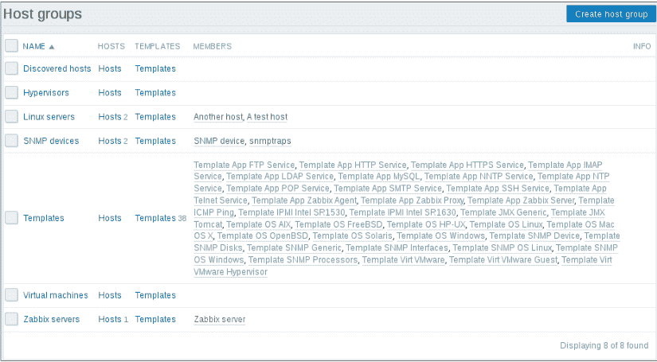

首先引起注意的是 **Templates** 组似乎已经有大量模板。这些是作为示例提供的，以便你以后可以快速参考它们以获取有关项目的提示。我们现在忽略这些。我们还可以看到一个空的 **Discovered hosts** 组和包含单个示例主机的 **Zabbix servers** 组。有趣的部分在表格的上半部分——我们可以看到我们在途中使用的两个组，以及所有对应的成员。该表格相当简单，只有一个组名、组成员数量的计数（单独表示组中包含的主机和模板），以及单独列出各个成员。

如图所示，各个成员按以下约定进行颜色编码：

- **Green：** 正常、已启用的主机
- **Red：** 正常、已禁用的主机
- **Gray：** 模板

让我们创建另一个主机组并分配一些主机。点击 Create host group 按钮。在 Group name 字段中输入 Test group，然后从 Other hosts 列表框上方的 Group 下拉菜单中选择 Linux servers。从过滤后的列表中，选择我们自定义创建的主机：A test host 和 Another host。你可以使用 Ctrl 和 Shift 键选择多个条目。选择这些主机后，点击 ◄ 按钮。

现在，从 Group 下拉菜单中选择 SNMP devices 并选择 SNMP device；然后再次点击 ◄ 按钮：

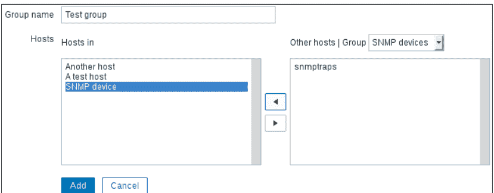

此表单允许在创建新组时轻松选择任意数量的主机以添加。你可以自由地在两个框之间移动主机，直到对结果满意为止。完成后，点击 Add。

现在列表中会出现一个新组。如你所见，它包含我们刚刚添加的三个主机：

| Test group | Hosts 3 | Templates | Another host, A test host, SNMP device |

但等等！Linux servers 和 SNMP devices 组各有两个主机：

| Linux servers | Hosts 2 | Templates | Another host, A test host |
| SNMP devices | Hosts 2 | Templates | SNMP device, snmptraps |

对，我们忘记添加 **snmptraps** 主机了。将鼠标光标移至其上方——注意这个（以及此页面上的每个其他主机）都是一个链接。点击它将带你进入主机详细信息，因此现在就这样做。正如我们在主机编辑表单上看到的那样，它已经在一个组中：**SNMP devices**。在 **Other groups** 列表框中点击 **Test group**，然后点击 ◀ 按钮：

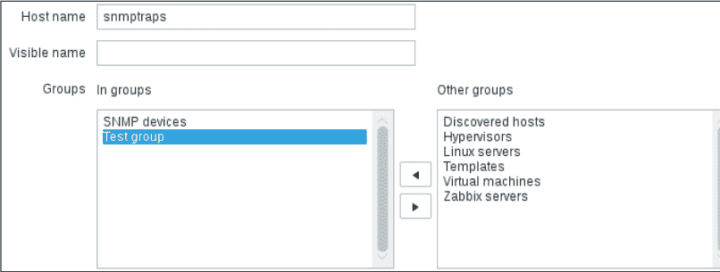

完成后，点击 **Update**。

你现在可能已经猜到了，一个主机可以属于任意数量的组。这允许你基于任意决定进行分组，例如将单个主机放在名为 **Linux servers**、**Europe servers** 和 **DB servers** 的组中。

现在，我们回到了主机列表，因此通过导航到 **Configuration | Host groups** 返回主机组列表。**Test group** 包含四个主机，正如它应该的那样。假设你想禁用一整组主机，甚至是多个主机组。也许你有一组已退役的主机，但你暂时不想删除它们，或者也许你想在 Zabbix 服务器上创建实际的生产配置时禁用为测试创建的主机。组列表提供了一种轻松执行此操作的方法：标记 **Linux servers** 和 **SNMP devices** 条目旁边的复选框，点击列表底部的 **Disable hosts** 按钮，并确认弹出窗口。

执行此操作后，所有绿色主机都应该消失——它们现在应该是红色的，表示它们处于禁用状态。

这次，你也可以只标记 **Test group** 旁边的复选框，因为 **Linux servers** 和 **SNMP devices** 是 **Test group** 的子集，最终效果会相同。执行此操作后，我们应该记住 **snmptraps** 是一个通用的 SNMP 陷阱接收主机，可能应该保持启用状态。再次点击它以打开主机详细信息编辑页面。

在主机详细信息页面打开时，我们可以快速查看接口部分。如你所见，有四种不同的接口类型可用。对于每种类型，都提供了一个 IP 和 DNS 字段，以及用于从服务器端发起检查的 Connect to 控件。我们已经使用过 Agent 和 SNMP 接口。当使用这些协议配置监控时，我们还将使用 IPMI 和 JMX 接口。

标记 Enabled 复选框并点击 Update：

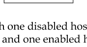

你现在应该会看到一个主机列表，其中有一个已禁用的主机（在 STATUS 列中用红色文字显示为 Disabled）和一个已启用的主机（在 STATUS 列中用绿色文字显示为 Enabled）。让我们重新启用 SNMP device——点击它旁边的 Disabled 文本并确认弹出窗口。这使我们在列表中剩下两个已启用的设备。从 Group 下拉菜单中选择 Linux servers，标记两个仍被禁用的主机旁边的复选框，点击列表底部的 Enable 按钮，并确认弹出窗口。最后，我们又回到了所有主机都已启用的状态。我们在这里使用了四种方法来更改主机状态：

- 在 Configuration | Host groups 区域更改整个组的状态
- 使用该主机属性页面中的 Enabled 复选框更改单个主机的状态
- 使用主机配置列表中 STATUS 列的每个主机的控件更改单个主机的状态
- 通过标记主机配置列表中的相关复选框并使用列表底部的按钮来更改单个主机或多个主机的状态

我们之前通过组配置屏幕创建了主机组。正如你可能记得的，另一种方法是使用创建或编辑主机时使用的 New group 字段——这会创建组并同时将主机添加到该组。

配置屏幕上的主机列表在另一个方面也很有用。它提供了一种快速简便的方式来查看哪些主机宕机。虽然监控部分为我们提供了有关特定服务状态和每个设备状况的相当广泛的信息，但有时你会想要快速查看设备状态，例如确定特定组中所有设备的可用性，例如打印机、路由器或交换机。配置以一个几乎没有其他信息分散注意力的列表提供此信息。如果我们现在从 **Group** 下拉菜单中选择 **All**，我们将看到此安装的所有主机：

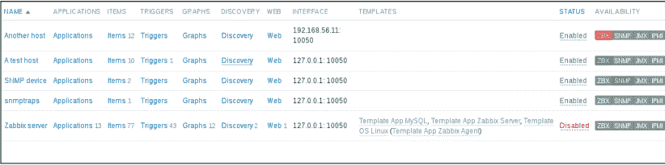

这次，我们感兴趣的是两列：**STATUS** 和 **AVAILABILITY**。从之前的屏幕截图中，我们可以看到我们有一个未被监控的主机，此信息很容易注意到——以红色打印，与通常的绿色条目形成鲜明对比。**AVAILABILITY** 列显示 Zabbix 确定的每个主机和轮询项目类型的内部状态。如果 Zabbix 尝试从主机获取数据但失败，则该主机对此特定类型信息的可用性被确定为缺失，就像这里 **Another host** 发生的那样。可用性状态和错误消息对于 Zabbix 服务器轮询的以下四种单独的项目类型都得以保留：

- Zabbix agent (passive)
- SNMP
- JMX
- IPMI

另一方面，snmptraps 主机对于所有轮询的项目类型来说可用性未知，因为 Zabbix 从未尝试从它检索任何数据（即，没有为它配置 Zabbix 服务器轮询的项目）。同样，未知和不可用的主机在视觉上与可用的主机不同，提供快速概览。


> 请记住，主机列表中的可用性图标仅代表被动 Zabbix agent 项——主动项完全不会影响它。如果一台主机只有主动项，该图标将保持灰色。如果您添加了失败的被动项然后全部将其转换为主动项，图标应恢复为灰色。这是 Zabbix 3.0 中的改进；在之前的版本中，图标会一直保持红色。

可用性信息更面向 Zabbix 管理员——它显示的是从主机收集数据相关的问题，而不是诸如资源使用、进程状态或性能指标等信息。

到此为止，Zabbix 中主机和主机组的管理就基本介绍完了。不过主机组的用途在前端管理之外还延伸了一点——我们将在本章后面讨论权限时，具体了解其如何发挥作用。

## 主机清单

我们已经了解了如何管理主机，但主机属性中有一个区域值得更深入地查看。前往 **Configuration | Hosts**，并确保在 **Group** 下拉菜单中已选择 **Linux servers**。然后，点击 **A test host**，并切换到 **Host inventory** 选项卡。默认情况下，清单设置为 **Disabled**：

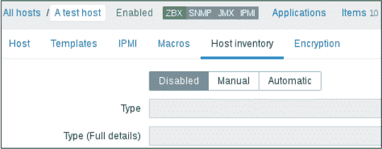

### 手动编辑清单数据

点击 **Manual** 以启用清单字段。注意字段很多，从类型、名称、操作系统、硬件等简单信息开始，到硬件维护日期、位置数据和联系人信息结束。在 **Type** 字段中输入 **test**，然后点击 **Update**：

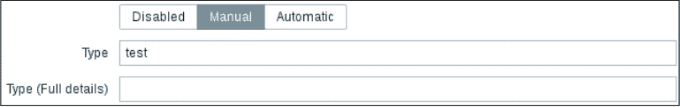

现在点击 Another host，切换到 Host inventory 选项卡，并点击 Manual。然后，再次在 Type 字段中输入相同的 test 字符串。点击 Update。现在，让我们在 Group 下拉菜单中切换到 SNMP devices。勾选列表中两个主机旁边的复选框，然后点击底部的 Mass update。在 Mass update 表单中，切换到 Inventory 选项卡并勾选 Inventory mode 旁边的复选框。切换到 Manual，勾选 Type 旁边的复选框，并在该字段中输入 snmp：

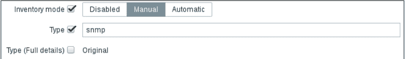

点击 Update。清单数据已填充一些内容后，让我们前往 Inventory | Overview。从 Group 下拉菜单中选择 All，并从 Grouping by 下拉菜单中选择 Type。注意我们可以看到该字段的所有可用值以及每个值的 hosts 数量：

| TYPE | HOST COUNT |
|------|------------|
| test | 2 |
| snmp | 2 |

点击 HOST COUNT 列中 snmp 旁边的数字 2。在这里，我们可以看到各个主机和一些清单字段，包括我们使用的 TYPE 字段：

| HOST ▲ | GROUP | NAME | TYPE | OS | SERIAL NUMBER A |
|--------|-------|------|------|----|-----------------|
| SNMP device | SNMP devices, Test group |  | snmp |  | |
| snmptraps | SNMP devices, Test group |  | snmp |  | |

此列表已过滤，仅显示 Type 字段中包含确切字符串 snmp 的主机。您可以通过查看过滤器来验证这一点：

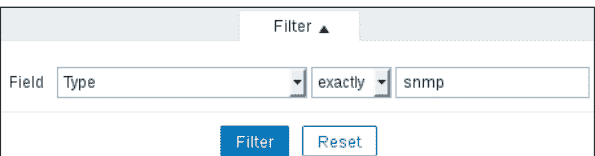

收起过滤器并点击 **HOST** 列中的 **SNMP device**。这将打开主机概览页面，显示一些基本配置信息。值得注意的是，这里显示了主机接口。虽然没有主机配置权限的用户无法在配置部分打开主机属性，但他们可以通过这种方式看到主机概览页面并查看主机接口：

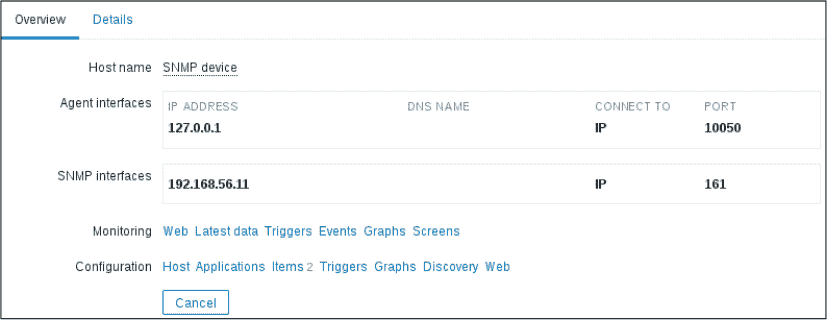

在此表单底部还有两行链接：**Monitoring** 和 **Configuration**。正如预期的那样，它们提供了快速访问该主机的各种监控和配置部分，与我们在 *Chapter 2, Getting Your First Notification* 中讨论的全局搜索类似。点击 **Host name** 将提供访问全局脚本的入口。我们将在 *Chapter 7, Acting upon Monitored Conditions* 中探索和配置这些脚本。

让我们返回 **Configuration | Hosts** 并点击 **SNMP device**。切换到 **Host inventory** 选项卡，并在 **OS** 字段中输入 Linux (`http://www.kernel.org`) 并点击 **Update**。这次让我们直接前往 **Inventory | Hosts**——注意这是我们从清单概览点击主机计数后到达的页面。查看 **OS** 列，我们可以看到 Zabbix 识别了 URL 并使其可点击：

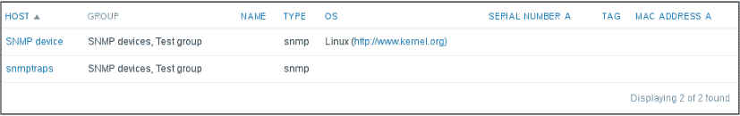

> 此时，此页面上显示的列无法自定义。

这允许您链接到提供更多信息或各种设备的 Web 管理界面的网站。请注意，除了识别 URL 外，字段不会以任何方式被解释；例如，Location latitude 和 Location longitude 字段只是文本字段。

### 自动填充清单数据

手动填充的清单数据很有用，但在大规模操作时可能并不切实可行。Zabbix 也可为我们自动收集一些清单值。这是因为任何项都可以填充任何清单字段。我们将使用现有的一个项并创建一个新的项来自动填充两个清单字段。

让我们先添加新项。导航到 Configuration | Hosts，从 Group 下拉菜单中切换到 Linux servers，并点击 A test host 的 Items。然后，点击 Create item。填写以下值：

- Name: The full OS name
- Key: system.uname
- Type of information: Text
- Update interval: 300

完成后，点击底部的 Add 按钮。让我们修改另一个项以将数据放入另一个清单字段。点击 Zabbix agent version，然后从 Populates host inventory field 下拉菜单中选择 Software application A，并点击 Update。我们现在有两个项配置为将数据放入清单字段，但仅凭这一点不会产生任何效果——我们的清单设置为手动模式。从项列表上方的导航栏中，点击 A test host 并切换到 Host inventory 选项卡。然后，选择 Automatic。注意有些变化——这里的几个字段被禁用了，并在其右侧出现了链接：

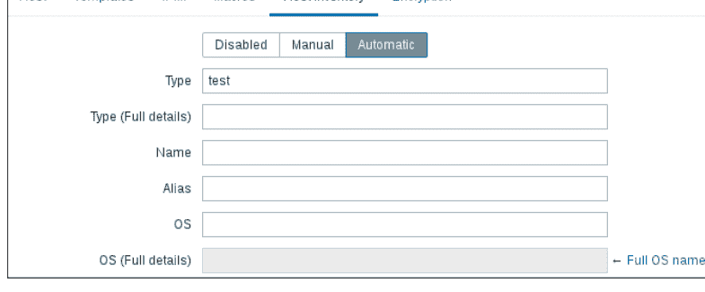

这些是我们之前在项配置期间选择的字段。链接显示哪些项应填充这些字段，并允许方便地访问这些项的配置。请注意，我们之前手动填充的字段 Type 并未丢失值。实际上，自动模式可以说是一种混合模式。配置为自动获取值的字段会这样做；其他字段可以手动填充。点击 Update。

项的值会在项获取新值时放置到清单中。对于完整的 OS 版本项，我们设置的间隔相对较低：300 秒。而 agent 项则间隔很大。这意味着在该清单字段中出现值之前，我们可能需要等待很长时间。为了更快地实现这一点，请在 A test host 上重启 agent。

我们选择的清单字段 Software application A 并不是很具代表性，但目前无法自定义清单字段。如果您的数据与现有清单字段不匹配，您必须选择最合适的——或者只是使用与实际数据关系不大的字段。

有两个项的值应放置到清单字段中，让我们返回 Inventory | Overview 并从 Grouping by 下拉菜单中选择 Software application A。这应该只显示一个主机，对应 agent 版本 3.0.0。点击 HOST COUNT 列中的 1，您应该可以看到，正如预期的那样，它是 A test host。尽管我们选择的列未在当前视图中列出。点击 HOST 列中的 A test host 并切换到 Details 选项卡：

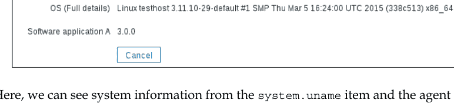

在这里，我们可以看到来自 system.uname 项的系统信息和来自 agent.version 项的 agent 版本。

我们使用了清单部分的概览和主机页面。概览对于查看按清单字段划分的主机分布很有用。主机页面允许在按主机组过滤和按单个清单字段过滤的同时查看各个主机。当我们最终到达主机页面时，过滤器已为我们预设为匹配确切字段值，但我们也可以搜索子字符串。例如，如果我们有系统，其 OS 信息包含 CentOS 5.5 和 CentOS 6.2，我们可以仅按 CentOS 过滤，获得所有 CentOS 系统的列表，无论它们运行的确切版本是什么。


有时能够在前端访问库存数据是有用的，但可能更希望更快、更方便地访问。库存数据也可以包含在通知中。例如，发送的电子邮件可以包含系统位置、系统出现问题时应联系的人员，以及一些序列号等其他信息。我们将在第 7 章《Acting upon Monitored Conditions》中讨论通知。

## Host maintenance

我们希望尽快知道问题，总是如此。好吧，并非总是如此——在我们测试故障转移或重新配置存储阵列时就会出现这种情况。还有维护——事情极有可能在此时中断，我们不希望向我们的账户或其他人发送大量电子邮件、短信和其他信息。Zabbix 提供了主机组和主机级别的维护功能，使我们能够在维护期间避免过度的消息发送。

主机处于维护状态可能导致三个主要后果：

- 这些主机的数据不会被收集
- 这些主机的告警会被隐藏或在前端中不显示
- 这些主机的告警不会被处理

这些后果也可以根据主机组、主机和其他因素进行相当详细的自定义。我们将在本章中探讨其中大部分自定义可能性，除了告警处理——我们将在第 7 章《Acting upon Monitored Conditions》中讨论该内容。

## Creating maintenance periods

我们将创建几个维护周期，并看看它们如何影响前端中的多个视图。我们将讨论可用的时间段选项并设置两个不同的维护周期：

- 一个不会影响数据收集的周期
- 一个停止数据收集的周期

> 在使用维护周期之前，请确保为 PHP 和 Zabbix 服务器主机配置的时区匹配。否则，前端中显示的时间将与实际维护发生的时间不同。

## Collecting data during maintenance

导航到 **Configuration | Maintenance** 并点击 **Create maintenance period**。在 resulting 表单中，填写以下值：

- **Name:** 输入 `Normal maintenance`
- **Active since:** 确保此项设置为当前日的开始或更早
- **Active till:** 确保此项设置为一年或更久的未来
- **Description:** 输入 `We keep data during this maintenance`

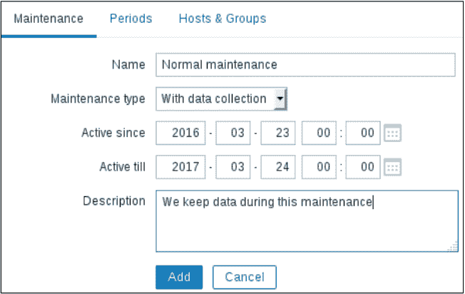

怎么回事，我们真的要创建一个为期一年的维护周期吗？并非如此。切换到 **Periods** 选项卡。

这里，Zabbix 的术语有点令人困惑。主选项卡具有 since–till 字段，允许我们设置可称为主周期的内容。**Periods** 选项卡允许我们添加单独的周期，我们可以称它们为子周期。Zabbix 中的任何维护条目都必须至少定义一个子周期。Zabbix 中的维护在主周期与子周期重叠时处于活动状态。让我们再重复一遍：

> Maintenance in Zabbix is active when the main period overlaps with the subperiods.

解决了问题——缺失的主机或主机组——让我们再次点击 **Add**。维护条目应出现在列表中：

| NAME | TYPE | ACTIVE SINCE | ACTIVE TILL | STATE | DESCRIPTION |
|---|---|---|---|---|---|
| Normal maintenance | With data collection | 2016-03-23 00:00 | 2017-03-24 00:00 | Active | We keep data during this maintenance |

> 重复多次提醒点击小 Add 链接并非没有原因——很容易忘记点击它，从而在某些情况下错过更改。例如，如果你在添加第二个子周期时忘记点击小链接，它将被静默丢弃。注意其他表单中类似的陷阱。

维护条目添加后，让我们尝试看看这对前端中的几个部分有何影响。在控制台中运行以下命令：

```
$ cat /dev/urandom | md5sum
```

导航到 **Monitoring | Triggers** 并等待触发器触发。当它出现时，查看 **HOST** 列——这次有一个橙色的扳手指示器。这表明该主机的维护目前处于活动状态。将鼠标光标移到此指示器上：

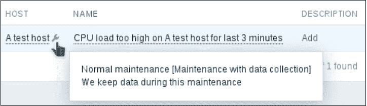

> 你可以点击指示器以保持消息打开，就像 Zabbix 中其他弹出消息一样。

## Managing Hosts, Users, and Permissions

该消息显示了我们使用的维护名称：**Normal maintenance**。它还告诉我们，此维护配置为继续收集数据，并在下方显示了维护的描述。这使我们能够轻松地向其他用户说明此维护正在进行的原因。仍在触发器页面上，查看过滤器。注意 **Show hosts in maintenance** 复选框默认被标记。取消标记它并点击 **Filter**。**A test host** 的所有问题都应消失——至少在这个视图中是如此。为了避免以后混淆，标记该复选框并再次点击 **Filter**。记住，大多数过滤选项会在访问特定页面时被记住，因此如果我们将其保持标记，后续在此视图中将看不到维护中的主机。

让我们检查一下主机处于维护状态时另一个页面看起来如何。导航到 **Monitoring | Dashboard** 并检查 **Last 20 issues** 小部件：

| HOST | ISSUE | LAST CHANGE | AGE | INFO | ACK | ACTIONS |
|---|---|---|---|---|---|---|
| A test host 🔧 | CPU load too high on A test host for last 3 minutes | 2016-03-23 02:55:55 | 6m 33s |  | No |  |

*Last 20 issues — 1 of 1 issue is shown; Updated: 03:02:28*

处于维护中的主机在此以相同方式表示。同样，将鼠标光标移到橙色图标上会显示维护名称、类型和描述。我们也可以从仪表板中隐藏维护中的主机——点击右上角的扳手图标以打开仪表板过滤器。在过滤器中，点击顶部的 **Disabled**，然后取消标记 **Show hosts in maintenance** 复选框：

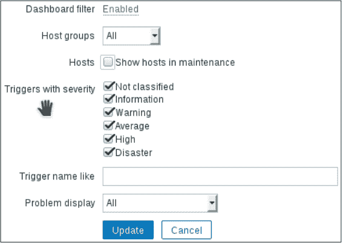

完成后，点击 **Update**。注意问题已从 **Last 20 issues** 小部件中消失。再次点击扳手图标（现在有一个绿色点表示此过滤器处于活动状态），点击 **Enabled** 以禁用它，然后点击 **Update**。

维护状态也可以在其他前端部分中看到。我们将在 *Chapter 9, Visualizing the Data with Graphs and Maps.* 中回顾其中的一些。

我们创建并检查了一个维护条目。在此维护期间，我们的主机数据仍在被收集，触发器正在检查该数据。状态在前端中显示，我们可以选择隐藏处于维护中的主机。现在，让我们尝试做一些不同的事情——维护也停止数据传入。

## Not collecting data during maintenance

导航到 **Configuration | Maintenance** 并点击 **Create maintenance period**。在 resulting 表单中，填写以下值：

- **Name:** 输入 `Maintenance with all data dropped`
- **Maintenance type:** 选择 **No data collection**
- **Active since:** 确保此项设置为当前日的开始或更早
- **Active till:** 确保此项设置为一年或更久的未来
- **Description:** 输入 `We don't need no data`

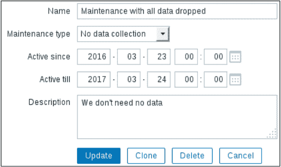

## Managing Hosts, Users, and Permissions

切换到 **Periods** 选项卡并点击 **New**。在 **Date** 字段中，将日期和时间设置为当前值：

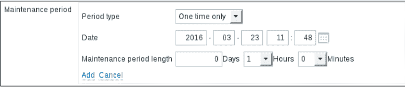

点击小 **Add** 链接——再次，先点击它，而不是 **Add** 按钮。现在，切换到 **Hosts & Groups** 选项卡。确保 **Other hosts** 部分中的 **Group** 下拉菜单显示 **Linux servers**，并选择 **Another host**。然后，点击该按钮。现在，点击大 **Add** 按钮。列表中现在应有两个维护条目：

| NAME | TYPE | ACTIVE SINCE | ACTIVE TILL | STATE | DESCRIPTION |
|---|---|---|---|---|---|
| Maintenance with all data dropped | No data collection | 2016-03-23 00:00 | 2017-03-24 00:00 | Active | We don't need no data |
| Normal maintenance | With data collection | 2016-03-23 00:00 | 2017-03-24 00:00 | Active | We keep data during this maintenance |

转到 **Monitoring | Latest data**，并确保在过滤器的 **Host groups** 字段中选择了 **Linux servers**。注意 **Another host** 中的项目数据已停止传入——时间戳不再更新。这是因为我们创建的无数据收集维护。正因如此，触发器不会触发，并且此类主机的告警不会出现在前端中，无论过滤器设置如何。

让我们快速查看一下 **Configuration | Hosts**。这是可以看到维护状态的另一个位置。处于维护中的主机将在 **STATUS** 列中列出 **In maintenance**——这取代了正常的 **Enabled** 文本：

| NAME | APPLICATIONS | ITEMS | TRIGGERS | GRAPHS | DISCOVERY | WEB | INTERFACE | TEMPLATES | STATUS |
|---|---|---|---|---|---|---|---|---|---|
| Another host | Applications | Items 12 | Triggers | Graphs | Discovery | Web | 192.168.56.11:10050 |  | In maintenance |

我们发现了维护如何影响数据收集和问题的显示。另一个重要原因是跳过或修改通知。我们将在 *Chapter 7, Acting upon Monitored Conditions.* 中讨论通知。


## 维护周期选项

到目前为止，我们使用的唯一类型的维护子周期是一次性维护。我们决定将那些在单独标签页中配置的周期称为“子周期”，以区别于在第一个标签页 Maintenance 中配置的主周期。我们还发现，维护仅在主周期与子周期重叠的时间段内处于活动状态。但为什么要重复定义同样的东西；一次性周期不能是唯一需要指定的内容吗？主周期的好处在配置重复性维护时变得更加明显，因此让我们探索一下子周期可用的选项。您可以导航到 Configuration | Maintenance，开始创建新的维护，并在我们探索它们时尝试可用的子周期。

### 仅一次性维护

这就是我们已经使用过的维护子周期类型。它从指定的日期和时间开始，按指定的分钟、小时和天数持续，然后结束。此类型的子周期仍必须与主周期重叠。

### 每日维护

对于每日维护，我们必须指定开始时间和维护周期的长度：


在主周期期间，维护将在每天指定的时间开始。它将每天开始，Every day(s) 选项设置为默认值 1。我们可以更改此设置，使维护每隔一天、每三天等才发生。

### 每周维护

对于每周维护，我们必须指定开始时间和维护周期的长度，与每日维护相同：

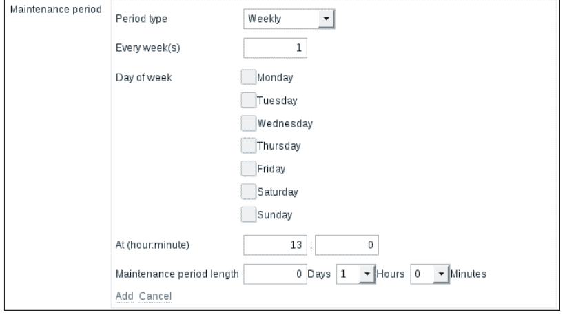

我们还必须选择维护将在一周中的哪些天进行——可以选一个或多个。在主周期期间，维护将在每周指定的星期几的指定时间开始。它将每周开始，Every week(s) 选项设置为默认值 1。我们可以更改此设置，使维护每隔一周、每三周等才发生。

### 每月维护

每月维护有两种模式：

- 按日（或按日期）
- 按星期几

对于这两种模式，我们必须指定开始时间和维护周期的长度，与每日和每周维护模式相同。此外，我们必须选择维护将在哪些月份进行——可以选一个或多个。在按日或按日期模式下（选项 Date 设置为 Day），我们必须在 Day of month 字段中输入一个日期。维护将在我们选择的每个月的该日期发生：

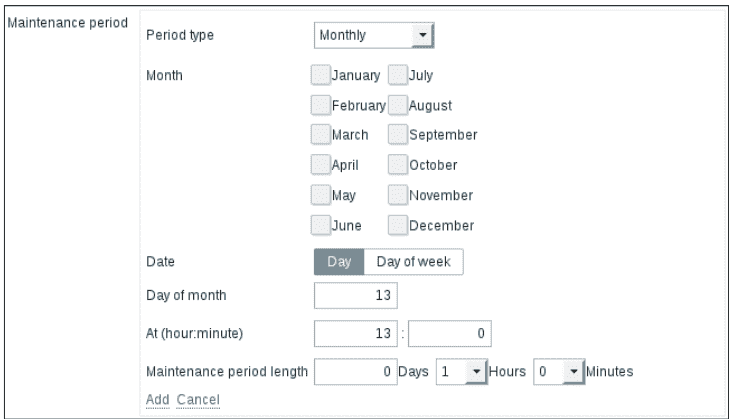

在按星期几模式下（选项 Date 设置为 Day of week）我们必须选择维护将在一周中的哪些天进行——可以选一个或多个：

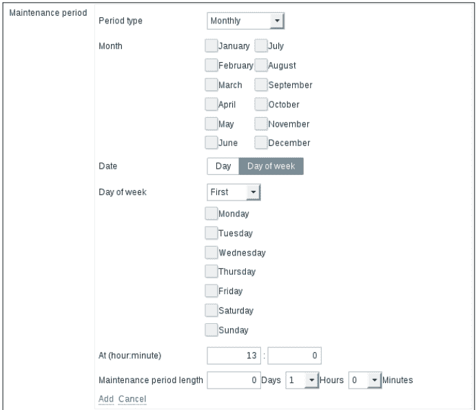

由于这必须按月而不是按周发生，我们还必须选择这将在所选月份中的第一个、第二个、第三个、第四个或最后一个此类工作日发生：


除此之外，我们还可以要求 Zabbix 在所选月份的最后一个此类日期运行此维护，例如，每年四月、八月和十二月，在当月的最后一个星期三运行维护。

使用所有这些重复性维护模式，可以创建几乎任何场景——可能缺少的一点是能够在每个月的最后一天运行每月维护。

因此，有这种双重配置的好处，即主周期与子周期之间的重叠，是我们可以拥有一个从未来某个时间点开始然后在稍后某个时间点完全自动停止的重复性维护——我们不必在特定日期记住添加和删除它。

### 临时维护

Zabbix 中的维护功能旨在面向维护始终提前规划的良好规划环境。实际上，人们经常希望快速将主机置于维护状态，然后稍后手动将其移除。考虑到维护条目所需的周期和其他内容，这还不够快。一个有点取巧的变通方法是创建一个始终处于活动状态的新主机组和维护周期（确保将结束日期设置得足够远）。将该主机组包含在维护条目中，然后，将主机添加到所选主机组将使该主机进入维护状态。当然，之后必须记住将主机从主机组中移除。

## 用户、用户组和权限

主机管理监控实体（主机）信息，并用于对基本信息收集单元——项目——进行分组。Zabbix 中的用户账户控制对监控信息的访问。

### 身份验证方法

在查看更详细的用户配置之前，了解 Zabbix 支持三种身份验证方法可能会有所帮助。导航到 **Administration | Authentication** 查看身份验证配置：

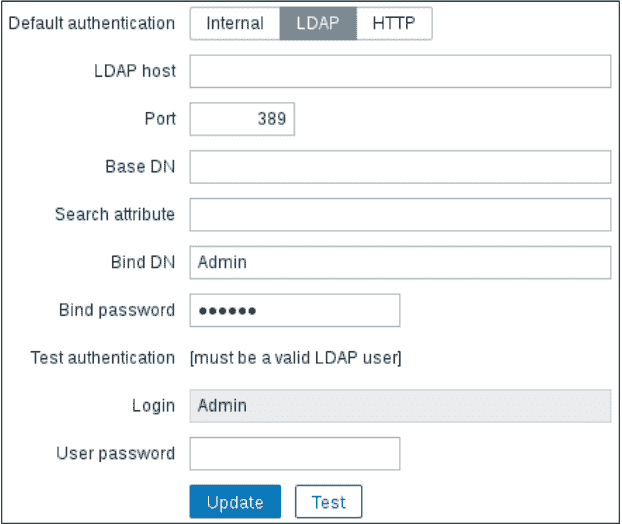

如图所示，这三种身份验证方法为：

- **HTTP：** 用户使用 Web 服务器 HTTP 身份验证机制进行身份验证。HTTP 身份验证的支持基本上允许使用 Web 服务器支持的任何身份验证方法用于 Zabbix，而在 Apache HTTPD 守护进程的情况下，有很多。
- **LDAP：** 用户使用 LDAP 服务器进行身份验证。如果所有需要访问 Zabbix 的企业用户都已在 LDAP 结构中定义，这会很方便。仅验证用户密码；组 membership 和其他属性不使用。登录成功还必须存在 Zabbix 用户账户。
- **Internal：** 使用此方法，用户使用 Zabbix 内部的用户和密码存储进行身份验证。我们将使用此方法。

### 创建用户

初始 Zabbix 安装不包含许多预定义用户——让我们查看用户列表。导航到 Administration | Users：

| ALIAS ▲ | NAME | SURNAME | USER TYPE | GROUPS | IS ONLINE? | LOGIN | FRONTEND ACCESS | DEBUG MODE | STATUS |
|---|---|---|---|---|---|---|---|---|---|
| Admin | Zabbix | Administrator | Zabbix Super Admin | Zabbix administrators | Yes (2016-03-24 12:15:03) | Ok | System default | Disabled | Enabled |
| guest |  |  | Zabbix User | Guests | No (2016-03-23 02:35:08) | Ok | System default | Disabled | Enabled |

没错；只定义了两个用户账户：Admin 和 guest。我们一直以 Admin 身份登录。另一方面，guest 用户用于未通过身份验证的用户。在我们以 Admin 身份登录之前，我们是 guest。用户列表显示了用户的基本信息，例如他们所属的组、是否已登录、上次登录时间以及其账户是否已启用。

> 通过向 guest 用户授予访问权限，可以允许匿名访问资源。

让我们为自己创建另一个用户。点击右上角的 Create user 按钮。我们将在填写适当内容的同时查看用户账户的所有可用选项：

- Alias：输入 monitoring_user。这本质上是一个用户名。
- Name：输入 monitoring。在此字段中，您通常输入用户的真实姓名。
- Surname：输入 user。显然，此字段通常包含用户的真实姓氏。
- Groups：与主机一样，用户账户也可以分组。用户必须至少属于一个组，因此让我们至少暂时将新用户分配到某个组。点击 Groups 字段旁边的 Add 按钮，并选中 Zabbix administrators 旁边的复选框。然后，点击 Select：
- Password：选择并输入密码，然后在下一个字段中重新输入。

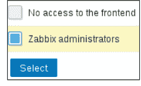


- **Language:** 前端有不同成熟度的翻译，每个用户都可以选择自己的偏好。我们将其保留为 **English (en_GB)**：


> 如果您想使用的语言未列出，它可能仍然存在，只是未完成。有关如何启用它并为 Zabbix 翻译做出贡献的更多详细信息，请参阅 *附录 B, 成为社区的一部分*。

- **Theme:** Zabbix 前端支持主题。目前，仅包含两种主题。我们将主题保留为 **System default**（即 **Blue**）：


- **Auto-login:** 勾选此选项将在用户至少手动登录一次后自动登录用户。自动登录使用浏览器 cookie 执行。我们不会为此用户使用自动登录。
- **Auto-logout:** 您可以使特定账户在一段时间内无活动后自动注销。可以设置的最短时间是 90 秒，最长约为 166 分钟。此处无需设置自动注销。

> 此外，在撰写本文时，此选项无法按预期工作，不应依赖它。

- **Refresh:** 这是 **Monitoring** 部分中页面刷新之间的时间间隔，以秒为单位。虽然在首次设置时，较小的值看起来可能很不错，并且项目检查间隔较短，但它们会 somewhat 增加服务器负载，并且如果页面包含大量信息，则有时甚至在下一次刷新开始之前页面都无法完成加载。让我们将此用户设置为 60——毕竟，在测试某些内容时，他们始终可以手动刷新。请注意，有些页面不会执行完整的页面刷新；相反，它们只重新加载该页面上的某些元素。例如，图表页面只重新加载图表图像。
- **Rows per page:** 每个用户都可以拥有单独的最大每页行数设置。如果返回的数据超过此参数，界面会将数据拆分为多个页面。我们不会更改此参数。
- **URL (after login):** 用户可能希望在登录后始终查看特定页面——无论是概览、触发器列表还是其他任何页面。此选项允许用户自定义该行为。输入的 URL 相对于 Zabbix 目录，因此让我们在此处输入 `tr_status.php`，使此用户在登录时始终看到 **Monitoring | Triggers**。

最终结果应如下所示：

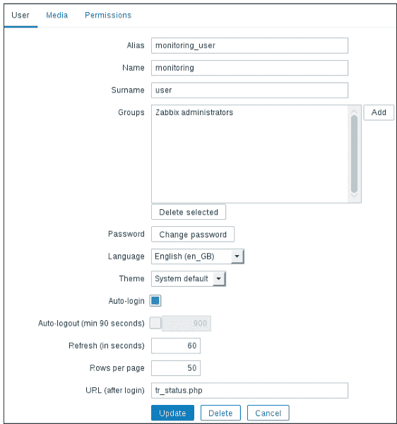

如果确实如此，请点击底部的 **Add** 按钮。

现在，最好测试一下这个新用户。建议您为此测试启动另一个浏览器，以便任何更改都易于观察。让我们将您已登录管理员用户的浏览器称为“Browser 1”，另一个称为“Browser 2”。在 Browser 2 中，打开 Zabbix 页面并以 monitoring_user 身份登录，提供之前输入的密码。打开的不是仪表板，而是 **Monitoring | Triggers** 页面。

此外，页面与之前明显不同——主菜单条目 **Configuration** 和 **Administration** 在这里不见了。尽管 **Host** 和 **Group** 下拉菜单都设置为 **All**，但看不到任何问题，并且下拉菜单本身也不包含任何主机或主机组。转到 **Monitoring | Overview**。**Group** 下拉菜单设置为全部，但 **Details** 视图声称 **No data found**。为什么会这样？

默认情况下，用户无法访问任何系统。当我们的新用户登录时，监控部分中没有任何内容显示，因为我们没有授予任何权限，包括只读权限。我们确实将此用户分配给了 **Zabbix administrators** 组，但该组默认没有设置任何权限。回到 Browser 1，点击 **ALIAS** 列中的 **monitoring_user**。有一件小事需要注意：这次不是 **Password** 输入字段，而是一个写着 **Change password** 的按钮可见。如果您必须为某个用户重置密码，点击此按钮将再次显示密码输入字段，从而允许在进行任何其他更改的同时更新密码：


但我们仍有一个未使用的标签页：**Permissions**。让我们切换到它。

> 还有一个 **Media** 标签页。在那里，用户可以分配各种媒体，以便 Zabbix 知道如何向他们发出警报。媒体类型包括发送电子邮件的电子邮件地址或发送短信的号码。我们将在 **第 7 章, Acting upon Monitored Conditions** 中讨论通知功能。

首先要注意的是 **User type** 下拉菜单。它提供三种用户类型。我们将此用户的类型保留为 **Zabbix User**：

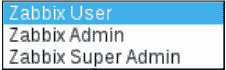

供参考，这些类型的含义如下：

- **Zabbix User**: 这些是普通用户，只能访问 **Main** 菜单中的 **Monitoring**、**Inventory** 和 **Reports** 部分
- **Zabbix Admin**: 这些用户除了前三个部分外，还可以访问 **Configuration** 部分，因此能够重新配置 Zabbix 的部分内容
- **Zabbix Super Admin**: 这些用户可以完全访问 Zabbix，包括 **Monitoring**、**Configuration** 和 **Administration** 部分

下面是一个看起来非常接近我们所寻找的区域。存在 **Hosts** 和 **Host groups**，分为 **READ-WRITE**、**READ-ONLY** 和 **DENY** 权限：

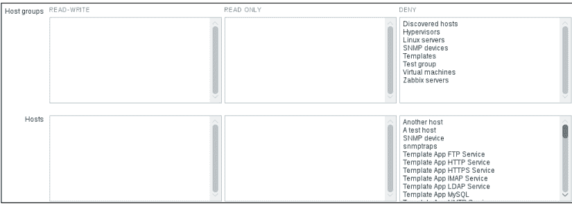

只有一个问题：没有办法更改这些权限。

页面底部的帮助信息解释了原因。它说 **Permissions can be assigned for user groups only.**

我们很方便地跳过了添加或配置任何组和权限的步骤，现在是修复它的好时机。

## Creating user groups

我们不会修改默认的用户组，而是添加自己的组。导航到 Administration | User groups，并查看当前用户组的列表：

| NAME ▲ | # | MEMBERS | FRONTEND ACCESS | DEBUG MODE | STATUS |
|---|---|---|---|---|---|
| Disabled | Users |  | System default | Disabled | Disabled |
| Enabled debug mode | Users |  | System default | Enabled | Enabled |
| Guests | Users 1 | guest | System default | Disabled | Enabled |
| No access to the frontend | Users |  | Disabled | Disabled | Enabled |
| Zabbix administrators | Users 2 | Admin (Zabbix Administrator), monitoring_user (monitoring user) | System default | Disabled | Enabled |

如您所见，已经有一些预定义组，可以让您了解用户如何组织。这种组织可以基于系统类别、系统、管理角色、物理位置等。例如，您可能在总部有一组管理员，在分支机构也有一些管理员。每个组可能对另一个位置的 UPS 状态不感兴趣，因此您可以将它们分组为 HQ 管理员和 Branch 管理员。用户可以属于任意数量的组，因此您可以根据实际条件创建各种方案。

让我们为我们的用户创建一个新组。点击右上角的 Create user group。让我们填写表单并了解每个控件的作用：

- **Group name:** 输入 Our users。
- **Users:** 在这里，我们可以将用户添加到我们正在创建的组中。我们当前的安装只有很少的用户，因此在显示所有用户的情况下找到正确的用户名很容易。如果我们有很多用户，我们可以使用 Other groups 下拉菜单来过滤用户列表，更容易找到我们要找的内容。选择 monitoring_user 并点击 ◄ 按钮。
- **Frontend access:** 此选项允许我们为特定组选择身份验证方法。它允许一种配置，其中大多数用户针对 LDAP 进行身份验证，但某些用户针对内部用户数据库进行身份验证。它还允许我们为某些组设置无 GUI 访问，这可以用于仅需要接收通知的用户。我们将此选项保留为 System default。


如果您的 Zabbix 安装使用 LDAP 进行用户认证，那么将用户组的“前端访问”设置为“内部”将导致该组中的所有用户都使用 Zabbix 内部密码存储进行认证。这不是故障转移选项——内部认证将始终被使用。如果您希望为不在 LDAP 目录中的用户提供访问权限，或者希望在 LDAP 宕机时创建可以从保险柜中取出的紧急账户，这将非常有用。这种方法对 HTTP 认证不起作用，因为 HTTP 认证发生在 Zabbix 对认证后端做出任何决定之前。

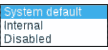

- **启用**：通过这一个选项，可以禁用或启用该组中的所有用户。正如预定义组可能告诉您的那样，这是一种很好的方法，可以通过简单地将用户添加到未勾选此复选框的组中，轻松禁用单个用户账户。我们希望我们的用户能够登录，因此此选项将保持选中状态。
- **调试模式**：此选项允许用户访问前端调试信息。它主要对 Zabbix 开发人员有用。我们将在附录 A“故障排查”中讨论调试模式。

在介绍了主要设置之后，让我们切换到“权限”选项卡：

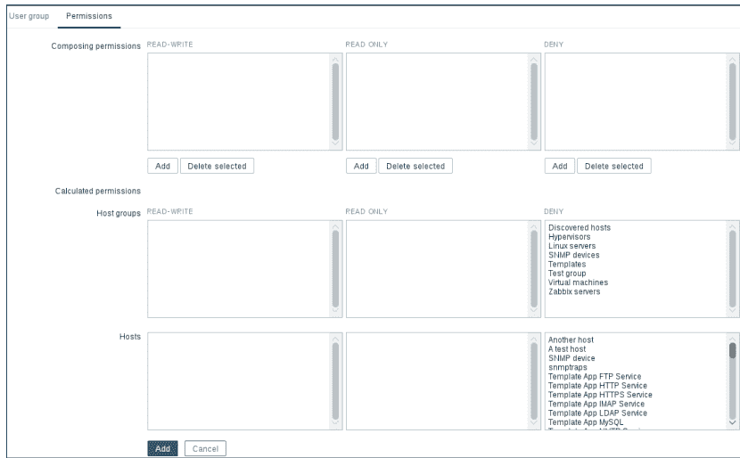

这才像样！我们终于可以看到各种权限级别的控件了。共有三个部分，分别标记为“读写”、“只读”和“拒绝”。每个部分都有名为“添加”和“删除所选”的按钮，它们似乎用于修改相应的权限。我们的用户没有查看任何内容的权限，因此我们需要在前两个框中添加一些权限。点击“读写”框下方的“添加”。这会打开一个包含某些选项的新窗口。

它还为我们提供了另一个有价值的信息。如果仔细查看窗口内容，您会注意到所有这些条目都有一个共同点：它们都是主机组。我们终于获得了关键信息——在 Zabbix 中，只能基于主机组为用户组设置权限。

勾选“SNMP 设备”旁边的复选框，然后点击“选择”按钮。

我们现在可以看到“SNMP 设备”已添加到“读写”框中。接下来，点击“只读”框下方的“添加”。将打开一个与之前完全相同的弹出窗口。这次，勾选“Linux 服务器”条目旁边的复选框，然后点击“选择”。

现在，“只读”框中列出了“Linux 服务器”。最终的表单应如下图所示：

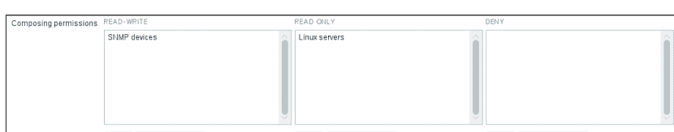

让我们看一下刚刚使用的控件下方的“计算权限”部分：

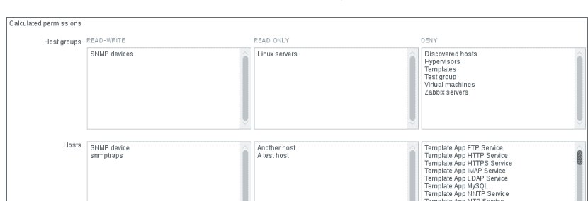

## 管理主机、用户和权限

此视图显示了有效的用户权限。我们可以看到确切的访问权限是什么样的：哪些主机允许读写访问，哪些只有只读访问权限，哪些完全没有访问权限。这看起来是正确的，因此点击底部的**添加**按钮。该组将被成功添加，我们将在组列表中看到它：

| 我们的用户 | 用户 1 | monitoring_user（监控用户） | 系统默认 | 已禁用 | 已启用 |
|---|---|---|---|---|---|

让我们回到浏览器 2。导航到**监控 | 最新数据**。点击**主机组**字段旁边的**选择**。很好，我们在配置权限时选择的两个组都可用。勾选它们旁边的复选框，然后点击**选择**。接着，点击**筛选**。现在，我们的新用户可以查看所有主机的数据。但是我们还为该用户添加了其中一个组的写权限，那么**配置**菜单是怎么回事？让我们回顾一下用户创建过程——不是有关于用户类型的内容吗？没错，我们可以在三种用户类型之间进行选择，我们选择了**Zabbix 用户**，如前所述，这种用户不允许访问配置。

> 重要的是要记住，目前，被授予写访问权限的 Zabbix 用户将无法在前端中配置内容，但他们将通过 API 获得写访问权限。这可能会导致安全问题。我们将在*第 21 章“与数据密切合作”*中讨论 API。

为了继续探索用户权限，我们将创建另一个更强大的用户。在浏览器 1 中，前往**管理 | 用户**，点击**创建用户**按钮。填写以下值：

- **别名**：输入 advanced_user。
- **名字**：输入 advanced。
- **姓氏**：输入 user。
- **组**：点击**添加**，勾选**Zabbix 管理员组**旁边的复选框，然后点击**选择**。
- **密码**：在两个字段中输入密码。您可以使用与 `monitoring_user` 相同的密码，以便记忆。
- **刷新**：输入 60。
- **登录后 URL**：让该用户在登录后立即查看另一个页面。“事件历史”或许可以——在此处输入 `events.php`。

现在，切换到“权限”选项卡，并从“用户类型”下拉列表中选择“Zabbix 管理员”。这将产生相当大的差异，我们很快就会看到：


完成后，点击“添加”按钮。

现在让我们使用浏览器 2。在右上角，点击注销图标，然后以 advanced_user 身份登录。该用户将进入事件历史页面，而且这次我们可以看到配置部分。这是因为我们将用户类型设置为 Zabbix 管理员。让我们看看那里有什么可用内容——打开配置 | 主机：

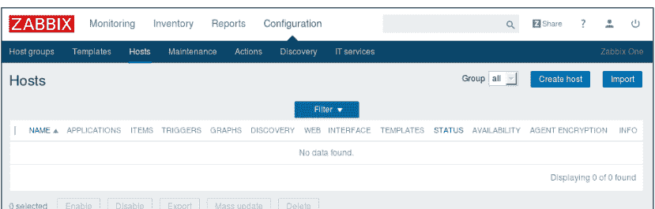

怎么会没有可用的主机？我们已将此用户设置为 Zabbix 管理员类型。我们或许应该回到浏览器 1 查看用户列表：

| 别名 | 名字 | 姓氏 | 用户类型 | 组 | 是否在线？ | 登录 | 前端访问 | 调试模式 | 状态 |
|---|---|---|---|---|---|---|---|---|---|
| Admin | Zabbix | 管理员 | Zabbix 超级管理员 | Zabbix 管理员组 | 是（2016-03-24 16:01:12） | 正常 | 系统默认 | 已禁用 | 已启用 |
| advanced_user | advanced | user | Zabbix 管理员 | Zabbix 管理员组 | 否 | 正常 | 系统默认 | 已禁用 | 已启用 |
| guest |  |  | Zabbix 用户 | 访客 | 否 | 正常 | 系统默认 | 已禁用 | 已启用 |
| monitoring_user | monitoring | user | Zabbix 用户 | 我们的用户、Zabbix 管理员组 | 是（2016-03-24 16:01:08） | 正常 | 系统默认 | 已禁用 | 已启用 |

在这里，我们可以轻松发现错误——我们将 `advanced_user` 添加到了 **Zabbix 管理员组**，但我们是针对 **我们的用户** 组设置的权限。现在我们将修复这个问题，不过这次我们将使用用户属性表单。点击**别名**列中的 **advanced_user**，在出现的表单中，点击“组”字段旁边的**添加**。勾选**我们的用户**旁的复选框，然后点击**选择**：

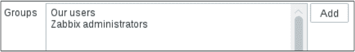

完成后，点击**更新**。在浏览器 2 中，只需刷新主机**配置**选项卡——它应该会显示两台主机：**SNMP 设备**和 **snmptraps**，**advanced_user** 可以配置这两台主机。

突然，我们注意到通过这种方式，我们已授予了 `snmptraps` 主机配置访问权限，而我们将其视为一个重要的主机，不应该被乱动，而且我们的两个用户无论如何都不应该拥有对它访问权限。我们如何在不将其移出 **SNMP 设备** 组的情况下轻松限制对该主机的访问呢？

在浏览器 1 中，导航到**配置 | 主机组**，点击**创建主机组**。输入以下详细信息：

- **组名：** 输入 `Important SNMP hosts`
- **主机：** 使用**组**下拉列表筛选**其他主机**列表框，以显示 **SNMP 设备**，选择 `snmptraps`，然后点击**◀**按钮

完成后，点击**添加**。

打开**管理 | 用户组**，点击**名称**列中的**我们的用户**，切换到**权限**选项卡。在组详细信息中，点击**拒绝**框下方的**添加**按钮。在出现的窗口中，勾选**重要 SNMP 主机**旁边的复选框，点击**选择**，然后点击**更新**按钮。

现在是时候看一下浏览器 2 了。它应该仍显示包含两台主机的主机配置。刷新列表，`snmptraps` 主机将消失。经过我们的更改后，`advanced_user` 仅拥有对 **SNMP 设备** 主机的配置访问权限，并且对 `snmptraps` 主机的监控将完全没有访问权限，因为我们使用了拒绝。对于 `monitoring_user`，没有任何变化——之前就没有 **SNMP 设备** 组的访问权限。


## 权限与维护

本章中我们查看的维护配置以其自身的方式遵循主机组权限的规则。主机组权限会影响 Zabbix 管理员配置维护条目的方式：

- Zabbix 管理员可以创建新的维护条目，并包含其具有写入权限的主机组和主机
- Zabbix 管理员可以编辑现有的维护条目，前提是其对该维护条目中包含的所有主机和主机组都具有写入权限

### 总结

我们探索了 Zabbix 中主机属性的另一个方面：主机清单。主机清单可以手动填充，但其更有用的方面是能够从任何项目接收值到任何清单字段中。这仍然允许手动编辑不从项目接收值的清单字段。

主机和主机组维护允许我们按每日、每周和每月的基础创建一次性或循环的维护条目。处于维护中的主机上的问题在前端中以视觉方式区分，并且在许多视图中，我们也可以选择完全不显示此类问题。

重要的是记住 Zabbix 中权限的主要规则：

- 权限只能分配给用户组
- 权限只能授予主机组

这意味着对于复杂的权限方案，你可能需要在开始随意操作之前进行一些规划。我们也可以安全地说，为了避免未来的神秘问题，每个主机都应至少属于一个主机组，每个用户都应至少属于一个用户组。此外，有两个因素结合起来决定了有效权限：为组设置的权限和用户类型。我们可以尝试总结这两个因素的交互：

| Permissions | Zabbix User | Zabbix Admin | Zabbix Super Admin |
|---|---|---|---|
| Read-write | Read only | Full | Full |
| Read only | Read only | Read only | Full |
| Deny | None | None | Full |

## 管理主机、用户和权限

从这张表可以看出，Zabbix Super Admin 用户类型无法被拒绝任何权限。另一方面，Zabbix User 不能被授予写入权限。尽管如此，仍然非常重要地记住，在此时，他们可以通过 Zabbix API 获得写入权限。

有了这些知识，你应该能够对主机进行分组并管理主机清单和主机维护，以及创建和组、用户，并分配细粒度的权限。

在下一章中，我们将研究一种检查项目值是否表示问题的方法。虽然我们有项目收集数据，但在 Zabbix 中，项目不用于配置阈值或检测不良值的任何其他信息。项目只要值到达就不会关心值是什么。为了定义什么是问题，使用了一个单独的配置实体，称为触发器。触发器逻辑以表达式形式编写，可以从非常简单的阈值到相当复杂的逻辑表达式。

## 使用触发器检测问题

我们已经获得了关于可以使用项目收集何种信息的相当全面的知识。然而，到目前为止，我们只积极监控了一件事——我们只创建了一个触发器（我们在 *第 2 章，获取你的第一个通知* 中创建了它）。触发器可以做更多。让我们回顾一下触发器是什么。

触发器定义了何时将条件视为值得关注。它“触发”（即变为活动状态），当项目数据或其缺失与特定条件匹配时，例如系统负载过高或可用磁盘空间过低。

让我们现在更详细地探索这两个概念。在本章中，我们将：

- 进一步了解触发器与项目之间的关系
- 发现触发器依赖关系
- 构建触发器表达式
- 了解 Zabbix 前端上使用全局脚本的基本管理功能

### 触发器

触发器是可以触发的东西。它们查看项目数据，并在数据不符合已定义条件的任何条件时发出标志。正如我们之前讨论的，仅仅收集数据是好的，但非常不足。如果想要任何过去的历史数据收集，包括通知，就必须有人一直查看所有数据，因此我们必须定义阈值，在这些阈值下我们希望条件被视为值得关注。触发器提供了一种定义这些条件的方法。

之前，我们创建了一个检查 A test host 上系统负载的触发器。它检查返回的值是否大于定义的阈值。现在，让我们检查服务器可能出现的一些其他问题，例如服务宕机。SMTP 服务宕机可能很重要，因此我们将尝试现在寻找这种情况的发生。导航到 Configuration | Hosts，点击任意一个 Triggers 链接，然后点击 Create trigger 按钮。在打开的表单中，我们将填写以下值：

- **Name**：此字段的内容将在大多数地方用于标识触发器，因此应可读。 这次，输入 `SMTP service is down`。注意我们描述的是实际问题。与收集状态的项目不同，触发器有一个特定的条件要检查；因此名称反映了这一点。如果我们有一个主机不应该运行 SMTP 服务，我们可以创建一个名为 `SMTP service should not be running` 的触发器。
- **Expression**：这可能是触发器的最重要属性。检查什么以及检查什么条件将在此处指定。触发器表达式可以从非常简单到复杂。这次，我们将创建一个简单的，并利用前端的帮助。为此，点击 Expression 字段旁边的 Add 按钮以打开表达式构建对话框。它也有多个字段需要填写，让我们看看它们是什么：
  - **Item**：在这里，我们可以指定应检查哪个项目数据。为此，点击 Select 按钮。另一个弹出窗口将打开。从 Group 下拉菜单中选择 Linux servers，然后从 Host 下拉菜单中选择 Another host。我们对 SMTP 服务感兴趣，因此点击 NAME 列中的 SMTP server status。弹出窗口将关闭，Item 字段将被填充所选项目的名称。
  - **Function**：在这里，我们可以选择要执行的实际测试。也许我们可以回忆一下 SMTP 服务器状态项目的值——对，1 表示服务器正在运行，0 表示服务器宕机。如果我们想检查最后的值是否为 0，默认函数 Last（最近）似乎非常合适，因此我们不会更改它。
  - **Last of (T)**：这是函数参数，如果函数支持时间段。我们在第一个触发器中使用了 180 秒来检查之前的 3 分钟内的值，但在取最后一个项目值时，时间段将毫无意义。
  - **Time shift**：我们将在本章后面的 Relative thresholds or time-shift 部分讨论此功能。

在继续之前，请确保 SMTP 服务器在 Another host 上正在运行，然后点击 Add。让我们现在在概览中看看它是什么样的：转到 Monitoring | Overview，并确保 Type 下拉菜单已选择 Triggers。然后展开过滤器，在 Triggers status 下拉菜单中选择 Any，然后点击 Filter：

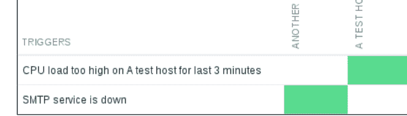

太好了，我们可以看到两个主机现在都定义了触发器。由于触发器不同，我们还有两个未使用的单元格：

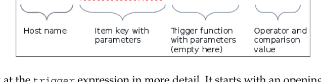

让我们更详细地查看触发器表达式。它以一个左大括号开头，第一个参数是主机名。用冒号分隔的是项目键——这里是 net.tcp.service[smtp]。项目键必须与项目配置中完全一致，包括任何空格、引号和大小写。在确切的项目键之后是一个点作为分隔符，其后是更有趣且特定于触发器的内容：触发器函数。这里使用的是最常见的函数之一 last()。它始终从项目历史中返回单个值。有些触发器函数需要传递至少一些参数，但对于 last() 函数，这不是必需的，如果第一个参数只是数字，则会被忽略。

> Zabbix 的旧版本要求即使会被忽略也必须传递一些参数。看到 last(0) 这样的语法仍然很常见。因此，last(300) 与 last(0) 和 last() 相同——它们都为一个项目返回单个最后一个值。


另一方面，如果第一个参数是一个以哈希前缀的数字，则不会被忽略。在这种情况下，它的工作方式类似于 nth 值指定符。例如，last (#9) 将检索最近的第 9 个值。正如我们所见，last (#1) 等于 last (0) 或 last ()。另一个重叠的函数是 prev。正如名称可能暗示的那样，它返回前一个值；因此，prev() 与 last (#2) 相同。

> 主机名、项目键、触发器函数、运算符——它们都区分大小写。

继续触发器表达式，花括号被关闭以表示检索某个值的字符串，即主机和项目引用，后跟触发器函数。然后我们有一个运算符，在本例中是一个简单的等号。这里的比较是与一个常量数字 0 进行的。

> 如果将项目历史设置为 0，则不会存储任何值，也不会评估任何触发器，即使这些触发器仅检查最后一个值。这与 Zabbix 的早期版本不同，在早期版本中，仅引用最后一个值的触发器仍然有效。

## 触发器与项目关系

你可能已经注意到，Zabbix 中的项目不包含任何关于数据质量的配置——如果 CPU 负载值到达，项目不会关心它们是 0 还是 500。任何问题条件的定义都发生在触发器中，无论是简单的阈值还是更复杂的情况。

当我们创建此触发器时，我们可以点击任何 Triggers 链接，但我们在选择项目时注意到了下拉菜单中选择的宿主。实际上，只要在该弹出窗口中选择了正确的宿主或我们手动输入了正确的宿主机名，我们点击哪个 Triggers 链接并不重要。

> 触发器不像项目那样属于某个主机。触发器与它引用的项目的任意数量的主机相关联。

如果我们为主机 A 点击了 Triggers，然后为该触发器选择了来自主机 B 的项目，则创建的触发器不会出现在主机 A 中，但会出现在主机 B 中。

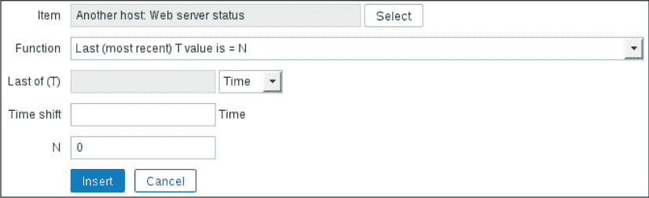

这会插入 `{Another Host:net.tcp.service[http,,80].last()}=0` 表达式：

- **严重性：** 平均
- **描述：** 触发器表达式可能会变得非常复杂。有时，复杂性会使人们在没有认真剖析的情况下无法理解触发器 supposed to do 的含义。注释提供了一种帮助他人或自己在以后理解此类复杂表达式背后的思路的方法。虽然我们的触发器仍然非常简单，但我们可能想要解释依赖关系的理由，因此输入类似 `Web service goes down if SMTP is inaccessible.` 的内容。

现在，切换到 **Dependencies** 选项卡。要配置 Web 前端对 SMTP 服务的依赖，请点击 **Dependencies** 部分中的 **Add** 链接。在 resulting 窗口中，确保在 **Group** 下拉菜单中选择了 **Linux servers**，在 **Host** 下拉菜单中选择了 **Another host**，然后点击 **NAME** 列中的唯一条目：**SMTP service is down.**

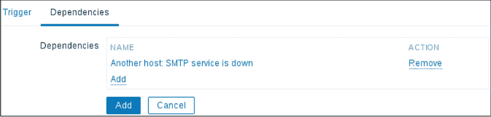

## 第一章 人工智能概述

人工智能（Artificial Intelligence，简称 AI）是研究、开发用于模拟、延伸和扩展人的智能的理论、方法、技术及应用系统的一门新的技术科学。

人工智能是计算机科学的一个分支，它企图了解智能的实质，并生产出一种新的能以人类智能相似的方式做出反应的智能机器，该领域的研究包括机器人、语言识别、图像识别、自然语言处理和专家系统等。

- 人工智能的发展历史
- 人工智能的主要研究领域
- 人工智能的应用场景

> “人工智能就是关于知识的科学——怎样表示知识、怎样获取知识和怎样使用知识。”

| 年代 | 标志性事件 |
| --- | --- |
| 1950 | 图灵测试提出 |
| 1956 | 达特茅斯会议 |
| 1997 | 深蓝击败卡斯帕罗夫 |
| 2016 | AlphaGo击败李世石 |

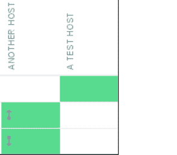

```
```python
import ai
model = ai.load_model('gpt')
result = model.predict('你好')
```
```

本章介绍了人工智能的基本概念和发展脉络，后续章节将深入探讨各类算法及其应用。

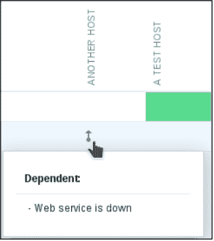

弹出窗口出现，告知我们有其他触发器依赖于此触发器。依赖的触发器列在弹出窗口中。现在，将鼠标光标移动到下方的一个单元格上，悬停在向下指向的箭头上：

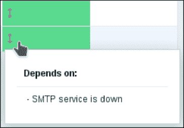

让我们看看除了箭头之外，这提供了什么效果。转到 **Monitoring | Triggers**，并确保 **Host** 和 **Group** 下拉菜单都显示 **all**。然后，将 **Another host** 上的 Web 服务器关闭。等待触发器触发，并查看条目。注意，这里也显示了指示依赖关系的箭头。再次将鼠标光标悬停在其上，依赖详情将以弹出窗口的形式显示：

| SEVERITY | STATUS | INFO | LAST CHANGE | AGE | ACK | HOST | NAME | DESCRIPTION |
|---|---|---|---|---|---|---|---|---|
| Average |  |  | 2016-04-05 15:49:01 | 3s | No | Another host | Web service is down | Show |

但 DESCRIPTION 列中的 Show 链接是怎么回事？让我们弄清楚；点击它。创建触发器时我们提供的描述将被显示。这允许从触发器列表中轻松访问描述，既可以了解有关触发器的更多信息，也可以更新描述。点击取消 ( × ) 返回到触发器列表。现在，停止 Another host 上的 SMTP 服务。等待触发器列表更新，再次查看它。Web 服务器触发器已从列表中消失，并被 SMTP 服务器触发器取代。这是因为 Zabbix 不会在依赖的上游触发器处于 PROBLEM 状态时显示依赖触发器。这有助于保持列表简短并集中于真正导致停机的問題。

| SEVERITY | STATUS | INFO | LAST CHANGE ▼ | AGE | ACK | HOST | NAME | DESCRIPTION |
| Average | PROBLEM |  | 2016-04-05 15:51:00 | 3s | No | Another host | SMTP service is down | Add |
|  |  |  |  |  |  |  | Dependent: Web service is down |  |

触发器依赖关系不限于单一层级。我们现在将再添加一个触发器。在此之前，我们还将创建一个项目，以便通过不影响系统服务的方式手动更改触发器状态。在前端，导航到 Configuration | Hosts，点击 Another host 旁边的 Items，然后点击 Create item。填写以下值：

- Name: Testfile exists
- Key: vfs.file.exists[/tmp/testfile]

完成后，点击底部的 Add 按钮。正如键名可能揭示的那样，此项目仅检查特定文件是否存在，如果存在则返回 1，如果不存在则返回 0。

> 在现实生活情况下，在 /tmp 中使用常量文件名可能不是理想的，因为任何用户都可以创建此类文件。

在 Item 列表上方的栏中，点击 Triggers，然后点击 Create trigger 按钮。输入这些值：

- Name: Testfile is missing.
- Expression: 点击 Add 然后点击 Item 字段旁边的 Select。在 Another host 的项目列表中，在 NAME 列中点击 Testfile exists，然后点击 Insert（同样，默认函数对我们有效）。Expression 字段将填入以下表达式：
  {Another Host:vfs.file.exists[/tmp/testfile].last()}=0
- Severity: Warning.

这应该处理当前触发器列表上唯一的触发器。等待触发器列表更新。你将看到两个触发器，其状态在闪烁。记住，默认情况下，Zabbix 会将最近更改状态的触发器显示为闪烁，这也包括处于“OK”状态的触发器：

| SEVERITY | STATUS | INFO | LAST CHANGE ▼ | AGE | ACK | HOST | NAME | DESCRIPTION |
|---|---|---|---|---|---|---|---|---|
| Warning | OK |  | 2016-04-05 16:12:25 | 1m 4s | No 1 | Another host | ↑ Testfile is missing | Add |
| Average | PROBLEM |  | 2016-04-05 15:51:00 | 22m 29s | No 8 | Another host | ↑ ↓ SMTP service is down | Add |

查看列表，我们这次可以看到一个很大的不同：SMTP 触发器现在有两个箭头，一个指向向上，另一个指向向下。将鼠标光标移过它们，你会发现它们表示的与之前相同：此特定触发器所依赖的触发器或依赖于此触发器的触发器。如果一个触发器处于依赖链的中间，将会出现两个箭头，正如这里的 SMTP service is down 触发器所发生的那样。

这里的箭头显示的方向与我们之前的示意图相同。我们可以说依赖触发器被“更重要”的触发器“支持”，就像我们把砖块一层层堆放在上面一样。如果其中一块砖消失了，上面砖块就会出问题。

我们的 testfile 触发器对链式依赖按预期工作，因此我们可以现在移除该依赖。转到 Configuration | Hosts，点击 Another host 旁边的 Triggers，然后在 NAME 列中点击 SMTP service is down 触发器。切换到 Dependencies 选项卡，点击 ACTION 列中的 Remove，然后点击 Update 按钮。请注意，你始终需要在任何实体的编辑表单中保存更改。在这种情况下，仅仅移除依赖关系是不够的。如果我们在没有明确更新触发器的情况下导航到其他部分，任何修改都将丢失。现在，你也可以重新启动“Another host”上停止的任何服务。

## 构造触发器表达式

到目前为止，我们只使用了非常简单的触发器表达式，将最后一个值与某个常量进行比较。幸运的是，这并不是触发器表达式所能做的一切。我们现在将尝试创建一个稍微复杂一点的触发器。


假设我们有两台服务器：A test host 和 Another host，它们提供冗余的 SSH 文件传输协议（SFTP）服务。我们关心的是其中任意一个服务宕机的情况。导航到“配置 | 主机”，点击 A test host 或 Another host 旁边的“触发器”，然后点击“创建触发器”按钮。输入以下值：

- **名称：** 一个 SSH 服务已宕机。
- **表达式：** 点击“添加”按钮。在弹出的窗口中，点击“监控项”字段旁边的“选择”按钮。确保在“主机”下拉列表中选择了 Another host，在“名称”列中点击“SSH server status”监控项，然后点击“插入”。现在，将光标放在插入的表达式末尾，输入不带引号的 ` or `（即空格、or、空格）。再次点击“添加”按钮。在弹出的窗口中，点击“监控项”字段旁边的“选择”按钮。从“主机”下拉列表中选择 A test host，在“名称”列中点击“SSH server status”监控项，然后点击“插入”。
- **严重性：** 一般严重（记住，这些是冗余服务）。

最终触发器表达式应如下所示：

```text
{Another host:net.tcp.service[ssh].last()}=0 or {A test host:net.tcp.service[ssh].last()}=0
```

完成后，点击底部的“添加”按钮。

> 在 Zabbix 2.4 之前的版本中，使用管道符 `|` 代替小写的 `or`。

我们在这里遵循的过程使我们能够创建比简单比较单个监控项的值更复杂的表达式。而是比较两个值，如果其中任何一个匹配比较条件，触发器就会触发。这就是 `or` 运算符的作用。另一个逻辑运算符是 `and`。以 SSH 服务器为例，我们可以创建另一个触发器，当两个 SSH 实例都宕机时触发。构建这个表达式很简单，因为我们只需修改这一个运算符，即将 `or` 改为 `and`，使得表达式如下：

```text
{Another host:net.tcp.service[ssh].last()}=0 and {A test host:net.tcp.service[ssh].last()}=0
```

> 触发器表达式运算符区分大小写，因此 `AND` 不是有效运算符——应使用小写的 `and`。

触发器表达式还支持其他运算符。在我们创建的所有触发器中，我们都使用了最常见的运算符：等于运算符 `=`。我们还可以使用不等于运算符 `<>`。这样我们可以反转表达式，如下所示：

```text
{A test host:net.tcp.service[ssh].last()}<>1
```

> 在 Zabbix 2.4 之前的版本中，使用井号 `#` 代替 `<>` 表示“不等于”比较。

虽然在这种情况下并不实用，但当监控项可能包含多个值，并且我们希望触发器在值不是预期值时触发时，这样的触发器很有用。

触发器表达式还支持标准数学运算符 `+`、`-`、`*` 和 `/`，以及比较运算符 `<`、`>`、`<=` 和 `>=`，因此可以在监控项数据和常量之间进行复杂的计算和比较。

让我们使用不同的函数创建另一个触发器。在前端部分的“配置 | 主机”中，从“组”下拉列表中选择 Linux servers，点击 A test host 旁边的“触发器”，然后点击“创建触发器”按钮。接着，输入以下值：

- **名称：** `Critical error from SNMP trap`
- **表达式：** `{A test host:snmptrap.fallback.str(Critical Error)}=1`
- **严重性：** 严重

完成后，点击底部的“添加”按钮。

这次，我们使用了另一个触发器函数 `str()`。它会在监控项数据中搜索指定字符串，如果找到则返回 1。匹配区分大小写。

只要监控项的最新值不包含作为参数指定的字符串，此触发器就会变为 OK 状态。如果我们想手动强制触发器回到 OK 状态，只需发送一个不包含触发器正在查找的字符串的 trap。当其他系统发送 SNMP trap 时，手动发送成功值也可能很有用。如果问题 trap 已成功接收，但恢复 trap 丢失（由于网络连接问题或任何其他原因），您可能希望使用这样一个伪 trap 使相关触发器回到 OK 状态。如果使用内置的 trap 处理功能，只需将 trap 信息添加到临时文件即可。如果使用带有 Zabbix trapper 监控项的脚本化解决方案，可以使用 `zabbix_sender`。SNMP trap 管理已在第 4 章“监控 SNMP 设备”中讨论。

## 防止触发器抖动

对于我们编写的服务监控项和触发器，一旦检测到服务宕机，触发器就会立即触发。如果我们知道某些服务在升级期间会因日志轮转或备份需求而短暂宕机，这可能是不希望出现的。在这种情况下，我们可以使用不同的函数来实现延迟反应。将 `last()` 函数替换为 `max()`，我们可以指定一个参数，从而仅在监控项数值在一段时间内持续表明有问题时才做出反应。要使触发器仅在服务 5 分钟未响应时才触发，我们可以使用如下表达式：

```text
{A test host:net.tcp.service[ssh].max(300)}=0
```

> 要使此示例正常工作，监控项间隔不能超过 5 分钟。如果监控项间隔超过触发器函数的检查时间，则只会检查单个值，这使得使用像 `max()` 这样的触发器函数毫无用处。

请记住，对于接受秒作为参数的函数，我们还可以通过在数字前加上 `#` 来使用返回值的数量，如下所示：

```text
{A test host:net.tcp.service[ssh].max(#5)}=0
```

在这种情况下，触发器将始终检查最后返回的五个值。这种方法允许在监控项间隔改变时，触发器周期也相应扩展，但不应将其用于可能停止发送数据的监控项。

使用触发器函数是解决潜在触发器抖动的最简单、最常用的方法。前面的服务示例检查过去 5 分钟内的最大值为 0；因此，我们确定不存在值为 1 的情况，而值为 1 意味着“服务正常”。

对于我们的 CPU 负载触发器，我们使用了 `avg(180)` 函数，检查过去 3 分钟的平均值。我们也可以使用 `min(180)`——在这种情况下，即使整体平均值高于阈值，单次降到阈值以下也会重置 3 分钟计时器。该用哪个？这完全取决于您，取决于功能需求。没有一种方法总是优于其他方法。

## 检查缺失数据

有些监控项总是需要提供值，例如 CPU 负载监控项。此监控项的问题条件通常是“值过大”。但有些监控项则不同，例如键为 `agent.ping` 的监控项。该监控项只告诉我们 agent 对服务器是否可用，并且只有当 agent 在线时才返回 1。是的，仅此而已——当 agent 宕机时，它不会发送 0；它根本没有值。我们不能使用 `last()` 函数编写触发器，因为最后一个值始终是 1。`min()`、`max()` 和 `avg()` 也是如此。幸运的是，在这种情况下我们可以使用一个函数：`nodata()`。当监控项在一段时间内缺少数据时，该函数允许触发器触发。例如，如果我们在“A test host”上创建了一个 `agent.ping` 监控项，触发器可能如下所示：

```text
{A test host:agent.ping.nodata(300)}=1
```

这里，`nodata()` 函数检查该监控项是否在 300 秒（即 5 分钟）内缺少数据。如果是，触发器将触发。这里的 1 表示什么意思？Zabbix 中的所有触发器函数都会返回某个数字。如果监控项缺少数据，`nodata()` 函数返回 1；如果在指定时间段内至少有一个值，则返回 0。请注意，尝试猜测某个触发器函数有哪些返回值可能不是一个好主意——如果您不确定，最好查看手册中的详细信息：https://www.zabbix.com/documentation/3.0/manual/appendix/triggers/functions。

`nodata()` 函数被称为基于时间（time-based）的函数。“普通”触发器函数在监控项收到新值时才被评估。这对于针对诸如我们之前创建的 CPU 负载监控项之类的触发器非常有意义——当值到达时，我们将其与阈值进行比较。但是，这对于我们的 `agent.ping` 监控项效果不佳。如果值持续流入，一切都会很好——触发器表达式会被评估，该函数会返回 0。如果值停止流入，该函数将不会被评估，也永远不会触发。然后，如果新值到达，该函数会被评估，看到新值后就会宣布一切正常。

因此，在这种情况下，该触发器不会仅在新值到达时才被评估。相反，此函数每 30 秒评估一次。这个间隔是硬编码的。更具体地说，任何在表达式中至少包含一个基于时间的函数的触发器都会每 30 秒重新计算一次。对于 30 秒的间隔，`nodata()` 函数的参数永远不应低于 30。为了安全起见，切勿使用低于 60 秒的参数。在 Zabbix 3.0.0 版本中，以下触发器函数是基于时间的：

- `date()`
- `dayofmonth()`


- `dayofweek()`
- `nodata()`
- `now()`
- `time()`

如果使用更高版本，请参阅 Zabbix 手册——这个列表可能会有变化。

## 超时触发器

有些系统在发生故障时会发送 trap，但不会发送恢复 trap。在这种情况下，手动重置每一个单独的事件并不是一种选项。幸运的是，我们可以利用刚刚讨论过的函数 `nodata()` 来构造一个超时的触发器表达式。下面这个表达式会让 PROBLEM 状态在 10 分钟后超时：

```
{Another host:snmptrap.fallback.str(Critical Error)}=1 and
{Another host:snmptrap.fallback.nodata(600)}=0
```

目前，我们希望对触发器的触发方式进行更精确的控制，所以我们不会把触发器表达式改成像上一个示例那样。

注意，给触发器添加 `nodata()` 函数会使其每 30 秒重新评估一次。如果大量触发器都这样做，可能会对 Zabbix 服务器的性能产生显著影响。

## 具有自适应阈值的触发器

有些被监控的指标，即使以百分比而非绝对值来度量，也会因为值的可能范围不同，对阈值有着相当不同的需求。例如，当磁盘容量可能从几十兆字节到数百太字节甚至拍字节不等时，使用字节作为磁盘空间触发器的单位就不会太好用。运用我们所掌握的触发器表达式知识，我们可以根据磁盘的总容量来调整阈值。为此，我们需要同时监控空闲磁盘空间和总磁盘空间：

```
(
    {host:vfs.fs.size[/,total].last()}<=100GB
    and
    {host:vfs.fs.size[/,pfree].last()}<10
) or (
    {host:vfs.fs.size[/,total].last()}>100GB
    and
    {host:vfs.fs.size[/,pfree].last()}<5
)
```

我们也可以让这个触发器忽略周末的早晨：

```
{A test host:system.cpu.load.avg(180)}>1 and
{A test host:system.cpu.load.dayofweek()} >5 and
{A test host:system.cpu.load.time()}<100000
```

这里，我们检查星期值是否大于 5（其中 6 和 7 分别代表周六和周日）。此外，还用到了触发器函数 time()。该函数返回 HH:MM:SS 格式的时间，因此我们的比较可以确保当前时间还未到 10:00:00。

注意，这种方法会完全阻止触发器触发，因此我们不会收到告警，不会在前端看到触发器，也不会生成任何事件。

我们还会在*第 7 章，根据监控条件采取行动*中讨论一种基于时间限制告警本身的方法。

## 相对阈值或时间偏移

通常，触发器函数查看最新值——last() 获取最后一个值，而 min()、max() 和 avg() 则查看从当前时刻往前计算的指定时间段。对于某些函数，我们还可以指定一个额外的参数，称为*时间偏移*。这会使函数表现得就像我们回到了过去；在其他方面，它的工作方式完全相同。这允许我们实现的一个特性是创建具有相对阈值的触发器。对于 CPU 负载触发器，我们可以不使用固定的值（如 1、5 或 10），而是让它在负载与过去某个时间段相比有所增加时触发：

```
{A test host:system.cpu.load.avg(3600)} /
{A test host:system.cpu.load.avg(3600,86400)}
>3
```

在这个示例中，我们修改了正在评估的时间段——它增加到了 1 小时。我们不再将结果与固定阈值进行比较；而是查看过去某个时间段的平均值——具体来说，是 86400 秒，即一天之前。从功能上讲，这个表达式检查的是：最后一小时的平均 CPU 负载是否超过一天前同一小时的平均 CPU 负载的 3 倍以上。

这样一来，CPU 负载可以是 1、5 或 500——这个触发器不关心绝对值，只关心它是否增加了 3 倍以上。

我们使用的 avg() 函数的第二个参数是时间偏移。为了理解它是如何获取值的，假设我们添加了一个新的监控项，并将时间偏移设置为 1 小时。现在是 13:00:00，该监控项收到了一个新值。我们在过去一小时内已有值：12:10:00、12:20:00，依此类推，一直到 12:50:00。1 小时的时间偏移将根本获取不到任何值，因为它会先倒退 1 小时到 12:00:00，然后查找 1 小时前的所有值——但我们拥有的第一个值是在 12:10:00：


从 Zabbix 3.0.0 版本起，以下函数支持时间偏移参数：

- avg()
- band()
- count()
- delta()
- last()
- max()
- min()
- percentile()
- sum()

> 触发器始终基于历史数据运行，绝不基于趋势数据。如果历史数据只保留一天，就不应使用一天的时间偏移，因为在评估时可能会遗漏一些值。

## 校验系统时间

Zabbix 可以校验各种各样的项目，其中之一就是被监控系统上的当前时间。让我们快速创建一个配置来实现这个功能。我们将创建一个监控项来收集当前时间，然后创建一个触发器，将该时间与 Zabbix 服务器上的当前时间进行比较。当然，要使其正常工作，Zabbix 服务器上的时钟必须准确——否则，我们反而会抱怨所有其他系统的时间不正确。

首先需要创建收集当前时间的监控项。转到 **配置 | 主机**，点击 **Another host** 旁边的**监控项**，然后点击**创建监控项**。填写以下值：

- **名称：** `Local time`
- **键值：** `system.localtime`
- **单位：** `unixtime`

完成后，点击底部的**添加**按钮。该监控项返回当前时间的 Unix 时间戳。虽然我们的触发器并不要求设置单位，但我们在那里输入了 unixtime。这会将时间戳在前端转换为人类可读的值。我们在*第 3 章，使用 Zabbix Agent 和基础协议进行监控*中更详细地讨论了监控项单位。

在监控项列表上方的栏中，点击**触发器**，然后点击**创建触发器**按钮。输入以下值：

- **名称：** `Incorrect clock on {HOST.NAME}.`
- **表达式：** 点击**添加**，然后点击**监控项**字段旁边的**选择**。在 **Another host** 的监控项列表中，点击**名称**列中的 **Local time**，然后点击**插入**。**表达式**字段会被填充为以下表达式：`{Another host:system.localtime.last()}=0`。这实际上并不是我们需要的，但我们在这里试图避免使用函数下拉列表，因此我们将手动编辑该表达式。将其改为：`{Another host:system.localtime.fuzzytime(30)}=0`。
- **严重性：** 选择警告。

完成后，点击底部的**添加**按钮。`fuzzytime()` 函数接受一个时间段作为参数。它将该监控项的时间戳与 Zabbix 服务器上的当前时间进行比较。如果差异大于参数中指定的时间，则返回 0，这正是我们想要捕获的问题条件。同样，如果你不确定某些触发器函数的返回值，最好查阅 Zabbix 手册。

> 不要忘记，Zabbix 服务器上的时间不正确可能会导致大量关于所有其他系统的告警。

## 人类可读的常量

在处理较小的值时，使用纯数字常量是可以的。当监控项收集的数据较大时，例如磁盘空间或网络流量，这种方法就变得非常繁琐。你必须计算出期望值，而且稍后看到它时，通常很难直观地看出它到底有多大。为了帮助解决这个问题，Zabbix 在表达式中支持所谓的**后缀乘数**——支持 **K、M、G、T** 等缩写。这使触发器表达式更简短，也更易读。例如，对于一个名为 **host** 的主机，检查磁盘空间的表达式最初可能长这样：

```
{host:vfs.fs.size[/,free].last()}<16106127360
```

使用后缀乘数后，它变成了这样：

```
{host:vfs.fs.size[/,free].last()}<15G
```

这当然更容易阅读，如果需要的话，也更容易修改。

另一种类型的常量是基于时间的。到目前为止，我们在所有触发器函数中都只使用秒作为时间单位，但这往往有些难以阅读。例如，6 小时就是 21600，时间周期越长，越难以阅读。支持以下基于时间的后缀：

- s：秒
- m：分钟
- h：小时
- d：天
- w：周

s 后缀会被直接丢弃，但所有其他后缀都会作为乘数。因此，21600 就变成了 6h，这更具可读性。我们之前看过的 SSH 服务触发器示例也会更简单：

```
{A test host:net.tcp.service[ssh].max(5m)}=0
```

我们现在已经介绍了 Zabbix 触发器的基础知识。还有更多函数可用于评估各种条件，你以后可能会用到。前端函数选择器并不包含所有这些函数，因此有时你必须在文档中查找它们，并手动构造表达式。有关完整且最新的函数列表，请参阅 https://www.zabbix.com/documentation/3.0/manual/appendix/triggers/functions 上的官方文档。


## 自定义触发器显示

在深入探讨了触发器的配置细节后，我们应该能够创建强大的定义，来指明什么情况下视为问题。此外，我们还可以使用几个配置选项来定制触发器的显示方式。

### 触发器严重级别

导航到**管理 | 常规**，然后在右上角的下拉菜单中选择**触发器严重级别**：

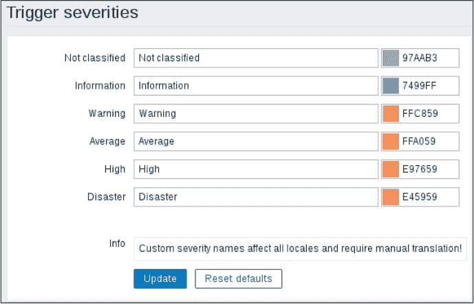

在此部分中，我们可以自定义严重级别标签及其颜色。如本页底部的**信息**框所述，更改严重级别标签将需要更新此 Zabbix 实例中任何用户可能正在使用的翻译。

但是我们能否在某个地方看到有关它们的更多详细信息？在前端中，转至监控 | 事件，然后点击“时间”列中最新一条“问题”状态条目的日期和时间。

> 如果看不到列出的任何事件，请展开过滤器，点击“重置”，并确保所选时间段足够长，以包含一些事件。

这将打开“事件详细信息”页面，使我们能够更可靠地确定事件流程。该页面包括事件和触发器详细信息以及操作历史记录等内容。右下角的“事件”列表（包含前 20 个事件）本身作为一个控件，允许您点击其中任何一个事件，并查看从所选择事件向前回溯的之前 20 个事件。由于此列表仅显示单个触发器的事件，因此在需要查明某个孤立问题的时间线时非常方便：

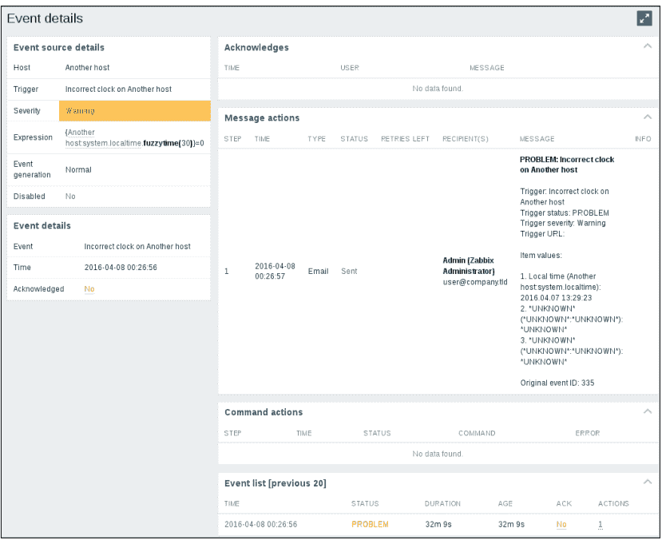

## 事件生成与迟滞

每当触发器更改状态时，就会生成触发事件。触发器可以处于以下状态之一：

- **正常**：正常状态，即触发器表达式计算结果为`false`
- **问题**：问题状态，即触发器表达式计算结果为`true`
- **未知**：Zabbix 无法计算触发器表达式时的状态，通常是因为缺少数据

> 有关如何通知触发器变为**未知**状态的信息，请参阅*第 22 章，Zabbix 维护*。

无论触发器是从**正常**变为**问题**、**未知**，还是任何其他状态，都会生成一个事件。

> 此外，还可以使用触发器属性中的**多问题事件生成**选项对此进行自定义。我们将在*第 11 章，高级监控项监控*中讨论此选项。

我们之前已经了解到，可以使用某些触发器函数来避免在每次数据变化后都更改触发器状态。通过接受时间段作为参数，这些函数使我们能够仅在问题持续一段时间后才做出反应。但是，如果我们希望在尽可能早地收到通知的同时，仍然避免在数值在阈值附近波动时触发器反复切换，那该怎么办？在这里，一个特定的 Zabbix 宏（或变量）会有所帮助，它允许我们构建具有某种迟滞（即状态记忆）的触发器表达式。

一个常见的例子是测量温度。例如，一个非常简单的触发器表达式如下：

```
server:temp.last()>20
```

当温度为 21 时，它将触发，并在温度为 20 时进入**正常**状态。有时，温度会在设定的阈值附近波动，因此触发器会一直开开关关。这是不受欢迎的，因此改进后的表达式如下所示：

```
({TRIGGER.VALUE}=0 and {server:temp.last()}>20) or
({TRIGGER.VALUE}=1 and {server:temp.last()}>15)
```

这里使用了一个新的宏 TRIGGER.VALUE。如果触发器处于正常状态，此宏返回 0；如果触发器处于问题状态，则返回 1。使用逻辑运算符 `or`，我们声明：如果触发器当前处于正常状态且温度超过 20，或者触发器当前处于问题状态且温度超过 15，则该触发器应切换为（或保持）问题状态。

也可以将此理解为触发器具有两个阈值——当值超过 20 度的上限阈值时，我们期望其切换到问题状态，但只有当值降至 15 度的下限阈值以下时才恢复：


与仅检查温度是否超过 20 度的简单表达式相比，这种情况有何不同？让我们来看一下：

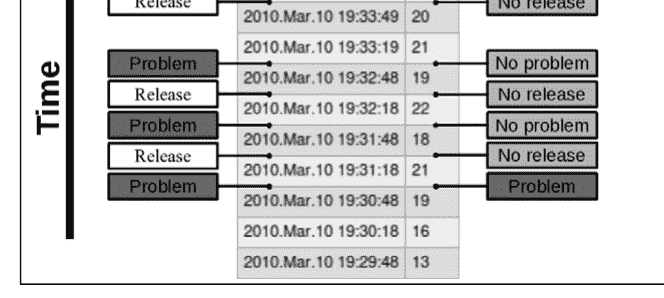

在此示例中，我们避免了两个不必要的**问题**状态，这通常也意味着至少避免了两个通知。这是防止触发器抖动的另一种方法。

## 总结

本章主要讨论了如何对监控环境中发生的事件做出反应。我们学习了如何将应该做出反应的条件描述为触发器表达式。触发器本身具有有用的依赖功能，我们可以使它们相互依赖。我们还探讨了几种在触发器表达式中直接减少触发器抖动的方法，包括使用诸如 `min()`、`max()` 和 `avg()` 之类的函数，以及触发器迟滞。

在其他触发器技巧中，我们了解了：

- 使用 `nodata()` 函数检测缺失数据
- 使用相同的 `nodata()` 函数使触发器超时
- 创建基于总磁盘空间而具有不同已用磁盘空间阈值值的触发器
- 创建仅在特定时间段内工作的触发器
- 使用相对阈值，将最近数据与之前某个时间的情况进行比较

> 请记住，如果将监控项历史记录设置为 0，则任何触发器都不会工作，即使是仅检查最新值的触发器也是如此。

触发器配置有很多东西，既可以让生活更轻松，也可能带来难以发现的问题。希望这里对基础知识的介绍能帮助你利用前者，避免后者。

拥有这些触发器知识后，我们将在下一章花时间看看触发器触发后我们可以做什么。我们将探讨各种动作，这些动作允许我们发送电子邮件，甚至运行命令来响应触发器触发。
