## 对监控到的条件采取操作

既然我们已经对触发器有了更多了解，现在来看看当它们触发时我们可以做些什么。仅仅在前端看到某些问题是不够的；我们可能希望使用电子邮件或短信发送通知，甚至可能尝试自动修复问题。

动作确保对触发器触发采取某些措施。让我们尝试发送通知并自动执行命令。

在本章中，我们将：

- 学习如何限制发送告警时的条件
- 发送通知
- 在达到阈值时升级
- 使用脚本作为媒介
- 与问题管理器集成
- 了解全局脚本

## 动作

查看触发器列表是挺好的，比查看单个监控项要好得多，但这仍然需要大量的手动工作。这时动作就派上了用场，它提供通知和其他方法来应对条件变化。

最常见的方法是电子邮件。如果在第 2 章“获取你的第一个通知”中首次配置了一条完整的监控项-触发器-动作工作链时，你正确设置了动作，那么每当我们启动或停止服务、创建测试文件等时，你都会收到一封电子邮件。让我们更详细地了解一下动作可以做什么。

## 限制发送告警的条件

我们在第 2 章“获取你的第一个通知”中创建的先前动作匹配任何事件，因为我们没有以任何方式限制其范围。现在我们可以尝试只匹配特定条件。导航到配置 | 动作，然后点击“创建动作”。

> 以下活动依赖于正确配置的电子邮件设置（在第 2 章“获取你的第一个通知”中完成），以及一个用户组“我们的用户”（在第 5 章“管理主机、用户和权限”中添加）。

在名称字段中，输入 SNMP 动作。现在切换到“条件”选项卡。默认情况下，已经添加了两个条件——为什么这样？

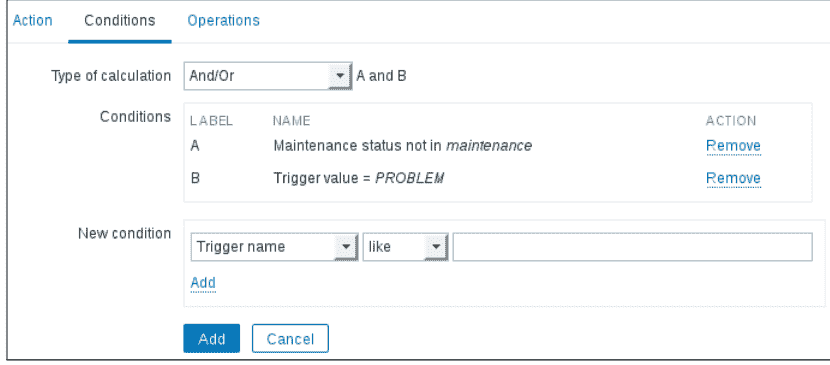

这里添加这些条件是因为它们对大多数用户的新动作可能有用：

- 维护状态不在维护中：此条件确保在主动维护期间不会执行任何操作。可以安全地删除它以忽略维护。例如，技术专家可能希望在主动维护期间也收到通知，而帮助台成员可能不希望。


- **触发值 = PROBLEM：** 此条件确保操作只会在问题发生时才执行某些操作。触发值在触发器恢复时也会为 OK，但此条件会使操作忽略恢复事件。虽然移除此条件以在问题解决时收到通知似乎很诱人，但不建议这样做。我们将在本章后面讨论更好的恢复消息选项。

是否有人想移除触发值条件？是的，可能存在脚本需要在问题发生时和解决时都运行的情况。我们可以移除此条件，但在此情况下不应使用升级。否则，问题和恢复事件都会被升级，这会非常、非常令人困惑：

| Conditions | LABEL | NAME | ACTION |
|---|---|---|---|
|  | A | Maintenance status not in *maintenance* | Remove |
|  | B | Trigger value = *PROBLEM* | Remove |
|  | C | Host group = *Important SNMP hosts* | Remove |

对于我们当前的操作，让我们保留默认条件不变并转到操作。操作是实际执行的活动。切换到 **Operations** 选项卡并在 **Action operations** 块中点击 **New** 链接。首先，我们将配置一个非常简单的操作——向单个 **USER GROUP** 发送电子邮件。此表单可能相当令人困惑。在 **Send to User groups** 部分点击 **Add**，在弹出的窗口中点击 **Our users**。结果应如下所示：

| Send to User groups | USER GROUP | ACTION |
|---|---|---|
|  | Our users | Remove |
|  | Add |  |

> Zabbix 3.0 的早期版本在此表单中存在标签错位问题——请确保使用正确的部分。

现在点击 **Operation details** 块中的主 **Add** 链接（就在 **Conditions** 部分下方）。最后，点击底部的 **Add** 按钮。由于我们希望正确测试电子邮件的发送方式，现在应禁用我们之前添加的操作。勾选 **Test** 操作旁边的复选框，点击底部的 **Disable** 按钮，然后在弹出窗口中确认禁用。

## Acting upon Monitored Conditions

现在我们需要在 **SNMP trap** 项上创建触发器。导航到 **Configuration | Hosts**，点击 **snmptraps** 旁边的 **Triggers**，然后点击 **Create trigger**。输入以下内容：

- **Name:** `SNMP trap has arrived on {HOST.NAME}`
- **Expression:** `{snmptraps:snmptraps.nodata(30)}=0`
- **Severity:** **Information**

这样的触发器会在陷阱到达时触发，并在大约 30 秒后自行清除。我们在 *Chapter 6, Detecting Problems with Triggers* 中讨论过 `nodata()` 触发器函数。完成后，点击底部的 **Add** 按钮。

我们还希望在 **Another host** 上触发一个触发器。让我们复制刚刚创建的那个——勾选它旁边的复选框并点击 **Copy**。在 **Target type** 下拉菜单中选择 **Hosts**，在 **Group** 下拉菜单中选择 **Linux servers** 并选择 **Another host**：

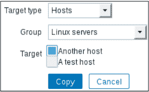

完成后，点击 **Copy**。

> 为防止我们的陷阱进入没有针对它的触发器的项，请前往 **Configuration | Hosts**，点击 **Another host** 旁边的 **Items**，然后删除 **Experimental SNMP trap** 项，或更改其项键。

仍缺少一个环节——**Our users** 组中的两个用户都没有定义用户媒介。要添加媒介，请导航到 **Administration | Users** 并在 **ALIAS** 列中点击 **monitoring_user**。切换到 **Media** 选项卡并点击 **Add**，在 **Send to** 字段中输入电子邮件地址，然后通过点击 **Add** 关闭弹出窗口。我们现在也必须保存此更改，因此点击 **Update**。

现在我们需要触发一个触发器。从 `Another host` 执行以下命令：

```
snmptrap -Ci -v 2c -c public <Zabbix server> "" "NET-SNMP-MIB::netSnmpExperimental" NET-SNMP-MIB::netSnmpExperimental s "Critical Error"
```

有关接收 SNMP 陷阱的信息，请参阅 Chapter 4, Monitoring SNMP Devices。

将 <Zabbix server> 替换为 Zabbix 服务器的 IP 或 DNS 名称。此值应出现在 Another host 中的 snmptraps 项中并触发关联的触发器。您可以在 Monitoring | Triggers 部分验证触发器是否已触发：

要使下一个陷阱进入 snmptraps 主机，请前往 Configuration | Hosts，点击 Another host 旁边的 Items，然后删除 snmptraps 项，或更改其项键。

然后从 Another host 发送另一个陷阱：

```
$ snmptrap -Ci -v 2c -c public <Zabbix server> "" "NET-SNMP-MIB::netSnmpExperimental" NET-SNMP-MIB::netSnmpExperimental s "Critical Error"
```

由于 Another host 已不再有 snmptraps 项，此值应转到 snmptraps 主机。此时，我们应该已收到来自我们新操作的新电子邮件。让我们查看另一个视图——事件视图。打开 Monitoring | Events 并查看最近几条条目：

| TIME | HOST | DESCRIPTION | STATUS | SEVERITY | DURATION | ACK | ACTIONS |
|---|---|---|---|---|---|---|---|
| 2016-04-13 04:02:56 | snmptraps | SNMP trap has arrived on snmptraps | PROBLEM | Information | 34s | No |  |
| 2016-04-13 04:02:30 | Another host | SNMP trap has arrived on Another host | OK | Information | 1m 25s | No |  |
| 2016-04-13 04:00:56 | Another host | SNMP trap has arrived on Another host | PROBLEM | Information | 1m 34s | No | 1 | 1 |

如果您看不到 SNMP 事件，请确保 Group 和 Host 下拉菜单都已全选。

我们可以看到，到目前为止已成功注册了三个事件——首先是 Another host 上报告错误的 SNMP 陷阱项，然后是其恢复，最后是 snmptraps 主机上的触发器已触发。但最后一列，标题为 ACTIONS，明显不同。虽然第一个 PROBLEM 事件列出了一些数字，但最近的一个却什么都没有。原因如下。

在 Zabbix 中，只有对触发器中引用的系统至少有一个只读访问权限的用户才会收到通知。

snmptraps 主机位于 important SNMP host 组中，我们的用户组对其权限被明确设置为拒绝。

这使我们能够将 **host group** 权限与操作条件重叠，以创建相当复杂的通知场景。

## Additional action conditions

到目前为止，我们只使用了两个默认操作条件。实际上，Zabbix 提供了相当多的不同条件来确定何时调用操作。让我们看看其他可用的条件示例：

- **Application**：允许我们将操作限制为特定应用程序。例如，操作可能仅在属于 MySQL 应用程序的项涉及时才做出反应。这是一个自由格式字段，因此必须与实际的应用程序名称匹配。我们也可以匹配或否定子字符串。
- **Host**：允许我们为操作调用单独指定一个重要（或不重要）的主机。
- **Host group**：与 **Host** 条件类似，此条件允许我们根据主机组成员资格进行限制。
- **Trigger**：此条件允许我们匹配单个、特定的触发器。
- **Trigger name**：比前一个更灵活一些，通过此条件我们可以根据触发器名称限制调用——例如，仅对名称中包含字符串 `database` 的触发器采取行动。
- **Trigger severity**：我们可以将操作限制为仅在最高两个触发器严重级别发生时，或仅在几个最低严重级别发生时。
- **Time period**：仅当问题发生在指定的时间段内时才可执行操作，或也可以在指定的时间段内抑制操作。

还有更多在特定用例中有用的操作条件——请查看操作条件配置中的列表，以便日后使用它们。

## Complex conditions

在操作属性中，在 **Conditions** 选项卡中，顶部还有一个 **Type of calculation** 下拉菜单。当操作有两个或更多条件时会出现该下拉菜单，因此对我们来说它一直存在——默认操作已带有两个条件。让我们了解一下它提供的功能：


- **And：** 所有条件都必须为真，动作才会匹配
- **Or：** 只要有一个条件为真，动作就会匹配
- **And/Or：** 同类型条件按 Or 方式求值；不同类型条件按 And 方式求值
- **Custom expression：** 完全自由选项——你编写公式来定义条件应如何求值

前两种选项足够清晰。**And/Or** 会自动创建表达式，逻辑基于条件类型。例如，如果我们有以下条件：

- **A：** `Application = MySQL`
- **B：** `Application = PostgreSQL`
- **C：** `Trigger severity = High`
- **D：** `Host group = Database servers`

选项 **And/Or** 将会创建公式 `(A or B) and C and D`。这在很多情况下都有效，但我们现在可以再添加一个 **Host group** 条件，如下：

- **E：** `Host group = Production servers.`


> 实际占位符字母在 Zabbix 前端中可能会不同，因为条件是有序的。添加或删除条件可能会改变现有条件的字母——在使用自定义表达式且条件发生变化时请注意。

公式将变为 `(A or B) and C and (D or E)`。新的 **Host group** 条件由于与之前条件同类型，会与之前的 **Host group** 条件进行“或”运算。这可能不是用户所期望的。实际上，期望的条件是 *同时属于数据库服务器组和生产服务器组的 hosts*。此时 **and/or** 选项已不再适用，因此我们可以使用 **Custom expression**。在这种情况下，我们只需在提供的输入字段中输入公式：

```
(A or B) and C and (D and E)
```

这里对 D 和 E 的分组是可选的；我们只是为了清晰而添加了它。

当否定某些条件时，情况变得更加复杂。如果希望在问题发生在属于 A 组或 B 组的 host 上时跳过某个动作，使用两个非 host group 条件（A and B）是行不通的——它只会在 host 同时属于两个组时匹配。让表达式检查 (A or B) 也会匹配，除非 host 同时属于两个 host 组。例如，如果问题发生在属于 A 组的 host 上，Zabbix 会检查该 host 是否匹配第一个条件。它会判定动作不应执行——但还有 or 的第二部分。该 host 不属于 B 组，因此动作会被执行。不幸的是，这类情况没有简单的解决方案。创建两个动作，每个动作仅否定单个 host 组，将会奏效。

## Dependencies and actions

限制发送通知的另一种方式是触发器依赖关系，在这里非常有用。如果一个依赖于已激活触发器的触发器被触发，我们在前端上看到的效果是——依赖触发器没有出现在活动触发器列表中。在动作中效果更好——这种情况下不会执行任何动作。如果你知道某个网站依赖于 **Network File System (NFS)** 服务器，并且已设置了相应的依赖关系，NFS 服务器宕机时不会通知你网站出现问题。当需要解决问题时，不被邮件淹没是一件好事。

如果依赖触发器的 item 检查频率更高，则可能存在竞态条件。在这种情况下，依赖触发器可能先触发，而另一个触发器稍后触发，从而仍然产生两次告警。虽然这对于触发器在前端的显示不是大问题，但如果涉及动作则可能不希望出现这种情况。如果你经常看到此类误报，请更改 item 间隔，使依赖项的间隔始终稍长一些。

## Media limits for users

我们查看了动作可以施加的限制，但媒体本身也可能存在限制。导航到 **Administration** | **Users** 并在 **ALIAS** 列中点击 **Admin**。切换到 **Media** 选项卡，然后点击我们在此创建的唯一媒体旁边的 **Edit**：

> 此周期与动作中的时间段条件一起工作。此用户的动作只有在两个周期重叠时才会被执行。

使用 if severity 也非常有用，因为那位可怜的技术人员可能不想在夜间收到信息性短信，只想收到灾难级别的通知。

点击 **Cancel** 关闭此窗口。

## Sending out notifications

由于操作中指定的两个用户都被明确拒绝访问 snmptraps 主机，因此他们在动作操作中不被视为有效。

现在让我们赋予他们对该主机的访问权限。前往 **Administration | User groups** 并在 **NAME** 列中点击 **Our users**。切换到 **Permissions** 选项卡，然后在 **DENY** 框中标记 **Important SNMP hosts**，点击下方的 **Delete selected**，然后点击 **Update**。两个用户现在应该可以访问所需的主机了。

我们的触发器现在已被停用，因此我们可以发送另一个 trap 来激活 snmptraps 主机上的触发器。

> 注意当触发器停用时没有发送消息，因为有 Trigger value = PROBLEM 条件。我们将在本章后面启用恢复消息。

在 Another host 上运行以下命令：

```
$ snmptrap -Ci -v 2c -c public <Zabbix server> "" "NET-SNMP-MIB::netSnmpExperimental" NET-SNMP-MIB::netSnmpExperimental s "Critical Error"
```

等待一段时间以便触发器再次触发。检查你的电子邮件，你应该收到了关于我们之前未收到通知的主机 snmptraps 的通知。让我们再次查看事件列表——打开 **Monitoring | Events** 并查看最新条目：

| TIME | HOST | DESCRIPTION | STATUS | SEVERITY | DURATION | ACK | ACTIONS |
|---|---|---|---|---|---|---|---|
| 2016-04-13 08:16:04 | snmptraps | SNMP trap has arrived on snmptraps | PROBLEM | Information | 56s | No | 1 | 1 |

如果 **ACTIONS** 列显示橙色数字，请再等待几分钟。我们将在 *Chapter 22, Zabbix Maintenance* 中讨论这种延迟的原因。

哦，但 **ACTIONS** 列中奇怪的条目是怎么回事？那两个颜色不同的数字看起来很神秘。让我们试着找出它们可能意味着什么——打开 **Reports | Action log** 并查看最后几条记录：

| RECIPIENT(S) | MESSAGE | STATUS | INFO |
|---|---|---|---|
| monitoring_user (monitoring user)<br>monitoring_user@company.tld | **Subject:** PROBLEM: SNMP trap has arrived on snmptraps<br><br>**Message:**<br>Trigger: SNMP trap has arrived on snmptraps<br>Trigger status: PROBLEM<br>Trigger severity: Information<br>Trigger URL:<br><br>Item values:<br>1. Received SNMP traps (snmptraps:snmptraps): 192.168.56.11 "Critical Error" NET-SNMP-MIB::netSnmpExperimental<br>2. "UNKNOWN" (*UNKNOWN*: *UNKNOWN*): "UNKNOWN"<br>3. "UNKNOWN" (*UNKNOWN*: *UNKNOWN*): "UNKNOWN"<br><br>Original event ID: 374 | Sent | |
| advanced_user (advanced user) | **Subject:** PROBLEM: SNMP trap has arrived on snmptraps<br><br>**Message:**<br>Trigger: SNMP trap has arrived on snmptraps<br>Trigger status: PROBLEM<br>Trigger severity: Information<br>Trigger URL:<br><br>Item values:<br>1. Received SNMP traps (snmptraps:snmptraps): 192.168.56.11 "Critical Error" NET-SNMP-MIB::netSnmpExperimental<br>2. "UNKNOWN" (*UNKNOWN*: *UNKNOWN*): "UNKNOWN"<br>3. "UNKNOWN" (*UNKNOWN*: *UNKNOWN*): "UNKNOWN"<br><br>Original event ID: 374 | **Not sent** | X |

如果看不到任何条目，请增加显示的时间段。

**STATUS** 列显示发送给 monitoring_user 的消息成功，但发送给 advanced_user 的消息失败。因此，事件列表中绿色数字表示通知发送成功，而红色数字表示失败。要查看失败原因，请将鼠标光标移到 **INFO** 列中的红色 X 上：

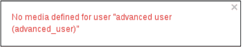


你可以点击红色的 X 使弹出窗口在鼠标光标移开时仍然保持显示，这样我们可以复制错误文本。

很好，这清楚地说明了错误是什么——我们的 advanced_user 没有定义任何媒体条目。我们可以很容易地推断出事件列表中的数字代表通知计数——成功的为绿色，不成功的为红色。它还向我们展示了不应将操作配置为向媒体未正确设置的<|message|>用户发送消息，因为此类条目会污染操作日志并使审查有趣条目变得更困难。

虽然操作日志提供了更多细节，但我们也可以在事件列表中找到错误。返回 Monitoring | Events，并将鼠标光标移到 ACTIONS 列中红色、最右边的数字 1 上。会出现一个弹出窗口。点击数字 1 使弹出窗口保持显示，然后将鼠标光标移到 INFO 列中的红色 X 上——同样的信息性弹出窗口会出现，在本例中告诉我们该用户没有定义媒体。

## 使用宏

让我们仔细看看我们收到的电子邮件（如果你已经删除了它们，只需再发送几个 SNMP trap 即可）。主题和正文都提到了触发器名称 SNMP trap has arrived on snmptraps。看起来在触发器名称中包含主机名宏是个好主意。虽然我们现在将探讨另一种解决方案，但一个通用建议是始终在触发器名称中包含主机名。这样做可以避免你在收到警报时却不知道哪个主机出现问题的情况。例如，如果我们省略了触发器中的主机名宏，电子邮件警报就会说 SNMP trap has arrived。

针对上述问题还有另一种可能的解决方案——我们可以在操作中使用宏来帮助解决此特定情况。要继续，请导航到 Configuration | Actions，点击 NAME 列中的 SNMP action，然后将 Default subject 字段内容更改为：

```
{TRIGGER.STATUS}: {TRIGGER.NAME} on {HOST.NAME}
```

这里使用“宏”一词可能会让人困惑——Zabbix 将其称为宏，尽管它们更正确地应被视为变量。在本书中，我们将遵循 Zabbix 的术语，但请随意将宏读作变量。

该字段已包含两个宏——{TRIGGER.STATUS} 和 {TRIGGER.NAME}。宏的好处在我们有一个操作覆盖许多情况时变得明显。我们不必创建无数个操作来涵盖每种可能的情况；相反，我们使用宏来让与特定事件相关的所需信息被替换。宏名称通常能很好地说明宏的作用。在本例中，我们通过添加主机名宏改进了已包含触发器名称和状态宏的现有主题行，尽管仍然建议在触发器名称中包含主机名。

要确认你的更改，请点击 Update。通过像之前一样发送 SNMP trap 使触发器状态发生变化，然后检查你的电子邮件。主题现在包含了主机名。但等等，现在主机名被包含两次——我们做了什么？主题现在是：

```
PROBLEM: SNMP trap has arrived on snmptraps on snmptraps
```

我们在触发器名称和操作主题中使用了相同的宏。你应该决定在哪里指定主机名并始终遵循该规则。

电子邮件中还有一些其他略显奇怪的地方——在消息正文末尾，有几行包含 UNKNOWN：

```
Received SNMP traps (snmptraps:snmptraps): 192.168.56.11 "Critical Error"
NET-SNMP-MIB::netSnmpExperimental
*UNKNOWN* (*UNKNOWN*:*UNKNOWN*): *UNKNOWN*
*UNKNOWN* (*UNKNOWN*:*UNKNOWN*): *UNKNOWN*
```

如果我们现在查看相应的操作配置：

```
Item values:
{ITEM.NAME1} ({HOST.NAME1}:{ITEM.KEY1}): {ITEM.VALUE1}
{ITEM.NAME2} ({HOST.NAME2}:{ITEM.KEY2}): {ITEM.VALUE2}
{ITEM.NAME3} ({HOST.NAME3}:{ITEM.KEY3}): {ITEM.VALUE3}
```

附加在这些宏中的数字，例如 {ITEM.NAME1} 中的数字，是触发器表达式中项目的顺序编号。我们发送通知的触发器仅引用了一个项目，因此第一个引用有效，引用第二个和第三个项目会失败，并在消息中输出 *UNKNOWN*。默认操作旨在用作示例——在本例中，演示引用多个项目的能力。如果你的大多数触发器仅引用单个项目，可能需要删除第二行和第三行。此时，没有办法有条件地打印项目值，如果它存在。

## 根据监控条件采取行动

有时，消息的接收者可能会受益于一些额外的信息，这些信息无法直接从事件相关宏中获得。这里有一个额外的宏类别会有所帮助——在触发器表达式中使用的宏也适用于宏内容。想象一个人管理着两台服务器，这两台服务器都依赖于一个已知存在性能问题的 NFS 服务器。如果其中一台服务器的系统负载增加到足以触发触发器的程度，警报接收者也希望知道另一台服务器的负载，以及 NFS 服务是否正常运行。这将使他们能够快速评估问题最可能出在哪里——如果 NFS 服务已关闭或自身存在性能问题，那么这两台服务器的系统负载很可能因此上升，需要 NFS 服务器管理员处理。为了让此人收到此类信息，我们可以在电子邮件正文中添加以下行：

```
CPU load on Another host: {Another host:system.cpu.load.last()}
NFS service is: {NFS Server:nfs.service.last()}
```


> 请确保调整项目间隔和触发器表达式，以避免这些项目的竞态条件。

请注意，没有内置的 NFS 服务项目——必须创建适当的主机和项目才能像这样引用它们。

正如示例所示，使用与触发器表达式相同的语法，包括支持的函数。这也允许接收者通过添加如下宏立即获知一段时间内的平均负载：

```
Average CPU load on Another host for last 10 minutes: {Another host:system.cpu.load.avg(600)}
```

你可以在官方 Zabbix 文档 https://www.zabbix.com/documentation/3.0/manual/appendix/macros/supported_by_location 找到受支持宏的完整列表。

## 发送恢复消息

我们使用的设置仅在问题发生时发送消息。这是由默认添加的 `Trigger value = PROBLEM` 条件确保的。一种也启用触发器恢复时发送消息的方法是删除该条件，但当使用升级功能时它将无用。因此建议保留该条件不变，而在操作级别启用恢复消息。

让我们为我们的 SNMP trap 操作启用恢复消息。转到 **Configuration | Actions**，点击 **NAME** 列中的 **SNMP action**，并标记 **Recovery message** 复选框。注意这会为我们提供两个额外的字段——我们可以自定义恢复消息。与问题消息发送类似的消息不同，我们可以让恢复消息更突出一些。嘿，这是个好主意——我们将向管理层发送电子邮件，让我们在这里添加一些“令人愉快”的内容。修改 **Recovery subject** 字段，在现有内容前添加 `Resolved:`：

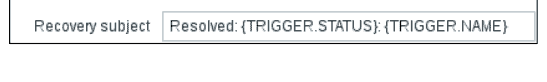

> 启用恢复消息时不要删除触发值条件。这样做可能导致恢复消息被升级，从而产生大量无用的消息。

点击 **Update** 按钮。这将使发出的恢复消息具有一种双重确认一切正常的效果——主题将以 `Resolved: OK.` 开头。要测试新配置，请将 trap 设置为生成问题并等待问题解决。这次应发送两封电子邮件，第二封应带有我们自定义的主题。

在收到的电子邮件中，注意末尾看起来像这样的行：

```
Original event ID: 1313
```

该行末尾的数字是事件 ID——问题发生的一个唯一标识符。它实际上是所谓的 **original event ID**。这是原始问题的 ID，在问题和恢复通知中是相同的。一个非常有用的方法是当将此数据发送到问题管理或票务系统时自动将恢复消息与问题消息匹配——恢复信息可用于自动关闭票据，或为其提供额外信息。

此 ID 由宏 `{EVENT.ID}` 生成，并且与许多其他宏一样，你可以在操作中使用它。如果你想唯一标识恢复事件，还有另一个宏——`{EVENT.RECOVERY.ID}`。

宏有很多，所以请务必查阅 Zabbix 手册以获取完整列表。


最终结果应如下所示：

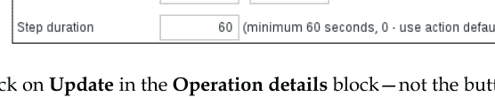

如果如此，请点击操作详细信息块中的更新——还不是底部的按钮。现在进入下一个任务——Admin 必须在五分钟之后每隔五分钟收到一次通知，直到问题解决。

我们必须弄清楚在步骤字段中填入什么值。我们希望这个操作在五分钟后触发，但五分钟时的通知已被第一个操作覆盖，所以我们可能目标是10分钟。但应该使用哪一步来表示10分钟呢？让我们尝试创建一个时间线。我们当前设置了一个单独的操作来覆盖默认时段。之后，默认时段开始生效，即使当前没有分配任何操作，我们也可以计算后续步骤将在何时执行：

| 步骤 | 操作 | 间隔（秒） | 经过时间 |
|------|-----------|--------------------|-------------|
| 1 | 向用户 Admin 发送消息 | 操作，60 | 0 |
| 2 | 向用户 Admin 发送消息 | 操作，60 | 1 分钟 |
| 3 | 向用户 Admin 发送消息 | 操作，60 | 2 分钟 |
| 4 | 向用户 Admin 发送消息 | 操作，60 | 3 分钟 |
| 5 | 向用户 Admin 发送消息 | 操作，60 | 4 分钟 |
| 6 | 向用户 Admin 发送消息 | 操作，60 | 5 分钟 |
| 7 | 无 | 默认，300 | 6 分钟 |
| 8 | 无 | 默认，300 | 11 分钟 |

> 操作步骤持续时间会覆盖其中所含步骤的时段。如果某个操作跨越步骤5-7，则它会覆盖5-6、6-7和7-8时段。如果某个操作仅位于步骤3，则它会覆盖3-4时段。

我们想要10分钟，但看起来使用此配置不可能——我们的第一个操作将步骤7置于6分钟，而回退到默认间隔则将步骤8置于11分钟。要覆盖6-7间隔，我们必须在步骤7定义某个操作，但我们不想这样做。有没有办法按期望的方式配置？应该有。点击操作列中的编辑，将第二个步骤字段改为5，然后点击操作详细信息块中的更新——不要点击底部的主更新按钮。

现在点击动作操作块中的新建。我们先配置简单的事情。点击操作详细信息块中发送给用户区域中的添加，然后在出现的弹出窗口中点击 Admin。第一个操作已更新，让我们再次模拟最后几个步骤：

| 步骤 | 操作 | 间隔（秒） | 经过时间 |
| ... | ... | ... | ... |
| 5 | 向用户 Admin 发送消息 | 操作，60 | 4 分钟 |
| 6 | 无 | 默认，300 | 5 分钟 |
| 7 | 无 | 默认，300 | 10 分钟 |
| 8 | 无 | 默认，300 | 15 分钟 |

通过最新修改，看起来我们可以在经过10分钟后发送消息——那将是步骤7。但实际上我们移除了步骤6（5分钟时）的消息发送。好消息是——如果我们现在添加另一个操作从步骤6开始，它完成第一个五分钟发送周期，然后继续每隔5分钟发送一条消息——简直完美。

在第一个步骤字段中输入6。我们希望此操作持续到问题解决为止，因此在第二个步骤字段中输入0。完成后，点击操作详细信息块底部的添加控件。

我们可以看到 Zabbix 很贴心地计算了第二个操作应该开始的时间，这让我们能够快速发现计算中的错误。这里没有错误；第二个操作按预期在5分钟时开始：

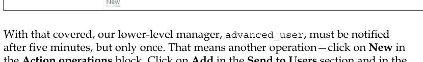

解决了这个问题后，我们的下级经理 `advanced_user` 必须在五分钟后收到通知，但只通知一次。这意味着需要另一个操作——点击动作操作块中的新建。点击发送给用户区域中的添加，在弹出窗口中点击别名列中的 `advanced_user`。这一条消息应该很简单——我们知道步骤6在五分钟后发生，所以让我们在两个步骤字段中都输入6，然后点击操作详细信息块底部的添加。同样，开始于列显示此步骤将在五分钟后执行，符合预期。

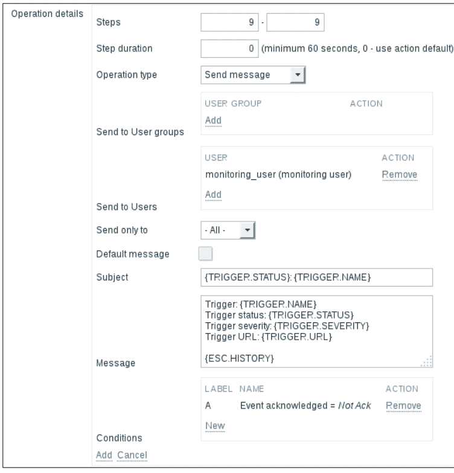

一切正常，所以点击操作详细信息块底部的添加。我们现在可以查看动作操作，并验证每个操作是否在应该开始的时候开始：

| 步骤详情 | 开始于 | 持续时间（秒） |
|---|---|---|
| 1 - 5   向用户发送消息：Admin（Zabbix 管理员）通过所有媒介 | 立即 | 60 |
| 6 - 0   向用户发送消息：Admin（Zabbix 管理员）通过所有媒介 | 00:05:00 | 默认 |
| 6       向用户发送消息：advanced_user（高级用户）通过所有媒介 | 00:05:00 | 默认 |
| 9       向用户发送消息：monitoring_user（监控用户）通过所有媒介 | 00:20:00 | 默认 |

## 根据监控条件采取行动

一切似乎都符合规范。让我们切换回**动作**选项卡，类似于**SNMP 动作**，将**恢复**主题修改为 `Resolved: {TRIGGER.NAME}`。这一次我们想避免 `Resolved: OK;`，而选择单一地提及现在一切正常。我们终于可以点击**更新**了。通知设置就绪后，让我们破坏一些东西。在另一台主机上，执行：

```bash
$ rm /tmp/testfile
```

Zabbix 很快就会发现该问题，并向 Admin 用户发送第一封电子邮件。这封电子邮件与我们之前收到的不会有什么不同。但现在让我们耐心等待 20 分钟以上。在此期间，Admin 用户将收到更多消息。我们真正感兴趣的是发送给 monitoring_user 的电子邮件中的消息内容。收到此消息后，请查看其包含的内容：

```text
Trigger: Testfile is missing

Trigger status: PROBLEM

Trigger severity: Warning

Trigger URL:


Problem started: 2016.04.15 15:05:25 Age: 20m
1. 2016.04.15 15:05:27 message sent        Email admin@company.tld
"Zabbix Administrator (Admin)"

2. 2016.04.15 15:06:27 message sent        Email admin@company.tld
"Zabbix Administrator (Admin)"

3. 2016.04.15 15:07:27 message sent        Email admin@company.tld
"Zabbix Administrator (Admin)"

4. 2016.04.15 15:08:27 message sent        Email admin@company.tld
"Zabbix Administrator (Admin)"

5. 2016.04.15 15:09:27 message sent        Email admin@company.tld
"Zabbix Administrator (Admin)"

6. 2016.04.15 15:10:27 message failed        "advanced user (advanced_user)" No media defined for user "advanced user (advanced_user)"

6. 2016.04.15 15:10:27 message sent        Email admin@company.tld
"Zabbix Administrator (Admin)"

7. 2016.04.15 15:15:28 message sent        Email admin@company.tld
"Zabbix Administrator (Admin)"

8. 2016.04.15 15:20:28 message sent        Email admin@company.tld
"Zabbix Administrator (Admin)"
```

> 与所有其他通知一样，此处的时间将使用 Zabbix 服务器上的本地时间。

现在它包含的信息远不止发生了什么——经理还收到了一份详细列表，列出了谁收到了问题通知。Admin 用户收到了许多通知，然后……嘿，advanced_user 没有收到通知，因为他们的电子邮件地址未配置。这个用户或 Zabbix 管理员需要做一些工作来修复此问题。在这种情况下，只有在之前没有人确认该问题时，该问题才会升级给 monitoring_user，这意味着甚至没有人查看过它。

> 当前设置会在问题被确认后取消向管理用户升级。我们可以通过添加另一个操作来创建延迟升级，该操作在稍后的步骤中向管理用户发送消息，但不带确认条件。如果问题被确认，则向管理用户发送的第一个操作将被跳过，但第二个操作始终有效。如果问题完全未被确认，管理用户将收到两条通知。

如果我们仔细查看前缀数字，它们不是历史条目的序号，实际上是升级步骤编号。这让我们无需比较时间戳即可快速了解哪些通知同时发生。`Email` 字符串是用于此通知的媒介类型名称。

现在让我们修复问题；在 `Another host` 上执行：

```sh
$ touch /tmp/testfile
```

很快，应该会发送两封电子邮件——一封发送给 Admin 用户，另一封发送给 monitoring_user。由于这些是恢复消息，它们都将使用我们自定义的主题：

**已解决：Testfile 缺失**


我们的测试动作的升级阈值对于大多数真实情况来说太短了。如果要减少这些阈值意味着要从头创建一个动作，那会非常不方便。让我们看看如何轻松地调整现有的动作。在前端，导航到 **Configuration | Actions**，然后在 **NAME** 列中点击 **Test action** 并切换到 **Operations** 选项卡。我们可能想要进行以下更改，假设这不是一个关键问题，也不值得快速响应——除非它已经存在半个小时了：

- 增加 `Admin` 用户收到进一步重复消息之间的间隔
- 增加向 `advanced_user` 和 `monitoring_user` 发送消息前的延迟
- 在问题存在 30 分钟后开始向 `Admin` 用户发送消息

> 在接下来的几个步骤中，请注意不要过早点击 **Update** 按钮——这会丢弃我们当前正在编辑的操作中的修改。

让我们先将 **Default operation** 步骤持续时间更改为 1800（30 分钟）。然后让我们在 **ACTION** 列中点击 **Edit**，旁边是第一个条目（目前跨越步骤 1-5）。在其属性中，将 **Steps** 字段设置为 2 和 6，然后点击 **Operation details** 块中的 **Update** 控件。

对于两个从步骤 6 开始的操作，将其更改为步骤 7。对于 **Steps** 字段中两个都是 6 的操作，以同样的方式更改两个出现的位置——并且同样要小心不要点击 **Update** 按钮。

最终结果应如下所示：

| Default operation step duration | 1800 (minimum 60 seconds) |
| Action operations | STEPS DETAILS | START IN DURATION (SEC) |
| 2 - 6 | Send message to users: Admin (Zabbix Administrator) via all media | 00:30:00 60 |
| 7 - 0 | Send message to users: Admin (Zabbix Administrator) via all media | 00:35:00 Default |
| 7 | Send message to users: advanced_user (advanced user) via all media | 00:35:00 Default |
| 9 | Send message to users: monitoring_user (monitoring user) via all media | 01:35:00 Default |
| New |  |  |

如果确实如此，请点击该 **Update** 按钮。

默认操作的第一次更改将所有步骤间隔拉开——除了在操作属性中被覆盖的那些步骤。这在很大程度上实现了我们将 Admin 用户的通知间隔拉开并延迟向另外两个用户发送通知的目标。通过将第一个操作中的第一个步骤从 1 改为 2，我们实现了两个目标。步骤 1 和 2 之间的间隔恢复为动作的默认间隔（因为我们将步骤 1 从使用 60 秒覆盖的操作中排除），并且不会立即向 Admin 用户发送消息。此外，我们将结束步骤稍微推后了一些，以便 Admin 用户以 1 分钟间隔接收到的消息总数不会改变。这导致一些后续操作不再那么整齐地对齐到 5 分钟边界，因此我们将它们移到了步骤 7。让我们将其与之前的配置进行比较：

| Before | After |
|---|---|
| STEPS DETAILS | START IN | DURATION (SEC) | START IN |
| 1 - 5 Send message to users: Admin (Zabbix Administrator) via all media | Immediately | 60 | 00:30:00 |
| 6 - 0 Send message to users: Admin (Zabbix Administrator) via all media | 00:05:00 | Default | 00:35:00 |
| 6 Send message to users: advanced_user (advanced user) via all media | 00:05:00 | Default | 00:35:00 |
| 9 Send message to users: monitoring_user (monitoring user) via all media | 00:20:00 | Default | 01:35:00 |

这使我们能够轻松地从测试配置将通知和升级扩展到更适合实际情况下的配置，以及快速适应不断变化的需求。让我们再创建一个问题。在 Another host 上执行：

```
$ rm /tmp/testfile
```

等待触发器触发并等待 Admin 用户收到几封电子邮件，然后“解决”问题：

```
$ touch /tmp/testfile
```

这应该很快向 Admin 用户发送一封恢复电子邮件。嘿，等一下——为什么只有该用户？Zabbix 只向收到问题通知的用户发送恢复通知。由于问题没有升级到管理用户收到通知，因此该用户也不会被告知问题的解决情况。advanced_user 也发生了类似的事情，他没有分配媒体。由于在事件升级时未发送通知（因为未配置电子邮件地址），Zabbix 甚至没有尝试向该用户发送恢复消息。不管向用户发送了多少个问题消息，每个动作只会发送一条恢复消息。

因此，在这种情况下，如果 Admin 用户在 monitoring_user 收到关于问题的电子邮件之前解决了或确认了问题，monitoring_user 将既收不到关于问题的消息，也收不到关于其解决的消息。

正如我们所见，升级是相当灵活的，允许你在响应事件时组合许多操作。我们可以想象一个相当长且复杂的 Web 服务器宕机的升级序列，其过程如下：

- 1. 电子邮件管理员
- 2. 向管理员发送短信
- 3. 在帮助台系统上打开报告
- 4. 电子邮件管理层
- 5. 向管理层发送短信
- 6. 重启 Apache
- 7. 重启服务器
- 8. 断电整个服务器机房

好吧，最后一个可能有点过头了，但我们确实可以构建一个关于问题反应和通知的精细逐步升级。

## Runner analogy

升级的事情对你来说似乎非常复杂吗？如果是这样，我们可以尝试一个在盐湖城附近创造的类比。

想象有一名跑者在森林中奔跑，路线是笔直的。在这条路线上，有一些柱子。跑者有一个首选速度（我们可以称之为默认速度），这意味着跑者通常需要 T 秒才能从一个柱子走到下一个柱子。

柱子上可能有指示。跑者从第一个柱子开始，并检查那里的指示。指示可以命令跑者做各种事情：

- 在此柱子上仅向某人发送短信
- 从此柱子到柱子 N 向某人发送短信
- 从此柱子到下一个柱子更改速度以便更快或更慢到达
- 从此柱子到柱子 N 更改速度

无论如何，跑者都会走完路线——如果当前柱子上没有指示，跑者只需继续到下一个柱子。

如果这个类比使动作升级步骤如何被“跑者”处理变得更清晰，那么值得重新审视本节并可能更好地理解细节。

## Using scripts as media

虽然 Zabbix 支持相当多的通知机制，但总会有需要非常具体的东西，而默认方法无法胜任的时候。对于这种情况，Zabbix 支持使用自定义脚本作为媒体。让我们尝试设置一个。打开 Administration | Media types 并点击 Create media type。输入以下值：

- **Name:** Test script
- **Type:** Script
- **Script name:** testscript
- **Script parameters:** 点击 Add 控件并在新字段中输入 {ALERT.MESSAGE}：

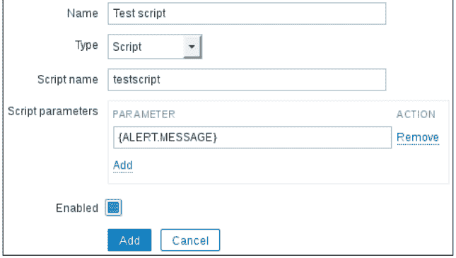

> {ALERT.MESSAGE} 宏将被扩展为来自动作配置的消息正文。目前，脚本参数中还支持另外两个宏——{ALERT.SENDTO} 和 {ALERT.SUBJECT}。请查阅 Zabbix 手册以检查在 https://www.zabbix.com/documentation/3.0/manual/config/notifications/media/script 的后续版本中是否添加了新的宏。

完成后，点击底部的 **Add** 按钮。现在我们应该确保在某个时候使用此媒体。转到 **Administration | Users**，在 **ALIAS** 列中点击 **monitoring_user**，并切换到 **Media** 选项卡。点击 **Media** 部分中的 **Add**。在 **Type** 下拉列表中，选择 **Test script**，并在 **Send to** 字段中输入 `user@domain.tld`。

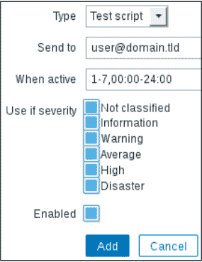

> 💡 电子邮件地址不会传递给我们的脚本，但 Zabbix 不允许我们保存一个 **Send to** 字段为空的媒体条目。

完成后，点击 **Add** 并通过点击用户编辑表单中的 **Update** 来确认更改。在继续脚本本身之前，导航到 **Configuration | Actions** 并点击 **SNMP action** 旁边的 **Disabled** 以启用此动作。

我们输入了脚本名称，但脚本应该放在哪里？现在是时候回到我们很久没有去过的地方了——查看 `zabbix_server.conf` 并检查 `AlertScriptsPath` 选项的值是什么。默认位置会根据安装方法而有所不同。如果你是从源码安装，它将是 `/usr/local/share/zabbix/alertscripts`。发行版包可能使用其他目录。作为 root，在该目录中创建一个名为 `testscript` 的文件：

```
```sh
# touch /path/to/testscript
# chmod 755 /path/to/testscript
```
```


Populate it with the following content:

```
```bash
#!/bin/bash
for i in "$@"; do
    echo "$i" >> /tmp/zabbix_script_received.log
done
```
```

如你所见，我们只是将每个传入的参数记录到文件中以供检查。现在生成 SNMP trap，使 snmptraps 触发器切换到 PROBLEM 状态。等待电子邮件到达，然后检查 /tmp/zabbix_script_received.log 文件。其内容应类似于以下内容：

```
Trigger: SNMP trap has arrived on snmptraps

Trigger status: PROBLEM

Trigger severity: Information

Trigger URL:


Item values:


1. Received SNMP traps (snmptraps:snmptraps): 192.168.56.11 "Critical Error" NET-SNMP-MIB::netSnmpExperiment

2. *UNKNOWN* (*UNKNOWN*: *UNKNOWN*): *UNKNOWN*

3. *UNKNOWN* (*UNKNOWN*: *UNKNOWN*): *UNKNOWN*


Original event ID: 397
```

我们可以看到，操作属性中的整个消息主体在这里被完整传递，换行符也得以保留。如果我们还想知道用户媒体 Send to 的值以识别接收此数据的 Zabbix 用户，我们也可以将 {ALERT.SENDTO} 宏传递给我们的 alertscript。同样，要获取操作属性中的主题，我们将使用 {ALERT.SUBJECT} 宏。


> 如果你看到消息内容丢失了换行符，请检查脚本中的引号——Zabbix 会保留所有换行符。

从这里开始，基本上可以用数据做任何事情：将数据传递给没有电子邮件网关的工单管理系统，通过 Zabbix 不直接支持的某些媒体发送它，或在某处显示它。

# Acting upon Monitored Conditions

让我们现在重新审视操作配置——打开 **Configuration | Actions** 并在 **NAME** 列中点击 **Test action**。现在，每当 `monitoring_user` 收到通知时就会执行一个脚本。但如果我们想跳过通知的脚本，而只在特定操作中使用它怎么办？值得庆幸的是，我们不必为此场景创建单独的用户。切换到 **Operations** 选项卡，在 **Action operations** 块中，点击发送消息给 `monitoring_user` 的最后一个操作旁边的 **Edit**。查看下拉菜单 **Send only to**。它列出了所有媒体类型，并允许我们将特定操作限制为仅特定媒体类型。在此下拉菜单中，选择 **Email**。点击 **Operation details** 块底部的 **Update** 链接，然后点击底部的 **Update** 按钮。

通过使用 **Send only to** 选项，可以在不创建多个虚假用户账户的情况下，为不同情况使用不同的通知方法。例如，用户可能在前几次升级步骤中收到电子邮件，然后发送短信。

# Integration with issue management systems

向技术人员或帮助台发送消息很好，但在某些时间和条件下，自动在某个管理系统中打开工单是可取的。这最容易通过使用两种主要集成方法来实现：

- E-mail gateways
- APIs that decent systems provide

要实现此类集成，应采取以下步骤：

1. 为工单系统通知创建一个 Zabbix 用户。
2. 为该用户配置媒体（系统接收电子邮件的电子邮件地址，或要运行的脚本）。
3. 为工单应自动创建的资源分配只读访问权限（请记住，如果用户对事件生成涉及的任何主机都没有访问权限，则不会发送警报或运行脚本）。
4. 创建一个单独的操作，或将该用户添加为现有操作操作的接收者，并使用自定义消息（在编辑操作时取消选中 **Default message** 复选框）。

还有第 5 步——要么正确格式化消息内容，以便接收系统知道如何处理消息，要么创建脚本以访问工单系统 API。这特定于每个系统，但让我们看几个例子。这些示例仅提供基本信息——为了获得额外加分，你可以添加其他宏，例如最后值或平均值宏。请注意，具体语法可能会在工单系统版本之间发生变化，因此请检查你使用的版本的文档。

让我们再创建一个条件——在 New condition 块中，在第一个下拉菜单中选择 Trigger name。第二个下拉菜单保持默认值。在其旁边的输入字段中输入 Web service is down，然后点击 Add control。最终结果应如下所示：

| Conditions | LABEL | NAME | ACTION |
|---|---|---|---|
| A | Maintenance status not in maintenance | Remove |
| B | Trigger value = PROBLEM | Remove |
| C | Host = Another host | Remove |
| D | Trigger name like Web service is down | Remove |

现在切换到 Operations 选项卡。在 Action operations 块中，点击 New。在刚刚出现的 Operation details 块中，在 Operation type 字段中选择 Remote command。Zabbix 提供五种不同类型的远程命令：

- Custom script
- IPMI
- SSH
- Telnet
- Global script

我们将在第 10 章 Advanced Item Monitoring 中讨论 SSH 和 telnet 项。我们将在第 13 章 Monitoring IPMI Devices 中讨论 IPMI 功能。全局脚本将在本章后面介绍——现在让我们看看自定义脚本功能。

对于自定义脚本，可以选择在 Zabbix agent 或 Zabbix server 上运行它们。在 agent 上运行将允许我们在发现问题条件所在的系统上收集信息、控制服务并执行其他任务。在服务器上运行将允许我们从 Zabbix 服务器的角度探测系统，或也许访问 Zabbix API 并基于该信息做出进一步决策。

> 此处的界面可能相当令人困惑，并且可能同时可见多个名称相同的按钮或链接——例如，将有三个不同的东西称为 Add。请非常小心你点击的是哪个控件。

现在，我们将创建一个操作，如果 Web 服务宕机，将尝试重启 Apache Web 服务器。通常，这必须在出现问题的主机上完成。在 Target list 部分，点击 New 链接。那里的下拉菜单将有 Current host 被选中，这正是我们想要的，所以点击它下方的 Add control。

在 Commands 文本框中，输入以下内容：

```
sudo /etc/init.d/apache2 restart
```

> 此步骤和后面的步骤假设 /etc/init.d/apache2 init 脚本存在且可用。如果你的发行版有不同的控制脚本，请改用它的路径。如果你的发行版完全使用 systemd，你可能必须使用诸如 /usr/bin/systemctl restart apache2 或 /usr/bin/systemctl restart httpd.service 之类的命令。请注意，服务名称也可能不同。

我们只是以防 Apache 停止响应而不是简单地死亡而重启它。你也可以输入许多要执行的远程操作，但我们现在不这样做，所以只需点击 Operation details 块底部的 Add control。要保存我们的新操作，点击底部的 Add 按钮。

> 运行远程命令时，Zabbix agent 会接受命令并立即返回 1——服务器无法知道命令花费了多长时间，甚至无法知道它是否被运行。请注意，agent 上的远程命令是无超时运行的。

我们的远程命令几乎准备好运行了，只是在 agent 端仍有一些工作要做，所以以 root 身份打开 zabbix_agentd.conf 并查找 EnableRemoteCommands 参数。将其设置为 1 并取消注释，保存配置文件，然后重启 zabbix_agentd。

这还不是全部。由于远程命令会传递给作为 zabbix 用户运行的 Zabbix agent 守护进程，我们还必须允许该用户实际重启 Apache。正如远程命令所示，我们将使用 sudo，因此以 root 身份在 Another host 上编辑 /etc/sudoers 并添加以下行：

```
zabbix ALL=NOPASSWD: /etc/init.d/apache2 restart
```

> 为了额外的安全措施，使用 visudo 命令——它还应检查你的更改的语法有效性。


> 在某些系统上，sudo 仅被配置为可交互使用。你可能需要注释掉 `/etc/sudoers` 中的 `requiretty` 选项。

同样，如果你需要不同的脚本名称，请更改它。这将允许 zabbix 用户使用 sudo 并重启 Apache Web 服务器——只重启它，不要停止或执行任何其他操作。


> 确保 SMTP 服务器运行在 Another host 上，否则 Web 服务触发器将不会被触发，因为我们依赖 SMTP 触发器。或者，移除该依赖。

现在我们可以开始演示了。停止 Another host 上的 Web 服务器。等待触发器更新其状态，并检查 Web 服务器的状态。它应该会自动再次启动。


> 默认情况下，所有动作都带有两个条件。其中一个条件限制动作仅在触发器进入 **PROBLEM** 状态时触发，而在触发器恢复到 **OK** 状态时不触发。对于这个动作而言，这是一个非常有用的设置；否则，Web 服务器在检测到宕机时会重启一次，然后在检测到恢复时又会重启一次。这种配置错误并不明显，因此可能会在一段时间内不被发现。此外，应该避免为重启服务的动作启用恢复消息。

请注意，对代理执行的远程命令仅适用于被动代理——它们在主动模式下不起作用。这并不意味着你不能在这类主机上使用主动监控项——你可以这样做，但服务器直接连接到该代理时，远程命令总是会以被动模式尝试执行。在某些情况下，所有监控项都是主动的，因此导致服务器与代理之间连接无法工作的配置更改可能不会被注意到——然后远程命令就会失败。如果你所有监控项都是主动的，并且想要使用远程命令，那么设置一个被动监控项来检查该类监控项是否仍然有效可能是值得的。

虽然像这样需要重启服务表明存在问题，而这个问题最好在服务本身中加以解决，但有时它可以作为一种紧急解决方案，或者用于专有软件供应商无响应的情况。

## 全局脚本

在前端查看数值和图形既美观又实用，但有些情况下可能需要立即获取额外信息，或者需要手动调用某个操作，例如启动升级过程、重启系统或执行其他管理任务。Zabbix 允许我们直接从前端执行命令——这个功能称为**全局脚本**。让我们看看开箱即用了哪些功能——导航到 **监控 | 事件** 并点击任意条目中的主机名：

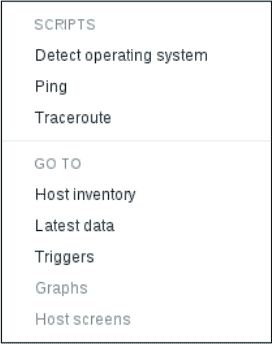

该菜单的第二部分包含指向前端各个部分的快捷链接。第一部分标记为**脚本**，这就是我们要找的。目前，Zabbix 附带三个预配置脚本——操作系统检测、ping 和 traceroute。我们稍后会更详细地讨论它们，但现在只需点击 **Ping**。将打开一个弹出窗口，显示此脚本的输出：

```
PING 192.168.56.11 (192.168.56.11) 56(84) bytes of data.
64 bytes from 192.168.56.11: icmp_seq=1 ttl=64 time=0.293 ms
64 bytes from 192.168.56.11: icmp_seq=2 ttl=64 time=0.268 ms
64 bytes from 192.168.56.11: icmp_seq=3 ttl=64 time=0.363 ms

--- 192.168.56.11 ping statistics ---
3 packets transmitted, 3 received, 0% packet loss, time 1998ms
rtt min/avg/max/mdev = 0.268/0.308/0.363/0.040 ms
```

注意会有轻微延迟——目标主机被 ping 了三次，我们必须等待其完成才能获得输出。

在前端多个位置，通过从这样的上下文菜单中单击主机，即可使用全局脚本。这些位置如下：

- **监控 | 仪表板**（在**最近 20 个问题**组件中）
- **监控 | 总览**（当主机位于左侧时）
- **监控 | 最新数据**（当显示来自多个主机的数据时）
- **监控 | 触发器**
- **监控 | 事件**
- **监控 | 地图**
- **资产 | 主机**，单击**主机名称**将打开资产概览
- **报表 | 触发器 Top 100**

将这些脚本称为**预配置**脚本，暗示了我们有能力配置自己的脚本。让我们就这么做吧。

## 配置全局脚本

我们可以从检查现有脚本开始。导航到 **管理 | 脚本**：

| 名称 | 类型 | 执行于 | 命令 | 用户组 | 主机组 | 主机访问权限 |
|---|---|---|---|---|---|---|
| 检测操作系统 | 脚本 | 服务器 | sudo /usr/bin/nmap -O {HOST.CONN} 2>&1 | Zabbix 管理员 | 全部 | 读取 |
| Ping | 脚本 | 服务器 | /bin/ping -c 3 {HOST.CONN} 2>&1 | 全部 | 全部 | 读取 |
| Traceroute | 脚本 | 服务器 | /usr/bin/traceroute {HOST.CONN} 2>&1 | 全部 | 全部 | 读取 |

我们在菜单中看到的这三个脚本也可以在这里看到。让我们看看它们的作用：

- **检测操作系统：** 此脚本调用 nmap 并依赖 sudo
- **Ping：** 使用 ping 工具，并对主机 ping 三次
- **Traceroute：** 对主机调用 traceroute 工具

这三个脚本都在 Zabbix 服务器上执行，因此它们应该适用于任何主机——带有 Zabbix 代理的服务器、交换机、存储设备等。

> 3.0 之前的 Zabbix 版本默认丢弃 stderr。如果你看到全局脚本通过在脚本命令后附加 2>&1 将 stderr 重定向到 stdout，那么在那个版本中配置这一点非常重要，否则脚本的错误消息会被静默丢失。自 Zabbix 3.0 起不再需要这样做，但它也没有任何坏处。

我们稍后会讨论其他选项，但现在先看看这些脚本是否都能工作。Ping 对大多数人来说应该可以工作。Traceroute 需要安装 traceroute 工具。至于操作系统检测，它不太可能开箱即用。让我们试着让它工作。

> 如果不希望 Zabbix 管理员获得 Zabbix 服务器的 root shell 访问权限，请勿按此处所示配置 sudo。nmap 中有一个功能允许执行命令。相反，创建一个包装脚本，只允许使用带单个参数的 -O 选项。

首先确保 nmap 已安装在 Zabbix 服务器上。由于脚本使用 sudo，请编辑 /etc/sudoers（或使用 visudo）并添加如下一行：

```
zabbix  ALL=NOPASSWD: /usr/bin/nmap
```

> 在发行版软件包中，Zabbix 服务器可能以 zabbixs 或 zabbixsrv 用户身份运行，而不是 zabbix——请在 sudoers 配置中使用该用户名。

如有必要，调整 nmap 路径。与重启 Apache Web 服务器类似，你可能需要在 /etc/sudoers 中取消注释 requiretty 选项。同样，所有这些更改都必须在 Zabbix 服务器上完成。完成后，从菜单中运行操作系统检测脚本——使用前面提到的位置之一：

```
Starting Nmap 6.40 ( http://nmap.org ) at 2016-04-16 02:27 EEST
Nmap scan report for 192.168.56.115
Host is up (0.00042s latency).
Not shown: 996 filtered ports
PORT     STATE SERVICE
22/tcp   open  ssh
25/tcp   open  smtp
80/tcp   open  http
443/tcp  closed https
MAC Address: 08:00:27:DD:4E:9E (Cadmus Computer Systems)
Aggressive OS guesses: Netgear DG834G WAP or Western Digital WD TV media player (94%), Linux 2.6.32 (94%), Linux 2.6.32 - 3.9 (93%),
Crestron XPanel control system (93%), Linux 2.6.31 (92%), Linux 3.0 (92%), Linux 3.1 (90%), Linux 3.2 (90%), Linux 2.6.32 - 2.6.35
(90%), Linux 2.6.32 - 3.2 (90%)
No exact OS matches for host (test conditions non-ideal).
Network Distance: 1 hop

OS detection performed. Please report any incorrect results at http://nmap.org/submit/ .
Nmap done: 1 IP address (1 host up) scanned in 8.55 seconds
```

> SELinux 安全框架可能会阻止全局脚本工作。

好极了，成功了！nmap 命令运行需要一些时间。在代理上运行全局脚本时，它们和本章前面讨论的远程命令使用相同的超时时间。此脚本是在服务器上运行的。在这种情况下，前端有 60 秒的超时时间。

现在来检查其他脚本选项，并配置一些我们自己的脚本。当系统出现问题时，可能是资源匮乏。我们可能想要找出系统上哪些进程对 CPU 压力最大。导航回 **管理 | 脚本** 并点击 **创建脚本**。对于我们的第一个脚本，填写以下内容：

- **名称：** `Top CPU using processes`
- **命令：** `top -n 1 -b | grep -A 10 "^[ ]*PID"`

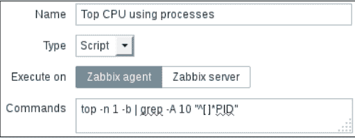

> Zabbix 3.0.0 和 3.0.1 版本存在一个 bug——在 **Commands** 字段下方还有另一个 **Command** 字段。请忽略第二个字段。希望这个 *bug* 能在后续版本中修复。


完成后，点击**添加**。对于 `top` 命令，我们只让它打印进程列表，且仅执行一次。然后，我们获取了标题行及其后的 10 行内容——假设标题行以任意数量的空格和字符串 `PID` 开头。

> 我们之前在另一台主机上启用了远程命令——如果你跳过了该步骤，请确保在继续之前启用它们。

导航到**监测 | 事件**，在**主机**列中点击**另一台主机**，然后选择**CPU 使用率最高的进程**。

你可以使用其他任何提供此上下文菜单的位置——我们之前列出了这些位置：

| PID 用户 | PR NI | VIRT RES | SHR S %CPU %内存 | 时间+ 命令 |
| 1 root | 20 0 | 129216 3536 | 2076 S 0,000 1,444 | 0:04.24 systemd |
| 2 root | 20 0 | 0 0 | 0 S 0,000 0,000 | 0:00.04 kthreadd |
| 3 root | 20 0 | 0 0 | 0 S 0,000 0,000 | 0:03.39 ksoftirqd+ |
| 5 root | 0 -20 | 0 0 | 0 S 0,000 0,000 | 0:00.00 kworker/0+ |
| 6 root | 20 0 | 0 0 | 0 S 0,000 0,000 | 0:03.32 kworker/u+ |
| 7 root | rt 0 | 0 0 | 0 S 0,000 0,000 | 0:00.00 migration+ |
| 8 root | 20 0 | 0 0 | 0 S 0,000 0,000 | 0:00.00 rcu_bh |
| 9 root | 20 0 | 0 0 | 0 S 0,000 0,000 | 0:00.00 rcuob/0 |
| 10 root | 20 0 | 0 0 | 0 S 0,000 0,000 | 0:08.40 rcu_sched |
| 11 root | 20 0 | 0 0 | 0 S 0,000 0,000 | 0:25.93 rcuos/0 |

在这个特定情况下，`systemd` 进程占用了大部分 CPU。运行在此系统上的 Zabbix 代理甚至没有进入前十名。不过，说实话，这个系统上其实也没发生什么大事——所有进程都被报告为完全不使用 CPU。

其他类似的诊断命令可能会显示一些软件包详细信息、**媒体访问控制（MAC）** 地址，或任何其他易于从标准实用程序获取的信息。请注意，在大多数操作系统或发行版上，使用 `top` 命令无法获取占用内存最多的进程列表——可能需要使用 `ps` 命令。以下代码可能提供有用的内存占用前 10 个进程列表：

```
ps auxw --sort -rss | head -n 11
```

我们在这里获取前 11 行，因为其中也包含了标题行。

现在让我们配置另一个脚本——一个允许我们重启目标系统的脚本。导航到**管理 | 脚本**，点击**创建脚本**。填写以下内容：

- **名称：** 管理 / 重启。
- **命令：** reboot。
- **用户组：** 此命令有点风险，因此我们只限制为管理用户使用——选择 **Zabbix 管理员**。
- **主机组：** 由于这在 SNMP 设备上无法工作，因此让它仅对 Linux 系统的主机显示是合理的——选择**所选**，然后在文本字段中输入 Linux。在下拉菜单中选择 **Linux 服务器**。
- **所需主机权限：** 我们不希望具有只读访问权限的用户能够重启主机，因此选择**写入**。
- **启用确认：** 这是一个可能具有破坏性的操作，因此请勾选此复选框。
- **确认文本：** 勾选上一复选框后，我们可以填写此字段。输入 `Reboot this system?`

> 尽管组选择字段可能看起来与其他可以多选组的地方类似，但这里只能选择一个主机组。

我们还可以测试此确认消息的外观——点击**测试确认**：

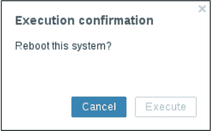

## 响应受监控的条件

虽然**执行**按钮当前处于禁用状态，但我们可以看到这看起来相当易懂。在确认对话框中点击**取消**。最终结果应如下所示——如果确实如此，请点击底部的**添加**按钮：

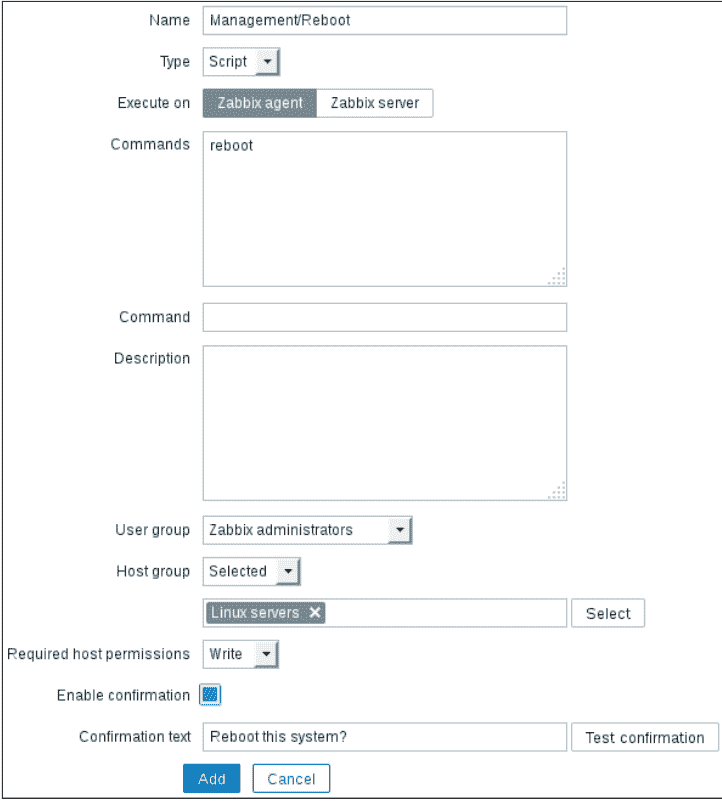

现在让我们看看这个脚本在菜单中是什么样子——导航到**监测 | 事件**，在**主机**列中点击**另一台主机**。在弹出菜单中，将鼠标光标移动到**管理**条目上：

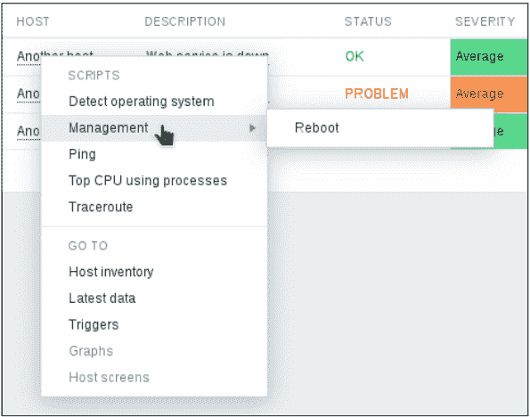

注意我们使用的语法如何创建了子菜单——斜杠用作分隔符。我们可以将 Ping、Traceroute 和 CPU 使用率最高的进程分组为“诊断”，在“管理”部分添加更多条目，并创建一个有用的工具集。请注意，我们还可以在服务器上使用 zabbix_get 来轮询我们可能不希望持续监控的单个监控项。条目可以按这种方式无限嵌套，但要注意不要创建太多层级。这种鼠标悬停菜单在超过前几级后就难以使用了，因为很容易误操作导致所有子菜单突然关闭。

关于“重启”条目，如果添加它显得有点风险，别担心——它实际上并不起作用。首先，我们必须在命令中使用 sudo。其次，我们必须配置 sudoers 以实际允许 zabbix 用户运行该命令。

## 在动作中重用全局脚本

某些以此方式添加的全局脚本仅适合在交互式使用时才有意义——大多数数据收集或诊断类脚本可能都属于这一类。但我们的“重启”条目也可能在动作操作中被重用。这样，我们就不需要在全局脚本和每个动作中单独配置此类命令，而是可以有一个统一的位置来控制重启如何发生。也许我们想要将重启命令更改为在 10 分钟后发起待处理的重启。这样，可能正在系统上工作的系统管理员就有时间取消重启并更详细地调查问题。

我们已经创建了用于重启的全局脚本。如果我们有一个需要重启整个系统的触发器，我们将创建一个具有适当条件的动作。在动作属性中，编辑操作时，在“操作类型”下拉菜单中选择“远程命令”，即可重用全局脚本。然后，在“类型”下拉菜单中，必须选择“全局脚本”并指定一个具体脚本：

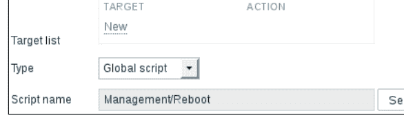

由于这些脚本既可以从前端使用，也可以在动作中使用，因此它们不仅仅被称为前端脚本——它们是全局脚本。

## 总结

在本章开头，我们讨论了动作。动作控制着当触发器触发时执行什么操作，并且它们有非常广泛的配置内容，涉及不同级别，包括各种精确度的条件、消息内容和实际执行的操作——从简单的电子邮件发送和使用自定义脚本，到强大的远程命令执行。我们还了解了影响动作的其他内容，例如用户媒介配置和用户权限。

让我们回顾一下与告警相关的概念：

- 触发器是包括严重性级别在内的问题定义，触发器表达式包含有关计算和阈值的信息
- 事件是发生的事情——也就是说，触发器从 PROBLEM 状态变为 OK 状态等等
- 动作是一个配置实体，具有特定条件集，这些条件决定何时调用它以及要执行的操作
- 操作是动作的属性，定义了如果调用此动作该怎么做，并且通过操作来配置升级
- 告警或通知是实际发送出去的内容——电子邮件、短信或任何其他消息

除了简单的一次性消息，我们还弄清楚了 Zabbix 中内置升级的工作方式，并对一些问题进行了升级。虽然升级允许我们制定相当复杂的响应场景，但在配置时必须注意。一旦启用，它们允许我们根据问题发生以来经过的时间以及其他因素执行不同的操作。我们讨论了通知的常见问题，包括用户必须具有查看主机的权限才能收到有关主机的通知，以及恢复消息仅发送给收到原始问题消息的用户。

到目前为止，我们已经学习了三种避免触发器抖动导致过多通知的方法：

- 使用触发器表达式函数（如 min()、max() 和 avg()），仅当值在定义的时段内处于特定范围内时才触发触发器
- 使用迟滞，并且仅当当前值低于（或高于）阈值某个安全距离时才返回 OK 状态
- 创建跳过前几步的升级，从而仅在问题持续一段时间未解决时才发送消息

前两种方法与最后一种不同。使用不同的触发器函数和迟滞会改变触发器的工作方式，影响其触发速度以及关闭速度。对于升级，我们不会影响触发器的行为（因此它们仍会显示在“监测 | 触发器”和其他位置），但会在触发器触发时引入延迟通知。

最后，我们弄清楚了全局脚本是什么，并尝试手动 ping 一台主机并获取其上 CPU 使用率最高的进程列表。至于动作操作，我们讨论了几种响应问题的方法：

- 发送电子邮件
- 运行命令（在 Zabbix 代理或服务器上执行）
- 运行 IPMI 命令
- 通过 SSH 或 telnet 运行命令
- 重用全局脚本

最后一种方法允许我们配置一次脚本，并可能在单一位置为所有系统重新配置它。


在配置触发器（triggers）和动作（actions）时，有一些小细节既能让你更轻松，也可能带来难以发现的问题。希望这里对基础内容的介绍能帮助你利用前者、避免后者。

在下一章中，我们将看到如何避免在每台主机上单独配置我们已经知道的一些内容（包括监控项和触发器）。我们将使用模板（templates）在多个主机上轻松管理此类配置。
