## 使用模板简化复杂配置

我们目前的配置有两台环境相似的主机，因此我们将监控项从一台复制到了另一台。但是，当有大量主机需要监控相似的参数时，该怎么办呢？手动复制监控项相当繁琐。更糟糕的是，当需要为所有主机更改某些内容时（例如监控项间隔或进程名称），情况会更加麻烦。幸运的是，Zabbix 提供了一种通过模板系统统一配置这些内容的方法。

## 识别适合使用模板的场景

模板让 Zabbix 管理员能够减少工作量并简化配置。但是，要正确部署模板，我们必须首先识别那些需要或受益于模板的用例。简而言之——我们必须弄清楚 Zabbix 中的模板到底是什么。

当我们创建第二台受监控的 Linux 主机时，我们手动从第一台主机复制了监控项。如果愿意，我们也可以复制触发器。这种复制工作并不是最佳选择，因此我们可以为模板创建监控项和触发器，然后将模板链接到目标主机。由于这种关联，主机会立即获得模板中定义的所有监控项和触发器。之后，当我们想为所有主机更改某些监控项参数时，只需修改一次即可。对模板所做的更改会传播到关联的主机。因此，模板最适用于你希望在多台主机上使用的监控项和触发器，比如那些 Linux 机器。即使你只有某一类型的单一设备，也可能值得为其创建模板，以防将来出现可以使用相同配置的新设备。

## 使用模板简化复杂配置

例如，如果我们在某台主机上运行着 **Apache httpd** 和 **MySQL**，我们可以将与这些服务相关的所有监控项和触发器分别拆分成独立的模板：

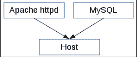

修改 **MySQL** 模板中的监控项会将更改向下传播到 **主机**。添加更多主机会变得很简单——我们只需将它们关联到适当的模板即可。在模板中进行的更改将应用到所有下游主机。

虽然我们创建的 snmptraps 主机看起来是直接创建对象的合适候选，但也可能出现这样的情况：SNMP 代理发送的陷阱（traps）能在 Zabbix 中已配置的主机之间正确分配，但偶尔会有设备发送的陷阱找不到已配置的主机或相应的 SNMP 监控项。如果我们仍然希望这类陷阱能被整理到通用陷阱主机中对应的监控项里，我们就会再次使用模板为相应主机和我们的通用主机创建此类监控项。

模板是 Zabbix 配置中一个非常有价值的工具。不过这些听起来有点枯燥，让我们来实际设置一些模板吧。

## 创建模板

打开 **配置 | 模板**。我们可以看到，已经有 38 个预定义模板。不过我们要创建自己的专用模板；点击 **创建模板**。这会打开一个需要填写的简单表单：

- **模板名称：** `C_Template_Linux`
- **新组：** `Custom templates`

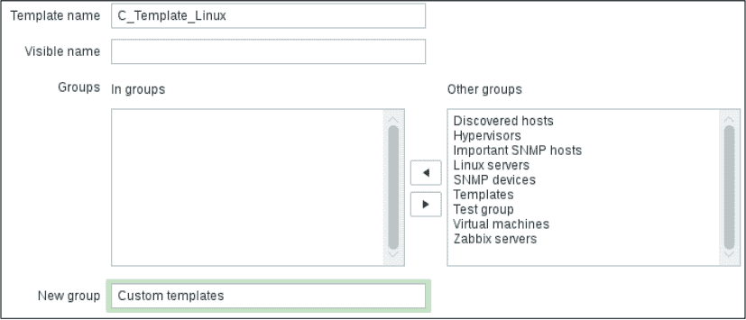

名称开头的 C_ 代表 **“Custom”（自定义）**。我们还在创建一个新组来存放我们的模板，并且不使用组配置界面，而是利用这个表单上的快捷方式来创建组。完成后，点击 **添加**。

现在我们有了模板，但它还没有用——里面没有监控项或触发器。前往 **配置 | 主机**，我们将使用一种偷懒且快速的方法——将现有监控项和触发器复制到新模板中。在 **组** 下拉菜单中选择 **Linux servers**，然后点击 **Another host** 旁边的 **监控项**。勾选表头中的复选框以选中所有监控项，然后点击底部的 **复制** 按钮。

> 记住，要选择连续的一组复选框，可以使用范围选择——先选中范围内的第一个复选框，按住 **Shift** 键，再点击范围内的最后一个复选框。

在下一个界面中，在 **目标类型** 下拉菜单中选择 **模板**，在 **组** 下拉菜单中选择 **Custom templates**。这样只剩下一个条目，所以在 **目标** 部分勾选 **C_Template_Linux** 旁边的复选框：

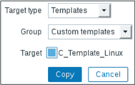

完成后，点击 **复制**。所有监控项都应该成功复制。

> 在这种情况下，目标模板没有配置任何监控项。由于同一主机不能有两个具有相同键（key）的监控项，因此尝试复制已存在的监控项会失败。

在左上角，点击 **详细信息** 链接。这会展开消息，我们可以看到所有这些监控项都已添加到目标模板中：

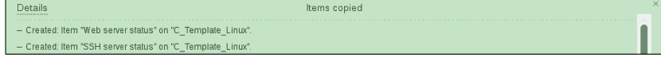

现在我们需要对触发器做同样的操作，因此点击监控项列表上方导航栏中的 **触发器**，然后勾选表头中的复选框。这次要取消勾选 **One SSH service is down**（SSH 服务之一已关闭），因为这个触发器跨越了两台主机。如果把这个触发器复制到模板中，会产生各种奇怪的效果。

> 这里的操作顺序很重要，先复制监控项，再复制触发器。如果触发器引用的监控项不存在，就无法创建触发器，所以如果先复制触发器会失败。复制触发器不会尝试复制其引用的监控项。

再次点击底部的 **复制** 按钮。在下一个界面中，在 **目标类型** 下拉菜单中选择 **模板**，在 **组** 下拉菜单中选择 **Custom templates**。在 **目标** 部分勾选 **C_Template_Linux** 旁边的复选框，然后点击 **复制**。所有触发器都应该成功复制。当然，我们不必先创建一台主机、在上面创建实体，然后再将它们复制到模板——在创建新模板时，你会希望直接在模板上创建实体。如果你之前不太细心，没有事先考虑模板化，那么像这样复制是更快创建模板的好方法。

## 将模板链接到主机

现在，我们想把这个模板链接到我们的第一台主机“A test host”。首先，让我们比较一下新建模板和那台主机的监控项列表。在一个浏览器窗口或标签页中打开 **配置 | 主机**，在另一个中打开 **配置 | 模板**。在第一个窗口中，在 **组** 下拉菜单中选择 **Linux servers**，然后点击 **A test host** 旁边的 **监控项**。在另一个窗口中，在 **组** 下拉菜单中选择 **Custom templates**，然后点击 **C_Template_Linux** 旁边的 **监控项**。将两个窗口并排放置，比较列表：

| 名称 | 触发器 | 键 | 名称 | 触发器 | 键 |
|---|---|---|---|---|---|
| CPU load | 触发器 1 | system.cpu.load | CPU load |  | system.cpu.load |
| Full OS name |  | system.uname | Experimental SNMP trap |  | netSnmpExperimental2 |
| ICMP ping performance |  | icmppingsec | ICMP ping performance |  | icmppingsec |
| Incoming traffic on interface lo |  | net.if.in[lo] | Incoming traffic on interface enp0s8 |  | net.if.in[enp0s8] |
| Incoming traffic on interface enp0s8 |  | net.if.in[enp0s8] | Incoming traffic on interface lo |  | net.if.in[lo] |
| SMTP server status | 触发器 1 | net.tcp.service[smtp] | Local time | 触发器 1 | system.localtime |
| SNMP trap fallback | 触发器 1 | snmptrap.fallback | SMTP server status | 触发器 1 | net.tcp.service[smtp] |
| SNMP trap tests |  | snmptrap[test] | SNMP trap fallback |  | snmptrap.fallback |
| SSH server status | 触发器 1 | net.tcp.service[ssh] | snmptraps | 触发器 1 | snmptraps2 |
| Web server status | 触发器 1 | net.tcp.service[http,,80] | SNMP trap tests |  | snmptrap[test] |
| Zabbix agent version |  | agent.version | SSH server status |  | net.tcp.service[ssh] |
|  |  |  | Testfile exists | 触发器 1 | vfs.file.exists[/tmp/testfile] |
|  |  |  | Web server status | 触发器 1 | net.tcp.service[http,,80] |
|  |  |  | Zabbix agent version |  | agent.version |

我们可以看到，模板比主机多了三个监控项。查看列表可以看出，模板中有但主机没有的监控项都是我们后来添加的两个与 SNMP 相关的监控项——Experimental SNMP trap 和 snmptraps——时间监控项 Local time，以及检查文件的 Testfile exists。如果模板有四个主机缺失的监控项，但总数只比主机多三个，这意味着主机应该有一个模板没有的监控项——没错，Full OS name 存在于主机上，但在模板中缺失。牢记这一点，返回 **配置 | 主机**。


# 使用模板简化复杂配置

确保 **Group** 下拉菜单选择为 **all** 或 **Linux servers**，然后在 **NAME** 列中点击 **A test host**。我们终于可以开始使用 **Templates** 选项卡了——切换到它。在 **Link new templates** 输入框中开始输入 c。在下拉列表中，我们的新模板 **C_Template_Linux** 应该是最上面的一个——点击它。即使看起来该模板已被添加，实际上并没有——如果我们现在就更新主机，它将不会被关联：


点击模板名称下方 **Add** 控件。此表单可能非常令人困惑，因此请记住在这里需要执行额外的点击操作。模板被添加到列表后，注意它实际上是一个链接。点击它会打开模板属性并在新窗口中显示。当查看主机属性时，这提供了快速访问模板属性的方式。Zabbix 前端中许多地方都有这种便捷的链接：

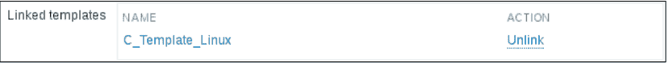

最后，点击底部的 **Update** 按钮。让我们来看看此操作做了什么——点击左上角的 **Details** 链接。在展开的 **Details** 面板中，我们可以看到发生的操作。在此情况下，部分项目被创建，部分被更新：

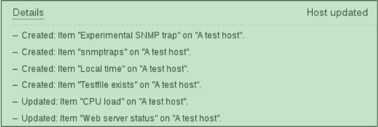

> 当模板链接到主机时，主机上已存在的相同实体将与模板关联，但不会丢失历史数据。仅存在于模板上的实体将被添加到主机并与模板关联。

再往下滚动一点，你会看到触发器也发生了同样的情况：

- Updated: Trigger "Web service is down" on "A test host".
- Updated: Trigger "SMTP service is down" on "A test host".
- Created: Trigger "SNMP trap has arrived on {HOST.NAME}" on "A test host".

现在这看起来像是为无所作为做了很多工作，但如果我们需要为具有相同项目和触发器的更多主机添加配置，没有模板的情况下每个主机都需要繁琐的手动复制，这很容易出错。有了模板，我们只需将模板链接到新添加的主机，所有实体就会自动存在。

> 不要将模板与主机组混淆。它们是完全不同的东西。组用于逻辑主机分组（以及权限分配），但模板定义了主机上监控的内容、它有哪些图形等。更重要的是，单个主机组可以同时包含普通主机和模板。将模板添加到组中不会以任何方式影响该组中的主机，只有链接该模板才会生效。将组视为组织模板的方式，与组织主机的方式相同。

现在我们可以查看链接的项目在配置中是如何出现的。打开 **Configuration | Hosts**，点击 **A test host** 旁边的 **Items**：

| NAME | TRIGGERS | KEY |
|---|---|---|
| C_Template_Linux: CPU load | Triggers 1 | system.cpu.load |
| C_Template_Linux: Experimental SNMP trap |  | netSnmpExperimental2 |
| Full OS name |  | system.uname |
| C_Template_Linux: ICMP ping performance |  | icmppingsec |

我们现在希望为此主机使这个特定项目与模板将要链接到的所有其他主机略有不同，因此让我们更改以下内容：

- **Update interval:** 360
- **History storage period:** 60

完成后，点击 **Update**。现在此主机将对单个项目的两个参数进行自定义，而所有其他将与模板关联的主机仍会接收模板中的值。现在让我们再将另一台主机链接到我们的模板。导航到 **Configuration | Templates**。在这里我们可以看到模板的完整列表以及链接到它们的主机。此屏幕中的链接区域显示各种条目，且列出的实体具有不同的颜色：

| TEMPLATES ▲ | APPLICATIONS | ITEMS | TRIGGERS | GRAPHS | SCREENS | DISCOVERY | WEB | LINKED TEMPLATES | LINKED TO |
|---|---|---|---|---|---|---|---|---|---|
| C_Template_Linux | Applications | Items 14 | Triggers 5 | Graphs | Screens | Discovery | Web |  | A test host |
| Template App LDAP Service | Applications 1 | Items 1 | Triggers 1 | Graphs | Screens | Discovery | Web |  |  |
| Template App MySQL | Applications 1 | Items 14 | Triggers 1 | Graphs 2 | Screens 1 | Discovery | Web |  | Zabbix server |

- **Gray:** Templates
- **Blue:** Enabled hosts
- **Red:** Disabled hosts

点击 **TEMPLATES** 列中的 **C_Template_Linux**。这将提供一个表单，可以轻松地将多个主机链接到当前模板或从中取消链接。在此情况下我们希望链接一台主机。在 **Hosts | Templates** 部分，在 **Other | Group** 下拉菜单中选择 **Linux servers**，在该框中标记 **Another host**，然后点击 ◄ 按钮：

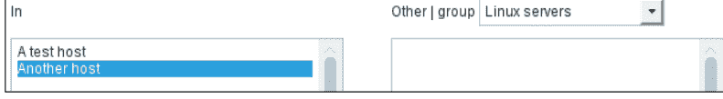

## Macro usage

我们之前已将触发器从 **Another host** 添加到模板，但我们没有为 **A test host** 这样做。让我们看看它是否有一些可以用于模板的触发器。点击 **Items** 列表上方 **Navigation** 栏中的 **Triggers**。从直接附加的触发器列表中（即名称前未加模板名的那些），其中一个触发器考虑了来自两个不同主机的项目，我们之前避免将其复制过来。其他直接附加的触发器是我们感兴趣的。标记 **NAME** 列中 **CPU load too high on A test host for last 3 minutes** 和 **Critical error from SNMP trap** 触发器旁边的复选框，然后点击底部的 **Copy** 按钮。在下一个窗口中，在 **Target** type 下拉菜单中选择 **Templates**，在 **Group** 下拉菜单中选择 **Custom templates**，然后标记唯一剩余目标旁边的复选框（**C_Template_Linux**）并点击 **Copy**。这次复制的效果有点更有趣，因此让我们再次展开 **Details** 框：

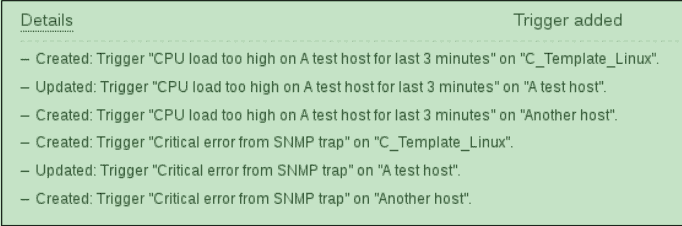

我们复制的两个触发器被添加到模板中。这会导致以下情况：

- 由于 **A test host** 已链接到修改后的模板，并且它已具有此类触发器，因此该主机的这两个触发器将被更新以反映链接关系
- **Another host** 没有此类触发器，因此触发器将被创建并与模板关联

在我们仍在触发器列表中时，在 **Host** 下拉菜单中选择 **Another host**。仔细查看在此次操作中添加到此主机的 CPU load 触发器：

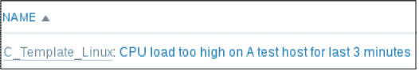

等等，这肯定是不正确的。触发器引用了 `A test host`，而这里是 `Another host`。触发器名称在我们第一次添加时是正确的，但现在同一个触发器被应用到多个主机。因此，引用对于除一台主机外的所有主机都是不正确的。让我们尝试修复这个问题。在 **Group** 下拉菜单中选择 **Custom templates**，然后点击 **NAME** 列中的 **CPU load too high on A test host for last 3 minutes** 触发器。将 **Name** 字段更改为 `CPU load too high on {HOST.NAME} for last 3 minutes`。

没错，宏再次派上用场了。

> 这里使用“宏”一词可能会令人困惑——Zabbix 将其称为宏，尽管它们更准确地应被视为变量。在本书中，我们将遵循 Zabbix 的术语，但请随意将宏理解为变量。

现在点击 **Update**。在模板的触发器列表中，触发器名称现已更改为 **CPU load too high on {HOST.NAME} for last 3 minutes**。这不是很具描述性，但你可以在配置部分经常看到这种情况——Zabbix 在配置中不会展开大多数宏。为了验证其是否按预期解析，请导航到 **Monitoring | Triggers** 并展开过滤器。将 **Triggers** 状态下拉菜单设置为 **Any**，在 **Filter by name** 字段中输入 `CPU`，然后点击过滤器下方的 **Filter** 按钮：

| HOST | NAME |
|---|---|
| A test host | CPU load too high on A test host for last 3 minutes |
| Another host | CPU load too high on Another host for last 3 minutes |

注意触发器名称现在包含正确的主机名。在大多数情况下，建议在触发器名称中包含此类宏以便轻松识别受影响的主机。

我们在此使用的宏 `{HOST.NAME}` 解析为主机的可见名称。我们没有指定可见名称，因此使用了主机名。如果主机定义了可见名称，我们也可以选择使用主机名宏 `{HOST.HOST}`。

## User macros

我们之前使用的宏是内置的。Zabbix 还允许用户定义宏并在以后使用。在这种情况下称它们为变量可能更重要，因此请考虑并行使用该术语。让我们从一个用户宏的实际应用开始，然后稍后讨论细节。


## 使用模板简化复杂配置

转到 **配置 | 模板**，在 **模板** 列中点击 **C_Template_Linux**。切换到 **宏** 标签页并添加一个新宏：

- **宏：** `{$CPU_LOAD_THRESHOLD}`
- **值：** `1`

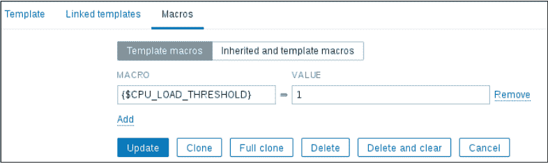

完成后，点击 **更新**。我们在模板上定义了一个宏，但此时尚未使用。点击 **C_Template_Linux** 旁边的 **触发器**，然后在 **名称** 列中点击 **{HOST.NAME} 最近3分钟的CPU负载过高**。更改触发器属性：

- **名称：** `CPU load too high on {HOST.NAME} for last 3 minutes (over {$CPU_LOAD_THRESHOLD})`
- **表达式：** `{C_Template_Linux:system.cpu.load.avg(180)}>{$CPU_LOAD_THRESHOLD}`

请注意，我们在触发器名称和表达式中使用了与模板属性相同的用户宏名称。完成后，点击 **更新**。我们刚才所做的更改没有功能影响——该触发器的工作方式与之前完全相同，只是名称更具解释性。我们做的是将触发器阈值替换为宏，使其参数化，而不是硬编码值。现在我们可以尝试针对单个主机覆盖此值——转到 **配置 | 主机**，在 **名称** 列中点击 **A test host**。切换到 **宏** 标签页，并切换到 **继承和主机宏** 模式：

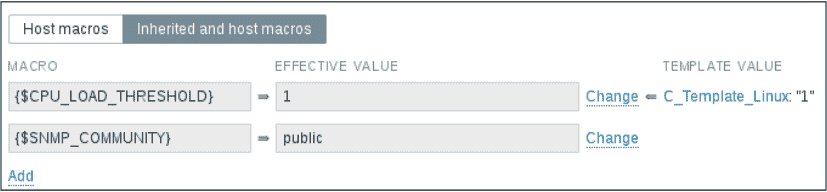

请注意，在此表单中，我们可以看到我们在模板上刚创建的宏。还有一个 {$SNMP_COMMUNITY} 宏——我们稍后会讨论它的来源。我们还可以看到是哪个模板提供了我们创建的宏。尽管我们记得在这个简单的例子中具体是哪个模板，但在实际环境中，当许多模板链接到一个主机时，这是一个非常有用的功能。要自定义此主机上的该值，请点击 {$CPU_LOAD_THRESHOLD} 旁边的“更改”控件。“有效值”列输入框变为可编辑——将其更改为 0.9。

> Zabbix 3.0 是第一个允许解析此类宏的版本。在之前的版本中，我们必须知道确切的宏名称才能覆盖它。也没有合理的方法来识别提供该宏的模板。

完成后，点击 **更新**。现在我们终于用上了这个宏——通过在主机级别使用相同的名称，我们能够为这个单独的主机覆盖宏值。为了双重检查此更改，转到 **监控 | 触发器** 并展开过滤器。将 **触发器状态** 下拉菜单设置为 **任何**，在 **按名称筛选** 字段中输入 CPU，然后点击 **筛选**：

| 主机 | 名称 |
|---|---|
| A test host | A test host 最近3分钟的CPU负载过高（超过 0.9） |
| Another host | Another host 最近3分钟的CPU负载过高（超过 1） |

此列表确认 Another host 从模板获取宏值 1，而 A test host 已将其更改为 0.9。我们仍在使用相同的模板和相同的触发器，但更改了此单个主机的触发器阈值。您也可以测试触发器的触发。在 A test host 上，此触发器现在应在新阈值 0.9 处触发。

还记得我们在“继承和主机宏”部分看到的 {$SNMP_COMMUNITY} 宏吗？到目前为止，我们已经介绍了用户宏可能定义的两个位置——模板和主机级别。实际上还有另一个位置可用。转到 **管理 | 常规**，并在右上角的下拉菜单中选择 **宏**。此表单看起来与模板和主机宏属性相同，并且这里已经定义了一个宏。

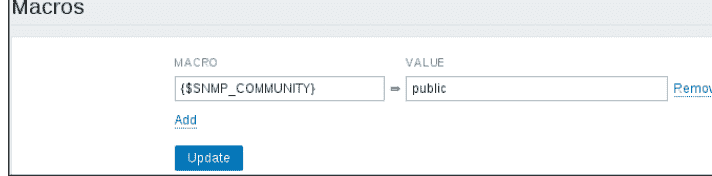

我们稍后会详细讨论这个宏，但首先让我们弄清楚这三个级别是如何交互的。例如，我们可以看一下我们刚刚定义的宏的假设用法：

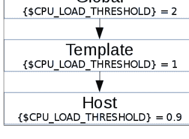

除了模板和主机级别的定义之外，我们还可以在全局级别定义此宏，并设置另一个值，在此示例中——2。现在，所有其他未定义此宏的模板和主机都将使用全局值 2。此更改不会影响我们的模板和主机，因为它们已经定义了相同名称的宏。通常，最接近主机的宏定义“胜出”。Zabbix 首先在主机级别查找宏，然后是模板，最后是全局级别。

> 只要使用允许的符号——大写字母、数字、下划线和点，宏的名称由我们自己决定。

转到 **配置 | 模板**，然后点击 **创建模板** 按钮。在 **模板名称** 字段中输入 C_Template_Email，在 **其他组** 框中标记 Custom templates，点击 ◄ 按钮，然后点击 **添加**：

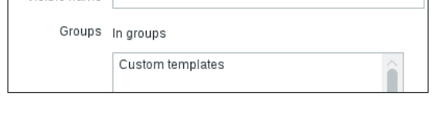

现在让我们填充此模板——在 **组** 下拉菜单中选择 Custom templates，然后点击 C_Template_Linux 旁边的 **监控项**。在 **名称** 列中标记 SMTP server status 和 Testfile 旁边的复选框，然后点击底部的 **复制** 按钮。在下一个界面中，在 **目标类型** 下拉菜单中选择 **模板**，在 **组** 下拉菜单中选择 Custom templates，标记 C_Template_Email 旁边的复选框，然后点击 **复制**。

这样就处理了监控项，但还有触发器需要处理。点击“监控项”列表上方导航栏中的 **触发器**，在 **名称** 列中标记 SMTP service is down 和 Testfile is missing 旁边的复选框，然后点击 **复制** 按钮。在下一个界面中，同样在 **目标类型** 下拉菜单中选择 **模板**，在 **组** 下拉菜单中选择 Custom templates，标记 C_Template_Email 旁边的复选框，然后点击 **复制**。

> 我们还必须引入测试文件监控项和触发器，因为 SMTP 触发器依赖于测试文件触发器。我们不能只复制 SMTP 触发器，那会留下未满足的依赖关系。

我们现在有了一个简单的专用电子邮件服务器模板，可以链接到主机。它与我们的自定义 Linux 模板具有相同的关于 SMTP 服务的监控项和触发器。但有一个问题——由于两者都具有相同键的监控项，我们无法将这些模板链接到同一主机，否则会失败。尝试这样做可能会导致类似以下消息：

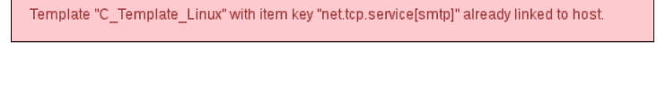

我们将执行一些步骤来更改模板链接：

- 从“A test host”和“Another host”取消链接 `C_Template_Linux`
- 从 `C_Template_Linux` 中移除 SMTP 相关的监控项和触发器
- 将 `C_Template_Email` 链接到这两个主机
- 将 `C_Template_Linux` 重新链接到这两个主机

这样，SMTP 相关的监控项和触发器将来自电子邮件模板，同时保留所有已收集的数据。如果我们从 Linux 模板中删除这些监控项，然后链接电子邮件模板，我们也会删除这些监控项已收集的所有值。

转到 **配置 | 主机**，标记 **A test host** 和 **Another host** 旁边的复选框，然后点击 **批量更新**。切换到 **模板** 标签页，标记 **链接模板** 复选框和 **替换** 复选框。这将取消链接已链接的模板，但将之前由模板提供的实体保留为直接附加的实体：

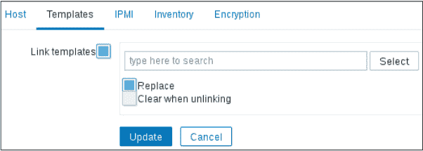

> 我们将在本章后面更详细地讨论主机批量更新。

点击 **更新**。现在我们将修改 Linux 模板，移除 SMTP 相关的监控项和触发器。转到 **配置 | 模板**，点击 **C_Template_Linux** 的 **监控项**，并在 **名称** 列中标记 **SMTP server status** 和 **Testfile exists** 旁边的复选框。在底部，点击 **删除** 按钮并确认弹出窗口。如果你展开详细信息，你会看到依赖这些监控项的触发器也一并被删除了——我们无需手动删除它们：

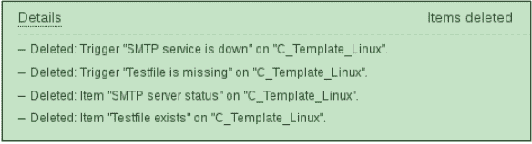


现在我们可以将新的邮件模板链接进来，同时将修改后的 Linux 模板重新链接回去。我们甚至可以在一步内完成，而且仍然使用批量更新功能。转到 **配置 | 主机**，勾选 **测试主机 A** 和 **另一台主机** 旁边的复选框，然后点击 **批量更新**。切换到 **模板** 选项卡，勾选 **链接模板** 复选框，并在输入框中输入“C_”。我们的两个模板都会显示出来——点击其中一个，然后再次输入“C_”，点击另一个模板：

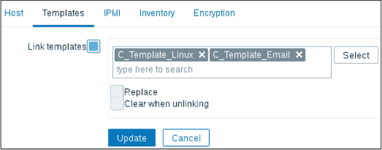

点击 **更新** 按钮。在此操作后，查看 **配置 | 模板** 中的模板关联列表。每个自定义模板现在都关联了两台主机：

| 模板 | 应用 | 监控项 | 触发器 | 图形 | 聚合图形 | 自动发现 | Web | 链接的模板 | 链接到 |
|---|---|---|---|---|---|---|---|---|---|
| C_Template_Email | 应用 | 监控项 2 | 触发器 2 | 图形 | 聚合图形 | 自动发现 | Web |  | 另一台主机, 测试主机 A |
| C_Template_Linux | 应用 | 监控项 12 | 触发器 5 | 图形 | 聚合图形 | 自动发现 | Web |  | 另一台主机, 测试主机 A |

单个主机可以链接到多个模板。这允许采用模块化配置，其中每个模板只提供一部分实体，因此服务器可以配置为具有基本 Linux、邮件服务器、Web 服务器、文件服务器以及任何其他模板的任意组合。

当然，对于单个监控项和触发器来说，这个过程似乎过于复杂，但通常邮件服务器会有更多参数，例如邮件服务器进程数、SMTP、IMAP、POP3 服务状态、垃圾邮件和病毒过滤器状态、队列长度等等。此时，能够通过几次点击快速在一台机器上建立一组监控指标的能力就非常受欢迎了。

> 取消链接、重新设计和重新链接的方法是一种常见且推荐的做法，用于更改模板配置。只需注意，在模板未链接时不要更改监控项键，或者在模板已链接时删除监控项。

## 从主机取消链接模板

但我们之前提到一台服务器失去了邮件服务器职责，而将两个模板都链接到两台主机实际上并不是正确的操作。现在让我们来处理这个问题。打开 **配置 | 主机**，并在 **分组** 下拉框中选择 **Linux 服务器**。我们的第一个测试主机将不再提供 SMTP 服务，因此点击 **名称** 列中的 **测试主机 A** 并切换到 **模板** 选项卡：

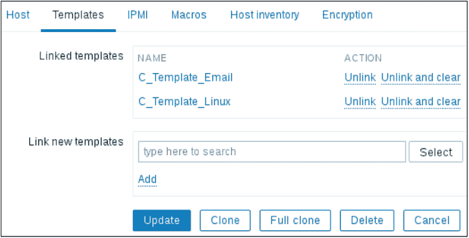

此部分正确地列出了两个链接的模板。我们现在想要取消链接 **C_Template_Email**，但有两个可能的操作——**取消链接** 和 **取消链接并清除**。那么区别是什么呢？让我们尝试一下，从看起来更安全的那个开始——点击 **C_Template_Email** 旁边的 **取消链接**，然后点击 **更新**。展开 **详情** 链接以查看发生了什么：

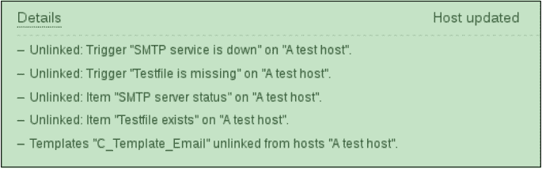

看起来监控项和触发器都被取消链接了。这是否是我们想要的？让我们看看。

点击 **测试主机 A** 旁边的 **监控项**：

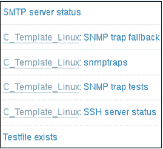

嗯，不完全——SMTP 相关的监控项仍然存在。因此，简单的取消链接只是解除关联，并在先前链接的主机上保留监控项的副本。如果我们想创建不同的监控项，或者出于历史原因在主机上保留某个监控项以保留数据，这很方便，但这次不是。要解决当前情况，我们可以手动删除两个触发器和监控项，但如果主机还直接附加了一堆实体，这就不那么容易了。在这种情况下，必须手动查找并删除它们，这很容易出错。相反，让我们尝试另一种途径——重新链接此模板，然后将其无痕移除。

点击导航栏中的 **测试主机 A** 并切换到 **模板** 选项卡。在 **链接新模板** 字段中开始输入“C_”，然后点击 **C_Template_Email**。小心地点击其下方的小型 **添加** 控件，然后点击 **更新**。展开详情将显示 SMTP 监控项和触发器再次链接到该模板。我们现在回到了起点，两个模板都已链接——是时候再次取消链接了。点击 **名称** 列中的 **测试主机 A** 并切换到 **模板** 选项卡。在 **链接的模板** 块中点击 **C_Template_Email** 旁边的 **取消链接并清除**，点击 **更新**，然后展开 **详情**：

> **详情** 主机已更新
>
> – 已删除：主机“测试主机 A”上的触发器“SMTP 服务已关闭”。
>
> – 已删除：主机“测试主机 A”上的触发器“测试文件缺失”。
>
> – 已删除：主机“测试主机 A”上的监控项“SMTP 服务器状态”。
>
> – 已删除：主机“测试主机 A”上的监控项“测试文件存在”。
>
> – 模板“C_Template_Email”已从主机“测试主机 A”取消链接。

现在完成了。监控项和触发器实际上都被删除了。查看主机列表；请注意 **模板** 列如何再次提供了快速概览——当您可能想要快速验证特定组中所有主机的模板链接时，这很方便：

| 名称 ▲ | 应用 | 监控项 | 触发器 | 图形 | 自动发现 | Web | 接口 | 模板 |
|---|---|---|---|---|---|---|---|---|
| 另一台主机 | 应用 | 监控项 14 | 触发器 8 | 图形 | 自动发现 | Web | 192.168.56.11:10050 | C_Template_Email, C_Template_Linux |
| 测试主机 A | 应用 | 监控项 13 | 触发器 6 | 图形 | 自动发现 | Web | 127.0.0.1:10050 | C_Template_Linux |

## 使用批量更新

与监控项类似，批量更新也可以用于主机，而且我们已经多次使用过它。让我们更详细地探讨批量更新在这里可能提供的功能——转到 配置 | 主机。在主机列表中，勾选 **测试主机 A** 和 **另一台主机** 旁边的复选框，然后点击底部的 **批量更新** 按钮。然后切换到 **模板** 选项卡并勾选 **链接模板** 复选框。

选择模板的方式与在主机属性中相同——我们可以键入并按该子字符串搜索，也可以点击 **选择** 按钮从列表中选择。我们可以在该字段中指定多个模板，并且没有像主机属性中那样的额外控件需要点击——在那里我们必须点击 **添加**。在此表单中，只需将模板列在第一个字段中即可。在批量更新和更新单个主机之间切换可能相当具有挑战性，因为这些表单的工作方式不同——务必非常非常小心。

还有两个复选框——在讨论它们的作用之前，让我们先弄清楚默认会发生什么。如果我们列出一个或多个模板然后更新配置，则该模板会链接到所有选定的主机，同时保留现有模板——现有模板不会受到任何影响。复选框会修改此行为：

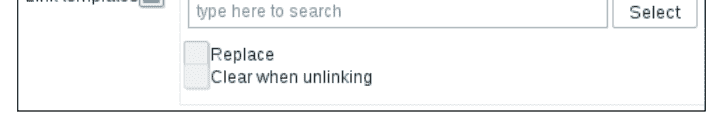

- **替换：** 现有模板将被取消链接。与之前相同，来自这些模板的任何实体都不会被触及。由该模板控制的监控项、触发器以及其他所有内容都保留在主机上。如果我们在表单中指定的模板包含相同键的监控项，这些监控项会链接到新模板。
- **取消链接时清除：** 现有模板将被取消链接并清除——也就是说，来自它们的所有内容都会被删除。这几乎就像清除主机，但直接附加的实体不会被触及，只有模板化实体受到影响。

当然，如果存在任何冲突，例如两个模板中出现相同的监控项键，则此类链接将会失败。

我们此时不会修改模板链接，因此请点击 **取消** 按钮。

## 嵌套模板

仍然提供邮件服务的那台主机——**另一台主机**——现在分配了两个模板。但如果我们把可以逻辑分组的所有服务、应用程序和其他数据都分离到单独的模板中呢？那将导致我们需要链接到单个主机的一堆模板。这还不算糟糕，但如果我们有两台这样的服务器呢？或者三台？或者 20 台？在某个时刻，即使是带模板的配置也可能变得难以管理——在大型复杂环境中，每台主机的模板数量很容易达到十几个。

这就是简单性与强大功能相结合的地方。在幕后，模板与主机并没有太大区别。实际上，它们就是主机，只是有点特殊。这意味着一个模板可以链接到另一个模板，从而创建嵌套配置。

这如何应用于我们的情况？让我们创建一个简单的配置，以便轻松添加更多具有相同设置的主机。在 **配置 | 模板** 中，点击 **创建模板** 按钮。在 **模板名称** 字段中输入 `C_Template_Email_Server`，在 **其他组** 框中勾选 **自定义模板**，然后点击 ◄ 按钮。

切换到 **链接的模板** 选项卡。在这里，我们可以将其他模板链接到此模板。点击 **选择** 按钮，在弹出窗口中勾选 **C_Template_Email** 和 **C_Template_Linux** 旁边的复选框：


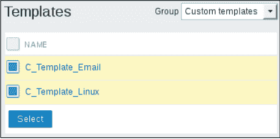

点击 **Select**。在 **Link new templates** 部分点击小小的 **Add** 链接——不要点按钮。两个模板都被添加到链接部分：

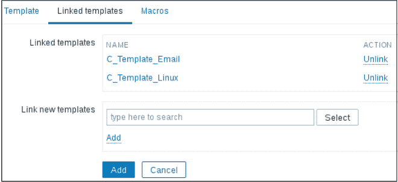

完成后，点击底部的 **Add** 按钮。现在我们有一个模板，它涵盖了安装并运行着邮件服务器的基础 Linux 系统配置，所以我们仍需将其正确链接到将承担此角色的主机上。

打开 **Configuration | Hosts**，在 NAME 列点击 **Another host** 并切换到 **Templates** 选项卡。在 **Linked templates** 部分，点击两个 **Unlink** 链接。在 **Link new templates** 输入框中输入 `email` 并点击 **C_Template_Email_Server**。点击小小的 **Add** 控件，然后点击表单底部的 **Update**。操作成功完成，于是展开 **Details** 链接。正如我们在此看到的，所有元素首先被取消链接，然后才更新。基本上，先取消链接之前的模板，但项目和触发器保留在原位，然后再重新链接到新模板。这种顺序的最大好处是保留了所有项目的历史数据。

## 使用模板简化复杂配置

但我们在这里做的最大事情是创建了一个嵌套模板。这样的模板链接到其他模板，因此它继承了所有项目、触发器和其他特性，同时通常会对原始模板条件进行一些修改。在本例中，我们的嵌套模板包含来自另外两个模板的实体，如下所示：

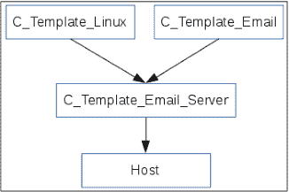

虽然这看起来与之前的情况相比——两个模板链接到单个主机——只获得了少量收益，但当你的监控环境稍大时，这是一种非常有效的方法。如果只有一个主机需要多个模板的特定组合，直接将这些模板链接到主机是可以的。一旦数量增加，设置模板嵌套会更方便，为这些主机创建一个单一模板进行链接。完成后，添加同类的新主机只需链接到一个模板即可，这大大简化了配置并最大限度地减少了出错的可能性。

查看主机列表，我们可以在 **TEMPLATES** 列看到影响此主机的所有模板：

| TEMPLATES |
|---|
| C_Template_Email_Server (C_Template_Email, C_Template_Linux) |

注意新的 **C_Template_Email_Server** 模板被列在最前面，而另外两个模板则在括号中列出。直接链接到主机的模板列在前面，而由第一级模板引入的第二级模板则在括号中列出。这里只显示前两级——如果我们有更多层级的嵌套，则在主机列表中看不到它们。

现在让我们回顾一个模板化项目。从主机列表中，点击 Another host 旁边的 Items。点击 NAME 列中的 SMTP server status。这次我们关注这里的第一行，Parent items：

```
Parent items  C_Template_Email => C_Template_Email_Server
```

这是模板化项目中出现的内容。更高级别的项目可以在这里看到并访问，对于此项目显示了两个层级。离主机更近的模板列在最后，而第一个模板是项目来源的模板。如果我们有超过两个层级，也会显示出来。这行作为快速信息，说明特定项目源自何处以及什么可能会修改它，同时也是向上访问的便利方式。如果我们在某个模板化项目中发现简单错误，我们可以一键进入更高级别的项目，而不必去 Configuration | Templates，找到正确的页面和/或模板，然后对项目重复此操作。相同的父实体便利访问行也适用于触发器和其他实体。

在使用嵌套模板设置时，继承的宏解析助手就更加有用了。如果我们只有一个主机和一个模板，没有助手，我们首先会在主机上检查宏，如果未定义则在模板上检查，如果模板上也未定义则在全局级别检查。使用嵌套模板我们必须逐个检查所有模板。有了助手，我们可以在主机属性的同一宏选项卡中看到结果以及哪个确切模板提供了该值。

模板嵌套是一种方便的方式来分组模板并将单个模板应用于目标主机，同时仍能让不同的功能在多个低级模板中得到适当的拆分和重用。尽管如此，仍应注意不要创建过度的嵌套。两层嵌套相当常见，但一位高级 Zabbix 用户承认，设计一个具有五层嵌套的模板系统有点过分，下次他会将自己限制在最多四层。

## 总结

在 Zabbix 中，模板在简化配置和允许大规模更改方面发挥着主要作用。如果你是文字处理软件的熟练用户，你可能使用样式。TeX、Web 的 CSS 样式以及其他地方也使用相同的概念——将内容与呈现分离有助于在需要更改时减少工作量。

虽然将模板与样式进行比较乍一看似乎牵强，但实际上相似程度足够。就像样式一样，你可以将主机与提供的服务分离，并以集中方式定义这些服务。与文字处理器文档中标题样式允许一次操作更改所有该级别标题的字体大小一样，Zabbix 中的模板允许更改直接或嵌套链接主机的某些参数。

我们在 Zabbix 中使用了多个允许修改模板链接的位置：

- **Host properties**：这允许将多个模板链接、取消链接以及取消链接并清除到单个主机
- **Host mass update**：这允许将多个模板链接到多个主机，以及取消链接或取消链接并清除之前链接的所有模板（但不能取消链接或取消链接并清除特定模板）
- **Template properties**：这允许将多个主机从单个模板链接和取消链接（但不能取消链接并清除）

在前面的列表中，我们也可以在谈论主机时谈论模板。这在管理嵌套模板配置时使用。

Zabbix 中的宏就像变量——它们提供了一个通用占位符，后续会被替换为主机特定的值。我们查看了一些内置宏，也查看了用户宏，允许我们定义自己的变量以在主机级别具有自定义的项目、触发器和其他实体。

正如我们在模板中对项目和触发器进行所有重新排列时所看到的，在实际配置之前规划合理的模板策略会更容易。强烈建议你在急于配置之前坐下来绘制至少一个非常基本的受监控事物层次结构——这在长期来看会让事情更轻松。

在下一章中，我们将查看数据在 Zabbix 中可视化的方式。我们将从图表和网络地图开始，看看如何显示各种运行时信息。我们将详细讨论图表的定制和使用。
