## 9 使用图表和地图可视化数据

到目前为止，我们仅简要查看了一些基本可用的数据可视化选项，主要是显示项目随时间变化的简单图表。这并不是 Zabbix 提供的全部——还有更多选项，我们现在将探索。本章中我们将查看的 Zabbix 可视化选项包括以下内容：

- 图表，包括简单、临时和自定义图表
- 可以以不同方式显示信息的地图——例如，地理上

### 可视化什么？

我们设置了在需要时向我们发送信息的动作，我们还有远程命令可以根据需要重启服务并执行许多其他操作。那为什么还要可视化任何东西呢？

虽然对大多数人来说这个问题会显得愚蠢，因为我们很清楚想要可视化什么数据，但并非所有功能都显而易见。

当然，当查看图表时评估问题会更容易，因为这使我们能够轻松发现问题开始的时间、轻松关联各种参数并发现反复出现的异常。诸如图表之类的东西也可以用作简单表示来回答诸如“那么 Zabbix 系统做什么？”这样的问题。在向非技术管理层展示成果和效益时，这会很有用。


## 使用图表和地图可视化数据

另一个有用的领域是在大屏幕上显示数据。这通常是系统状态的高级概览，并放置在系统操作员或帮助台所在的位置。想象一下，一台大型等离子电视，显示着该国的帮助台地图，列出各个公司位置以及其中存在的任何问题。

当拥有一个精美的图表，或以其他方式直观地展示信息能够提供很大帮助时，肯定还可以想到更多应用场景。现在，我们来看看 Zabbix 已经提供的选项。

## 单个元素

我们可以区分单个可视化元素和组合可视化元素。这里所说的单个元素，是指在一个容器中显示特定信息的元素，例如图表或网络拓扑图。虽然单个元素可以包含来自多个监控项和主机的信息，但通常不能包含其他 Zabbix 前端元素。

## 图表

虽然前面的定义听起来可能有些令人困惑，但其实很简单——图表就是单个可视化元素的一个例子。图表可以包含一个或多个监控项的信息，但不能包含其他 Zabbix 可视化元素，例如其他图表。因此，图表可以被视为单个元素。

在试图说服管理层购买新的数据库服务器时，容量规划方面很难有其他工具能胜过图表。如果你能够展示网站访问者数量正在增加，并且按照当前增长速度，几个月后就会达到当前限制，这样的说服力会强得多。

## 简单图表

我们已经了解了此列表中的第一个可视化元素：所谓的**简单图表**。它们有些特殊：由于不需要进行配置，因此你不必创建它们——每个监控项都可以使用简单图表。对吗？并不完全是。它们仅适用于数值型监控项，因为为文本型监控项绘制图表并没有**太大意义**。为了回顾一下相关内容，我们来看一下 **Monitoring | Latest data** 中的监控项：

| 名称 ▲ | 最后检查时间 | 最后值 | 变化 |
|---|---|---|---|
| - other -（13 个监控项） |  |  |  |
| CPU 负载 | 2016-04-27 15:15:25 | 0 | 图表 |
| 实验性 SNMP 陷阱 |  |  | 历史记录 |
| 完整操作系统名称 | 2016-04-27 15:15:22 | Linux testhost 3.12.53-40-defa... | 历史记录 |
| ICMP ping 性能 | 2016-04-27 15:15:32 | 0.04 ms | 图表 |

对于数值型监控项以外的其他监控项，右侧的链接会显示**历史记录**。对于数值型监控项，我们会看到**图表**链接。这只取决于数据的存储方式——单位或值映射等因素不会影响图表的可用性。如果你想回顾缩放等基本图表控件的信息，请参阅*第 2 章：获取第一条通知*。

虽然简单图表不需要配置，但它们也不提供任何配置功能。它们很容易获得，但功能相当有限。因此，虽然它们对于单个监控项很有用，但无法绘制多个监控项，也无法更改视觉样式。当然，如果没有其他方式，这将是一个很大的限制；但幸运的是，Zabbix 还提供另外两种图表类型——**临时**图表和**自定义**图表。

## 临时图表

简单图表很容易访问，但只能显示单个监控项。在单个图表中快速查看多个监控项，有一种非常简单的方法——在 Zabbix 中，这类图表称为**临时**图表。临时图表可以从 **Latest data** 页面访问，方式与简单图表相同。我们来看一个临时图表——导航至 **Monitoring | Latest data**，然后查看左侧。与配置部分的许多页面类似，这里有一些复选框。勾选 **A test host** 中 CPU 负载和网络流量监控项旁边的复选框：

|  | A test host | - other -（13 个监控项） |
|---|---|---|
| ☑ | CPU 负载 | |
| ☐ | 实验性 SNMP 陷阱 | |
| ☐ | 完整操作系统名称 | |
| ☐ | ICMP ping 性能 | |
| ☑ | 接口 enp0s8 的传入流量 | |
| ☑ | 接口 lo 的传入流量 | |

非数值型监控项旁边的复选框处于禁用状态。

在页面底部，点击 Display graph 按钮。此时会显示一张包含所有已选监控项的图表：

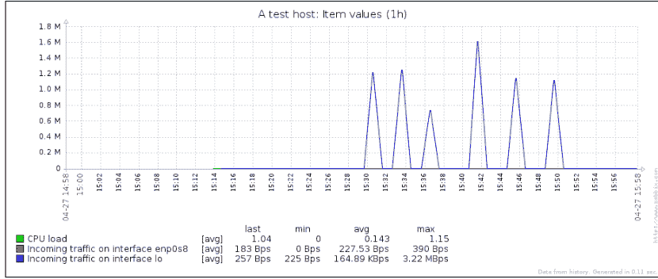

现在看一下图表顶部——那里出现了一个新的控件：Graph type：


它允许我们在普通图表和堆叠图表之间快速切换。点击 Stacked：

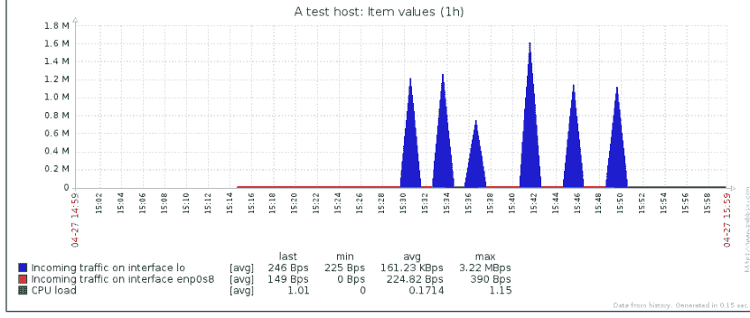

对于这张图表而言，堆叠模式意义不大，因为 CPU 负载和网络流量具有完全不同的比例和含义，但至少我们可以快速地在两种模式之间切换。返回 **Monitoring | Latest data**，这次只勾选网络流量监控项旁边的复选框。在列表底部，点击 **Display stacked graph**。此时会再次显示一个临时图表，不过这次默认采用堆叠模式。因此，**Latest data** 页面底部的按钮控制初始模式，但打开图表后，切换模式也很容易。

> 撰写本文时使用的是 Zabbix 3.0.2 版本。临时图表中的时间段可以更改，但刷新临时图表页面后，图表时间段会重置为 1 小时。

遗憾的是，目前无法将临时图表保存为自定义图表，也无法将其保存到仪表板收藏夹中。如果你之后还想查看某个特定的临时图表，可以复制它的 URL。

## 自定义图表

自定义图表必须手动创建，但它们提供了很大的自定义空间。要创建自定义图表，请打开 **Configuration | Templates**，点击 **C_Template_Linux** 旁边的 **Graphs**，然后点击 **Create graph** 按钮。我们先创建一个简单图表的复刻版本，因此在 **Name** 字段中输入 **CPU load**，然后点击 **Items** 部分中的 **Add** 控件。在弹出窗口中，点击 **NAME** 列中的 **CPU load**。该监控项会被添加到图表属性中的列表里。虽然我们可以更改此监控项的其他参数，但现在只修改颜色。颜色值可以手动输入，但这样不太方便，因此只需点击 **COLOUR** 列中的彩色矩形。这会打开颜色选择器。选择一个中等范围的红色——请注意，将鼠标光标悬停在某个单元格上几秒钟，会打开一个显示颜色值的工具提示：

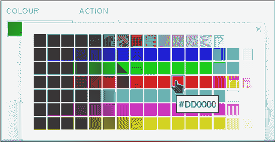

我们可能想看看最终效果——切换到 Preview 选项卡。遗憾的是，目前其中的图表对我们帮助不大，因为我们选择的是模板中的监控项，而模板本身没有任何数据。

> Zabbix 颜色选择器提供了一个用于选择可用颜色的表格，但仍缺少一些颜色，例如橙色。你可以直接以十六进制形式输入 RGB 颜色代码（例如，橙色可以近似表示为 FFAA00）。要查找其他有用的值，你可以自行尝试，或者使用在线颜色计算器。或者，如果你使用的是 KDE，也可以直接启动 KColorChooser 应用程序。

## 工作时间和触发器线

我们已经看到了一个简单的自定义选项——更改线条颜色。切换回 Graph 选项卡，并注意 Show legend、Show working time 和 Show triggers 这几个复选框。我们将保留这三项启用，因此点击底部的 Add 按钮。

现在，我们的自定义图表已经保存，但在哪里可以找到它呢？简单图表可以从 Monitoring | Latest data 部分访问，而自定义图表有自己的专属部分。前往 Monitoring | Graphs，在 Group 下拉列表中选择 Linux servers，在 Host 下拉列表中选择 A test host，然后在 Graph 下拉列表中选择 CPU load。

> 我们刚才完成了一件有趣的事情，你可能已经注意到了。虽然监控项是从模板中添加的，但图表对该主机可用，并且正确显示了该主机的所有数据。这意味着模板化这一重要概念在这里同样适用。在 Zabbix 中，可以将图表附加到模板，之后每个链接到该模板的主机都可以使用这些图表。

我们创建的自定义图表看起来与简单图表非常相似。之前我们已经看到，可以控制此图表中工作时间的显示——现在来看一下它的具体含义。点击左上角 Zoom 标题旁边的 7d 控件：


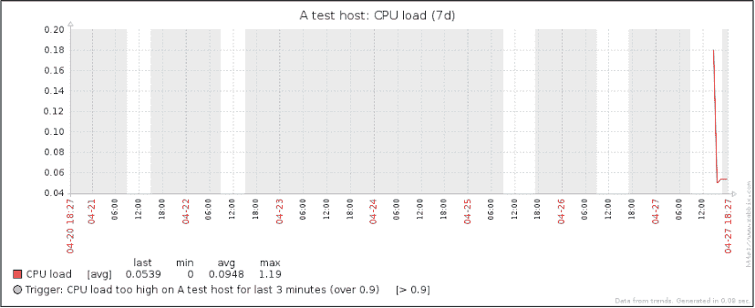

> 如果你最近才创建了CPU load监控项，这里可能还没有更长的时间段可用。这种情况下，请选择当前可用的最长时段。

我们可以看到图形上有灰色和白色区域。白色区域被视为*工作时间*，灰色区域则是*非工作时间*。

顺便说一下，简单图形也是如此，只是你无法为它们禁用工作时间显示。工作时间的具体定义并非硬编码——我们可以更改。打开**管理 | 常规**，从右上角的下拉框中选择**工作时间**。

该选项使用与用户媒介启用时相同的语法，这在*第7章：处理受监控条件和监控项的灵活时间间隔*和*第3章：使用Zabbix代理和基本协议进行监控*中讨论过。周一至周日分别用1-7表示，并使用24小时制来配置时间。目前，该字段为`1-5,09:00-18:00;`，表示周一至周五，每天9小时。让我们将其修改为`1-3,09:00-17:00;4-5,09:00-15:00,`

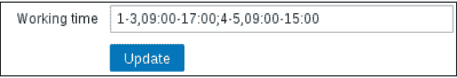

> 此设置为全局设置；目前无法按用户分别设置。

这样修改后，周一到周三的工作时间为09-17，而周四和周五则缩短为09-15。点击**更新**以接受更改。返回**监控 | 图形**，并确保在**图形**下拉框中选择**CPU load**。

现在，灰色和白色区域应显示周四和周五的工作小时数少于前三个工作日。

请注意，这些时间设置不会以任何方式影响数据收集或告警——受工作时间段影响的唯一功能就是图形。

那么图形属性中的触发器选项呢？再看一眼我们的图形，可以看到一条虚线和一条图例项，它说明图形描绘的是触发器阈值。触发器线仅针对简单表达式显示。

> 如果机器在所显示的时间段内负载较低，你将不会在图形上看到触发器线。Y轴自动缩放会排除触发器可能显示的范围。

与工作时间一样，触发器线在简单图形中也会显示，且无法禁用。

还有另一个复选框可以使该图形不同于简单图形——**显示图例**。让我们看看在禁用这三个选项后，图形会是什么样子。在图形配置中，取消勾选**显示图例**、**显示工作时间**和**显示触发器**，然后点击**更新**。

> 在重新配置图形时，建议使用两个浏览器标签页或窗口，一个保持打开**监控 | 图形**，另一个在**配置**部分打开图形详情。这样，你可以在进行配置更改后刷新监控部分，节省来回点击的步骤。

在监控部分再次打开此图形：

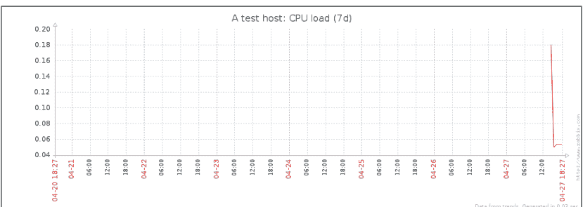

有时，所有额外信息会占用太多空间，尤其是当图形上有许多监控项时，图例更是如此。对于自定义图形，我们可以将其隐藏。在图形配置中重新启用这些复选框，并点击相同的“更新”按钮保存更改。

## 图形监控项功能

我们目前得到的图形与简单图形非常相似，但当显示的时间段较长时，有一个显著差异——简单图形会显示三条不同的线，且它们之间的区域被填充，而我们的图形只有一条线（当显示时间段接近3天时，差异更容易察觉）。我们能复制这种行为吗？前往“配置 | 模板”，点击 C_Template_Linux 旁边的“图形”，然后点击“名称”列中的CPU load以打开编辑表单。仔细查看“监控项”部分中的“功能”下拉框：

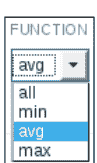

当前选择的是avg，它只是绘制平均值。其他选项相当明显，min和max，除了那个看起来可疑的all。选择all，然后点击“更新”。再次打开“监控 | 图形”，并确保在“图形”下拉框中选择CPU load：

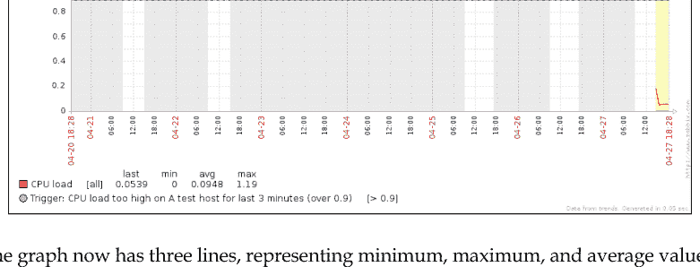

图形现在有三条线，分别代表每个时间点的最小值、最大值和平均值，尽管在此示例中，最下面的线始终为零。

默认值是average，因为当图形上有许多监控项时，如果显示三条带彩色区域的线，肯定会使图形难以阅读。另一方面，即使选择了average，图形图例仍会显示原始数据中的最小值和最大值，这些值用于计算平均线。这可能导致一种情况：线没有超过1，但图例显示最大值为5。在这种情况下，几乎总是可以通过放大包含原始值的区域来查看原始值，但这种情况仍然可能令人困惑。

## 双Y轴

我们现在已经忠实地复制了一个简单图形（嗯，简单图形使用绿色表示平均值，而我们使用红色，这是个小差异）。虽然这样的体验应该让你认识到简单图形的价值，但如果自定义图形只能做到这一点，那它们就相当无用了。颜色、功能和工作时间显示等自定义设置可能有用，但它们都是次要的。让我们看看还能往图形中添加什么。在改进图形之前，我们先添加一个监控项。我们监控了传入流量，但没有监控传出流量。前往“配置 | 模板”，点击 C_Template_Linux 旁边的“监控项”，然后点击“名称”列中的“Incoming traffic on interface eth0”。点击底部的“克隆”按钮，并更改以下字段：

- 名称：Incoming traffic on interface $1
- 键：net.if.out[enp0s8]

完成后，点击底部的“添加”按钮。

现在我们准备改进图形。

打开“配置 | 模板”，在“组”下拉框中选择“Custom templates”，点击 C_Template_Linux 旁边的“图形”，然后在“名称”列中点击CPU load。

在“监控项”部分点击“添加”。注意右上角的下拉框被禁用。将鼠标光标移到上面可能会显示工具提示：

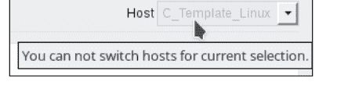

在某些浏览器中，此工具提示可能不可见。

我们现在无法选择任何其他主机或模板。原因是：一个图形可以包含来自单个模板的监控项，或者来自一个或多个主机的监控项。如果图形中添加了来自主机的监控项，则不能再向其添加任何模板化监控项。如果图形已从一个模板添加了一个或多个监控项，则只能从同一模板添加更多监控项。

图形与触发器也很相似——它们并不真正属于特定主机，它们引用监控项，然后与它们所引用监控项所属的主机关联。向图形添加监控项将使该图形显示在该监控项所属的主机上。但目前，让我们继续在模板上配置我们的图形。

在“名称”列中勾选“Incoming traffic on interface eth0”和“Outgoing traffic on interface eth0”旁边的复选框，然后点击“选择”。监控项将被添加到图形监控项列表中：

| 项目 | 名称 | 功能 | 绘制样式 | Y轴侧 | 颜色 | 操作 |
|---|---|---|---|---|---|---|
| 1 | C_Template_Linux CPU load | all | 线 | 左 | DD0000 | 移除 |
| 2 | C_Template_Linux Incoming traffic on interface enp0s8 | avg | 线 | 左 | F63100 | 移除 |
| 3 | C_Template_Linux Outgoing traffic on interface enp0s8 | avg | 线 | 左 | 2774A4 | 移除 |
| 添加 |  |  |  |  |  |  |

注意颜色是如何自动分配的。当多个监控项一次性添加到自定义图形时，Zabbix会从预定义列表中选取颜色。在这种情况下，CPU load和传入流量获得了非常相似的颜色。点击“颜色”列中传入流量监控项旁边的彩色矩形，选择某种绿色调。

由于图形现在不仅包含CPU load，请将“名称”字段更改为“CPU load & traffic”。当我们仍处于图形编辑表单中时，为两个网络流量监控项在“绘制样式”下拉框中选择“填充区域”，然后点击“更新”。在“监控 | 图形”部分检查图形：

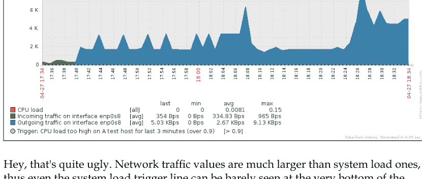

嘿，这真难看。网络流量值远大于系统负载值，因此即使是系统负载触发器线，在图形底部也几乎看不见。Y轴标签也不清晰——它们只是一些“K”。让我们回到图形配置中尝试修复这个问题。对于CPU load监控项，将“Y轴侧”下拉框更改为“右”，然后点击“更新”：


> 我们也可以修改网络流量监控项。不过，在这种情况下，那会多出两次额外的点击。


查看 **Monitoring | Graphs** 看看这次更改的效果：

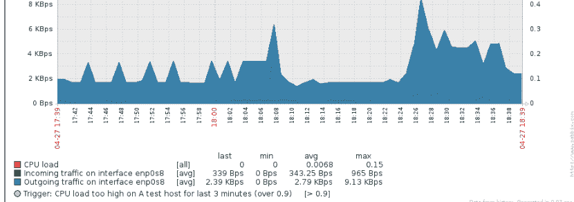

好多了；现在每个不同的刻度值都映射到了合适的 y 轴上。注意左侧 y 轴标签现在显示的是网络流量信息，而右侧则正确地按 CPU 负载进行了缩放。如果没有使用两个 y 轴，将系统负载和 Web 服务器连接数等放在同一张图上将毫无用处，而我们可能还想比较的其他许多事物也具有不同的刻度。

注意填充区域在与其他区域重叠时略微透明。这使我们即使在较大区域后面也能看到值，但建议避免在同一张图上放置太多使用填充区域绘制样式的元素，否则图表可能会变得难以阅读。我们稍后也会让这张图更易读一些。

在某些情况下，右侧轴的自动 y 轴缩放可能看起来有点奇怪——它的范围可能比所需稍大。例如，对于 0 到 0.25 的值，y 轴可能会缩放至 0.9。这是由尝试匹配两个轴上的水平引线造成的。左侧 y 轴被视为更重要的轴，右侧会根据其进行调整。

有人可能会注意到图例中没有关于项目在 y 轴上放置位置的指示。对于我们的图表，很容易看出网络流量项目在左侧，**CPU load** 在右侧，但对于其他值则可能很复杂。不幸的是，目前没有很好的解决方案。可以将项目名称 hack 为包含 “L” 或 “R”，但这必须手动与图表配置同步。

## Item sort order

回到我们的图表，CPU 负载线有时可以在网络流量区域之上看到，但当流量区域覆盖 CPU 负载线时几乎看不到。我们可能希望在这种情况下将线条放在这两个区域之上。

回到图表配置，查看项目列表。项目在 Zabbix 图表中的放置顺序与它们在图表配置中出现的顺序相同。第一个项目被放置，然后第二个项目在其之上，依此类推。最终，配置中列在最前面的项目位于背景中。对我们来说，那就是 CPU 负载项目，也就是我们希望放在最上面的项目。要实现这一点，我们必须确保它列在最后。项目顺序可以通过拖动它们左侧的句柄来更改。抓住 CPU 负载项目旁边的句柄并将其拖动到列表的最后条目：

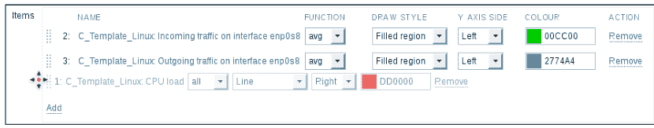

项目将被重新编号。点击 Update。让我们在 Monitoring | Graphs 中检查图表现在看起来如何：

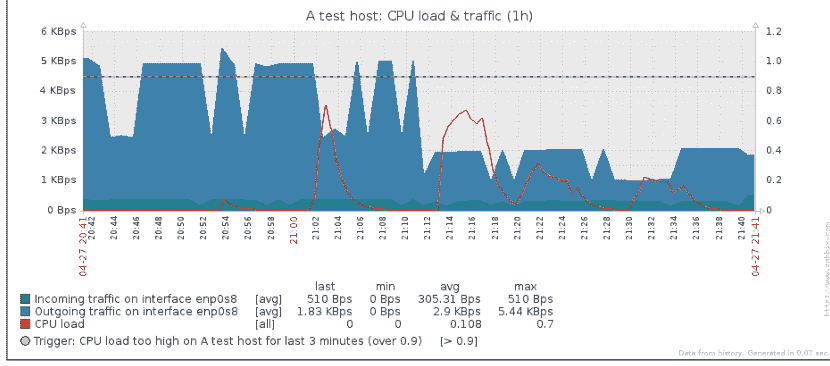

好多了。**CPU load** 线条绘制在两个网络流量区域之上。

> 经常有人想将图表包含在电子邮件中或在文档中使用。对于 Zabbix 图表，通常不建议创建屏幕截图——这需要手动裁剪掉不需要的区域。但 Zabbix 中的所有图表都是 PNG 图像，因此您可以直接从前端通过右键单击保存或复制它们即可轻松使用图表。不过有一个小技巧——在大多数浏览器中，您必须点击缩放拖动操作区域之外的区域。例如尝试图例区域。这对简单、临时和自定义图表同样适用。

## Gradient line and other draw styles

我们的图表变得越来越有用，但网络流量项目会相互覆盖。我们可以更改它们的排序，但当流量模式发生变化时效果不佳。让我们再次编辑此图表的配置。这次，我们将更改两个网络流量项目的绘制样式。将其设置为 **Gradient line**：

| NAME | FUNCTION | DRAW STYLE |
|---|---|---|
| C_Template_Linux: Incoming traffic on interface enp0s8 | avg | Gradient line |
| C_Template_Linux: Outgoing traffic on interface enp0s8 | avg | Gradient line |

点击 **Update** 并在监控部分检查图表：

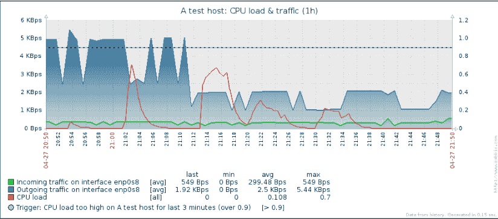

选择渐变选项使区域变得更加透明，现在即使它们之前会相互覆盖，也很容易看到两条流量线。

我们已经使用了线条、填充区域和渐变线绘制样式。还有一些其他选项可用：

- Line
- Filled region
- Bold line
- Dot
- Dashed line
- Gradient line

填充区域和渐变线选项的外观在我们的测试中已经可见。让我们比较一下剩余的选项：

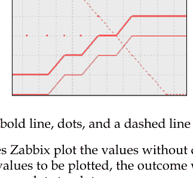

此示例在同一张图表上使用了线条、粗线、点和虚线。

请注意，点模式会使 Zabbix 在不使用线条连接的情况下绘制值。如果要绘制的值很多，结果看起来会像一条线，因为要绘制的点会非常多。

> 我们将 CPU 负载项目的 **FUNCTION** 值保留为 **all**。在较长时间段内，这可能会使图表难以阅读。在配置 Zabbix 图表时，请检查它们在不同周期长度下的表现如何。

## Visualizing Data with Graphs and Maps

查看测试主机在 **Monitoring | Graphs** 部分的图表是什么样子的：

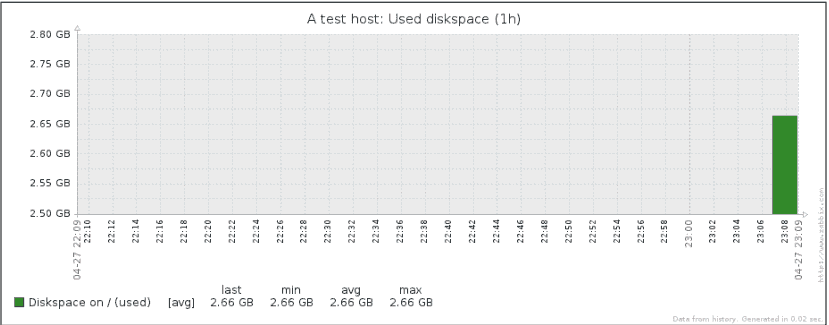

因此，此特定主机的根文件系统使用了略多于两个半千兆字节。但图表很难阅读——它没有显示分区相对已满的程度。y 轴从我们值以下一点开始，并在其以上一点结束。关于 y 轴期望的上限，我们可以在 **Monitoring | Latest data** 中查出根文件系统的总磁盘空间：

| Metric | Timestamp | Value |
|---|---|---|
| Diskspace on / (total) | 2016-04-27 23:10:56 | 58.93 GB |

因此总共有近 60 GB 的空间，这在图表上也没有反映。让我们尝试让图表更易读一些。在模板中 **Used diskspace** 图表的配置中，查看两个选项——**Y axis MIN value** 和 **Y axis MAX value**。它们目前都设置为 Calculated，但对于我们当前的场景似乎不太适用。首先，我们希望确保图表从零开始，因此将 **Y axis MIN value** 更改为 **Fixed**。这允许我们输入任意值，但我们想要的默认值是零。

对于上限，我们可以计算 58.93 GB 为字节并插入该值，但如果可用磁盘空间发生变化怎么办？通常文件系统会通过添加物理硬件、使用 **Logical Volume Management (LVM)** 或其他方式而增加。

这是否意味着每次可能发生这种情况时我们都必须更新 Zabbix 配置？幸运的是，不需要。对于这种情况有一个很好的解决方案。在 **Y axis MAX value** 下拉菜单中，选择 **Item**。这会添加另一个字段和一个按钮，因此点击 **Select**。在弹出窗口中，在 **NAME** 列中点击 **Diskspace on / (total)**。最终的 y 轴配置应如下所示：

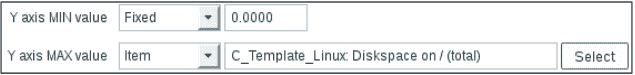

如果这样，点击 **Update**。现在是时候检查对图表的影响了——查看 **Monitoring | Graphs** 中的 **Used diskspace** 图表：

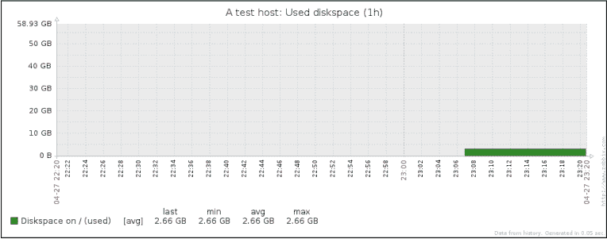

> 如果 y 轴最大值设置为总磁盘空间量，而总磁盘空间项目尚未收到值。在这种情况下，您可以等待项目更新或暂时降低其间隔。

现在图表可以轻松识别磁盘已满的程度。请注意，我们在模板上使用了这样的图表。所有主机都将具有已用和总磁盘空间项目，图表将自动按该主机拥有的总磁盘空间量进行缩放。此方法也可用于已用内存或任何您想查看可能值的完整范围的项目。可能出现的负面副作用是当监控大值（如 PB 级文件系统）时。随着 y 轴范围跨越数 PB，我们几乎看不到数据的正常变化，因为 y 轴上的一个像素将是数 GB。

> 目前无法分别为左右 y 轴设置 y 轴最小值和最大值。


# 百分位线

百分位数是一个阈值，低于该阈值的值占给定百分比。例如，如果我们有网络流量测量值，就可以计算出 95% 的值低于 103 Mbps，而 5% 的值高于该数值。这样，我们便可以过滤掉峰值，同时仍然能够较为精确地测量所使用的带宽。实际上，按使用带宽计费时，最常采用的就是百分位数。因此，在网络流量图中绘制百分位线会非常有用，而 Zabbix 恰好提供了实现这一功能的方法。要了解其工作方式，我们来创建一个新图形。导航到 Configuration | Templates，单击 C_Template_Linux 旁边的 Graphs，然后单击 Create graph 按钮。在 Name 字段中输入 Incoming traffic on eth0 with percentile。单击 Items 部分中的 Add，在弹出窗口中单击 NAME 列中的 Incoming traffic on interface eth0。对于此监控项，将颜色更改为红色。在图形属性中，勾选 Percentile line (left) 旁边的复选框，并在该字段中输入 95。完成后，单击底部的 Add 按钮。在监测部分查看此图形：

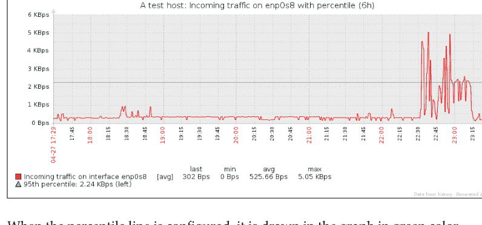

配置百分位线后，它会以绿色绘制在图形中（不过在深色主题下颜色会有所不同）。此外，图例中还会显示百分位信息。在此示例中，百分位线很好地抹平了几个峰值，用于显示平均带宽使用情况。由于 95% 的值高于百分位线，因此只有 5% 的值高于 2.24 KBps。

我们将默认的监控项颜色从绿色改成了其他颜色，这样百分位线就能使用不同的颜色，从而更容易区分。左侧 y 轴的百分位线始终使用绿色；右侧 y 轴的百分位线始终使用红色。

我们在此图形中只使用了一个监控项。当同一坐标轴上存在多个监控项时，Zabbix 会将所有值相加，并根据相加后的结果计算百分位数。目前无法在图形中为单个监控项指定百分位数。

要根据百分位值触发告警，可以使用触发器函数 percentile()。如需将此值存储为监控项，请参阅第 11 章“高级监控项监测”中的计算型监控项。

## 堆叠图形

我们之前创建的包含多个监控项（网络流量和 CPU 负载）的图形，是在 y 轴上独立放置这些监控项的。但有时我们可能希望将它们沿同一坐标轴一个叠加在另一个上面，也就是进行堆叠。可能的使用场景包括内存使用情况：我们可以堆叠缓冲区、缓存以及其他已使用的内存类型（并将 y 轴最大值链接到内存总量）；也可以堆叠多个接口上的网络流量，以查看网络总负载；或者在其他任何需要同时查看总量和数值分布的场景中使用。现在让我们尝试创建一个堆叠图形。打开 Configuration | Templates，单击 C_Template_Linux 旁边的 Graphs，然后单击 Create graph 按钮。在 Name 字段中输入 stacked network traffic，并将 Graph type 下拉列表更改为 Stacked。单击 Items 部分中的 Add，在弹出窗口中勾选 NAME 列中 Incoming traffic on interface eth0 和 Outgoing traffic on interface eth0 旁边的复选框，然后单击 Select。完成后，单击底部的 Add 按钮。

请注意，使用堆叠图形时，我们无法选择绘制样式——所有监控项都会使用 Filled region 样式。

如果测试机器上有多个活动接口，那么将所有接口的入站流量堆叠起来可能会很有趣；但在本例中，我们将看到同一接口上的入站和出站流量。

前往 Monitoring | Graphs 查看新图形，并确保从下拉列表中选择 Stacked network traffic：

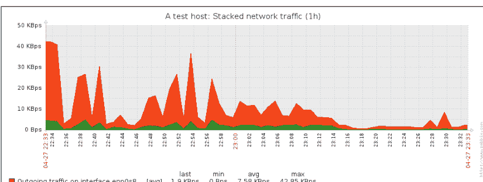

使用堆叠图形，我们既可以看到总量（由数据区域顶部表示），也可以看到各个监控项对总量的贡献。

## 饼图

到目前为止，我们创建的图形提供了广泛的自定义选项，但有时我们可能更关注各个值之间的比例。在这种情况下，可以创建饼图。转到 Configuration | Templates，单击 C_Template_Linux 旁边的 Graphs，然后单击 Create graph 按钮。在 Name 字段中输入 Used diskspace (pie)。在 Graph type 下拉列表中选择 Pie。单击 Items 部分中的 Add，勾选 NAME 列中 Diskspace on / (total) 和 Diskspace on / (used) 监控项旁边的复选框，然后单击 Select。

饼图中的图形监控项配置略有不同。我们不再选择绘制样式，而是选择类型。可以在 Simple 和 Graph sum 之间进行选择：

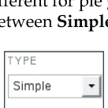

某些值的比例可以显示在饼图中，但要知道该比例有多大，必须将一个监控项指定为饼图的“总量”。在本例中，这应该是磁盘空间总量。对于 Diskspace on / (total)，在 TYPE 下拉列表中选择 Graph sum：

| 名称 | 类型 |
|---|---|
| C_Template_Linux: Diskspace on / (total) | Graph sum |
| C_Template_Linux: Diskspace on / (used) | Simple |

完成后，单击底部的 **Add** 按钮：


> 幸运的是，磁盘空间总量被分配为绿色，而已使用磁盘空间被分配为红色。对于更多监控项，我们可能需要调整颜色。

返回 **Monitoring | Graphs**，选择 **Used diskspace (pie)**：

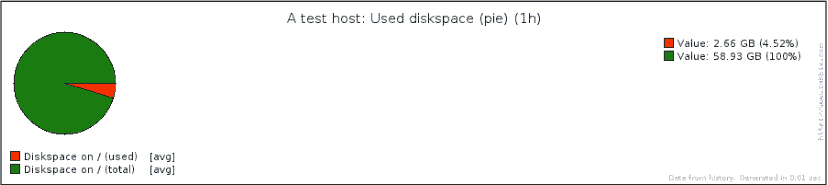

很好，整体看起来基本正确，只是右侧有一大片空白区域。怎样才能去掉它？返回此图形的配置页面。这一次，宽度和高度控件会派上用场。将 **Width** 字段更改为 430，将 **Height** 字段更改为 300，然后单击 **Update**。让我们再次在 **Monitoring | Graphs** 中查看效果是否有所改善：

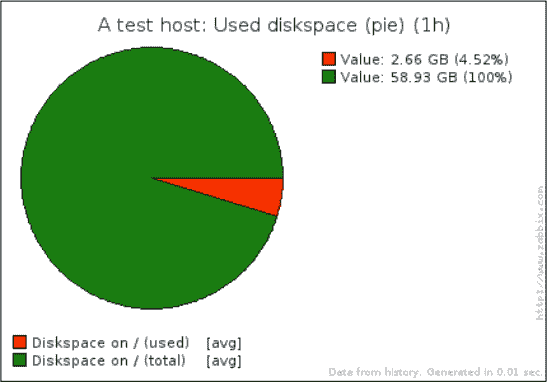


确实好多了，我们去除了巨大的空白区域。饼图也可以用于显示内存信息——整个饼图可以分为缓冲区、缓存和实际使用的内存，并以总内存量为基础进行展示。在这种情况下，应将总内存的类型设置为 **Graph sum**，而所有其他监控项的 **TYPE** 应设置为 **Simple**。

让我们再做一次更改。再次编辑 **Used diskspace (pie)** 图形。在 Graph type 下拉列表中选择 **Exploded**，并勾选 3D view 旁边的复选框。保存这些更改，然后在 **Monitoring | Graphs** 中刷新图形视图：

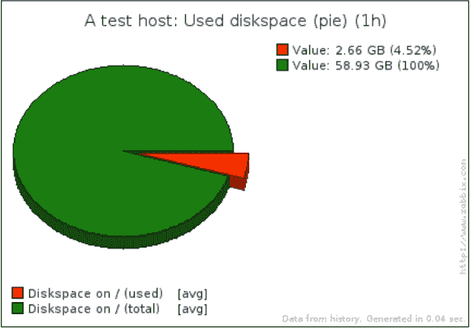

还记得我们为普通图形设置的“函数”吗？我们在 **avg** 和 **all** 之间进行了切换，同时还可以选择 **min** 和 **max**。饼图也支持这样的参数，但可用值略有不同：

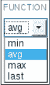

对于饼图，**all** 被替换为 **last**。虽然饼图本身没有时间序列，但我们仍然可以为其选择时间段。该函数决定如何从这个时间段中提取值。例如，如果我们显示一个时间段设置为 1 小时的饼图，并且在这一小时内获得的可用磁盘空间值分别为 60、40 和 20 GB，那么 **max**、**avg** 和 **min** 将分别返回这些值中的一个。如果函数设置为 **last**，无论时间段长度如何，都会始终显示最新的 20 GB 值。

> 监测百分比值时，最好将图形总量设置为手动值 100，这类似于设置 y 轴最大值。遗憾的是，目前尚不支持此功能，因此必须使用一个只接收“100”值的虚拟监控项。使用公式为“100”的计算型监控项是一种简单的实现方式。我们将在*第 11 章“高级监控项监测”*中讨论计算型监控项。

## 地图

我们已经介绍了多种数据可视化类型，这些类型可以提供非常广泛的视图。虽然能够在单个图形中放置不同内容，可以让我们在更丰富的上下文中查看数据和事件，但有时你可能希望以更宏观的视角了解事物及其相互关系。或者，你可能只是需要一些看起来很酷的内容来展示。

Zabbix 提供了创建地图的功能。虽然有时人们会将其称为网络地图，但这并不妨碍你使用它来映射任何想要展示的内容。在开始之前，请确保两台服务器都没有活动触发器——在 **Monitoring | Triggers** 下进行检查，并修复发现的任何问题。

### 创建地图

现在让我们尝试创建一个简单的地图——导航到 **Monitoring | Maps**，然后单击 **Create map**。在 **Name** 字段中输入“First map”，并勾选 **Expand single problem** 复选框。

> 以前的 Zabbix 版本允许我们在配置部分配置地图，并在监测部分查看地图。Zabbix 3.0 已将这两项操作都移到了监测部分。


# 使用图表和地图可视化数据

完成后，点击底部的 **Add** 按钮。嘿，这就完了吗？我们到底可以在哪里配置地图？在 **ACTIONS** 列中，点击 **Constructor**。是的，现在这更像一个编辑界面。首先我们需要添加一些内容，所以点击地图顶部 **Icon** 标签旁边的 **Add**。这会在地图的左上角添加一个元素。位置不是很好。解决这个问题，点击并拖动图标到其他位置，大约在 50×50 的单元格附近：

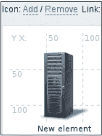

> 注意它如何吸附到网格。我们稍后会讨论这个功能。

地图看起来仍然不太有用，那现在该怎么办？只需单击一次我们刚刚添加的元素——这会打开元素属性表单。注意元素本身现在也被高亮显示了。默认情况下，添加的地图元素是图像，它不会显示有关监控系统的任何信息。为了简单起步，我们将使用主机，因此在 **Type** 下拉菜单中选择 **Host**——注意这会稍微改变表单。在 **Label** 文本区域输入 "A test host"，然后在 **Host** 字段中输入 "test" 并在下拉菜单中点击 **A test host**。默认图标是 **Server_(96)**——让我们稍微减小一点。在 **Icons** 部分的 **Default** 下拉菜单中选择 **Server_(64)**。属性应如下所示：

## 企业数据架构

本文档概述了企业数据架构策略，强调了所有数据平台的扩展性、安全性和运营效率。

- Centralized data governance framework
- Unified metadata management layer
- Real-time streaming data ingestion pipeline
- Batch processing for historical data analysis

该架构采用混合方法，结合云原生服务和本地基础设施，以确保数据驻留合规性并最大限度地降低关键工作负载的延迟。

### Key Components

- 1. **Data Lake Storage** - Serves as the central repository for raw and curated data assets.
- 2. **Processing Engine** - Supports both stream and batch processing using unified APIs.
- 3. **Data Catalog** - Provides end-to-end lineage tracking and business glossary management.
- 4. **Security Layer** - Implements row-level security and dynamic data masking.

如需更多详细信息，请参阅官方文档或联系数据平台团队。

一张只有一个元素的地图并不令人兴奋，所以再次点击 **Icon** 标签旁边的 **Add**，然后将新元素拖动到 450x50 的单元格附近。单击一次并更改其属性。首先在 **Type** 下拉菜单中选择 **Host**，然后为 **Label** 输入 Another host 并在 **Host** 字段中开始输入 "another"。在下拉菜单中选择 **Another host**。将默认图标更改为 **Server_(64)**，然后点击 **Apply**。注意元素不再与网格对齐——我们更改了图标大小，导致它们有点偏离网格单元格的中心。这是因为对齐是基于图标中心进行的，但图标定位是图标的左上角。当我们更改图标大小时，其左上角是固定的，而中心发生了变化，因此不再对齐。我们可以稍微拖动图标，图标就会吸附到网格上，或者我们可以点击顶部的 **Align icons** 控制。 现在点击 **Align icons**。同时注意地图上方的其他 **Grid controls**——点击 **Shown** 将隐藏网格（并将该标签更改为 **Hidden**）。点击 **On** 将停止在移动时将图标对齐到网格（并将该标签更改为 **Off**）。

地图不会自动保存——要保存，请点击右上角的 **Update** 按钮。出现的弹出窗口可能令人困惑——它并不是询问我们是否要保存地图。实际上，正如消息所述，地图在那时已经保存了。点击 **OK** 将返回地图列表，点击 **Cancel** 将保持地图编辑表单打开。通常点击 **OK** 或 **Cancel** 区别不大。

> 最好不时保存地图，尤其是在进行大量更改时。

现在是检查地图外观的好时机，所以前往 **Monitoring | Maps** 并在 **NAME** 列中点击 **First map**。它应该看起来相当不错，网格引导线已移除，除了大面积的空白区域，就像我们使用饼图时一样。这需要修复，所以点击地图本身上方的 **All maps** 并在 **First map** 旁边点击 **Properties**。在 **Width** 字段中输入 "600"，在 **Height** 字段中输入 "225"，然后点击 **Update**。再次在 **First map** 旁边的 **ACTIONS** 列中点击 **Constructor**。

显示和对齐到网格是可单独控制的——我们可以显示网格但不自动对齐到它，或不显示网格但仍用于对齐：


默认情况下，使用 50x50 像素的网格，并且有预定义的 20、40、50、75 和 100 的矩形网格可用。这些尺寸是硬编码的，不能自定义：

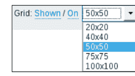

对于我们的地图，将网格大小更改为 75x75 并启用与网格的对齐，将图标定位在地图的相对两端，距离边框一个单元格。点击 Update 按钮保存更改。

> 更改地图时务必点击 Update。

前往 Monitoring | Maps 并在 NAME 列中点击 First map：

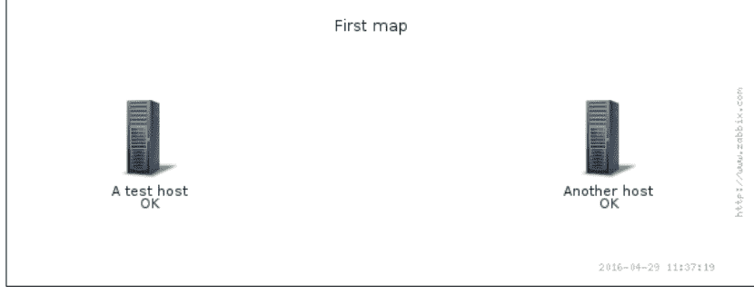

> 注意右上角的 + 按钮。点击它，地图可以轻松添加到仪表板收藏中。查看图表时也有相同的功能。

看起来好多了，我们验证了在需要向地图添加更多元素时可以轻松更改地图尺寸。

> 💡 Zabbix 地图不会像普通和堆叠图表的宽度那样自动缩放——配置的尺寸是固定的。

除了漂亮的视图外，此显示还提供什么？点击 **Another host** 图标：

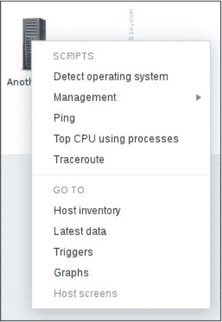

在这里我们可以访问一些全局脚本，包括默认脚本和我们在 *Chapter 7, Acting upon Monitored Conditions* 中配置的几个脚本。还有快速链接到主机清单，在 *Chapter 5, Managing Hosts, Users, and Permissions* 中讨论，以及此主机的最新数据、触发器和图表页面。当我们使用这些链接时，对应的视图将被过滤以显示我们最初点击的主机的信息。此部分中的最后一个链接 **Host screens** 目前处于禁用状态。我们将在 *Chapter 10, Visualizing Data with Screens and Slideshows* 中讨论主机（或模板化）屏幕。

我们谈到了使用地图来查看事物如何连接。在进一步探索之前，让我们创建一个基本的测试基础设施——我们将创建三项和三个触发器来表示网络可用性。为了便于控制，我们将检查某些文件是否存在，然后根据需要创建和删除这些文件。在 "A test host" 和 "Another host" 上执行以下操作：

```
$ touch /tmp/severity{1,2,3}
```

在前端，导航到 **Configuration | Templates** 并在 **C_Template_Linux** 旁边点击 **Items**，然后点击 **Create item** 按钮。在 **Name** 字段中输入 "Link $1" 并在 **Key** 字段中输入 `vfs.file.exists[/tmp/severity1]`，然后点击底部的 **Add** 按钮。现在克隆此项（通过点击它，然后点击 **Clone** 按钮）并创建另外两个，根据需要将文件名末尾的数字更改为 "2" 和 "3"。

> 不要忘记在打开项目详细信息后点击 **Clone**，否则你将只是编辑现有项目。

验证你已正确设置这三项：

| NAME | TRIGGERS | KEY |
|---|---|---|
| Link /tmp/severity1 |  | vfs.file.exists[/tmp/severity1] |
| Link /tmp/severity2 |  | vfs.file.exists[/tmp/severity2] |
| Link /tmp/severity3 |  | vfs.file.exists[/tmp/severity3] |

现在是触发器——在导航栏中点击 **Triggers** 并点击 **Create trigger** 按钮。在 **Name** 字段中输入 "Latency too high on {HOST.NAME}" 并在 **Expression** 字段中输入 `{C_Template_Linux:vfs.file.exists[/tmp/severity1].last()}=0`。在 **Severity** 部分选择 **Warning**，然后点击底部的 **Add** 按钮。与项目一样，克隆此触发器两次并更改 **Expression** 字段中的严重性编号。至于名称和严重性，让我们使用以下内容：

- 第二个触发器用于 **severity2** 文件：名称为 "**Link down for 5 minutes on {HOST.NAME}**" 且严重性为 **Average**
- 第三个触发器用于 **severity3** 文件：名称为 "**Link down for 10 minutes on {HOST.NAME}**" 且严重性为 **High**


最后三个触发器应如下所示：

| Severity | Name | Expression |
|---|---|---|
| Warning | Latency too high on {HOST.NAME} | {C_Template_Linux.vfs.file.exists[/tmp/severity1].last()}=0 |
| Average | Link down for 5 minutes on {HOST.NAME} | {C_Template_Linux.vfs.file.exists[/tmp/severity2].last()}=0 |
| High | Link down for 10 minutes on {HOST.NAME} | {C_Template_Linux.vfs.file.exists[/tmp/severity3].last()}=0 |

虽然克隆项目和触发器会带上所有其细节，但克隆地图仅包含地图属性——实际的地图内容、图标、标签和其他信息都不会被克隆。复制地图的一个相对简单的方法是将其导出为 XML，在 XML 文件中更改地图名称然后再导入回来。我们在第 21 章《与数据紧密协作》中讨论了 XML 导出和导入功能。

## 链接地图元素

我们现在已经搭建好了测试环境。Zabbix 允许我们用称为链接的线条连接地图元素——让我们看看地图链接能提供什么功能。进入 Monitoring | Maps 并点击显示地图上方“All maps”，然后在 ACTIONS 列中点击 First map 旁边的 Constructor。

我们之前创建的三元组项目和触发器现在可以用作网络链接问题指示器。你可以在地图中添加链接连接两个元素。此外，还可以根据触发器状态更改连接器的属性。假设你在两个机房之间有一个网络链接。你希望网络地图上显示的链接根据连接状态改变外观，如下所示：

- **No problems**: Green line
- **High latency**: Yellow line
- **Connection problems for 5 minutes**: Orange, dashed line
- **Connection problems for 10 minutes**: Red, bold line

好消息是，Zabbix 支持这种配置。我们将使用这三个项目和触发器来模拟每种状态。让我们尝试添加一个链接——点击地图顶部 Link 标签旁边的 Add。现在不行了。弹出窗口告知我们 Two elements should be selected。我们该如何做到？

先点击一次 A test host，然后按住 Ctrl 再点击 Another host。这样就选中了两个主机。属性弹出窗口也随之改变，显示可以一次性批量更改两个元素的属性。Apple 系统用户可能需要按住 Command 键代替。

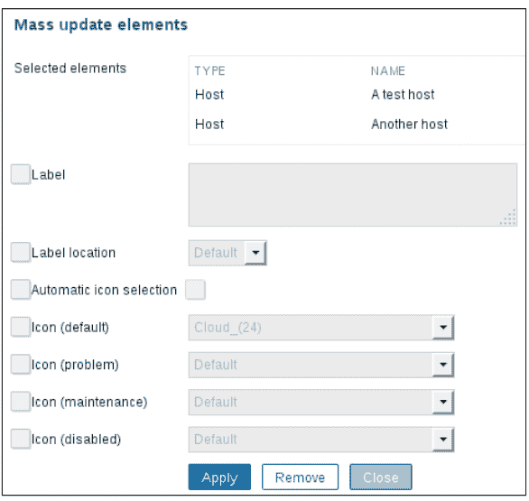

> 如果弹出窗口遮挡了你想选中的元素，不要关闭弹出窗口，只需拖动弹出窗口，使被遮挡的元素可以访问。虽然在默认主题中不明显，但可以通过其上部区域拖动弹出窗口。

另一种选择多个元素的方法是在地图配置区域拖动一个矩形框住它们：

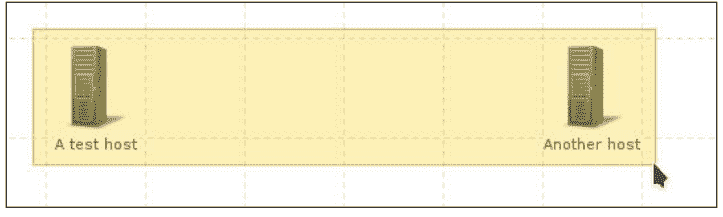

即使可以像这样拖选多个元素，目前也没有移动多个元素的方法——即使选中了多个元素，也只有我们拖动的元素会被移动。

无论你使用哪种方式选中了两个主机，现在再次点击 Link 标签旁边的 Add。地图现在会在两个主机之间显示新的链接，默认是绿色的。注意属性编辑器底部出现了 Links 部分：

| Links | FROM | TO | LINK INDICATORS | ACTION |
|---|---|---|---|---|
|  | A test host | Another host |  | Edit |

元素被放在 FROM 和 TO 列中的顺序其实并不重要——Zabbix 中的地图链接没有方向概念。

在这里我们可以编辑链接本身的属性——点击 ACTION 列中的 Edit。

让我们定义条件及其对链接的影响。点击 Link indicators 部分的 Add。在弹出的窗口中，在 Group 字段选择 Linux servers，在 Host 下拉菜单中选择 A test host，然后勾选我们刚刚创建的那三个触发器旁边的复选框，然后点击 Select：

| Trigger | Severity |
|---|---|
| ☑ Latency too high on A test host | Warning |
| ☑ Link down for 5 minutes on A test host | Average |
| ☑ Link down for 10 minutes on A test host | High |

现在我们需要配置这些触发器在激活时会产生什么效果。对于高延迟触发器，在颜色选择器中将其颜色更改为黄色。对于 5 分钟连接丢失触发器，我们可能希望配置一条橙色虚线。在其 TYPE 下拉菜单中选择 Dashed line，然后在颜色选择器中选择橙色。或者也可以不选。颜色选择器有点受限，而且没有橙色。但幸运的是，十六进制 RGB 输入字段允许我们指定任意颜色。在第二个触发器中输入 FFAA00。对于 10 分钟连接丢失触发器，在 TYPE 下拉菜单中选择 Bold line 并将颜色保持为红色。

最终的链接配置应类似于这样：

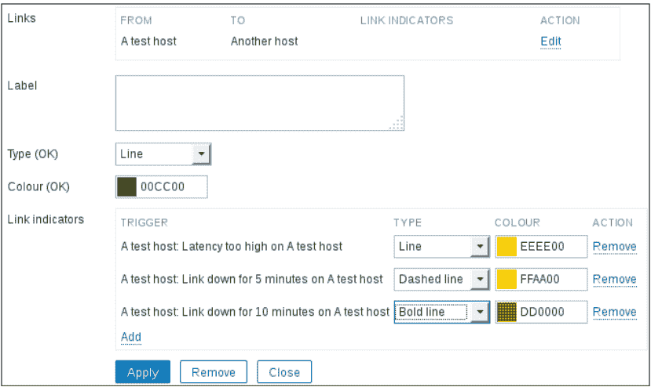

完成后，点击连接器区域的 Apply，然后关闭地图元素属性并点击地图上方的 Update 按钮并在弹出窗口中点击 OK。点击 NAME 列中的 First map。看起来一切正常，两个主机都显示 OK，链接为绿色。在 "A test host" 上执行：

```
$ rm /tmp/severity2
```

我们刚刚中断了对远程数据中心的连接 5 分钟。再次查看地图。你可能需要等待最多 30 秒才能看到变化：

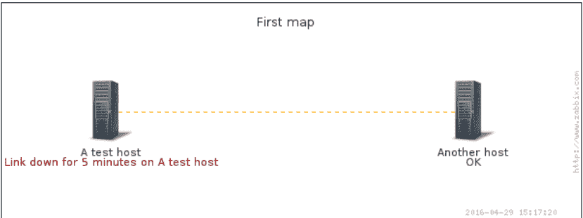

> 在 Zabbix 版本 3.0.0 中存在一个 bug——地图不会自动刷新。预计在 3.0.3 版本中修复。

为了吸引操作员的更多注意，线条现在变为红色并加粗。与主机只有一个问题且能够显示触发器名称或字符串 **1 Problem** 不同，当有多个触发器激活时，问题计数始终会列出。现在，假设我们的延迟触发器检查更长的时间段，现在才触发。在 `A test host` 上执行以下操作：

```
$ rm /tmp/severity1
```

等待 30 秒，然后刷新地图。我们现在应该看到一条黄色线。实际上，加粗的红色线仍然在那里，即使它已正确检测到现在有三个活动问题。为什么会这样？问题在于，触发器触发的顺序并不重要——触发器严重程度决定了哪种样式优先。我们为触发器仔细设置了三种不同的严重程度，因此触发器触发时不会有歧义。如果添加多个具有相同严重程度但样式不同的状态指示器触发器并且它们全部触发会怎样？别这样。虽然技术上可以创建这种情况，但那毫无意义。如果有多个相同严重程度的触发器，只需为它们使用相同的样式即可。让我们修复连接，同时仍然保持高延迟：

```
$ touch /tmp/severity{2,3}
```

只应剩下一个问题，元素之间的链接最终应为黄色——更高严重程度的触发器不再覆盖提供黄色颜色的触发器。

随意尝试移除和添加测试文件；链接应始终根据附加的活动触发器中严重程度最高的那个指定的样式进行样式化。

状态指示器的数量没有实际限制，因此你可以轻松添加更多视觉差异级别。

我们使用了链接的两个主机之一的触发器，但关联的触发器不需要位于链接连接的主机上——它甚至可能根本不在地图上。如果你决定在两个主机之间绘制链接，触发器可以来自完全不同的主机。在这种情况下两个元素都会显示状态为 "OK"，但链接会改变其属性。

## 选择链接

我们目前的地图只有一个链接。要访问链接属性，我们可以选择该链接连接的元素之一，链接部分将出现在元素属性弹出窗口底部。在更复杂的地图中，如果一个元素有很多链接，选择正确的链接可能会很困难。幸运的是，Zabbix 地图编辑界面遵循一些规则，使其更容易：

- 如果只选择了一个元素，则会显示其所有链接
- 如果选择了多个元素，则只显示所选元素之间的链接

几个示例来说明这些规则：

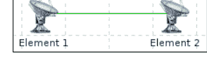

选择一个或两个元素会显示一个链接：

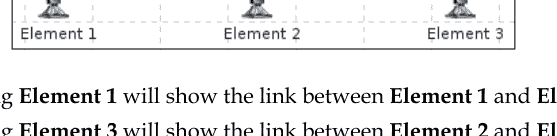

- 选择 Element 1 会显示 Element 1 和 Element 2 之间的链接
- 选择 Element 3 会显示 Element 2 和 Element 3 之间的链接
- 选择 Element 2 会显示两个链接
- 选择 Element 2 和 Element 1 或 Element 3 中的任一个会显示所选元素之间的链接
- 选择 Element 1 和 Element 3 不会显示任何链接
- 选择全部三个元素会显示两个链接

最重要的是，即使 Element 2 上有 20 条链接，我们也可以通过选择 Element 2 和该链接另一端的元素来选择特定的链接。

> 对于主机等命名元素，名称会显示在链接列表中。对于图像，只会显示图标名称。如果所有图像都使用相同的图标，列表中的名称将相同。


## 路由和隐形链接

Zabbix 中的链接只是从一个元素中心到另一个元素中心的直线。如果两个已连接元素之间有另一个元素怎么办？链接会直接从“阻挡”元素下方穿过。没有内置方法可以以其他方式“路由”链接，但有一种略显粗糙的变通方法。我们可以上传一张透明 PNG 图片作为自定义图标（本章稍后会讨论上传额外图片），然后用它来路由链接：

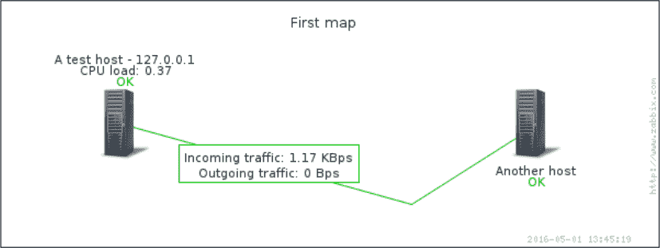

> 请注意主机和链接上的信息标签——我们将在本章后面讨论此类功能。

请注意，如果使用链接指示器，则必须在所有此类链接上进行配置——否则，某些片段会根据触发器状态改变颜色和样式，而另一些则不会。

这种方法还可以用于让链接从某个系统引出时为单条线，稍后才分成多条线。这可以减少某些地图中的杂乱。

另一个问题是，在某些地图中可能有大量链接。显示它们可能导致地图难以阅读。这里有一个技巧：将链接的默认颜色设置为地图背景颜色，仅在出现问题时通过链接指示器让这些链接显示出来。

## 进一步自定义地图

让我们看看还有哪些其他功能可以为地图配置增添亮点。

### 标签中的宏

到目前为止，我们使用的地图元素的名称在标签中是硬编码的，状态会自动添加到其中。我们可以自动使用主机属性中的名称并显示一些附加信息。在监控 | 地图 中，如果显示了地图，请点击所有地图，然后点击名称列中的 First map。

> 请注意网格设置是如何被保留的。包括对齐到网格、显示网格和网格大小在内的网格设置会针对每张地图单独保存。

点击 A test host 图标。在标签字段中输入“{HOST.NAME} - {HOST.IP}”，然后在标签位置下拉菜单中选择顶部。点击应用：

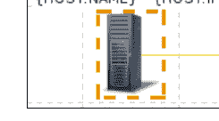

> {HOST.IP} 宏总是按顺序获取接口地址，从代理接口开始。如果主机有多种接口类型，则无法指定如何优先选择例如 SNMP 接口而不是代理接口。

奇怪……我们输入的值没有被解析，显示的是实际的宏。默认情况下，出于性能原因，宏在地图配置中不会被解析。查看地图上方顶栏；有一个展开宏控件，默认设置为关闭：

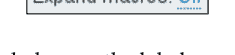

点击它切换到开启，然后观察我们之前更改的标签。现在应该显示主机名和 IP 地址：

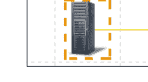

主机名和 IP 地址的宏在二者可能发生变化时非常有用，因为我们不想检查每张地图然后手动更新这些值。此外，当大量主机被添加到地图时，我们可以对它们进行批量更新并输入“{HOST.NAME}”，而不是为每一台单独设置名称。

> 最好不时点击更新按钮保存地图——例如，现在正是个好时机。点击取消关闭奇怪的弹出窗口；地图无论如何都已保存。

注意，我们还可以更改标签位置。默认情况下，使用地图属性中设置的任何内容，但可以为单个元素覆盖。

元素标签中还有更多可用的宏，Zabbix 手册中有完整列表。特别令人感兴趣的可能是显示项目实际数据的能力；让我们尝试一下。在 A test host 的标签中，添加另一行“{A test host:system.cpu.load.last()}”，然后观察标签：

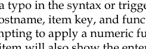

> 没有像触发器那样的辅助工具——我们总是必须手动输入宏数据。
> 如果标签没有显示 CPU 负载值，而是显示*未知*字符串，则可能是主机名或项目键中有拼写错误。如果所选函数没有该项目的可显示数据，也可能显示此内容。如果显示的是输入的宏而不是值，则可能是语法或触发器函数名称有拼写错误。请注意，主机名、项目键和函数名称都区分大小写。尝试对字符串或文本项目应用数值函数（如 avg()）也会显示输入的宏。

现在，该主机的实时监控数据已显示。语法与触发器中的几乎相同，只是地图标签只支持一部分触发器函数，即使对于受支持的函数，也只支持一部分参数。我们只能使用触发器函数 last()、min()、max() 和 avg()。在参数中，只能使用时间段，可以以秒为单位指定，也可以使用用户友好的格式。例如，avg(300) 和 avg(5m) 都可以在地图标签中工作。

不过，观察者不太清楚这个值是什么。改进方法是在该行前加上“CPU负载:”，这会使标签清晰得多：

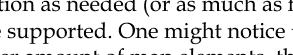

这样，可以根据需要（或容纳得下）向地图元素添加尽可能多的信息——支持多行。人们可能会注意到这里的硬编码主机名。在更新大量地图元素时，这可能很麻烦，但幸运的是我们可以再次使用宏——将该行改为“CPU负载: {{HOST.HOST}:system.cpu.load.last()}”。地图中的实际功能不应改变，因为这个元素现在应该从宏中获取主机名。请注意这里的嵌套用法。

> 宏 {HOST.NAME} 在这里不起作用。该宏解析为主机的可见名称，但要标识主机，我们必须引用其主机名或所谓的“主机技术名称”。是的，宏命名可能有点令人困惑。

元素标签可以显示什么？CPU 负载、内存或磁盘使用情况、连接到无线接入点的用户数——任何在地图中需要立即看到的有用信息。

我们还可以看到，这个主机仍然有一个问题，是由我们模拟的延迟触发器引起的。在“A test host”上执行：

```
$ touch /tmp/severity1
```

### 链接标签

如前所述，我们也可以在链接上放置标签。回到 First map 的构造器中，点击 A test host 图标。点击链接部分中的编辑以打开链接属性，然后在标签区域中输入“慢速链接”，并在链接属性中点击应用。观察地图中的变化：


在链接上，标签始终是一个矩形框，其颜色与链接本身相同。它位于链接的中心——无法指定偏移量。

使用硬编码文本可能有用，但像我们为主机所做的那样显示监控数据会更好。幸运的是，这是可能的，我们可以在此链接上显示网络流量数据。将链接标签改为以下内容：

```
Incoming traffic: {A test host:net.if.in[eth0].last()}
Outgoing traffic: {A test host:net.if.out[eth0].last()}
```

> 这里我们不能使用自动引用，如 {HOST.HOST}。链接与任何主机都没有关联，这样的引用会失败。

这里我们混合了自由格式文本（例如，你可以将某个链接标记为“慢速链接”）和宏（在这种情况下，引用特定的流量项目）。点击链接属性的 **应用**。这也可能是点击右上角的 **更新** 保存更改的好时机：

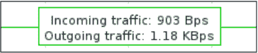

我们使用的两个宏和多行布局都工作得很好。

> 我们可以引用任何项目类型——代理、SNMP 等。只要它在收集数据，就可以在地图上显示值。

有关地图元素标签中支持的宏的完整列表，请参阅 Zabbix 手册。

### 在地图元素上反映问题

在标签中列出问题计数很有用，但在壁挂式显示器上远距离看并不容易。我们可能还希望地图看起来更美观一点，让问题对我们的用户更突出。Zabbix 提供了两种方法来实现这一点：

- 自定义图标
- 图标高亮

在 **First map** 构造器中，点击 **A test host**。在 **图标** 部分，从 **问题** 下拉菜单中选择一个不同的图标——出于测试目的，我们选择 **Crypto-router_(24)** 图标，但任何图标都可以。点击 **应用**，然后为地图点击 **更新**。此外，在“A test host”上运行：

```
$ rm /tmp/severity1
```


大约 30 秒后，检查监控视图中的地图——状态图标在配置部分中不显示：


一旦主机上出现问题，图标就会自动更改。在配置中，有两个额外的状态可以拥有自己的图标——当主机被禁用时以及当它处于维护中时。当然，服务器不应该变成路由器或其他意外的设备。通常的做法是有一个正常图标，然后是一个上面画有红色叉的图标，或者旁边有一个小彩色圆圈来表示状态。

> 注意链接不再水平对齐。 由于图标按其左上角定位，较小的图标其中心被移动。 链接附加到图标的中心。

手动指定不同的图标是可以的，但在更大规模上这样做可能会很麻烦。 识别有问题的元素的另一个功能称为图标高亮。 与按状态选择图标相反，这里使用的是通用高亮。 这是一个地图级别的选项，没有办法按地图元素进行自定义。 让我们测试一下。 在所有地图的列表中，单击 First map 旁边的 Properties 并勾选 **Icon highlighting** 复选框。 此设置决定地图元素是否根据其状态接收额外的可视化。 单击 Update，然后打开 Configuration | Hosts。 单击 Another host 旁边的 Enabled 以切换其状态并确认弹出窗口以禁用此主机。 检查监控视图中的地图：

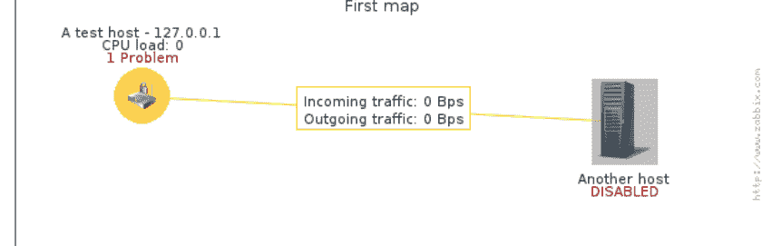

两个主机现在都有某种背景。 这是什么意思？

- 圆形背景表示触发器状态。 如果任何触发器不在 OK 状态，则优先级最高的触发器决定圆圈的颜色。
- 方形背景表示主机状态。 禁用的主机接收灰色高亮。 处于维护中的主机接收橙色背景。

单击 **A test host**，然后单击 **Triggers**。 在触发器列表中，单击 **ACK** 列中的 **No**，输入一些消息并单击 **Acknowledge**。 再次检查监控视图中的地图：

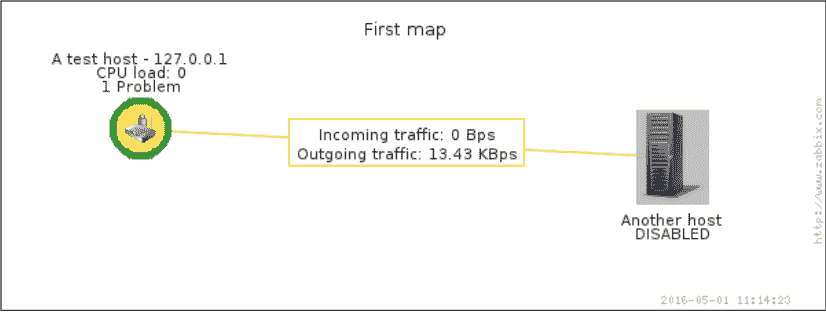

彩色圆圈现在有一个粗的绿色边框。 此边框表示确认状态——如果存在，则表示问题已被确认。

Zabbix 默认图标目前居中效果不佳。 当使用图标高亮时这一点最明显——注意 **Another host** 因阴影而错位。 对于此图标，在问题高亮中甚至更明显。 在 **First map** 的构造器中，单击 **A test host** 并在 **Icons** 部分的 **Problem** 下拉菜单中选择 **Default**。 单击 **Apply** 然后为地图单击 **Update**，然后检查监控部分视图中的地图：


在这种配置下，可能需要使用另一套图标以获得更悦目的外观。

> Zabbix 源代码归档在 misc/images/png_classic 目录中有旧图标，这些图标在 Zabbix 2.0 之前使用。

要将事物恢复到正常状态，请打开 Configuration | Hosts，单击 Another host 旁边的 Disabled 并确认弹出窗口，然后在 "A test host" 上执行：

```
$ touch /tmp/severity1
```

## 可用的地图元素

主机并不是我们可以在地图上添加的唯一元素类型。 在 First map 的构造器中，单击 Another host 并展开元素属性中的 Type 下拉菜单。 我们现在不会使用额外的类型，但让我们看看有哪些可用：

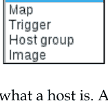

- **Host**：我们已经介绍过主机是什么。 主机显示所有相关触发器的信息。

- **Map**：你实际上可以插入指向另一张地图的链接。 它将像所有元素一样具有图标，单击它会提供一个菜单以打开该地图。 这使我们能够创建有趣的钻取配置。 我们可以有一个世界地图，然后链接到大陆地图，其次是国家级地图、城市级地图、数据中心级地图、机架级地图、系统级地图，在另一端我们甚至可以扩展到具有不同星球和星系的地图！ 好吧，我们有点走神了。 当然，每个级别都将具有作为背景图像的适当地图或示意图集。

- **Trigger**：这与主机非常相似，只是只包含单个触发器的信息。 这样你就可以在地图上放置一个不受主机上其他触发器影响的单个触发器。 在我们的嵌套地图场景中，我们可以在最后的显示中使用触发器，在背景中放置一个核心路由器示意图并为特定端口添加单个触发器。

- **Host group**：这与主机类似，只是收集组中所有主机的信息。 在简单模式下，显示单个图标来代表所选组中的所有主机。 这对于更高级别的概览很有用，但在前面提到的嵌套场景中尤其不错，我们可以在其中按大陆、国家和城市对所有主机进行分组，从而在上层地图上放置一些图标。 例如，如果我们有足够的空间，我们可以在全球地图上放置按国家的主机组元素。 地图上的主机组元素也可以单独显示所有主机——我们稍后会介绍该功能。

- **Image**：这允许我们在地图上放置图像。 图像可能只是视觉上的，例如服务器机房中空调的位置，但它也可以分配一个 URL；因此，你可以链接到任意对象。

谈到 **URLs**，请看元素属性弹出窗口的底部：


这里可以添加多个 URL，每个都可以有一个名称。 当在监控部分查看地图时，单击元素会在菜单中包含 **URL** 名称。 它们可以提供快速访问交换机或 UPS 设备的 Web 管理页面，或内部 Wiki 中的页面，描述使用此特定设备的故障排除步骤。 此外，**URL** 字段中支持以下宏：

- `{TRIGGER.ID}`
- `{HOST.ID}`
- `{HOSTGROUP.ID}`
- `{MAP.ID}`

这使我们能够添加指向 Zabbix 前端部分的链接，同时在打开的 URL 中指定我们单击的实体的 ID。

## 地图过滤

地图元素“host”、“host group”和“map”汇总了所有相关问题的信息。 通常这正是需要的，但 Zabbix 地图也允许过滤显示的问题。 可用的条件如下：

- **Acknowledgment status**：这可以为整个地图设置
- **Trigger severity**：这可以为整个地图设置
- **Application**：这可以为单个主机设置

在地图属性中，**Problem display** 下拉菜单控制基于其确认状态的问题如何显示。 这是一个仅在配置时生效的选项，不能在监控部分中更改。 可用的选择如下：

- **All**
- **Separated**
- **Unacknowledged only**

All 选项是我们当前选择的内容，确认状态不会影响问题显示。 **Separated** 选项将显示两行——一行显示问题的总数，另一行显示未确认问题的数量：

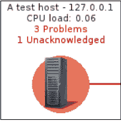

注意总计行和未确认行具有不同的颜色。 选项 **Unacknowledged only**，顾名思义，仅显示当前未被确认的问题。

过滤地图上显示的信息的另一种方法是按触发器严重性。 在地图属性中，**Minimum trigger severity** 选项允许我们选择要过滤的严重性：


如果我们选择 **High**，像前面的屏幕截图中那样，在监控部分打开地图将忽略除两个最高严重性级别之外的所有内容。 默认情况下，选择 **Not classified**，这会显示所有问题。 更棒的是，当我们在监控部分查看地图时，在右上角我们可以更改严重性，无论地图配置中选择了哪个级别：


> 此时，链接指示器会忽略严重性筛选器。这很可能是一个 bug，但截至本文撰写时，尚不清楚何时会修复。

另一种筛选地图上显示内容的方法，是在主机级别按应用（应用只是项目组）进行筛选。编辑显示主机数据的地图元素时，会看到一个**应用**字段：

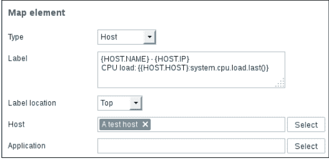

在此处选择应用后，只会考虑引用该应用中项目的触发器。这是一个自由输入字段——如果手动输入应用名称，请确保其与项目中使用的应用名称完全一致。此处只能指定一个应用。这是一个仅在配置时生效的选项，无法在监控部分进行更改。

## 自定义图标和背景图像

Zabbix 自带可用于地图的图标。很多时候，我们可能希望使用其他来源的图标，这可以通过先将图标上传到 Zabbix 来实现。要上传用作图标的图像，请转到**管理 | 常规**，然后从下拉菜单中选择**图像**。单击**创建**图标按钮，为新图标选择一个名称，然后选择一个图像文件——最好不要太大：

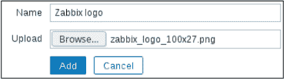

> 尽管按钮标签显示为**创建**，但我们实际上只是上传图像。

单击**添加**。在接下来的某张图像中，应该可以看到我们刚刚上传的图像。除了自定义图标外，我们还可以上传用于地图的背景图像。在**类型**下拉菜单中切换到**背景**，然后单击**创建背景**按钮。请注意，与其他页面不同，在 3.0.0 中，此下拉菜单位于左侧。再次输入背景名称并选择一个图像——最好选择尺寸为 600x225 的图像，因为这正是我们地图的尺寸。较小的图像会在边缘留下空白，而较大的图像则会被裁剪：

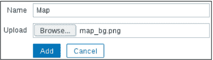

> 对于背景图像，建议使用简单的 PNG 图像，因为它们对实际监控数据的干扰较小，并且在查看地图时下载所需的大小也更小。

单击**添加**。由于 Zabbix 默认不提供背景图像，因此我们添加的图像现在应该是唯一显示的图像。图像上传完成后，让我们尝试在地图中使用它们。转到**监控 | 地图**，如果当前显示的是某个地图，请单击**所有地图**。单击**第一张地图**旁边的**构造器**，然后单击**图标**标签旁边的**添加**，接着单击新添加的图标。在**图标**部分，将**默认**下拉菜单更改为显示你为上传图标选择的名称，然后单击**应用**。将这个新图标放置到看起来最合适的位置（记得可以禁用网格吸附功能）。你可能还需要清空**标签**字段。记得单击**应用**，以便在地图上查看更改：

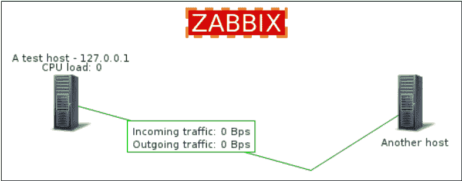

在此屏幕截图中，Zabbix 标志周围的边框是编辑界面中的选中边框。此处已隐藏网格线。

对图像位置满意后，单击右上角的**更新**以保存地图。这次，我们可以在弹出窗口中单击**确定**，返回地图列表。现在设置背景——单击**第一张地图**旁边的**属性**。在配置表单中，**背景图像**下拉菜单当前选择的是**无图像**。我们上传的背景应该可以在此处找到——选择它：


单击**更新**，然后再次单击**第一张地图**旁边的**构造器**。编辑界面应该会显示我们选择的背景图像，现在可以调整图像位置，使其与背景相匹配：


地图图像由 MapQuest 和 OpenStreetMap 提供

上传大量图像可能不太有趣。使用 XML 导入可以非常轻松地自动完成这一过程，相关内容将在第 21 章“与数据紧密协作”中讨论；我们还将介绍使用 Zabbix API 执行此类任务的可能性。

下面是一个较大地理地图可能呈现的样子：


地图图像由 Wikimedia 和 OpenStreetMap 提供：

这里使用地理地图作为背景，不同的元素彼此连接。

## 图标映射

到目前为止，我们用于元素的图像要么是静态的，要么会根据主机和触发器状态发生变化。Zabbix 还可以根据主机资产清单中的内容自动选择正确的图标。此功能称为图标映射。在使用它之前，我们必须先配置图标映射。转到**管理 | 常规**，从下拉菜单中选择**图标映射**，然后单击右上角的**创建图标映射**按钮。图标映射条目允许我们指定一个正则表达式、一个用于匹配该表达式的资产清单字段，以及匹配成功时要使用的图标。所有条目都会按顺序进行匹配，第一个匹配成功的条目将决定使用哪个图标。如果没有找到匹配项，则使用**默认**下拉菜单中指定的备用图标。

## 使用图形和地图可视化数据

完成后，单击底部的**添加**按钮。现在转到**监控 | 地图**，如果当前显示的是某个地图，请单击**所有地图**。单击**第一张地图**旁边的**属性**，然后在**自动图标映射**下拉菜单中选择我们刚刚创建的图标映射——除了`<手动>`条目外，它应该是唯一的选项。单击底部的**更新**按钮。现在，如果我们在监控视图中查看此地图，实际上不会看到任何区别。要了解原因，请转到地图列表，然后单击**第一张地图**旁边的**构造器**。在地图编辑视图中，单击**测试主机**。此时尚未启用**自动图标选择**。如果向此地图添加新元素，由于地图现在已分配图标映射，该元素将启用自动图标选择。将图标映射分配给地图时，现有元素会保留其配置——这些元素是在尚未分配图标映射时添加的。按住*Ctrl*，单击**另一台主机**。在批量更新表单中，先勾选**自动图标选择**左侧的复选框，然后勾选右侧的复选框。第一个复选框指示 Zabbix 覆盖所有选定元素的此选项，第二个复选框则指定为这些元素启用该选项：


> 勾选**自动图标选择**复选框后，手动图标选择下拉菜单将被禁用——对于同一个图标，这些功能不能同时使用。

单击**应用**，注意两台主机的图标都变成了图标映射属性中的默认图标。这似乎不正确，至少“测试主机”的该字段中有 3.0 版本号。原因同样与性能有关——在配置界面中不会应用图标映射，始终使用默认图标。单击**更新**保存更改，然后在监控视图中打开此地图：


在这里，**测试主机**获得了应该用于 Zabbix agent 3.0 的图标（假设该主机上安装的是 Zabbix agent 3.0）。**另一台主机**没有匹配该检查，因此获得了默认图标，因为项目尚未更新资产清单字段。稍后，当 agent 版本项目获取到“另一台主机”的数据后，它也应该会更换图标。

图标映射可以用于根据主机运行的操作系统显示不同的图标。对于网络设备，如果根据 `sysDescr` OID 设置图标映射，我们可以显示一个通用设备图标，并在其中一个角落显示供应商徽标。对于 UPS 设备，图标可以根据设备状态发生变化——充电时使用一个图标，放电时使用另一个图标，在提示更换电池时使用第三个图标。


- **图标标签类型**：设置用于标签的内容。默认情况下，它设置为**标签**，正如我们所使用的。其他选项包括**IP地址**、**元素名称**、**仅状态**和**无**，这些都不言自明。如果主机有多个接口，我们无法选择应显示哪个**IP地址**——与`{HOST.IP}`宏一样，Zabbix会自动选择一个IP地址，从agent接口开始。其中一些选项仅对某些元素类型有意义——例如，IP地址仅对主机元素有意义。在此上方，**高级标签**允许我们为每种元素类型单独设置标签类型：


- **图标标签位置**：这允许我们指定默认标签位置。对于所有使用默认位置的元素，此选项将控制标签的位置。

> Zabbix 3.0.0有一个bug——启用**高级标签**会在每个下拉框下方显示一个额外的文本字段。在撰写本文时，尚不知道哪个版本会修复此问题。

## 显示主机组元素

之前我们讨论可用的地图元素时，提到我们可以自动显示主机组中的所有主机。要了解其工作原理，请导航到地图列表并点击“创建地图”。在“名称”字段中输入“Host group elements”，然后点击底部的“添加”按钮。现在，点击“Host group elements”地图旁边的“构造器”，然后点击“图标标签”旁边的“添加”。点击新元素以打开其属性，并在“类型”下拉框中选择“主机组”。在“主机组”字段中，开始输入“linux”，然后在下拉框中点击“Linux servers”。在“显示”选项中，选择“主机组元素”。这将导致出现多个额外选项，但我们现在不会更改它们。最后一件事——将“标签”更改为“{HOST.NAME}”：


> Zabbix 3.0.0有一个bug——对于新的主机组图标，“显示”选择器最初不会显示当前选中的选项。在撰写本文时，尚不知道哪个版本会修复此问题。

完成后，点击**应用**。注意元素是如何放置在地图中间，而地图的其余区域被阴影覆盖。这表明主机组元素将利用整个地图区域。点击右上角的**更新**以保存此地图，然后在监控视图中查看它。所选**主机组**中的所有主机（在我们的例子中是两台）都放置在地图顶部附近：


现在让我们尝试一些更改。返回此地图的构造器，并点击代表我们**主机组**的图标。在属性中，将**区域类型**切换为**自定义大小**，对于**区域大小**字段，将**宽度**更改为400，**高度**更改为550。在**标签**字段中，添加CPU负载`{{HOST.HOST}:system.cpu.load.last()}`：


> **放置算法**选项只有一个选择——网格。当此功能开发时，预计稍后会出现其他算法，但到目前为止还没有发生。

完成后，点击**应用**。灰色区域缩小并出现选择边框。通过抓取图标将其拖到右下角。这似乎不太有效——区域中心会吸附到网格上，导致我们无法很好地定位它。通过点击地图上方**网格**标签旁边的按钮来禁用网格吸附，然后再次尝试定位区域——现在应该会更好了。点击**更新**保存地图，并在监控视图中查看地图：


主机现在位于一个带有灰色边框的列中——这就是我们的**主机组**区域。我们在标签中使用的宏应用于每个元素，在这种情况下，每台主机的CPU负载显示在图标下方。嵌套宏语法会自动从其所属主机中选取监控项值，现在更加有用了。如果主机被添加到**主机组**或从中移除，此地图将自动更新以反映这一点。不过，放置算法可能在某些情况下无法完美工作——最好测试一下预期数量的主机在所选区域中的适配程度。

使用特定区域的功能，使得其他元素只能放置在此地图的左侧——也许可以将一些与服务器相关的交换机、路由器或防火墙显示在右侧。

## 数字作为图标

从远处查看地图时，小的标签文本可能难以阅读。我们可以使用浏览器功能放大，但这会使图标变大——如果我们在某个地图上显示的系统都是相同的，就根本没有必要使用视觉图标。不过，我们可以尝试为每个系统显示一个大数字。Zabbix地图不允许更改字体大小，但我们可以通过生成仅包含数字的图片并将其用作地图中的图标来绕过这一限制。一种方法是使用ImageMagick套件。要生成从01到50的数字，我们可以在Linux上运行如下脚本：

```
for imagenum in {01..50}; do
    convert -font DejaVu-Sans-Mono-Bold -gravity center -size 52x24 -background transparent -pointsize 32 label: "$imagenum" "$imagenum".png
done
```

该脚本从01循环到50，运行convert工具，使用DejaVu字体生成带数字的图片。我们在个位数前加上零——例如使用01而不是1。如果不想要前导零，只需将01替换为1。之后，我们将这些图片作为图标上传并在地图中使用，地图的较小版本可能如下所示：


如果我们有大量系统，无法全部放入一张地图，我们可以为一部分系统创建一张地图，然后在某个壁挂显示器上自动循环显示所有地图——本章稍后将讨论如何使用Zabbix内置的幻灯片功能来实现这一点。

现在你应该能够创建美观且功能实用的地图了。在开始制作较大的地图之前，建议你先进行规划——在后续过程中进行大规模更改可能会非常耗时。

手动创建大量复杂的地图是不可行的——我们将在第21章“与数据密切协作”中介绍几种自动生成地图的选项。

> 地图也可以通过“用户组共享列表”部分与组中的所有用户共享。

完成后，点击“更新”。以“monitoring_user”身份刷新地图列表，注意“操作”列现在包含“属性”和“构造器”链接。查看“属性”中的“共享”选项卡——该用户现在可以看到现有的共享配置，并可与其他用户共享此地图，包括只读和读写模式。请注意，普通用户只能与其所在用户组以及这些组中的用户共享。切换回“地图”选项卡，查看“所有者”字段：


即使用户拥有读写权限，也不能更改所有权——只有超级管理员和管理员用户可以这样做。

现在让我们在第二个浏览器中以“advanced_user”身份登录，并查看地图列表：

| 名称 ▲ | 宽度 | 高度 | 操作 |
|---|---|---|---|
| First map | 600 | 225 | 属性 构造器 |
| Host group elements | 800 | 600 | 属性 构造器 |

我们只与该用户共享了一张地图，而且仅以只读模式共享——为什么他们能看到两张地图，并且还拥有写权限？共享只影响Zabbix用户，不影响管理员或超级管理员。超级管理员一如既往地对一切拥有完全控制权。Zabbix管理员只要对所包含的所有对象拥有写权限，就可以查看和编辑所有地图。如果我们以读写模式与某个Zabbix用户共享一张地图，而该用户没有权限查看该地图中包含的至少一个对象，那么该用户甚至看不到这张地图。不可能利用地图共享来绕过Zabbix的权限模型——该模型是：用户必须拥有查看所有包含对象的权限才能看到地图。如果我们包含聚合对象，如主机、主机组甚至子地图，用户必须拥有权限查看最后一个子地图中的最后一个触发器，才能看到顶层地图。

共享功能最大的好处可能是用户能够创建自己的地图并与其他用户共享——这在以前是不可能的。


## Summary

我们已经学会了创建不同类型的图表以及如何自定义它们。这使我们能够在一个图表中放置多个项目，改变它们的视觉特征，选择不同的图表类型，修改 y 轴缩放，以及其他多个参数。我们能够在图表上显示基本的触发器信息和百分位线。

我们发现了简单、临时和自定义图表，每种类别都适合不同的需求。

简单图表显示单个项目的数据。临时图表允许我们快速从最新数据中绘制多个项目，但无法保存它们。自定义图表可以包含多个项目，各种自定义，并且类似于触发器——它们与它们引用的项目所在的所有主机相关联。

创建网络地图也不应该再有问题了。我们将能够创建美观的网络地图，无论它们显示单个数据中心，还是遍布世界各地的众多位置。我们的地图将能够显示项目实时数据、网络链路状态，并使用漂亮的背景图像。

在下一章中，我们将研究可视化数据的其他方式。Zabbix 屏幕将允许我们在单个页面上组合图表、地图和其他许多元素。我们还将发现如何轻松地将单个屏幕适配以更改显示信息到特定主机。结合屏幕，幻灯片将能够在一段时间内显示一个屏幕，然后是另一个，并以这种方式循环显示所有选定的屏幕。

## 10