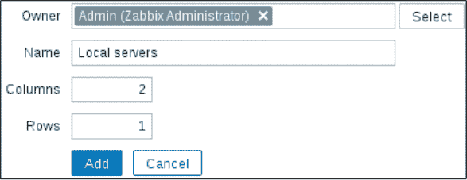
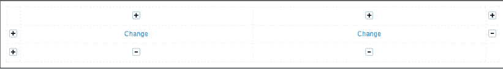
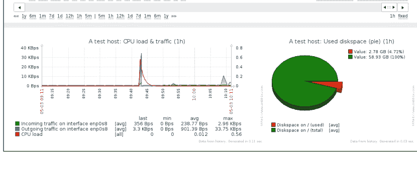
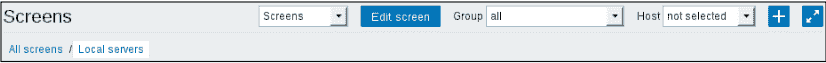
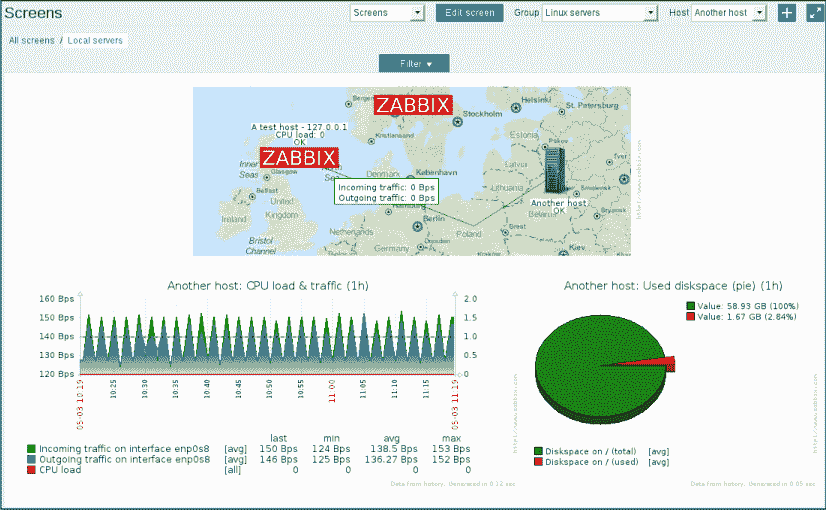
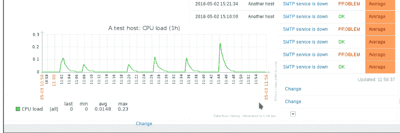
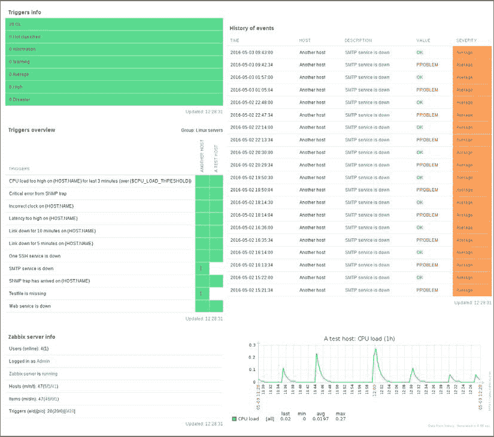
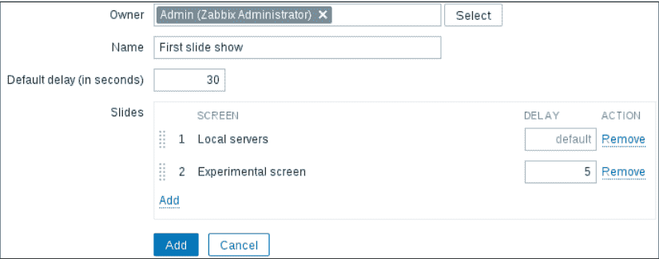
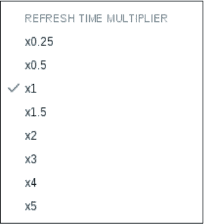
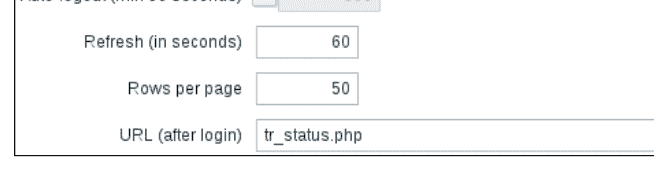

## 使用屏幕和幻灯片可视化数据

在熟悉了简单、临时和自定义图表以及网络地图之后，我们将在本章中探索更多可视化选项。我们将涵盖以下主题：

- 屏幕可以包含其他实体，包括全局和模板化或主机屏幕
- 幻灯片会定期自动更改显示的信息

我们之前查看了单个可视化元素；现在是时候继续前进。复合元素（与地图元素无关）允许我们组合单个元素和其他来源，以提供更有信息量或更美观的概览。我们可能希望同时看到网络地图和主要出站链路的图表，也许还有当前问题的列表。

## Screens

我们熟悉的图表和地图本身无法在单个页面上组合——为此，我们可以使用一个名为 **screen** 的实体。让我们一起创建一个：导航到 **Monitoring | Screens**，并点击 **Create screen** 按钮。在 **Name** 字段中输入 **Local servers**，在 **Columns** 字段中输入 2。我们稍后可以根据需要添加更多：

> 与网络地图一样，屏幕的配置方式在 Zabbix 3.0 中已发生变化——现在在监控部分完成。屏幕也可以由用户创建和共享。

点击 **Add**，然后点击 **Local servers** 旁边的 **Constructor**。我们看到一个相当不令人印象深刻的视图：

所以由我们来让它变得生动。点击左侧的 **Change** 链接，我们有一个编辑表单取代了之前的单元格内容。默认资源类型是图表，我们之前创建了一些图表：点击 **Graph** 字段旁边的 **Select**。在即将出现的窗口中，确保在 **Host** 下拉菜单中选择了 **A test host**，然后点击 **CPU load & traffic**。就目前而言，我们只想在这里配置这些，点击 **Add**。

> 不需要显式保存屏幕，不像大多数其他配置部分。所做的所有更改都会立即保存。

现在，点击右侧的 Change 链接，然后点击 Graph 字段旁边的 Select。在即将出现的窗口中，点击 Used diskspace (pie)。还记得我们之前如何调整饼图尺寸吗？在为屏幕插入元素时，我们会覆盖其配置的尺寸。这次，我们的饼图必须与另一个图表共享空间，所以在 Width 字段中输入 390，在 Height 字段中输入 290，然后点击 Add。虽然我们可以在这里立即看到我们工作的结果，但让我们以其全部辉煌来看看它——转到 Monitoring | Screens 并点击 NAME 列中的 Local servers：

我们现在在单个页面上同时显示了两个图表。但嘿，看看屏幕上方：那里的控件看起来非常像我们用于图表的控件。而且它们就是：使用这些控件，可以对屏幕元素执行与图表相同的操作。我们可以让所有屏幕元素显示更长时间的数据，或查看过去某个时间点的状况。

两个图表很好，但之前，我们谈到过在同一页面上同时拥有地图和图表。让我们看看如何实现。点击当前显示屏幕上方的 All screens，然后点击 Local servers 旁边的 Constructor。我们希望在该屏幕顶部添加我们的地图，但我们可以看到我们创建的屏幕有两个列和单行，所以我们必须添加更多。我们不能在通用屏幕属性中使用创建屏幕时使用的相同字段来做到这一点吗？当然可以，但有一个限制：在那里增加列数和行数只会分别在右侧或底部添加新列和新行。无法使用该表单在任意位置插入行和列。这就是为什么我们将使用不同的方法。

使用通用屏幕属性表单时，减少列数和行数只能从右侧和底部进行。使用该表单删除的字段中配置的任何元素也将被删除。

看看屏幕周围的 + 和 − 按钮。它们允许您在任意位置插入或删除列和行。虽然布局乍一看可能令人困惑，但理解几个基本原则应该能让您高效使用它们：

- 顶部和底部的按钮操作列
- 左侧和右侧的按钮操作行
- + 按钮在它们所在的位置之前添加一列或一行
- − 按钮删除它们所在的位置的列或行

在这种情况下，我们希望在顶部添加另一行，所以点击第一个列中上方的 + 图标——该列只有 + 和 − 控件，而不是已经有图表的列。这会在我们的图表上方添加一行，包含两个列，两者都有 Change 链接，就像之前一样。点击第一个 Change 链接。我们要添加的不是图表，所以从 Resource 下拉菜单中选择 Map。点击 Map 字段旁边的 Select，然后点击 First map。如果我们保持其他参数不变，地图将出现在左列顶部。将其居中在两列上方会更好看。这就是 Column span 选项的作用：在该字段中输入 2，然后点击 Add。可以立即看到，此屏幕元素现在跨越两列。这种功能不仅限于地图；任何元素都可以跨越多个列或行。

## Dynamic screens

我们现在有一个包含网络地图和两个图表的屏幕，显示关于 **A test host** 的数据。现在，我们应该创建一个显示 **Another host** 数据的屏幕。我们可能不得不重复为这个屏幕执行的所有步骤。这对于许多主机来说会很糟糕，不是吗？这就是为什么有一种不同、更简单的方法。

点击屏幕配置中 **CPU load & traffic** 图表下方的 **Change** 链接，并查看其中的最后一个参数：

让我们找出动态项的含义——标记此选项并点击 **Update**。虽然这似乎什么也没做，编辑另一个图表，标记 **Dynamic item** 复选框，并点击 **Update**。现在是时候查看结果了——转到 **Monitoring | Screens**，并点击 **NAME** 列中的 **Local servers**。查看屏幕顶部的可用下拉菜单：

一旦我们将某些元素标记为动态，我们就获得了其他主机的选择。让我们看看它工作得如何。 从 **Group** 下拉菜单中选择 **Linux servers**，从 **Host** 下拉菜单中选择 **Another host**：

# 使用屏幕和幻灯片可视化数据

太棒了！标记为动态的元素现在会显示所选主机的数据，而非动态元素则无论选择哪个主机都显示相同的数据。静态元素可以像我们屏幕中的地图一样，但如果未勾选**动态监控项**选项，它们也可以是图形。这样，我们就能切换屏幕，让某些图形显示服务器信息，而其他图形则继续显示常规的网络信息。

> 只能将来自主机的图形添加到屏幕中；来自模板的图形则不能。对于动态屏幕监控项，存在这样一种风险：最初选择图形的主机被删除，从而破坏屏幕。旧版Zabbix允许在此包含来自模板的图形，该功能可能稍后恢复。

# 其他屏幕元素

这是一个漂亮而简单的屏幕，但还有更多可用的屏幕元素可供选择，所以让我们创建另一个屏幕。转到屏幕列表——如果监控视图中显示了某个屏幕，请点击**所有屏幕**，然后点击**创建屏幕**按钮。在生成的表单中，在**名称**字段中输入“实验屏幕”，在**列**和**行**字段中都输入2，然后点击**添加**。在屏幕列表中，点击**实验屏幕**旁边的**构造器**。和之前一样，点击左上角单元格中的**更改**链接。在**资源**下拉菜单中，选择**简单图形**，然后点击**监控项**字段旁边的**选择**。从**主机**下拉菜单中选择**测试主机**。

正如我们所见，无需手动配置即可使用的所有简单图形也可以添加到屏幕中。这里，点击**CPU负载**条目。在**宽度**字段中输入600，然后点击**添加**。点击右上角单元格中的**更改**链接。从**资源**下拉菜单中选择**事件历史**，然后点击**添加**。

嗯，突然我们的图形看起来不那么好了——它应该更高一些才能适应这个布局。我们可以将它放在事件列表下方，但这需要删除它并重新配置右下角单元格。嗯，也不尽然。将图形拖到右下角单元格并松开鼠标按钮：

> 以前的Zabbix版本会高亮目标单元格，以告知用户对象将被放置在那里。该功能在Zabbix 3.0.0中已丢失。在撰写本文时，尚不清楚哪个版本将修复此问题。

元素（此处指图形）会从一个单元格移动到另一个单元格，无需重新配置各个单元格。

左上角单元格现在为空，因此点击那里的“更改”。从“资源”下拉菜单中选择“触发器信息”，在“样式”选项中选择“垂直”，然后点击“添加”。此屏幕元素为我们提供了按严重程度分布的触发器高级信息。现在让我们进一步填充这个屏幕。点击左下角的“更改”链接。在屏幕元素配置中，从“资源”下拉菜单中选择“触发器概览”，并在“组”字段中输入“linux”。从下拉菜单中点击“Linux服务器”。该组中的触发器比主机多——为“主机位置”选项选择“顶部”，然后点击“添加”。元素又错位了，对吧？

我们现在来尝试一些对齐操作。点击第一列中从上往下第二个+按钮（就在我们刚添加的概览元素旁边）。这会在第二行之前插入一行。将“触发器概览”元素（我们最后添加的那个）向上拖动一行，放到我们刚刚添加的那一行的第一个单元格中。点击“事件历史”元素（右上角单元格）的“更改”链接，在“显示行数”字段中输入20，在“行跨度”字段中输入2，然后点击“更新”。

# 使用屏幕和幻灯片可视化数据

我们的屏幕现在看起来相当不错，只是左下角是空的。点击该单元格中的**更改**，从**资源**下拉菜单中选择**服务器信息**，然后点击**添加**。屏幕现在看起来布局相当好。让我们通过进入**监控 | 屏幕**并点击**名称**列中的**实验屏幕**，在监控视图中查看它：

前面提到，所有图形在屏幕中显示相同的时间段。如果图形作为普通屏幕元素添加，确实如此。使用URL屏幕元素可以添加显示静态时间段的图形，该元素允许在屏幕中包含任何页面。在这种情况下，URL应指向Zabbix前端实例。例如，可以使用如下URL显示一个简单图形：`http://zabbix.frontend/zabbix/chart.php?period=3600&itemids[0]=23704&width=600`。您可以通过打开该监控项的简单图形并查看URL来找到监控项ID。请注意，图形图像的宽度应手动调整，以匹配屏幕单元格宽度，避免屏幕单元格中出现滚动条。这样，我们就可以配置一个屏幕，显示同一监控项的每小时、每日、每周、每月和每年图形。

正如我们所发现的，Zabbix中的屏幕允许非常灵活的视觉布局。您可以选择先放置一个地图，然后是更详细的图形。或者，您可以放置一组服务器最重要信息的图形，并在顶部放置触发器摘要。或者任何其他组合——还有更多可能的屏幕元素可以添加。尝试所有可用的屏幕元素并了解它们提供的信息可能是个好主意。

> 由于屏幕可能包含大量信息，它们可能对性能要求很高，尤其是在许多用户同时查看它们时。

可以看出，全局屏幕提供19种不同类型的元素，而模板屏幕仅提供七种。

对于我们现在的屏幕，将“资源”下拉菜单保留为“图形”，然后点击“图形”字段旁边的“选择”。注意当前模板已被选中且无法更改——添加到模板屏幕的所有元素必须来自同一个模板。在弹出窗口中，点击“名称”列中的“CPU负载与流量”，然后点击“添加”。点击右上角的+图标添加另一列，然后点击最右侧单元格中的“更改”链接。在“资源”下拉菜单中选择“简单图形”，点击“监控项”字段旁边的“选择”，然后点击“名称”列中的“CPU负载”。点击“添加”按钮。现在，导航到“配置 | 主机”，查看每个主机的可用列。没有屏幕列。模板或主机屏幕仅在模板级别配置；它们不会像监控项、触发器和其他实体那样在主机级别获得副本。

让我们前往“监控 | 屏幕”。如果我们查看那里的屏幕列表，找不到我们刚配置的屏幕。模板或主机屏幕只能从以下位置的主机弹出菜单中访问：

- 监控 | 仪表板（在“最近20个问题”小部件中）
- 监控 | 概览（如果主机位于左侧）
- 监控 | 最新数据（如果未按“主机”字段进行过滤）
- 监控 | 触发器
- 监控 | 事件
- 监控 | 地图

它们也可以从以下两个页面访问：

- 全局搜索结果
- 主机资产页面

这个屏幕上一个需要注意的地方是两个图形的高度差异。配置屏幕时，我们没有更改高度值，两个图形的高度相同，为100。不幸的是，这不是整个图形的高度，而只是图形墙体区域的高度。因此，如果监控项数量不同，触发器或百分位线将导致图形高度不同。对于屏幕来说，这意味着要让尺寸匹配需要进行相当繁琐的配置。宽度也是如此——如果有一个或两个Y轴值，图形宽度也会不同。

> 如果自定义图形禁用了图例，则高度不会因监控项数量而变化。目前，无法在自定义图形单独显示时显示图例，而在自定义图形包含在屏幕中时隐藏它。

应该使用模板屏幕还是全局屏幕？几个因素会影响这一决定：

- 元素的可用性（全局屏幕多得多）
- 导航（监控 | 屏幕与弹出菜单）
- 哪些主机以及多少主机需要这样的屏幕

# 幻灯片

我们现在有了一些屏幕，但要在它们之间切换，需要手动操作。虽然对于偶尔使用来说这通常是可以接受的，但如果您想在帮助台的大显示屏上显示它们，这就会很困难。即使您只是让Zabbix一直保持打开在辅助显示器上，手动切换很快也会变得烦人。

另一个功能来救场了——幻灯片。Zabbix中的幻灯片设置起来很简单，所以请前往“监控 | 屏幕”。为什么是屏幕页面？Zabbix 3.0将幻灯片的操作方式改为与地图和屏幕相同，将查看和配置都移到了监控部分。不过，幻灯片没有自己的部分；要访问它们，请从右上角的下拉菜单中选择“幻灯片”。点击“创建幻灯片”按钮。在“名称”字段中输入“第一个幻灯片”，然后点击“幻灯片”部分中的“添加”控件。幻灯片本质上就是屏幕，这正是我们在弹出窗口中看到的。点击“本地服务器”。我们不更改此幻灯片或屏幕的“延迟”字段中的默认值。将其留空将使用上方“默认延迟”字段中的值30。

## 使用屏幕和幻灯片展示数据可视化

再次点击**幻灯片**部分的**添加**，然后点击**实验屏幕**。这次，在该屏幕的**延迟**字段中输入 5：

注意左侧的拖动柄——与图形和图标映射中的操作相同，我们可以在这里对幻灯片重新排序。现在我们不打算这样做；只需点击底部的**添加**按钮。

> 如果你想在幻灯片中仅添加单个元素（例如地图或图形），则必须创建一个仅包含该元素的屏幕。

现在，点击**名称**列中的**第一个幻灯片**。它最初是空白的，只显示一个屏幕，然后在 30 秒后切换到另一个屏幕，5 秒后再切换回来，如此循环往复。由于幻灯片中包含了动态屏幕项，我们还可以在右上角选择主机——这只会影响动态屏幕项。

我们可以展示更多屏幕，例如，先显示一个高层次的概览大屏 30 秒，然后循环显示各服务器组屏幕，每个显示 5 秒。

看一下右上角的按钮：

第一个按钮允许我们将此幻灯片添加到仪表板收藏夹，与图形和屏幕的操作相同。第三个按钮同样是全屏按钮。而中间的按钮允许我们减慢或加快幻灯片的播放速度——点击它：

除了设置具体时间外，我们还可以通过应用一个倍率来让幻灯片播放得更快或更慢，从而保持每个幻灯片应显示的相对时长。

还有另一个理由选择全局屏幕而非模板屏幕或主机屏幕：只有全局屏幕才能被包含在幻灯片中。

旧版 Zabbix 在幻灯片功能中存在内存泄漏问题。浏览器中也曾出现过多次内存泄漏的情况。如果你在使用 Zabbix 幻灯片时发现浏览器内存使用量持续增加，请考虑升级。如果无法升级，可以使用某个幻灯片通过 URL 元素和 JavaScript 重新加载页面，这在大多数情况下应该能减少内存使用。`http://www.phpied.com/files/location-location/location-location.html` 提供了 535 种不同的实现方法。

自 Zabbix 3.0 起，普通用户也可以创建屏幕和幻灯片并共享，方式与我们在*第9章，使用图形和地图可视化数据*中共享地图相同。与地图一样，其他用户需要拥有访问这些屏幕和幻灯片中所有元素及子元素的权限，才能访问它们。

### 在大型显示器上展示数据

虽然个人层面的可视化很重要，但真正的挑战出现在需要为大型显示器创建视图时，这种显示器通常放置在服务台或技术操作员附近，以便快速识别问题。这带来了几个挑战。

### 挑战

在大型屏幕上为多人显示 Zabbix 数据，需要考虑显示器的位置、观看人员的经验水平，以及其他可能影响你如何配置此信息展示方面的因素。

### 非交互式显示

在大多数情况下，此类屏幕上显示的数据将是不可交互的——人们只需观看，而不能点击操作。之所以提出这样的要求，是因为下钻操作通常发生在个人工作站上，从而让主显示器可供其他人使用。此外，有人可能会轻易将主显示器置于不可用状态，因此通常不提供直接访问。这意味着放置在显示器上的数据不能依赖于查看问题详细信息的能力。其信息量应足以让技术支持人员获取所需的知识。

### 信息过载

将有关组织基础设施健康状况的所有信息都放在一个屏幕上，可能会导致显示器内容杂乱，过多的细节以过小的字体挤在屏幕上。这与前面的挑战正好相反——你需要决定哪些服务是重要的，以及如何对每项服务进行定义。这要求你与负责这些服务的人员密切合作，以便构建正确的依赖链。这是最常用于简化和减少显示数据同时保持其有用性的方法。

> 上述两个挑战都可以通过精心使用屏幕和幻灯片来显示正确依赖状态来解决。但不要过度依赖幻灯片——如果某个幻灯片只显示了短短几秒，而后面还有 10 个幻灯片需要循环播放，等待它再次出现可能会令人厌烦。

### 自动显示特定部分

对于中央显示器还有其他一些要求。它应在开机时自动打开并显示所需信息，例如一张漂亮的地理地图。虽然这可以通过一些客户端脚本来实现，但有一个更简单的解决方案，我们已经探讨过了。

提醒一下，前往管理 | 用户，点击别名列中的 monitoring_user，查看其中两个选项：自动登录和登录后的 URL：

如果我们为这种显示站所使用的用户勾选了自动登录选项，只需登录一次，该用户在每次访问页面时就会自动登录。此功能依赖于浏览器 Cookie，因此所使用的浏览器应支持并存储 Cookie。登录后的 URL 选项允许用户立即导航到指定页面。剩下的只需让显示盒在启动时启动浏览器并指向 Zabbix 前端 URL，这应该很容易设置。当设备启动时，它将无需任何人工干预即可打开指定页面（通常是一个屏幕或幻灯片）。例如，要让该用户在访问 Zabbix 前端时打开 ID 为 21 的屏幕，可以使用如下 URL：http://zabbix.frontend/zabbix/screens.php?elementid=21。要以 Zabbix 全屏模式打开该屏幕，需要附加一个全屏参数：http://zabbix.frontend/zabbix/screens.php?elementid=21&fullscreen=1。

在大型屏幕上显示数据时，请仔细探索可用的选项和功能——也许在某些情况下，最新数据展示是最合适的。在使用触发器概览时，请评估主机/触发器关系，并选择应在哪个轴上显示哪个。

### 总结

在本章中，我们学习了使用屏幕将图形、地图和其他数据组合到单个页面中。屏幕能够容纳许多不同的元素，包括当前活动触发器的统计信息，甚至历史记录，以及通过 URL 元素引用任何自定义页面。URL 元素还允许我们创建包含图形的屏幕，并显示不同的时间段。屏幕可以在全局级别或模板级别使用。

幻灯片尤其适用于无人值守的显示器，它允许循环播放屏幕。我们可以设置默认延迟，并为单个屏幕覆盖该延迟。要在幻灯片中包含单个地图或图形，我们仍然需要创建一个包含该地图或图形的屏幕。

在下一章中，我们将尝试使用更高级的方法收集数据。我们将了解使用计算项和聚合项复用已收集的数据、使用外部检查运行自定义脚本，以及监控日志文件。我们还将尝试在 Zabbix 中获取自定义数据的两种最流行方式：代理端的用户参数和强大的 zabbix_sender 实用程序。
